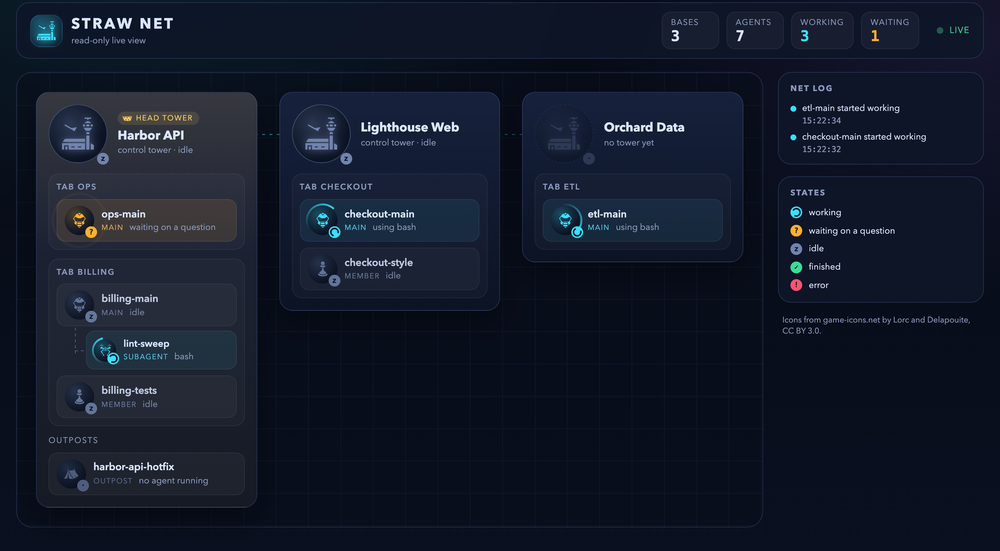
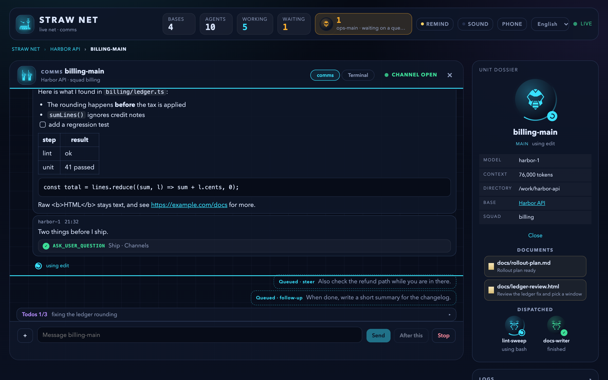

# pi-straw-boss

English | [繁體中文](https://github.com/wayne930242/pi-straw-boss/blob/main/README.zh-TW.md)

**Many pi agents, one project, no collisions.** pi-straw-boss gives the agents you run across the tabs of [Herdr](https://herdr.dev), a terminal workspace manager for agents, a light chain of command: a main agent per tab, a tower per workspace, and a live view of who is doing what.

**[Documentation](https://wayne930242.github.io/pi-straw-boss/docs/)** · **[Try the browser view live](https://wayne930242.github.io/pi-straw-boss/)** (a demo with made-up agents, nothing to install)



<p align="center"> </p>

## Why

Run a few agents on the same project and they start stepping on each other: two dev servers on one port, two branches editing the same migration, and no agent knows the others exist.
pi-straw-boss lets them find each other and coordinate, without a scheduler or a service to deploy.

- **Everyone joins.** Each pi in Herdr joins its tab's net at start. An agent whose work grows (several steps, dispatching workers, more than one app) promotes itself to the tab's **main agent**; you, the boss, can take over with `/boss`.
- **A tower per workspace**, an agent in a tab of its own, opens when agents start to collide: a member dispatches a subagent, or an agent promotes itself. It coordinates the mains and the other towers, and opens a tab with a new main for work no session owns. You don't need to talk to it.
- **A head tower of your own** takes your instructions in one long conversation and hands each to the workspace that owns it.
- **The browser view**, `/boss gui`: every workspace, agent, and subagent live, and the questions they wait on, answered in place from a desktop or a paired phone. Its Zen view shows one thing at a time.
- **Merge trains**: a project can batch its reviewed branches, so the heavy gates (lint, build, full suites) run once per train instead of once per branch.
- **Straw Link** connects the towers of teammates' computers, and an unattended build box can take work from them.
- **Auto mode**: tell the head tower you are going to sleep, and no agent waits on you until you are back. Agents keep working, and what needed you comes back as one list.

## Install

```bash
pi install npm:pi-straw-boss
```

It needs pi inside [Herdr](https://herdr.dev) 0.9.4 or newer, Herdr's pi integration (`herdr integration install pi`), and [pi-intercom](https://www.npmjs.com/package/pi-intercom) 0.18.1 or newer.
The merge train also needs `integrating` and `deploying` skills that declare the [merge-train contract](https://wayne930242.github.io/pi-straw-boss/docs/guide/merge-train/#the-merge-train-contract).
Windows support is experimental.
sb ships the pi-herdr-agents roles its agents run as (`worker`, `scout`, `planner`, `reviewer`, `visual-tester`, `adversarial-reviewer`); uninstall pi-herdr-roles, whose same-named roles would collide.
See [Install](https://wayne930242.github.io/pi-straw-boss/docs/guide/install/) for the optional packages it works with.

## Quick start

1. Open pi in a Herdr tab and give it work. It joins the net by itself, and promotes itself to the tab's main agent when its work grows, which also opens the workspace's tower.
2. `/boss status` shows each tab's main agent and the towers.
3. `/boss tower` opens the workspace's tower and its dashboard.
4. `/boss gui` shows the whole net in your browser.

## Common commands

| Command | What it does |
| --- | --- |
| `/boss` | Take over as this tab's main agent. |
| `/boss status`, `/boss tower` | Show the mains and towers; open the tower. |
| `/boss head <message>` | Talk to the head tower. |
| `/boss gui` | Open the net in the browser. `/boss gui remote` pairs a phone over your tailnet. |
| `/boss send <name> <text>`, `/boss answer` | Write to any session as the boss; answer the dialogs other sessions wait on. |
| `/boss memory` | The tower's standing instructions, decisions, and waits. |
| `/boss auto on`, `/boss auto off` | Auto mode, for when you are away. |
| `/boss stash`, `/boss pop` | Put a whole workspace (its tower, mains, and members) away and open it again later. |
| `/boss server` | The sb server: one background process per computer that runs the towers and serves the page. |
| `/boss roles-check [folder]` | Check each role's `tools:` names against this session's tools. |

Every tool and command: [Commands](https://wayne930242.github.io/pi-straw-boss/docs/reference/commands/).

## Documentation

The [documentation site](https://wayne930242.github.io/pi-straw-boss/docs/) is in English and [Traditional Chinese](https://wayne930242.github.io/pi-straw-boss/docs/zh-tw/): concepts, the browser view, phones, the head tower, auto mode, merge trains, Straw Link, unattended devices, the Herdr plugins, configuration, and the release notes.
[docs/how-it-works.md](docs/how-it-works.md) is the full behavior reference ([繁體中文](docs/how-it-works.zh-TW.md)).

## License

MIT. The browser view's icons come from [game-icons.net](https://game-icons.net) (Lorc and Delapouite, [CC BY 3.0](https://creativecommons.org/licenses/by/3.0/)); see [gui/ICONS.md](gui/ICONS.md).
