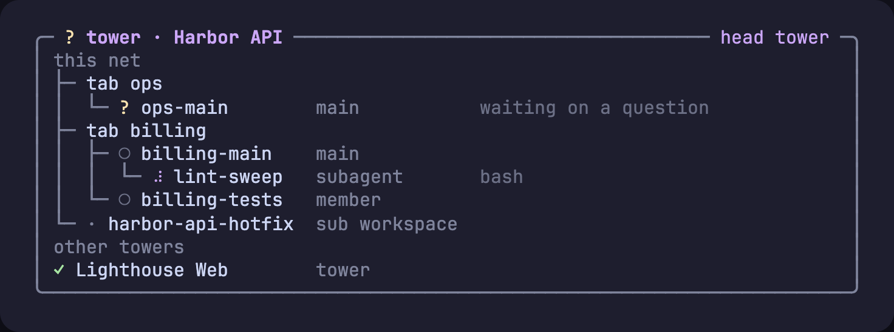
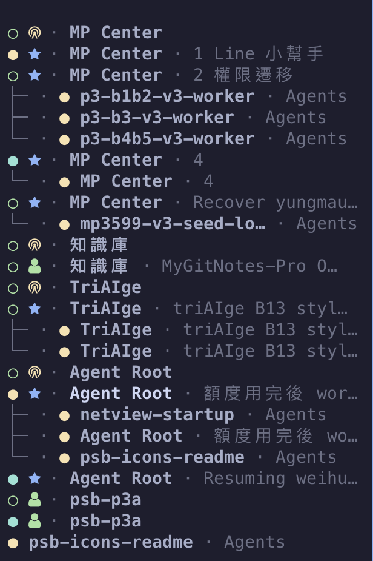

# pi-straw-boss

[English](README.md) | 繁體中文

**很多個 pi 做同一個專案，也不會互相踩到。** pi-straw-boss 讓你在 [Herdr](https://herdr.dev) 各個分頁（tab）裡跑的智慧體（agent）有一條輕量的指揮鏈：每個分頁一個主智慧體（main agent），每個工作區（workspace）一座塔台（tower），還有一張即時的畫面，看得到誰在做什麼。


<p align="center"><sub><code>/boss gui</code>：在瀏覽器即時看整張網的每個工作區。<a href="docs/straw-net-gui.gif">看它動起來</a>。</sub></p>



## 為什麼需要它

同一個專案跑上幾個智慧體，它們很快就會互相干擾：兩個 dev server 搶同一個 port、兩條分支改同一個 migration，而且沒有一個智慧體知道其他智慧體存在。pi-straw-boss 讓它們能找到彼此、互相協調，不需要排程器，也不用多架一個服務。

- **每個人都會加入。** Herdr 裡的每個 pi 一啟動，就以成員（member）身分加入所在分頁的網，不用問，也不用記。
- **每個分頁一個主智慧體，靠升任產生。** 工作變多的智慧體呼叫 `boss_promote`，或在第一次派出子智慧體（subagent）時自動升任。一個分頁只有一個主智慧體，除了你用 `/boss` 接手以外，沒有人能取代它。
- **每個工作區一座塔台。** 工作區出現第一個主智慧體時，塔台就在自己的分頁開起來，固定排在最前面。它負責協調各個主智慧體和其他塔台；沒有 session 負責的工作，它會開一個分頁、啟動新的主智慧體來處理。你不用跟它說話。
- **即時儀表板**在塔台裡：誰加入了，他們和他們的子智慧體正在做什麼。
- **瀏覽器畫面** `/boss gui` 看得到整張網：每個工作區是一座基地，裡面有塔台、智慧體和子智慧體，畫面會動，但只能看。點基地可以放大，點單位可以把它的對話當成即時通訊紀錄來讀；在等你回覆的單位會排成警示。畫面有英文和正體中文，預設跟隨瀏覽器語言，也可以從頂端的語言選單切換。在基地畫面按「＋主智慧體」可以在選定的資料夾開新的主智慧體（可以先填第一句指令），按「＋塔台」可以開新的基地和塔台；資料夾選擇只能在家目錄以下，也不會列出點開頭的資料夾。
- **廣播**給一個分頁、一個工作區、所有塔台，或所有 session。
- **分頁保持整齊。** pi 在分頁裡啟動或結束時，分頁裡的 pane 會重新平均分配，一個一個切出來的 worker 就不會留下一長串對半切的窄 pane。
- **斷線的子智慧體會被提醒回報。** 子智慧體做完後還開著，但開出它的 pi 已經重開、收不到它的結果時，它會收到一則 intercom，請它把最終報告送回去，只會送一次（[運作方式](docs/how-it-works.md#orphaned-subagents)）。
- **Herdr 側邊欄的網路檢視。** 一個選用的 plugin 會把 Agents 清單排成網的樣子：塔台在前，每個子智慧體排在開出它的人底下。預設開啟，按一個鍵就能切換。

## 安裝

```bash
pi install npm:pi-straw-boss
```

pi 要跑在 Herdr 0.9.4 以上，另外需要 [pi-intercom](https://www.npmjs.com/package/pi-intercom) 0.17.1 以上。[pi-herdr-agents](https://github.com/giuseppecrj/pi-herdr-agents) 可裝可不裝：裝了的話，子智慧體會顯示在開出它的 session 底下。

## 快速開始

1. 在 Herdr 分頁裡開一個 pi，交給它工作。它會自己加入網；工作變多時，它會把自己升成這個分頁的主智慧體，同時開出工作區的塔台。你可以用 `/boss` 接手。
2. 輸入 `/boss status`，看每個分頁的主智慧體和各座塔台。
3. 輸入 `/boss tower`，開啟工作區的塔台、看它的儀表板。智慧體呼叫塔台時也會自己把它開起來。
4. 在任何一個 session 輸入 `/boss gui`，就能在瀏覽器看整張網。

塔台只負責轉送和協調，所以可以用比較輕的模型：在 `~/.pi/agent/straw-boss/config.json` 設定 `towerModel`（[運作方式](docs/how-it-works.md#how-it-works)）。

## 工具與指令

| 名稱 | 作用 |
|---|---|
| `boss_promote` | 成為這個分頁的主智慧體（分頁已經有主智慧體時會被拒絕）。 |
| `boss_status` | 列出各個主智慧體、這個工作區的塔台，以及其他塔台。 |
| `call_tower` | 傳訊息給這個工作區的塔台，或別的工作區的塔台。 |
| `boss_open_main` | 只有塔台能用：替沒有 session 負責的請求開一個分頁，啟動新的主智慧體。 |
| `boss_broadcast` | 傳訊息給一個分頁、一個工作區、所有塔台，或所有 session。 |
| `/boss` | 接手成為這個分頁的主智慧體。 |
| `/boss status`、`/boss tower` | 顯示狀態；開啟塔台並切換過去。 |
| `/boss gui`、`/boss gui stop` | 在瀏覽器開啟網（任何 session 都能開，不會加入任何東西）；停止它的伺服器，在哪個 session 都可以。整台機器只跑一個伺服器、一個網址：開它的 session `/reload` 之後，會在原網址重開；版本較新的 session 會接手，開著的頁面也會自動換成新版。可以在通訊畫面直接打字給某個 session，或用終端機畫面下方的按鍵面板操作它的終端機；在等回覆的 `robot_hand` 選單或 `ask_user_question` 問卷，可以在那裡或它的警示裡作答（其他對話框只能看，要回到終端機回答；`secret_drop` 一律只能在終端機輸入）。session 用 [pi-herdr-doc-review](https://www.npmjs.com/package/pi-herdr-doc-review) 0.4.0 以上顯示的文件，會開在它的通訊畫面旁邊：HTML 放在沙箱框架裡，表單送出的答案會傳給智慧體；純文字只能讀。 |
| `/boss gui remote`、`/boss gui remote off` | 透過你的 tailnet 用手機連 GUI（`tailscale serve`，絕不用 Funnel）：掃 QR code 配對；關閉時只移除它自己的 serve 設定。 |

子智慧體，以及在 Herdr worktree 工作區裡的 session，都不會加入網，由開出它們的 session 代表它們。不在 Herdr 裡時，這個擴充套件什麼都不做。

## 側邊欄的網路檢視

[`herdr-plugin/`](herdr-plugin) 裡有一個選用的 Herdr plugin，會把側邊欄的 Agents 清單變成網路檢視。
它先列出首席塔台（head tower）所在的工作區；每個工作區裡先列塔台，再列各分頁的主智慧體和成員，每個子智慧體緊接在開出它的 session 底下，即使它在 worktree 工作區裡也一樣。
Herdr server 啟動時這個檢視就會打開，按一個鍵可以關掉，再按一次打開。
pi-straw-boss 會寫入排序鍵（`sb_order`）、角色標記（`sb_mark`），子智慧體另外有樹狀分支（`sb_indent`）和它的名稱（`sb_name`），網路檢視和你自己的側邊欄列設定都可以用。
需要 Herdr 0.9.3 以上和 node。

<p align="center"></p>

<p align="center"><sub>網路檢視裡每個智慧體的角色標記。<a href="docs/how-it-works.md#sidebar-net-view">運作方式</a>有顯示這些標記的側邊欄列設定。</sub></p>

從原始碼連結 plugin，再到 Herdr 的 `config.toml` 綁一個鍵：

```bash
herdr plugin link /path/to/pi-straw-boss/herdr-plugin
```

```toml
[[keys.command]]
key = "prefix+alt+n"
type = "plugin_action"
command = "wayne930242.straw-boss.net"
description = "toggle the straw net view"
```

執行 `herdr server reload-config` 載入這個鍵；要移除 plugin 就執行 `herdr plugin unlink wayne930242.straw-boss`。
也可以不用原始碼，改用 `herdr plugin install wayne930242/pi-straw-boss/herdr-plugin` 從 GitHub 安裝。
[運作方式](docs/how-it-works.md#sidebar-net-view)列出了所有標記，也有一段側邊欄列設定，讓 Herdr 原本的檢視也能顯示每個成員的角色。

## 延伸閱讀

[運作方式](docs/how-it-works.md)（英文）說明角色、塔台、儀表板、瀏覽器畫面、這個擴充套件會寫入什麼，以及 Claude Code 或 Codex 的智慧體怎麼找到塔台。

## 授權

MIT。瀏覽器畫面的圖示來自 [game-icons.net](https://game-icons.net)（Lorc 與 Delapouite，[CC BY 3.0](https://creativecommons.org/licenses/by/3.0/)）；詳見 [gui/ICONS.md](gui/ICONS.md)。
