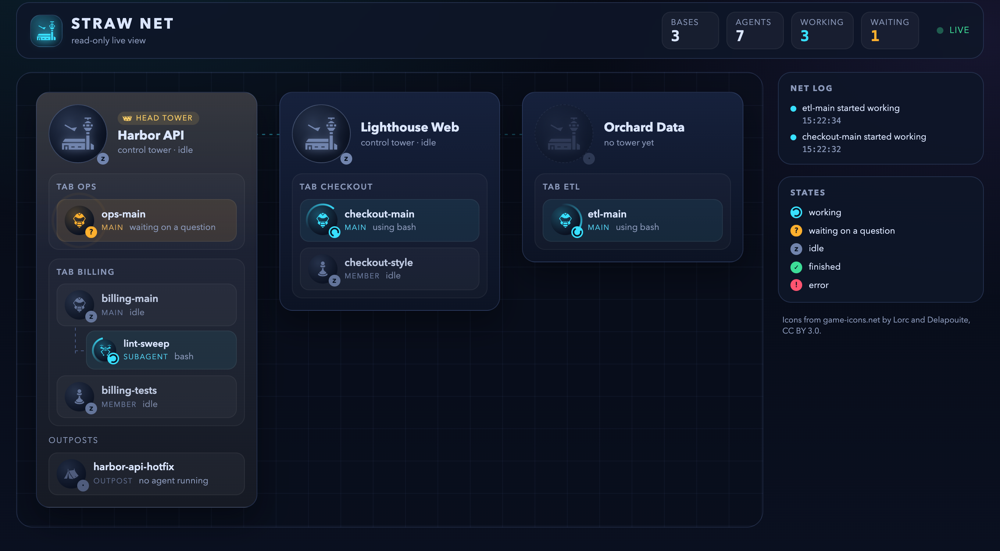
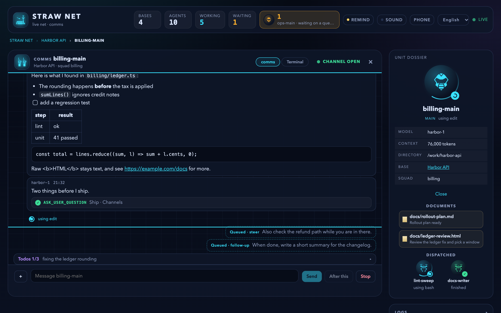

# pi-straw-boss

[English](README.md) | 繁體中文

**很多個 pi 做同一個專案，也不會互相踩到。** [Herdr](https://herdr.dev) 是給智慧體用的終端機工作區管理器；pi-straw-boss 讓你在 Herdr 各個分頁（tab）裡跑的智慧體（agent）有一條輕量的指揮鏈：每個分頁一個主智慧體（main agent），每個工作區（workspace）一座塔台（tower），還有一張即時的畫面，看得到誰在做什麼。

**[說明文件](https://wayne930242.github.io/pi-straw-boss/docs/zh-tw/)** · **[直接在瀏覽器試用](https://wayne930242.github.io/pi-straw-boss/)**（用假資料跑的展示頁，不用安裝任何東西）



<p align="center"> </p>

## 為什麼需要它

同一個專案跑上幾個智慧體，它們很快就會互相干擾：兩個 dev server 搶同一個 port、兩條分支改同一個 migration，而且沒有一個智慧體知道其他智慧體存在。
pi-straw-boss 讓它們能找到彼此、互相協調，不需要排程器，也不用另外部署服務。

- **每個人都會加入。** Herdr 裡的每個 pi 一啟動就加入所在分頁的網。工作變多（步驟變多、要派工作者、涉及不只一個 app）的智慧體會升任為分頁的**主智慧體**；你，也就是老闆，可以用 `/boss` 接手。
- **每個工作區一座塔台**：它是一個在自己分頁裡的智慧體，在智慧體開始互相干擾時開起來（成員派出子智慧體，或有智慧體升任）。它協調各個主智慧體和其他塔台；沒有 session 負責的工作，它會開一個分頁、啟動新的主智慧體來處理。你不用跟它說話。
- **你自己的主塔台**，和你保持一場長對話，把你交代的每件事轉給該處理的工作區。
- **瀏覽器畫面** `/boss gui`：即時看到每個工作區、智慧體和子智慧體，它們在等你回答的問題，可以直接在桌面或已配對的手機上回答。禪檢視一次只給你看一件事。
- **合併火車**：專案可以把審查過的分支整批合併，重型檢查（lint、build、完整測試）每列火車只跑一次，不必每條分支各跑一次。
- **Straw Link** 連起隊友電腦上的塔台，無人值守的建置機也能接隊友送來的工作。
- **自動模式**：跟主塔台說你要去睡了，在你回來之前，沒有智慧體會等你。智慧體照常工作，需要你的事等你回來時整理成一份清單。

## 安裝

```bash
pi install npm:pi-straw-boss
```

需要在 [Herdr](https://herdr.dev) 0.9.4 以上的版本裡執行 pi、安裝 Herdr 的 pi 整合（`herdr integration install pi`），以及 [pi-intercom](https://www.npmjs.com/package/pi-intercom) 0.18.1 以上。合併火車另外需要 [pi-anchorloop](https://www.npmjs.com/package/pi-anchorloop) 2.11.0 以上。Windows 支援仍屬實驗性質。可搭配的選用套件見[安裝](https://wayne930242.github.io/pi-straw-boss/docs/zh-tw/guide/install/)。

## 快速開始

1. 在 Herdr 分頁裡開 pi，交給它工作。它會自己加入網；工作變多時升任為分頁的主智慧體，工作區的塔台也會跟著開起來。
2. `/boss status` 列出每個分頁的主智慧體和各座塔台。
3. `/boss tower` 打開工作區的塔台和它的儀表板。
4. `/boss gui` 在瀏覽器看整張網。

## 常用指令

| 指令 | 作用 |
| --- | --- |
| `/boss` | 接手成為這個分頁的主智慧體。 |
| `/boss status`、`/boss tower` | 列出主智慧體和塔台；打開塔台。 |
| `/boss head <訊息>` | 和主塔台說話。 |
| `/boss gui` | 在瀏覽器打開整張網。`/boss gui remote` 讓手機透過 tailnet 配對。 |
| `/boss send <名稱> <文字>`、`/boss answer` | 以老闆身分寫給任何 session；回答其他 session 正在等的對話框。 |
| `/boss memory` | 塔台的長期指示、決定和等待事項。 |
| `/boss auto on`、`/boss auto off` | 自動模式，你不在時用。 |
| `/boss stash`、`/boss pop` | 把整個工作區（塔台、主智慧體和成員）收起來，之後再接回。 |
| `/boss server` | sb server：每台電腦一個的背景程序，負責執行塔台和提供網頁。 |

所有工具和指令見[指令](https://wayne930242.github.io/pi-straw-boss/docs/zh-tw/reference/commands/)。

## 說明文件

[說明文件網站](https://wayne930242.github.io/pi-straw-boss/docs/zh-tw/)有正體中文和[英文](https://wayne930242.github.io/pi-straw-boss/docs/)版：概念、瀏覽器畫面、手機、主塔台、自動模式、合併火車、Straw Link、無人值守裝置、Herdr 外掛、設定，以及版本紀錄。
[docs/how-it-works.zh-TW.md](docs/how-it-works.zh-TW.md) 是完整的行為說明（[English](docs/how-it-works.md)）。

## 授權

MIT。瀏覽器畫面的圖示來自 [game-icons.net](https://game-icons.net)（Lorc 與 Delapouite，[CC BY 3.0](https://creativecommons.org/licenses/by/3.0/)）；見 [gui/ICONS.md](gui/ICONS.md)。
