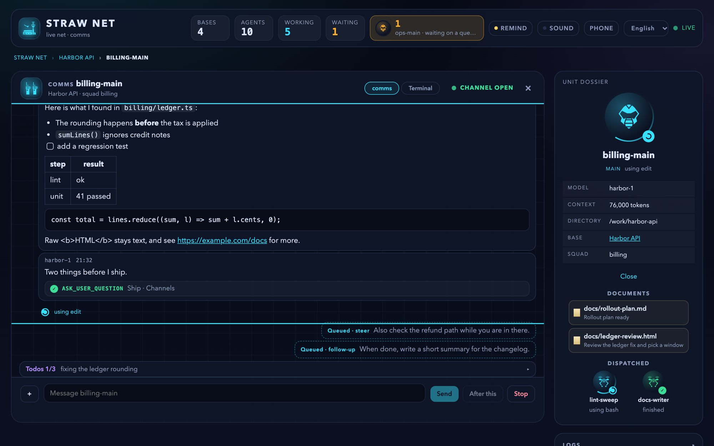
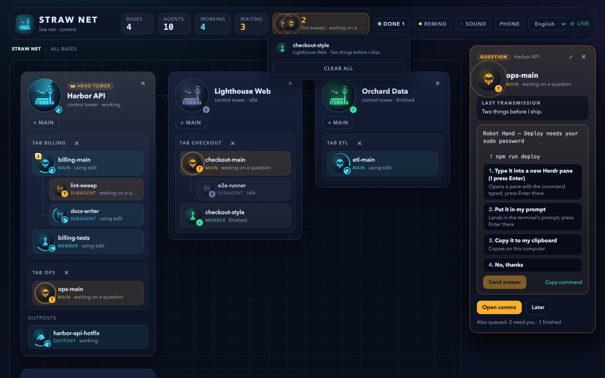
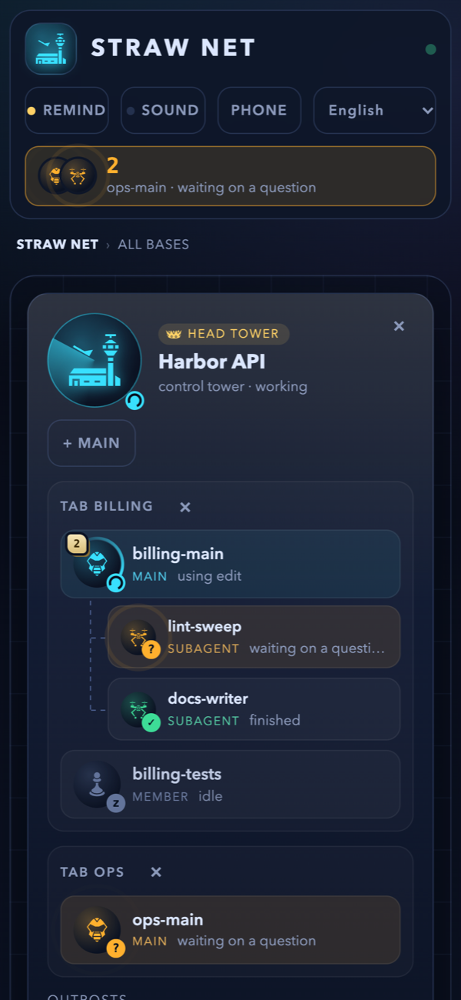
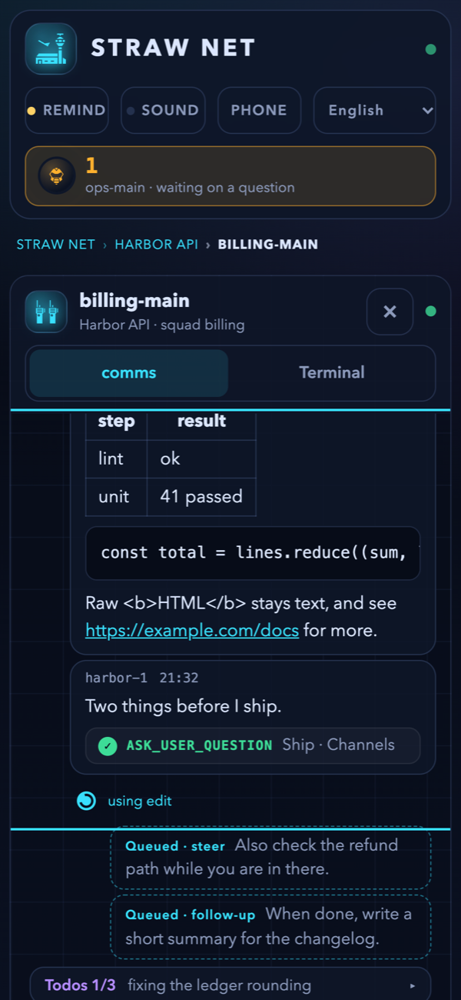
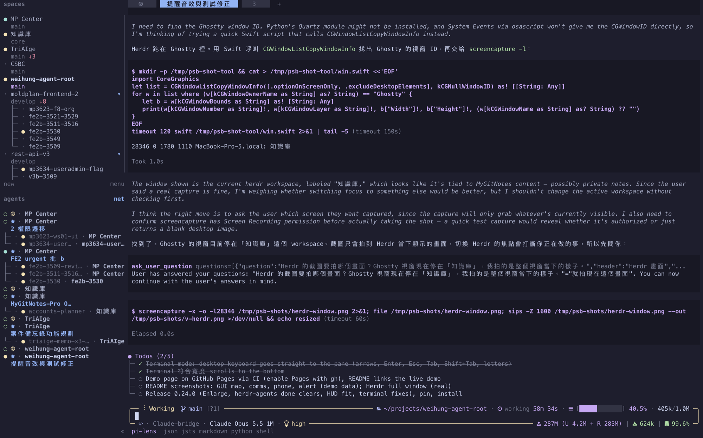

# pi-straw-boss

[English](README.md) | 繁體中文

**很多個 pi 做同一個專案，也不會互相踩到。** pi-straw-boss 讓你在 [Herdr](https://herdr.dev) 各個分頁（tab）裡跑的智慧體（agent）有一條輕量的指揮鏈：每個分頁一個主智慧體（main agent），每個工作區（workspace）一座塔台（tower），還有一張即時的畫面，看得到誰在做什麼。

**[直接在瀏覽器試用](https://wayne930242.github.io/pi-straw-boss/)**：這是用假資料跑的展示頁，不用安裝任何東西。


<p align="center"><sub><code>/boss gui</code>：在瀏覽器即時看整張網的每個工作區。<a href="docs/straw-net-gui.gif">看它動起來</a>。</sub></p>

<p align="center"> </p>

<p align="center"> </p>

<p align="center"><sub>單位的通訊畫面、可以直接在瀏覽器回答的問題，以及同一個頁面在手機上的樣子。</sub></p>



<p align="center"><sub>側邊欄開著網路檢視的 Herdr。</sub></p>


## 為什麼需要它

同一個專案跑上幾個智慧體，它們很快就會互相干擾：兩個 dev server 搶同一個 port、兩條分支改同一個 migration，而且沒有一個智慧體知道其他智慧體存在。pi-straw-boss 讓它們能找到彼此、互相協調，不需要排程器，也不用多架一個服務。

- **每個人都會加入。** Herdr 裡的每個 pi 一啟動，就以成員（member）身分加入所在分頁的網，不用問，也不用記。
- **每個分頁一個主智慧體，靠升任產生。** 工作變多的智慧體呼叫 `boss_promote`，或在第一次派出子智慧體（subagent）時自動升任。一個分頁只有一個主智慧體，除了你用 `/boss` 接手以外，沒有人能取代它。
- **每個工作區一座塔台。** 工作區出現第一個主智慧體時，塔台就在自己的分頁開起來，固定排在最前面。它負責協調各個主智慧體和其他塔台；沒有 session 負責的工作，它會開一個分頁、啟動新的主智慧體來處理。你不用跟它說話。
- **即時儀表板**在塔台裡：誰加入了，他們和他們的子智慧體正在做什麼。
- **給塔台的摘要**：自塔台上一輪以來，工作區裡有誰加入、啟動了哪些子智慧體、誰改了名字；塔台下一輪會讀進來一次，讀完就清掉（[細節](docs/how-it-works.md#the-towers-digest)）。
- **瀏覽器畫面** `/boss gui` 看得到整張網：每個工作區是一座基地，裡面有塔台、智慧體和子智慧體，畫面會動，但只能看。點基地可以放大，點單位可以把它的對話當成即時通訊紀錄來讀；在等你回覆的單位會排成警示，按空白鍵開下一則，按 F 放大最上面的對話框，按 Esc 關掉它（打字時都不會觸發）；回答問題也可以只用鍵盤：方向鍵選項目，Tab 換題，Enter 確認並跳到下一題。頂端有兩個開關：單位在等你、出錯或完成時，一個會跳系統通知，一個會播音效；已完成的單位另外排在自己的清單裡，可以一個一個清，也可以一次全清；地圖上已結束的子智慧體也可以一個一個移除，或用頂端的「移除已完成」一次全移除。單位的通訊畫面也會列出它在背景跑的 Monitor，出錯或太久沒輸出的 Monitor 會列進標頭的「通知」（只有在等你回答的單位才會跳出醒目的警示，出錯和完成都只是安靜的通知）；自己閒置、但它的子智慧體在工作或等待，或它的 Monitor 還在跑的單位，會顯示成帶光暈的「指揮中」；只在等 Monitor 跑完的單位，備註會用紅字顯示「監看中」。在桌面上點進單位的終端機，就能直接用鍵盤操作它。畫面有英文和正體中文，預設跟隨瀏覽器語言，也可以從頂端的語言選單切換。地圖最後一張「＋新基地」會在選定的資料夾開一座基地，裡面先有一位成員、沒有塔台。沒有塔台的基地只能加成員（基地上的「＋成員」開在新分頁，小隊上的開在該小隊旁），等成員自己升格時才會開塔台；有塔台的基地只能加主智慧體（「＋主智慧體」，各開在自己的分頁）。在 session 的輸入框貼上、拖進或用「＋」選的檔案（最多 20 MB）會存到私有的暫存資料夾，路徑放進訊息。開啟表單都可以先填第一句指令；資料夾選擇只能在家目錄以下，也不會列出點開頭的資料夾。
- **廣播**給一個分頁、一個工作區、所有塔台，或所有 session。
- **分頁保持整齊。** pi 在分頁裡啟動或結束時，分頁裡的 pane 會重新平均分配，一個一個切出來的 worker 就不會留下一長串對半切的窄 pane。
- **斷線的子智慧體會被提醒回報。** 子智慧體做完後還開著，但開出它的 pi 已經重開、收不到它的結果時，它會收到一則 intercom，請它把最終報告送回去，只會送一次（[運作方式](docs/how-it-works.md#orphaned-subagents)）。
- **Herdr 側邊欄的網路檢視。** 一個選用的 plugin 會把 Agents 清單排成網的樣子：塔台在前，每個子智慧體排在開出它的人底下。預設開啟，按一個鍵就能切換。
- **清理閒置的 worktree pane。** 另一個選用的 plugin 會關掉智慧體在 worktree 工作區留下的 pane，移除乾淨的 checkout，並保留你釘選的工作區。

## 安裝

```bash
pi install npm:pi-straw-boss
```

### 需求

- pi 要跑在 [Herdr](https://herdr.dev) 0.9.4 以上。
- [pi-intercom](https://www.npmjs.com/package/pi-intercom) 0.17.1 以上：網的頻道、訊息，以及 GUI 轉送對話框，都是透過它。

### 支援的套件

下面的套件都可裝可不裝。裝了，Straw Boss 會自動接上；沒裝，其他功能照常運作。

| 套件 | Straw Boss 怎麼用它 |
| --- | --- |
| [pi-herdr-agents](https://github.com/giuseppecrj/pi-herdr-agents) | 子智慧體會顯示在開出它的 session 底下，塔台面板、側邊欄和 GUI 都看得到；成員派出子智慧體時，會升格成主智慧體，塔台也會跟著開。 |
| [@juicesharp/rpiv-ask-user-question](https://www.npmjs.com/package/@juicesharp/rpiv-ask-user-question) 2.13 以上 | `ask_user_question` 問卷可以在 GUI 作答，等待作答的問卷也會讓該單位顯示為等待中。 |
| [pi-robot-hand](https://www.npmjs.com/package/pi-robot-hand) 0.3.0 以上 | `robot_hand` 選單可以在 GUI 作答。 |
| pi-code（hooks 擴充，需含它的對話框事件） | 它的 hook 確認（「Allow bash?」：允許或拒絕，在任何被攔下的工具呼叫之前）可以在 GUI 作答。 |
| [pi-herdr-doc-review](https://www.npmjs.com/package/pi-herdr-doc-review) 0.4.0 以上 | session 展示的文件會開在它的通訊畫面旁邊：HTML 放在沙箱框架裡，表單送出的內容會回給 agent；文字檔只能讀。 |
| [@juicesharp/rpiv-todo](https://www.npmjs.com/package/@juicesharp/rpiv-todo) 2.13 以上 | session 的待辦清單會顯示在 GUI 的輸入框上方，內容從 session 檔讀取。 |

任何 extension 的 `select` 和 `confirm`（例如 `mp-infra` 的指令審查）也可以在 GUI 作答，不必改動那個 extension：Straw Boss 把它們包在 pi 共用的 `ctx.ui` 上，照常打開 pi 自己的對話框，同時轉送同一個對話框，先答的算數。`select` 和 `confirm` 都可以從配對的裝置作答。`input`、`editor`、`custom` 完全不碰，它們和 pi-ask-user 的 `ask_user` 在 GUI 裡只能看，可以一鍵切到終端機回答。

## 快速開始

1. 在 Herdr 分頁裡開一個 pi，交給它工作。它會自己加入網；工作變多時，它會把自己升成這個分頁的主智慧體，同時開出工作區的塔台。你可以用 `/boss` 接手。
2. 輸入 `/boss status`，看每個分頁的主智慧體和各座塔台。
3. 輸入 `/boss tower`，開啟工作區的塔台、看它的儀表板。智慧體呼叫塔台時也會自己把它開起來。
4. 在任何一個 session 輸入 `/boss gui`，就能在瀏覽器看整張網。

塔台只負責轉送和協調，所以可以用比較輕的模型：在 `~/.pi/agent/straw-boss/config.json` 設定 `towerModel`（[運作方式](docs/how-it-works.md#how-it-works)）。

## 工具與指令

| 名稱 | 作用 |
|---|---|
| `boss_promote` | 成為這個分頁的主智慧體（分頁已經有主智慧體時會被拒絕）。 |
| `boss_status` | 列出各個主智慧體、這個工作區的塔台，以及其他塔台。 |
| `call_tower` | 傳訊息給這個工作區的塔台，或別的工作區的塔台。 |
| `boss_open_main` | 只有塔台能用：替沒有 session 負責的請求開一個分頁，啟動新的主智慧體。 |
| `boss_broadcast` | 傳訊息給一個分頁、一個工作區、所有塔台，或所有 session。 |
| `boss_rename` | 用一個短語替這個 session 命名，說明它現在在做什麼；net、GUI，以及裝了 pi-auto-tab-name 時的分頁名稱都會跟著顯示。主智慧體換工作時會呼叫它。 |
| `/boss` | 接手成為這個分頁的主智慧體。 |
| `/boss status`、`/boss tower` | 顯示狀態；開啟塔台並切換過去。 |
| `/boss gui`、`/boss gui stop` | 在瀏覽器開啟網（任何 session 都能開，不會加入任何東西）；停止它的伺服器，在哪個 session 都可以。整台機器只跑一個伺服器、一個網址：開它的 session `/reload` 之後，會在原網址重開；版本較新的 session 會接手，開著的頁面也會自動換成新版。可以在通訊畫面直接打字給某個 session，或用終端機畫面下方的按鍵面板操作它的終端機，在桌面上也可以點進終端機直接打字；在等回覆的 `robot_hand` 選單、`ask_user_question` 問卷或 pi-code 的 hook 確認，可以在那裡或它的警示裡作答（任何 extension 的 `select` 和 `confirm` 也可以，`confirm` 也可以從配對的裝置作答；其他對話框只能看，要回到終端機回答；`secret_drop` 的機密一律在終端機輸入，任何頁面（本機或 tailnet）都不接受，因為 pi-intercom 的身分是自己申報的，無法驗證）。session 用 [pi-herdr-doc-review](https://www.npmjs.com/package/pi-herdr-doc-review) 0.4.0 以上顯示的文件，會開在它的通訊畫面旁邊：HTML 放在沙箱框架裡，表單送出的答案會傳給智慧體；純文字只能讀。 |
| `/boss gui remote`、`/boss gui remote off` | 透過你的 tailnet 用手機連 GUI（`tailscale serve`，絕不用 Funnel）：掃 QR code 配對，手機配對後會一直有效（從最後一次使用起算 90 天，重啟與 `remote off` 都不影響），直到你在「手機」視窗解除配對；遠端存取在 stop、`/reload`、換新伺服器之後仍會保持開啟，直到 `remote off`；關閉時只移除它自己的 serve 設定。serve 指向 GUI 伺服器的第二個 loopback 監聽埠，請求算不算遠端取決於它進來的監聽埠，不看它帶什麼標頭。 |

子智慧體，以及在 Herdr worktree 工作區裡的 session，都不會加入網，由開出它們的 session 代表它們。不在 Herdr 裡時，這個擴充套件什麼都不做。

## 側邊欄的網路檢視

[`herdr-plugin/`](herdr-plugin) 裡有一個選用的 Herdr plugin，會把側邊欄的 Agents 清單變成網路檢視。
它先列出首席塔台（head tower）所在的工作區；每個工作區裡先列塔台，再列各分頁的主智慧體和成員，每個子智慧體緊接在開出它的 session 底下，即使它在 worktree 工作區裡也一樣。
Herdr server 啟動時這個檢視就會打開，按一個鍵可以關掉，再按一次打開。
pi-straw-boss 會寫入排序鍵（`sb_order`）、角色標記（`sb_mark`），子智慧體另外有樹狀分支（`sb_indent`）和它的名稱（`sb_name`），網路檢視和你自己的側邊欄列設定都可以用。
需要 Herdr 0.9.3 以上和 node。

<p align="center"></p>

<p align="center"><sub>網路檢視裡每個智慧體的角色標記。<a href="docs/how-it-works.md#sidebar-net-view">運作方式</a>有顯示這些標記的側邊欄列設定。</sub></p>

從原始碼連結 plugin，再到 Herdr 的 `config.toml` 綁一個鍵：

```bash
herdr plugin link /path/to/pi-straw-boss/herdr-plugin
```

```toml
[[keys.command]]
key = "prefix+alt+n"
type = "plugin_action"
command = "wayne930242.straw-boss.net"
description = "toggle the straw net view"
```

執行 `herdr server reload-config` 載入這個鍵；要移除 plugin 就執行 `herdr plugin unlink wayne930242.straw-boss`。
也可以不用原始碼，改用 `herdr plugin install wayne930242/pi-straw-boss/herdr-plugin` 從 GitHub 安裝。
[運作方式](docs/how-it-works.md#sidebar-net-view)列出了所有標記，也有一段側邊欄列設定，讓 Herdr 原本的檢視也能顯示每個成員的角色。

## 閒置的 worktree pane

另一個選用的 Herdr plugin 放在 [`herdr-reaper/`](herdr-reaper)，專門清理 worktree 工作區裡智慧體跑完留下的東西。
只處理 worktree 是 linked git worktree 的工作區（不管它叫什麼名字）：智慧體結束、pane 的 shell 閒置之後，就關掉這個 pane，但絕不關掉有焦點的 pane。
Herdr 接著會關掉分頁和工作區，plugin 再在 `git status` 乾淨、而且沒有別的東西還在用它（沒有別的 pane 在裡面工作，也沒有別的工作區開在同一個 checkout）時移除這個工作區的 checkout。
git 忽略的檔案（`.env`、`node_modules`、快取、本機資料庫）不算變更，所以會跟著 checkout 一起被刪掉。
分支一律保留；有未提交變更的 checkout 也留著，原因寫在 plugin 日誌裡。
含已初始化 submodule 的 checkout，只有在每個 submodule（含巢狀的）都沒有未提交或未追蹤的檔案，且 HEAD 已被某個 remote-tracking ref（或主儲存庫自己那份 module 的 ref）包含、不會遺失任何 commit 時才會移除：reaper 先跑 `git submodule deinit --all`，刪掉 worktree 的 `.git/worktrees/<id>/modules`（有它在，git 不肯移除 worktree），再跑不帶 `--force` 的 `git worktree remove`。不符合就保留，日誌會寫出是哪個 submodule、為什麼；若移除做到一半失敗、留下 git 已不再追蹤的檔案，日誌會寫「half-removed」並指出該目錄，由你自己刪除。
Herdr 為了把 worktree 歸在底下而替主 checkout 開了一個純 shell 工作區時，plugin 會記住它；該 repo 的 worktree 工作區全部收掉後，若它只剩閒置的 shell（沒有智慧體、沒釘選、名稱沒改過、沒有焦點），就把這個工作區關掉，checkout 和分支都不動。
其他工作區（包括從沒掛過 worktree 的主 checkout 工作區）完全不動。
它每 10 分鐘掃一次，智慧體結束後約一分鐘也會掃，`reap-now` 動作則立刻掃。
每一次關閉、移除、略過和釘選，都是 plugin 日誌（`herdr plugin log list --plugin wayne930242.straw-boss-reaper`）裡的一行。

釘選的工作區永遠不會被清理；它被關掉時（最後一個 pane 結束，或你自己關掉），會在同一個目錄用同一個名稱重新開啟，並保持釘選。要真的關掉，先取消釘選。
`pin` 動作會切換它所在工作區的釘選；工作區出現一分鐘後才被你改名的話，會自動釘選（pi-herdr-agents 在幾秒內替工作區命名，不會觸發釘選），取消釘選時也會改回原名。
釘選是工作區的 token `$pin`，內容是 Nerd Font 的圖釘字形，要加進 Space 的列設定才看得到。
需要 Herdr 0.9.3 以上、git 和 node 18 以上。

```bash
herdr plugin install wayne930242/pi-straw-boss/herdr-reaper
```

```toml
[[keys.command]]
key = "prefix+i"
type = "plugin_action"
command = "wayne930242.straw-boss-reaper.pin"
description = "pin or unpin the workspace"

[ui.sidebar.spaces]
rows = [["state_icon", "workspace", { token = "$pin" }], ["branch", "git_status"]]
```

也可以用 `herdr plugin link /path/to/pi-straw-boss/herdr-reaper` 連結原始碼，用 `herdr plugin unlink wayne930242.straw-boss-reaper` 移除。
plugin 一安裝或連結就開始清理，沒有試跑，也不會先問：第一次掃描會把 linked-worktree 工作區裡所有沒有智慧體、shell 閒置的 pane 都當成智慧體已結束，大約在第一個 hook 執行後一分半鐘。
請先執行 `bash herdr-reaper/run.sh reaper.mjs dry-run` 看它會做什麼，並釘選想保留的工作區（plugin 連結後 `pin` 動作才能用；也可以在連結之前，先在 plugin 的設定目錄放一個帶 `only_under` 的 `config.json`）。
[運作方式](docs/how-it-works.md#worktree-reaper)（英文）有規則和限制。

## 延伸閱讀

[運作方式](docs/how-it-works.md)（英文）說明角色、塔台、儀表板、瀏覽器畫面、這個擴充套件會寫入什麼，以及 Claude Code 或 Codex 的智慧體怎麼找到塔台。

## 授權

MIT。瀏覽器畫面的圖示來自 [game-icons.net](https://game-icons.net)（Lorc 與 Delapouite，[CC BY 3.0](https://creativecommons.org/licenses/by/3.0/)）；詳見 [gui/ICONS.md](gui/ICONS.md)。
