# How pi-straw-boss works

The full behavior behind the [README](../README.md). The guides say how to use Straw Boss; this reference says exactly what the code does, one section at a time, so find the section you need below and skip the rest.

Straw Boss is a pi extension. It joins the pi sessions that run in Herdr into one net, gives them a chain of command, lets one tower per workspace coordinate them, and shows the whole net on one page.

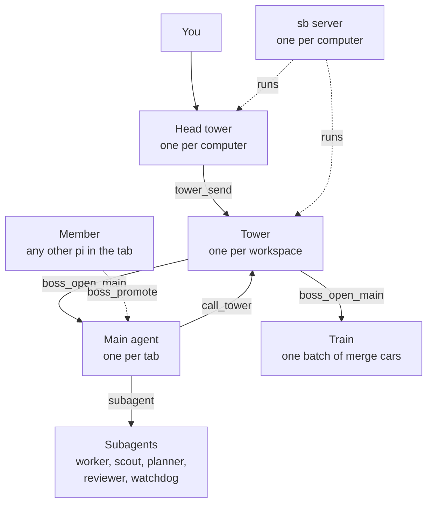

Each solid arrow is a tool from [Tools](#tools). The dotted ones are not tools: a member becomes a main by promotion, and the sb server runs the towers.

**Positions**

| Position | What it is | How it comes to be |
|---|---|---|
| member | a joined pi that is not a main | joins at session start, by itself |
| main agent | one per tab; plans, dispatches, and asks the boss | promotion (`boss_promote`, a first `subagent` call), `/boss`, or a tower opening it |
| subagent | a pi-herdr-agents child; it never joins, and its launcher speaks for it | launched by a main or a member |
| tower | one per workspace; routes work and repairs friction, and never asks the boss | opened when agents start to collide |
| head tower | the boss's one entry point, one per computer; hands each instruction to a workspace's tower | made by the sb server at the boss's first message |
| train | a worker that carries one batch of merge cars to the base branch | opened by a tower for the project's integrator |

<details>
<summary>Kinds of main agent, subagent, and tower run</summary>

**Kinds of main agent** (the page shows the kind word; the GUI says "on watch" for `standing`)

| Kind | What it is for | How it is set |
|---|---|---|
| `coordinator` | the default: splits work, plans, dispatches subagents | by default, or `boss_duty` |
| `integrator` | a project's merge trains: receives cars, forms trains | `boss_duty`, or the name `integ <project>` |
| `standing` | minds one system or machine, with no end | `boss_duty` |

**Kinds of subagent** (read from the role name pi-herdr-agents gave it; any other role stays a plain subagent)

| Kind | Role names | What it is for | Dispatch by a coordinator |
|---|---|---|---|
| `worker` | `worker` | does a task: edits, runs, builds | refused with `sb: plan first` until its todos name a graph |
| `scout` | `scout` | investigates and reports | passes without a plan |
| `planner` | `planner` | writes a plan or a design | passes without a plan |
| `reviewer` | `reviewer`, `visual-tester`, `adversarial-reviewer` | reviews a change or checks the UI | passes without a plan |
| `watchdog` | `watchdog` | watches another session or Herdr state and only reports back | refused like a worker |

**Kinds of tower run** (what wakes a tower; the rules are in [Local runs](#local-runs), [The boss conversation](#the-boss-conversation), and [Ally runs](#ally-runs))

| Run | Woken by | What it is |
|---|---|---|
| event run | an event from a session, such as a main's `call_tower` or a finished milestone | a fresh pi in the standing pane; ends with `tower_done` and a handoff note |
| boss conversation | the boss's words (the page's composer, the standing pane, `/boss tower`) | the run that resumes the boss's last session |
| ally run | a Straw Link message from a teammate's device | a fresh pi in a pane beside the standing pane, at the sender's trust level |

</details>

**Where to read**

| You want to know | Read |
|---|---|
| who joins, who is promoted, when a tower opens | [How it works](#how-it-works) |
| what a tower knows, how towers talk, what the head tower does | [The tower's digest](#the-towers-digest), [Talking between towers](#talking-between-towers), [The head tower](#the-head-tower) |
| teammates' computers and unattended boxes | [Straw Link](#straw-link-towers-across-computers-the-link-holder), [Straw Link operate](#straw-link-operate-an-attended-computer-drives-an-unattended-box) |
| the work board and auto mode | [The work board](#the-work-board), [Auto mode](#auto-mode) |
| opening and closing mains, the settings check | [Opening a main](#opening-a-main), [The settings check](#before-pi-starts-in-a-folder-the-settings-check), [Closing an opened main](#closing-an-opened-main) |
| merging many branches safely | [Merge train](#merge-train) |
| the dashboard, and subagents that lost their launcher | [Tower dashboard](#tower-dashboard), [Orphaned subagents](#orphaned-subagents) |
| the browser page: map, comms, alerts, phone, Zen | [Browser view](#browser-view) |
| Herdr's sidebar, worktree cleanup, process cleanup | [Sidebar net view](#sidebar-net-view), [Worktree reaper](#worktree-reaper), [Process hygiene and slots](#process-hygiene-and-slots) |
| the background server, tower runs, the standing pane, memory, ally runs | [The sb server](#the-sb-server) |
| a command, a file it writes, Windows, developing | [Tools](#tools), [What it writes](#what-it-writes), [From a shell](#from-a-shell), [Windows](#windows), [Development](#development) |

## How it works

Joining is automatic; the chain of command is earned.

In short:

- Every pi in Herdr joins its tab's net as a **member** by itself.
- A member becomes the tab's one **main agent** by promotion; an agent never takes over an existing main.
- A **tower** opens for the workspace when agents start to collide, and mains and the tower go together.
- **Subagents** and sessions in a sub workspace never join: their launcher, or their parent workspace, speaks for them.

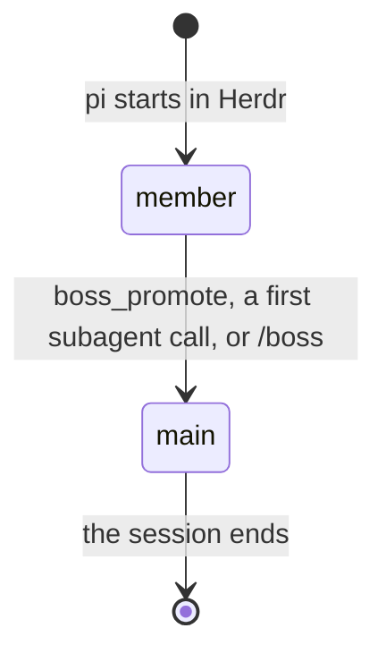

The numbered rules below are the whole behavior.

<details>
<summary>Details</summary>

1. Every joinable pi in Herdr joins its tab's net at session start as a **member**: no reminder, no question. It does not join outside Herdr, as a pi-herdr-agents subagent (`PI_SUBAGENT_ID`, its parent represents it), in a sub workspace (below), or as the tower itself.
2. A member becomes its tab's **main agent** by promotion. The agent calls `boss_promote` when its work grows (several steps, dispatching workers, more than one app); the member prompt says so. A member that calls pi-herdr-agents' `subagent` or `subagent_resume` tool without promoting is promoted automatically, before the subagent starts or resumes. A join that failed at start and retries after the session's pane moved to another tab registers on the tab it is in now, so it never becomes a second main there.
3. A tab has one main. An agent never takes over an existing one: while the tab's main is live, `boss_promote` is refused with a message and the automatic promotion is skipped. The member may still dispatch its own subagents, but its prompt tells it to first message the main through intercom with what it will do and which resources it will use.
4. A main never demotes. When its session ends, the tab has no main until a member promotes (the members' prompt then offers promotion). `/boss` is the user's manual takeover: it makes this session the tab's main even when another is.
5. A main has a **kind**: `coordinator` (the default: it plans and dispatches), `integrator` (a project's merge trains), or `standing` (one system or machine, no end). The kind is the prompt the main runs: `main.md`, plus `integrator.md` or `duty-standing.md`, and `dispatch.md`. A coordinator gets `dispatch.md` and its graph's addendum (`graph-fan-out.md`, `graph-orchestrator-worker.md`) only once its own todos name a graph in `metadata.graph` (`single-loop`, `fan-out/fan-in`, `orchestrator-worker`; read by `planGraph`, the newest open one wins); an integrator and a standing main always carry `dispatch.md`.

   A coordinator that dispatches a `worker` (or an unknown role, or a bare spawn) with no such plan is refused with `sb: plan first: …`; scouts, planners, reviewers, and `subagent_resume` pass, and a `todo` call earlier in the same assistant message that names a graph counts. The main changes its kind with `boss_duty` (a reason, one line; a switch re-reads its context once; it writes a `straw-boss` entry `{ duty, dutyFrom, dutyWhy, dutyAt }`, notes the tower's digest, and shows on the page).

   A main that has declared none and is named `integ <project>` (at start, or at any rename: `boss_rename`, `/name`, another extension), or holds `train` todos, is migrated to `integrator` once, with the entry `migrated: name` or `migrated: train todos`. A declared kind is never migrated. Each `/reload`, `/new`, `/resume`, and `/fork` reads the integration switch again, and with integration off an integrator runs as a coordinator and publishes `coordinator`. The page shows the kind word (協調者, 整合員, 值守 / coordinator, integrator, on watch) the same in every theme, with the plan's graph after it (單一迴圈, 分支匯流, 多工編排 / single loop, fan-out, orchestrated), and a switch is an event on the timeline.
5. The workspace tower opens when agents start to collide: a member dispatches a subagent (it promotes itself first, and a promotion opens the tower), the workspace has two members while another workspace already has a live tower, or `/boss tower` asks for it. Mains and the tower go together. The owner of each tab channel (its earliest member) checks when Herdr reports an event that can change the answer (`workspace.metadata_updated` for any workspace, `pane.closed` and `pane.agent_detected` in its own, over one `events.subscribe` connection per session), when the tab channel's owner changes or a session leaves it, and once every 4 minutes for what no event reports (a tower that crashed); a member that joins checks the two-member rule once.

   A check that must wait out a grace sets one timer for it instead of polling: under a live tower a tab with no live main promotes it; with no tower, every main is turned back into a member, at once when the tower quit (`sb_tower_quit=<members it left>` on the workspace; the two-member rule then waits until the workspace has more members than that, so a tower closed on purpose stays closed, while a subagent or `/boss tower` opens it any time) or after 15 s otherwise (a `/reload` comes back within that), except a main younger than 60 s, whose tower may still be opening. A demoted main keeps its subagents; subagents never promote.

   A tower dispatches no subagents: its `subagent` and `subagent_resume` calls are blocked with a pointer to `boss_open_main`, so nothing outlives it with no one to take the result. A tower that quits closes its own pane (an emptied tab closes with it); a reload, `/new`, resume or fork keeps it. The tower stays open when mains leave.
6. A promoted session keeps the subagents it launched: the dashboard and the browser view link subagents through the launcher's session file, not through its role, so they count under it as main with no re-registration.
7. A **sub workspace** is treated like a subagent too. `herdr worktree create` opens a linked git worktree as its own workspace (`worktree.is_linked_worktree: true`); its parent is the workspace with the same `repo_key` that is not linked. Sessions there never join, `/boss` is refused, and they receive only scope `all` broadcasts. A sub workspace never gets a tower: `call_tower` from it, or aimed at it, goes to the parent workspace's tower (opened there on demand), and fails with a clear error when no parent workspace is open.
8. **A start that cannot place itself or join is not final.** The start asks Herdr where the session runs (`pane current`, the workspace list) in the background before it joins, and counts as barred while it waits. Only a definitive answer (a head workspace, a sub workspace) bars for good. A call that failed (a Herdr that takes seconds under load) leaves the session unplaced: one warning tells the boss, and the check is asked again after 1 s, 2 s, 5 s, then every 15 s (`joinRetryMs`; timers are unref'd, and only the start in progress owns the timer: a shutdown or a newer session start ends it, and what an ended start still has in flight tells nothing, arms nothing, and joins nothing).

   `/boss` and a `subagent` or `subagent_resume` call do not wait for the timer: they ask again at once, or share the ask in flight, before they are refused. A join that failed at start for a reason waiting can mend (intercom not connected within 15 s, no owner elected, or the pane look failing before any channel exists) is retried by the same timers, besides the channel's `connection` and `owner` events; one that waiting cannot mend (pi-intercom not loaded, a tab id too long for a namespace, a broker without `extension-bus-v1`) is told once and not retried, and `/boss` tries it again when the boss asks.

   The check's warning, the join's error, and the warning about a pane without `terminal_id` are each told once per start. The answer that frees the session starts the normal start once (join, restore watch, opener and restore handling, never two joins); what the role record says (a main a Herdr restore resumed, its opener, the record of a pi started in a quit main's shell) is read once, at the first attempt, so a retry does not take for a restore's the record the session wrote itself while it waited. One info line tells the boss it joined after retries.

| Role | Who | Gets |
|---|---|---|
| main agent | the member that promotes first in a tab, or the `/boss` taker-over | a short prompt: split work by app, plan before the first dispatch, brief workers, check results, ask the boss before merging or deploying |
| member | every other joined session | a short prompt: with a main in the tab, tell it before dispatching subagents; without one, promote when the work grows |
| tower | one per workspace, in its own tab labelled with the Nerd Font radio tower glyph (U+F043B) | a prompt for coordinating agents and repairing coordination friction, and for opening a main when no session owns a request; it never asks the user |

Before its first dispatch a main reads `prompts/planning.md`, as it reads `prompts/apps-config.md` when it splits work, so the planning rules stay out of every run's system prompt. It chooses a coordination graph: single-loop (one task, carried by itself or one subagent) needs no plan. For fan-out/fan-in and orchestrator-worker it writes the plan as pi `todo` items: one per task, its `owner` the subagent (or `self`), `blockedBy` for the tasks it depends on (which leaves the rest parallel, up to a cap of 4), and in its description and metadata the anchor that checks it. Tasks that share one anchor share one checkpoint todo instead of each branch checking the same thing.

The anchors are testing, pseudo-human, human, and adversarial-review, each the lightest check that can fail before the change. The main dispatches without asking the boss to confirm the plan; it asks the boss only for decisions the plan cannot settle, before the task they block: a requirement that is unclear or contradicts the architecture, and an authorization such as a merge to a shared branch or a deploy. The browser view shows the todos as the plan's progress.

The tower is opened by a main, by `/boss tower` from any session, or by the rule above (`call_tower` from a member opens nothing), without taking focus, and answers through intercom. Its tab is moved to the first position of the workspace right after it is created (or adopted), through Herdr's socket API (`tab.move`, no focus change); a failed move is reported as a warning and ignored. A tower tab is recognised by the `sb_role=tower` pane token that only Straw Boss writes, never by its label, because a pi-herdr-agents subagent can be named `tower`.

A tab that lost its token because its tower quit is still adopted when its label is exactly the radio tower glyph (U+F043B), it holds a single pane, and no agent runs in that pane (a shell prompt): the next opening starts pi there instead of creating a second tower tab, marks the pane again, and moves the tab first. When several such leftover tabs exist, one is reused and the other shell-only ones are closed. A tab labelled only `tower`, or one whose pane runs an agent, is never adopted or typed into.

When a tower quits (pi's `session_shutdown` with reason `quit`; a reload, `/new`, resume or fork keeps the tab), it clears its tokens and, once pi has exited, closes its own pane; Herdr closes the tab with its last pane, and other panes in the tab stay. If two towers ever race in one workspace, the live token holder wins, otherwise the lower tab id, and the other closes its own tab.

Towers of different workspaces reach each other with `tower_list` and `tower_send` ([Talking between towers](#talking-between-towers)), or with `call_tower` from any session; the **head tower** is a tower of its own, in a workspace of its own, that the boss talks to and that forwards his work to these towers ([The head tower](#the-head-tower)).

</details>

### The tower's digest

A tower learns what changed in its workspace without asking. Each session in the workspace's net writes one line when it joins (`a1 joined tab billing`), when its `subagent` or `subagent_resume` call returns without an error (`MP-1 export started subagent lint-sweep (worker)`), and when it calls `boss_rename` (`a1 renamed itself "MP-1 export" (tab billing)`). Each line starts with the local time (`HH:MM`). At the start of each run the tower reads the lines, oldest first, into its role section under `Since your last run:`, and clears them, so it reads each line once. A member's or main's run never reads them.

<details>
<summary>Details</summary>

The lines live in Herdr's memory as workspace tokens (`sbd_<time>`, one line each), written under their own source, `straw-boss-digest`, without the TTL of Straw Boss's role tokens, so they wait however long the tower is idle. Herdr keeps at most 32 tokens on a workspace, changes at most 16 per report, and cuts a value to 80 characters without its newlines: the digest keeps the newest 20 lines, a note that finds 20 drops the oldest in the same report, and a line is cut to 80 characters. A new Herdr server starts without them, as it does without every other token; the role tokens are written again, the digest is not.

A line that cannot be written is dropped without failing the join, the launch, or the rename. The sb server writes `head tower opened` and `head tower closed` in the digest of every tower workspace when the head tower starts or ends ([The head tower](#the-head-tower)).

</details>

### Talking between towers

Towers coordinate with each other directly, with two tools only a tower has, and every message the net carries for a session tells its reader who sent it.

<details>
<summary>Details</summary>

**The header.** The code writes a line before the text of every `call_tower`, `boss_broadcast`, `tower_send`, and handoff message (never the model, so a name or a message cannot change it):

```text
[straw net from=<name> id=<session id> role=<tower|main|member|session> [head=yes] workspace=<label> kind=<call_tower|broadcast|tower_send|handoff> scope=<scope> to=<recipients> reply=<expected|none> [why=<milestone|shared|blocked|unspecified>] [ask=H<n>] [relay=boss:<event id>] [in-reply-to=H<n>]] <message>
```

`role` is the sender's role as its pane's `sb_role` token publishes it (`session` for a pi that did not join the net, which only a scope `all` broadcast reaches); `head=yes` marks the head tower and nobody else (`role` stays `tower`, so readers that know four roles keep working). `ask=` and `relay=` are on the head tower's forwards only, and `in-reply-to=` on a workspace tower's answer to one ([Forwarding and answers](#the-head-tower)). `scope` is `tab`, `workspace`, `towers`, or `all` for a broadcast and a `tower_send` to all, `tower` for a message to one tower, and `main` for a handoff.

`to` names every recipient as `<name> (<role> of <workspace>)`, `head tower` for the head tower, separated by `;`, at most 20 and then `+N more`: all recipients read the same line, so a tower that gets a message knows who else got it and does not send it on to them. `reply=expected` means the sender waits for an answer; `none` means a notice. `why=` is on a `call_tower` header only: the reason the main calls, written by the code from a closed set (see [When a main calls the tower](#when-a-main-calls-the-tower)), so the tower reads it from the line and not from the message.

Control characters and runs of whitespace in a name fold to one space, and a name with a space, quote, `]`, `=`, or `;` is written in double quotes with any quote inside it replaced by `'`.

**`tower_list`** (tower only) reads the net once and answers, for every workspace that is not a sub workspace: its id and label, `head`, `self`, `reach` (`tower`, `main`, `member`, or `none`: who a message for it reaches, see below), the sessions it reaches with their state (the same mark as the dashboard: `idle`, `working`, `waiting`), and its tabs with the label, the main's name, and the members' names. A main names itself with `boss_rename` for its current work, and the tab takes that name, so the tabs say what the workspace is working on. The answer is JSON, as `boss_status` is.

**`tower_send`** (tower only) takes a message, an optional `workspace` (id or exact label; a sub workspace goes to its parent workspace), and `reply` (default false). With no workspace it goes to every other tower. It never opens a tower. In a head tower run it takes only `workspace`, and the server opens that workspace's tower when it has none ([Forwarding and answers](#the-head-tower)); a workspace tower answers the head tower with `head: true` and `inReplyTo` (an ask id).

</details>

#### Workspaces without a tower

A workspace without a live tower (no `tower` token, or the session is not on the net) is reached through its main agents, else its members: the sessions of the workspace that joined the net, the tower's own session excluded. Both `tower_send` and `boss_broadcast` with scope `towers` do this, and the result labels each such recipient, as in `kb-main: sent [no tower in 知識庫: main]`. A workspace with no tower and no joined session is skipped (`tower_send` to it alone is an error that says so).

<details>
<summary>Details</summary>

The sender's own workspace never answers for a tower: a session never reaches itself, and a main in a workspace without a tower does not reach its sibling mains by scope `towers`; the tower of its own workspace, when there is one, is a recipient. Sub workspaces keep their rules (they have no tower and their sessions receive only scope `all`).

**`boss_broadcast`** with scope `towers` stays for sessions that are not towers, under the same header. `call_tower` has an optional `reply` too, default true (the tower answers); a notice sets it to false. It also takes `why`, which pi's tool requires ([When a main calls the tower](#when-a-main-calls-the-tower)).

</details>

### The head tower

The **head tower** is a tower that belongs to no project. The boss talks to it, in one long conversation, and it decides which workspace owns each instruction and hands it to that workspace's tower. It does no work of its own. The design is `docs/specs/2026-11-04-head-tower.md`.

How an instruction travels:

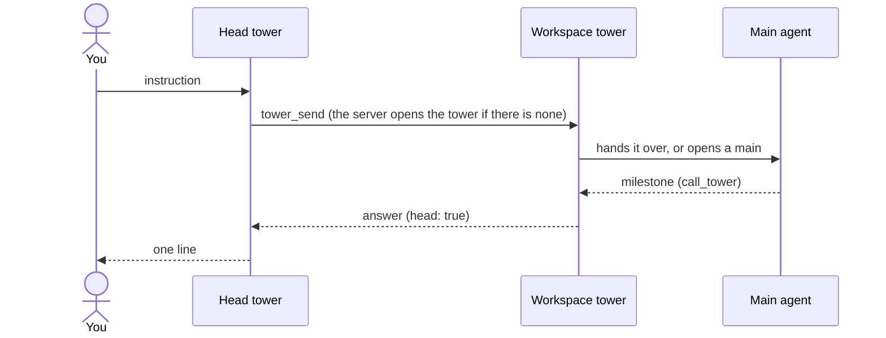

#### Its workspace

The sb server makes it the first time the head tower is needed (the boss's first message from any channel, or `/boss head`), in the folder `<pi agent dir>/straw-boss-head/`. A fresh install shows nothing new in Herdr until the boss writes to it. The workspace is labelled `主塔台` when the server's locale is Traditional Chinese and `Head tower` otherwise, its tab carries the crown glyph (U+F01A5), and its pane holds the standing pane of a tower, marked `sb_role=head` and sorted first (`000`). It is known by its record and its `sb_head` token, never by its label, so a workspace of the boss's with the same label is not taken for it.

<details>
<summary>Details</summary>

Closing its tab or workspace in Herdr, or `/boss head close`, ends the service as for a tower; the conversation, its memory, and its asks are kept, and the next message makes the workspace again and resumes. With `towerRuns` off there is no head tower, and every channel says so. Its state is `<state dir>/head/`: the service record, the queue, `boss-session.json`, `chapters.json`, `asks.json`, and `memory.json`.

</details>

#### Its runs and conversation

It is a tower service of its own kind with the tower's machinery (standing pane, wake, claim, crash rules). Every run resumes the one pi session, whether the boss's message or a tower's answer woke it, under the boss conversation's limits (the 10-minute wrap-up after his silence, the 4-hour cap). There is no age limit: a session past 8 MB, and **New conversation** or `/new`, start a new **chapter** whose brief carries the last handoff note and the last lines between the boss and the head. The GUI pages the history across chapters, with a divider where one ends. The model is `headModel`, else `towerModel`. Its brief lists the workspaces now (each tower's state, each main and what it is doing), the open asks, its memory, and its limits.

<details>
<summary>Details</summary>

**Its tools and who may reach it.** `read`, `grep`, `find`, `ls`, `tower_list`, `board_read`, `tower_send`, `tower_memory`, `tower_done`, and `boss_server`: no shell, no edits, no `boss_open_main`, no `call_tower`, and no Straw Link (`tower_send` with `device` is refused). Before anything is queued the server's gate lets in only the boss's own words (the GUI, `/boss head`, the standing pane's prompt) and an answer to one of its open asks; a broadcast, a main's message, or an answer with no open ask gets a receipt and wakes nothing.

</details>

#### Forwarding and answers

`tower_send` goes to one workspace's tower (an id or exact label; a sub workspace goes to its parent). A workspace with no tower gets one first (its tab and standing pane), then the message. Each forward opens an ask `H<n>` that stays open for 24 hours after its last forward or answer, with at most 40 open.

<details>
<summary>Details</summary>

An ask also carries `group`, the id of the first ask of its broadcast, which the GUI page folds into one row: asks with the same `relay` are one broadcast (the head words its message to each tower, so the first lines differ); an ask with no `relay` joins the newest earlier one without a `relay` that has the same first line and is under 60 seconds before it. A file from before `group` is grouped the same way when read.

The header carries `ask=H<n>` and, only when the turn was started by the boss's own message that the server delivered to this run, `relay=boss:<event id>`; a tower reads `head=yes relay=boss` as the boss's instruction routed through the head, and a `head=yes` message without `relay` as the head's own note. The tower answers with `tower_send({ head: true, inReplyTo: "H12", message })`, the server writes `in-reply-to=H12`, holds the answer up to 30 seconds with others, and wakes the head, which tells the boss in a line. When it needs his decision it asks in plain words and records a wait for him in its memory.

</details>

#### The head page

The GUI page is the conversation and its composer: End, New, and Close sit above the composer, the asks are one card per broadcast (its parts, then `2h ago · 1/4 handled`; each tower's state and newest answer unfold, and an order a later one corrects folds under it; groups quiet for a day fold into "Older"; [spec](specs/2026-11-07-head-log-cards.md)), a wait for the boss shows only until its `due` (a day old with none; the server's summary of the head leaves it out of the rows and of the footer count, the file keeps it for 7 days, and the head's brief tells it to resolve or re-ask it), the memory footer shows only for a standing instruction, a decision, or a pending proposal, and the head's tool calls and the sb server's notices are not drawn on this page (Zen's history of the head still draws them). Design: [docs/specs/2026-11-06-head-page-minimal.md](specs/2026-11-06-head-page-minimal.md).

<details>
<summary>Details</summary>

**Where the boss meets it.** The GUI page and Zen strip ([Browser view](#browser-view)), `/boss head [status | leave | new | close | <message>]` in any pi session (a bare one makes the workspace and focuses its tab), `/boss memory -w head`, the head's standing pane (Enter talks to the same conversation), Herdr's net view (the head workspace first), and `status`'s `head`. The head workspace is no base: it is not a target of `tower_send` or `boss_broadcast`, it is not stashed, and a pi typed into it by hand joins no net.

</details>

### Straw Link: towers across computers (the link holder)

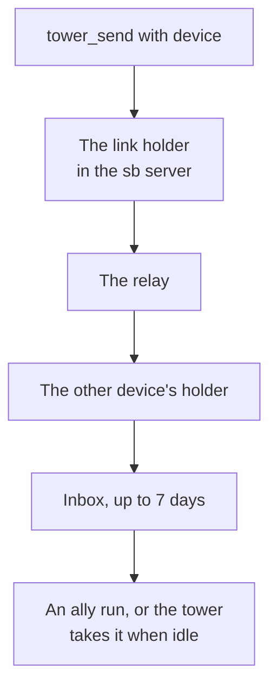

Design: [docs/specs/2026-10-25-straw-link.md](specs/2026-10-25-straw-link.md). This is what the code does so far (the holder, delivery, the tools, remote turns, and the GUI's team settings); joining over a tailnet is a later step. Unattended devices (the policy, `join.txt`, dialogs, the tower they open, `unit-status` and notices) are the paragraph **Unattended devices** below, and [their setup](unattended-device.md). A computer with no team set up (nothing under `link.teams` in `config.json`, no team file) runs none of it: no channel, no election, no files. The holder runs in the [sb server](#the-sb-server) (`src/link/service.ts`); a pi session only asks it.

#### Files

`<pi agent dir>/straw-boss/link/` (`PI_CODING_AGENT_DIR` aware, mode 700, files 600 where the OS has modes; paths are used as Unicode paths and never become a shell command): `device.json` (the keys, the label, and the next sequence number), `device.id`, `teams/<team>.json` (the roster copy, the team keys by epoch, the relay URL, the last event id, and the last sequence number taken from each sender), `inbox/<envelope id>.json`, `holder.json` with `holder.lock`, and `link.log` (one JSON line per dropped envelope, notice, or send). Every write goes through the lock; a write outside it throws. A lock whose process is gone, or that is older than 10 s, is taken over.

<details>
<summary>Details</summary>

A team file that is missing or damaged makes the team stop: nothing is taken and nothing is acknowledged, and the only way back is to join again, because a fresh file would forget which sequence numbers were already taken.

</details>

#### The link holder

It runs in the primary sb server (the server of the default Herdr; a secondary server holds no link, and a session on another Herdr is told so), and the server is its only candidate: no pi session or tower takes part in the election any more. The election is still its own, not the GUI's: `holder.json` (session id, version, PID, start time) names the server, whose id is `sb-server-<8 hex>`, and `holder.lock` guards it as before.

<details>
<summary>Details</summary>

The server ranks as a tower of its own version, so a session of the previous build, which is still a candidate there, can neither outrank it by build nor by role: it contests only a record that is vacant or whose process is gone, and the server takes the record back at its next look (every 2 s). The server starts the holder after it has connected to the broker and before it reports ready, waiting at most 3 s for the first look; a stop or restart removes the record first, so the next server takes it at its first look. A holder that finds the record names another process stops.

`status` shows the link's state (`inUse`, `holding`, `active`, and the last notices); the notices that a session used to see on its screen go to `server.log` (`link-notice`) and to `status`.

</details>

#### Requests from sessions

A session asks the holder over the server's control socket, one request per connection: `{cmd: "link", from: <the session's intercom id>, body: {op, …}}` answered by `{ok: true, answer: <the holder's answer>}`. The ops are the ones the channel carried (`send`, `list`, `board-read`, `confirm-request`, `confirms`, `answer-confirm`, `forget-confirm`, `gui`, `request-open`, `request-run`, `request-drop`) and `taken` (the tower says an inbox message is in its session). There is no 16 KiB limit and no chunking. `from` is self-reported, as pi-intercom's ids are; the GUI's requests are still taken only from the session `gui.json` names (and from the server itself once it hosts the GUI).

<details>
<summary>Details</summary>

A session finds the server through `server.json` and the `hello` secret; with no server running, or none holding the link yet, a request fails with "No link holder is running", and a server that is restarting says so. The channel `straw-boss/link` is kept for the previous build: the server answers a session of that build's chunked `req` with chunked `res`, takes its `taken`, and offers inbox messages to resident towers on it. Nothing the server loads imports pi-tui, `tools.ts`, `pairing.ts`, or the trust question (a test walks its imports).

**Receiving.** A stream resumes from the team file's last event id (the relay sends every envelope this device has not acknowledged on a new stream anyway). Each `tower` envelope is checked and decrypted under the lock, written to the inbox, and the sender's high-water mark moved in the same locked write; only then does the stream acknowledge it to the relay. A crash before the inbox write gets the envelope again and delivers it once; a crash after it and before the acknowledgement gets it again and the sequence guard drops the copy. A displaced holder (the record names another session) keeps the envelope for the next stream.

</details>

#### Delivery

A message goes only to a tower whose pane's cwd is inside the team's `project`: the one closest to the project root, then the first in Herdr's workspace order (a named `workspace` restricts it to that workspace's tower). Mains and members never receive one. The holder offers the inbox item to that tower over the intercom channel `straw-boss/link` (not owner-eligible; only a tower registers it now); a tower takes an offer only from the session `holder.json` names, the server.

<details>
<summary>Details</summary>

The tower keeps it until it is idle (`isIdle()` and no pending message, checked in the same tick), then sends it as a custom message of type `straw-link` with `triggerTurn`, under the header below, one message per tick, and tells the holder (`taken`, on the control socket), which removes it from the inbox. The session entry `straw-link-seen` remembers what a session took, so a restart does not take it twice.

With no such tower the message waits in the inbox for 7 days (an attended computer first wakes the tower of a workspace it already has for a teammate's message, 0.61.1, and the notices below appear only when that did not work), with one pi notice, and the Link button's notice (one per team, tower and state) says who sent how many messages, how long the oldest has waited, which workspace's tower or project they wait for, that they are not delivered yet, and the date the oldest is dropped; the sender's membership is checked again when a tower would get it.

When the tower is the sb server's (the default), nothing of this paragraph's offer-and-take happens: the server starts an ally run for the sender instead ([Ally runs](#ally-runs)); the offer over `straw-boss/link` is kept for towers that are still resident and for the reply to a main.

```text
[straw net from=<sender label> id=link:<sender device id> role=tower workspace=<label> remote=<device label> device=<short id> team=<project folder name> verified=yes kind=tower_send scope=tower to=… reply=<expected|none>] <message>
```

`from`, `workspace`, and `remote` are cut to the label character set (ASCII letters, digits, space, `.`, `_`, `-`; anything else becomes `_`) and 40 characters before they are quoted, and `id=` is always `link:` and the sender's device id, never a session id of this computer. `team=` is this computer's own name for the team, so it keeps its characters (cleaned, quoted, at most 80).

</details>

#### Sending

`tower_send` with `device` (a short id, an id, or a label; `workspace` then names a workspace label on that device) hands the message to the holder in the sb server over the control socket. The holder checks that the caller is a tower whose cwd is inside a team's project, resolves the device (a name that fits two devices, or this device, is an error that lists the candidates), reserves the next sequence number, builds and signs the envelope, and writes it to `link/outbox/` under one lock before the first post, then posts it in order with retries and answers once the relay has it or after 10 s with "queued".

<details>
<summary>Details</summary>

The file goes once the relay holds the envelope or refuses it for good (a refusal that comes after the answer is told to the boss), and the next holder of the computer posts what is left, first, in order. A 401 from the relay halts the team's posts for 60 s (a clock that was off), and a send meanwhile is refused with the reason. A team that forks, loses its team file, or refuses the stream (the device was removed) stays stopped, on disk too, until its team file is replaced by joining again.

A message may hold 192 KB; the inbox keeps at most 100 messages per sender and 500 in all, and the relay keeps the rest. `tower_list` adds `remote`: the teammates' devices from their last presence, with the workspaces and tab states they chose to share. A presence goes out every 30 s (`share: "status"` adds the bound workspaces and their tabs; `"presence"` only that the device is online) and a device with none for 90 s is offline.

**Remote turns** (`src/link/{turn,allow,gate,policy,hooks}.ts`; `hooks.ts` registers the pi hooks, `runtime.ts` wires it to the holder in the server). A run is a remote turn from the first `message_start` or `message_end` of a `straw-link` custom message until `agent_settled`, however the message got into it (a delivery, a steer into a run that began local); `agent_end`, a retry, a compaction, or a continuation does not end it, and a local message that joins leaves it as it is. Its level is the lowest of its remote senders'.

A sender's level is `reply` unless this computer names it: `link.trust` in `config.json` (device id to `reply`, `forward`, or `dispatch`), or, on a device whose `/etc/straw-link/policy.json` says `unattended` and passes the owner check (the file and its folder owned by another user, not symlinks, not writable by this user), that file's `trust` (`true` means `dispatch`) and `config.json`'s `link` section is ignored. A policy file that is there but fails the check refuses unattended mode: every sender stays at `reply` and the boss is told once. A message that names no sender this code put there is remote at `reply`.

</details>

What a tool call in a remote turn meets:

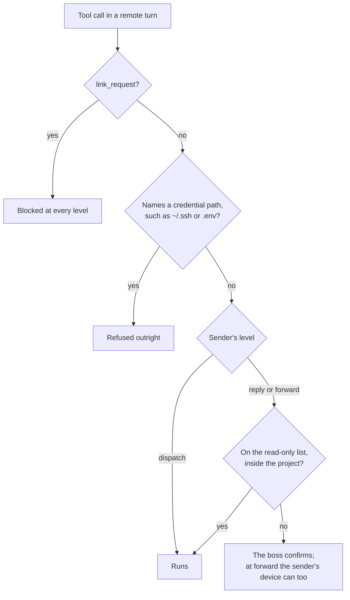

<details>
<summary>Details</summary>

- `link_request` is blocked at every level, `dispatch` included, with no dialog (the tool is the boss's alone, in a local turn).
- At `dispatch` nothing else is held. At `reply` and `forward` the `tool_call` hook allows by exact tool name: `read` of a file `git ls-files` lists in the bound project (after `realpath`, so a symlink out of the project is not); `grep`, `find`, and `ls` with every path inside the project, whose output the `tool_result` hook cuts to the lines and entries that belong to a tracked path (a line it cannot attribute, such as a notice, is dropped; the structured copy goes with the replaced content); `tower_list`, `board_read`, `boss_status`, `todo` (the first two answer a remote turn only what its senders already receive: [The work board](#the-work-board)); and `tower_send` whose `device` is a sender of the run (id, short id, or label).

  Paths are read the way pi's own tools read them (a leading `@`, `~`, odd spaces). Any tool that names a path under `~/.pi`, `~/.ssh`, `~/.aws`, `~/.config`, `~/.gnupg`, the agent dir, the `link/` dir, or a file named `.env*`, `*.pem`, `*.key`, `id_*`, `*.p12` (as written or once resolved) is refused outright, not confirmed. Everything else opens the gate.
- **The gate** shows its own dialog through the dialog contract (owner `straw-link-gate`, prefix `straw-link:gate`, a gate keyed by `toolCallId`, so it is answerable from a page even in a parallel batch): the sender's label and short id, the tool, and its arguments in full (a call whose arguments are over 12 000 characters is refused). The terminal shows the same confirm; the first answer, from the terminal, from a page (this computer's or a paired device's), or at `forward` from the sender's device, ends the other two. Deny, no answer within 10 minutes, and the abort of the call all block it with "the boss declined a remote request"; the output of a call the boss allowed is not filtered.
- **`forward`**: the run's lowest-level sender's device also gets a `confirm-request` (dialog id, digest, tool, full arguments). Its holder keeps up to 20 for 10 minutes (`confirmRequests()`, `answerConfirm(dialogId, allow, digest?)`; the GUI route `link/confirm-answer` requires the digest of the request it showed, and the holder refuses another with "That request changed; look at it again", leaving the request open), and sends a `confirm-answer`. The asking holder takes an answer only from the device it asked, with the dialog's id and digest, once; any other is dropped and does not use the dialog up.
- **After the turn**, in a later local run the `context` event replaces the text of each `straw-link` message that did not start the current remote run with a marker naming its device and saying it is a peer's request, not the boss's instruction; and a message the tower sends to a local session during a remote turn carries `origin=remote:<sender device id>` in its header. A reply to the sender already expects no answer unless the tower asks for one.

  Two limits are documented, not guarded: a compaction summary is written by the model from the whole conversation and pi's `session_before_compact` hook can only replace the whole compaction (it cannot hide messages from the summarizer), so a peer's text can survive in a summary unmarked; and a message sent through pi-intercom's own tool after a gate approval carries no `origin=` header, since only the tower's `tower_send` adds it.

**Unattended devices** (`src/link/{policy,joinfile,dialogs-out,unitstatus}.ts`, `src/server/opentower.ts`; setup in [unattended-device.md](unattended-device.md)). A device with `/etc/straw-link/policy.json` saying `unattended: true` takes its teams and trust from that file (`readEffectiveConfig`; `config.json`'s `link` section is ignored), and the sb server is its holder, with no boot pi session. A policy that fails the owner or write check, or whose `teams` is malformed, is `refused`: no holder runs and the reason is logged once (`policy-refused`).

The first look makes `device.json` and `device.id` even with no team, so an admin can pin an invite to the id, and the infra drops the invite in `link/join.txt` (a regular file of the device's own user at mode 600; any failed check deletes it): the holder reads it at start and on each tick, takes only an invite pinned to the device's id (a passing relay failure keeps the file and tries again later), joins with the relay from the invite (stored in the team file), project and share from the policy, and logs one outcome. A `dispatch` controller's message for a project with no tower makes the server open one (the paragraph below).

A question that waits in any session on the device (`select`, `confirm`, `ask_user_question`, never a `secret_drop`) goes to its controllers at `dispatch` as `dialog-open` (`DialogForwarder`): the first valid `dialog-answer` (same digest, answer id not seen, sender attended and at `dispatch` now) is carried to the session, and `dialog-close` ends the card on every controller. On a box shared by several devs a question is sent only to the controller that dispatched the unit that asked (the device of an ally run's own pane, or of the main an ally run opened, found by the `sb_opened_by=link:<device>` token on a pane of the dialog's tab) and to the team's roster admins; a unit nobody dispatched is the admins' alone, and an answer from another controller is refused (`dialog-answer-not-recipient`).

Notices follow the same scope (an ally run's end or refusal: its device and the admins; the tower's own run: the admins; a tower that would not open: the controller whose message asked for it). An admin is an admin of its own team: another team's admin is told nothing of a question that names a team. A question nobody can be told of (no admin attended at `dispatch`) stays open and leaves one `dialog-unrouted` line in `server.log`.

A main an ally run opened is ended when its device leaves the team or loses `dispatch` (`revoke.ts`): a main that cannot be found is forgotten only after two sweeps and with its pane gone from Herdr, otherwise the admins are told it still runs. See the [shared-box spec](specs/2026-11-05-link-shared-box.md). A forwarder pass runs every 15 s as well as on every hub change, so a controller that gained `dispatch` while a question was open gets it; an open question is sent again every ten minutes, a controller that lost `dispatch` is told it was withdrawn, a choice that only the device's own page may pick is not carried for a controller (`dialog-answer-here-only`), and an answer the session turned down leaves the question open and the card answerable again.

The controller's page draws each question as a card with the shared question panel (`gui/linkdialogs.ts`); a closed card stays two minutes and says how it ended ("answered by another controller" when the close carries only `by`), and a paired phone may answer. A controller is told the unit that asked, not the package that opened the dialog: the `owner` of a `dialog-open` is `main - <session name>`, `subagent - <name>`, `member - …` or `ally run - …` (a tower or an outside pi: its name alone; a name that begins with its role word is told as it is, so `main · trial11` is not `main - main · trial11`), scrubbed as a board label is (a path or a token is gone; the name is cut at 40 characters, so the whole label is at most 51) (`unitLabel` in `src/server/dispatcher.ts`).

Only the separator is chosen to be ASCII: the name keeps its Unicode, apostrophes and `…`. The card and the Link row show the label whole; the controller's notice runs it through `restrictOwner` (`src/link/text.ts`: the label character set of `restrictLabel`, letters, digits, space, `.`, `_`, `-`, plus the middle dot `·` of a tab's session name, cut at 40), so `main · trial11` reads the same in the notice, on the card and in the Link row, while `Mei's Mac` reads `Mei_s Mac` there and a name in CJK reads as underscores (0.60.2: the dot used to read `_` in the notice; a header's `restrictLabel` is unchanged); a unit with no name left, and a box older than 0.59.1, send the package (`rpiv`).

The same text is in the notice (`Straw Link: <box> asks a question (<unit>)`), in the Link button's row, in Zen's card, and in the 30-minute and oversize notices. In Zen the card is the whole page as soon as the snapshot carries it (title `<box label> asks you`, then the sentence, the questions, Send, Cancel and Maybe later), with no tap (the 3-second pause after a card the boss just answered is for a boss who is there to breathe: on a page that is not shown, a question that waits ends the pause at once, the card is drawn and the page reminds; on a shown page the pause is kept).

A page that is open when a question arrives draws the card from the snapshot the server pushes, with no reload. A forwarded question that waits and is not the card on the screen says why once in the page's console (`[sb] a question from <box> waits and is not on the Zen page: <reason>`).

In Standard and Geek it is a row in the header's Link button, and the box's base on the map (`<box> · <short id>`, the ally card) says `1 question waits for you: answer it here`: that button, and a click on a row of the card that waits, open the same question panel in place (`gui/allyasks.ts`, the shared panel of `gui/linkdialogs.ts` and the same answer path as the Link row and Zen, `gui/asks.ts`), and one answer closes the card everywhere.

While the panel is open the map's overview in the corner steps aside (the panel's Send answer and Cancel row sits at the foot of the window, where the overview is; `style.css`, `body:has(.ally-asks …) .minimap`), and it comes back when the panel closes. A controller that is in two teams of the box is told once: the box sends one `dialog-open` per device (the team it was told on stays while that team lists the device, else one where it is online), and the controller keeps one card per device and dialog id.

A forward that works used to leave no line anywhere; now the box's `server.log` has `dialog-forwarder` (`started` or `skipped`) at the start, `dialog-controllers` (count and known, at the first look and whenever either changes), `dialog-seen`, `dialog-sent` (per controller, queued in the outbox, not yet delivered) and `dialog-ended` for each question, and `dialog-pass-stuck` when a pass has not finished in a minute (it waits at `read`, `dispatcher`, `notice` or `post`; it is let go and the next look starts a new one; a close it had not posted is kept and posted by the next pass, five tries at most, and not at all once the card has expired at the controller; at most one pass let go is outstanding, so a call that never returns costs one pending pass, and a second stuck pass is left running with one `dialog-pass-hung` line), and the controller's `link.log` has `dialog-in` when one arrived; none holds a word of the question ([the lines](unattended-device.md#6-what-a-refusal-looks-like)).

</details>

#### What the box reports

Every minute and on a change the device sends each `dispatch` controller a `unit-status` (ephemeral): each tower unit's state, the monitors the hub sees running in that unit's workspace, and its last report (the later of the last `tower_done` note and the last `tower_send` text to that controller, 4 KB); the controller keeps the latest per device in memory, shows it as the device's ally base card (below), and loses it on restart.

<details>
<summary>Details</summary>

**The card** (Standard and Geek, `gui/allyunits.ts`) lists the units the box reported and none of its own mains or workers (while an unattended box reports none, which is an older box, a team that shares presence only, and the minute after this server restarted, one line says how many units are online and names none; a teammate's own computer, which the roster marks attended and which never reports units, lists its mains and workers with their states as before): per unit a state word (standing by, run in progress, crashed, needs trust, held after crashes; one the page does not know as it is; a tower unit is in the service's `running` or `waking` state while one of its short runs lasts, so the word says *run in progress* and its tooltip says that a tower wakes a run for each message and stands by between runs, and a plain unit's `working` still reads *running*), and the card's subtitle names the box and whether it is there, not its tower's state with "updated 40s ago" (the page's clock keeps it current), the monitors on one line (count, then the commands), and the last report folded to its first line, a tap opens it as Markdown (it parses no HTML; the Markdown is built when the fold first opens).

A unit reads *crashed* while a `run-crashed` notice for it is under 30 minutes old, the unit is not running, and the page has not seen it running since the notice (the page keeps when each unit was last seen running, so a unit the boss re-ran and that stands by again is not told as crashed again; a page just loaded has the 30 minutes alone), with the notice's text behind a fold of its own (*What happened*) and its age; an older crash is left to the Link notices.

A `trust-unanswered` notice follows the same rules but reads *needs trust* in amber, with the fold *Why it stopped*, the notice's text and a line that says to add the project to the box's `trust.json`: the box needs a setting, not a fix. A unit the box reports as `held` (paused after repeated crashes) reads *held after crashes* in the crash colour, with the crash fold when a notice is lately; `closing` is said in words A device silent for three minutes keeps its last units, dimmed in Standard, with a "no status lately" pill and the age of its last word; after thirty minutes they are gone and the summary line returns.

On a phone each fold is a 44 px row. **One card per device**: a device that is in several teams (the box `agent-tower-01` in `moldplan-center` and `agent-tower-team`) is one card, however many teams list it, with a quiet line under the title that names them (`Teams: moldplan-center, agent-tower-team`, 「團隊：…」; the crown then says only *teammate*, and a device in one team keeps `<team> · teammate` and no line).

The card is the device's, so its state is one: online when any team hears it; the most urgent tower state of the online bases of the card (a question that waits, then work); when none of the card's own teams and no-workspace teams is online but the device is heard, the card says `unknown` with no tabs, so a team that cannot hear the device never puts its stale state, or another workspace's tabs, on a card; a label that does not move (the first team's by id); and the units of every team the card is in: a box reports each team only the units of that team's project, so the card lists the union, one entry per unit name from its freshest row (that row's time and stale flag), in the order of the card's teams (units of a team that shows no workspace of the device, matching none of the device's workspaces, go to the device's first card); a crash notice told in the card's teams, the latest once; the page's memory of when a unit last ran is the device's, not a team's (`mergeAllies`, `unitsFor` in `gui/linkmodel.ts`, drawn by `fillAlly`).

A card's teams are the teams whose presence lists its workspace plus every team that shows no workspace of the device (presence is per team project, so another team's workspace is not this card's, and a crash notice goes only to the cards of the team it came on); a device's workspaces are a card each.

What is team-scoped keeps its team in its own words: a forwarded question's row on the card says the team it came on (`… in team <name> asks a question`) and is answered there as before, and it is placed on a card of that team when it has one; in the Link panel the role, remove, rotate and invite acts stay per team in the team's own card, and a device's trust is set per device as before. Nothing on the wire or in the holder changed, and no authority check: the merge is the page's presentation of `summary().allies`, and Zen, which ignores ally reports, is untouched.

The demo's `?ally=` scenes take a comma list (`ask`, `report` and the scenes alike: `?ally=ask,teams`) and gain `teams` (`?ally=crashed,teams`, `?ally=units,teams`, `?ally=mate,teams`): every device of the demo team is also in `agent-tower-team`, which reports a different set of units. A team's own unit-status lists only the units of workspaces inside that team's project, and none when the team shares presence only. **Remote stop, the controller's side** (todo #100 task 4, [spec](specs/2026-11-07-link-remote-stop.md) section 6).

When the box sends `mains` (a box that carries `unit-stop` in its fresh `caps`), each unit's fold on the card gains **Mains (n)**: a row per main with its name, its kind word when the box names one (*coordinator*, *integrator*, *standing* or *train*, in the words the local page uses, the same in every theme), a state word, the dispatcher's label for a main another controller dispatched, and a **Stop** button (44 px each way on a phone).

The button opens the page's own sheet (`choose` in `gui/quit.ts`) with Cancel, **Stop** (`quit`: the main quits when it is idle) and **Interrupt and stop** (`interrupt`: the turn in progress is aborted first); Cancel is first and focused, so an Enter takes no choice, and Interrupt and stop is drawn heavier (a solid fill and a 2 px border, not colour alone) because it aborts work in flight. The click posts `link/unit-stop {team, device, handle, mode, reason}`, the same route `/boss link stop` posts (a paired phone may use it: `link/unit-stop` is in `REMOTE_LINK`); the row then reads *stopping…* with no button, from the box's own `stopping` or, until the box says so, from this page's request for 120 s.

A box without `unit-stop` in its caps, a stale status, or a main already stopping shows no button; the box decides and tells the result in a notice. Everything a teammate wrote on a row (main, unit, state, the dispatcher's label) is drawn as text. The kind crosses as the optional seventh field of a main's entry in `unit-status` (`kind`, at most 16 bytes; a main whose pane names none sends none), written only to a controller whose fresh `caps` list `unit-status.kind` beside `unit-status.mains` ([spec](specs/2026-11-09-agent-kinds.md#12-link-and-remote-devices)); a controller of before gets the six-field entries it reads and draws no word. The list is still the mains the controller may stop, not a wider one.

For a box in two teams the freshest row decides, in the card and in pi alike. A `notice` (1 KB, kept as a quiet message until the boss clears it on that page, for at most a day, the last 20) is sent once per trigger: a run that crashed, timed out or was quit (a trust question nobody answered for ten minutes is a crash with that reason), a run refused by the settings check, a question unanswered for 30 minutes, a question too large to forward, and a tower that failed to open.

The box's `link.log` has one `tower-in` line per message kept in the inbox (sender device, team, ask id, message id) and one `tower-run` line when an ally run takes it (the run id), never the text ([spec](specs/2026-11-05-link-shared-box.md)). Nothing of this is sent by an attended computer: it has no controllers.

**Team settings in the GUI** (`gui/link.ts`, `gui/linkbar.ts`, `gui/linkmodel.ts`; the holder's side is `src/link/admin.ts`, reached through `runtime.ts`'s `gui` port and `control.ts`'s `link/<name>` routes). The settings page's Teams section (route `settings/teams`, which the header's Link notices also open) holds it. A computer that has not set Straw Link up shows one button, which starts the election; the first team or join then runs it as above. The page never holds a key, a team secret, or an invite secret: it asks the holder, which returns a view (the roster with each device's label, short id, role, attended or not, last presence, and trust level; the open invites; the join in progress; the notices).

- **Create** takes the relay's origin (default `link.relay`), the operator's one-time team token, a label, the project folder (a folder picker that opens on the folders the open bases work in), and what to share. A teammate outside the default relay writes their own relay.
- **Invite** shows the invite as a QR (drawn from the text the holder made) and as its text, with a 10-minute countdown and Cancel. **Invite an unattended device** takes the device's 26-character id and makes an invite pinned to it.
- **Join** is a paste field first; a camera button appears only where the browser has `BarcodeDetector` (Electron on Windows has none, and the camera permission is the host's). The joiner picks the project folder, and the page shows the four safety words to read out. The inviter taps the matching set among three decoys; a wrong tap, a cancel, or the countdown ends the invite. An unattended device is approved with a button instead, since the id in the invite stands in for the words.
- **Roster.** A label that two devices share shows the short id beside it. Admins remove a device, change a role, and rotate the key (each asks twice); anyone leaves (the holder refuses the only attended admin's leave unless the page says `force`, which its button does only after the second press: a team with no attended admin cannot remove a device or rotate its key). When there are two attended devices and the founder is the only attended admin, the page offers to make the other an admin. Trust per device (`reply`, `forward`, `dispatch`) is written to `config.json`'s `link.trust`.
- **Teammates' bases** (`net.link.allies`) are drawn beside the local bases from the latest presence: the device's label and short id, the team, the tower's state, and each tab's state. They are not openable, and nothing connects to them.
- **Notices** (the header's Link button, shown only while there is one): a join request waiting, a roster mismatch or fork, the relay unreachable for more than 2 minutes, a message waiting for a tower, a message held more than 10 minutes, and a forwarded confirm. A forwarded confirm is answered in the list with Allow or Deny, the tool's arguments in full, through the holder's `confirmRequests()` and `answerConfirm()`, with the request's digest; in pi the same two buttons are `/boss link confirms` (the list, arguments in full) and `/boss link confirm <id> allow|deny` (see **In pi** below).
- **In pi** (`src/bosslink.ts`; the boss's typed input only, so a tower run or an ally run takes none of them, no tool reaches them, and `control.ts`'s `BOSS_LINK_LOCAL` keeps a paired device's composer from typing them, as it does `link decide`). Each posts the route the page posts to, so the holder keeps its checks, and asks `hereOnly` (`hereOnlyOpts()`) where it changes who may command this computer.

  While such a screen waits (a confirm, a select, the token screen, the invite screen) the pane holds the server's overlay mark (`src/heremark.ts`: `gui-lan-face` is opened before the screen, `gui-lan-pending` renews it every second against the 5 s lease, and it is dropped when the screen returns, throws, or is cut off), so a paired device's key pad, composer, and take-backs send Escape only to the pane, as for the `/boss gui lan` overlay; without it `hereOnly` held for the page's relay and not for the terminal, where the key pad's Enter would have answered the confirm.

  A pane the server cannot mark (a secondary slot answers `gui-lan-face` with an error) refuses the screen and asks nothing; a GUI that is not running (`stopped`, `no server`) takes no paired device's keys, so nothing is marked and the screen opens as before. The same mark covers `link decide`, `gui rotate`, `gui unpair all`, and `server stop|restart`. `link confirms` lists the waiting confirms (short id, who, team, tool, age, the arguments in full; an id of more than eight characters where eight name two requests); `link confirm <id> allow|deny` posts `link/confirm-answer {dialogId, digest, allow}` with the digest of the request as it was read and shown (an allow first asks `hereOnly` with the whole call; a deny asks nothing).

  `link asks` lists the open forwarded questions (a select's choices numbered, a questionnaire's questions); `link answer <id> <number | text>` builds the answer as the page's `remoteAnswer` does (`{choice}`, `{answers}`, `{cancel: true}` for `--cancel`, only where the question takes one) and posts `link/dialog-answer {device, dialogId, digest, answer}` after a `hereOnly` confirm that shows the question and the answer; with no text it asks in pi, one question at a time.

  `link invite cancel|show <hash>` (`invite-cancel` after a `hereOnly` confirm, `invite-text` on its own screen), `link join cancel` (`join-cancel`), and `link leave <team> [--force]` (`leave {team, force}`, after a `hereOnly` confirm) close the rest of the page's gaps; an id, hash, or team the boss types is an exact key or the start (four or more characters) of an id, and when that names more than one (a teammate may choose an id equal to the start of another's) nothing is done and the candidates are listed in full; `link status` also lists open invites, the join in progress and its four words, and how many confirms and questions wait.

  `link invite <team> [unattended <device id>]` (`link/invite {team, forDevice}`, the page's Invite and Invite an unattended device), `link trust <device> reply|forward|dispatch` (`link/trust {device, level}`), `link role <team> <device> admin|member` (`link/role {team, device, role}`), `link remove <team> <device>` (`link/remove {team, device}`), and `link rotate <team>` (`link/rotate {team}`) are the page's team acts typed in pi. Each asks a `hereOnly` confirm that names the team, the device (its label with its short id) and the effect, then posts the body the page posts, so the holder keeps every check (an admin for `role`, `remove` and `rotate`, an attended member for `invite`, the last attended admin, an unattended device never an admin) and its refusal is shown as it said it.

  A device is a label, a short id, an id, or four or more characters of its id: in the team named, for `role` and `remove`, and in every team's roster for `trust` (a device in two teams is one; when two match, nothing is done and they are listed; this computer is refused, since the page changes other devices only).

  `remove` says the device can no longer read or send in the team, that its id is banned, and that the team key is replaced for the other devices that stay (a count); `rotate` says the key is replaced for every other device and that nobody is removed; `trust` names the level the device has and the one it gets, with what each level lets a message do, and a level it already has posts nothing; `role` says what an admin may do and a member may not.

  `invite` asks for the private screen first, as `invite show` does (a screen with no `ctx.ui.custom` makes no invite, since its text could not be shown; where `custom` exists but draws nothing, as in pi's RPC mode, the invite just made is cancelled with `link/invite-cancel` and `noPrivate` is told), checks that a device id after `unattended` is 26 characters before it asks, and draws the text on the same screen as `invite show`, never as a notice. A team called `show` or `cancel` is named by its id, since those two words mean the older forms.

  `link create <relay> <dir> [--share] [--label]` and `link join <invite | @file> [--project <dir>] [--share] [--label]` finish in pi what `link_request create|join` only prefilled: a `hereOnly` confirm names the relay, the folder, and (for a join) the team the invite names; `join` then posts `link/join-start` and `link/join-project` (the folder defaults to the session's own and the confirm says so) and prints the four safety words for the inviter to pick. Two things here are secrets.

  The relay's token is typed on a masked screen (`src/secretscreen.ts`: bullets, pi-tui's own `Input` for editing, the value returned only through the promise), because pi's `ctx.ui.input` draws what is typed in clear; it goes into the `link/create` body and nowhere else (no notice, no dialog, no session entry, no `link_request` argument), and a server refusal that echoes it is scrubbed. An invite text (`invite show`) is drawn on a screen of its own until Enter or Esc, never as a notice or a tool result; a screen with no `ctx.ui.custom` (print and RPC modes) refuses both rather than fall back to something that echoes.

  Prefer `join @file` to pasting an invite into the command line, which pi keeps in its in-memory input history and the terminal's scrollback. A mirrored terminal tile of that pane shows the screen as any pi screen (the `/boss gui remote` QR is the same). What a teammate's device wrote (arguments, questions, labels, ids) is shown with control, bidi, and invisible characters as `\x1b` and `\u202e` escapes, and a field that is one line of a screen (a label, a tool, a team, an id) also with its line breaks as `\n`, so it cannot repaint or lay out what the boss approves; the arguments and a question keep their lines, set in from the text above them.

  `link units [box]` and `link stop <box> <main | handle start> [--interrupt] [reason]` (`src/bossopen.ts`, with `link status`) are the remote stop's typed side: `units` lists each box's units and, under each, the mains this computer may stop (name, state, the dispatcher of a main it did not dispatch, the first six characters of the handle), and `stop` resolves the main against the box's last `mains` (an ambiguous or unknown name is an error that lists the candidates; a box in two teams is read from its freshest row, as the page does), checks the box's caps, that its status is not stale and that the main is not already stopping, asks a `hereOnly` confirm that names the box (label and short id), the main, its unit, its dispatcher and the mode, and posts `link/unit-stop`.

  `--interrupt` counts as a whole word anywhere after the main; the rest of the line is the reason, which must fit the wire's 200 bytes (a longer one is refused before the confirm). Every string a teammate wrote (a box's or a dispatcher's label, a unit, a main, its state and handle) is read through `line` (`src/safetext.ts`, shared with `bosslink.ts`) in the lists, the candidates, the confirm and the sent note, so none of it repaints the screen or reaches the terminal as a control sequence.
- **`/boss link on`** posts `link/enable`, the route the page's Set up button posts, so a computer where Straw Link is not on can be set up from pi (the "not on in this server" answer names it). The page asks nothing first, so this asks nothing either; like the other lines it is the boss's typed input only, and `BOSS_LINK_LOCAL` keeps a paired device from typing it (the route itself is `local_only` too).
- **A paired device** may read the state, answer a forwarded confirm or dialog, and ask a box to stop one main (`unit-stop`: a graceful stop that the box decides on), and nothing else: every other action changes who may command this computer, so only this computer's own page (a request on the loopback listener) does it. An invite text is only ever returned to that page, and a paired device's state leaves out what an agent put into the join or create screen.

</details>

#### `link_request`

An agent asks for `create`, `invite`, `invite-unattended`, `join`, `trust`, `leave`, `remove`, `role`, or `rotate` with its arguments and a reason. It never runs unasked: the holder checks and words the request (the dialog shows these lines, never the agent's own description), and a dialog through the dialog contract (owner `straw-link-request`, prefix `straw-link:request`, keyed by `toolCallId`) shows the action, every argument, the reason, and the requesting session.

<details>
<summary>Details</summary>

Only an explicit Approve runs it; for `trust`, `remove`, `role`, `rotate`, and `leave` (the high-risk actions) Approve can be given only from this computer's own page or terminal: a paired device sees the dialog with Approve disabled, can still deny, and its approval is refused (403 `local_only`, decided by the listener), while the other actions are approvable from a paired device too; Deny, a timeout (10 minutes), the end of the tool call, and a dialog that cannot show everything all refuse. Each request is its own dialog; no setting skips it. The holder carries the action out, and an approved `invite` returns the invite text to the asker.

An approved `join` or `create` only opens the screen prefilled: the words are still compared. A computer set up as unattended refuses the tool outright, and a remote turn refuses it at every level. While a request is open (its call in the session file, or its dialog relayed by the owner), a paired device sends only Escape (No) and no prompt; this computer keeps every key, and the terminal confirm comes up 1.5 s after the dialog is published, so a key already on its way cannot be taken as Yes. A call nested in another tool (codemode) is blocked, since the session file would not show it.

Residual assumption: a Herdr or GUI stall of more than 1.5 s after a key passed its last check can still deliver that key late.

</details>

### Straw Link operate: an attended computer drives an unattended box

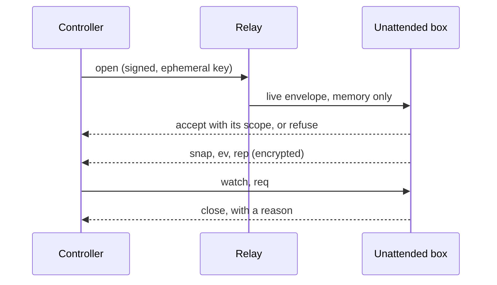

Design: [docs/specs/2026-11-07-link-operate.md](specs/2026-11-07-link-operate.md). An attended computer (the controller) shows the work of an [unattended box](unattended-device.md) as bases of its own GUI and drives it: the live terminal and the conversation of the box's towers, mains and workers, typing, Escape and steering, and the transcripts of runs that have finished. It is a remote base bridge, not a second viewer: the box's sb server runs its own GUI core for one operator session, the controller's sb server merges the result into its net, and the page is the usual page (the map, the comms view, the pad, Zen, a paired phone through the Mac).

It is **not** a shell: nothing here runs a command on the box except through the pi session you are typing into. A computer with no team, an unattended computer (it has no controller end), and a box whose policy grants nobody `operate` run none of it: no bridge, no policy watch, no timer, no log line.

#### Who may (the box side)

`operate` is a root-owned field of `/etc/straw-link/policy.json` (`src/link/policy.ts`; [setup](unattended-device.md#2-the-policy-file)): a map of device id to `team` or `box`. The box checks it on every request (`src/server/operatescope.ts`, `operateguard.ts`): this device is unattended and its policy reads; the sender is a current, attended member of the team the envelope came on; the sender is at `dispatch` in `trust` now and `operate` names it; and the unit the request names is in the session's scope. A failure answers with one word (`not-granted`, `not-admin`, `out-of-scope`, `local-only`, `policy`) and is logged.

<details>
<summary>Details</summary>

The scope of a session is the one team its `open` came on, when the device is a roster admin of that team (an admin of two teams holds two sessions), plus the box's own units for a `box` grant that asked for them. A unit belongs to a team only through the box's own records of who started it, never its folder (both teams of the real box work in `/srv/work`): an ally run by its run record, a main an ally run opened by its `opened` row and the pane's `sb_opened_by` token (both must agree, else it is nobody's), a member or subagent by the tab of its main.

The box's tower service, its local runs, a worker in a tab of its own and anything unattributed are the box's, which only a `box` grant reaches. A hq-signed grant can never carry `operate`.

</details>

#### The carrier

Operate rides the one `operate` Link kind, which the relay treats as a third class beside queued and ephemeral: `live`. The relay holds a live envelope in memory only, writes it to the one addressee's open streams as an SSE `live` event with no `id:` line, and never stores, replays or acknowledges it (an addressee with no stream gets nothing: the post answers `delivered: 0`).

<details>
<summary>Details</summary>

The holder fails closed on its side: it drops a live envelope older than 60 s (`stale-live`), one that names other than a single addressee, and one that arrives as a stored event; a post whose answer lacks `delivered` (a relay that stored it) stops live posts for an hour (`operate-relay-not-live`); a live post has a 5 s deadline and no retry. An attended sender may send only `open` and `frame`/`close`, an unattended one only `accept`, `refuse` and `frame`/`close`; a device lists `operate/1` in its `caps` only when it has a sink, and a box only while its policy grants someone `operate` (it changes within a tick).

**The session** (`src/link/operate.ts`). The controller sends a signed `open` with an ephemeral X25519 key; the box answers a signed `accept` (with the scope and its limits) or a `refuse` word. Both derive the same two directional keys with HKDF over the team, session id, both device ids and both public keys; every `frame` is ChaCha20-Poly1305 under a counter that only rises, so a relay or another team member sees a session id and two public keys, and a recorded session opens with neither a later team-key nor device-key leak.

The inner messages are deflated JSON: `snap` (the box's sliced net), `watch`, `ev` (history, cards, terminal frames), `req`/`rep` (one page request and its answer), `part` (a message over 160 KB in parts of at most 120 KB; caps 4 MB per message, 8 MB per session) and `ping`. A ping goes after 15 s of silence, 45 s without a frame ends the session on either side, and a session lasts at most 12 h (the controller reopens at once and the base never greys). A box holds at most 2 sessions per operator device per team and 6 in all, and refuses a session id it has seen.

**What the controller sees and can do** (`src/server/operatehost.ts`, `operatesanitize.ts`, `gui/box*.ts`). While any page of this computer's GUI is connected (its own and every paired phone), the sb server keeps one session per (box, team) to each unattended box whose fresh `caps` list `operate/1`, and closes them 60 s after the last page leaves. What the box sends is merged into the net after the local bases, each base with a `box` field (device, label, team, scope, `can`, and a state `live`, `unreachable` or `ended`). Every key and base id is rewritten to `x` and 16 hex of a hash, so no box key reaches a URL, and the controller keeps the way back.

On a live base the page does what it does for a local one: the map, tabs, units, marks, queued messages, todos and monitors; the comms view with the whole transcript and the composer (Send, follow-up, Edit of a queued message, slash completion, an upload up to 2 MB); the terminal tile with the pad (one key at a time, typed text, paste, chords from an editor-only list, Escape to interrupt) and its card; answers to the box's waits and questions, which are Zen items too; Dismiss and Quit on a unit or a squad; and, with the `box` scope, a tower's memory and its leave, new, retry, deliver and drop.

A fold "Earlier runs (n)" lists the box's finished agent sessions, and a second closed fold "Tower runs (n)" beside it lists the tower's own finished runs (the ledger's `ally`, `run` and `tower` roles: an ally run a teammate's message drove, an event run), so a tower's short runs are never rows among the agents; a row of either opens the run's read-only comms view, and Show more under both pages the one ledger. The ⋯ entries follow `box.can`. A remote base has no + Main, + Member, Stash or Quit base, anywhere.

When the box serves two of the controller's teams there is one session per team, and a base both show is one base: a unit's actions, and a squad's Quit, go to the session that shows it (a live one, the one with the box scope first); Earlier runs lists the runs of every live session, a run both list once; a workspace's cards come from every session that shows the base; and a unit whose own session is unreachable, or has a narrower reach than the base's, is off or limited on its own (`box.units`) while the rest of the base works. A box's waits keep their cards, their press and their resolved state through the controller, as text.

A dialog of a box's unit disables the choices only this computer may give and the ones that open a pane, whatever address the page was opened at.

**What the box refuses, whatever the controller asks** (`src/operateroutes.ts`, `src/keys.ts`, the seam in `src/operateseam.ts`). Every request runs with the guards a paired device meets, and more: no `!` shell line (typed, or an Enter on a draft that starts with one), no `/boss` line, no composer text into a non-empty editor, no Enter on any `/` draft, no `hereOnly` choice and no secret `value`; no `open/*`, `dirs`, `close/base`, `close/stash`, no focus change, no bare pane (`panes/*`), trust, `link/*`, `server/*`, `head/*` or document (`doc/*`).

A key goes to the pane only when the box's own pi confirms the key is an editor action in its live keybindings, pi holds the terminal (its stdin is raw and it is the one foreground `pi`), and a second Escape or Ctrl+C within a second is refused. Documents are never served: a card keeps its name and reason and no capability. A refusal is `operate_refused` with a reason word and a logged `operate-refused`.

Everything the box sends is treated as hostile on the controller: it is rebuilt from a schema (unknown fields dropped, keys with `..` or control characters refused with their subtree, labels as plain text, images of four types under 1 MB whose bytes match, replies capped), and what is refused is counted in `link.log` as `operate-bad-frame`. The head tower is nobody's scope, the box part included: no read, watch, key, close or answer reaches it, on the box (the owner of its key is nobody, and every route that names a unit refuses it) and on the controller (a box's key of its shape is never put in the tables).

A request admitted just before a revoke is checked once more, after the last look at the terminal, and does not write if the session has ended.

</details>

#### Pacing

The box sends whole visible screens, never row diffs: at most one every 500 ms while a screen changes and an empty "current" frame every 2 s while it is calm (so the controller's 3 s freshness holds on a slow link); the net snapshot at most once per 2 s and only when it changed. One budget of 900 envelopes a minute covers all the box's sessions; as it fills, the terminal slows to 1 s and then 2 s, then the snapshots to 4 s, and past it no bulk goes. An `accept`, `refuse`, `close` and `rep` are never held.

<details>
<summary>Details</summary>

The relay gives live traffic its own limits (1,200 envelopes and 8 MB a minute per sender and team, 3,000 a minute per team), apart from the 600 a minute queued kinds have. A page request the box does not answer in 20 s is a 504 ("the box did not answer; check before sending again").

</details>

#### Ending

The box ends a session with a `close` and a reason word the moment the grant or the scope is gone: on any roster change (the operator removed or no longer an admin of the team, the box removed), on a change of the policy (`fs.watch` on the file and its folder plus a 2 s poll of its stat, so a lowered or withdrawn `operate`, a policy that stops reading, or an `unattended` that is no more) and on a request whose recheck fails. One bad read ends operate: a roster or policy that cannot be read is no grant.

<details>
<summary>Details</summary>

A scope that narrows (an admin demoted, `box` lowered to `team`) narrows the session, and watches and terminals end when their unit leaves it. A holder that stops a team (removed, forked, left) closes the controller's sessions of it at once.

**History.** The box's server keeps `link/operate-ledger.jsonl` (mode 600, append-only, no content): per unit seen, its owner, dispatcher, role, scrubbed name, workspace label and session file path (the path never leaves the box), for 30 days and at most 2,000 rows. While the policy grants operate, the box reads its own net every 30 s, so a run that starts and ends unobserved still has a row. `GET api/transcripts` lists the rows in the session's scope whose file still exists; `api/history`, `api/entry` and `api/image` take `t<id>` keys that the ledger resolves, never a path from a request, and only a regular `.jsonl` inside pi's session folder is read.

</details>

#### Audit

The box writes to `link.log`, never with text, keys, choices or file content: `operate-open` (team, sender, session, verdict), `operate-open-throttled`, `operate-close` (by whom, reason, seconds), `operate-watch`, `operate-mirror`, `operate-input` (action, class, unit, pane, status), `operate-read`, `operate-refused`. An `open` the box refuses opens a 10 s window for that sender on that team in which further opens are dropped unlogged, so a member with no grant cannot spend the budget or push a real operator out of the log. On an unattended box the log rotates at 8 MiB and keeps four old copies (`link.log.1` to `.4`), so an hour of typing does not push a week of audit out (an attended computer: 1 MiB, one copy). The controller writes `operate-open`, `operate-close` and, counted, `operate-send-failed` and `operate-bad-frame`.

#### Failure and backoff

No frame for 45 s greys the base (`unreachable`, "last seen …", no typing or keys) and the controller reopens after 5 s, doubling to 5 minutes; the wait resets only after a session lived 60 s. A box that closes for `policy` or `roster` shows an `ended` base, a single line (「操作權限已撤銷」, 「這台機器不讓這部裝置操作」 for a refusal shown once, or "Operating this machine has ended"), and is tried again after a minute. A refusal of the grant itself is remembered for 10 minutes and shows its line once; a refusal for "not now" (`unavailable`, a full slot, a session id seen before) is retried with the backoff and says nothing.

<details>
<summary>Details</summary>

A box that stops, is overloaded or swaps its GUI greys the base and is reopened with the backoff. A controller that is not offered a box any more (removed, attended, no `operate/1`) drops it from the map.

</details>

#### `/boss link operate`

On this computer's own page and in pi only (a slash command of the boss's typed input, no tool; a paired device's request is refused). `/boss link operate` lists the sessions that have opened (box, team, scope, state, since, pages). `/boss link operate off` ends every session and keeps operate off until `/boss link operate on`: it writes `link/operate-off.json` (`{"since": <ms>}`, mode 600, in the server's state folder), the host opens nothing and stops its clock while the file is there, across a GUI and a server that start again, and a file that is there but cannot be read as that still means off.

<details>
<summary>Details</summary>

`off` says when the file could not be written (then it is off only until the server stops); `on` says when it could not be removed (it stays off). The list says "off since <time>" while it is off.

</details>

### The work board

A main says what it is doing in one place, and a tower reads it before it routes work (`src/board.ts`, `boardauto.ts`, `boardfill.ts`, `boardset.ts`, `boardread.ts`; the design is `docs/specs/2026-10-25-straw-link.md`, Work board). It works on one computer without Straw Link, and crosses to allies' towers when a team is set up.

#### Entries

**An entry** is `now` (1 to 120 characters, one line) and 0 to 8 checklist items (`t` of 1 to 80 characters, `done`). Whitespace folds to one space; a control or format character (an escape, a bidi override, a zero-width mark) is refused on write with the reason, never cut silently. Every reader checks the same rules and cuts again, so a file that skipped them is held to them, and a file that fails the structure check is ignored. The entry carries no name, workspace, tab, or state: a reader joins those from the net when it reads.

<details>
<summary>Details</summary>

The file also says who wrote it (`src`: `set` for `board_set`, `todo` for the auto-fill, with the todo list's `count` of tasks done and in all); `src` and `count` stay on this computer and are not in the `board` message.

</details>

#### `board_set({ now, items })`

`board_set({ now, items })` replaces the session's whole entry; it overrides the auto-fill (below). It is registered for joined sessions that are not towers, and refused unless the session is its tab's main at the call (a member, a demoted main, a tower, and a subagent do not write). It writes only `<state dir>/board/<own session id>.json` (folder 700, file 600, a temporary file renamed over it); no parameter names another session's file. Its answer says where the text goes: `local towers`, and `team <name> (<n> devices)` for each team whose project holds the main's pane directory and whose `share` is `status`. `board_set({ auto: true })` (no text) hands the board back to auto-fill at once.

<details>
<summary>Details</summary>

`board_set({ clear: true })` (no text, no `auto`) deletes the session's entry, and auto-fill writes nothing until the todo list or the name moves; it is what a main calls when its work ends or is shelved, and `prompts/main.md` makes that part of "done". A cleared line, and a finished line removed after its 30 minutes, stay off across a `/reload` (the session keeps a `straw-boss-board` entry with the withdrawn key); a line a reload finds on file is kept with its own age, and a quit with no turn after a reload deletes it. A main that commands work (a subagent of it runs) is never marked `stale`.

</details>

#### Auto-fill

Auto-fill (`src/boardauto.ts`, `src/boardfill.ts`). The board fills itself in the main's own session; the server takes no part. At the end of a turn, after a tool call, and after a move in the session tree or a compaction, a main reads its todo list (rpiv-todo's snapshots on its branch, the same reading as the card's todo summary) and its name (`boss_rename`, or `/name`; pi's default name, the session id, is no name) and writes the entry.

<details>
<summary>Details</summary>

`now` is `<name>: <task in progress>` (its `activeForm`, else its subject), else `<name>: next <first pending>`, else `<name>: done (n/n)`; with no todo list there is no entry, a name alone being no work (it would stay on the board after the work is gone); with no name the line has no prefix. A finished list (`done (n/n)`) is written once and goes 30 minutes later: the main removes it at its next reading, a reader does not show it, and a tower's `board_read` deletes the file. The items are the tasks, in progress first, then pending in id order, then completed (highest id first), at most 8. `boss_rename` refills the line at once.

- **Scrub.** The text is cleaned (NFKC, format characters removed) and scrubbed before it is cut to the board's caps (nothing is refused, since no model wrote it for the board): an absolute path inside the session's working folder becomes relative to it; any other path (POSIX, `~/`, `$HOME/`, `%USERPROFILE%\`, `C:\`, UNC, or `../` out of the folder) becomes `…`; a URL becomes its host (`…` when it has userinfo or no host); an email address and a secret-shaped token (`sk-`, `ghp_`/`gho_`, `glpat-`, `xox?-`, `AKIA`, a JWT, `npm_`, `sk_live_`/`rk_live_`/`pk_live_`, hex of 32 or more with or without `0x`, a letters-and-digits run of 32 or more in both cases, `Password=`/`Pwd=` and its value) become `…`.

  A task that is more than half `…` is dropped, and the last of the 8 places says `(n hidden)` (marked done, so no reader counts it among the open tasks). Customer names cannot be found by pattern: that is a documented limit, and the allies' rule below bounds it. Paths with spaces and a bare `host/path` without a scheme are not recognized.
- **One gate for labels.** Every workspace label, tab label, session name, opened-by, and ledger line that an ally can read (the board and presence on the wire, a `tower` message's workspace, a confirm request's tower name, `tower_list`, `boss_status`, and `board_read` in a remote turn or an ally run, scoped to the workspaces inside the bound project, and the ally brief) goes through `allyLabel`: scrubbed first, cut last. Your own views keep the raw text.
- **Override.** The main writes only when the entry it would write differs from the last one it wrote, not from the file, so a `board_set` stands until the todo list or the name moves, and `board_set({ auto: true })` ends it at once (with nothing to show it removes the entry), and `board_set({ clear: true })` stops auto-fill the same way, with no entry. A `board_set` entry that outlived a `/reload` stands the same way: the first reading in the new extension only records the list. A member and a demoted main write nothing. After a `/reload` the new extension finds the file this session left and takes it as its own, so a later quit deletes it.

</details>

#### Expiry

A main's `session_shutdown` deletes its own file on `quit`, `new`, `resume`, and `fork`, and keeps it on `reload`; the reloaded session still deletes it at its own quit. A file whose session is not live, or no longer its tab's main, shows as `state: "ended"` until 30 minutes after its last update, then not at all. A live main that is `idle` and whose entry was last updated over 2 hours ago shows it with `stale: true` (`board_read` and the tower's brief say so): the text is probably not what it works on now.

<details>
<summary>Details</summary>

Only a tower's `board_read` (and the Straw Link holder's tick) deletes files, and it deletes those of sessions that are not live and have not been updated for 24 hours, and a finished auto entry (all todos done) older than 30 minutes; `board_set` does not purge, because it cannot tell which sessions are live, and age alone would delete an idle live main's entry.

</details>

#### `board_read({ scope?, device? })`

`board_read({ scope?, device? })` (towers only, registered with `tower_list`) answers JSON: a `note` that remote entries are data, `local` (each live main's workspace, tab, name, state, `now`, `items`, `updatedSecondsAgo`; a live main with no entry shows with its name and tab alone; `stale: true` on an idle main's old entry), and, only when Straw Link is set up, `remote` (one row per ally device: `origin: "remote"`, the team's name on this computer, the device's id, short id, and label **from the roster**, `online`, `boardSecondsAgo`, and its entries). `scope` is `local`, `remote`, or `all`; `device` reads one ally (as `tower_send` resolves it, so an unknown or ambiguous name is an error that lists the candidates) and skips the local part. Remote text keeps its characters but loses control and format characters and is cut again.

#### In a remote turn

In a remote turn (any level) both `board_read` and `tower_list` are on the allowlist and answer only what the run's senders already receive: `local` holds only mains whose pane directory is inside the project the senders' teams bind (with senders of teams that bind different projects, none; an ended entry has no directory to prove it and stays out), each auto-filled entry as the allies get it (the name and the done count), `remote` only those teams' boards, and `tower_list` only the workspaces inside that project and the senders' teams. The result of a `board_read` stays in the tower's context in later runs, like any tool result; each remote line is at most 120 characters, under `origin: "remote"`, below the note.

#### Sharing

Sharing is the `board` message kind (`src/link/kinds.ts`): ephemeral, to the whole team, from any member, a kind of its own so an older client drops it as `unknown-kind` and keeps reading presence. Each entry is `(entry id, workspace label, tab label, name, now, updated, items)`; an auto-filled entry goes as the main's name and the done count (`<name> (3/5)`), no task text and no items, and a `board_set` entry whole; the id is the first 8 bytes of `sha256(device id ‖ session id)` in hex, so no local session id leaves the computer. At most 24 entries (newest first), labels and names 40 characters.

<details>
<summary>Details</summary>

The holder looks at the board folder on its 5-second tick, once per team per 15 seconds (a change goes out within about 20 seconds): it sends the live mains whose pane directory is inside that team's project, when `share` is `status` (`presence` sends none), when the board differs from the last one it sent (compared by hash, without `ts`), when the stream (re)started or the epoch changed, and once an hour unchanged; the last bound entry going sends one empty board, which clears the allies' copy. A relay that refuses the kind (`unknown-kind`) is logged once and left alone for an hour; nobody is told. `ts` rises by at least 1 per board.

</details>

#### Holding allies' boards

The holder keeps each ally's last board in memory only (the relay gives it back at the next stream). A device that leaves the roster loses its board at once; one offline for more than 2 hours, or whose board is older than 7 days, is not shown. A board never starts a turn, enters the inbox, or reaches a main, a member, or the GUI.

#### On the boss's own page and in pi

On the boss's own page and in pi (`src/boardview.ts`, `server/boardpanel.ts`, `gui/board.ts`; the design is `docs/specs/2026-11-09-board-view.md`). The earlier rule, that a board never reaches the GUI, was about allies' boards, and it stands: allies' boards are never shown there. This computer's own board is, so the boss can see whether lines are cleaned up when work ends.

<details>
<summary>Details</summary>

The net snapshot carries it as `board` (like `yards`, it never goes to Straw Link, a remote turn or an operate session; the operate table refuses `board/**`): one row per live main in tab order (with its line, if it wrote one; without, its name and tab only), then one row for every entry whose session is not a live main, **for as long as its file exists** (a tower's `board_read` still drops an ended entry after 30 minutes).

Rows are built with the same `readEntries` and `joinLocal` as `board_read`, raw (the boss's own view keeps the text as `board_read` does outside a remote turn) and cut to the board's caps (the folder is parsed again only when a file in it changed: its names, sizes, times and inodes are the check); a row carries when the line was written (`updated`), not its age, so the snapshot moves only when the board does.

The head tower's page has a **Work board** section under the log, folded to one line (`12 lines (2 idle, 1 ended)`); open, the rows are grouped by workspace in tab order, ended ones last. A live main's name opens its session page; everything a row says is drawn as text. **Ask progress** (live mains) posts the fixed English prompt to the main's input as a steering message and reads "Asked" for 60 s.

**Clear** (only a row the server marked `clearable`: the session is not a live main, or an idle live main's line is over 2 hours old) asks in the page's sheet, then posts `board/clear {session}`: the server takes only a session id that names a file in the board folder, reads the board again itself (never the page's claim), refuses a line its writer wrote again meanwhile, deletes the file, and tells the writer once when its session is still open (an idle main, or a session that is no longer a main, shown as "not a main"): one `kind=board_clear` message (`The boss cleared your work-board line…`), and the answer says `told: "delivered"` (its connection took it), `"queued"` (the broker holds it) or `false`, which the page reads as "Cleared; it was told", "Cleared; the reminder is queued" and "Cleared"; a session that is not live at all is told nothing.

The button is disabled while its request is on its way. The writer's auto-fill compares with what it last wrote, so a cleared line comes back only when its todo list or name moves. `/boss board` prints the same rows as text. Zen is unchanged.

</details>

### Auto mode

For when the boss is away and nothing may wait for them (`src/auto.ts`, `autostate.ts`, `autotext.ts`, `autoscope.ts`, `bossauto.ts`, `declined.ts`, `server/automode.ts`, `autoops.ts`, `autoback.ts`, `autotower.ts`, `gui/auto.ts`; the design is `docs/specs/2026-11-09-auto-mode.md`). It covers this computer and every Herdr slot on it; Straw Link teammates are not told, and an unattended device has none.

The states and the doors between them:

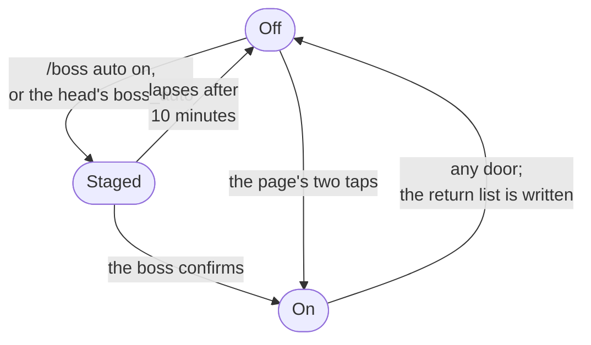

#### One state, written by the server only

The primary server writes `<state>/auto.json` (`on`, `since`, who switched it, a `rev` and a hash) and, before it, `auto-own.json` (the same record, a staged `on`, and the head words it has used). Every session reads `auto.json`; a write that is not the server's own is put back as a new rev within 2 s, cancels nothing, and is listed. An unreadable file keeps the last state. Nothing is cancelled until the server's `auto-check` says the rev is its own; refusals follow the file at once.

#### Who switches it

Only the boss's own act: a typed `/boss auto` (`on` stages a request and the terminal asks; nothing over the socket switches on in one step), the GUI switch, and the head tower's `boss_auto`. The head's tool acts on the boss's words in the turn the run reports as started by the boss (an event that is no press, or a line typed at the head pane), which the server reads against a fixed list: a question, a negation, two directions at once, or words used before are refused. An `on` from any door but the GUI's two taps needs the confirm of a pending record, which lapses after 10 minutes and tells the head. A run token, an operate session, and a workspace tower get nothing.

#### What it refuses

In every session (main, member, train, subagent) a new `ask_user_question`, `question`, `robot_hand`, `secret_drop`, `link_request`, or `mcp` browser login is refused with a note that says the boss is away; a confirm or prompt opened inside a tool call is answered as Escape without being drawn; a Straw Link gate confirm is denied (`no one can confirm this here now`); pi's trust question is answered "not trusted", except in a pane the page's `open/base` started: a person asked for that project, so its question is asked as usual.

<details>
<summary>Details</summary>

The sb server keeps the list of the panes it started, each with its folder, in its memory until the open has joined, and the pane's pi asks it over the control socket (`open-intent`); no answer, an older server, or a server that started again is the usual "not trusted", and no listing is written to or read from disk for it. The asker finds the server through its record (`server.json`), as every control request does, so a process of the same user that replaces that record and answers the socket can say yes for any pane; that grants no trust, and the question only waits for a person. The boss's own `/boss` commands still draw their confirms. `call_tower`, `intercom ask`, `caller_ping`, monitors, loops, and `subagent` are not refused; `show_doc` is allowed and says not to wait for its form.

</details>

#### What it cancels

When it turns on, a session that sees the server's `auto-check` cancels the waits it has open: an owner that takes a cancel gets one, the rest go with the turn (aborted, then a message starts the next turn), and the result becomes sb's text. A server backstop cancels, once per dialog, a wait older than 30 s that an older session left, and lists those with no cancel as still waiting. Each session is told once when it turns on and once when it ends.

#### Towers

Every tower and head brief gains one line while it is on. A boss wait recorded then is parked (`parked` on the memory entry), and so is every open one when it turns on; the card's raiser gets one `wait_parked` message. A `tower_reply` to a session whose `blocked` `call_tower` the run took is noted with its `basis` (a memory id or a boss event that is no press, else `none`). A secret card's start button is refused.

#### The return list

When it ends by any door the server writes `<state>/auto-report.json` for that period (parked waits per tower and the head, cancels and refusals per session, replies a tower decided, waits that could not be cancelled, foreign writes), makes the parked cards ordinary again, and gives the head one event. `/boss auto off` prints it, `boss_status` shows its summary, and `/boss memory done|choose|decline W<n>` acts on a parked wait.

#### What remains possible

A process of the same user can write files, speak to the control socket, or type into a pane. Every switch and staging is notified to every pane and listed with its requester; the head's confirm record is the one a forged request cannot skip.

### Opening a main

When no session owns a request, a tower opens a main for it itself with `boss_open_main`, without asking the user first. It resolves the sender, makes one new tab in the tower's own workspace without taking focus, starts pi there as a main, and hands over the request. Any failure closes the tab it made, with nothing handed over.

<details>
<summary>Details</summary>

A tower routes a request to the main that owns it, or to the member doing that work. When no session owns it, the tower no longer returns it to the sender: it calls its own tool, `boss_open_main`, and does not ask the user first. Its other limits stay: it runs no shell command, sends no process signal, and edits no file. The tool is registered in the tower only, takes the request (verbatim, with every user decision it quotes kept verbatim), the sender (intercom name or session id), and an optional tab label, and does this:

1. Resolves the sender to one live session; no live session of that name or id fails before anything opens, because the new main could not report back.
2. Creates one tab in the tower's own workspace, in the workspace's checkout path (the tower's cwd when it has none), with `--no-focus` and `STRAW_BOSS_ROLE=main`. It never switches the user's focus and never types into a pane that already exists. Work for another workspace goes to that workspace's tower with `call_tower`; the tool opens nowhere else.
3. Starts pi in that tab's pane under the Herdr agent name `main-<8 hex>`, with pi's default model (the `towerModel` setting is for towers only). A pi started with `STRAW_BOSS_ROLE=main` joins like any session and then promotes itself as `boss_promote` would: a tab that has a live main refuses it and the pi stays a member with a warning.
4. Waits up to 60 s for that pane to publish `sb_role=main`, then sends the new main one intercom message, under the [header](#talking-between-towers) (`kind=handoff`, `reply=expected`), with the sender's name and session id, the tower's name and session id, and the request verbatim, so its first prompt is the main agent's. The message tells the main to report the outcome to the sender and to the tower that opened it, then wait: the tower closes it ([Closing an opened main](#closing-an-opened-main)).

The tool also opens a train (`role: "train"`, the manifest as the request, once per code; see [Merge train](#merge-train)). A train sits in a tab of its own, is not counted in the two mains below, and has no per-sender limit; the project's `integration.maxTrains` (default 3, over every workspace) limits it instead, and the open is refused when the merge train is off.

Since 0.74.0 it is also the door of a project's integrator (`role: "integrator"`, in a run of the sb server only; see [Merge train](#merge-train), Hand-off and routing): that main is the tower's own, so its pane is marked `sb_opened_by=integ:<project>` and counts toward neither limit below; a tower opens at most 2 integrators in its workspace, and a project has one on the whole computer.

Limits, counted from live Herdr panes so they survive a tower restart: the tool marks the new pane with a token (`sb_opened_by=<sender session id>`, kept fresh by the opened main) and refuses, with an error the tower relays to the sender, when the workspace already has 2 live mains opened by towers or the sender already has one (opens are serialised, so one in flight counts). A refusal is not remembered, so the same request may be tried again once a main has finished.

`STRAW_BOSS_ROLE=main` stays in the new tab's shell, so a pi promotes itself only when the pane also carries the one-time token `sb_open_main`, which the first such pi consumes; a later pi started in that shell stays a member.

Any failure (the start, the wait, the delivery) closes the tab the tool created, nothing having been handed over, and reaches the tower's model as an error that its prompt tells it to relay to the sender. The tower remembers each sender and request for the life of its session: the same request never opens a second main, whether the first attempt is still running, succeeded (the repeat answers that a main was already opened), or failed (the repeat is refused, not retried). A tower restarted in between forgets, and different wording is a different request.

</details>

### Before pi starts in a folder: the settings check

pi 1.4.0 reads `<folder>/.pi/settings.json` at startup, whole and with no size limit, before any extension loads and before the trust question (`SettingsManager.create(cwd, agentDir)` with the project trusted by default, in `dist/main.js`; upstream issue [earendil-works/pi#11421](https://github.com/earendil-works/pi/issues/11421)). A link to `/dev/zero` makes pi grow without bound, `/dev/stdin` or a FIFO blocks it for good, and a huge file is read whole. No extension can step in, so whoever starts pi looks first: Straw Boss does it before it creates anything for a new pi (`src/trust/settings.ts`).

#### The probe

Inspecting the path in the boss's own process always diverges from what the kernel does for pi (`.pi -> /proc/self/cwd` means whoever looks, link targets that are not UTF-8, `/DEV` on a case-insensitive disk, Windows paths), so the kernel resolves it. Cost: one `lstat` of `<folder>/.pi` when there is no `.pi` (`ENOENT`/`ENOTDIR` means no file, no child); when `.pi` exists, one short child process (`process.execPath`, `--max-old-space-size=32`, no input, working directory `<folder>`, the same as pi's). The child first `lstat`s `.pi` and `.pi/settings.json` relative to that directory.

<details>
<summary>Details</summary>

With no link involved, `ENOENT`, `ENOTDIR`, or `EACCES` means no file (pi's `existsSync` is false or its read error is caught: `tryLoadFromStorage` in `core/settings-manager.js`); a link it cannot follow or open is refused, whatever the error. It then `stat`s the path, following links, before it opens anything: a directory is fine (pi catches `EISDIR`), and anything but a regular file is `special` and is never opened, so a FIFO's writer is not released and no device is touched. A regular file is opened with `O_RDONLY|O_NONBLOCK`, `fstat`ed again, and read through the descriptor with a fixed buffer, whatever `st_size` says (so `/proc/self/pagemap`, size 0 and endless, stops at once), `large` when more than 256 KB arrive. It prints one JSON line (the parent cuts its output at 4 KB). Any other error, a link loop (`ELOOP`) included, refuses as `unreadable`.

</details>

#### What is refused

A `settings.json` that is not a plain file (a device, FIFO, or socket, or a link that ends at one), one over 256 KB, one that cannot be looked at (`unreadable`), a link the check could not follow or open, whatever the reason (a dangling link is refused too, though pi itself would skip it: a per-process link such as `/proc/self/fd/17` is missing for the check but is pi's own terminal for pi), and one the check did not finish (also a failed start of the check itself): no answer in 5 seconds (the child is killed), a crash, or output that is not the expected line is `unchecked` ("could not be checked in time"). **What is fine.**

<details>
<summary>Details</summary>

No `.pi`, no file, a directory at the path, and a plain file of at most 256 KB, also through links. A file swapped for a device or a link between the check and pi's start is not covered; the window is the few seconds of the opening. The look is asynchronous, so the boss's event loop is not blocked; every opening (a new main, member, or base, the tower's tab, an opened main, a pop) refuses before it creates anything. An adopted tower pane that reports no folder is checked as the folder the tower is for (the workspace's checkout, else the opening cwd), since herdr gave nothing better.

</details>

#### Bounded stall

A `settings.json` on a hung network or FUSE mount can stall the read; the child's timeout bounds it, and the opening is then refused as `unchecked`. **Remaining gap.** The child's file descriptors differ from pi's: its `/dev/stdin` and `/dev/fd/0` are `/dev/null`, its stdout and stderr are pipes. A link to `/dev/stdin` or `/dev/fd/N` therefore never shows pi's real descriptor: the child's pipes, sockets, and devices are `special`, and a number the child has not opened is refused as a link it cannot follow. On macOS the child's `/dev/fd/6`, `8`, and `10` are the directory `/`, as pi's are, so such a link is allowed as a directory.

<details>
<summary>Details</summary>

The check is wrong only if pi holds a regular file at a number where the child holds something else, which no tab Straw Boss opens arranges.

</details>

#### Where it runs

Every path that starts pi in a folder: the GUI's + New base, + New member (new tab and split), and + Main (`spawn.ts`), the tower's `boss_open_main` (`opener.ts`), a tower's own tab (`towertab.ts`, new or adopted), and a stash pop from the GUI or `/boss pop` (`stash.ts`; every folder of the stash is looked at before the new workspace is made). A refusal comes before the workspace, tab, or pane is created, so there is nothing to clean up; a stash stays under its name.

#### What the person sees

The deploy panel fails its first step (`create`) and says, in the page's language (zh-TW first, English), that nothing was started, which file, and why; a refused pop shows the same in its dialog. The server's answer carries the facts (`settings: {path, why, size?, limit?, code?}`) and the page words them. A tool or the LLM (`boss_open_main`, `/boss pop`) gets one English sentence with the same path and reason. The upstream issue is named here only, never in the interface.

<details>
<summary>Details</summary>

This guard can be removed once pi fixes #11421. When pi is newer than 1.4.0, check `SettingsManager.create` in its `dist/main.js` (and `FileSettingsStorage` in `core/settings-manager.js`): once it skips an untrusted project's `settings.json` until the trust question is answered, or reads it with a size and file-type limit, delete `src/trust/settings.ts`, its calls in the paths above, and the `deploy_settings_*` messages.

</details>

### Closing an opened main

A main a tower opened tells the sender and the tower when its work is done, then waits; the tower closes it with `boss_close_main`, unless the main says it awaits a boss decision. The tower may close only a main of its own workspace that it opened itself and that Herdr reports idle or done, and the main decides for itself whether to accept the request to quit.

<details>
<summary>Details</summary>

A main a tower opened (`boss_open_main`) tells the sender and the tower when its work is done, then waits; the tower closes it with `boss_close_main`, unless the main says it awaits a boss decision. The handoff message names both (`Sender:` and `Tower:` with their session ids) and says to report the outcome to the sender with `intercom send` and to the tower with `call_tower` (`why: milestone`, no reply); the main prompt repeats it for a tab a tower opened. The tool is registered in towers only and takes a main's intercom name or session id. The tower checks first, from Herdr's view:

- the session is in the tower's own workspace and is a main (`sb_role=main`);
- its pane carries `sb_opened_by`, so a tower opened it: a main the boss opened is never closed by a tower;
- Herdr reports it `idle` or `done`.

Then it asks the main's own extension to quit as `/boss close` does, over the intercom extension channel `straw-boss/control` (the "capable" audience; a message is for one session, `to`; the sender id is self-reported like every pi-intercom identity, so the channel rests on the same-user trust boundary: a same-user process posing as the tower could close an idle tower-opened main, which that user can already do with `herdr pane close`). It does not use the GUI server, which may be stopped, and a bridge's `close` answers only that server. Only a main opened by a tower registers the channel (right after it consumes `sb_open_main`), and so does every tower.

The opener is saved in the session with its pane, and only the same pi in that pane restores it: after a `/reload`, `/resume`, or `/fork` there the main writes `sb_opened_by` again and registers the channel again. A pi started anew (`pi --session`, `pi -c`, a restart after `/boss pop`) and a session in any other pane count as the boss's main, which no tower closes, and so does a `/new` session, which carries no opener. A later claim (a pop's) saves its own opener, none, over the earlier one.

```text
{type: "close-main", to: <main session id>, reqId}                              tower → main
{type: "close-main-result", to: <tower session id>, reqId, accepted, reason?, busy?}   main → tower
```

The main decides, and accepts only when all of these hold: the sender is the tower token holder of its workspace, its own pane carries `sb_opened_by`, and nothing running would be lost, checked as a stash checks a session (no running turn, no queued message, no open dialog, no running background monitor, from the bridge's `stashCheck`) plus no subagent still running (pi-herdr-agents' activity files under its session). On accept it answers and then quits the way `/boss close` does: pi shuts down, its tokens are cleared, and its pane closes (an emptied tab with it). A refusal says why.

One for something running (`busy: true`) is asked again every 3 s for up to 15 s, since a main sends its done report from the turn that ends right after; any other refusal is final. A main that does not answer within 10 s (a pi-straw-boss without the channel) leaves the tool with an error and closes nothing. After an accept the tool waits up to 30 s for the session to leave intercom and says whether it did.

The tower runs pi's default model unless you set one for it in `~/.pi/agent/straw-boss/config.json` (under `PI_CODING_AGENT_DIR` when that is set):

```json
{ "towerModel": "claude-bridge/claude-sonnet-5-5" }
```

Straw Boss passes it to pi as `--model` whenever it starts a tower, and reads the file at each start, so a change applies to the next tower without a reload. A tower already running keeps its model; restart it (or switch with `/model` in its pane) to change that one.

</details>

### Merge train

A project may give each app a merge train: one integrator main merges the coordinators' work instead of each coordinator merging for itself. It is opt-in. The procedure is prompt-only and not in Straw Boss, but since 0.65.0 the extension and the server do read and write some files for it (the trainboards and car files, the car notices, the `landed` git check, the sweep, `apps.json`'s `integration.accept` and `stages`; see [Trains as their own workers](#trains-as-their-own-workers)). Since 0.60.0 the procedure is not in Straw Boss: it is the `integrating` (merge) and `deploying` (deploy) skills of whichever package implements the [merge-train contract](#requires-skills-that-declare-the-merge-train-contract) (pi-anchorloop is one), and Straw Boss binds the places those skills leave open.

How a car travels, from slip to landing:

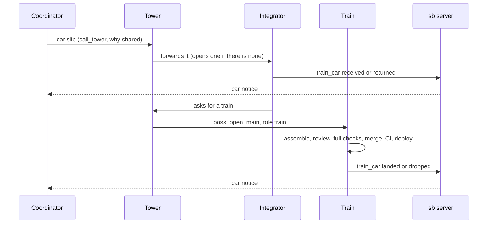

A car has four states, set with `train_car` by the integrator and the train:

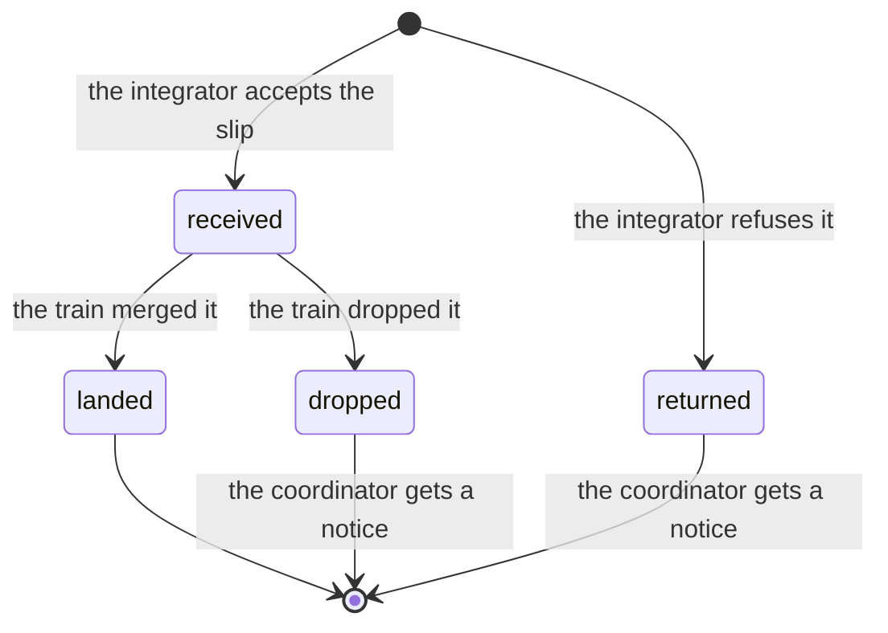

[`prompts/apps-config.md`](../prompts/apps-config.md) holds the `apps.json` fields, [`prompts/integrator.md`](../prompts/integrator.md) the integrator's role, and the design records are [`docs/specs/2026-10-30-merge-train.md`](specs/2026-10-30-merge-train.md), [`docs/specs/2026-11-05-train-stages.md`](specs/2026-11-05-train-stages.md), and [`docs/specs/2026-11-06-seam-bindings.md`](specs/2026-11-06-seam-bindings.md) (which maps every line of the old integrator prompt to its skill location).

#### Requires skills that declare the merge-train contract

Straw Boss requires no skills package by name. The train's prompts assume version 1 of the merge-train contract of the `integrating` and `deploying` skills (the [merge train guide](https://wayne930242.github.io/pi-straw-boss/docs/guide/merge-train/#the-merge-train-contract) lists what it holds), and a skill declares the versions it implements in its frontmatter, as `merge-train-contract: "1"` under `metadata:`. The extension checks it (`src/train/contract.ts`): it asks pi which skills this session loaded (`pi.getCommands()`, so the file is the `SKILL.md` the model reads, whichever package ships it) and reads each one's declaration. A train's and the integrator's `todo` and `MonitorCreate` calls that change something are refused with the reason while pi loaded no `integrating` or no `deploying`, a file cannot be read, a skill declares none, or its versions do not include 1; a passing answer is read at most once a minute, a refusal again on every call. One exception covers the versions released before the declaration existed (`src/train/contract-legacy.ts`, the only place that names a package): an undeclared skill inside pi-anchorloop 2.11.0 or newer counts as version 1. A main or integrator that cannot load `integrating` or `deploying` calls the tower with `why=blocked` naming the merge-train contract, and departs nothing. With the train off none of this is loaded.

#### Seam bindings

`integrating` names six seams (Handoff route, Batch owner, Approval, Record, Escalation route, Settings) and reads one `## Seam bindings` block from the session's instructions. Straw Boss's block is the last text of `main.md`, inside the integration markers: `main.md` is the system prompt of every main, a coordinator and the integrator alike, so each session holds exactly one block, in front of it before its first step, with no file to read. The tower runs no skill and holds none; its prompts carry only the forwarding.

<details>
<summary>Details</summary>

The block binds: the **Handoff route** to `call_tower` `why: shared`, which the tower forwards (`tower_reply` with `forward`, its header naming the sender as `fwd-from`) to the project's one integrator, and the sb server sends every car notice to the slip's `coordinator` (which must be that sender) by session id; the **Batch owner** to the project's one integrator main (opened by the tower with `boss_open_main`, named `integ <project>`, closed by the tower after its idle `milestone`), which schedules trains and opens each with `boss_open_main` `role: "train"` (a departed train runs in a `train` session of its own), with train worktrees at `~/.herdr/worktrees/<repo>/train-<code>`; **Approval** to the boss, whose covering words the coordinator quotes in the slip's `auth` from its brief or the boss's messages, asking with its question tool only when they are missing (an overnight train must not stall on a question), each deploy target `auto` or `strict` by `integration.targets`; the **Record** to `trains/<project>/<app>.json` (the integrator's index) and `trains/<project>/<app>/<code>.json` (one per train, its train's) in the state folder; the **Escalation route** to `call_tower` (`blocked`; idle as `milestone`; an announced deploy as `shared` naming the target); **Settings** to `apps.json`'s `integration`. With the train off the block drops out and anchorloop's defaults apply: the session asks the boss before a merge or a deploy.

</details>

#### Principle

`integrating`'s Principle: before handoff a coordinator's anchor is its review (P0 and P1 clear), behaviour tests for its own change, and the project skill's `Light checks`; format, lint, build, full type-check, full suites, publish, and similar gates run once, by the integrator, on the integrated head.

#### Fields

`apps.json` has a top-level `integration` (`skill`, `maxCars` 4, `maxWaitMin` 60, `maxTrains` 3) and a per-app `integration` (`base`, optional `skill`, `stages`, `accept`, and `targets`). An app without the field keeps today's flow.

#### Skill contract

The project skill is found by the headings in `integrating`'s Project skill contract (`## Light checks`, `## Train assembly`, `## Full gates`, `## Merge`, `## Post-merge`, `## Deploy` and `## Deploy verify` for a `deploy` stage, `## Acceptance` for a project whose apps set `integration.accept`, optional `## Urgent lane` and `## Load`). The integrator does not depart, and calls the tower with `why=blocked`, if a required one is missing.

#### Hand-off and routing

A coordinator sends a car slip with `call_tower` `why=shared`. The tower does not answer go: it sends the slip to the project's one integrator and closes that main when it reports idle. The integrator tells the coordinator nothing itself: it sets the car's state with `train_car` and the sb server sends the notice, so the tower relays nothing back. Since 0.74.0 the tower opens the integrator itself, in code (`src/integrator.ts`, `src/opener.ts`, `src/server/runtools.ts`): a tower run calls `boss_open_main` with `role: "integrator"`, the slip as the request, and its sender.

<details>
<summary>Details</summary>

The project is not the run's word: the opener reads it from the workspace's checkout (`integration.project` at the top of its `apps.json`, else the folder name of its repository, which every worktree of it shares) and refuses another word, so a made-up name opens nothing. A run is shown no event id, so the server finds the slip itself: the newest `call_tower` (`why=shared`) the run took from that sender whose text carries the request's `head:`.

It then finds the project's integrator on the whole computer (a main of kind integrator that a tower marked for the project, or that is named `integ <project>`; a main opened for a teammate's device is never one, whatever it calls itself, by its pane token and by the route table) or opens one in its workspace, named `integ <project>` so the new pi is of kind integrator before it is handed anything, and forwards the slip as its sender wrote it, stamped `fwd` and `fwd-from`: nothing the run typed is forwarded, so a run cannot change a slip's `auth`.

The integrator is the tower's own main: it counts toward neither the two opened mains of the workspace nor its sender's one, a tower opens at most 2 in its workspace (the boss's busiest workspace ran two), and a project never has two: an app whose trains a ledger already keeps under another project (`trains/<project>/<app>.json`) is refused with that project's name; an integrator that works in another repository (by its pane's folder; a worktree counts with its repository) takes no slip of this one; the opens of one project wait for each other across every tower's opener, so two workspaces that take a slip at the same moment open one; a marked pane whose pi has not joined, a marked main that is of another kind now, and two mains that both answer as the project's integrator each refuse the open and say which.

That rule is for the integrators the door opens. A project that already runs integrators under names of their own (before 0.74.0 the boss opened one per app, such as `integ FE2` and `integ v3` in one checkout) keeps them: when a live main of kind integrator that no tower marked and that was not opened for a teammate's device is in the tower's workspace or works in the checkout (an app's own repository below it counts), and it is not the one main named `integ <project>`, the door opens nothing, counts none of them toward its limits, and picks none.

They are looked for before the ledger rule, so a ledger kept under one of their own names (`trains/FE2/<app>.json`) refuses nothing. Its refusal names them and, for a local run, the slip's event id, so the run forwards as it did in 0.73: `tower_reply` with `to` (the integrator that runs that app's trains), the slip as the message, and `forward` (that id), which the code stamps `fwd` and `fwd-from` from the event the run took.

What goes out under the stamp is the event's own text, not the message the run typed; the target has to be one of the integrators the door named for that slip; and the slip of a main opened for a teammate's device, or such a main as the target, is refused by the same two witnesses (its pane token, any workspace's route table). An ally run is given no id, since it forwards no slip; below `dispatch` it asks the opener for its refusals before the gate, so the boss is asked nothing for a call the opener refuses.

A kept integrator leaves no durable sign, so it has to sit in the tower's workspace or work in the checkout to be seen. When the project's ledger exists (`trains/<project>/<app>.json`) and no integrator of it is seen, the door looks once more after 2 s; if none is seen then, it opens one only when no unmarked main of kind integrator is alive anywhere on the computer (a dead integrator must be replaceable), and otherwise refuses and names that main. An integrator's open is kept in no ledger, so the next slip after an idle one closed opens it again; the open needs an app with `integration` in the workspace's `apps.json`, and is refused with the merge train off.

A main an ally run opened sends its car slip the same way, and its `call_tower` reaches the ally runs of its device, never a local run ([Ally runs](#ally-runs)): there the same call is an ally run's one door to an integrator. When such a slip does reach a local run (the main named another workspace's tower, its route was gone, or a local run's newer expectation outranked it), the door refuses it: the main's pane token (`link:<device id>`) or a route table of any workspace says whose it is. A server heavy-gate semaphore is not built.

</details>

#### Integrator

Its prompt keeps only what is Straw Boss's: the role (a main, not the tower, and the exception to "never merge into an integration base"), the name `integ <project>` (16 characters at most, never renamed), the ledger at `trains/<project>/<app>.json` in the state folder (`$PI_CODING_AGENT_DIR/straw-boss`, `~/.pi/agent/straw-boss` by default; the role prompt names the resolved path), one `train` todo per forming train (the guard checks it; the yard is drawn from it), the tower calls (no `shared` call for its own merges, pushes, and merge-triggered deploys, whose slips' `auth` covers them; a `shared` call naming the target for a deploy it starts itself; `blocked`; the idle `milestone`), and the `reviewer` role for a step it briefs.

<details>
<summary>Details</summary>

Slips, departure, assembly, review, red handling, the urgent and fix-forward lanes, deploy, and rollback are the skills'; since 0.65.0 the integrator only receives cars and schedules trains (below), and the train does the rest.

</details>

#### Stages

An app's `integration.stages` lists what the integrator carries each train through: `merge` (default, always first), then optionally `deploy`. There is no `uat` stage since 0.65.0: acceptance moved to the coordinator ([Acceptance before handoff](#trains-as-their-own-workers)). A `strict` target (the default for an unlisted one) takes a train only where every car's `auth` names it; an `auto` target takes every train. Straw Boss names no environment: which targets exist and what a live one needs beyond the slip's `auth` is the project skill's (`## Deploy`, `## Deploy verify`, `## Acceptance`). Design record: [`docs/specs/2026-11-05-train-stages.md`](specs/2026-11-05-train-stages.md).

#### Switch

A computer that wants none of this turns the merge train off with `STRAW_BOSS_INTEGRATION=off` in the environment of its sessions, or with `"integration": "off"` in `config.json` of the state folder (`$PI_CODING_AGENT_DIR/straw-boss`, else `~/.pi/agent/straw-boss`). Order: a non-empty environment value wins; else `integration` in `config.json` (a UTF-8 BOM is ignored); else off when `STRAW_BOSS_DESK=1` and on otherwise. On is `on`, `true`, `1`, `yes`; off is `off`, `false`, `0`, `no` (case and surrounding spaces ignored).

<details>
<summary>Details</summary>

The switch fails closed: any other value, and a `config.json` that exists but cannot be read or parsed (a trailing comma, a folder), turn the train off and tell once per process (a session notice, or a line on stderr for a tower run) naming the file and the value. Off, no main or tower is given the integrator role: the main, tower, and tower-run prompts drop their integration text and say instead that integration is off on this computer, a main asks the boss before it merges to a shared branch or deploys, a tower answers a `shared` request that carries a `car:` block with "integration is off on this computer" and opens no main for it, and `integration`, `stages`, `targets`, and `deploy` in any `apps.json` are ignored (`apps.json` still gives the owning app and its paths).

`{{dir}}`, the folder the prompts point to for `apps-config.md` and `planning.md`, becomes a copy in the state folder (`prompts-off/`) made at the first use in a session from the same files with the integration blocks dropped, and holds no `integrator.md`, so nothing loads the integrator prompt. Each load rewrites a copy file whose text differs from its source, removes files with no source and leftover temp files, and the copy is removed when the switch is on again. When the copy cannot be written, a notice says so, the turn still has its Straw Boss section, and `{{dir}}` reads "none yet".

The `## Seam bindings` block of `main.md` is inside the same markers, so with the train off the skills' own defaults apply (a coordinator asks the boss before a merge or a deploy). The prompt files mark the text in one place: `<!-- integration -->…<!-- /integration -->` is dropped when off, `<!-- no-integration -->…<!-- /no-integration -->` is kept only when off (`src/trainswitch.ts`). The markers must be spelled exactly so, in lower case, and must neither nest nor cross; anything else fails the session start, on or off. The default is on and the role prompts a session gets are today's, minus the markers; a main on also reads `apps-config.md` with its markers in it, and a few lines added in this release.

The switch is per computer: work a desk sends over Straw Link to a device where the train is on runs that device's train. It reaches sb's own prompts only: a project's skills (a coordinator skill that says "play the integrator yourself", say) are outside it. Panes (mains and tower runs alike) get their environment from Herdr (`herdr agent start`), so set the variable in the environment that starts `herdr server` (as `STRAW_BOSS_DESK=1` is), or use `config.json`, which every session reads. The desk sets nothing: `STRAW_BOSS_DESK=1` already turns the train off, and `"integration": "off"` in its `config.json` is only a belt.

</details>

#### Trains as their own workers

Design record: [`docs/specs/2026-11-07-train-workers.md`](specs/2026-11-07-train-workers.md). Since 0.65.0 a train is a worker of its own, a session with the role `train`, and the integrator only schedules.

##### Roles

The coordinator (a main) runs its acceptance, then sends the car slip. The integrator (`integ <project>`, one per project, as before) receives cars, checks each, sets it `received` or `returned`, forms trains, and asks the tower to open one. The tower opens a train with `boss_open_main` and `role: "train"` and the manifest, in a tab of its own named `train 1106m` (`MMDDx`, unique per project, never reused). The train assembles the cars on the latest base in `~/.herdr/worktrees/<repo>/train-<code>`, has a fresh reviewer read the assembly, runs the full checks, merges, watches the pipelines, deploys and verifies where its stages say so, rolls back or reports on a failure, and ends.

<details>
<summary>Details</summary>

It runs on its own once it departs; the integrator does not supervise it. It never waits on a person, and the tower closes it after its `milestone`.

</details>

##### Acceptance before handoff

e2e and UAT happen on the coordinator's own branch before the slip, with the boss's nod, as the project skill's `## Acceptance` says (`integration.accept` names the kinds an app requires). The slip carries `accept:` (evidence: what ran, on which head, the result, the boss's words) and `departs:` (when the car may leave: `next`, `alone`, `with <car>`, `after <time>` or `by <time>`, comma separated); `cli.mjs train check --accept <file>|none [--slip <file>] [--app <name>] [--app-accept K,…]` validates both. What the app requires is `integration.accept` in the project's `apps.json`, which the integrator's guard and the train read themselves, so a flag can add to it and never weaken it: a car whose evidence lacks a required kind, or says `none` for an app that requires some, is refused before a train departs (`train check` reads the file in its own folder when there is one).

<details>
<summary>Details</summary>

An app whose `stages` still list `uat` is a config error: the tower does not open a train for it, the integrator's `train` todo is refused, and `train check` says so, each naming the field and the migration below. A car that asks the train for acceptance is refused with one word ("the train runs no acceptance…") and returned.

</details>

##### Steps

Every todo of a train is a step with a `metadata.sb` spec: a kind (assemble, review, full-check, merge, ci, deploy, deploy-verify, rollback, land: a classification only, the flow is the skill's), the checks that pass it, `holds` (a lane or target), and the load it needs. A guard in the extension refuses a spec that does not parse, and rewrites `MonitorCreate` calls to go through `cli.mjs train gate --spec <file>`, which waits for load and for the named machine-wide lock under `<state>/locks/`, runs the command, and prints one JSON `progress` line (always with a `message`, with `load` while it waits). A dropped car starts a new round: the train's todos are rewritten and the superseded steps end as `void`.

##### Holds, lanes, targets

A train holds a lane (an app's integration branch) or a target from its first step that declares it until every declaring step of any round has completed (so a re-assembly leaves no gap); a later train's step that declares the same hold waits, and the board says what for. The project has at most `integration.maxTrains` live trains (default 3); a train is not one of the tower's two opened mains.

##### Car notices

The train and the integrator set each car's state with `train_car` (`received`, `returned`, `landed`, `dropped`); the sb server sends the coordinator one intercom notice per (car, state) under `kind=car_notice`, retries at 30 s, 2 min and 5 min, records `deliveredAt`, and when the coordinator is gone sends the tower one `blocked` and records `escalatedAt`. A train cannot pass `land` before every landed notice is delivered or escalated. The server keeps a tower's forwards, and the door's answer naming a slip's integrators, in memory only and reads neither back from disk (a file there is one a train can write), so an sb server restart loses them.

<details>
<summary>Details</summary>

The refusals say so since 0.75.1: within 24 hours of the server's start, the integrator's `train_car` refusal `no forward by a tower carries head ...` names the start time and the way back (the coordinator sends the slip to the tower again and the tower forwards it again), and a tower run whose slip came in before the start is told to ask the door again.

</details>

##### Commands

`cli.mjs train gate|check|status|clear|notices`. `status` shows every train, its steps, waits, locks and cars; `clear` releases what a train whose session is gone still holds (after reading the target's version); `notices` lists every car's states from the journal on disk (`--project`, `--pending`, `--json`).

##### Files

The ledger (`trains/<project>/<app>.json` with an `index`, and one file per train) stays the model's. The trainboard (`<state>/trainboard/<project>/<code>/board.json` and `yard.json`) is derived by the extensions; `<state>/trainboard/<project>/cars/` is the server's journal of car states and notices, written by the server and read only for display after a restart. A car's acceptance chip is stated by the code from the evidence it checked (kinds of a complete evidence file, or none required when the app requires none), and says it is unknown when the evidence cannot be checked; no word a model wrote there is shown.

<details>
<summary>Details</summary>

The cars a round removed stay on the board with their heads, so the yard shows whether their coordinators were told and the sweep removes their car files with the board. The server deletes an ended trainboard 7 days after its last update, and a stale one only after `train clear` and the same 7 days, at start and every hour, with the merge train on.

</details>

##### Where it shows

A train's pane carries `sb_role=train` and `sb_train=<project>/<code>`, so the net, the sidebar and the work board show a train, not a member; the Herdr sidebar orders the tower's subagents, the integrator, then trains by code ([Sidebar net view](#sidebar-net-view)). The page (spec §11.2): one yard per project, opened from a chip on the base header, with the forming trains and their cars, each car's acceptance chip and departure condition, one row per train (code, cars, round, steps as pills by kind, the wait in words, the load it needs, each car's notice, from the server's own record, or from the journal on disk marked as such for a car the server has not seen since it started), and a locomotive card for a train; Zen's strip adds only the train count and the waiting count.

#### Moving a project to 0.65.0

1. Install skills that declare the merge-train contract first (pi-anchorloop 2.11.0 or newer).
2. In `apps.json`, remove `uat` from every app's `integration.stages` (an app that still lists it is a config error: the tower opens no train for it, the integrator's `train` todo is refused, and nothing departs). Add `integration.accept` for an app that requires acceptance, and `integration.maxTrains` if 3 is not right.
3. In the project skill, rename `## UAT` to `## Acceptance`: it now tells a coordinator how to accept on its branch. Give `## Load` a number, list `## Full gates` one by one, and end `## Post-merge` and `## Deploy verify` with a line that is the pipeline's conclusion or the target's version.
4. Coordinators send `departs:` and `accept:` lines; a slip with `uat:` and no `accept:` is returned.
5. A train already in the ledger with no trainboard is finished by the integrator the old way; later departures open train sessions. Ledgers are not rewritten. A car the 0.64.0 tower forwarded that still sits in the integrator's queue cannot be received or returned (the server saw no forward of it): its coordinator sends the slip again, and the integrator says `blocked` naming the car so the tower asks for it.

## Tower dashboard

A tower session with a TUI shows a monitoring widget above its editor. It is read-only: it never takes focus, never prompts, and is shown only while the session holds the tower role (a tower that yields, a headless tower, and main agents never show it). Its first lines say what the pane is, the channel main agents reach each other through with `call_tower`, and give the straw net GUI's link while a GUI server answers (otherwise that `/boss gui` opens it).

```text
╭─ ? 󰐻 Alpha ─────────────────────────────────────────────────────────────╮
│ Control tower: main agents talk here (call_tower).                       │
│ GUI  http://127.0.0.1:52662/<token>/                                     │
│                                                                          │
│ this net                                                                 │
│ ├─ tab api-main                                                          │
│ │  ├─ ○  api-main            main                                       │
│ │  │  └─ ⠸ [sub] psb-sleeper  subagent  bash                             │
│ │  └─ ○  docs-member         member                                     │
│ └─ tab other                                                             │
│    └─ ?  ops-main            main      waiting on a question            │
│ other towers                                                             │
│ ✓ 󰐻 Beta                      tower                                      │
╰──────────────────────────────────────────────────────────────────────────╯
```

<details>
<summary>Details</summary>

- **This net**, in detail: the sessions that joined in this workspace, by tab (main agent first, then members), each with the subagents it launched, and this workspace's sub workspaces. Sessions that did not join are not listed, and neither is anything in other workspaces.
- **Other towers**: the head tower first when it exists (`head tower`, with its state), then one line per workspace that has a live tower (workspace and status). No workspace tower carries the head tag.
- Each row carries the role mark Herdr's sidebar shows (see [Sidebar net view](#sidebar-net-view)), in Nerd Font glyphs one column wide: the radio tower (U+F043B) for a tower and in the title, the glyph of its kind for a main agent or a launched subagent that has one (see `sb_mark` below), Font Awesome's star (U+F005) for a main with no known kind, person (U+F007) for a member, and `[sub]` for a subagent with none. A tab and a sub workspace have none. Their colors are pi theme roles, so they follow the active theme: the tower `warning`, a main kind's glyph (and the star) `accent`, the person `success`, all bold, and a subagent kind's glyph and `[sub]` `dim`. The kind column keeps the role's word.
- One glyph and theme color per state: a spinner in the accent color for working, `?` warning for waiting on a question, `◈` in the bold title color for commanding (an idle session whose subagent works or waits), `○` dim for idle, `✓` success for done, `✗` error. Colors come from the active pi theme. The title mark shows the most urgent state of the net.
- The spinner runs at 1 fps, and only while something is working and the tower's tab is on screen (the active tab of Herdr's focused workspace): every frame redraws the tower's whole TUI, and at 8 fps each idle tower burned 5–13% CPU for as long as anything in the net worked. The data is re-read when Herdr reports a change: the dashboard subscribes to Herdr's `pane.*` (created, closed, updated, moved, exited, agent detected), `tab.*` (created, closed, renamed, moved, focused) and `workspace.*` (created, updated, metadata updated, renamed, moved, reordered, closed, focused) events, and a burst of them is one read 0.5 s after the first. An intercom presence, join, or leave event re-reads at once.

  No two reads are closer than 0.5 s, and a request that comes inside that gap, or while a read runs, is read when it ends instead of being dropped. A poll every 30 s is the safety net: it catches an event that was missed, and what no event tells (a subagent's activity file, which holds the tool it is running), and a reconnection of the event stream re-reads after the same 0.5 s, so a missed event never leaves the screen wrong for longer than that. Shutdown, or losing the tower role, removes the widget, the subscription and every timer.

Where the data comes from: pi-intercom `listSessions()` (status `idle`, `thinking`, `tool:<name>`, and the Herdr location of each session), Herdr's pane list (`sb_role` token, Herdr's agent status where `blocked` means waiting on a question, and the pi session file) and workspace list (workspace status, `tower` token, linked-worktree fields), which one `session.snapshot` request answers together (the snapshot's panes and workspaces are what `herdr pane list` and `herdr workspace list` print). Subagents are linked to their parent through pi-herdr-agents' own layout: the parent's session file names its artifacts directory, `subagent-activity/<child id>.json` there records each child's activity, and the child's pane session file contains the child id.

So a subagent is grouped under the session that launched it wherever it runs, and it never counts as a net member of the workspace or tab it sits in. The pane of each child is found by one pass over the panes (their session file names are indexed by child id), the two directories are listed again only when their timestamp changes (a directory changed in the last two seconds is always listed), and a launch script is read again only when it changes.

</details>

### How Herdr is read

The listings (`pane list`, `workspace list`, `tab list --workspace`) are requests on Herdr's socket (`pane.list`, `workspace.list`, `tab.list`), not spawned `herdr` commands; the reply is the same as the CLI's, so every reader is the same. Every write (`report-metadata`, `tab create`, `agent start`, closing, and the rest) still runs the CLI. A listing that fails rejects with Herdr's own error, and nothing falls back to the CLI. The dashboard and the browser view read the panes and workspaces together from one `session.snapshot`. The browser view's poll (every 2 s while a page listens) stays a poll: its net also holds what only the session files and intercom know (what a unit waits on, its queue, its dialogs), which no Herdr event tells.

## Orphaned subagents

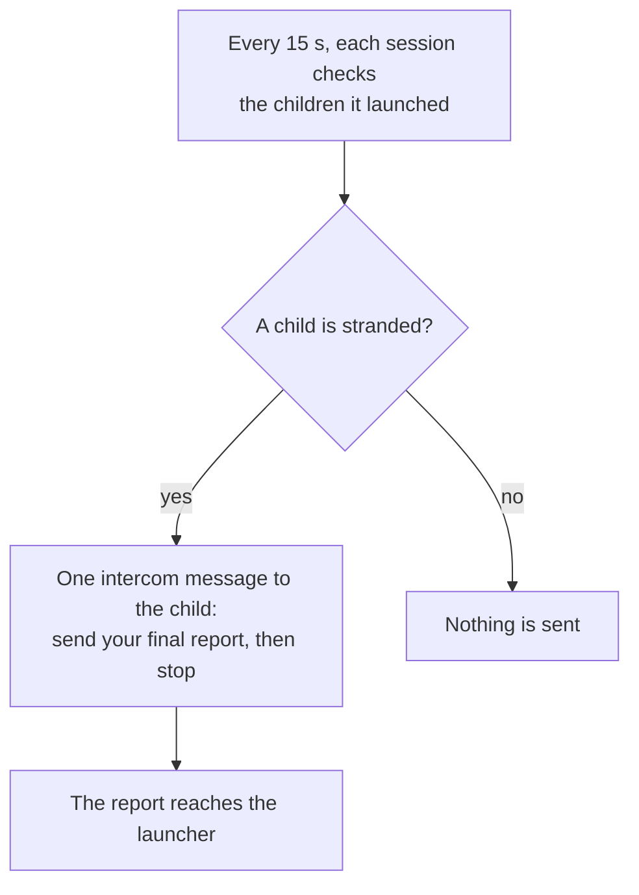

A subagent's result reaches the session that launched it only while that session's own process keeps pi-herdr-agents' watchers and its registry of launched children (`runningSubagents`, in the process-wide slot `globalThis[Symbol.for("pi-subagents/runtime")]`). `/reload`, `/new`, `/resume` and `/fork` keep them, quitting pi suppresses the delivery, and a crash or restart drops them for good: pi-herdr-agents does not recover watchers after a full restart. A subagent that stays open after it finished, an interactive one for instance, is then stranded: it sits done in its pane and nobody is told.

<details>
<summary>Details</summary>

Every session in Herdr that is not itself a subagent checks for this every 15 seconds. While no subagent of the session is stranded, a check reads the registry and one directory; only a subagent that is not tracked and whose own activity says it waits brings a pi-intercom session listing, and after that one `herdr pane list` per check (and one `herdr pane process-info` when it is about to be asked). A subagent is asked to report when all of these hold:

- **Its launcher no longer tracks it.** Its id is not in that registry. When the registry cannot be read (pi-herdr-agents is not loaded, or no longer keeps it there) nothing is known to be lost, so nothing is sent.
- **Its result is not in the launcher's transcript.** No `subagent_result` or `subagent_ping` message names the child's session file.
- **It has finished.** Its activity file says `waiting` (it ended its turn), its pane runs pi and Herdr says `done` (or `idle`, which a pane becomes once someone has looked at it), and pi-intercom says the session in that pane is `idle`. A child that works, waits on a question, or has not started is left alone.
- **It was found so twice in a row,** 15 seconds apart, so that a delivery just going out is not taken for a lost one.
- **Its pane runs the child itself.** The foreground processes of the pane (`herdr pane process-info`) include the launch script this session wrote for that run, `artifacts/<session id>/subagent-scripts/<name>-<run id>.sh`. A pane that only reuses the run's session file, such as a run another session resumed or a pi someone started on that file, is not the child, and neither is a pane whose processes Herdr does not list.

Straw Boss then sends that session one intercom message: the launcher's session id and name, and the request to send its final report to that session through intercom and stop. The launcher shows a notification. It sends at most one message per run, where a run is a child id: its activity file is named after it, and the child's own `/reload` starts that file again, so its creation time says nothing about a run. The run is written to the launcher's session (a `straw-boss` entry with a `nudged` key) before the message goes out, so a restart does not repeat it, and a send that fails is shown as a warning and not tried again.

A child whose pane cannot be found or does not run its launch script, or that has no pi-intercom session of its own, is given up on after four looks, until the next session start (a reload counts). A subagent whose process has exited cannot be asked; its result stays in its session file. A resumed run (`subagent_resume`) has an id of its own that nothing in its pane's session file names, so it is never found and never asked.

The subagent's own launcher does this, not a tower: only the launcher's process knows what it tracks, so a tower never nudges the subagents of other sessions, and a subagent that launches subagents of its own does not (it runs no Straw Boss).

</details>

### Subagents a Herdr restore brought back plain

The restore case in one picture:

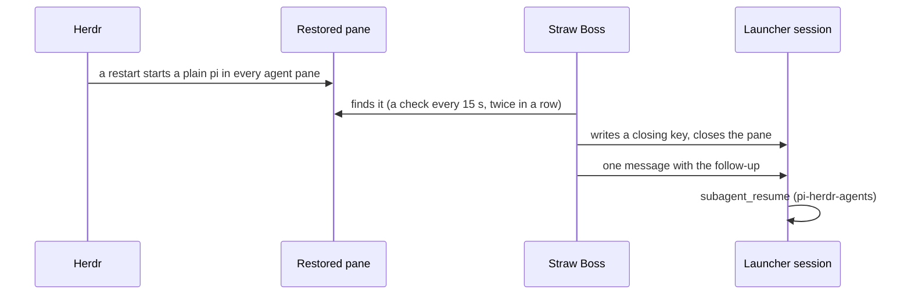

The nudge above needs the child to still be what pi-herdr-agents started. A Herdr restart does not leave that: with `resume_agents_on_restore` (on by default) Herdr starts a plain `pi --session <file>` in every pane that had reported an agent session, subagent panes included. That pi has none of the child's setup (no `subagent-done.ts` extension, no `PI_SUBAGENT_*` environment, no `caller_ping`, no auto-exit, no `<session>.exit` sidecar), so it sits idle at its prompt with the task unfinished and will never report, and the restored launcher's registry is empty and is never filled again. Nothing can ask it to report by itself, so the launcher resumes the run instead, through pi-herdr-agents' public `subagent_resume`.

<details>
<summary>Details</summary>

The same check every 15 seconds (`restored.ts`) finds such a run when all of these hold. It lists Herdr's panes only while some run could still be noted or found: a run that can never qualify (a persistent specialist, or a launch script that is missing or does not name the run's own session) is dropped before that, so it costs no list and no process look.

- **The launcher does not track it, and its result is not in the transcript.** As for the nudge: its id is not in the registry, and no `subagent_result` or `subagent_ping` names the child's session file. It is not a persistent specialist (`PI_SUBAGENT_PERSISTENT=1` in its launch script), which pi-herdr-agents cannot resume.
- **It never ended.** There is no `<session>.exit` beside its session file, and Straw Boss has not acted on it before (no `resumed` or `nudged` key for it in the `straw-boss` session entries).
- **Its pane is the restored one.** The launch script's header (`# Session:` and `# Surface:`) names the child's session file and the pane it ran in, and a restore keeps pane ids. Herdr lists that same pane with agent `pi` on that session file, `idle` or `done`.
- **A restore happened.** While the child runs as pi-herdr-agents started it (its pane's foreground runs the launch script), the launcher notes the pane's `terminal_id` in its session (a `straw-boss` entry with `seen` and `terminal`). Herdr gives a restored pane a new terminal while the pane id stays, so the pane counts only when its terminal differs from the noted one. A pi someone started by hand in the same pane (same terminal), a run never seen running (the restart came before the first look), and a Herdr that reports no `terminal_id` are all unknown, and unknown is never closed.
- **Nothing else runs there.** `herdr pane process-info` lists exactly one foreground process whose argv0 is `pi`, and every other process has a readable argv with no launch or resume script (a path with `/` or `\`). A pane that still runs the launch script is the nudge's case; a run another session resumed sits in a pane of its own and runs a resume script; none of them is touched. On Windows the list cannot prove the absence of the script, so a pane there is never taken for restored.
- **The launcher is no subagent itself, and the run is an ordinary one.** A session with a `.pi-herdr-subagent-policy.json` beside its file (a restored nested subagent) does nothing. The child's own policy sidecar decides: `persistent` runs are left alone, and an owner other than `public` is handled as a worktree run.
- **It was found so twice in a row,** 15 seconds apart, because a pane may still be coming up after the restart. A run with no such pane is given up on after eight looks, until the next session start.

Then, in this order: a `closing` key for the run is written to the launcher's session, the restored pane, and only that pane, is closed with `herdr pane close` (the old pi must not hold the session file beside the resumed one) and Straw Boss waits up to five seconds for it to be gone, and the launcher gets one custom message; once the session has taken it, a `resumed` key is written. A reload or quit between the close and the message leaves `closing` without `resumed`: the next instance of the launcher finds the run, sees that its pane is gone, and sends the message then.

If the pane is still open, the close never took effect (the process died first): the `closing` key is taken back (an `unclosed` key in the session, so a reload does not read it again) and the run goes through the proof of a restore from the start. A run that then can no longer qualify (no restored pane, the same terminal, not a plain pi) is counted as a miss like any other, and when the eighth miss gives up on it one warning names its session path. The message names each run with its `sessionPath` and name, quotes the follow-up to pass (finish the task you were given, and report your result), and tells the model to call `subagent_resume` once per run (with `autoExit` false for a run launched with `PI_SUBAGENT_AUTO_EXIT=0`); the resumed run then reports as a normal `subagent_result`.

It is a steering message that triggers a turn, the way pi-herdr-agents delivers `subagent_result` itself and the way a tower run is driven: an idle launcher wakes at once and a busy one gets it at its next step. Straw Boss does not call the tool, import pi-herdr-agents, or write a result for the child: whether and how the run is resumed stays pi-herdr-agents' and the model's. A launcher that is a tower does none of this (a tower is driven by the server's queue, not by messages of this kind).

Each step that fails is shown as a warning, recorded as `gaveUp`, and not tried again: a pane that cannot be closed (or stays open) is not resumed, and a message that cannot be put into the session is shown with the sessions it would have named, so they can be resumed by hand.

A **managed-worktree** run (it has a manifest under `artifacts/<session id>/worktree-runs/`) is the exception. Its pane is the root pane of the retained worktree workspace, so Straw Boss does not close it, and pi-herdr-agents' `subagent_resume` neither reattaches the worktree's lifecycle nor accepts such a session. The message says so, names the pane, worktree and branch, tells the model not to call `subagent_resume` for it, and leaves the restored pi waiting at its prompt for the user to continue (a run cut off mid-turn is told to go on, below).

</details>

#### A child cut off mid-turn is told to go on

A restart or a reboot can land in the middle of a child's turn, and the restored pi then waits at its prompt with nothing to do: its interrupted tool call has no result and nobody continues the turn. Before a run is handed to the launcher, `cut.ts` reads the end of the child's session file (the last chunk of it, which grows until it holds the last assistant message; a large file is not read whole). Only `message` entries and the custom messages that start a turn (an intercom message, a nested launcher's result, a monitor's wake, a second-thought or document-review notice, a robot-hand follow-up) count, so a custom entry, a model change, or any other notice says nothing.

<details>
<summary>Details</summary>

The session is **cut** when the last tool calls of the last assistant message have no result, or the last step is a tool result the model never read, or the last step is a message nobody answered, or the last assistant message is an error a restart leaves: claude-bridge's `Claude Code process terminated by signal SIGHUP` or `exited with code 129` (a SIGTERM or code 143 may be a kill by hand, and nothing shows a restart came after it, so it is no cut) (the reply was cut while it was being written, with or without a tool call that had begun to stream).

It is not cut when the last assistant message ended its turn (a stop; an abort, which is the boss's own Esc; any other error, such as a quota or a replaced conversation), when the turn stands at a question (`ask_user_question`, `caller_ping`, an intercom `ask`: the child is waiting for an answer, as before the restart), when the file cannot be read, or when the file has no step. Only plain tool names (letters, digits, `_`, `.`, `:`, `-`, up to 64) are quoted into the text, others are called "a tool", and the time must be an ISO time.

The child is told once, in one message: its last turn was cut by a Herdr restart or reboot (with the time of its last recorded step), the tool call (by name) got no result, it should check the current state before re-running anything that changes state, then continue the task and report. How it gets there depends on the run:

- A run that is resumed (the pane was closed) gets it as its follow-up. The launcher's message lists the run as restored mid-turn, with the text, and tells the model to pass that one to `subagent_resume` instead of the generic follow-up. The run is resumed once, so it is told once.
- A managed-worktree run keeps its restored pane, so Straw Boss sends the text itself over intercom (the same send as the report request above), to the broker session whose Herdr location is current and in the run's pane (an unavailable location keeps the pane id of its registration, so it does not count). A restored worktree pi reports to nobody by itself, so the text also names the launcher (its name and intercom session id) and asks for the final report there, as the report request above does. It is never typed into the pane, so whatever the boss has in the prompt stays.

  It is sent only while that session's own intercom status is `idle` (and the pane was idle or done at the look), and the transcript is read again just before the send: a child someone went on with is not told. A session that is not reachable yet (pi-intercom connects a moment after pi starts) is looked at again at the next looks, four at most; then the launcher is told it could not be reached. `continued` is written to the launcher's session before the send, so a child is told at most once per restore, even across a reload or a failing send.
- In both cases the one message the launcher gets says which runs were restored mid-turn, and for a worktree run whether the child was told ("not idle, wait for its report over intercom"; then the message does not send the launcher to the pane for that run) or not (why, and to continue it in its pane).

</details>

#### Limit: a draft the boss is typing

Straw Boss does not see the prompt editor of another pi, and the intercom message starts the child's turn as soon as its status is idle. If the boss has a draft in the restored pane in the first minute after the restore, the draft is kept (nothing is typed into the editor) but the child may act before the boss sends it. The text tells the child to check the state first. A guard on the child's side (its own Straw Boss extension holding the message until the editor is empty) would need a channel of its own between the two, an acknowledgement, and a fallback for a child whose extension is older, so it is not part of this release.

<details>
<summary>Details</summary>

Not covered: a run that was itself resumed (`subagent_resume`) is not recovered by a second restart. Its resume script is named `<name>-resume-<time>.sh` and its header (`# Session:`, `# Surface:`) does give the session file and pane, but not the run's id (that is only in the script's command, as `PI_SUBAGENT_ID`), and the id is what every other proof here hangs on. The resumed run reuses the original session file, whose name carries the original id, so the pane and the transcript cannot be matched to the new id (`ownFile`), and the original run's `subagent_result` names the same session file, so the transcript cannot say whether the resumed run finished.

Covering it would mean closing a pane on a guess, so a restart after a resume stays unknown and nothing is closed; and a `.exit` sidecar left unconsumed means the child finished, so the run is left alone and its result has to be read from the session file.

</details>

## Browser view

`/boss gui` shows the whole net in your default browser: a game-style map, live and animated, where you can read any unit's comms and type into its session.

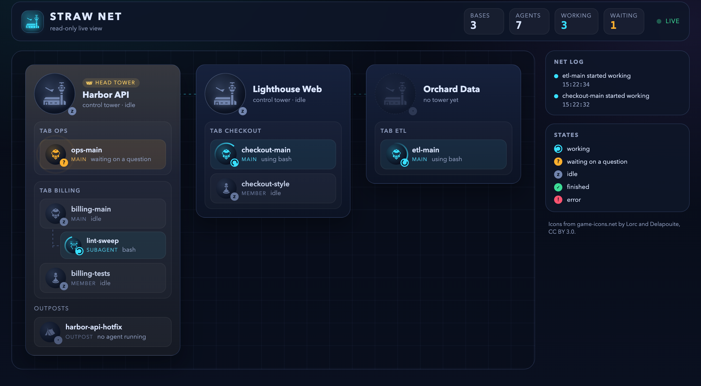

This section is in six groups: [the map, bases, and units](#map-bases-and-units); [alerts and questions](#alerts-and-questions); [what a unit's page shows](#what-a-units-page-shows); [closing, opening, and trust](#closing-opening-and-trust); [serving the page](#serving-the-page) (remote and Wi-Fi access, the server); and [views, themes, phone, and settings](#views-themes-phone-and-settings).

### Map, bases, and units

#### Any session can open it

Any session can open it, in a Herdr workspace or a sub workspace, joined or not. It changes no role and writes no token. A joined session reads the sessions through its tab channel; one that cannot join (a sub workspace) uses a channel of its own (`straw-boss/view/<hex of the pane id>`, never owner-eligible) that takes no part in any tab. Outside Herdr the extension is inactive, so there is no command.

#### What it shows

Each workspace the net reaches is a **base**: one with a live tower or with sessions that joined. Workspaces with neither, and sessions that did not join, are not shown. A base has its **control tower** (the head tower wears a crown; a base without a tower shows a dim ghost), each tab's main agent and members as units, subagents under the session that launched them, the tower's own under the tower (linked as the dashboard does, wherever they run), and sub workspaces as **outposts** under their parent.

<details>
<summary>Details</summary>

A unit's card shows how long it has been in its state (once the server has seen it take that state), its todos (done of total and the task in progress, from rpiv-todo via the session's bridge), and its last steps as marks along its foot. Under the map, a **timeline** marks the net's joins, leaves, and state changes of the last 30 minutes (after [zoetrope](https://github.com/furkankly/zoetrope)): waiting and errors on top, work in the middle, the rest below, each named on hover and linking to its unit. The server keeps them, so a reloaded page still has them; a phone folds the strip to its newest event.

The bases pack like masonry in reading order. While the map runs past the window, an overview in the corner shows each base in its state's colour and scrolls where you click.

</details>

#### States

States look the same everywhere:

| State | Looks like |
| --- | --- |
| working | a spinning ring and a spinner badge |
| waiting on a question | an amber `?` that hops, with a pulsing ring |
| idle | a dim `z` |
| finished | a green `✓` |
| error | a red `!` |

<details>
<summary>Details</summary>

Changes animate; the page honors `prefers-reduced-motion`. What the open session is doing (thinking, using a tool, watching a monitor, commanding, waiting for the boss) is not a row in the log: a ring runs round the composer's box while it works, stands still and amber while it waits for the boss, and a live region says the same in words.

</details>

#### Routes

| View | Route |
| --- | --- |
| The map | `/<token>/` |
| A base | `/<token>/w/<workspace id>` |
| A unit | `/<token>/w/<workspace id>/s/<session key>`, optionally with `?at=<entry id>` to open its comms at one entry |

<details>
<summary>Details</summary>

Links are real links (middle-click and copy-link work); a plain click, Back, and Forward change the view without reloading, and Escape goes up one level. The **Straw Net** title in the header goes back to the map. A deep link loads straight into its view.

</details>

#### A base, zoomed in

The workspace route draws the base large on the map's grid: its control tower, each tab as a squad of unit tokens with the same icons and state badges, subagents tethered under the unit or the tower that launched them, outposts, and the workspace's other pi panes as unaligned units (outside the net, grey, with a dashed ring). Each unit shows its last assistant line, read from the end of its session file. Entering a base zooms out of its spot on the map.

#### A unit's comms

The session route shows the session's chat as a comms log, with the unit's dossier in a side column (portrait, role, state, model, context use, directory, base, squad, launcher, dispatched subagents). Its **Terminal** button opens the unit's terminal mirror as a tile beside the log.

##### The log

Your messages are gold on the right; the unit's transmissions are on the left with its icon. Each tool call is a collapsed action card with a state badge (running, done, failed), thinking is folded behind its length, and compactions are dividers. An assistant message's header names the unit's role (tower, main agent, member, subagent) with the model and the time, not the session's name, which the page header already shows; a relayed message still names its sender.

<details>
<summary>Details</summary>

New entries appear when pi writes them; text still being streamed is not in the file yet, so it shows at the end of the reply. The log opens at the newest entry and stays pinned there. Scrolled up, it stays put and a floating button (**jump to latest**, or **N new** once entries arrived) scrolls to the end and pins it again. Older pages load as you scroll up; at most 600 entries stay in the page.

</details>

##### Terminal mirror

The **Terminal** button opens a live mirror of the unit's pane beside the log. The server sends only colours and attributes, the page draws the rows as text, and the mirror refreshes within a second while the pane changes.

<details>
<summary>Details</summary>

The tile shows what the unit's pane shows, with colours and attributes, updated within a second while it changes (at most 4 reads a second, shared by every page that shows it, and none while no page does). The server sends only colour and attribute escapes, and the page builds the rows from text. **Fit width** scales the tile and scrolls to the bottom, where pi's editor is; otherwise it keeps its size and scrolls sideways, as on a phone. While the session waits for a secret (`secret_drop`) nothing is read and the tile says so. A tile pauses 5 s after its browser tab is hidden and resumes when it shows. A read-only question panel offers **Show terminal** too. On a phone the mirror is display only: typing or tapping in it sends nothing.

</details>

##### Key pad

Under the mirror, the key pad sends one key per tap: `esc`, `tab`, `⇧tab`, the arrows, `enter`, `space`, `⌫`, `home`, `end`, `pgup`, `pgdn`, and `1`–`9` (folded away). It has no letters, `/`, Ctrl, or Alt, and the server refuses them as keys.

<details>
<summary>Details</summary>

- It works only while the tile shows the terminal live (a frame in the last 3 s), at most 8 keys a second.
- While the session waits for a secret, or on a question its panel answers, only Escape works. A paired device likewise sends only Escape, and no prompt, while a `link_request` is open.
- Before **enter** the server asks the session what Enter would submit. It asks to confirm first for a command that ends or replaces the session (`/reload`, `/new`, …, recalled from history too), another `/` or `!` command, or an editor it could not read. A second Escape within a second on an idle session, which opens pi's tree (or fork), asks too.
- A confirm says why in the page's own words, chosen by the server's `confirm` token (`gui/confirmwords.ts`; the server's English only for a token the page does not know), above two buttons of one height: the one that sends carries its label (**Send Enter**) on a fill, and **Cancel** is outlined and has the focus.
- The pad's buttons join the same write queue as typed keys: a press while a write is on its way waits its turn, and the buttons stay enabled meanwhile. Escape goes to the pane, not to the page.

</details>

##### Typing into the mirror

On a desktop (a fine pointer) a click into the mirror gives it the keyboard until a click elsewhere; a drag that selects text to copy does not, and switching the session view to its terminal gives it once. Keys land in an invisible text box by the mirror's corner, so an input method shows its candidates there.

<details>
<summary>Details</summary>

On a phone nothing takes the keyboard by itself, because a tap into a pane opens no soft keyboard. The terminal's **Keyboard** button (鍵盤) focuses the same text box and opens the soft keyboard (a second tap, or leaving the terminal, closes it). What it types goes out as text (an input method's composition as one write when it ends), with Backspace and Enter read from the soft keyboard's `beforeinput` where it sends no key for them. Switching to the terminal also makes the composer's box let go of the focus, so keys never land in the hidden chat.

What goes, all on the same `keys` endpoint under the same guards:

- the pad's keys by their own key (arrows, Enter, Escape, Tab, Shift+Tab, Backspace, Home, End, Page Up, Page Down), and Delete as its sequence;
- Ctrl or Alt with a letter, Alt+Enter, Alt+Backspace, and Ctrl or Alt with ← or →, as Herdr names them (the letter from the key's position, since Alt on a Mac types å for A). Ctrl+Z never goes: pi would stop in the background, where nothing here brings it back. Ctrl+D asks first (it leaves pi on an empty editor), and so does a second Ctrl+C within a second (pi leaves on the second). ⌘ stays the browser's, and so do Ctrl+V and Ctrl+C on a selection off a Mac;
- characters, `/` and `!` and an input method's text included, as typed text (`{text}`): one raw write of 1 to 64 printable characters, so no line break, tab, or escape sequence rides along and Enter still comes alone and asks first;
- a paste as one paste (`{paste}`): up to 4,000 characters with line breaks and tabs but no other control character, which the server wraps in the terminal's bracketed-paste markers, so pi takes it as a paste and a line break in it submits nothing.

Writes go one at a time, at most one every 130 ms, under the same 8 a second. Characters typed meanwhile join the next write, a held key repeats only into an empty queue (never Enter, Escape, Tab, or a chord), and a refusal or a confirm drops what was still queued.

</details>

##### The composer

Under the log, the composer types into the unit's terminal through Herdr, as if typed there:

- **Send** (Enter; Shift+Enter adds a line; off while the box is empty) sends a prompt when the unit is idle and a steering message while it works;
- **After this** (Alt+Enter, shown while it works) queues one for when the current task is done;
- **Stop** sends Escape after a confirm.

<details>
<summary>Details</summary>

While the box holds only `/` and a name being typed, a menu above it lists the session's matching commands (extension commands, prompt templates, and skills, as its own pi lists them; pi's built-in commands are not listed): ↑ and ↓ move, Enter, Tab, or a click puts `/name ` in the box, and Escape closes it. The session's dialog bridge answers the list, so it is the session's own set, and the menu shows nothing when it does not answer within a second.

A leading `/` or `!` runs a pi or shell command; commands that end or replace the session (`/quit`, `/exit`, `/new`, `/resume`, `/fork`, `/clone`, `/import`, `/reload`) ask first. Text lands after anything still unsent in the terminal's editor and is submitted with it. The box clears only once Herdr confirmed the input, keeping anything typed meanwhile; a send that was not confirmed is never repeated (check the terminal). What the page could not say when the answer came (you were on another session, or the page reloaded) is kept and shown when you come back: why a send was refused, that it was not confirmed, or, if you edited text that had already been sent, that the original already went.

The box is disabled, with the reason, while the stream is down, the session is gone, or it waits on a dialog (answer that in the panel above it when it can be answered there, else in the terminal). A **closed channel** takes no typing: the box says why ("This session is no longer live; its history stays readable."), the comms head shows "channel closed", and the server refuses input and keys to it (409 `not_live`). A channel is closed when its session left the net, or when it is a finished subagent that no pane runs pi for any more (its pane is gone or back at a shell); a finished subagent whose pi still runs (an interactive one, not auto-exited) keeps its composer, on a paired device's page as on this computer's. Other subagents are typed into directly, like any session.

Ctrl+C and Ctrl+D are never sent from the browser. On a touch screen Enter adds a line and Send sends; drafts survive a reload. Markdown is rendered into DOM nodes, never as HTML; only `http`, `https`, and `mailto` links are links; block quotes and lists nest at most 16 deep, and deeper levels stay text.

</details>

### Alerts and questions

#### Alerts and panels

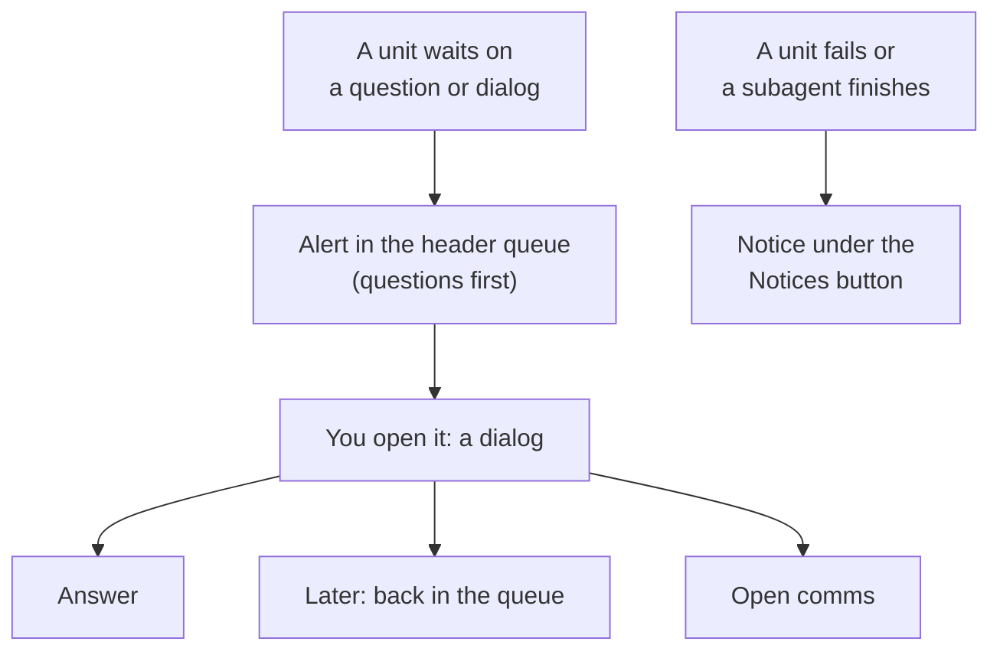

Only a unit that needs an answer raises an alert. Alerts queue in the header and never open by themselves: you open one as a dialog, then answer it, put it back with **Later**, or jump to the unit's comms with **Open comms**. A failure or a finished subagent is a **notice**: it waits apart, under the **Notices** button, and never takes focus.

<details>
<summary>Details</summary>

Only a unit that needs you to answer raises the prominent alert: one waiting on a question or a dialog (mark waiting, or a pending dialog). A unit that fails (mark error, or a monitor that failed or went quiet) and a subagent that finishes are **notices**: they never take the header's alert, queue a dialog, or steal focus. An alert never opens anything by itself: it joins the queue in the header (questions first, then notices, oldest first in each), and leaves it again when the unit moves on.

The header's alert, Space, and the dialogs' queue count hold questions only; notices wait under a **Notices** button beside it, shown only when there is one and tinted red while one of them is a failure. A notice raised before the page opened is not news. You open alerts from the queue or by clicking a unit that waits; they open as dialogs in the dock over the side column.

A second dialog you open stacks on top, with the one beneath peeking out; click the part that peeks out to bring it up (a click that really lands on a control under the strip, such as a settings link, goes to that control). A dialog you are reading is never covered by one you did not open: alerts only queue, and any dialog opened without your action goes beneath the top one, without focus. Closing the top reveals the one beneath, and with none beneath, the next queued question or error.

**Later** puts the alert back in the queue and opens nothing else; if the unit moved on while its dialog was open, the alert is stale and leaves instead. A dialog is never closed under you: if its unit leaves the net while it is open, the dialog shows **gone** ("left the net"), without its question or Open comms. The queue is counted the same way in the header (its tooltip) and in every dialog ("Also queued: 1 needs you · 1 finished"): questions and errors need you and are what closing a dialog reveals next; a unit that only finished waits in the queue for you to open it and is counted apart.

**Open comms** goes to the unit's comms at the entry the alert was about (read when the alert arrived: the reply with the tool call it waits on, else its last reply), loading older pages when needed, and lights that entry for a moment; the comms log stays there with **jump to latest** until you go down. It closes the alert without opening the next queued one, so nothing covers the comms you went to. The entry is in the URL (`?at=`), so Back, Forward, and the link itself land on it again; an entry no longer in the history opens at the newest one, as does opening a unit any other way.

Escape closes the top dialog only, focus returns to where it was, and dialogs are not modal (the page stays usable, nothing traps focus). Documents open as **tiles** beside the current view instead, sharing its width; a tile that arrives by itself takes no focus, and narrow windows show tiles as tabs. A dialog shows the unit, its last line, and the tool call it waits on, with a link to its comms.

</details>

#### Questions and selectors

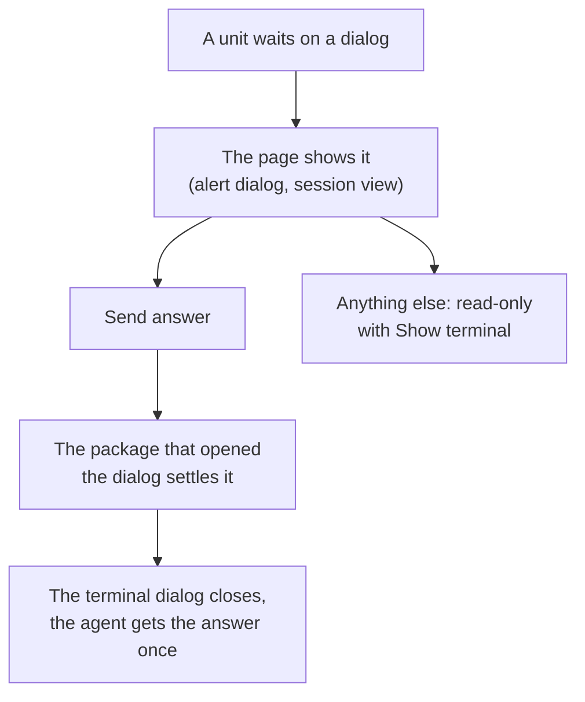

When a unit waits on a dialog, the page shows it in the alert dialog and above the session's composer. Four kinds can be answered from the page: pi-robot-hand's selector, rpiv's questionnaires, pi-code's hook gate, and an extension's own `select` or `confirm`. **Send answer** goes to the package that opened the dialog, which settles it as a terminal answer would, so the agent gets the answer once. Everything else stays read-only, and `secret_drop` is never answerable from a page.

<details>
<summary>Details</summary>

When a unit waits on a dialog, its alert dialog and its session view (above the composer) show it. Four kinds can be answered from the page: pi-robot-hand's selector (`robot_hand` ≥ 0.3.0: its title as written, each choice with where it acts and the terminal's number, and **Copy command**, which copies through the browser and answers nothing); @juicesharp/rpiv-ask-user-question's questionnaires (`ask_user_question`: one to four questions, each with a header tag, options with descriptions as radio buttons or, when it takes several, checkboxes, "Or type your own answer", and "Note (optional)"); pi-code's hook gate (its confirmation before a gated tool call of any tool, such as "Allow bash?": **Allow** or **Deny**); and any extension's own `ctx.ui.select` or `ctx.ui.confirm` (see [Any extension's select and confirm](#any-extensions-select-and-confirm)).

**Send answer** goes to the package that opened the dialog, which settles it exactly as a terminal answer would, so the terminal's dialog closes and the agent gets the answer once. The panel then says "Answered."; "It was already answered in the terminal." when the terminal was first; the owner's reason when it refused (the dialog stays answerable); or "Not confirmed. Check the terminal" with **Check again** (which resends the same answer, never a new one) when no confirmation came.

**Cancel** (next to Send; a 44 px target on a phone, in Standard, Geek, and phone layouts) ends the dialog the way Escape does in the terminal, with nothing picked: rpiv gets `{cancel: true}` and its tool call ends with its own cancelled result; a `ctx.ui` select resolves `undefined` and a confirm `false`; the link gate and a link approval take it as Deny. It rides the same answer route as an answer, so the first answer wins and a resend replays, and the card says "Cancelled." An owner with no cancel path (`robot_hand`, pi-code's gate, `secret_drop`) gets no button: nothing is sent, no key, no screen read.

Escape on the page still only closes the dialog view; it does not cancel the question. Cancelling is a refusal, so a paired device may cancel wherever it may pick some choice. A dialog whose choices are all `hereOnly` (the `/boss` link approval, its confirm and its words select, and the confirms of `gui rotate`, `gui unpair all`, `server stop` and `restart`) is refused from a paired device with 403 `local_only` and shows no Cancel there. A link approval of trust, remove, role, rotate, or leave keeps a Deny a paired device may pick, so it may cancel it (which is Deny).

A question is answered from the keyboard alone: a dialog opens with the focus on its first question's chosen or first option, not on Open comms. Arrows move between options (a single choice selects as the focus moves; a multiple choice only moves, and Space toggles); Tab and Shift+Tab move between questions (after the last one, to its own-words box, its note, and Send); Enter, or Space on a single choice, confirms an option and goes on to the next unanswered question and then to Send, where Enter sends. Down past a question's last option reaches its own-words box, where Enter does the same and Shift+Enter breaks a line.

While the focus is in a text box the page's own keys are off, Escape excepted. A choice that acts on this computer (robot_hand's clipboard) is offered on a paired device's page too, with the note that says where it acts, and accepted from it. No key is sent and the screen is never read: each session's dialog bridge (in every pi in Herdr, subagents too) relays the dialogs its packages publish on pi's event bus to the GUI server's session over an intercom extension channel only that session may own. The server lets the page answer a dialog only when it is the session's one open dialog, belongs to one of the session file's open calls (the owner's own tool call, or for the hook gate the call it names), and matches what the page showed (dialog id and digest; see [Answering pi dialogs](specs/2026-10-18-dialog-answers.md)).

Everything else stays read-only with the reason and **Show terminal**, which opens its screen on the page: `ask_user` (pi-ask-user), several open dialogs (the page says so only when the bridge relays more than one, or when the one it relays names no open call; a session whose last message left several calls unanswered is answerable while its one relayed dialog names one of them), an answer already on its way, a dialog too long to relay, or one that differs from the session file.

`secret_drop` is never answerable from a page: a secret is entered in the terminal only. pi-intercom identities are self-reported, so a same-user process could pose as the asking session's bridge, relay a secret dialog under its own key, and receive the value the page seals to it. Until intercom can verify who a bridge is, the bridge does not relay a secret dialog at all (no label, steps, destination, or key leave the session) and refuses any answer to one, and the server takes no `value` from any request (400 from this computer's page, 403 from a paired device) and sends none.

The panel is a read-only wait on every page, with no field and no Show terminal (the mirror stays hidden and the key pad Escape-only): this computer's page says a secret is entered in the terminal only, and a paired device's page words it as "For security, entering a secret is not supported remotely" (安全考量，遠端不支援); both name the terminal. The sealing code stays in the tree for the day the path comes back; the spec says what blocks it ([Answering pi dialogs](specs/2026-10-18-dialog-answers.md), "Why a secret is terminal only").

The `secret_drop` call itself is still shown in a device's comms history with its arguments (label, steps, and destination) as any tool call is; the value never is. Beside another open dialog the unit shows only that it waits for a secret. A unit with an open dialog counts as waiting at once; otherwise it is waiting while Herdr reports its pane `blocked`, which pi reports from the `herdr:blocked` event. Straw Boss relays rpiv's `rpiv:ask-user:blocked` into it, once per open questionnaire, and pi's own dialogs too (see [Blocked dialogs](#blocked-dialogs)).

The question shown is the newest unanswered call on the session's current branch (for a hook gate answered among several open calls, the call it gates); a call longer than 256 KB is read from further back in the file (up to 16 MB, shown clipped), and a longer one says it is too long to read.

</details>

#### Any extension's select and confirm

Every extension's `ctx.ui` is one object, so Straw Boss wraps `select` and `confirm` (and leaves `input`, `editor`, and `custom` alone, since a secret may be typed there). A wrapped call opens pi's own terminal dialog and relays the same question to the page; the first answer wins and the other side is dismissed. The dialog is never made worse: a call that cannot be relayed is the original call.

<details>
<summary>Details</summary>

Every extension's `ctx.ui` is one object, so Straw Boss (in every pi in Herdr, subagents too) replaces its `select` and `confirm` and leaves `input`, `editor`, and `custom` alone (a secret may be typed there). A wrapped call opens pi's own terminal dialog exactly as before and, in the same call, publishes the dialog on pi's event bus as a dialog-contract v1 owner under `straw-boss:ui`, so the bridge, hub, and answer route handle it like any owner's dialog and every existing check applies (one open dialog, the digest, an answer already on its way, `secret_drop` open, too long).

A `select` is relayed with its options; a `confirm` as one dialog whose text is its title, a blank line, and its message, with **Yes** and **No**. The first answer wins and the other side is dismissed: an answer from the page aborts the terminal dialog through its `signal` (combined with the caller's own) and the extension's call resolves with that answer (the chosen option, or `true` for Yes and `false` for No), once; an answer in the terminal closes the page's dialog (`stale`, answered in the terminal).

The dialog is never made worse: a call that cannot be relayed, or whose relay fails to start, is the original call with nothing left behind, and a dialog that throws or rejects passes its error on unchanged.

*When it binds.* A dialog is relayed only while exactly one tool call is in flight, and binds to that call (the hub needs it among the session file's open calls, as for pi-code's gate); the page words it as "opened while {tool} was running", since it may be unrelated to that call. With no call, two or more, or a `secret_drop` in flight, it stays in the terminal; so does a call whose tool has a contract owner (`robot_hand`) when the owner relays nothing. Unicode format characters in the text the page shows (bidi overrides, zero-width marks) are drawn as U+FFFD.

  Only the outermost dialog is relayed (`input`, `editor`, and `custom` only count, passing through untouched; the count resets at `agent_end` and when pi swaps its ui object): a dialog that opens while another is open withdraws the relayed one (the page could not tell which dialog an answer would dismiss) and is not relayed itself. A `select` over 100 options, or a title and options over 12,000 characters, are not relayed.
*Owners win.* A dialog with a contract owner (`robot_hand`, pi-code's gate) is relayed by its owner, and the intercepted twin on the same tool call is dropped, whichever opened first. `ask_user_question` opens its questionnaire through `ctx.ui.custom`, which is not wrapped.
*Remote.* A paired device answers a `select` and a `confirm` as this computer's page does: the relayed dialog carries `confirm: true` (told apart by its digest, so a relay cannot pass one off as the other) and every page shows Yes and No. A secret is the exception: no page takes one. Cancel follows the same rule as any choice: a paired device may cancel a select or a confirm unless every one of its choices is `hereOnly`.
- *Lifetime.* The wrap marks the `ui` object it wrapped, so several loaded copies of the package wrap it once. Pi replaces the object when it binds a new UI context (a mode change), so the marker is checked at session start and before every tool call and the wrap is put back on the new object; at shutdown the relayed dialogs are closed and the original methods restored. A session without a UI has pi's shared no-op object, which is never touched.

</details>

#### An answer that needs the terminal opens it

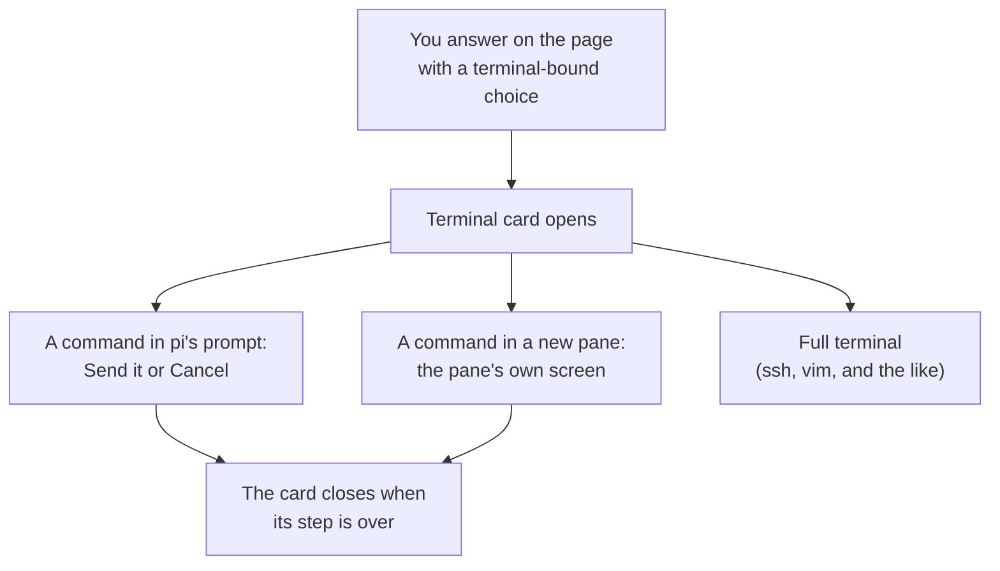

Some choices leave the next step in a terminal: robot_hand can put a command in pi's prompt, or run or type it in a new Herdr pane. When the owner accepts such an answer, the page opens a small **terminal card** that holds the command, and the card closes when its step is over. **Full terminal** opens the whole terminal for anything longer.

<details>
<summary>Details</summary>

Some choices leave the next step in a terminal: robot_hand's *Put it in my prompt* (the command waits in pi's prompt for Enter), *Type it into a new Herdr pane* and *Run it in a new Herdr pane* (a new pane below pi that shows or runs the command; the pane closes itself and its output returns as a message). A choice says so with an optional `next` (`"terminal"` or `"pane"`, a hint like `note`, not hashed); pi-robot-hand sends none, so its adapter reads it from the labels it shows, and an owner that sends its own keeps it.

When the owner accepts such an answer, the answer route's reply carries `then` (from the stored dialog's choice, never from the request), and the page opens the **terminal card** for it in every view: one small card that holds the command the answer put there, for a pane the last four rows of its screen, one line with a **Hide what I type** toggle, and one button: *Run* (執行) for a command waiting in pi's prompt, *Send Enter* for a pane. The card sends what the key pad sends, through the same writes and under the same server checks.

For a command in pi's prompt the first tap meets the server's confirm of a command, which the card draws inline as a pair, *Send it* and *Cancel* (the page's words by the server's token; Cancel takes the focus, so a second or held Enter cannot confirm). A last row that ends in a colon after *password*, *passphrase*, *passcode*, *PIN*, 密碼, or 口令 turns the line into a password field by itself and says so; the toggle masks by hand, and a hand mask ends with the Enter it answered.

The field sits outside any form and is cleared on send; the Enter that commits an input method's candidate sends nothing. A card whose attach was refused or failed reattaches from its button (no key goes), at most once a second and doubling to 8 s while it keeps failing, and says it is connecting meanwhile. Rows that only echo the command shown above them (a prompt, then the command) are left out.

A refusal of a key or of the mirror is said in the page's language by the server's code (`no_mirror`, `blocked`, `rate`, `standing`, `not_found`, and the rest); a code the page does not know shows the server's own text. The page does this for every accepted answer with a `then`, on this computer and on a paired device alike; one rule, no robot_hand special case, in one call (`openThen`, `gui/terminalthen.ts`) that every view reaches from the answer's outcome (`gui/ask.ts`, so the alert dialog, the session view, and Zen alike) and that anything else ending in a terminal can call.

It hands the page one step, `{kind: "prompt" | "pane", key, command}`, and a view decides only where the card sits: Standard and Geek in the overlay layer's dock (not modal, a sheet at the bottom on a phone, covered by a dialog that opens over it, closing at once the alert dialog that sent the boss there), Zen as the card mode of its terminal layer (in ink, in the middle of the page, with 「回到禪」 / *Back to Zen* in the top right corner). A newer answer's card replaces the one on show.

**The card closes when its step is over**, by what it sent or what happened to its own pane and never by a unit's mark: a prompt's card when its own Enter is taken, a pane's when the pane ends (an `ended` frame, 404 or 409 `pane_closed`); × and Esc close it in Standard, and in Zen the layer's Esc Esc returns.

**Full terminal** opens the terminal as it was before the card, for ssh, vim, and the like: Standard's session terminal mode or the pane's tile, in Zen the full mode of the same layer (the page's one terminal, the same mirror, key pad, and keyboard as Standard's, one attach; while it has the keyboard Esc goes to it, with the focus elsewhere in the layer Esc Esc returns, and nothing else ends it). The layer is never closed by itself: when a pane closes or its grant ends, a prompt's own Enter is taken, or the unit works again, a quiet line in the layer's bar says the step is done and the boss goes back with **Back to Zen**.

Zen's *Open the terminal* buttons (a blocked prompt, a read-only dialog) open that full mode directly, *armed*: the unit's first work is that step's end, which the bar says. A tower with no run live shows its sentence on the card instead of rows. Standard is never visited from Zen and the screen that was there (item, companion, or idle) is shown again as it was. The pane is found by the server: the tab's panes are noted before the answer goes out, and after it is accepted one new pane is granted under an unguessable id, kept with its terminal id (a reused pane id is refused), at most 8 for 6 hours. **Which pane** depends on the owner.

An owner whose choice says `tagged` marks the pane it opened with the Herdr pane token `sb_answer=<the answer's answerId>`; the server grants the new pane in the tab that carries exactly that value (within 3 s) and no other, however new an untagged pane is, and two panes carrying it grant nothing. An owner that does not tag (pi-robot-hand 0.3.x) leaves the server to the timing claim: exactly one new pane that runs no agent and carries no `sb_role` token within 3 s.

Its residual is that timing is all that ties the pane to the answer: a pane of the same tab that shows alone in that window (a subagent or `/boss open` split whose pi Herdr has not detected yet, the boss's own split, another session's answer) is granted instead, and takes bare keys until Herdr reports its agent (then the grant ends); Herdr's detection can lag, which was not measured for pi. A tagging owner has no such residual. Two new panes (untagged owner), none, or an unreadable layout grant nothing (`then.pane` is `null`; the card says a pane opened in Herdr).

A grant never reaches a pane that runs an agent or carries `sb_role`, and ends the moment its pane does either: the next key is refused (409 `pane_closed`), the mirror reads the pane again with every frame and sends none once it is a pi session or a tower, and the grant is dropped with its reader.

`POST /api/panes/<grant>/mirror` and `/keys` mirror it (a "bare" reader with no session behind it) and key into it (the pad's keys, chords, typed text, and paste under the same rate and the live-mirror precondition, without the pi session's guards, probe, or confirms), for the boss's page and a paired device as for a session's terminal keys; a `hereOnly` choice stays refused for a paired device. Not opened: a read-only dialog (a `secret_drop`, several dialogs at once, one too long) keeps its **Show terminal** link and opens nothing by itself, and a "not confirmed" or "another answer is on its way" outcome offers **Check again** in the panel, which a terminal view would hide.

- **One tap for a prompt.** When the choice put a shell command in the session's prompt (robot_hand places it as `! <command>`), the server keeps a one-tap grant for that answer (the answer id, the session, a random nonce of its own, and the MAC of the line `! <command>`), and `then` says `run: true`. The card's 執行 sends its Enter with `run: <answer id>`.

  Only for that Enter does the server give the session's bridge the grant's nonce with the probe, and the bridge answers HMAC-SHA-256(nonce, its prompt line) for a `command` draft (an Enter with no `run` carries no nonce, so no MAC of the draft is ever made for it; the draft itself never leaves, but a listener on the local intercom broker that sees both the nonce and the MAC of that one Enter could still test guesses for a short command). Only when the MAC equals the command's does the Enter pass the `command` confirm.

  **A `run` Enter never sends a line that is not that command:** a prompt that was edited, emptied, or turned into text or an ending command is refused (`run_changed`, nothing sent) wherever the editor was read; the one case that asks the confirm instead is a `command` line from a bridge that sends no MAC (an older one). An ending command (/reload, /quit …) and an unreadable editor still ask, whatever the MAC. **One tap covers only `! ` lines without completable tokens.**

  A command with a token pi's completion menu can open on (a `/` path or pi command, `~`, `@`, `#`, a quote, a token starting with `.`, or a trailing space) gets no one tap: a menu can be open with the line unchanged, and for a `/` token Enter then submits the menu's pick.

  The residual: after Tab on a plain word (`ls foo`), which no rule can tell from a command word, the menu can be open; a one-tap Enter then fills in the pick and runs nothing, the grant is spent, the card closes as if the command ran, and the changed line waits in the prompt. pi does not tell extensions whether its menu is open, so the probe cannot see it. Its Enter keeps the confirm, and `then` has no `run`.

  A grant answers once, whatever it answers, belongs to its session, and expires after 2 minutes; a changed line, another session's or an unknown/replayed answer id, and a stale grant are refused with `run_changed`, `run_unknown`, `run_expired` (said in the page's words), and the next Enter, which carries no `run`, asks the usual confirm. Only a pane answer, a choice with no `next`, or an answer the owner did not accept leaves no grant. Only MACs are kept or logged.

</details>

#### Notices

Notices are read once opened: they have no Later, and closing one does not put it back in the queue. They wait apart from what needs you, under the header's **Notices N** button: it opens a list of the finished or failed units, each with its base and last line; a row goes to the unit's comms and clears it, and **Clear all** clears every one (questions stay, to be answered).

<details>
<summary>Details</summary>

A finished unit whose pane has closed, and a subagent whose run pi-herdr-agents recorded done (`phase: "done"` in its `subagent-activity` file, even while its pane still runs pi), clears itself from the list after its sound and reminder: its parent has the result. The map still shows a finished subagent for ten minutes.

</details>

#### Enlarge

An alert dialog's ⤢ turns the dialog dock into one wide panel in the middle of the window, for a long question; ⤡ puts it back. The choice is kept per browser.

<details>
<summary>Details</summary>

An alert dialog's ⤢ beside its × turns the dialog dock into one wide panel in the middle of the window (at most 880 px wide, nearly the window's height), for a long question; ⤡ puts it back. The choice is kept per browser (`sb.dialog-wide`), so the next dialog opens the same size. A phone has no Enlarge: its dialogs already take the width. Three keys drive the dialogs: **Space** opens the next alert, as the header's alert button does, **F** presses the top dialog's ⤢ or ⤡, and **Escape** closes the top dialog. The page leaves a key alone while you type (an input, the composer and its `/` menu, a terminal's key sink), with Ctrl, Alt, or ⌘ held, while an input method composes, or while a confirmation, the image viewer, or a popover is open; Space on an answer option, which selects or toggles it, or on a button or link you moved the focus to with the keyboard, keeps its own activation.

A button or link the mouse left focused (the logo after a click) does not hold Space: it still opens the next alert. A key that did nothing (Space with nothing queued, F with no dialog) is not taken, so the page scrolls as usual.

</details>

### What a unit's page shows

#### Documents

A session that shows documents with pi-herdr-doc-review lists them in its dossier under **Documents**, and a click opens one as a tile beside the current view. An HTML document runs in a sandboxed frame without scripts; a text document renders read only.

<details>
<summary>Details</summary>

A session that shows documents with [pi-herdr-doc-review](https://www.npmjs.com/package/pi-herdr-doc-review) 0.4.0 or newer (`show_doc`, or a Mini SDD spec that opens on its own) lists them in its dossier under **Documents** within 2 s, and a parchment badge on a unit's token counts those still on screen in its terminal (a tower lists them only in its dossier). On that session's comms a document that arrives opens as a tile beside the log without taking focus, unless four tiles are open already (it never pushes out one you opened); anywhere else (the map, a base, another session) only the badge changes, and a page that opens on a session with documents opens none.

A click in the dossier opens one, and so does **open beside** on a `show_doc` card while its document is listed (an older card stays text). An HTML document is a frame sandboxed without scripts: the page's attribute and the server's policy both leave it an opaque origin, so it runs no script, cannot read the API or the cookie, and loads only images, stylesheets, and fonts from its own directory. Its links open in a new tab, and a form with `action="cgi-bin:pi-answer"` answers the session exactly as a Chawan submission does (the owner delivers it): each page view can send once, so **Back** and submit says "Already sent" and **Reload** sends again.

Answers travel in the URL of a GET, as in Chawan, and stay in the browser's history: keep secrets out of document forms. **Open in a new tab** shows the same sandboxed page. A text document renders read only, as markdown for `.md` and as plain text otherwise. When the owner reports a new revision a tile that shows reloads, and a hidden one (another tab of tiles) says so and loads when it shows; a document closed in its session, or a session that ended, leaves its tile saying it is no longer listed.

A session lists at most 32 documents; a list too large for the dialog channel is dropped (the dossier says to read them in the terminal), and documents never hold back its dialogs.

</details>

#### Files

A file pasted, dropped, or picked with **+** in a composer is posted as its bytes to `sessions/<key>/upload`, under the same origin and CSRF checks as typed input (a paired phone too), at most 20 MB. The server stores it under `pi-straw-boss-uploads` in the temp directory (folder 700, file 600) with a cleaned name, and the page puts the path into the message where the cursor is, the way a picture pasted into pi's terminal lands as a temp file path; the session reads it with its own tools. Text pastes as text.

#### Reminders and sounds

Two switches on the settings page (This device), each a labelled button that says On or Off, kept per browser in `localStorage`: Remind (on by default) and Sound (off by default, so a page that opens makes no noise; Sound is in fact two switches, Sound effects and Background sound, described in the next entry). They act on the alerts a snapshot raises: a unit that turned to waiting on an answer, to error, or that finished.

<details>
<summary>Details</summary>

Reminders are system notifications (a question's may beep; a failure's or a finish's is silent, a quiet notice), raised only while the page is hidden or unfocused, one per alert, tagged by unit, and a click brings the page forward on that unit; a focused page already shows the alert queue. A first press on Remind asks the browser's permission; until it is granted the switch shows amber, red when the browser blocks it. A batch plays one sound, the most urgent of its marks (waiting, then error, then finished; an error keeps its own clip, which sounds apart from the question's), from three Kenney CC0 clips bundled as hashed MP3 files and fetched when one first plays.

Sound has a volume from 0 to 100 (60 by default, kept in `localStorage` as `sb.volume`) and a Try button under it; each change plays the finished sound. The device's preferences live in one store; another tab's Sound switch or Volume applies to the open page at once. The clips play through Web Audio at the volume squared (loudness follows the square, and an iPhone ignores an audio element's `volume`). Both follow every snapshot, a hidden page's included, through their own record of what was heard: the alert queue's record moves only while the page is shown, so it still queues what arrived while hidden. What was already waiting when the page opened raises neither.

</details>

#### Sound effects and background sound

The settings page's one Sound switch and Volume became two, each with its own switch and volume under *This device*: **Sound effects** (the cues of events: the question, finish, and failure clips of Standard and of a theme, the unit-ready chime, Zen's bowl and knock) and **Background sound** (what plays under the page: Zen's music, Raven's rain and thunder; the thunder belongs to the weather). Both are off by default and work in Standard, Geek, Zen, and Raven Keep; Zen's corner menu and its palette carry both too (a switch and two volume steps each).

<details>
<summary>Details</summary>

A volume is 0 to 100 (60 by default) and reaches the page's audio core as the square, as a gain for its class only; each switch is checked by the sources of its class only, so Effects off silences the cues and leaves the rain, and Background off silences the rain, the thunder, and the music and leaves the cues. Sound effects has a Try button and plays the finished clip when it is turned on or its volume is released; Background has no sample, because what it plays is already audible.

The old `sb.sound` and `sb.volume` are read as the start of both classes while a class has nothing stored of its own (the old on is both on at the old volume, the old off is both off) and are never written, so an older page on the same browser keeps reading its own.

</details>

#### Images

A user message's or tool result's images (png, jpeg, gif, or webp, as pi stores them in the session file) show as thumbnails in the chat: under the message, or under the tool's card whether it is open or closed. The page loads each from `api/image/<key>/<entry id>/<n>`, which reads that one entry and answers with the image's bytes, cached for a day since an entry never changes; the history itself carries only the count. A thumbnail opens the lightbox: the image fitted to the screen, its own size on a tap, ← → or the arrows for the other images of the same message, and Escape, ×, or a tap beside it to close.

#### Queued messages

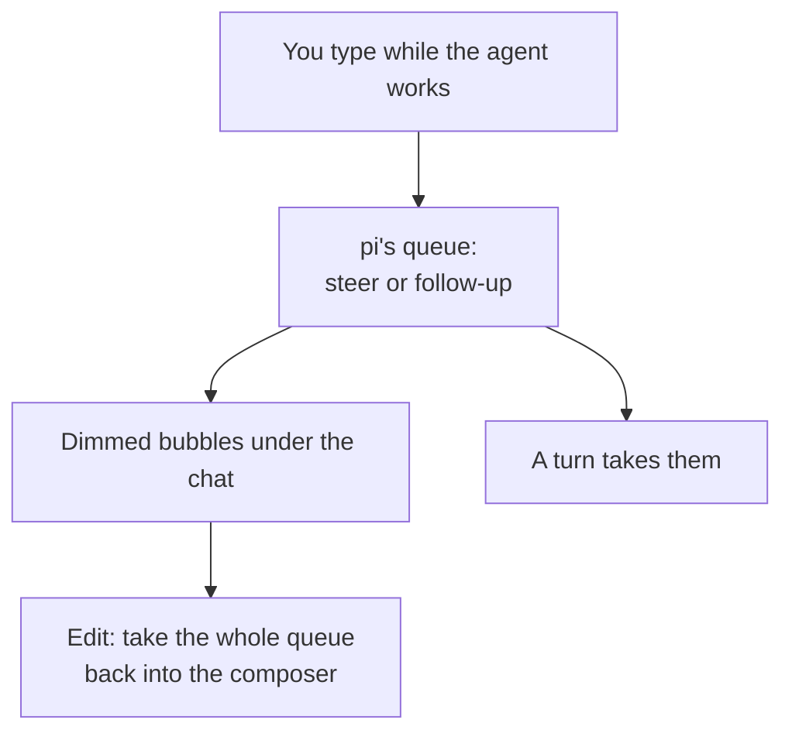

What is typed while the agent works waits in pi's queue: a steer reaches the agent at its next turn, a follow-up when the run ends. The session view shows them as dimmed bubbles under the chat until a turn takes them, and **Edit** takes the whole queue back into the composer. Everything below is how the take-back stays safe.

<details>
<summary>Details</summary>

What is typed while the agent works waits in pi's queue: a steer reaches the agent at its next turn, a follow-up when the run ends. The session view shows them under the chat as dimmed bubbles, labelled steer or follow-up, until a turn takes them. pi tells extensions only whether messages wait, so each session's dialog bridge keeps what it saw arrive and drops one when its user message starts (the one with the same text, else the oldest); a queue pi emptied another way (Esc, its dequeue key) clears at the bridge's next check, within 2 s.

The bridge relays the five oldest, each cut to 200 characters, with its dialogs. Each queued row shows at most three lines, cut with an ellipsis; a row the clamp cuts opens to its full text on a click, Enter or Space, and closes again. **Edit** (one button under the queue, with a hint that all queued messages come back as one text and one already delivered cannot be recalled) takes the whole queue back into the composer.

It is pi's own dequeue key (`app.message.dequeue`): Alt+Up, but Alt+Q where pi uses its Windows keybindings (Windows, and Linux under WSL), or what the user's `keybindings.json` binds it to. pi lets an extension read its live keybindings but not run the action, so the session's bridge, which runs inside pi, names the key: the first of pi's live bindings for it that the server will press (one Alt or Ctrl chord, never Ctrl+C, Ctrl+D, or Ctrl+Z); where the live manager lacks the id, `<agent dir>/keybindings.json` read as pi reads it, with an invalid value dropped whole, else the platform's default. The server checks it against the same list and sends it.

The key clears every queue and puts the steering messages, then the follow-ups, joined by a blank line, in front of whatever pi's editor held. The page makes an id for each take-back (kept in the tab's `sessionStorage` until an answer settles it) and posts it to `POST …/sessions/<key>/dequeue` (from this computer's page and from a paired device alike, with no mirror, as typing needs none).

The server asks the session's bridge first (is anything queued, what does the editor hold, what does the bridge's own mirror say is queued), sends that key to the pane only when something is (after looking at the pane once more, so a session that changed meanwhile gets no key), then asks again (it waits up to 1.5 s for the queue to be gone, reads the editor, checks that what stands in front of the draft is exactly the mirror's messages, steering ones first, then follow-ups, puts the draft back, and hands over only the messages).

The terminal's draft never leaves the session: anything that is not exactly the mirror's messages in front of the draft (text typed in the terminal between begin and the key, a message pi expanded such as a `/template` or `/skill:`, an extension that rewrote it) is refused as `changed`, and the messages stay in pi's editor with the draft. pi's own restore forgets the content of a pasted block in the draft (only its marker stays); then the bridge sets the editor to the messages and the whole draft, the paste's content back in place.

The hub tells `finish` its deadline (2.5 s from the request, this machine's clock) and waits 4 s; past the deadline minus 0.3 s the bridge clears nothing, so the messages stay in pi's editor and the answer is `not_cleared`. The messages handed over stay kept in the bridge for ten minutes under the take-back's id: the same id asked again (the answer was lost: the page left, the network dropped, the page reloaded) gets them without a key, so pressing Edit again fetches them.

The page puts the reply in front of what its box holds, or, when its composer is gone, in front of the session's stored draft (with a note for the composer that comes back), so nothing depends on a composer being mounted; pi's editor keeps its own draft and no longer holds the messages, so sending from the page does not duplicate them.

An empty queue sends no key (`{empty: true}`, "nothing is queued any more"), a queue delivered between the check and the key gives the same answer, and a press while a dialog waits is refused like any key but Escape, and from a paired device while a `link_request` is open (403 `local_only`, checked again right before the key).

Refusals that leave the messages in pi's editor say so: pi's dequeue key is bound only to keys the page will not send (`no_key`, nothing sent), pi did not take its queue back (the message names the key that went, which may not be its dequeue key; an older bridge names none, and the server then sends its platform's default), the editor changed meanwhile, the text is longer than 12,000 bytes, the editor could not be cleared (nothing is handed over while it would stay in the editor too), or the take-back timed out after the key went (`stale`). A bridge without `pull` (an older pi-straw-boss in that session) does not answer, and the page says it is unsure. The rows the user opened are remembered per session and per row (the nth of identical rows counts apart).

</details>

#### Monitors

A session's background monitors from [pi-loop-monitor](https://www.npmjs.com/package/pi-loop-monitor) (`MonitorCreate`) show under its todos: folded to how many run and how many failed, with the newest running one's last output line; unfolded to each monitor (newest first, running ones before ended ones, six at most) with its description or command, its state (running, finished, failed, no output and stopped, or stopped), its exit code, its line count, and its last line. Each session's dialog bridge follows pi-loop-monitor's events on the session's bus (`monitor:started`, `monitor:output` at most once every 2 s, `monitor:finished`), strips terminal escapes and control characters, cuts text to 160 characters, and relays the list with its dialogs; an ended monitor stays 15 minutes, as long as pi-loop-monitor keeps its record.

<details>
<summary>Details</summary>

The list is read-only: pi-loop-monitor gives other extensions no way to stop a monitor. A monitor that fails (exit code other than 0) or goes quiet (stopped by its inactivity timeout) raises an error notice of its own, apart from its unit's state (it goes under Notices, not the header's alert): its dialog names the monitor, and Open comms, its chat, its terminal, and a reminder's click all go to the unit. A monitor that finishes or is stopped raises nothing. The alert leaves the queue when the session stops listing the monitor.

</details>

#### Commanding

A unit that is itself idle while a subagent of it is working, waiting, or commanding, or while one of its monitors runs, shows a mark of its own, **commanding** (zh-TW 指揮中), instead of idle. Its own state wins: working and waiting stay as they are, and finished subagents count for nothing. This holds for a main agent, a member, a tower, or any unit that has subagents or monitors, in the tower's dashboard and in the browser view (the server decides; a monitor also keeps the note "watching a monitor", in red).

<details>
<summary>Details</summary>

It has its own colour (violet), glyph (`◈`, a diamond) and a breathing glow on the unit's plate on the map, in the dossier, on the squad's tokens, on the comms head, and on the HUD's Commanding figure (still under `prefers-reduced-motion` and after the page has rested), and a line in the legend. A base or squad that holds a commanding unit rolls it up as working (its subagents work anyway; a unit that only watches a monitor makes its base working); the HUD and the tally count each mark on its own, so Working does not include Commanding.

The alert queue treats commanding like working: it raises nothing. A subagent whose run pi-herdr-agents recorded done but whose pi is still alive with a running monitor has not finished: it is not `ended`, so it shows as commanding (note: watching a monitor) instead of finished, has no Dismiss button, is left out of Dismiss finished (the server refuses to dismiss it too), and raises no finished notice. When the monitor stops and pi is idle it is finished again.

The same holds for any unit, subagent or not, whose pi is alive: marked done by Herdr while a monitor runs, it shows as commanding, not done, and raises no finished notice or done sound until the monitor stops. The tower's own TUI dashboard has no monitor data (monitors reach only the session that hosts the GUI), so its glyph for such a unit is unchanged.

</details>

#### Todos

A session that keeps a todo list with [@juicesharp/rpiv-todo](https://www.npmjs.com/package/@juicesharp/rpiv-todo) shows it above its composer: folded to `Todos done/total` and the task in progress, unfolded to every task (○ waiting, ◐ in progress, ✓ done; deleted ones are left out). The server reads it from the session file, as it reads the history: the newest `rpiv-todo-state` entry on the current branch, else the details of the newest `todo` result (sessions from before those entries), sent with the history's first page, with every reset, and with each change that adds a snapshot. Terminal mode hides it, since pi's own widget shows it there.

### Closing, opening, and trust

#### Closing

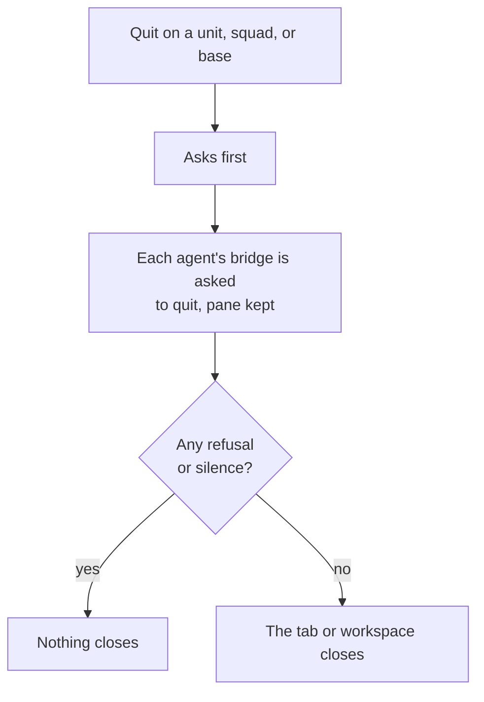

**Quit** on a unit, squad, or base asks first, then asks each session's own bridge to quit, as `/boss close` does. One refusal or silence closes nothing; only when every agent has gone does the tab or workspace close. A finished subagent has **Dismiss** instead, and a base can be **Stash**ed and popped again.

<details>
<summary>Details</summary>

**Quit** on the map, on a base, a squad, or a unit (not a subagent: its launcher closes it), and **Quit tower** under a base's name for its tower alone, asks first. × only closes dialogs. Quit is also in a unit's own comms header, desktop and phone alike: the same button as the map's for that unit (a tower's is Quit tower), shown only where the map shows one (not for a subagent, a finished subagent's Dismiss, or a unit the page cannot control), with the same confirmation, request, and refusals; cancelling or a refusal stays in the comms, and a quit that went returns to the unit's base.

Then it posts `close/all` for a base (a base's Quit is checked first as `/boss close all` is, and refuses with every reason while anything running would be lost), `close/tab`, or `close/unit`. A base's **Stash** (beside its + Main) asks first and posts `close/stash` under the base's label; the HUD's **Stashed (n)** lists what is stashed, each with **Pop**, which posts `close/pop` and opens it from the server's session. A paired device may stash and pop as it may quit. Closing is each session's own: the server asks the session's bridge to quit it as `/boss close` does (pi's `shutdown`, reason `quit`, so its tokens clear and a tower's quit demotes the mains).

The tower the sb server runs (the tower service) has no pi and no bridge to ask: its **Quit tower** posts the same `close/unit`, and the server ends the service as `close-tower` does (the tab closes, the tokens go with `sb_tower_quit=<members>`, the base's mains become members); a squad or a base is closed without asking that identity or the pi of a run in the service's pane (a boss conversation, an event run, a hand run), and the service ends with the tab or the workspace (a run's pi that is working still refuses a base's Quit); a stash refuses a base whose tower is the service, since a pop makes no service again and its queue and conversation stay under the old workspace id.

A session that does not answer is told so in the dialog, with the hint that it may run an older pi-straw-boss (`/reload` it). A unit then closes its own pane from a detached process once pi has exited. Before it quits, the session marks its pane with the token `sb_closing` (a 10 minute TTL, never cleared by the session): it leaves intercom while pi is still shutting down, and a pane Herdr still lists as a pi with no session would show for those seconds as an unjoined pi that finished, a green card under "outside the net", so the net leaves a pane with the token out and the closed main goes from its tab to nothing.

For a squad or a base every agent of the net in it (mains, members, and the base's tower) is asked with its pane kept; one refusal or silence closes nothing, an agent still running after 30 s keeps the squad or base open, and otherwise the tab or workspace closes with what is left in it (shells, subagents).

A finished subagent has **Dismiss** instead of Quit (it hides it from every page until it leaves the net), and **Dismiss finished (n)**, in the location bar under the HUD, hides every finished subagent on the net at once through the same path (the button shows only while one exists, on this computer's page and a paired device's alike); the phone's left pane has it as well, at the bottom directly above Back to the map, where a thumb reaches both. A page that was showing what it closed goes up to what is left: from a closed base to the map, from a closed squad's or unit's comms to its base.

</details>

#### Opening agents

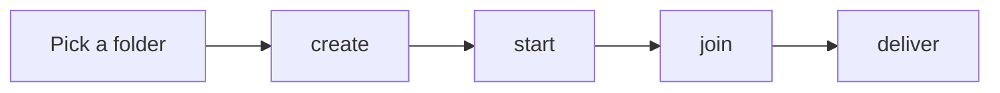

**+ New base** opens a Herdr workspace in a folder you pick, with one member and no tower; **+ Member** and **+ Main** open one more agent in a new tab. The page shows the opening's steps (create, start, join, and deliver when there is a first message), and the server enforces the same rules as the commands do.

<details>
<summary>Details</summary>

**+ New base**, the last card on the map, opens a Herdr workspace in a folder you pick with one member in its first tab and no tower: a base is never empty, and a failed open closes the workspace again. A base without a tower takes only members: **+ Member** on the base opens one in a new tab in a picked folder, and on a squad splits one into that squad's tab, in the folder of its main (or its first pane). Its tower opens by the rules of the tower, never from the page.

A base with a tower takes only mains: **+ Main** opens one in a new tab in a picked folder, and it promotes itself as soon as it joins; the tower's own comms carry the same **+ Main** in their header (on a phone and a desktop alike), which opens that tile for the tower's base and goes to the new main's comms. Each form takes an optional first message, typed into the new agent once it has joined.

The folder is picked in Finder-style columns: shortcuts for home, Desktop, Documents, and the folders the open bases work in; a column for each level of the selected folder, with the arrow keys moving between them (up and down in a column, left and right between columns, Enter to choose); a breadcrumb with back and forward; and **New folder**, which makes a folder inside the selected one (a plain visible name, no separator, no leading dot, none of the characters Windows refuses; one that exists is just selected) and selects it. The selected folder's real path is always shown, and the base's name defaults to the folder's own name until it is typed over.

While a unit opens, the tile shows a deploy panel in place of the form: the server reports the steps of the opening (create, start, join, and deliver when there is a first message) at `open/progress` under an id the page sends with the open, the page polls it twice a second, the running step's clock ticks, and a finished open flashes "unit ready" (with the finished clip when Sound effects is on) before the page goes to the new unit; a failure names the step it failed at and the server's reason, and **Back to the form** returns to the form as it was.

The server enforces the same rules (a base counts as having a tower while its tower session is live), keeps the picker inside home and out of hidden folders (a dot hides one everywhere; on Windows also the Hidden or System file attribute, which a fresh profile puts on AppData and the old compatibility junctions such as Application Data, Cookies, My Documents, and the localised Start Menu: they are not listed, not pickable, not made into, and not reached through a path that passes one; the attributes of a listed folder are read with one `cmd.exe` call (`dir /a:h` and `/a:s`) and kept for 10 s, and when the folder cannot be read the request fails with its reason instead of listing on a guess), runs one opening at a time (one lock for the whole server process, so a GUI that stops and starts inside it, or a token rotation, does not let a retry run beside the open still in its join: the retry is told 429 `busy`), and closes what it created when an opening fails.

An `open/base` that carries a `deploy` id is recorded (the workspace, tab and pane it made, its folder and label, and where the first message stands; the last 64 ids) as soon as the workspace exists, so the id outlives a server restart: a repeat with the same id finds that workspace and answers with it, waiting for its pi to join if it has not, and makes no second workspace for the folder.

Herdr reuses the ids of closed workspaces, so a record counts only while its workspace is open, its recorded pane is still there and runs in the recorded folder, and the repeat names the same folder. A pane that reports no folder (Herdr's `cwd` is optional, and a Windows pane may report none just after the start) counts only when the recorded workspace id, pane id, and the workspace's label all still match; anything weaker drops the record, since a wrong workspace is worse than a duplicate. A folder that is reported and differs makes the record stale. A dropped record makes the repeat a new open (every `open/base` with an id also forgets the records whose workspace is gone).

The first message is kept per id as `none` (the open had none), `pending` (never attempted), `sending` (set just before the call types it) and `sent`. A repeat types it only from `none` or `pending`, which is the case when the server restarted during the join; from `sending` or `sent` it never types again. The reply of an `open/base` that had a message, and a repeat's reply, carries `delivery`: `sent` (typed by this call, or by an earlier one that finished), `unknown` (an earlier one began to type it and the server cannot tell whether it arrived), or `not_sent` (the earlier one had a message that was never typed and this call carries none); `open/progress` carries the same `delivery` once the open is finished, and a repeat's `deliver` step is done in every case, so a finished open never shows a pending step.

A first message that did not arrive (502 `prompt_failed`, or 503 `unavailable` for a server that cannot type) leaves the workspace and its joined pi, and keeps the id, so a repeat finds it and makes no second base; an open that throws before its first message is typed (the pi never joined, or a record could not be written) closes the workspace and frees the id. A repeat whose own pi does not join fails at `join` (502 `open_failed`) and leaves the workspace and the record, since it made neither: the next repeat waits again.

A record that cannot be written, when the workspace is made or when the message goes to be typed, fails the open with the fixed reason "The opening could not be recorded, so it was not kept." (at `create` or at `deliver`; the cause and its path go to `server.log` as `opening-record-failed`, never to the reply), and an open that made the workspace closes it before anything is typed, rather than leaving a retry to make a second one; a repeat that fails so leaves the workspace and the record, which it did not make.

The wait for the new pi to join is 60 s by default; `open/base` takes an optional `joinWaitMs` (a whole number of milliseconds, 10000 to 300000; anything else is refused 400 `bad_request` before anything is made) for a slow computer such as a Windows one, and a pi that has not joined within it fails the open at the `join` step (502 `open_failed`, naming the seconds waited). Time a trust question is open does not count against it, as before. `open/member` and `open/main` keep the 60 s.

</details>

#### Project trust

A pi started in a folder with project resources (`.pi/settings.json`, `mcp.json`, `extensions`, `skills`, `prompts`, `themes`, `SYSTEM.md`, `APPEND_SYSTEM.md`, or `.agents/skills` in the folder or an ancestor) stops at pi's own "Trust project folder?" before it loads anything of the folder, and that prompt is drawn only in the pane's terminal. Straw Boss registers a `project_trust` handler in every pi in Herdr (subagents too) that asks the running GUI as well, so a person who uses only the GUI sees an alert instead of an opening that hangs. With no GUI it answers `undecided` and pi asks as before.

<details>
<summary>Details</summary>

- *When it asks.* The handler answers `undecided` at once, leaving pi's own order intact (a `--approve` or `--no-approve` override, then the saved decision in `trust.json`, then `defaultProjectTrust`), unless: pi runs in its TUI on a terminal; this is the process's first runtime (a `/new`, `/resume`, or `/fork` into another folder is pi's own prompt); no decision is saved for the folder or a parent (a `trust.json` that cannot be read counts as a decision: pi reports it); `defaultProjectTrust` is `ask`; and a GUI that reads trust requests runs for this Herdr (`gui.json` carries `trust: 1`, names this Herdr's socket, is not stopped, and answers within 1 s).

  The page only gets the token after the recorded server is shown to be the process that runs: its pid is alive and its start time is the recorded one. On macOS and Linux that is `ps`, at once. On Windows the start time is a CIM read of 3.5 to 5 s on a cold cache, so a new pi may wait up to 6 s before the question reaches the GUI (the read starts when pi loads, if `gui.json` names a live server that reads trust requests, so it is mostly under way by then; a start time not in within 6 s is unknown and nothing is sent, and pi asks in the terminal). A `gui.json` that names a dead pid, a stopped server, or none costs no wait and no PowerShell start.
- *The channel.* The pi has not joined the net yet, so it talks to the server through files in `<state>/trust/` (mode 700, files 600): its request `<id>.json` (its process, pane, role, the folder, what trusting would load, and a digest over the folder and those findings), the server's `<id>.answer.json`, and the pi's `<id>.result.json` (which side answered), all written by rename. On Windows the folder must lie inside the user's profile (see [Windows](#windows)); elsewhere pi asks in its terminal. The server lists a request only while its Herdr is its own, its process lives, and Herdr lists its pane; a request whose process ended is removed. A file that is a link, someone else's, too large, or whose digest does not match its findings is not read.
- *The race.* pi's startup prompt cannot be dismissed once drawn, so the terminal prints three lines (the folder, "The question is in the Straw Boss window.", "Press any key to answer here instead.") and reads one key. A GUI answer is returned to pi as the decision (pi's prompt never shows); a key hands over to pi's own prompt with all its options, and the alert closes as answered in the terminal; no server answering for 15 s hands over the same way. A `SIGINT` or `SIGTERM` while waiting removes the request. Nothing times out: an agent should not trust or distrust a folder because nobody looked.
- *The alert.* One per folder and digest, however many agents wait on it, ranked as a question (it counts in the HUD, Space opens it, and the reminder and sound are the waiting ones). It names the folder and where the agents run, says that trusting loads the folder's settings, extensions, skills, prompts, themes, and MCP servers and installs the packages its settings name (extensions and MCP servers run as programs on this computer), lists what the folder holds (folded past five items), and offers **Trust** (saved for the folder in `trust.json`), **Trust this time**, and **Don't trust** (this process only, so the next agent asks again). pi's "trust the parent folder" stays in the terminal.
- *Who may answer.* `POST /<token>/api/trust/answer {id, digest, choice, answerId}` under the page's usual checks (origin, `Sec-Fetch-Site`, CSRF, 64 KB): this computer's page, and a paired device on the remote listener as for a relayed confirm; a Straw Link peer never. The answer must carry the request's digest, so it is for exactly what was shown; nothing from the page is a path. One answer is taken per request (`busy` for another; the same answer sent again hears its outcome), written to every request of the folder and digest, and the reply is `accepted` (a pi took it), `stale` (the terminal or the end of the pi came first), or `unknown` (no result in 5 s; Check again looks again).
- *Openings.* A new pi that waits on the question has not joined, so every wait for a new pi (the page's opens, `boss_open_main`, a tower's start, a pop) stops counting while its pane has a request, and fails after ten minutes of it with "No trust decision for <folder> within 10 minutes", closing what it created. The deploy panel gets a **trust** step between start and join that holds the same three choices inline; that page's alert queue then does not open a second dialog for it, while a paired device or another tab still gets the alert, and the panel's 120 s give-up does not count that time.
- *Desk mode and the team profile.* Nothing more is needed: the desk window is this computer's page, and every pane on the desk stack runs the handler. Leave `defaultProjectTrust` at `ask`, so the person is asked once per new folder and **Trust** remembers it (`always` would load any cloned repository's extensions with no question; `never` would drop a team repository's own `.agents/skills`).

</details>

### Serving the page

#### The server

The server runs in one session at a time, the one that opened it or a survivor that took it over (see One server per machine), on `127.0.0.1` with two random free ports: the local listener, for this computer's browser, and the remote listener, the only target `tailscale serve` is pointed at. Which request is local is decided by the listener it arrived on, not by what it says about itself: a request on the remote listener is remote whatever its `Host` or headers say, and the local listener lets in only a request with `Host: 127.0.0.1:<port>` and none of the forwarding headers `tailscale serve` adds (`X-Forwarded-*`, `Tailscale-*`, `Forwarded`, `Via`), and refuses the rest with 403 (a second guard).

<details>
<summary>Details</summary>

Both listeners run the same handler. Every URL starts with a random token (`http://127.0.0.1:<port>/<token>/`); a request without it or with another `Host` header is refused with 403, so other local pages cannot read the net. The only writes are POSTs under `/<token>/api/sessions/<key>/`: `input`; `keys`, which takes one key pad key from a page that shows that terminal live, or Stop's Escape; `commands`, which asks the session's bridge for the commands that match a typed `/name` and calls no Herdr method; `answer`, which carries a dialog's answer to its owner and sends no key; and `mirror`, which shows the pane's screen on the page's own stream. Only this computer's page may also send (403 from a paired device) `server/stop`, `remote/pair` (a new one-time pairing code: pairing is the desktop's), `remote/on`, `remote/off`, `remote/devices`, `remote/unpair`, `remote/unpair-all`, and `/<token>/api/dismiss` (one finished subagent, or `all`). Each needs the page's own `Origin`, `Sec-Fetch-Site: same-origin` when sent, a JSON body of at most 64 KB, and the CSRF secret written into the page; for `input`, `keys`, and `answer` the server also asks Herdr right then that the pane still runs pi on that session's file (a mirror checks it before its first read and every 2 s, and starts afresh when the session moved to another pane).

Typed text is never logged. The page is a built static bundle; any route answers the same page, which carries a `<base href>` so it loads from any depth. The stream (`/<token>/events`) names itself first (`hello`, a random id the page attaches terminal mirrors to; a server that has not read the net yet names it after its first reading), then sends the full snapshot on connect and on every change, a `ping` every 15 s, and a `problem` event when Herdr or intercom cannot be read; `events?watch=<session key>` adds that session's history, and `events?watch=w:<workspace id>` the last line of each unit there.

`/<token>/api/history/<key>` and `/<token>/api/entry/<key>/<entry id>` page through a session and fetch one entry in full (capped at 1 MB). Documents are served by capability, a random 128-bit value the server gives each listed document, never by path: `/<token>/doc/<cap>/` is an HTML document (at most 2 MB) with each `cgi-bin:pi-answer` form pointed at a one-time nonce (30 minutes, bound to that document), `/<token>/doc/<cap>/<file>` an image, stylesheet, or font under the document's own directory (at most 8 MB, no `..`, no symlink out of it), `/<token>/doc/<cap>/answer/<nonce>` one form answer (at most 64 fields, 16 KB of query, 12 KB of answer, no control characters other than tab and line breaks), and `/<token>/api/doc/<cap>` a text document as JSON.

Only documents a session lists now are served. Every `/doc/` response carries a CSP `sandbox` without `allow-scripts` or `allow-same-origin`, and its sources name the server's origin (WebKit does not match `'self'` in a sandboxed document); the app may frame only its own pages and sends `Cross-Origin-Opener-Policy: same-origin`. The rewrite also drops a document's own `<base>`, referrer policy, and its buttons' `formaction`, `formmethod`, `formtarget`; that is a best effort on HTML text, and the sandbox and policy are what hold.

While a page listens the net is read every 2 s; with none it is still read every 10 s, so the timeline keeps what happened while a phone slept. The page is installable as an app: the bundle carries `manifest.webmanifest` (its `id`, `start_url`, and `scope` are `./`, so they resolve under the token path), PNG and SVG icons, and `apple-touch-icon.png`; the page's policy adds `manifest-src 'self'` and links the manifest with `crossorigin="use-credentials"`, so a paired device's cookie goes with it. There is no service worker: every page comes from the running server's own build.

</details>

#### Session files

The server reads only the session files of units in the net it just read (joined sessions, towers, subagents through their pane or launch script, and the other pi panes of a base); a path never comes from the browser. A file is read only from a pane running pi, only as a `.jsonl` under pi's sessions directory (`sessions/` in `PI_CODING_AGENT_DIR` or `~/.pi/agent`, symlinks resolved on both sides), and for an intercom session only when it is named for that session, so a net read during `/new` cannot pair the old session with the next file; a watched session whose file changes re-attaches to the new one.

<details>
<summary>Details</summary>

A file is indexed in 1 MB chunks from the first and last bytes of each line, and only the index stays in memory; entries are read by offset for the page being sent. Indexing, appends, and reads run one at a time in order, so entries pi writes during the first index wait for it, and a read never uses the index of a file that was replaced. A rewritten file or a branch move resets the page. A first page that cannot be read is tried again on the next net reading.

A unit that leaves the net stays readable for ten minutes, with a link to the pane's new session when there is one. A session file is opened without following a symlink at its last step (`O_NOFOLLOW`): a file swapped for a link after the net resolved its path is not read. Where the platform has no `O_NOFOLLOW` (Windows) the link is looked for just before the open, which leaves a short window between the look and the open; a process of the same user that can swap files in pi's sessions directory can use it to make the GUI show another `.jsonl` under that directory, and only the user and their paired devices read the result. Sessions stored elsewhere (`--session-dir`, `PI_CODING_AGENT_SESSION_DIR`, or pi's `sessionDir` setting) show on the map but have no history and cannot be typed into.

</details>

#### Remote access

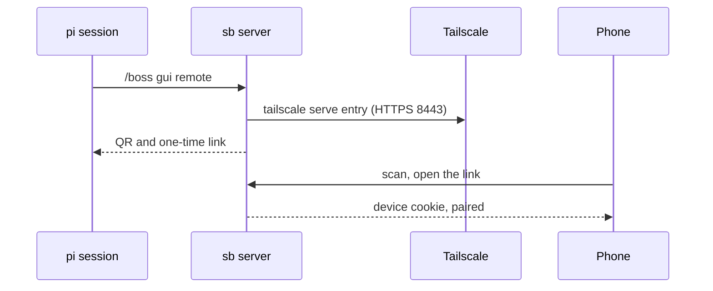

`/boss gui remote` asks the sb server to put the GUI on your tailnet with one `tailscale serve` entry (HTTPS on port 8443, to the remote listener only, never Funnel). The session shows a QR in a pi overlay; a phone signed in to Tailscale as this machine's user scans it and gets a device cookie. Every remote request must also carry this machine's Tailscale identity.

<details>
<summary>Details</summary>

`/boss gui remote`, from any pi session, asks the sb server to put the GUI on your tailnet: it adds one `tailscale serve` entry, HTTPS on port 8443 proxying to the server's remote listener (never Funnel, and never the local port), and the session shows a QR code in a pi overlay, drawn here from the server's answer, so the QR and its one-time links never reach the server's log or the model's conversation. Scan it with a phone signed in to Tailscale as this machine's user (or, in an installed app, type the short code printed under the QR: see **The installed app's entry** below).

In the overlay, **c** copies a link and **o** opens one in this computer's browser (a session in a desk stack, `STRAW_BOSS_DESK=1`, has no **o** key and lists none: the shell shows the page itself); every QR, copy, and open is its own one-time link that works once, within ten minutes, and **Esc** or **q** closes it. While the overlay is open the session counts as waiting, so input from the browser is refused rather than lost in it. The settings page's Phone & devices section shows a fresh QR in the page too; it shows only on this computer's page (127.0.0.1), not on a paired device's, and not in a desk window ([Desk mode in the page](#browser-view)).

A paired device gets a session cookie (HttpOnly, Secure, SameSite=Strict, 90 days, scoped to the token path) and stays paired until the desktop unpairs it, the GUI gets a new token (a pairing belongs to the token: a restart keeps it, but a taken port, a missing or corrupt `gui-secrets.json`, or `/boss gui rotate` makes a new one and needs a new QR), this machine's Tailscale identity (host or login) changes, or 90 days pass without a use; every use renews it, and the response then sets the cookie again (the stored expiry moves at most once an hour).

The server keeps only the cookie's SHA-256, with the device's name (platform and browser, read from its User-Agent when it paired), when it paired and when it was last used, in `paired.json` (mode 600) beside `gui.json`; it survives remote off and on and a restart of the server, but a new GUI token unpairs every device, because their cookies are scoped to the old token's path and could not connect anyway; the identity and the wish to have remote on stay, the log says `devices-cleared`, and a phone scans a new QR code (see [One GUI per machine](#browser-view)).

Every remote request arrives on the remote listener and must also carry this machine's Tailscale user in `Tailscale-User-Login`, which `tailscale serve` sets, and the exact MagicDNS host. Secrets are entered only on a page of the local listener, so a proxy that dropped its forwarding headers, or a serve entry that still points at the local port, cannot turn a remote request into a local one. A document's own requests (`/<token>/doc/…`) need that identity and the document's capability but not the cookie, because Chrome withholds a SameSite=Strict cookie from a sandboxed frame's requests: on the tailnet, a device of the same Tailscale user that holds a document's link can read it and answer its form without pairing.

Port 8443 is taken only when it is free or already this server's, including an entry from before the remote listener that points at this server's local port: turning remote on (or the page's Turn on remote access) points it at the remote listener, and if Tailscale does not take the change, remote stays off with "tailscale serve did not take the entry as asked" and nothing is recorded, so a request through the old target is refused 403 by the local listener rather than served as local. An entry that points anywhere else is never touched.

Turning remote off, and starting a server that does not resume remote, remove the old-target entry; a server started with remote wanted on repoints it to the remote listener instead (the same "free or already ours" rule), and removes it only when it stays off. `/boss gui remote off` (or **Turn off remote access** in the Phone & devices section of this computer's settings page) removes only that entry (other serve entries are never touched), ends every remote stream, and forgets that remote was wanted; the paired devices stay paired.

`/boss gui stop` does not touch it (the entry points at the remote listener, which stops with the GUI), but the end of the server removes the entry for as long as the server is gone, and remote stays wanted: the next server that starts (from `/boss gui`, `cli.mjs up`, a restart, an upgrade, or a pi session's look) turns remote on again by itself, with the same safety checks and without the QR, and when it cannot (Tailscale down, 8443 taken) it says why in `cli.mjs status` (`remote.note`) and in the `remote_off` warning of `up`, and tries again at the next start.

**Unpair**: the Phone & devices section of this computer's settings page lists the paired devices (name, paired, last used) with Unpair for each and Unpair all, which end that device's open streams at once; a device list is never offered to a paired device. A paired device with terminal access is trusted like the boss's own keyboard: the page routes refuse it pairing, remote, Wi-Fi, and server management, and its composer and a new session's first message refuse the matching `/boss` commands (and `/boss gui view <mode>`) to prevent slips, but the key pad's terminal keys are not filtered, so it can type anything pi accepts, `!` shell commands included, and the key pad's Escape can dismiss any open dialog, all-`hereOnly` ones too; that is a refusal, never an approval.

A device whose Tailscale identity changed, which was unused for 90 days, or whose GUI token was replaced, needs a new QR (or, in an app, a new code). **Resuming checks the identity**: a new server turns remote on by itself only as the Tailscale identity (host and login) the devices were paired under, which paired.json remembers; as another one (another user or tailnet signed in) it stays off, removes any serve entry it finds, tells why (a warning), and leaves the wish and the old devices as they are, so the next start as the remembered identity turns it on again and tells the same again until then; turning remote on by hand as the new identity (`/boss gui remote`) is what voids the old devices.

A `paired.json` that cannot be written (a full disk, a directory without write permission) does not throw out of the request, and the change stays in effect in memory until the server stops (an unpaired device stays unpaired, remote off stays off), but it is reported: Unpair, Unpair all, Turn on and Turn off remote answer `500 save_failed` with the reason (the Phone & devices section shows it) and the session shows a warning, because after a restart the revoked device would be paired again or remote would come back. `access.saveError` holds the raw error. A legacy `paired.json` counts as wanted only while one of its sessions has not expired.

Remote off keeps `remote.json` when its entry still exists under another host name (the Tailscale identity changed), so a later off can remove it. It says why and changes nothing when Tailscale is missing, signed out, a tagged node, without MagicDNS, or 8443 serves something else. The layout works on a phone: no sideways scrolling, larger touch targets, safe-area insets, and the composer stays above the on-screen keyboard.

Since 0.26.0 a session on a phone takes the whole screen (‹ goes back to its base, **Info** opens its dossier full-screen, and a tower's dossier lists its base's squads and units on every screen since 0.26.1), its composer fixed at the bottom over the keyboard, and a tile opens over it the same way; the composer puts its box on top with **+** on Send's row, its note line taking no room while empty. While a finger holds or flings the comms log, nothing pulls it back to the newest entry. The net log folds away from its heading, and on a phone shows only its two newest entries.

To use it as an app, pair in the browser first and then add it to the home screen: iOS copies the browser's cookies into the app only once, at install, and after that the two keep separate cookies, so a pairing link (which opens in the browser) never reaches the app; the pairing code typed into the app's own entry does. On Android an app installed from Chrome shares Chrome's cookies, but launching it is a navigation from another site, which leaves the SameSite=Strict cookie behind: a page load without the cookie whose `Sec-Fetch-Site` is not `same-origin` gets a page that reloads itself once, and that same-origin reload carries the cookie.

**The installed app's entry.** An installed app cannot follow a token that changes (a new one comes with a taken port, a lost store, or `/boss gui rotate`), and on iOS it has a cookie jar of its own that a link opened in Safari never reaches. So the remote listener (only; on the local one `/sb-app/` is a wrong token and answers 403) also answers a fixed, token-free path, `/sb-app/`, and the manifest it serves a remote page has `start_url` `/sb-app/` and `scope` `/`; the local page's manifest is as before.

The entry runs the same identity checks as a page (remote on, the exact MagicDNS host, no Funnel marker, this machine's `Tailscale-User-Login`), and its pages hold no token and no secret. A GET with a valid device cookie answers 302 to the current `/<token>/` and sets the cookies again; one without it shows a page with eight boxes, one character each, for the **pairing code** (its own `form-action 'self'` and `Referrer-Policy: same-origin`, because a form post from a page under the others' `no-referrer` carries `Origin: null` and was refused; a script served at `/sb-app/entry.js` under the same strict `script-src 'self'` moves between the boxes and takes a paste, and without it the boxes are fields `c1` to `c8` that the server joins, or a single `code` field), or, for a document load that is not `Sec-Fetch-Site: same-origin` (Android launching the app, which leaves the SameSite=Strict cookie behind), the same one-time self-reload as a tokened page.

The POST `/sb-app/pair` takes the code: it must be a form post from the entry's own page (`Origin` equal to the https name, `Sec-Fetch-Site` `same-origin` when sent, `application/x-www-form-urlencoded`, at most 1 KB), so a post from another site never reaches the code or counts for anything. The code is 8 characters from a 32-symbol alphabet without I, L, O, and U (40 bits, shown as two groups of four with a space, `ABCD EFGH`, never with a hyphen; case, full-width letters (NFKC), any space or dash, and look-alikes are forgiven), drawn when `/boss gui remote` runs (under the QR in its overlay, never in the text the conversation shows) and when the Phone & devices section asks (beside the QR); it works once, within ten minutes, and ends with remote off or an identity change; at most sixteen wait.

After five wrong codes every waiting code is void and the entry answers 429 until this computer asks for a new code (which gives the five tries back), so a device on the tailnet cannot grind through the 40 bits. A pairing made by the code is the same as a scanned one (a device with a name, 90 days, renewed by use), and its response sets the session cookie twice: `Path=/<token>/` for the page and `Path=/sb-app/` for the entry, each HttpOnly, Secure, SameSite=Strict, so the pairing is never sent to another path on the host; a QR pairing and a renewal set both too.

A document load at a dead token by this machine's user, or at the current token with no pairing and `Sec-Fetch-Site: same-origin`, answers 302 to `/sb-app/`, so an app installed before the entry existed (its start URL is an old tokened address) finds it by itself; any other request gets the refusals as before. The 401 text for everything else says to type the code in an installed app. A restart keeps the token and the pairing, so a paired app goes on by itself; the code is for a first pairing and for a device that a new token unpaired.

</details>

#### Wi-Fi access

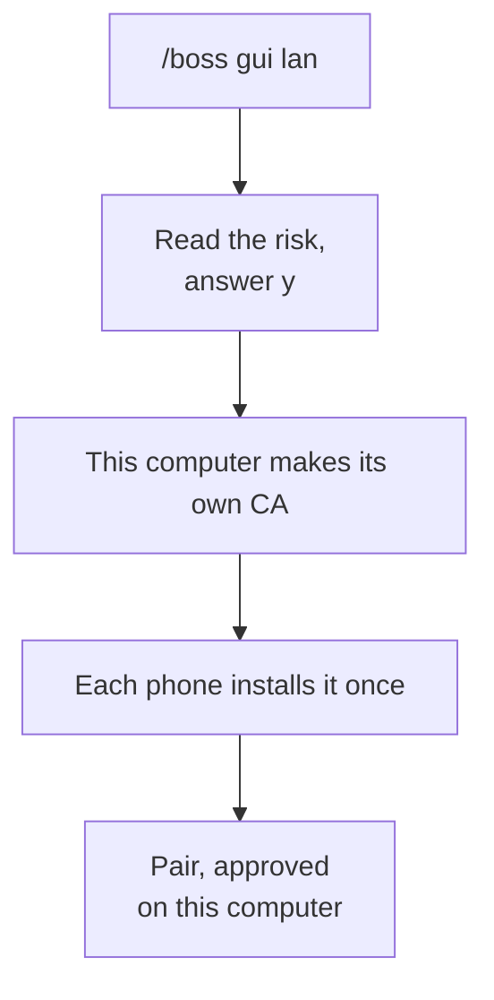

`/boss gui lan` lets a phone on the same Wi-Fi as this computer open the GUI without Tailscale. It is off until you turn it on, and it stays on across restarts until `/boss gui lan off`. Tailscale access is unchanged and stays a separate switch; both can be on, and a phone may be paired over each. The terminal speaks English; the pages the phone sees speak English or Traditional Chinese by the browser's first language.

<details>
<summary>Details</summary>

**Read the risk first.** Wi-Fi access needs a certificate authority (CA) that this computer makes for itself and that each phone installs once. A phone that trusts the CA accepts anything the CA signs. Whoever copies the CA's key can pose to that phone as this computer, and as any private-network address (a router's or a NAS's `192.168.x.x` page), on any Wi-Fi the phone joins, until the certificate is removed from the phone.

The key lives in `lan-ca.json`, which every program running as you can read, agents you run included, and it can end up in a backup of the agent folder. macOS excludes the file from Time Machine, but Time Machine's local snapshots may still hold a replaced key for up to a day. The CA is limited by name constraints (below), which hold only where the phone's software enforces them. So use Wi-Fi access on your phone's hotspot, or on a Wi-Fi that connects the phone directly to this computer, so no one else is on the network.

The first `/boss gui lan` shows this warning and makes the CA only after you answer **y**; the page's Wi-Fi tab shows the same text before it turns anything on.

</details>

##### What is served

Each eligible address of this computer (private IPv4 only) gets its own listener, `8445` by default. IPv6, the Tailscale address, and link-local and public addresses are never served.

<details>
<summary>Details</summary>

- Each eligible address of this computer gets its own listener (`8445` by default, kept in `lan.json`, because the port is part of an installed app's origin).
- An address is eligible when it is IPv4 in `10/8`, `172.16/12`, or `192.168/16`, is on a real interface (not loopback, not a tunnel such as `utun`, WireGuard, or a `/31` or `/32` link), and has a sensible prefix.
- Never served: IPv6, the Tailscale address, link-local and public addresses.
- VM and container bridges are served, since nothing tells them from Wi-Fi; a layer-2 VPN adapter can be served too. The overlay, the page, and `cli.mjs status` list every served address with its interface, so you can see it and turn Wi-Fi access off.
- Every connection must come from a private address on the served address's own subnet; anything else is closed before a byte is read.
- The listener tells TLS from plain HTTP by the first byte. TLS gets the GUI; plain HTTP answers only the certificate pages.
- The server watches the interfaces every 5 s: a new address gets a listener, a gone one loses it, and a wake from sleep rebinds all of them.
- A port taken by another program on an address leaves that address unserved with a note; `/boss gui lan` moves the port only then, and an app installed on the old port must be added again.

</details>

##### The certificate

The CA is made once and kept in `lan-ca.json`; each served address gets a short-lived server certificate that names only the computer's `.local` name and that address. The CA is constrained to private IPv4 names.

<details>
<summary>Details</summary>

- `lan-ca.json` holds an ECDSA P-256 CA valid for two years. Each served address gets a 90-day server certificate (kept in memory, renewed under 30 days) that names `<computer name>.local` and that address, nothing else.
- The CA may sign only that name, private IPv4 addresses, no IPv6, no email address, and no URI. If the computer's name cannot be read, the CA signs addresses only and the QR carries an address.
- Sixty days before it ends, `status` and the page say so; when it has ended, Wi-Fi access turns itself off until you renew it.
- `/boss gui lan reset` asks: **r** makes a new certificate and keeps the pairings (the old one is ending, or the computer was renamed); **u** also unpairs every Wi-Fi device (the key or a phone may have been stolen). Either way each phone must remove the old certificate and install the new one; removing it is what ends a copy of the old key.
- `/boss gui rotate` leaves the CA alone.
- A corrupt, foreign-owned, linked, or too-open `lan-ca.json` leaves Wi-Fi access off with a note; nothing makes a new CA behind your back.

</details>

##### Getting the phone to trust it (once per phone)

Each phone trusts the CA once. The best way is to send the profile (iPhone) or the `.crt` (Android) from this computer by AirDrop or Quick Share; the certificate page is the fallback.

<details>
<summary>Details</summary>

- Best: send the profile (iPhone) or the `.crt` (Android) from this computer by AirDrop or Quick Share. The overlay's **f** key writes these public files to `lan-ca-files/` and shows them; the page's share buttons download them, one link for each file. Nobody on the Wi-Fi can touch this path, and it needs no check unless the phone asked you to accept a file from an unknown sender.
- Otherwise scan the certificate QR, or open `http://<name>.local:8445/sb-ca/`, a plain-HTTP page that offers the files and the steps for the phone's platform. Anyone who controls the Wi-Fi can swap what that page serves, and the page itself shows no fingerprint, because an attacker who swaps the page would print the real one. So the check is on this computer's screen, which shows the SHA-256 start of the real certificate and where to look on the phone:
  - iPhone, before **Install**: the profile's Contains row says only a certificate, More Details lists exactly one certificate and nothing else, and its SHA-256 starts with the bytes shown.
  - Android, after installing: Trusted credentials, User, shows exactly one Straw Boss LAN CA and nothing you did not add, with the same SHA-256.
  - Mac: Keychain Access shows exactly one, with the same SHA-256.
  - Windows: exactly one Security Warning appears during the import, and its SHA-1 thumbprint matches the one shown. Anything else means remove what was added.
- The profile and the file each hold exactly one certificate, so another count means they were swapped.
- On iPhone, install the profile and then turn the certificate on in Settings, General, About, Certificate Trust Settings. On Android use Chrome; it trusts certificates you install, and Firefox does not by default.
- An Android phone before 12 may not resolve `.local`; press **i** in the overlay to use the address instead. An app installed from an address stops working when the address changes.
- The page `/sb-ca/check` shows whether the phone trusts some certificate for this name. It cannot tell this computer's from an attacker's.

</details>

##### Pairing, with approval on this computer

The overlay's QR carries a token-free link that asks the phone to press **Pair**; a code works once, and a redeemed code only makes a pending device that this computer must approve.

<details>
<summary>Details</summary>

- The overlay's QR carries a token-free link, `https://<name>.local:8445/sb-app/pair/<code>`, which asks the phone to press **Pair** before it uses the code, so a link preview cannot spend it. A typed code for the installed app is shown only when asked for.
- A code works once, within ten minutes, and each surface (one overlay, one page tab) has at most one live code; making a new one voids the one shown before.
- A redeemed code only makes a pending device with a four-digit number shown on the phone. You allow it by typing that number on this computer, in the overlay or in the page's Wi-Fi tab. Neither prints the number and no button allows a listed request, so a bystander who used a seen code cannot be allowed by reflex. The overlay denies one request with `d` (Up and Down mark which when more than one waits; the page's Deny) or all with `n`; denying needs no number. Three wrong numbers deny everything pending; two minutes without an answer drops the request; every result is announced in the overlay, the session, the page, and the log.
- Typed codes are locked per peer address (five wrong tries) and void after 200 wrong tries from all addresses; the page says when someone seems to be guessing.
- While a `/boss gui lan` screen is open, a paired device (either network) can send only Escape into that session, and each screen takes only Escape for 1.5 s after it opens. A `/boss send` into that session is held to the same mark (the post says `guarded`), since a paired device can make another session send it. A phone cannot answer the screen it is looking at.
- A request that arrives while no screen is open raises a notice in every pi session and on the page.
- The approval does not stop a swapped certificate: an attacker in the middle relays the real number. The fingerprint check does.

</details>

##### After pairing

After approval the phone holds a Wi-Fi cookie, set only for the GUI's paths and kept apart from the remote one. A Wi-Fi device may do what a paired tailnet device may do, nothing more.

<details>
<summary>Details</summary>

- The cookie is `__Secure-sb_lan` (HttpOnly, Secure, SameSite=Strict, 90 days, renewed by use), set for `/<token>/` and `/sb-app/` only. Remote and Wi-Fi cookies live on different hosts and are never mixed.
- Allowed devices live in `lan.json`, bound to the GUI token: a new token (a taken port, a lost store, `/boss gui rotate`) unpairs them. They survive Wi-Fi access off and on, restarts, new addresses, and CA renewal.
- A Wi-Fi device may do what a paired tailnet device may do, nothing more. The server, remote, Wi-Fi, and most Straw Link controls stay on this computer's page.
- A document opened on a Wi-Fi device needs the device's cookie for the document itself, and everything the document loads (images, styles, answers) goes through a short-lived ticket in the page's `<base>`, so a leaked link opens nothing. Unpairing, switching Wi-Fi access off, or a new token ends the tickets.
- The settings page's Phone & devices section on this computer's page has a Tailscale tab and a Same Wi-Fi tab and one device list for both, each device labelled with its network. The Wi-Fi tab shows the risk and the hotspot advice, turns Wi-Fi access on only when you press its button, and offers the certificate files (one link for each file, labelled by the platform it is for), the fingerprint steps, a pairing QR, a code, the address toggle, the pending requests, and the field for the phone's number.

  Notes and events from the server (a taken port, the firewall, a renamed computer, no address, the certificate ending, a paired or refused device) come with a code and its parameters, and the page words them in English or Traditional Chinese; the PowerShell and macOS commands in a firewall note stay exactly as the server gives them. A note that means a phone cannot connect now (Wi-Fi access held off, a taken port, an ended certificate, a firewall block) is shown as an error; a moved port, a VPN, a certificate that is ending, and the events are only told.

  Refused pairing codes from one address are one line with a count and the time of the latest. While a pairing request waits and the Wi-Fi tab is not open, the page's header says so, and pressing it opens the tab. The tile does not show in a desk window or on a paired device's page.
- Straw Link is unchanged: the tailnet join stays Tailscale only, and nothing of the link listens on Wi-Fi.
- Only the default Herdr's sb server offers Wi-Fi access; another slot's server says so.

**The installed app's entry on Wi-Fi.** The Wi-Fi listeners also answer the fixed `/sb-app/`, with the Wi-Fi's own codes, cookie, and waiting page. A typed Wi-Fi code is shown as `ABCD EFGH` and entered in the same eight boxes as the Tailscale entry, with the same forgiving reading (case, full-width letters, spaces, any dash, and invisible characters). The entry's pages send `Referrer-Policy: same-origin`: under the listener's usual `no-referrer` a form post carries `Origin: null`, which the redeem refuses. An app installed from the name keeps working when the computer's address changes.

**Firewalls.** The server never changes a firewall; it reads what it can without elevation and adds a note with the fix.

- macOS: when the application firewall is on and blocks all incoming connections or blocks `node`, the note says to allow it in System Settings, Network, Firewall, Options.
- Windows: see [Windows](#windows).
- Linux: no check; allow the subnet to the port, for example `ufw allow from <subnet> to any port 8445 proto tcp`.
- A full-tunnel VPN that blocks local traffic leaves the address served and unreachable; the note says to allow local network access in the VPN's settings.

Whether a phone enforces the CA's name constraints for a certificate you installed is the platforms' own behavior, and it is to be measured, not assumed. Nothing is measured yet: every platform counts as unmeasured and gets the strong warning. The certificate page, the Same Wi-Fi tab, and the `/boss gui lan` overlay say plainly that whether the phone limits the certificate has not been verified, and that a copy of the key could pose as any website to it. The table below stays "not measured" until the gate (see the release notes) is run; a platform that passes it will get narrower text.

| Client | OS and browser version | Outside the permitted address | Another `.local` name | IPv6 | Ended CA | Another DNS name under the no-name CA (f) | No-name CA's real leaf | Mail and code-signing leaves (g) |
|---|---|---|---|---|---|---|---|---|
| iPhone, Safari and home-screen app | not measured | not measured | not measured | not measured | not measured | not measured | not measured | not measured |
| Android, Chrome and installed app | not measured | not measured | not measured | not measured | not measured | not measured | not measured | not measured |
| macOS, Safari and Chrome | not measured | not measured | not measured | not measured | not measured | not measured | not measured | not measured |
| Windows, Edge and Chrome | not measured | not measured | not measured | not measured | not measured | not measured | not measured | not measured |

</details>

#### The server panel

The settings page's **Server** section, on this computer's page only (127.0.0.1; a paired device does not see it, and the server answers it 403 `local_only`), opens the sb server's state (live, restarting, or stopped; version; mode; uptime; last error), **Restart server** (a confirm in place that says the page keeps its address and reconnects by itself, then the server restarts and the page reconnects when it is back, with a note to open `/boss gui` if it does not: the address changes only when a port was taken) and **Show log** (the last 200 lines of `server.log`, which holds no message text or secret). Restarting from the page names the asker "GUI" in the log; the reason is one line of at most 200 characters.

#### One GUI per machine, served by the sb server

The GUI runs in the sb server ([The sb server](#the-sb-server)), not in a pi session: the server binds its two loopback listeners (the local one and the remote one) after it has registered its intercom id, and, while Wi-Fi access is on, one more listener per served private address ([Wi-Fi access](#browser-view)), and `/boss gui`, `/boss gui stop`, `/boss gui remote`, `/boss stash`, and `/boss close all` ask the server over its control socket. A pi session hosts nothing, adopts nothing, takes nothing over, and holds no dialog hub, so the page does not depend on which pi lives. The server writes `gui.json` and records the same port and token in `server.json` (`gui: { port, token, stopped }`).

<details>
<summary>Details</summary>

The boss chose to keep the GUI token, the CSRF secret, and the paired devices across restarts. The token and the CSRF secret live in `gui-secrets.json` (mode 600, written by rename, beside `paired.json` in the owner-only folder; on Windows covered by the state folder's ACL; the ACL read-back lists it in the primary slot's folder only, a secondary slot's copy inherits the folder's protection without being read back) with the pair of ports they were bound to.

A restart or an upgrade of the server, a server that starts after a crash or an unclean exit, a reboot, and a start after `/boss gui stop` bind the recorded ports again (a port the old server is still letting go is waited for up to 5 s) and keep the token, the CSRF secret, and `paired.json`'s devices: an open page and the desk shell reconnect by themselves, a phone's tokened start URL and the installed app's fixed entry go on, and remote access, when it was wanted, comes back with the serve entry pointed at the new remote listener. Both records carry the token before `restarting` is cleared.

A **new** token, with every device unpaired (the log says `devices-cleared`; the identity and the wish stay), comes in three cases: `gui-secrets.json` is missing, corrupt or stale (one log line, `newToken=true why=missing`, `corrupt` or `stale`; the first start after an upgrade from 0.47 has none; a link or a file another account owns in its place is `corrupt`; `stale` is a store whose token is not the one the records name, left behind when a build that ignores the store ran on the ports in between: a downgrade, or a 0.45 host), the listener could not get both of its ports back and moved (`why=moved`; the remote port counts), and `/boss gui rotate` (after a confirm; a new token and CSRF secret on the same ports, every phone unpaired, a stopped GUI started, the new address opened; `why=rotate`).

Then the old token and CSRF secret get 403, a page left open says the address does not work here (a page load at the old address gets the same note as a short HTML 403, in Traditional Chinese when `Accept-Language` asks for it), and a phone scans a new QR code (an installed app types the pairing code). **The risk, accepted by the boss:** another account that binds a port in the gap between two servers receives what an open page or the app sends (the token in the URL, the CSRF secret in its requests), and the secrets stay valid when it frees the port.

On the remote port the gap is wider: a clean leave (and a fatal JavaScript error) takes the serve entry down, but a SIGKILL, an out-of-memory kill or a power loss leaves it pointing at the dead port, so a squatter there is sent a paired phone's requests with the token in the path. What it then gets is more than that phone: with the token it can open this computer's page on the local port (the local listener admits on the token and a `Host` header the process sets itself) and read the CSRF secret, which is the full power of the local page (restart, link settings, spawn, secret entry).

Unpairing the phone does not end it; only `/boss gui rotate` does, and the "port is taken" rule catches only a squatter that still holds a port when the next server starts, not one that let go. `/boss gui rotate` is the answer to a gap you do not trust. The first server after an upgrade can find a pi session of 0.45 or older still hosting the GUI: it asks that session to hand over, as a newer build always could (`server/stop` with `take`; its serve entry goes with it), waits up to 5 s until nothing accepts a connection on its port (it sends the port nothing during that wait), and binds the same port, under a token of its own (the older host never stored one), when it gets it back (only when the process `gui.json` names runs, and its start time is known and the one `gui.json` records: nothing is sent to a port whose recorded process is gone, and nothing to one whose process's start time is not known yet or was not recorded, because on Windows a crashed host's pid is often another process's, which may hold the port.

The start time is waited for up to 6 s; when it does not come, the hand-over is skipped and logged as `gui-reclaim-skipped`, and the server's GUI moves to another port), so remote access comes back on the server's listener (the page the older host served stops working: its token is the older listener's). The server itself is never taken over: a takeover asked of it is answered 409, and the older session then reports the GUI as stale and leaves it alone (only that build's plain `/boss gui stop` is taken, as a stop on purpose).

`/boss gui` is the boss's own start: it starts the sb server when none runs, starts a GUI that was stopped on purpose, opens the browser, and prints the URL. `/boss gui stop` stops the GUI listeners only (`stopped` in `gui.json` and `gui.stopped` in `server.json`); the server goes on running its other services, and a restart keeps the stop, the boss's own `/boss server restart` too (it clears only the server's own stop on purpose, as `/boss server` and `cli.mjs serve` do; only `/boss gui` and `cli.mjs up`'s gui step start a GUI that was stopped).

No automatic ask starts a GUI that was stopped on purpose: `/boss stash` and `/boss close all` say it was stopped and leave it to `/boss gui` or `cli.mjs up`. `remote.json` records the serve entry's target, the server's PID, and when that process started while remote access is on (`paired.json` outlives the server: whether remote is wanted on, the identity, and the devices, which go only with a new GUI token), so the next server removes an entry a crashed one left: a recorded entry counts as stale only when its PID is gone or belongs to a process that started at another time, so a server that really runs keeps its entry.

If the remote port is taken (two servers, or another process) the server gets another free one, which `remote.json` and the next serve entry then name.

</details>

#### `gui.json` is a contract

Besides the sessions, a program that shows the GUI (the straw-boss-desk shell) reads `gui.json` in the state directory, `$PI_CODING_AGENT_DIR/straw-boss/` (a pi without that variable uses `~/.pi/agent/straw-boss/`). It may read `port`, `token`, `pid`, `started`, `stopped`, `version`, `herdr`, `owner`, and `view`; `csrf` and the rest are for the sessions (`trust: 1` tells a pi that the server reads its project trust question, [Project trust](#browser-view)).

<details>
<summary>Details</summary>

Since the GUI moved into the sb server, `pid` and `started` name the sb server, the process that serves the GUI, `owner` is `sb server (pid N)`, `ownerSession` is the server's intercom id, `view` (optional, `standard`, `geek`, or `zen`, absent when the boss has set no default) is the default view of the GUI (`/boss gui view`; the record is written again when it changes, also while the GUI is stopped, and a shell that does not know the field ignores it), and `stopped` means the GUI was stopped on purpose (`/boss gui stop`) while the server runs on; the whole server stopped on purpose is `server.json`'s `stopped`.

The file holds the token, so it is a secret: never log it. The URL is `http://127.0.0.1:<port>/<token>/`, with the trailing slash. **Ready**: the record exists, is not `stopped`, and a GET of the URL answers 200. **Moved**: a restart, an upgrade, a start after a crash or an unclean exit, a start after `/boss gui stop`, and a reboot write the record again with the same `token` and CSRF secret and the same `port` (D27: the token is kept in `gui-secrets.json` with the pair of ports it belongs to).

A new `token` comes with a port that was taken (the remote port counts: one that is taken moves the listener to a new token too), a missing, corrupt or stale `gui-secrets.json`, a hand-over from a 0.45 host (which never stored one, and leaves a store from before it stale), and the boss's `/boss gui rotate`. The old token and CSRF secret then get 403, and both records carry the new token before a reader can see the server as live again. Watch the directory (or read the file every 2 s) and reload when `port` or `token` changes, once the new URL answers; a shell that loaded the old URL has no page to keep.

**Gone** no longer depends on a pi session: a server that went down without a stop is started again by the next pi session's look (about 6 s while any pi runs), by its supervisor, or by `cli.mjs up`, which a shell runs at its launch; the states and what a shell does in each are in [States for a shell](#states-for-a-shell). Every write goes to a temporary file in the same directory (mode 600, created new under a random name) and is renamed into place, so a reader never sees half a file.

While the server restarts, `gui.json` still names it but has no `started`: an older build adopts a GUI only when the record has one, so no pi session of 0.45 or older adopts it mid-restart, and the next server writes `started` again. The record has no schema version: pin the pi-straw-boss version, and a change to these fields reaches you only with a new pin. `server.json` (beside it) describes the whole stack and is the successor the shell moves to: it may read `pid`, `started`, `version`, `herdr`, `mode`, `desk`, `stopped`, `restarting`, `lastError`, `log`, and `gui: { port, token, stopped }`; `socket`, `secret`, `intercom`, and `intercomId` are for sessions only.

`gui.json` stays on disk, and is never removed without a note in the release. A session started with `STRAW_BOSS_DESK=1` in its environment (the desk shell shows the page itself) prints the URL for `/boss gui` and opens no browser.

</details>

#### Desk mode in the page and the session

Desk mode in the page and the session (`STRAW_BOSS_DESK=1`; the desk shell starts its Herdr server with it, so everything under it has it, and `server.json` records `desk`). A server that runs with the switch puts `<meta name="sb-desk" content="1">` beside `sb-csrf` in the page it serves, and the page, which reads it once at load, leaves out GUI remote access (the settings page's **Phone & devices** section) and stash (each base's **Stash** button, the HUD's **Stashed** button and its list); this holds after every restart, because each server reads the switch from its own environment (`up` with the switch restarts one that runs without it). Hiding is presentation only: the routes stay, and the URL is the credential either way.

<details>
<summary>Details</summary>

A session in a desk stack prints the URL for `/boss gui` and opens no browser, and its pairing overlay has no **o** key. The folder pickers (**+ New base**, **+ Member**, **+ Main**, and Straw Link's folder steps) show a **Choose…** button when the shell's preload exposes `globalThis.strawBossDesk.pickFolder({ defaultPath, title })`, which answers a folder path or `null`: the chosen path goes through the same `POST api/dirs` as a click on a breadcrumb, so the server stays the judge of it (home only, nothing hidden, and a refusal shows in the picker's note), and `null` changes nothing. A browser has no such hook, so no button.

Every session, desk or not, checks 20 s after its start whether Herdr's pi integration is in place for its agent directory: when Herdr reports an agent in its pane but no `agent_session`, it warns once, "Herdr's pi integration is missing for this agent directory, so this session cannot join the net; run `herdr integration install pi` and restart pi." (`src/integration.ts`; a failed listing says nothing).

</details>

#### Background tabs

The page treats a stream as dead after 45 s without a message and reconnects with a backoff of 1 s doubling to 30 s (±20 %), giving up after 8 failures until the tab is used again. Coming back (visible, focus, `pageshow`, `online`) reconnects at once when the stream is closed or has been quiet for 20 s, and takes a fresh full snapshot instead of replaying what was missed. While disconnected, the map is dimmed and the banner says so with the time of the last update.

<details>
<summary>Details</summary>

A modal overlay (`gui/connect.ts`) covers the page from the first byte until the stream's first snapshot, and again whenever the stream is lost: "Connecting…" or "Reconnecting…", and after the 8 failures the give-up note with Try again. The app root is inert and no click or key reaches the page behind it. A hidden tab pauses its animations, draws only the newest snapshot when it returns, and holds no timer beyond the stall monitor.

</details>

#### The QR encoder

The QR encoder is the package's own (`src/qr.ts`), adapted in part from Project Nayuki's QR Code generator library (MIT, see [`NOTICE.md`](../NOTICE.md)); there are still no runtime dependencies.

#### Motion rests

A page left alone costs a phone's battery in frames, so the animations that never end (the spinning rings, the waiting unit's ping, the working badge's spinner, the connection dot's blink, the packets on the map's wires) stop after 30 s without input and show a still sign of the same state instead (a frozen ring or spinner, a faint halo for a unit that waits); any touch, key, mouse move, or scroll brings them back. A wire's packet travels only while one of its two towers works, and a phone's dossier, which sits under the full-screen comms, is not drawn. With `prefers-reduced-motion` the page has no such motion and none of this runs.

### Views, themes, phone, and settings

#### Phone layout

Phone layout (unreleased; on a screen up to 640 px wide, a desktop is unchanged). The log gets the screen: with a main's queue of three steers or the tower waiting for the boss, the log is at least 55 % of a 390 × 844 viewport (it was 29 % and 33 %), and the first base starts within 160 px of the top of the map.

<details>
<summary>Details</summary>

The map has no location bar and no unit Quit: **a unit's Quit is only in its comms header**; **a base's and a squad's Quit** (the same button, the same confirmation and refusals) are behind a `⋯` on its header, and the header's own `⋯` holds **Dismiss finished** and **Stashed** while one exists. A tower's comms header is one row (back, name, Info, `⋯`) with **+ Main** and **Quit tower** behind its `⋯`, over the Comms | Terminal switch. The boss conversation is one line with a `⋯` for Leave, New, the facts the line cuts, and the event runs' chips (with only event runs it reads "Event runs · n").

Queued messages fold to one row, "n queued", when there are two or more; a tap opens the list and Edit all steers. An assistant's message has no avatar gutter, a squad's units are rows with the plate beside the name, and the phone's left pane names the tower and its state. A `⋯` is a 44 px button that opens a popover (Escape or a tap outside closes it and the focus returns to the button; the arrow keys, Home and End move between its controls; a control that acts closes it, Leave and New keep it open for their result), and above 640 px the button is not there, its controls sit in the row they always had, and the arrow keys are the page's again (`gui/menu.ts`).

A finished subagent's **Dismiss** takes its own row under its words, so its state and note keep the card's width. A question's card scrolls as one, with a "More below" cue and fade over the Send row while more lies under it. On a 360 px screen the boss conversation's line may take two lines (the time it ends shows) and the composer is one row (+, the box, Send) until the box is tapped or has text; the log is at least 55 % of 360 × 740 for a main with queued steers and for the tower waiting. An open conversation `⋯` stays open, with the result of Leave or New, when the page redraws.

</details>

#### View: Auto, Standard, Geek, Zen, Raven Keep

View: Auto, Standard, Geek, Zen, Raven Keep (per device, with a default from the server). The settings page's This device group has a five-word control (Auto, Standard, Geek, Zen, Raven Keep; Raven Keep is the next entry's sibling, described after Zen; Zen is described in the next entry, and its design is the spec `docs/specs/2026-11-01-zen-view.md`), kept in this browser's `localStorage` (`sb.view`); `gui/view.ts` reads it first thing and sets `data-view` on `<html>` (and the browser's `theme-color`) before anything is drawn. **Standard** is the palette above.

<details>
<summary>Details</summary>

**Geek** is a terminal: black surfaces, one monospace face at 13 px, every text colour at least 7 : 1 on every surface and every border at least 3 : 1 (`tests/geek-contrast.test.ts` does the arithmetic on the stylesheet's `[data-view="geek"]` block, tints included), no motion, glow, gradient, or press-in (the still signs of "Motion rests" are always on), one plain border on all four sides, and each state also as a text tag before a unit's name (`[WORK]`, `[WAIT?]`, `[CMD◈]`, `[IDLE]`, `[DONE✓]`, `[ERR!]`, `[UNKN]`), the connection in words, the Remind, Sound effects, and Background sound switches as `[On]` and `[Off]` (Standard shows the same words beside a dot), and what is chosen (a tab, the mode switch, a picked folder) in inverse video.

**Auto**, also a missing or invalid stored value, follows the server's default (below) when the boss set one, and otherwise is Standard, and Geek when the system asks for more contrast (`prefers-contrast: more`, followed live); there is no light variant. **The server's default** is set from pi only: `/boss gui view geek` (or `standard`, `zen`, `raven`, or `auto`, which clears it; `/boss gui view` alone tells it) asks the sb server over the control socket (`gui-view`; setting it is the boss's own command, so it starts a server that is not running but not a GUI that was stopped, and telling it only reads: it starts nothing, so a server stopped on purpose stays down), which keeps it in `gui-prefs.json` beside `gui.json` (`{"v":1,"view":"geek"}`, mode 600, written by rename; a missing, corrupt, or foreign file, or a value this build does not know, is `auto`, and a write that fails is told and changes nothing; an explicit set of the value already in memory still rewrites a file that does not say it, so `/boss gui view auto` replaces a value this build could not read, while starting a server rewrites nothing).

Going back to a build older than Zen and then forward again: the older server reads `zen` (and `raven`) as `auto` and serves Auto, but it leaves the file alone until it is told a different value, so an upgrade brings `zen` back unless the boss set another default on the older build (an explicit Auto there is a no-op for it, as the value in memory is already `auto`). The page never writes it, and a paired device (Tailscale or Wi-Fi) has no route that could: the only way in is the control socket.

The server writes it into every page it serves as `<meta name="sb-view" content="auto|standard|geek|zen|raven">`, so a device that follows the server paints the default on its first frame (no flash, and nothing to set in the desk window or an installed app), puts `view` in each stream's `hello`, and sends a `view` event to the open streams when it changes, so an open page switches at once with no reload (a stream that missed the event hears it in the hello of its reconnect). A device on Auto follows it, labelled **Follow server (Geek)** on the settings page; a device that chose Standard or Geek keeps its choice, and the default is never stored on a device.

With the default on `auto` each device is back to its own screen's contrast preference. `gui.json` carries the default as an optional `view` (`standard`, `geek`, `zen`, or `raven`; absent for `auto`) for a shell that paints its window before the page loads. Under `forced-colors` the system's colours take over and the state shapes get an outline; the QR code and the terminal keep their own colours. `calm.ts` runs no timer in Geek.

</details>

#### Raven Keep (鴉閣)

Raven Keep (鴉閣) is a gothic skin of Standard, with the same layout and interaction (loaded only when a page shows it). Dark only: a near-black ground with a cold violet cast, bone text, candle gold for what waits, blood crimson for failures, fog grey for rest, every text colour at least 4.5 : 1.

<details>
<summary>Details</summary>

It brings its own ten role icons (every icon goes through `iconRef`; Standard's stay the fallback), its own role nouns in English and Traditional Chinese (the head tower is Raven Keep / 鴉閣, the boss is the Count / 伯爵, a tower is a Steward (管家), a main a Spawn (血僕), a member a Wolf, a subagent a Bat, an outpost a Coffin chamber, an unaligned unit a Ghost, the comms Ravens (通信 in Chinese)), and in Traditional Chinese a sentence pack that swaps with the nouns (every message that says 塔台 says 管家, 主塔台 says 鴉閣, and a base with no tower says 自主活動; English sentences keep the base words). It also has a crest for the tab icon, and three sounds that replace Standard's clips behind the same Sound effects switch and volume: a bell strike for a question (a bell asks for an answer), a crow's caw for a finish, a door's creak for a failure (`bell.mp3`, `caw.mp3`, `door.mp3`, mono, fetched on first play).

The head page and the map draw an illustration behind them (the castle above the mist and the crypt gate), animated in CSS only: drifting mist, lit windows and lanterns, bats, a raven, and a far lightning at most once in 61 seconds (the first 7 s after the picture shows: a forked bolt in a double pulse under 0.3 s, then the picture lit for a second, then thunder); reduced motion draws neither bolt nor wash. The map's panels and legend take a 0.66 black over the picture, so text keeps 4.5 : 1 at the brightest lightning frame; chat, workspace, and settings pages stay plain. A unit's chat page draws a room of the keep behind its comms by the unit's role (the study for a tower, the great hall for a main, the crypt for a subagent, the library for any other), under a dark veil with candle light that breathes by opacity.

Where Standard sweeps a radar, spins a ring, and pings, the keep draws other figures on the same tower, plate, and badge, and nothing turns: a working unit gets a seal, a ring drawn up from the foot on both sides to a diamond at the top and then faded (4.2 s), over two layers of mist that breathe under the disc, and a bat that beats its wings on the small badge (0.9 s); a waiting unit gets a soul-fire that swells and sinks inside the disc (3.2 s) under a dotted ring that breathes, and its small badge floats up and down (2.4 s). The two differ in shape, not hue alone. Each figure only moves or fades a fixed picture (`transform` and `opacity`), so a frame repaints nothing however many units work. All of it, and the weather, stops under `prefers-reduced-motion`, after the page has rested (`data-calm`), and under forced colours, and each state then keeps a still figure: a solid seal with its diamond, or a dotted ring with a soul-fire. The connection overlay's ring is a dotted ring with a soul-fire in the same way. On a fine pointer calm leaves the lightning, the raven's light and turn, and the thunder running (the rain still rests).

A phone (under 600 px) draws the picture covering the screen's height, pinned left so the castle shows, without the bats, the flyer, and the head page's perched raven; where the browser supports `backdrop-filter` the large panels (bases, comms, dossier and timeline, settings groups, sheets) are frosted glass over it (72 percent of #0a080e under an 8 px blur, 88 percent for a sheet; the head page's comms are thinner, 18 percent under 2 px, so the castle reads behind them), with text kept at 4.5 : 1 over the brightest part of the picture at the lightning's peak.

Every view maps pi-better-show's `--pbs-*` tokens onto its own palette (`tests/pbs-tokens.test.ts`), so a pbs element in a document or a chat entry follows the view. `/boss gui view raven` sets the server's default as the others do; a page showing Zen keeps Zen when the default moves to raven, and Auto with `prefers-contrast: more` is still Geek.

</details>

#### Zen

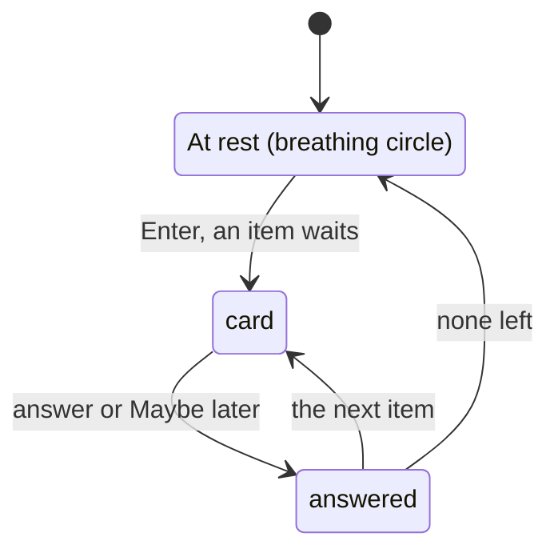

Zen shows one thing at a time. An **item** is whatever waits for you, such as a unit's question, a trust question, or a tower's wait, and it appears as one card. Zen rests on a breathing circle, and no card takes the screen by itself: it waits for Enter. A card is never replaced or pulled away while you read it.

<details>
<summary>Details</summary>

Zen shows one thing at a time (`gui/zen.ts`, a chunk loaded only when the view shows; the choices live in the pure model `gui/zenmodel.ts`). An **item** is what waits for you: a unit waiting on an answer, a pending dialog, a project trust question, or a tower's wait for you, in the order they began waiting (a question that holds an agent, such as a dialog, a trust question, a question a box forwarded, or a teammate's confirm, before a tower's wait, a pair request, or a memory proposal; no card takes the screen by itself, in any state, but waits for Enter, blocking ones first, and a card on the screen is never replaced or pulled away; Standard's order is unchanged), so the HUD's alert list is the same set.

Four more questions, which Standard shows in the Link button, the Wi-Fi notice, and the tower's notices, are one card each in Zen (`gui/cardalerts.ts`, `gui/zendecide.ts`): a **confirm** a teammate's tower asked of this computer (Allow or Deny, under the tool's full arguments), a **dialog a Straw Link box forwarded** (the shared question panel), a **pair request** (the four-digit number the phone shows, Allow or Deny), and a **memory proposal** of a tower run (Confirm or Reject).

Each answers through the same functions as Standard's row (`gui/asks.ts`), the server's list decides when a card is over (one it stops listing stays on the screen with *Already answered elsewhere*, or *This unit has left* when its unit left the net or closed, its answers off, until you close it with Enter, Esc, or its button; the knock rings once for a card, a refusal or a failure after it still rings the low bowl, and a card taken before the relay that then gains its dialog becomes answerable instead of ending), and a paired device keeps the authority it has in Standard: it is given no pair-request card, since the server answers it `local_only`.

A join request stays in Standard. The page shows only the current item, with its question card (the Standard dialog's card, answered the same way, a terminal-bound answer included) and never a count or a hint that more are queued. A dialog with several questions sits in one column (`gui/zenquestions.ts`): one question is focused, open and at full strength, and the others fold to one faded line each (the header or the question, and the answer after a dot once there is one) whose controls are not drawn, so only a tap, Enter, or Tab on the line is heard and it brings that question in.

One wheel gesture or one swipe moves one question (the focused question's own scroll goes first, and the inertia of a fling does not move a second), and so do a pointer's pick of a single choice, Tab and Enter, and a tap on a line; a question taller than the room scrolls inside itself and always opens at its top. Send, Cancel, the outcome, and **Maybe later** stay on the page whatever the size of the window, and the question area gives way instead.

When it leaves the screen by your own answer or cancel, the next card that was already waiting when the answer was accepted follows after the 1.2 s outcome, with the bowl and no pause (a card that arrives after the answer waits for Enter; for its first 400 ms that card ignores a repeating or earlier Enter and any Enter, tap, or Esc, so the key that answered cannot press it; nothing chains on a hidden page, on a page without the focus, under the terminal layer, the palette, or a menu, or into a visit to Zen that begins after the answer: every visit starts at the breath).

A 3 s breathing pause follows the last answer, **Maybe later** (which rests the card for 10 minutes or until its question changes), and the closing of a card whose question ended elsewhere (a tap skips it), and the next item waits for Enter. Enter presses the main button of whatever card you took (never inside a text field), and the terminal layer's confirm takes Enter too, though a key you type while it shows moves the focus to Cancel instead of confirming, and an Enter in the first 400 ms after it showed (the second tap of a double Enter) confirms nothing.

Nothing in Zen takes the screen from you: a terminal opened from a card stays until you go back, a session for company that ended or lost control stays with a quiet note (*Ended*, *Lost control*), its box read-only and its Send off, until you leave it, a change of the server's default view applies to a page that shows Zen at its next load, not at once (and a page it held that opens the settings page shows Zen again on leaving it), and a new build of the page (a newer pi-straw-boss took the server over) is not loaded under you either: while a card, the terminal layer, a session for company, the head's conversation or unfolded input, the palette, or a menu is open, one quiet line says a new version is ready, and the page reloads once when Zen is back on the breathing circle with nothing open (looked at every second), or at once while the page is hidden or Zen is left; Standard and Geek reload at once, as before.

With none, a breathing circle and one sourced mindfulness line (`gui/zenlines.ts`): every visit starts there, and nothing is remembered between visits. `[` and `]` step to a **companion**, a live session with its live log and composer, through the core's candidates with the circle where the list wraps round, and the palette's *Back to the breath* returns to the circle for the rest of the visit; no session, a tower included, stands in. The menu and the music list open over a veil that takes the press that closes them, so it never reaches the card under it.

**Esc** is one table (`gui/zenkeys.ts`): the corner menu closes first, then a field with text only blurs, then the item's Cancel is pressed (or Maybe later where it cannot be cancelled), then the head tower's strip rests when its lines are clear, and otherwise the first Esc shows a hint and a second within 600 ms goes back to Standard; the corner menu's last row does the same at once, and leaving never changes the device's choice. The corner holds a full-screen button and a menu (language, view, sound, volume, back to Standard).

The menu opens only by a press (a click, a tap, Enter, or Space), never by hover, and closes by Esc, a press outside, or a choice of language, view, or the way back. A card takes the size its content needs at once; a swap of what it holds (a new dialog, an outcome line) fades in over 0.3 s, and nothing eases a card's height or width. The palette is dark ink only. **Sound** is two things, both behind the page's own switches.

The **effects** are synthesized with Web Audio (`gui/zensound.ts`, no audio files): a singing bowl when an item takes the screen, a wooden-fish knock when one is done, a lower bowl on an error; they are sound effects: they play only with the settings page's Sound effects switch on (off by default), at the square of its volume read at each play, and ring only after the page's first gesture (a browser starts audio suspended; an effect due before that is dropped, never queued). The corner menu's *Try the sounds* plays them. Standard and Geek keep their own clips, and Zen never plays those.

The **music** is yours: audio files (mp3, m4a, aac, ogg, oga, opus, wav, flac) in `straw-boss-music/` in the agent folder (`~/.pi/agent/straw-boss-music/`, beside the state folder and not inside it); the GUI's server lists them at `GET api/music` and streams them with range requests (`src/music.ts`), behind the same token and cookie as every other `api` read, and nothing ships in the package. The folder is read each time Zen shows; with no files the corner has no ♪.

The music is background sound: the ♪ in the corner picks whether Zen plays it (off by default, kept in `sb.zen.music`), and it sounds only while the Background sound switch of the settings page (or the corner menu) is on, at that switch's volume; with Background off the ♪ keeps its place and says *Music: on, but background sound is off*, nothing is fetched, and a playing track stops at once.

The ♪ and a tap on a page that wakes the music are the gestures a browser wants, so turning Background on from the corner menu starts a track at once and from another tab waits for a tap. a ⌄ beside it picks the track when there are two or more (`sb.zen.track`). The player (`gui/zenmusic.ts`, a chunk of its own, fetched only once the music is on) uses two audio elements and cross-fades the track into itself over the last 6 s, so the loop has no gap; an effect ducks it by 6 dB while it rings.

Playing starts from a gesture: a switch that is stored on waits for the first tap and says *tap to play*, and so does one that a locked phone or a refusing browser stopped. On a touch screen the music pauses while the page is hidden; on a desktop it keeps playing. Leaving Zen stops it. The ringer switch of an iPhone mutes it, as it mutes any web audio. A terminal an answer opens (robot_hand's *Put it in my prompt* or a new Herdr pane, or a blocked prompt's **Open the terminal**) shows inside Zen as a full-screen layer with **Back to Zen** in the corner (the paragraph "An answer that needs the terminal opens it" above).

The demo opens a state with `?zen=item|questions|secret|words|trust|idle|alone|terminal|blocking` (`gui/fixture.ts`; `blocking` is a tower's wait with a box's question arriving `&box=<ms>` later (`&box=<ms>` works on any state), `settled` is `item` whose question is answered elsewhere `&settle=<ms>` on; `terminal` is `item` with a pane that closes itself 20 s after it shows; the four link states are `gui/demo-link.ts`, `&refuse` makes the server refuse the answer, and the pair number is 4821).

Keys in Zen: `[` and `]` step the companion through the sessions you can talk to (idle ones and towers first; also typed with Option or AltGr, never inside a text box), and ⌘K (Ctrl+K off a Mac, also from a text box) opens a command palette: the page's actions (the companion's session or terminal, Settings, back to Standard) and the corner menu's preferences (view, language, sound, volume). A quiet strip at the top says how many units work and how many are idle; it never counts what waits.

**H** opens *Context* on a card: the unit's session log inside the card, read-only and fetched only on the first open, while answering stays possible; H or Esc closes it (it is the second step of Esc's table, after the corner menu). **Shift+Esc** lets the keyboard out of a terminal in Zen, which otherwise takes every Esc (pi interrupts on it); Enter or Space ends the breathing pause early, as a tap does. The pointer leaves faint ripples, and everything that moves stops under `prefers-reduced-motion`, and the drifting ground under forced colours; unlike Standard, Zen keeps breathing however long the page rests (the circle, also faintly behind the companion's log, and a ground that drifts on a half-minute tide).

The companion's log and composer have no boxes: messages, tool calls, code, and tables are set apart by space and the quieter ash, and the composer is one line. The rest of Zen follows the same rule (the spec's **The visual language**): a choice is a line of text with a dot, filled when chosen, and brightens when hovered or keyed; the menu, the music list, and the palette float on a blurred veil with no panel; what you said sits at the right in ash; and the vermilion seal marks only where the keyboard is, as the dot's ring or a line under a word, never a ring around a box.

On a phone the card, the pause, and the corner keep 44 px targets, the menu and the music list open over the page, and the corner's full-screen button gives way to a one-time Add to Home Screen hint where the browser has no Fullscreen API. `&upgrade=<ms>` on any state announces a new build that long after the page starts (once for the browser session). The demo opens more states for pictures: `history` (an item with its context open), `palette` (the companion with the palette open), `pause` (an item put aside, so the pause shows), and `?music=<n>` (a music folder of n invented tracks; no audio file, so a switched-on track says *tap to play*).

</details>

#### The head tower in Standard and Geek

The head tower in Standard and Geek (`gui/headpage.ts`; design in `docs/specs/2026-11-04-head-tower.md`). The route `head` (`/head`) is a tower's comms on the key `sb-head`: the log with a chapter divider where each chapter begins, the composer ("Wakes the head tower"; `/quit` and `/new` with no confirm), the conversation box with **Leave conversation** and **New conversation**, the memory panel, the notices with Retry, Deliver again, and Drop, and the terminal mode.

<details>
<summary>Details</summary>

What differs is the header (a gold crown where the comms logo is, the title *Head tower* or 主塔台, the state line), the **broadcast cards** under the conversation box ([spec](specs/2026-11-07-head-log-cards.md): one card per instruction the head forwarded, its closed line the labelled parts *You said* (the boss's own words, kept by the server from the event the relay names), *Head sent* (its first line, without the boss's quoted copy) and *To*, then `11m ago · 2/3 handled`; a tap unfolds the whole texts and each tower's state (`answered`, `handled`, `received`, `waiting`, `no answer`), its newest answer as text, and a link to its comms; an order the head names as corrected by a later one folds under the newest card, struck, with `corrects N earlier` / `corrected by the next`), and **Close the head tower** in the conversation box's ⋯ menu, which asks once.

Before the head exists the page shows the composer and one line, "The head tower opens with your first message". Three ways in: the header's **crown button** on every route (with a small dot, never a number, while the head's newest reply is newer than this device has seen), the map's **head band** ([spec](specs/2026-11-07-head-band.md); `gui/headband.ts`, drawn by `fillHeadNode` in `gui/render.ts`: the first thing inside the map, centred above the bases' grid, at most one grid column wide and 44 px tall, in the flow so it scrolls with the map; the crown, *Head tower*, the newest line, and a chip with the head's waits for the boss, hidden at 0 and counted as the head page's rows are; the whole band is one link to `/head` with its state in the accessible name and the hover.

The newest line is the newest broadcast's one-line summary while it had activity in the last day, else the first line (160 characters at most) of the head's newest assistant text, which the server reads from the conversation file's tail by the head log's filter (`HeadUnit.line`); with neither it is empty. While the head is not open the band is faint and dashed, says *not open*, and has no line or chip. On a phone it is one line of 44 px at least; the newest line is ellipsised, and dropped once the band is under 240 px wide, while the crown, the name, and the chip always stay.

Geek and Raven Keep restyle it; Zen has no map), the hub of the map's wires, which are dashed and orthogonal only: one drop from the band's bottom centre to a bus in the gap above the grid (about 32 px under the band), the bus along the column gutters, then down the gutter on the left of each column and across into each tower's centre, so a column reads as one trunk with branches and no segment crosses a card. A wire's packet travels while either end works, along the same path, and the first row of the phone drawer. No base has a crown any more. 

</details>

#### The head tower in Zen

On the circle screen (no item, no pause, no companion) the head tower sits under the breathing circle as a strip: its lines once the boss calls them up (as many whole lines as the height leaves, the newest at the foot next to the input; three, or two on a phone, while it is quiet; the circle gives way first, never under 80 px), the boss's in ash on the right, its replies in paper on the left, and one-line notes for a forward (`→ Harbor API tower`) and an answer.

<details>
<summary>Details</summary>

Each line is clear for 20 seconds from when it is first on screen, then fades over three minutes to almost nothing and stays; the fade is one CSS animation per line, so no timer repaints. Hovering or focusing the strip, or tapping it on a phone (10 seconds), eases every line to clear over 0.6 seconds, and back to where its fade stands 1.5 seconds after the pointer leaves (the fade's clock never stops: a hover only lifts the lines, `--lift` in `gui/zen.css`); a wait for the boss keeps its line clear.

The mindfulness line shows only while every line has faded, so one thing is in paper at a time: it fades out over 0.6 seconds when the lines come clear and back in at its own slow pace, and at rest it and the *Whole conversation* link keep their room, and a hover or tap only lifts the lines and never fills the page, so nothing moves under the pointer (the awake strip's lines fill the room, with no mindfulness line). The link names its key, *Whole conversation · H*, in the input hint's quiet ash, and a touch screen (no keyboard) does not show the key.

Below the lines the input is a hairline with the hint "Enter to talk to the head tower"; a click, a tap, or **Enter** on the circle unfolds it (Enter sends, Shift+Enter is a new line, Esc folds it and keeps the draft, a refusal shows the server's words in clay and keeps the draft). **H**, the *Whole conversation* link, a wheel gesture up or a swipe up opens the full history as a companion over the faint circle (older pages as it scrolls, a forward reads as one quiet line, "Sent to the Harbor API tower"), and Esc, H, *Back to the breath* or a gesture down closes it.

**The strip is at rest by default**: every visit to Zen starts at the breathing circle, the mindfulness line, and the folded input, with none of the head's lines on show. A click or tap on the folded input, a focus on it, **Enter**, or **H** (the first H brings the lines up, the second opens the whole conversation) calls the lines up, clear for 20 seconds from then; **Esc**, a tap or click on the blank space, or the focus leaving the strip (an empty input that loses the focus) rests it again, and closing the whole conversation returns to the rest. A resting strip stays at rest for the head's own lines (a tower's answer, a report it starts itself) and a wait or question for you (that is a card, counted in the cue below) and surfaces only for a reply to something you sent in this visit; the rest is the page's own and every visit begins with it.

**Cards wait for Enter**: while Zen rests on the breathing circle no card takes the screen by itself, whatever its kind (a unit's dialog, a trust question, a question a box forwarded, a teammate's confirm, a tower's wait, a pair request, a proposal) or the head's own wait; one quiet line above the input says how many wait (「1 張卡等 Enter。不急，等你準備好。」, "1 card waits for Enter. No rush, when you're ready."), and **Enter** or a tap on that line takes the next one, blocking questions first. When it is done Zen breathes again and the next waits for Enter, except that your own accepted answer is followed by the next card at once, with no breath.

A card on the screen is never interrupted. While a card waits the input's hint reads "Click to talk to the head tower", since Enter takes the card first. **Never interrupted, and Enter acts:** a card never takes the screen by itself in any state, a session for company, the head's whole conversation, and the terminal layer included; there the cue sits under the name or the layer stays as it is, and a card that resolves while it waits leaves the count without ever being drawn.

A card whose question ends while you read it stays, says so, and is closed by Enter, Esc, or its button *Back to the breath*; the unit's next question waits for Enter. When a card is taken the focus lands on its primary control (a dialog's first choice, Open the terminal, Trust, a wait card's first row, Allow, Confirm, the pair number, a terminal step's Run), and the next Enter presses it; Enter never fires in a text field, and the terminal key pad's confirm (Send Enter, Send Escape, Send key) is confirmed by Enter in Zen only, never by a held key or one that began before the confirm showed.

A page nobody is looking at (hidden, or in front without the focus) gets one system notification for each card, once for as long as the server lists it. The strip keeps a row for the link and a row for the cue in every state, and the circle gives way when the page is short, so nothing moves when a card comes or goes and the circle never sits behind the *Working · Idle* line. An ally base's unit-status report and a Link notice are never cards in Zen. The palette gains *Talk to the head tower*, *The head tower's whole conversation*, and *Open the head tower in Standard*.

Reduced motion has no fade and no easing (clear for 20 seconds, then at rest at once; a hover lifts the lines at once); forced colours show the lines unfaded, as many as fit (up to 24 while awake), with `CanvasText` borders. An item you take takes the screen first, and the strip goes with the circle.   

</details>

#### Demo states for the head tower

`?head=absent|talk|answers|waiting|busy` puts the head tower on the net (not open; a conversation; work handed to three towers with one answered; a wait for the boss; and one that refuses what the boss sends, for the strip's refusal), and `?zen=head`, `?zen=head-open` (the input unfolded with a draft), `?zen=head-history`, and `?zen=head-rest` (Esc a moment after the page starts, then a report the head makes by itself, which the rested strip does not show) show the strip in Zen.

#### Settings page

Settings page (unreleased; route `settings`, `gui/settings.ts`, step 5 of the GUI pass). The header's gear is a link to it, and so is a link anyone can copy (`settings`, or `settings/phone`, `settings/wifi`, `settings/teams`, `settings/server` to open a section; the server answers the page for each, behind the token as any route). It replaces the settings popover and the Phone, Teams, and Server tiles that opened beside the map, so the map keeps its columns.

<details>
<summary>Details</summary>

**This device** holds what a person sets once and is always there: View (Auto, Standard, Geek; the server's default stays a pi command), Remind and Sound as labelled buttons that say On or Off (Remind also says Allow? or Blocked, with a line under it on what that means), Sound's volume and Try, and Language. **Phone & devices** (the Tailscale and Same Wi-Fi tabs, the paired devices with Unpair all beside their heading), **Teams**, and **Server** are closed sections that fill when opened and are dropped when closed or when the page is left, so nothing polls or mints behind a closed section: opening Phone is what asks for a pairing code, as the Phone button was.

Who may use each is as it was: Phone and Server only on this computer's page (a paired device's page has This device and Teams, and the server still answers `local_only` to it), and a desk window has no Phone. The header's waiting-request notice opens `settings/wifi`; Escape, the page's back arrow, and the gear go back to where the page was opened from (or to the map when it was the first page). In the Same Wi-Fi tab, while Wi-Fi access is off, the full warning (risk, not verified yet, hotspot) stays above the turn-on button, which is a filled button; it folds under Details only once Wi-Fi access is on. On a phone each control is 44 px (`tests/phone-targets.test.ts`).

</details>

#### A unit's icon is its kind's

a coordinator a ship's wheel, an integrator two arrows joining, a standing main a lighthouse, a train the locomotive, and a launched worker, scout, planner, reviewer or watchdog a wrench, binoculars, a pencil and ruler, a magnifier or a hound. The tower (control tower) and the head tower (crown) keep theirs, and a unit with no known kind keeps its position's icon (main, member, subagent). The icon is drawn from `unitIcon(role, duty)` (`gui/icons.ts`) wherever a unit's role icon was: the map's tokens and cards, the drawer, the dossier, the chat avatar, an alert's face, and the row of a box's main on the ally card (from the kind the box sends).

<details>
<summary>Details</summary>

A launched subagent's kind reaches the page as `Unit.duty`, read from the agent role its launch script names. Raven Keep draws Standard's symbols for the kinds, as it does for the train, and Geek draws Standard's too.

</details>

#### Icons

Icons come from [game-icons.net](https://game-icons.net) by Lorc and Delapouite, [CC BY 3.0](https://creativecommons.org/licenses/by/3.0/) (details in [`gui/ICONS.md`](../gui/ICONS.md)). Nothing is loaded from the network: no CDN, fonts, or runtime dependencies.

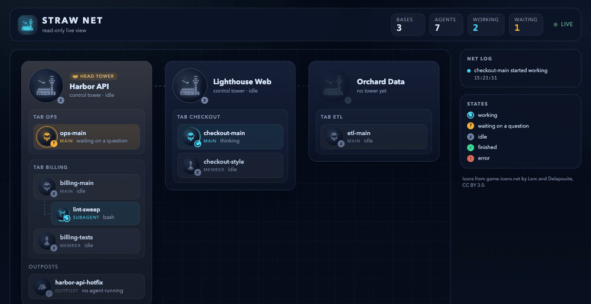

## Pane balance

A second extension entry, `src/balance.ts`, keeps Herdr tabs even. When a pi starts in a tab (once per process, so `/reload` does not count) and after a pi quits and Herdr closes its pane, the panes of that tab get equal widths along each split, and stacked panes equal heights. It runs in every pi inside Herdr, joined or not, and leaves a zoomed tab alone. A pane that outlives its pi (a shell you keep) changes nothing.

<details>
<summary>Details</summary>

The work runs in `src/balance.mjs` as a detached `node` process: `balance.mjs now <pane>` at start, `balance.mjs after-close <pane> <tab>` at quit, because the quitting pi exits before Herdr closes its pane. It is started with `windowsHide`, so on Windows a detached console child gets no console window of its own. Each resize is planned from a freshly read layout, and a per-tab lock under the system temp directory (`pi-straw-boss-pane-balance/`) makes concurrent sessions take turns instead of applying the same change twice.

A local tower run's pi (started with `--sb-run`, or marked by the run mode when the server hands it a standing pane, `src/runmark.ts`) never starts `after-close`: its pane stays, so the helper would only wait out its 30 s. On Windows that wait mattered: Herdr starts `pi.cmd` with `Start-Process -Wait`, which waits for the whole process tree, so the pane showed no prompt until the helper ended and the next `herdr agent start` there ran into its own timeout. An ally run's pane is closed by the server as soon as pi is gone, so its pi keeps `after-close` and the tower tab is rebalanced as for any pane (the run mode marks the process `ally` once the claim says so).

</details>

## Blocked dialogs

```mermaid
flowchart TD
    d["An extension opens a dialog"] --> a["herdr:blocked<br/>active: true"]
    a --> b["Herdr shows the pane as blocked<br/>while the count is above zero"]
    e["The dialog ends"] --> z["herdr:blocked<br/>active: false"]
    z --> w["Count back to zero:<br/>the pane shows its state again"]
```

Herdr's pi integration shows a pane as `blocked` while its count of `herdr:blocked` events (`{active: true, label}` up, `{active: false}` down) is above zero, and pi's own dialogs emit nothing, so a session waiting on one looked as if it were working. A third extension entry, `src/blocked.ts`, closes that for every pi in Herdr, joined or not, subagents included. It relays two sources into `herdr:blocked`:

<details>
<summary>Details</summary>

- **rpiv's questionnaire**: `rpiv:ask-user:blocked`, once per open `ask_user_question`.
- **Every `select`, `confirm`, `input` and `editor` dialog of any extension** (an `mp-infra` command review, pi-robot-hand's selector), from pi's `ui_prompt_start` / `ui_prompt_end` events (pi 0.84.4 and later; on an older pi they never fire and nothing is relayed). This relay wraps nothing: pi wraps `ctx.ui` once per runner for all extensions and emits one pair per outermost dialog (the answer relay above wraps the same object again, and calls pi's wrapper, so the pairs are unchanged), so overlapping dialogs make one pair that spans from the first start to the last end, and a dialog that resolves, is cancelled, aborted, times out or throws ends it all the same.

  The label is `Waiting for your answer: <title>`, with control and format characters turned into spaces and the title cut to 80 characters (`<kind> dialog` when it has none). A session without a UI (print mode) gets pi's no-op `ui`, which is never wrapped, so it emits nothing; `/reload` and a new session load a fresh runner and a fresh relay, and the old ones are dropped with their runner.

Pi emits both events without waiting and walks the extensions one after another, so behind an earlier extension's slow handler a dialog's end can reach this relay before its start (measured against the real runner). The relay therefore keeps a signed count and reports blocked only while it is above zero: an early end and its late start cancel out, and the pairs it emits always alternate and end balanced. `custom` dialogs are left out on purpose: pi's own program status does not count them as blocking either, and the ones that do wait for the user report themselves (`ask_user_question`, `secret_drop`, the pairing QR overlay).

Because pi reports only the outermost dialog, a confirm opened while a `custom` dialog is already open is not reported either. A tool that reports its own dialog as well (pi-robot-hand's `robot_hand` selector, pi-ask-user's input) adds a second, balanced pair while it is open; Herdr counts both and clears them together. Skipping the relay's pair there would drop blocked when the tool's pair closes first while another dialog is still open. A blocked pane has no question to show, so the GUI lists it as waiting with "It waits on a dialog.", and its composer refuses a prompt while Herdr reports the pane `blocked`.

</details>

## Sidebar net view

The optional Herdr plugin in `herdr-plugin/` (id `wayne930242.straw-boss`, action `net`) toggles the sidebar's Agents list between Herdr's own view and a net view. The net view lists the head tower's workspace first when it exists (its row is the crown tab's pane, and focusing it shows the standing pane, where Enter talks to the head tower), then the other workspaces in Herdr's order. In each workspace the tower comes first, then the tabs in their order, and in each tab the main agent and then the members. Every subagent sits directly under the session that launched it, including one that pi-herdr-agents opened in a worktree sub workspace.

Agents the net does not know come last, in Herdr's workspace, tab and pane order, so nothing is hidden and an agent that waits for you stays on the list. The sidebar header reads `net` while the view is on. The view is on by default: the plugin turns it on when the Herdr server starts, and the key switches it off and on again. The same order drives the collapsed sidebar, the mobile list, mouse targets, and `focus_agent` numbering and next/previous navigation. The view changes no notification or attention count.

### The tower between runs

A tower the sb server runs keeps its row when no run is live: the server reports a stand-in agent `tower` on the standing pane (idle, with `standing by`, `3 queued` or `held` as its message) while the tower prompt runs there ([The standing pane](#the-standing-pane)), so the row sits first in its workspace as the tower's mark and `agent.list` shows it. It is a row and nothing more: no net, dashboard, stash, closer or reaper check counts it as an agent, a main, or a member, and an idle report starts no toast, sound, or attention count. A run replaces it with pi's own row, and it comes back when the run ends. An ally run's pane is a row too, right under the tower (`[ally] <device label>`, see [Ally runs](#ally-runs)).

<details>
<summary>Details</summary>

**The tokens.** Every session in the net writes display tokens next to `sb_role`, in the same report, on the same 4 minute refresh and with the same 10 minute TTL. It writes them on the panes of the subagents it launched as well, because those never join and write nothing themselves. A session that ends clears its own and its subagents'.

- `sb_order` is the sort key. A tower's is `WWW.0`. A main agent's or member's is `WWW.1.TTT.R.PPP`: `WWW` is the place of its workspace among the base workspaces (a sub workspace does not count, and the head tower's workspace is `000` while it exists, so the base workspaces then start at `001`), `TTT` the place of its tab in the workspace, `R` is `0` for a main agent and `1` for a member, and `PPP` the place of its pane in the tab.

  Two more places sit between the tower and the tabs, for the merge train (see [Merge train](#merge-train)): the integrator, the main whose `train` todos made the project's `yard.json` (the yard names its session as writer, and that writer's process still runs), is `WWW.05.TTT.0.PPP` and the members of its tab `WWW.05.TTT.1.PPP`, with the place of its tab among the workspace's tabs as `TTT`, so its tab moves up under the tower and two integrators in one workspace are two blocks, each member right under its own main; a train is `WWW.06.YYMMDDLL.HHHHHHHH`, the year, month and day of its code and its letters left-padded with `0` (`2026-11-06-m` is `2611060m`, `2026-11-06-aa` is `261106aa`), then the first eight hex digits of the SHA-256 of its project's name, which only breaks the tie between trains of two projects that have the same code.

  The tower's subagents (`WWW.0.NNN`) come first because `.` sorts before digits, then `WWW.05`, then `WWW.06`, then the tabs (`WWW.1`). A train's key depends on its own code and project alone, so a train that ends moves no other row and only the `focus_agent` numbers after it shift; one-letter codes sort before two-letter ones. A train's reviewer is one segment below its train, as any subagent. Each subagent adds one `.NNN` segment, its place among the live and finished subagents of its launcher, at any depth (the dashboard lists eight per session, the keys cover every live one).

  Every number is zero-padded, so plain string order is numeric order, and a subagent's key sorts after its launcher's and before the launcher's next sibling's.
- `sb_mark` says what a net member is, in a few characters: the glyph of its kind alone for a main agent (since 0.74.0: a ship's wheel, nf-md-ship_wheel U+F0833, for a coordinator, the code-fork below for an integrator, a lighthouse, nf-md-lighthouse U+F09FF, for a standing main; a star alone, Font Awesome's U+F005, when the main's kind is unknown), a person alone (Font Awesome's, U+F007) for a member, and for a subagent the glyph of the kind its launch script names (`PI_SUBAGENT_AGENT`) alone: a wrench (nf-md-wrench U+F05B7) for a `worker`, binoculars (nf-md-binoculars U+F00A5) for a `scout`, a pencil and ruler (nf-md-pencil_ruler U+F1353) for a `planner`, a magnifier (nf-md-magnify U+F0349) for a `reviewer`, and a dog (nf-md-dog U+F0A43) for a `watchdog`.

  A subagent whose role is none of those, or whose launch script is gone, is `[sub] <launcher>`, with the launcher's name cut to 24 characters. The glyphs are the ones the page draws as icons ([Browser view](#browser-view)) and were checked against the glyph names of Nerd Fonts 3.5.1. The pane of an ally run (a Straw Link message worked by the sb server) has `[ally] <device label>`; its key, branch and name are written by the sb server for it, like a subagent's by its launcher (see Ally runs). A tower has none: its tab already carries the radio tower glyph.
- `sb_mark` also marks the integrator with Font Awesome's code-fork (U+F126) alone, and a train with its train glyph (U+F238) and the short code (`\uF238 1106m`). Both come from the trainboard files by the session's own record, not from any token on a pane: the integrator is the session a live `yard.json` names (a yard whose writer process is gone names no one), the train is the one whose pane the tower opened for the code.

  A member of the integrator's tab asks the intercom's list where the sessions the live yards name sit, and takes the integrator's place when one of them is in its own tab (Herdr says which tab a pane is in); it re-keys at its next refresh after the yard changes. The mark and the place are display only: a train's own shell can write a yard that names a live session.
- `sb_step` is on a train alone: the glyph for its current step's state (hourglass U+F254 waiting, play U+F04B running, check U+F00C passed, times U+F00D failed, undo U+F0E2 rolling back) and the step's kind, at most 24 characters. The current step is the lowest one in progress, else the newest that completed, read from the train's own board (validated, so the kind is one of the known words). The train writes it 5 seconds after its board changes (a watch on the project's trainboard folder, which also looks once after it starts), besides the 4 minute refresh; control and direction characters are stripped. Every other agent carries none, and a session clears the one a pane kept.
- `sb_main_tab` is a main agent's tab label and `sb_tab` a member's, one token per role because a Herdr rule sees only its own token, so a row colors each by role. A member's keeps the `sb_tab` name it has had since 0.7.2, so the row works with sessions that have not reloaded; every other agent carries neither.
- `sb_indent` is on a subagent alone, and is the branch to it from its launcher, drawn like the worktrees in Herdr's Spaces panel: `├─` while a later subagent of the same launcher is marked, `└─` on the last one. Subagents of one launcher are siblings at every depth. A tower, a main agent and a member carry none, and a session clears the one a pane kept from when it ran a subagent.
- `sb_name` is on a subagent alone, and is its own name as pi-herdr-agents shows it, cut to 24 characters like the launcher's name in `sb_mark`. The name comes from the pane's Herdr label while it has one, else from the launch script's name. Herdr keeps the label in the server's memory too, so after a new server the label is gone and a row would show only the workspace's name; the token comes back with the others (see below) and a row can show it instead. A tower, a main agent and a member carry none, and a session clears the one a pane kept from when it ran a subagent.

The tokens rest on Herdr's order as of the session's last refresh, so moving a tab or workspace shows in the net view within 4 minutes, and a subagent that has a new sibling gets its `├─` at the next refresh. A subagent is marked while its pane runs pi: its launcher publishes again 3 and 15 seconds after a `subagent` or `subagent_resume` call returns, so a new subagent hangs under it within seconds, and its tokens go at the next refresh once it has finished. A subagent whose pi Herdr has not detected by then (it waits at pi's trust prompt, say) is marked when Herdr reports it, not at the next refresh.

While a launched subagent has no pi pane, its launcher keeps one `events.subscribe` connection open for `pane.agent_detected` and `pane.updated` (the two events that can turn a pane into a pi on the subagent's session file), and a burst of them, from a pane the launcher has not marked, sets one timer of 1 s that reads Herdr once. The reading writes only the subagents' tokens, and only when they differ from the last ones written, so events that change nothing cost one reading and no write.

The connection closes as soon as every launched subagent has a pi pane, and with it a session that launched none holds none; a subagent that finished in the last 10 minutes has no pane either, so the connection stays that long after it. The 4 minute refresh stays as the safety net, and a subagent's tokens still go at the next refresh once it has finished.

</details>

### A new Herdr server

Herdr keeps pane and workspace tokens in the server's memory, so a server that takes over (a live handoff during an update, or a stop and a start) begins with none of them, and the net view would stay unsorted, and a tower would look absent, until each session's next 4 minute refresh. Every session that can join the net, and every tower, therefore keeps one `events.subscribe` connection open on Herdr's socket, only to see it close; it asks for `workspace.renamed`, which almost never happens, so the connection carries no traffic and costs nothing while the server runs.

<details>
<summary>Details</summary>

When it closes, the session reconnects after 0.25 s, 0.5 s, 1 s, and then every 2 s, and when a server answers, it writes everything again at once: first, for a tower, the workspace token `tower` and its own `sb_role`, which is how another session finds the tower (without them a `call_tower` in the gap would open a second one), then the full publish of the 4 minute refresh (its role and net tokens, and the marks of the subagents it launched). The first connection of a session is no takeover.

A session that has not finished joining (or a tower that has not taken its role) writes nothing on a takeover, and a subagent and a session in a sub workspace hold no connection.

</details>

### A Herdr restore

```mermaid
flowchart TD
    r["herdr server stop,<br/>then a new server"] --> p["Herdr starts a new pi in each<br/>restored pane: pi --session file"]
    p --> c{"Same pane, tab, and workspace<br/>as the recorded role?"}
    c -->|"yes"| t["The session takes its role back"]
    c -->|"no"| m["It stays a member"]
```

After `herdr server stop` and a new server, Herdr (with `[session] resume_agents_on_restore`, on by default) starts a new pi in every restored pane as `pi --session <file>`: the processes are new, the pane and tab ids and the session file path are the same, and `STRAW_BOSS_ROLE`, the tokens, and (for a session that had no conversation yet, since pi writes its file only after the first message, and gives the resumed one a new session id) the `straw-boss` entry are gone. Without more, every resumed session would come back a member: the PM who quits the app and opens it again would lose the tower and every main.

<details>
<summary>Details</summary>

A tower and a main therefore record their role in `roles/<hash of the session file>.json` of the state directory (role, pane, tab, workspace, and for a main the pane's terminal), when the tower takes its role and when a session becomes its tab's main, and drop it when the session is closed on purpose (the GUI's quit, `/boss close`, a tower asking an opened main to quit, a second tower yielding).

A session that starts in the pane, tab, and workspace it recorded takes the role back: the tower starts as the tower once Herdr lists its pane in a tower tab (below), which writes its tokens and the workspace token with the new session id, and the main joins and promotes itself, refused as always when the tab already has a live main (and then it drops its record, since it stays a member).

A session in another pane, tab, or workspace than it recorded, one with no record or a record that cannot be read, and one a user closed on purpose stays a member, and nobody takes the role from a record without the pane, tab, and workspace it names. A main needs one more proof, that a restart happened: Herdr gives a restored pane a new terminal (`terminal_id` of `pane current`, while the pane id stays), and the record names the terminal the main ran in.

A pi started in the same terminal, after a `/quit` and a `pi --session` or `/resume` of the same file in the still-open shell, is no restore: it stays a member and drops the record, so the next real restore does not give the main role to a session that never held it. A tower and a train need another proof, since 0.75.0: **a record and a saved entry only claim the role, and Herdr proves it.** Both are files the session's own shell can write, so a member that wrote `{"role":"tower"}` into its record, or a tower entry into its session file, used to start as a tower at its next `/reload`, `/resume`, or restore.

Now a session is a tower only when its process was started as one (`STRAW_BOSS_ROLE=tower`, or a tower earlier in the same process) or when Herdr lists its pane in a tab labelled with the tower glyph, which a restore keeps and no file holds (the proof the server seats its own towers by), and no other pane of that tab runs an agent; a train's entry or record counts only in the tab labelled `train <MMDDx>` for its code, and at a `/reload` the entry must also equal the `sb_train` token its pane kept.

The label is asked with the workspace check at the start, so a tab list that fails proves nothing: the start stays unplaced and is asked again, and nothing joins meanwhile. A claim that is not proven starts a member (a train: no train) with one warning that names the file and the tab; so a tower's session file resumed in an ordinary tab is a member, and a restored tower or train whose tab was renamed away from its label comes back a member.

`boss_rename` and a main's label in `boss_open_main` refuse those labels, and `/boss pop` starts a tower only for a pane its manifest names a tower alone in a tower tab (anywhere else it comes back a member, with one warning). `STRAW_BOSS_ROLE=tower` itself is outside the guard: any shell can set it. A main has no such tab (its label is its own name), so its record stands on the checks above ([spec §29](specs/2026-11-07-train-workers.md)).

A main a tower opened (see [Closing an opened main](#closing-an-opened-main)) records its `sb_opened_by` marker too, and a restored main writes it back and registers the control channel again, so the restored tower of its workspace can close it as before: the restore is a plain start, which has neither the pane's tokens nor the opener saved in the session, and the right to close rests on the tower token of the main's workspace when the tower asks (the rule above), which a new tower session holds again once it is back.

The record counts only where the main ran (the same pane, tab, and workspace), so a main restored in another workspace has no marker, and a main the boss opened has none to bring back. The terminal is required for a main: a Herdr that reports no `terminal_id` for the pane gives it no restore, and the session warns once at its start. Herdr may reuse a pane id, so the record also names the session file, and the guard waits for a pane only while the `agent_session` Herdr reports for it (when it reports one) is that file.

A tab has one main record: the session that becomes the tab's main deletes the others for that tab, so a main that `/boss` or the guard demoted does not come back as a second main whichever pi starts first; if an older record is left beside the new one (written by an earlier version), a restore honors only the newest. A record is not dropped when the guard turns a main back into a member, nor by a plain `/quit`: a Herdr stop looks the same from inside the process, and the tower quitting just ahead of its mains demotes them first. The guard that crowns a tab's first member when the tab has a tower and no main (see the guard above) waits for the main a restore is bringing back: while the tab's main record names a pane that now runs in a new terminal, it crowns nobody, for 30 s from its first look at that pane.

Without the wait the first pi to join a restored tab would be crowned over the recorded main, and the recorded main would then find the tab taken. A main that came back this way does not open a tower (the first main of a workspace normally does): its tower is coming back too, and a base whose tower does not return clears its mains after the guard's grace as it always does. A record untouched for 90 days is deleted when another is written; that tidying, and the deletion of a rival main record, cannot fail the write of the record itself.

The connection and the retry timer never keep pi alive, and `session_shutdown` closes them: a `/reload` leaves one connection, the new instance's, and a session started again in the same instance replaces its connection. A server that refuses `events.subscribe` is treated like one that is gone, so the session retries every 2 s without effect and keeps the 4 minute refresh as before. The sidebar plugin needs nothing more: its startup hook turns the view on when the server starts (before any token exists), and Herdr 0.9.4 and later sort the view again when tokens change.

The subagents a restore brings back are another matter: each comes back as a plain pi without the extension that makes it a child, and its launcher is asked to resume it (see [Subagents a Herdr restore brought back plain](#subagents-a-herdr-restore-brought-back-plain)).

</details>

### Sidebar rows

The tokens also show the roles in Herdr's own grouped view, which a plugin cannot reorder. Add them to a row of `[ui.sidebar.agents]` in `config.toml`. `$sb_indent` goes before the state icon, so a subagent hangs under its launcher as the worktrees do in the Spaces panel; Herdr puts its own ` · ` after it, and an agent without the token shows nothing. `$sb_name` goes right after the state icon, so a subagent row says which subagent it is even when Herdr has lost the pane's label, and `$sb_step` after it shows what a merge train is doing.

<details>
<summary>Details</summary>

Every glyph sits in the first row; the `[sub]` mark of a subagent with no kind stays hidden because the branch already says what it is, and a subagent's kind glyph shows, since the branch does not. The snippet bolds the glyphs of the main kinds and leaves the colors to your Herdr theme; add an `fg` to a rule to color a mark. Herdr drops a row whose every item is empty, so the second row, the tab label from `$sb_main_tab` or `$sb_tab`, gives a main agent and a member a second line and leaves every other agent one line; give the two tokens the colors of the star and the person. The first row leaves out Herdr's `tab`, which the second row carries.

```toml
[ui.sidebar.agents]
rows = [
  [
    { token = "$sb_indent", dim = true },
    "state_icon",
    { token = "$sb_name" },
    { token = "$sb_step" },
    { token = "$sb_mark", rules = [
      { starts_with = "[sub]", hide = true },
      { starts_with = "\uF005", bold = true },
      { starts_with = "\uF007", bold = true },
      { starts_with = "\uF126", bold = true },
      { starts_with = "\uF238", bold = true },
      { starts_with = "\U000F0833", bold = true },
      { starts_with = "\U000F09FF", bold = true },
    ] },
    "machine", "workspace",
  ],
  [{ token = "$sb_main_tab", bold = true }, { token = "$sb_tab", bold = true }],
]
```

Herdr's default has a second row with the agent name; put `"agent"` back in a row of its own, or in this one, if you want it. The token colours take hex values only, so add an `fg` to a token or a rule to taste. `herdr config check` accepts the snippet, and `herdr server reload-config` applies it.

**Install.** Link the plugin from a checkout and bind the action to a key. Herdr runs the startup hook when a server starts, not when a plugin is linked, so a server that is already running shows the view after one press of the key, after the next agent Herdr detects (the `reapply` event hook, below), or after a restart:

```bash
herdr plugin link /path/to/pi-straw-boss/herdr-plugin
herdr plugin action list --plugin wayne930242.straw-boss
herdr plugin action invoke wayne930242.straw-boss.net
```

```toml
[[keys.command]]
key = "prefix+alt+n"
type = "plugin_action"
command = "wayne930242.straw-boss.net"
description = "toggle the straw net view"
```

`prefix+?` lists the keys that are taken, `herdr server reload-config` loads a new binding, and `herdr plugin unlink wayne930242.straw-boss` removes the plugin. The plugin needs Herdr 0.9.5 or newer (the view probe is checked on it) and node; on Windows it reaches Herdr over its named pipe and has its own action, `net-windows` ([Windows](#windows)). The tokens come from the sessions, so a session that still runs an older pi-straw-boss (before 0.6.5) has none until pi reloads it, and sorts after the others.

</details>

### How the view works

The view is one `agent.view.set` request on Herdr's socket, which the CLI has no command for, sorted by the `sb_order` token ascending, then by Herdr's workspace, tab and pane order. Herdr sorts a present value before a missing one, so agents without the token come after the net, and among themselves in that place order. The plugin writes no tokens of its own. Herdr servers before 0.9.4 do not sort an installed view again when tokens change (0.9.4 does): the order stays as it was at the last install until the view is switched off and on again, so press the key twice to refresh it.

<details>
<summary>Details</summary>

**On at start.** `[[startup]]` in the manifest runs `net-view.mjs startup` once after the server has restored its session, and again when a new server takes over in an update handoff. It installs the same view as the key and exits at once; no process stays running, and a failure (Herdr refusing the view) is in the plugin log and does not stop the server. Every server start turns the view on, whatever an earlier server left: a press that turned it off lasts until the server stops. The one exception is a startup that runs again in the same server, which leaves that server's own "off" alone.

</details>

### The toggle

Herdr has no query for the active view, but `agent.view.clear` with a source that owns nothing (`<plugin source>-probe`; Herdr accepts only ASCII letters, digits, colon, dot, underscore and hyphen in a source) leaves the view unchanged and answers with it (checked on Herdr 0.9.5), so the action reads what is shown instead of trusting what it saved: it clears when its own view is the active one and installs otherwise. A plugin unlinked and linked again, or disabled and enabled, in one server run loses its view without a startup hook, and the first press used to record "off" and change nothing; now one press always changes the sidebar.

<details>
<summary>Details</summary>

The state in `net-view.json` in the plugin's state directory ("on" or "off" and the identity of the running server, the socket file's inode and creation time) is only the wish the hooks read. The next press clears the view with `agent.view.clear` named to this plugin's own source, so it never clears a view that another owner installed. A restarted server drops its view; the startup hook turns the view on and records it, so the first press switches it off.

`[[events]] on = "pane.agent_detected"` runs `net-view.mjs reapply` (Herdr has no hook for a link or an enable): it installs the view when no view is active and this server's own "off" has not been pressed, and leaves any active view, this plugin's or another owner's, and a pressed off alone; so after a relink the net view is back at the next agent Herdr detects. A view another owner installed over this one also counts as off: the press installs this one again.

</details>

### Limits

Herdr keeps one Agents view per server, so another plugin's view and this one replace each other. Unlinking or disabling the plugin while the view is on drops the view at once; the first press after linking it again only resets the state, and the second turns the view on. Herdr starts plugin commands with the PATH of the process that started its server, and a Herdr launched from a macOS app has only `/usr/bin:/bin:/usr/sbin:/sbin`. `run.sh` therefore looks for node on PATH, in Homebrew's, `/usr/local`, mise, asdf, and volta directories, and through a login shell, and says so in the plugin log (`herdr plugin log list --plugin wayne930242.straw-boss`) when it finds none.

## Worktree reaper

The second optional Herdr plugin, in `herdr-reaper/` (id `wayne930242.straw-boss-reaper`), closes the panes agents leave behind in worktree workspaces and removes the checkouts that are clean. It is plain JavaScript that imports nothing from `src/` and talks to Herdr through the `herdr` CLI (`HERDR_BIN_PATH`) and to git directly.

A sweep decides in this order; the sections below give the details:

```mermaid
flowchart TD
    w["Workspace in a linked worktree"] --> pin{"Pinned?"}
    pin -->|"yes"| keep["Never touched"]
    pin -->|"no"| pane{"A pane that ran an agent is now<br/>an idle shell, not focused, for 60 s?"}
    pane -->|"no"| left["Left alone"]
    pane -->|"yes"| close["Close the pane"]
    close --> last{"Every pane closed?"}
    last -->|"yes"| co{"Checkout clean, and nothing holds<br/>or uses it?"}
    co -->|"yes"| rm["Remove the checkout<br/>(the branch stays)"]
    co -->|"no"| kept["Keep it and retry next sweep"]
```

### Scope

Only a workspace whose worktree is a linked git worktree (`worktree.is_linked_worktree`) is ever touched, whatever its label. A workspace of the main checkout, or of no repository, is never touched, and neither is anything a pinned workspace holds; the one exception is a main-checkout shell workspace a worktree was grouped under (see the parent shell below). An optional `config.json` in the plugin's config directory (`herdr plugin config-dir wayne930242.straw-boss-reaper`) with `{ "only_under": ["/path"] }` narrows the scope further, to repositories and checkouts below the listed directories; `{ "retain_idle_hours": 72 }` sets how long a pi-herdr-agents parent session that is open in no Herdr pane may stay silent before its worktrees are released (see the checkout below; a value that is not a positive number means the default).

### What closes a pane

The plugin remembers which panes ran an agent: a `pane.agent_detected` event and every sweep that sees `agent` set record the pane's terminal. A pane that was recorded, now has no agent, and whose shell is idle (Herdr's `pane process-info` shows the shell as the only foreground process) is a candidate. The first sweep after the plugin's state is created counts every agent-less pane in a linked-worktree workspace as recorded, so leftovers from before the plugin was installed go too, and it starts as soon as the plugin is installed (the first hook starts the ticker, which waits 20 s, and a candidate waits 60 s more: about a minute and a half).

<details>
<summary>Details</summary>

There is no log-only first run: reaping begins at once, so run `dry-run` and pin first. Only a pane the first sweep treats as a leftover is recorded; a pane it skipped because it was pinned, focused or running something stays the user's shell for later sweeps too. Panes opened afterwards that never ran an agent are the user's shells and stay. A candidate must stay one for `CONFIRM_MS` (60 s) before it is closed, so an agent restarting in the same pane, or a command started at the prompt, is not caught between two looks; the `reap-now` action skips the wait.

The focused pane is never closed, and a pane whose shell runs something (a dev server, an editor) is skipped with that process named. Right before each close the plugin looks at the pane again: it must still be the same terminal (a pane id can be reused), have no agent, not be focused, have an idle shell, and its workspace must not be pinned (token and state file, read fresh). Anything that changed since the plan skips the close and keeps the workspace's checkout for that run.

"Focused" is the one pane Herdr reports as focused; a second client (the web UI, say) that is viewing another pane does not count, so a pane someone watches from there can be closed. Closing a workspace's last pane lets Herdr close its tab and then the workspace, with no dialog.

</details>

### The checkout

When every pane of a workspace was closed by one sweep, the plugin waits up to 5 s for Herdr to close the workspace, then reads `git --no-optional-locks status --porcelain --untracked-files=all --ignore-submodules=none` in the checkout (the options keep a repository or user setting such as `status.showUntrackedFiles=no` from hiding files). It also keeps the checkout when `git ls-files -v` shows skip-worktree or assume-unchanged files, whose edits `status` cannot show.

<details>
<summary>Details</summary>

Right before removing, it lists Herdr's panes and workspaces again and keeps the checkout if any live pane's cwd or foreground cwd is the checkout or below it, or any live workspace has the same checkout path: in the usual pi-herdr-agents layout the worker's pane sits in the parent's workspace, not in the linked worktree's, and it must not lose its directory. A list that cannot be read keeps the checkout too. This applies to checkouts retried from the pending list as well. Three more guards decide, in this order, whether a clean checkout is released.

Each keeps it as pending (retried every sweep, with no give-up) and logs `keep checkout <path>: <reason>, branch kept`, in a dry run as `would keep`:
1. *pi-herdr-agents holds it.* pi-herdr-agents never removes a worktree on its own: the parent session does, with `worktree_remove`, which marks the child's manifest `removed`. The manifests are `<session dir>/artifacts/<parent session id>/worktree-runs/<child id>.json`; they hold `path`, `state`, `name`, `updatedAt` and the child's `sessionFile`. The reaper reads them below every directory pi may keep its sessions in: `<pi agent dir>/sessions`, with one directory per working directory below it (`PI_CODING_AGENT_DIR`, default `~/.pi/agent`); `PI_CODING_AGENT_SESSION_DIR`; the `sessionDir` setting of the user (`<pi agent dir>/settings.json`) and of the repository (`<repository>/.pi/settings.json`, a relative path counted from the repository). With `sessionDir` set, pi puts `artifacts/` straight into that directory, and the reaper reads that layout too.

   A directory that does not exist is logged once per run (`pi sessions directory <path> does not exist`) and holds nothing; a settings file that cannot be parsed keeps the checkout. The reaper cannot see pi's `--session-dir` option or a variable that only a shell sets: Herdr's own environment must carry `PI_CODING_AGENT_DIR` and `PI_CODING_AGENT_SESSION_DIR`, or pi's settings must name the directory. A manifest names the checkout when its `path` is the same directory as the checkout's, compared by canonical path: a symlinked prefix (`/tmp` and `/private/tmp`), a trailing slash or `..` segment, and the letter case on a case-insensitive file system make no difference.

   A manifest that names the checkout and is not `removed` (`provisioning`, `provisioned`, `running`, `ready_for_review`, `needs_help`, `failed`, `cancelled`) keeps it while its parent is alive, which two things show. The first is a Herdr pane that runs pi on the parent session (`agent` is `pi` and its session file is `<time>_<parent session id>.jsonl`, read from `herdr pane list`), however long the parent has been idle. The second is activity: the newest modification time of the manifest, its `updatedAt`, the parent session's `.jsonl` and the child's session file within `retain_idle_hours` (default 72) of now. When Herdr's pane list cannot be read, the activity rule alone decides.

   A parent that is open in no pane and wrote nothing for longer has ended, and the checkout is then the reaper's. A newer `removed` manifest on the same path supersedes an older run. A manifest that names the path but cannot be parsed (it is matched by the checkout's directory name, in any letter case), a sessions directory that cannot be read, or a reaper wired without the reader keeps the checkout (fail closed). Closing the idle root shell of such a workspace is unchanged, but the workspace closing with it no longer leads to the removal.
2. *Another pane or workspace uses it* (the check above).
3. *A process uses it.* The plugin lists every process of the user (`lsof -d cwd` on macOS, `/proc/<pid>/cwd` on Linux), not only Herdr's panes, and keeps the checkout when one has its cwd at or below it (an editor, a dev server, a pi that was started there, a terminal outside Herdr). In a dry run the idle shells of the panes it would close are ignored. A process list that cannot be had keeps the checkout; processes of other users are not inspected, and neither are the user's own processes Linux will not let it inspect (non-dumpable ones such as ssh-agent or gpg-agent), which rarely sit in a worktree.

   The manifests of guard 1 and this process list are each read once and reused for 10 s (a sweep over many pending checkouts then costs one read of each, not one per checkout), and a sweep that has just closed a pane reads the process list again, so the shell that exited does not hold its own checkout. A clean checkout is removed with `git worktree remove`, never forced; any change, tracked or not, keeps it, and so does a detached HEAD that no branch, remote branch or tag contains, because the checkout would be the last place those commits live.

   Git-ignored files do not count as changes, so `.env` files, `node_modules`, caches and local databases in a clean checkout are deleted with it; keep a checkout whose ignored files matter by pinning its workspace. The branch is never touched. A failed removal logs git's own `fatal:`/`error:` line, not node's "Command failed" header. Git refuses a checkout with a submodule by design ("working trees containing submodules cannot be moved or removed"), so the plugin clears the way itself, and only when nothing is lost: every initialized submodule (recursively) must have no uncommitted or untracked paths (ignored files are fine) and its HEAD must be contained in a remote-tracking ref of its own repository or in a branch, tag or remote-tracking ref of the main repository's own copy (`.git/modules/...`), and no local branch may hold commits outside the remote-tracking refs.

   The submodule repositories of a linked worktree live in `.git/worktrees/<id>/modules/...` and are deleted with it, which is why those refs count. Then the plugin runs `git submodule deinit --all` (no `--force`), deletes that `modules` directory (git still refuses the removal while it exists), and runs the plain `git worktree remove`. A failed check keeps the checkout and logs the submodule and why, for example `keep checkout <path>: submodule community has 2 uncommitted paths, branch kept` or `submodule community HEAD abc1234 is in no ref outside this worktree (no remote-tracking ref contains it)`; a removal logs `(clean; 1 submodule deinitialized first; branch X kept)`. The main checkout and its submodules are never touched.

   After a failed or timed-out removal the plugin checks whether the checkout is half-removed (the directory is still there but git no longer registers it as a worktree of the repository, or its `.git` is gone, as when git deleted them and then failed on the files, say through a self-referencing `node_modules`). If so the log says that leftover files remain at the path, git no longer tracks it and the branch is kept, and that the user can delete the directory; the plugin never deletes or moves the leftover itself. A workspace that is still open after the wait stays pending in the state file and is retried by the next sweeps for an hour.

   Each decision is a line in the plugin log with its reason (`close`, `remove checkout`, `keep checkout ... uncommitted changes`, `keep checkout ... pi-herdr-agents child ...`, `skip ... workspace is pinned`).

</details>

### The parent shell

When a linked-worktree workspace is open, Herdr groups it under the workspace of the repository's main checkout and opens a plain shell workspace for that checkout if none exists. The plugin remembers a non-linked workspace as a parent once a linked worktree workspace with the same `worktree.repo_key` (else `repo_root`) was seen open, in a sweep or by the `workspace.created` hook, within `only_under`; a workspace never seen with a worktree under it is never remembered, so it is never closed.

<details>
<summary>Details</summary>

After the checkout step of a sweep, on a fresh look at Herdr, a remembered parent is closed (`herdr workspace close`, never the group form, so Herdr refuses if a worktree workspace appeared meanwhile) when no linked workspace of its repository is left and every pane has no agent and an idle shell, none is focused, the workspace is not pinned, and its name is the one Herdr gave it (the repository or checkout directory name) and was never renamed (a rename also pins it).

**A workspace a Straw Boss tower stands in is never closed**, whatever its panes look like: the sb server puts the tower's tab in this very workspace, and between runs the standing pane is a shell that waits at a prompt, which is exactly what the rule above closes. The plugin reads the tokens the server writes and nothing else of Straw Boss: the workspace token `tower`, and the pane token `sb_role` with the value `tower` (the standing pane) or `ally` (an ally run's pane, split off the tower's tab).

Any one of them keeps the parent, and the parent is not tracked as a candidate meanwhile; a token that is gone (the tower was closed, or the tokens' 10 minute lifetime ran out with no server alive to renew them) leaves the parent to the rule above again. It must qualify for `CONFIRM_MS` (60 s) first, tracked in `parentCandidates`; closing the workspace closes only its panes, and the main checkout and every branch stay.

The log lines are `wait parent <label> (workspace <id>): ...`, `skip parent ...: <reason>` (worktree workspace still open, pinned, name changed, a tower stands in it, agent or running process in a pane, focused pane), and `close parent workspace ...`; a dry run prints `would close parent workspace ...`, counting the worktree workspaces it would close as gone. A child closed by the user rather than the plugin is handled the same way, by the next sweep (up to 10 minutes later) and the confirmation wait.

</details>

### Pins

The `pin` action is one toggle, in the `workspace` context: it sets or clears the workspace token `pin`, a Nerd Font pin (nf-md-pin, U+F0403), through `workspace.report_metadata` under the source `wayne930242.straw-boss-reaper`. Herdr shows a workspace token only where a row asks for it, so add `{ token = "$pin" }` to `[ui.sidebar.spaces]` rows as the README shows. Bind it with `[[keys.command]]` (`prefix+i` in the README's example: `prefix+P` is Herdr's default `rename_pane`, and `alt` combinations are often taken by window managers such as AeroSpace); a key invokes it in the focused workspace. A pin is also written to the plugin's state file, because Herdr drops workspace tokens when its server restarts, and a sweep puts the token back.

<details>
<summary>Details</summary>

A linked worktree's pin is keyed by its checkout path, so it outlives the workspace and the checkout is never removed; any other workspace's pin is keyed by its id (`workspace:<id>`) and goes when the workspace closes, so a later workspace on the same main checkout starts unpinned. A sweep moves a main-checkout pin an older version keyed by its path to the ids of the workspaces open on it. A workspace is pinned when either the token or the state entry says so, and a pinned workspace is skipped by every sweep and its checkout is never removed.

A pin does nothing else: closing a pinned workspace closes it, and a linked worktree's pin keeps its checkout from being removed until the checkout is gone or you unpin a workspace on it.

</details>

### Pinning by renaming

Herdr's `workspace.renamed` event does not say who renamed, but nothing renames a workspace except the user: pi-herdr-agents and Straw Boss set the label when they create the workspace, and `herdr workspace create --label` and `herdr worktree create --label` fire no rename. `herdr worktree open --label` on a worktree whose workspace is already open does fire one, and counts as a rename. So every rename pins the workspace (any workspace, linked worktree or not, within `only_under`) and marks its record `renamed`, even when a sweep recorded the new label first; a workspace already pinned stays as it is. Unpinning clears the token and the state entry and leaves the name alone.

<details>
<summary>Details</summary>

Herdr reuses the ids of closed workspaces, so a `workspace.created` event replaces any earlier record of its id, the `workspace.closed` event (or a `pane.exited` that took the workspace's last pane) deletes the record and any `workspace:<id>` pin of the id, and a sweep drops the records of the workspaces it closed. Each record also stores the workspace's checkout path, and a record whose checkout differs from the live workspace's belongs to an earlier workspace on a reused id and is ignored.

</details>

### When it runs

A sweep runs every 10 minutes and again when an agent was released, `CONFIRM_MS` later. Herdr has no timers for plugins, so the startup hook and the event hooks start a ticker, a small detached node process that checks the state file every 15 s and runs the `sweep` action through `herdr plugin action invoke` when one is due, which makes every sweep a normal, logged plugin command. This departs from Herdr's guidance (0.9.5): startup hooks are meant to be one-shot rather than supervised daemons, and plugins are told to stop detached background processes before their command exits.

<details>
<summary>Details</summary>

The ticker is the only way a plugin can sweep on a schedule, and it limits the departure: it is a single process (a beat file and a lock), it keeps nothing but the beat and its log (`ticker.log` in the state directory, truncated at a start when over 200 KB), and it ends on its own after three failed invocations in a row. After an uninstall, unlink or server exit it therefore lives until its next sweep is due, up to 10 minutes, plus about a minute for the three retries: roughly 11 minutes.

The state directory belongs to the plugin id, so two Herdr servers on one machine (a named session, say) would share it: one ticker for both, and workspace and pane ids of the two servers colliding in the state file. Use the plugin with one server. A ticker beats in `ticker.json`; a hook starts a new one only when the beat is older than 45 s, and two started together settle it with a lock. The ticker ends after three failed invocations in a row, which happens when the Herdr server is gone or the plugin was unlinked; the next hook of a new server starts another.

The event hooks do bookkeeping only (`workspace.created`, `workspace.renamed`, `workspace.closed`, `pane.exited`, `pane.agent_detected`), and none is hooked to `pane.updated`, so no per-output work exists. The `pane.agent_detected` event for a release marks the pane a candidate from that moment and schedules the sweep for the end of its wait; the other events cost one `herdr` call and a state write. Sweeps never overlap (a lock whose holder keeps touching it, so only a dead run's lock goes stale after 10 minutes, and one waiter at a time takes a stale lock over; a second sweep logs that it was skipped).

Every `herdr` call has a 30 s timeout and every git call 60 s (5 minutes to remove a checkout), so a hung call fails instead of holding the lock. `bash herdr-reaper/run.sh reaper.mjs dry-run`, run in a terminal inside Herdr, prints what a sweep would do now without changing anything, the state file included; it reads the plugin's state, so its first-sweep rule applies until the plugin has swept once.

</details>

### Limits

The state is `state.json` in the plugin's state directory. Only a missing file reads as empty; a damaged or unreadable one makes the sweep and the events fail with the file's path in the plugin log (and stops the ticker) instead of bringing back the first-sweep rule and forgetting the pins, so repair or remove the file. A user's shell that outlived its agent in a linked-worktree workspace is closed like a leftover: pin the workspace to keep it. Ignored files (`.env*`, `node_modules`, build output, local databases) do not make a checkout dirty, so they go with it; pin the workspace to keep them.

<details>
<summary>Details</summary>

A pi-herdr-agents worktree is held by guard 1 whatever it contains; the ignored-file loss is for checkouts nothing holds. pi-herdr-agents keeps no "parent is alive" record, so the hold on its worktrees rests on two signals: a pane in which Herdr sees pi on the parent session, and the idle limit. A parent session that was resumed, forked or restarted with `/new` in its pane is another session id, so its old id no longer counts as open; a parent in a terminal outside Herdr is held only by the idle limit. A pi session of either kind left idle past `retain_idle_hours` and resumed later may find its clean worktree removed (the branch is kept).

The agent event compares its terminal with the pane's only when the payload names one (Herdr 0.9.5 documents `pane_id` and `workspace_id`), so a pane id reused within the hook's latency can still be misread there; the sweep's checks use the terminal id. A Herdr launched from a macOS app has a short PATH; `run.sh` finds node the way the net-view plugin's does. The plugin needs Herdr 0.9.3 or newer, git, node 18 or newer, and a Unix shell, so it runs on macOS and Linux only. `tests/reaper.test.ts` drives the decisions and the sweeps against a fake Herdr and git.

</details>

## Process hygiene and slots

Release 1 of this section (layer 2 of the plan in `docs/specs/2026-11-04-procs.md`): whatever a worker starts dies with the worker, and a worktree is not removed from under a running process. Heavy-command slots, the Linux cgroup path and the CPU stall monitor come with release 2 and are not built yet; this section grows with them.

**Why.** pi stops a bash call's process group (`killProcessTree`, SIGKILL to the group of the shell it started). `timeout`, `setsid`, `detached: true` spawns and test runners put their children in groups of their own, so a worker that ends, or is killed, leaves them behind, reparented to launchd or init. On 11/03 four such node test processes ran for six hours at 55 to 60% CPU each in a worktree the parent had already removed.

### The owner marker

Every pi that loads the `src/hygiene.ts` extension (a main, a worker, any session) sets `STRAW_BOSS_OWNER=<owner id>` in its own `process.env`. pi's bash passes that environment to its shell, so every descendant carries it. The id is `<subagent id>-<pid>` for a pi-herdr-agents worker and `pi-<pid>` for any other pi. Readers look only for that one key (`/proc/<pid>/environ` on Linux, the environment option of `ps` on macOS) and match it in memory: no command line or environment of any process is ever logged, returned or shown. The server's own spawn environment drops the key, and a standing tower run (a pane the server owns) and Windows get no marker.

### Registering a worker

A pi with `PI_SUBAGENT_ID` set (a pi-herdr-agents worker) sends `procs-hello {pid, started, subagentId, sessionFile, pane, terminal, cwd}` to the sb server over the control socket at `session_start`, beats every 30 s, and sends `procs-bye` when it quits (a reload or a switch of session keeps the process, so it is not a bye). The server finds the pid in its own process table and checks the start time; it finds the worktree root from `cwd` (the nearest `.git` going up is a file with `gitdir:`; a worker in the main checkout has no worktree and gets no cwd rule). Records live in `<slot dir>/procs/owners.json` (mode 600).

<details>
<summary>Details</summary>

If the server turns a hello down, the worker says so once and what it starts is not reaped; with no server running the hello is tried again at the next beat. The server refuses a hello for a pid that is the Herdr server, a pane's shell, a shell, a server or the broker, or that has Herdr or a pane's shell below it. The folder, session file and notify function of the session are read when it starts, never after an await, so a reload in flight cannot raise on a stale context.

**What the server keeps.** Every 10 s (30 s after a first tick that cost more than a second; the cost is logged once as `procs-tick-cost`) the server snapshots the descendants of each live owner by ppid, as (pid, start time, pgid). A process that reparents later is still known as that owner's. Identity is `(pid, start time)` everywhere, and every action checks it again right before acting.

**When an owner ends.** On `procs-bye`, when its pid is gone or reused, or when Herdr reports `pane.exited` or `pane.closed` for its pane and the terminal id matches (Herdr reuses pane ids, so an event for a pane whose terminal differs is ignored). An owner that ended while the server was down is reaped when the server starts, from `owners.json`.

</details>

### What is reaped

```mermaid
flowchart TD
    e["An owner ends"] --> k["Kill set: its live descendants,<br/>processes with its marker,<br/>orphans in its worktree"]
    k --> t["SIGTERM to each group,<br/>then each pid"]
    t --> s["After 10 s, SIGKILL<br/>what is left"]
```

The kill set of an ended owner is: the snapshot descendants still alive with the same identity, plus the processes that carry its marker, plus the orphans whose working folder is in its worktree or in a removed checkout last seen as that root (an orphan has parent pid 1, or a `systemd --user` on Linux), plus what those started below them. The protected set is subtracted: the Herdr server, every live pane's shell and foreground, an sb server named in a `server.json`, the intercom broker, every other live registered owner with its tree, and processes that carry another live owner's marker.

<details>
<summary>Details</summary>

A pane that closes in a linked-worktree workspace with no registered owner (an agent that is not pi) gets only the cwd rule, and not into a worktree where another live session works. A main's quit reaps nothing: mains start long-lived daemons on purpose.

**The kill sequence.** SIGTERM to each target group, then to each pid; after 10 s, SIGKILL to what is left with the same identity; a last look is logged. The log has one line per reap, `procs-reaped {owner, reason, targets, termed, killed, left, protected}`, and `procs-left` when something stayed alive (its record is then kept for `reap`). Under a test run every signal goes through `src/procs/killguard.ts`, which refuses a pid the test did not start or whose cwd is outside `SB_TEST_ROOT` and fails the process.

**`cli.mjs procs`.**

| Command | Effect |
|---|---|
| `procs` | List the owners the server knows: id, pid, start time, live or ended (with the reason), worktree roots, snapshot size, pane. |
| `procs reap --owner <id>` | Run the kill sequence again for an owner that has ended and left something alive. Refused for an owner that is still alive. |
| `procs reap --checkout <path>` | Kill what works in a linked worktree (or in a removed checkout a worker was known to work in): the orphans and the leftovers of ended owners. Refused while a live owner works there: end that worker or close its pane first. Exit 1 when a process stayed alive; the JSON on stdout says which. |

</details>

### The removal guard

The extension refuses `worktree_remove` and a bash command with `git worktree remove` or `herdr worktree remove` (also after `cd`, `git -C`, `&&`, `;`, a pipe, or inside `bash -c "…"`) while any process has its working folder in the target checkout. The target is resolved from a path, a branch name or a Herdr workspace id with `git worktree list --porcelain` and Herdr's workspace list. The refusal lists each holder by pid, program name (`comm`; on Linux the file name of its executable, because there `comm` is the main thread's name, which a program sets for itself and node 24 sets to `MainThread`; never the command line), CPU time, age and owner state (live, ended, unknown, or no marker), and gives `cli.mjs procs reap --checkout '<path>'`; after the reap the same call passes.

<details>
<summary>Details</summary>

A target also resolves by git's unique trailing path components, and `herdr worktree remove` without `--workspace` takes the workspace in `HERDR_WORKSPACE_ID`. A check that cannot run (git or Herdr does not answer) is not a pass. A finished worker's retained idle pane shell (Herdr says it is its pane's foreground) in the target's own workspace does not hold the removal; anything else with its folder there does. The `/worktree remove` slash command does not pass `tool_call`: that is a documented limit, and the reaper plugin still refuses its own removals.

**The reaper plugin's hint.** `herdr-reaper` still only refuses to remove a checkout a process works in, and never kills. Its message now ends with `node <pi-straw-boss>/dist/server/cli.mjs procs reap --checkout '<path>'`, since the plugin cannot know where the package is installed. Updating the running plugin is a separate step from the package release: `herdr plugin install wayne930242/pi-straw-boss/herdr-reaper` again, or a link to the checkout.

**The stall watch.** A pi that froze is told to its workspace's tower; the server never signals it and sends it no key. On 11/12 a main's pi pegged a core for 40 hours, took no keys, and had fallen out of pi-intercom's list, and nobody noticed until a tower was asked to rescue it by hand. Once a minute the server takes the table of that tick and looks at the pi of every pane where Herdr says one runs (the process Herdr lists in the pane; a pid a session reports counts only when pi-intercom finds that session in the pane now, or could not place it at all; at most eight panes are asked about at a sample, in turn, since `pane process-info` starts Herdr's CLI, so after a server start the panes are taken in over a few minutes; a pane whose pi was not found is asked again after 2, 4, 8, 16, then every 32 samples, and is logged once as `stall-unresolved`). Three signals, each counted in samples a minute apart: `cpu`, the process averaged `cpuPercent` (75) of a core or more over `cpuMinutes` (5) samples in a row, none of them calm (under half of `cpuPercent`), while its session file was not written: a pegged pi on a loaded machine dips under the threshold for a minute now and then, so one such sample does not start the count again, while a calm sample or a write does, and a burst and a session that still writes are not told (healthy mains with a long history were measured at 73% and 83% of a core over a minute while they wrote their files, so the write, not a lower threshold, is what tells work from a freeze); `missing`, the process is alive and pi-intercom has not listed it for `missingMinutes` (3) samples in a row, for a session the server saw listed before or whose pane carries a role and a session file (the broker drops a client whose event loop stopped; a list the server cannot read counts for nothing); `silent`, the pane says working, the session file was not written for `silentMinutes` (30) samples in a row, and no tool call is open in it, so a long command, a build, or a subagent is never a stall. A sample that comes more than three minutes late (the computer slept, the server was stopped) starts every count again. The sessions known and the open incidents are kept in `<slot dir>/procs/stallwatch.json`, so after a server restart a session that does not come back is told once the first three samples have passed, and an incident told before the restart is not told again. An incident is one notice event in the tower's queue (the parent workspace's tower for a sub workspace, the head tower where the server stands in for no tower; with neither it is tried again each minute and logged once as `stall-untold`; with `towerRuns.enabled: false` the towers are resident sessions, the server tells none, and `stall-no-tower` is logged once): it names the pane, the session's id and name (both quoted; the id keeps only letters, digits, and `._:-`), the pid and its start time, the cpu minutes, and the signals, and carries the runbook: read the pane twice, and leave a screen that moves; send Esc to one that stands still and read again; only with a handoff file or the boss's approval stop the process and start a fresh session with the handoff. It is told again only when a further signal fires, when the signals have been gone for three samples (a recovery: do not stop it; a `silent` session that answered and now has a tool call open is one), and as a reminder after `remindMinutes` (60), then at twice the wait each time up to 8 hours; a reminder waits while the signals are gone. A pi that ends, or whose pane closes, takes its incident with it without a message. The settings are `stallWatch` in `config.json`, read at each sample; `0` minutes turns one signal or the reminders off, and `enabled: false` the watch. The log has `stall-told`, `stall-untold`, `stall-no-tower`, `stall-unresolved`, `stall-ended` and `stall-error`. Not seen: a tool call that hangs with the process calm (an open call is work); a session that froze with a calm process more than ten minutes before the watch first saw its pane, because the role token, which a session renews itself, has lapsed by then and nothing else says of the process that it registered (a session file's entries travel with a resume or a fork), which holds for the first sample of a server whose `stallwatch.json` has no row for that pi (the release that brings the watch, a watch turned on, a lost file); and anything on Windows, which has no process table here. Told wrongly: a session in another pi-intercom scope is never in the server's list, so with a role on its pane it is told as `missing`.

**Limits.** Windows has no hygiene (the extension is inert and says so once). A process a worker started on purpose to outlive it (a dev server, a broker) is reaped unless it is protected; long-lived processes go through `MonitorCreate`, which pi stops at session end anyway. A pi that loaded Straw Boss before release 1 is not registered either, so what its worker leaves is found only by the cwd rule when the pane closes.

Three limits the replay on macOS showed. (1) The marker is readable only on processes whose program is not an Apple platform binary: node and Homebrew tools show it, `/bin/bash`, `/bin/sleep` and `/usr/bin/perl` do not, because the system hides their environment, and the refusal of the removal guard then says "no owner marker" for them. The snapshot and the cwd rule carry those. The pi itself shows no marker either (it sets the variable after it started; only what it starts inherits it).

(2) The cwd rule does not reach into a worktree where another pane also works (the boss's shell, a main), because that session may own what runs there; a process that escaped every snapshot by a double fork (adopted by launchd within milliseconds) and cannot be read by marker stays in that case, and `cli.mjs procs reap --checkout <path>` is the explicit way to stop it. (3) The server learns the linked-worktree workspaces at its tick (every 10 s): a pane without an owner that closes within 10 s of its workspace being created is not seen as a worktree's.

</details>

### Timing

A reap sends SIGTERM as soon as it has read the process table, the working folders of the orphans, the markers and the protected set (about 3 s at a load of 25 to 35, more under a higher load), then SIGKILL 10 s later. In the replay every escaped process was gone 12 to 14 s after the worker ended, once 22 s while the machine was at a load of 60 or more. A pane that Herdr closes ends a plain process through the pane event at once (Herdr spells it `pane_closed` and `pane_exited` on the wire), and a real pi through the `procs-bye` its own shutdown sends.

## The sb server

The sb server is the Straw Boss backend as a process of its own, so that the towers, the link holder, and the page do not depend on which pi session happens to run them ([spec](specs/2026-10-26-sb-backend.md)). It owns the process record, the control socket, the log, the connection to the intercom broker, and the GUI server (the page, its API, the dialog hub, remote access, the stash and close routes). The link holder runs in the primary server ([the link holder](#straw-link-towers-across-computers-the-link-holder)); the towers run in it as the [tower service](#the-tower-service), on by default (`"towerRuns": { "enabled": false }` in `config.json` keeps them resident pi sessions instead).

In this section: [what it is](#what-it-is), [starting](#starting) and [restarting](#restarting), [states for a shell](#states-for-a-shell), [desk mode](#desk-mode-up---dir); then the tower service: [the service](#the-tower-service), [the standing pane](#the-standing-pane), [when a main calls the tower](#when-a-main-calls-the-tower), [local runs](#local-runs), [the boss conversation](#the-boss-conversation), [tower memory](#tower-memory), and [ally runs](#ally-runs).

### What it is

One server per slot: a (state directory, Herdr socket) pair. The slot of the default Herdr is the primary and keeps its files in `<pi agent dir>/straw-boss/`; a pi on another Herdr socket uses a secondary slot under `servers/<first 16 hex of sha256 of the socket>/`, whose server holds no link; the first 8 hex of that hash (`slot8`) names its tower identities (`sb-tower-<slot8>-w1`) when `towerRuns.enabled` puts the towers in the server. The server is `dist/server/cli.mjs` and `main.mjs`, built from `src/server/` by `npm run build:server` (esbuild, run by `prepack`). The build fails on a value import of `@earendil-works/pi-tui`, `typebox`, or `@earendil-works/pi-coding-agent`, which are peer dependencies that are not on disk where the server runs; type imports are erased.

<details>
<summary>Details</summary>

The one runtime dependency, `tsx`, is resolved from this package (its ESM entry `dist/esm/api/index.mjs`, read from tsx's `exports`: `tsImport` run from the CommonJS entry fails on Node 22.22.1 and 22.22.2 and works on 22.23.4 and 24) and used only through its scoped `tsImport()` to load pi-intercom's TypeScript client (pi-intercom 0.18.1 or newer, checked at start: this release requires it, and an older pi-intercom stops the server from starting), so the server's own code is never transformed; a load that fails logs one line naming the Node version. The server connects to the broker as `sb-server-<8 hex>` through the headless kit and leaves 60 s after its Herdr stops answering.

**Files** in the slot's folder, all mode 600 in a 700 folder: `server.json` (the record: pid and start time, version, mode `detached` or `serve`, whether the desk switch is on, the control socket or Windows named pipe and its hello secret, the PI_INTERCOM scope and transport the server was started with, `stopped`, `restarting {began, since, reason, by}`, `lastRestart`, `lastError`), `server.lock` (holder pid and start time; a dead holder loses it at the next look, and a lock older than 120 s is taken even from a live holder), `start-error.json` (why the last start failed: `loader`, `intercom`, or `acl`; cleared when a start attempt begins and after `hello`), `openings.json` (the workspaces the page's open/base made, by opening id), `server.log` (5 MB, 3 files; events and errors only, never message text or secrets), and `server.sock` (a socket path over about 100 bytes does not fit `sun_path`, so then the socket is `/tmp/sb-<uid>/<hash>.sock`, in a private folder of the user's own; a server never unlinks a socket that still accepts a connection).

The control socket answers only a connection that opens with the secret (compared in constant time); any other is closed with no answer. On Windows the state folder's ACL is set to the owner and SYSTEM, protected, and checked by SID in one PowerShell call before the server starts (a failure is `acl` in `start-error.json`); the call prints ASCII-only JSON, so an account name in any code page reads back, and it also tells the server's own start time, so the server makes no other PowerShell start.

None of the PowerShell scripts on the server's start path (launch, ACL, owner read, start time, process table) calls a cmdlet of a module (`Get-CimInstance`, `Get-Acl`, `ConvertTo-Json`, `Test-Path`, `New-Object` and the like): the first one in a fresh Windows PowerShell 5.1 builds its module cache, 41 to 48 s on a cold runner, which is most of the 60 s a start waits for `hello`. The scripts use .NET calls, `[wmisearcher]` for a start time, and a small JSON writer instead (the LAN setup of `firewall.ts` is off the start path and still calls its network cmdlets). Start times are computed from the CIM datetime string itself, so a DST fall-back hour reads right.

Constrained Language Mode is not supported: the ACL script refuses it, and the start-time and process-table reads need FullLanguage. The folder is protected first, without `/T` (which would leave the files already in it, the lock and the log, with an empty ACL), and everything below it is then reset to inherit from it by one `icacls <dir>\* /reset /T /C /Q`, so the cost does not grow with the number of files; the read-back includes every slot's `server.json`. The server does not wait for its own start time to answer `hello` (elsewhere it fills it into the record when it arrives), and the lock does not wait for its holder's.

Whoever starts a server writes `restarting` (reason `starting`) into the record before it spawns and touches it until the server answers, so `status` says `restarting` during a slow cold start and never `gone`; a start waits 60 s for `hello` on Windows (20 s elsewhere). `server.log` has one `phase` line each for the loader, the ACL call, and listening, and `start-requested`, `start-answered`, and `stop-done` lines with their times. A connection that sends a few KB without a complete hello line is closed. `server.log` is rotated by one writer at a time (`server.log.lock`), as the server, sessions, and the CLI all write it.

</details>

### The server outlives its starter

On macOS and Linux the detached server leads a session of its own, so killing the starter's process group does not end it. On Windows `detached: true` does not leave the starter's job object, and a pane or an ssh session may hold its children in a kill-on-close job, so the server is created through WMI (`Win32_Process.Create`, in one PowerShell start) with `CREATE_BREAKAWAY_FROM_JOB`, hidden and with no console, and with the starter's whole environment as `Win32_ProcessStartup.EnvironmentVariables` (nothing is written to disk).

<details>
<summary>Details</summary>

The same PowerShell start makes the server's ACL check (the start time of the new pid, the reset and read-back of the state folder) and leaves it in a file only the server's `--acl-token` names; the server checks every SDDL itself before it writes its secret, so the launch and the check are one PowerShell start, not two (`serve` and the plain-spawn fallback still make their own); with the owner read before the first file is created, a cold start on Windows makes two (one if this process has already read this folder's owner, as a pi session restarting a server has). That start is the log phase `breakaway`, with `createMs` and `aclMs`.

When WMI cannot start it, a plain spawn does, and that is said: `up` warns `breakaway_failed`, and `status`, `boss_server status`, and `/boss server` show that the server ends with the pane or ssh session that started it. A PowerShell that does not answer in time, or whose answer is missing after WMI may have made the server, is a failed start, with no second one; once WMI made the process, a failure of the check's marker only makes the waiting server end with `acl` at once.

A PowerShell that dies before it reaches the create (a language mode that refuses a method, an AMSI or EDR block) is told apart by a line the script prints before the create, and falls back to the plain spawn, visibly. PowerShell failure texts are read from the error records of its CLIXML stderr, never shown as XML; the calls are started with `-OutputFormat Text` and the progress stream off. Known: a `Win32_Process.Create` that throws after WMI made the process still falls back (an RPC drop), and the second server then ends on the lock.

The state folder is read (`whoami`, `icacls /save`, no PowerShell) at every start before the first file in it, the lock, the placeholder record, or the log, is created, and protected and read back when its permissions are wrong (a new one is made under a temporary name and protected before it takes its name); a folder that is a link is refused.

A folder that is not there is made under an unpredictable name beside it, protected and read back there, and renamed into place, so the server's own creation of `straw-boss\` never stands under its name with the parent's broad permissions (other modules, such as the board, stash, link and handover code, still create that folder with a plain `mkdirSync` when they get there first; that code is older than this and is known). The temporary folder stands for 35 to 130 ms with the parent's inherited permissions under a name nobody looks for; the final name never does.

The rename is tried again for about two seconds when a scanner holds the folder, and a temporary folder a crash left is removed after a minute. The launch script also reads the starter's own start time, and nothing else asks for it; a cold start's other PowerShell is the owner read. A server that runs but refused this process for lack of permission (an elevated server seen from a filtered token of the same user) is shown as live and unreachable and is never started over or marked stopped; `stop` says to stop it from an elevated shell.

`stop`, `status` and a second `up` start no PowerShell beyond that one owner read: a server that answers hello is proof enough. Constrained Language Mode is told as that. The control connection proves that the server knows the secret (a keyed answer to a fresh nonce), and a refusal for lack of permission counts only for the process the record names.

The scripts walk what is below the state folder ONCE, without following links, reading each entry's link type and owner as they go (the read-back reuses the list, and reads each SDDL through .NET rather than one `Get-Acl` per file: 3,000 files in `link\inbox` had made the check take 7 to 9 s), and refuse a junction or symbolic link (cloud placeholders such as OneDrive's are walked as ordinary files); every folder below, and the files the read-back names (the five top-level files, every file under `link\`, each secondary slot's `server.json`), must be the user's. A refusal lists the first five problems and how many more.

No native call changes an owner (a successful `/setowner` would take over a folder another account made and granted the user the right to take; the temporary folder of a new start could be swapped for such a folder): an existing folder is read with `icacls /save` and left alone when its permissions are already the owner's and SYSTEM's, and a wrong one is changed only after one PowerShell has read its owner as a SID and found the user, `BUILTIN\Administrators` or SYSTEM (and the folder is checked to be the same one right before the call; a swap in that one process start is a documented residual).

The owner is gated again in PowerShell before any secret exists, and the folder's own owner and every entry's owner are read before anything below it is changed; the same three owners are accepted everywhere. Before the first file is created in a state folder (an existing one, or a newly made one right after it is made), one PowerShell reads its owner (remembered by the folder's file identity, so a pi session reads it once): another account's folder is refused with nothing created or written in it, the reason going to stderr and the JSON of `up`, not into the folder.

A look at a folder that holds a record (a session's look, `status`, `up`, `stop`, `restart`) passes the same owner gate before it asks whether the pid lives, sends a hello to the record's pipe, or tells anything the record says: another account's folder is refused with the same `acl` error, and nothing is sent or written. The read is the memo's, so a pi session spends one PowerShell on it at its first look (a refusal and a failed read are remembered too, so a look every 2 s starts none), and a shell command, being a new process, spends one; a folder with no record is not read.

A cold `up` and a `stop` of a server that is down spend one as before. The read never holds a pi session's event loop: it is an asynchronous child process (a PowerShell start is 2 to 5 s on the VM), the requests that come while it runs (a look, a link request, the GUI) wait for the one read and get its verdict, and a folder replaced while it was read is read again instead of remembered.

Where there is no ACL (macOS and Linux) the same gate is a stat of the state folder, the slot's folder and the record, before the record is read: one that another uid owns is refused with the same `acl` error and the same words ("belongs to another account", exit 3 in a shell), and no process is started. The walk and the reset calls are not atomic: an entry planted between them is a known, bounded residual. A start refused because the folder belongs to another account writes nothing: the reason is in the error and the JSON of `up` (a folder that is not ours gets no `start-error.json`).

A record is no longer trusted without the owner read (R13-F003, closed before the server carries session content). `icacls /T /L` descends a junction, so the refusal of junctions in the walk is what protects their targets; a junction planted between the walk and the calls is a known, bounded residual. An account that can write the parent of the state folder can always win the swap of the temporary folder and make the first `up` fail (nothing is taken over). A server that cannot protect the folder writes `start-error.json`, so `up` exits 3 with `acl`. A `server.lock` that cannot be opened is repaired with `icacls /reset` once.

The stopped record of a server that is gone does not pin the pi-intercom scope for the next start. The folder's exact owner (`O:`) is checked in PowerShell: before the server is created (a folder another account owns ends `up` with `acl`, exit 3) and again before any secret is written; the folders below are made the user's and checked too. A failing `icacls` is told by a fixed message for its step and exit code with what to do (for a folder an elevated run made: run pi once elevated, or delete it), and the program's own text only as printable ASCII detail.

The system's programs (`powershell`, `whoami`, `icacls`, `cmd`, `clip`) are called from `%SystemRoot%\System32` by absolute path, and every other program the package starts (`herdr`, `git`, `tailscale`, `ps`, `sh`, the opener and clipboard commands) is found by a PATH search that skips empty, `.`, and relative entries and never looks in the current folder, then spawned by the path found, so a `git.exe` planted in a repository is never run.

</details>

### The owner gate costs PowerShell starts on Windows

Before a request trusts a record, or writes into an existing state folder, one PowerShell reads the owner of the state folder, the slot's folder and the record (a foreign owner is refused with exit 3 and nothing is sent or written; a read that runs out of time is a wait, exit 1, and is read again). A pi session reads it once per folder identity (its first look; later looks cost none); a shell command is a new process and reads it itself.

<details>
<summary>Details</summary>

Each read is followed by one `icacls /save` that checks the folder is closed (the owner's and SYSTEM's DACL only): a folder that is open is protected right there (`icacls /inheritance:r /grant:r`, then another `/save`; any other explicit grant it still shows, such as the BUILTIN\Administrators ACE of a folder an elevated token made, is taken off by SID with `icacls /remove:g *<SID>` and the folder is read once more, the check itself unchanged), and then remembered.

If that protect fails it is told once (a process warning for `cli.mjs`; in a pi session the look tells it once, since pi silences process warnings), and the folder is read again at most every 60 s (at once when a record in it changed identity), not at every look. Counted per command, in PowerShell starts and (in brackets) `icacls /save` calls (a count pinned by fake runners; the Windows time is not measured): a session's first look at a folder with a record 1 [1], later looks 0; `status` 1 [1] (and a `whoami`); `stop` of a live server 1 [1] (and a `whoami`); a second `up` 1 [1]; `restart` of a live server 2; a cold `up` 2 [2: the gate's, then `secure`'s DACL read; a new folder is protected and read back before the gate, so its gate adds one more]; an open folder adds one protect call and one more `/save` to its first read.

Before the gate `status`, `stop` and a second `up` cost none, so a shell that polls `status` on Windows pays one start (2 to 5 s) per poll; this is accepted. Where there is no ACL the gate is a stat of the owner (a link's own owner first, then its target's; root counts as the user's), and costs no process. A folder that a `sudo` run made and the user cannot use is told as that (`sudo chown -R` it, or remove it with sudo).

</details>

### Starting

A pi session with a screen in Herdr looks at session start and every 2 s: when no live server runs for its slot, it starts one detached (`detached: true`, `stdio: "ignore"`, `windowsHide: true`) from its own package, under `server.lock`, and holds the lock until the server's `hello`. The environment it builds drops the session's identity (`PI_INTERCOM_SESSION_ID`, `PI_INTERCOM_STABLE_ID`, `PI_SUBAGENT_*`, `STRAW_BOSS_ROLE`) and keeps `PI_INTERCOM_SCOPE_ID`, `PI_INTERCOM_TRANSPORT`, and `PI_INTERCOM_TCP`, which the record keeps; a session on another scope or transport uses no server and says so once. A failed start is told once with its reason and tried again after a minute. A subagent and a session without a screen start nothing.

<details>
<summary>Details</summary>

**Versions.** A session never starts a server from an older package than the one that runs; it says so once. A session on a newer package asks the live server to upgrade, which restarts it from the newer package (`restart reason=upgrade` in the log). Going back to an older package happens only through `/boss server restart --downgrade` (or `cli.mjs restart --downgrade`), after a confirm that says it is older.

</details>

### Restarting

```mermaid
sequenceDiagram
    participant R as Requester
    participant O as Old server
    participant N as New server
    R->>O: restart, with a reason (holding server.lock)
    O->>O: write "restarting" to server.json, exit
    R->>R: touch "since" every 2 s
    N-->>R: hello
    Note over R,N: a record not touched for 10 s counts as gone
```

Every restart keeps the server's port when it is free and the GUI's token (see [Browser view](#browser-view)). The requester takes `server.lock` and asks the server to restart with a reason; the old server writes `restarting {began, since, reason, by}` into `server.json` and exits (code 75 for a `serve` server), and the requester then touches `since` every 2 s until the new server's `hello` (the starting server touches it too), writing only while the record is still the old server's, so it never overwrites a newer server's record. A `restarting` record not touched for 10 s counts as gone.

<details>
<summary>Details</summary>

The requester holds the lock until the new server answers, except for a `serve` server: its supervisor starts the next `serve`, which needs the lock, so the requester lets go of it for that wait and takes it again only to start a detached server itself when no supervisor did; if a `serve` holds the lock past the start budget (20 s, 60 s on Windows) while it starts, the requester reports the restart as done once that server answers, not `busy`. A server that is down starts whatever the once-a-minute limit says; a `serve` server that is down while another requester's `restarting` is fresh is waited for the same way instead of being replaced by a detached one.

A restart is refused when the requester's broker scope or transport is not the record's (`serve` taking over a detached server likewise), and `serve` never replaces a server of a newer package (started from an older package, a `serve` therefore exits 1 each time its supervisor launches it again, under `KeepAlive` or `Restart=always`, until the package is upgraded or the newer server is gone). `stop` is refused from another scope or transport the same way.

Only a restart someone asked for (an agent, `/boss server restart`, `cli.mjs restart`) counts for the once-a-minute limit that agents are held to; an upgrade or a `serve` takeover does not, and the limit is checked under the lock, so two asks at once get one restart. A session judges an upgrade by the version of the package on disk beside the `cli.mjs` it would start, not by the code it loaded, and treats an upgrade whose new server is not newer than the old one as a failure (told once) instead of asking again at every look; it asks again only when the server's version or the package's changes, never as time passes, so a stale `dist/` cannot restart the server once a minute.

**`cli.mjs`** (`node dist/server/cli.mjs …`, or `npm run server -- …` in a checkout, which runs `src/server/cli.ts` through tsx; a session in a checkout without `dist/` starts the server as `node src/server/cli.ts`, which needs Node 22.18 or newer):

| Command | Effect |
|---|---|
| `up [--dir FOLDER --label NAME] [--timeout SECONDS] [--exact]` | Make sure a server runs; print one JSON line (`url` (the GUI's, from the server's own answer once it answers 200), `pid`, `started`, `version`, `package`, `mode`, `desk`, `server` = `found`, `started`, `restarted`, or `upgraded`, `log`, `steps` (herdr, version, server, gui; with `--dir` also integration, base, tower), `warnings`). `up` is the boss's own start, so it starts a GUI that was stopped on purpose; remote access that cannot resume is the `remote_off` warning, and Wi-Fi access that is wanted and could not come back is `lan_off`. `--timeout` bounds the waits of the call, the lock wait and the start wait together, and every Herdr call of the desk steps (90 s by default on Windows, 30 s elsewhere), counted from the moment `up` begins its steps in the running `node` process: starting `node` and loading the CLI before that, and leaving it after the answer is written, are outside it (about 0.5 s on a quiet machine, and seconds more on a starved one: with 16 busy processes on 4 vCPU `--timeout 5` ended after 11.7 s on the wall, 5.3 s of it the call's own), so a caller's own limit on `up` should be the timeout plus a margin; when a wait runs out the JSON on stderr names it beside `step` as `wait`: `lock`, `start`, `hello`, or `exit`. A running newer server is `server_newer` in `warnings`, or exit 1 at step `version` with `--exact`. `--dir` and `--label` add the desk steps and need `STRAW_BOSS_DESK=1` ([Desk mode](#desk-mode-up---dir)): `integration`, then `base` and `tower` before `gui`, and `workspace`, `pane`, `tower`, `created`, `integration` in the output. |
| `serve` | Run the server in the foreground, for a supervisor (systemd, launchd). It takes over a detached server on the same port (under the same token); another live `serve` makes it exit 4. |
| `stop` | Stop the server on purpose (`stopped` in `server.json`); pi sessions do not start it again (their looks leave a stopped server alone), and only a boss command (`up`, `serve`, `/boss server`) clears it. Refused for a `serve` server, exit 5: stop its supervisor. |
| `status` | Print one JSON line: `state` (`live`, `restarting`, `stopped`, `gui-stopped`, or `gone`, [States for a shell](#states-for-a-shell)), the record's facts (never the secret), the GUI's `url`, the live server's uptime and remote access (`remote`), Wi-Fi access (`lan`: whether it is wanted and on, the port, the entry `url` without the token, the served addresses with their interfaces, the count of pending pair requests, and a `note`), and the last start error when it is gone. Works with the server down. |
| `restart [--reason TEXT] [--by TEXT] [--downgrade]` | Restart on the same port, under the same token (a `--downgrade` to a package from before D27 draws a new token and unpairs every device). The reason is 1 to 200 characters on one line; `--by` names the asker in the log (the GUI's Restart button uses it). |
| `logs [--lines N] [--follow]` | Print the log's tail (200 lines by default). |

Exit codes: 0 done; 1 a step failed (one JSON line on stderr); 2 usage; 3 the server cannot run (`start-error.json` says why); 4 `serve` found a live `serve`; 5 `stop` found a `serve` server.

</details>

### In a session

After `cli.mjs stop` the sessions do not restart the server: it was stopped on purpose, and only `up`, `serve`, or `/boss server` start it again. `/boss server` shows the state and starts the server when it is down, also when it was stopped on purpose. `/boss server stop` stops it on purpose after a confirm that says every workspace then loses its live tower and mains are demoted 15 s later. `/boss server restart [--downgrade] [reason]` restarts it after a confirm. The `/boss server restart` command also clears a stop on purpose (it is the boss's own start).

<details>
<summary>Details</summary>

The `boss_server` tool, registered in a joined session with a screen, gives an agent `status` (works with the server down), `logs` (`lines`, at most 200), and `restart` with a reason of 1 to 200 characters on one line, which goes into the log with the asking session. A restart through the tool is refused while the boss stopped the server on purpose, is taken once a minute for the whole machine, and starts a server that is down. A remote turn cannot call `boss_server` at any level, dispatch included. That block is on the tool only: a peer at `dispatch` level still has `bash`, so it can run `cli.mjs stop` or `restart`, or kill the server's pid. Until the server checks run tokens (the tower steps), the block is not a boundary at that level.

</details>

### States for a shell

```mermaid
stateDiagram-v2
    state "GUI stopped" as gs
    state "Server stopped" as ss
    [*] --> live
    live --> restarting: restart
    restarting --> live: hello
    restarting --> gone: 10 s
    live --> gs: GUI stop
    live --> ss: stop
    ss --> live: up
    gone --> live: up
```

A program that shows the GUI (the straw-boss-desk shell) tells the stack's state from `server.json` (and `gui.json`), or reads it from `cli.mjs status`. `restarting.since` is touched every 2 s by the server that is starting, so a restart counts as under way only while that touch keeps coming, however long the start takes; there is no fixed overall limit.

<details>
<summary>Details</summary>

| State | How to tell from the files | `cli.mjs status` | What the shell does |
|---|---|---|---|
| live | `server.json` has no `stopped` and no `restarting`; its `pid` is alive and started at `started`; a GET of the URL answers 200 | `{"state":"live", …}` | Show the page. |
| moved | live, but `gui.port` or `gui.token` differs from the URL the shell loaded (a taken port, a lost store, or `/boss gui rotate` changes the token; a plain restart does not) | `live`, with the new `url` | Load the new URL once it answers 200; the old one answers 403. |
| restarting | `server.json` has `restarting` whose `since` is within the last 10 s | `restarting`, with `reason` | Keep the page until the restart ends; it reconnects to the same URL (the token is kept), and a new URL appears as moved only when the token changed (D27). |
| gui stopped | live, and `gui.stopped` (`gui.json`'s `stopped`) is set | `gui-stopped` | Say the GUI was stopped; `up` starts it again. |
| server stopped | `server.json` has `stopped` | `stopped` | Run `up` at the next launch (it clears `stopped`). |
| gone | none of the above: the PID is dead or started at another time, or `restarting.since` is older than 10 s, or the URL has not answered for 10 s while nothing touched `since` | `gone`, with `lastError` and the `start-error.json` reason when there is one | Run `up`. |

On the happy path the shell reads no file at all: `cli.mjs up` prints everything it needs (`url`, `pid`, `server`, `steps`, `warnings`), and `cli.mjs status` prints the state above as one JSON line. Files are for watching between launches, and `cli.mjs logs` for debugging.

**Migration**, in three releases that the shell pins one at a time: S1 (the server ships) writes `gui.json` under the unchanged contract and `server.json` as its documented successor, with `up`, `status`, and `logs`, and nothing has to change in the shell; S2 (one minor later) makes `server.json` the documented contract, which the shell uses through `up`'s output and `status`, keeping `gui.json` as a fallback; S3 (after the shell confirms S2 in its pin) drops the fallback, and `gui.json` stays on disk for older shells, marked deprecated here, and is never removed without a note in the release. No schema version is added: the shell keeps pinning the pi-straw-boss version.

</details>

### Desk mode: `up --dir`

A shell that shows the page itself (straw-boss-desk) starts `herdr server` with `STRAW_BOSS_DESK=1` and runs one command, which makes the shell's home base and finds its tower ([desk spec](specs/2026-10-26-desk-mode.md), S3 to S6, as [the sb server spec](specs/2026-10-26-sb-backend.md), *Desk mode: what changes*, has them):

```sh
node <pi-straw-boss>/dist/server/cli.mjs up --dir <folder> --label <name> [--timeout <seconds>] [--exact]
```

<details>
<summary>Details</summary>

The GUI no longer waits for a tower pi: the sb server serves the page from its own start, so `up` returns as soon as the server, the base, and the tower's standing pane are there. **What the shell can count on:**

- **The switch** is `STRAW_BOSS_DESK=1` in the environment that started `herdr server`, so every pane inherits it, and in the environment of `up`. `up --dir` refuses with exit 2 when `up`'s own environment lacks it, which catches a shell that forgot it; `--dir` and `--label` go together (exit 2 otherwise). A server that runs without the switch is restarted with it (`server: "restarted"`); one that runs with it, found by an `up` without it, is left alone with the `desk_on` warning. Nothing changes for a machine that does not set it.
- **The state directory** is `$PI_CODING_AGENT_DIR/straw-boss/` and no other variable moves it (a second variable that one pane missed would split one machine into two GUIs). Files a shell may read there: `gui.json` and `server.json` ([the contract](#browser-view), [States for a shell](#states-for-a-shell)), and `desk.json`, `{workspace, dir, label}`, the home base (written by rename, mode 600). `desk.lock` and everything else is for pi-straw-boss.
- **The steps**, each named in a failure (one JSON line `{step, reason, steps, warnings, log}` on stderr, exit 1; the exit codes of `up` otherwise stand):
  1. `herdr`: Herdr's socket answers.
  2. `integration`: `herdr integration status` is read, and `herdr integration install pi` is run unless its `pi:` line says `current` (an outdated one is installed again, so a Herdr update brings it along); the line must say `current` afterwards. Herdr's install fails (exit 1, "extension directory not found") when `<agent dir>/extensions/` does not exist (a fresh agent directory), so `up` makes the folder first: the folder of the file Herdr's own `pi:` status line names, wherever the environment points. Without the integration Herdr never names a pane's pi session and the pane stays out of the net, which every session also warns about 20 s after its start. The output says `current` or `installed` (the `integration_installed` warning). Normal mode never installs anything.
  3. `version`, `server`: as without `--dir` (start, find, restart for the switch, or upgrade).
  4. `base`: under `desk.lock` (a second `up --dir` while one holds it fails here with "busy"; a lock of a dead process, or of one that started at another time than the lock says, or older than ten minutes is taken over, one run at a time, as `server.lock` is; on Windows a process's start time arrives from a background read that takes seconds, later than a short `up` lasts, so there a lock whose pid a live process now holds is not told apart from its holder and stays until the ten minutes are up, rather than every busy `up --dir` waiting for the read), `--dir` must be an existing folder (make it first, and put it in a visible folder under home such as `~/Straw Boss`: a hidden folder is not pickable, so the page's folder steps in that base would start at home).

     While Herdr lists the workspace `desk.json` names, it is the base, whatever `--dir` and `--label` say this time (a Herdr restore keeps workspace ids), as long as it still matches the record: its label is the recorded one (the label `up` made it with) and is not just the folder name of one of its panes (Herdr gives an unlabelled workspace that name and follows a `cd`, so such a label proves nothing), or a pane of it starts in the recorded folder (compared as real paths; case-folded on Windows, which is not verified on a real machine). A base renamed by hand whose panes have all left the folder no longer matches: a new base is made, with `desk_base_replaced`.

     A tower tab proves nothing, since every workspace's tower tab carries the same label; so a base whose tower was quit and whose other tabs work elsewhere is still the base and gets a new tower, and a workspace of the person's with a tower of its own is not taken for it. Herdr numbers a new workspace from the highest id it restored, so a quit base's id can return as a workspace of the person's; that one is left alone, a new base is made, and the `desk_base_replaced` warning says so. A kept base opens its tower in the recorded folder; `--dir` is checked only when a base is made.

     Otherwise `up` creates a workspace in `--dir` with `--label`, labels its first tab as a tower tab and marks its root pane `sb_role=tower`, so the base has no stray shell tab, and records it. Its shell gets no Straw Boss environment. A base that cannot be marked is closed again. A `desk.json` that is no record is told in the `desk_json_unreadable` warning and the base is made again.
  5. `tower`: `ensure-tower` on the base's workspace ([The tower service](#the-tower-service)): the server takes that pane as the standing pane, registers the tower's identity, and writes the `tower` token; no pi starts and nothing waits for a restored one (a pi a restore resumes in the standing pane is quit). When `up` made the base in this run it tells `ensure-tower` the root pane and the time; the server believes that only when the pane is the workspace's only pane and the claim is under 30 seconds old.

     The same claim then ends a tower service still registered for that workspace id (Herdr killed with its session unsaved numbers the new base like the lost one), whatever that service did in the pane meanwhile (it may have proven the new base by its glyph, which is any tower's, typed the prompt there, and shown its stand-in), so the new tower, with the base's label and folder, gets its tokens at once instead of at the next 4-minute refresh; the lost service's looks stop at that moment.

     The pane counts as a fresh shell, so on Windows (where Herdr cannot tell an idle shell from a busy one) the `tower>` prompt is typed into it, only when it is also marked as a tower, holds no agent, and the server has typed nothing into that terminal since (`claimGate`): the prompt is typed into a pane once, whichever service stands for it. Any other pane is never typed into there. A tower the person closed has dropped its record, so the next `up` opens a new one in the same base; a base the person quit is made again. It needs the tower service (`towerRuns.enabled`, on by default): with it off the step fails with the server's own words.
  6. `gui`: the URL answers 200 ([`gui.json` as the contract](#browser-view)).
- **The output** is the JSON of `up` plus `workspace` (the base), `pane` (the tower's standing pane), `tower` (its intercom id), `created` (whether this run made the base or the tower), and `integration`. A second run prints the same base and `created: false` and opens no tab; after `herdr server stop` and a new server, `up` finds the base by its workspace id and the restored tower, and opens nothing.
- **What the page hides** in a desk stack: GUI remote access (the settings page's Phone & devices) and stash (each base's Stash, the HUD's Stashed), as presentation only (the routes stay); `/boss gui` prints the URL and opens no browser; the folder pickers offer the shell's native dialog when its preload exposes `strawBossDesk.pickFolder` ([in the page and the session](#browser-view)).
- **Stopping** is the shell's: `cli.mjs stop`, then `herdr server stop`. Its next launch runs `up` again. The server `up` starts is detached and recorded in `server.json` (`pid`, `started`), which is what the shell stops with `cli.mjs stop`.
- **Straw Link** keeps one state directory, so `link/` sits beside `gui.json`; the link holder is the primary server. The home tower works in the shell's folder, so it holds no team's messages (delivery goes to a tower whose folder is inside a team's project); they wait in the inbox until a base in the project is open.

</details>

### The tower service

One switch, `towerRuns` in `~/.pi/agent/straw-boss/config.json`: `{ "towerRuns": { "enabled": false } }` (`max`, the most pi runs at once, default 4, is for the [local runs](#local-runs)). **It is on by default**: a missing `config.json`, or a `towerRuns` without `enabled: false`, means on. A `config.json` that cannot be read or parsed also means on, but the server says so once: an `error` line with `code=config` in the log and the status's `lastError`, since the file's own `enabled: false` is not obeyed meanwhile. With `enabled: false`, towers stay resident and nothing in this section happens.

<details>
<summary>Details</summary>

The server reads it at start and at every `ensure-tower`, so changing it needs no restart. Turning it off takes effect for the server within one refresh (4 minutes): it releases its tower identities, clears its `tower` tokens, and purges every `service.json`, queue, and ledger; until then a session that finds the live identity's token still reaches it, and what it sends is queued and never read. A server that starts with the switch off purges the leftovers too. The service stands in for the tower; what wakes a pi for the events it gets is [the local runs](#local-runs) below ([spec](specs/2026-10-26-sb-backend.md), **The tower service**).

</details>

#### A workspace gets one

```mermaid
flowchart TD
    c["A promotion, /boss tower,<br/>call_tower from a main"] --> e["ensure-tower<br/>over the control socket"]
    e --> t["Reuse a marked tab,<br/>or make the tower tab"]
    t --> i["Register the tower identity<br/>with pi-intercom"]
    i --> w["Write the tower token<br/>and service.json"]
```

A workspace's tower is not a pi any more: opening one asks the server `ensure-tower` over the control socket. The server reuses a marked tower tab or makes one, registers the tower identity with pi-intercom, and writes the workspace's `tower` token and `service.json`. A sub workspace is answered with its parent's tower.

<details>
<summary>Details</summary>

`openTower` (a promotion, a member that dispatches, the two-member rule, `/boss tower`, `call_tower` from a main) asks the server `ensure-tower {workspace}` over the control socket instead of starting a pi; a live tower token is the tower and is not asked about. The server reuses a marked tower tab or a bare one (the radio tower glyph, one shell pane, no agent), else makes the tab with no Straw Boss environment, moves it first, marks its pane `sb_role=tower` (the **standing pane**, left at its shell prompt), registers the **tower identity** with pi-intercom (id `sb-tower-<workspace id in lowercase>`, or `sb-tower-<slot8>-<id>` on a secondary slot; name `tower · <label>`; cwd `<slot>/tower/<workspace id>`, a folder no pi runs in; `herdrPaneId` = the standing pane), and writes the workspace token `tower` and `tower/<workspace id>/service.json`.

A sub workspace is answered with its parent's tower. `/boss tower` is the boss's own command, so it also starts a server that was stopped on purpose; an automatic open against a stopped server fails with "the sb server was stopped on purpose; /boss server starts it again".

</details>

#### An attended device wakes one for a teammate

When a message from a teammate waits for a project that has no tower, the link holder asks the server to wake the tower of a workspace this computer already has: a workspace with a pane inside the project, or the one the sender named. The sender's trust must be `reply` or higher (a member with no `link.trust` entry is at `reply`, so every member of the team qualifies; a sender who left the roster is dropped first).

<details>
<summary>Details</summary>

The server never makes a workspace or a base for it, and moves no focus and types into no other pane; the one thing it may make is the tower's tab in that existing workspace, when the workspace has none (the boss's ruling of 2026-11-07). With no such workspace it makes nothing and says so. A name the sender wrote that is no workspace of this computer (or is the head or a sub workspace) costs no wake: the holder answers it itself, and so it does when `towerRuns` is switched off.

One wake runs per project and workspace asked for (by its id), a sender has at most 3 in flight, and the next try waits a minute after the last ended, then two, four, and so on up to 30 minutes (10 for a failed one); a wake that found no workspace is tried again at once when a workspace with a pane inside the project appears. The link log has `tower-wake`, `tower-woke`, `tower-wake-none` and `tower-wake-failed` (no message text) when the state changes, not at each try. While a wake is queued or runs, and for two minutes after the first that worked, the Link button and pi show no notice for the message.

They show one only when the wake failed (the reason is in plain words), when no workspace exists or tower runs are off (it says what to do), or when a wake that worked has not got the message taken in two minutes. The message then gets its ally run as for any tower the server runs.

</details>

#### An unattended device opens one for a controller

When a message from a sender at `dispatch` (the policy file's `trust`) waits for a project that has no tower, the link holder asks the server to open one: a workspace of Herdr with a pane inside the project, else a new workspace at the project's real path, then `ensure-tower` on it. Only an unattended device does this, never for a sender below `dispatch`, never outside the project, and never a workspace whose name the sender chose. One open runs per project, and the next one waits 60 seconds after the last ended (`tower-open`, `tower-opened`, `tower-open-failed` in the link log). The message then gets its ally run as for any tower the server runs. An ally run at `dispatch` opens its main with `boss_open_main` (the `run-tool` request), which a run token's control-socket `open-main` refusal does not touch.

#### What the server keeps up

The `tower` token and the pane's `sb_role` and sort key every 4 minutes (their TTL is 10). The head watch: on one events connection, a change of the head workspace is noted as a digest line in every tower workspace. The opener (`boss_open_main`) and the `close-main` ask run in the server for the identity: the identity registers the `straw-boss/control` channel, so a main's check that the sender is the workspace's `tower` token holder holds, and the opener's ledger (sender, a hash of sender and request, outcome, tab, main) is kept in `tower/<workspace id>/opened.json` for 24 hours, so a request already tried is not tried again after a restart. Control commands: `ensure-tower`, `close-tower`, `open-main`, `close-main`.

#### Resident towers, restarts, and the queue

A resident tower of an older build keeps its workspace: the service waits while it lives, and a read that fails (the server's own broker connection is not up yet) counts as "may live". A live service checks before each publish and yields to a foreign holder of the token. A hand-over whose first ask failed asks once more.

<details>
<summary>Details</summary>

A `roles/` record becomes a service only when its pane is in the recorded tab and that tab carries the tower glyph, or the pane carries the live tower's `sb_role=tower` mark and runs the record's own session file (that tab gets the glyph); since 0.75.0 the record and the file alone make none, for a session can write both. Every events reconnection after the first (Herdr restarted) opens the one-minute recovery window, whichever of it and the watch's takeover comes first. The queue keeps at most 1000 events per workspace (the oldest go first) and none older than 24 hours.

</details>

#### When a tower ends

Closing the tower's tab (or the pane, or the workspace) in Herdr, or `close-tower`, ends the service: the identity leaves, the tokens go with `sb_tower_quit=<members it left>` as a quitting tower writes it, and `service.json` is deleted; the queue stays 24 hours for a tower reopened in that time. A pane or tab list that Herdr fails to answer is unknown, not a tab that is gone: the service stays and nothing is demoted. A server that stops or restarts only releases its identities: tokens and files stay, and the guard counts a tower identity of its own slot as live while that slot's `server.json` has a fresh `restarting` that began less than 30 s ago.

#### A Herdr restart

A new Herdr server has no tokens. The server finds each tower tab again by the recorded pane and tab, else (for a minute after the takeover or the server's start) by a tab labelled with the glyph that has one pane in the workspace, writes the marks again, and registers the identity again when the pane changed. A tab not back within that minute ends its service. **The ids prove nothing.**

<details>
<summary>Details</summary>

Herdr numbers workspaces, tabs, and panes with short counters that repeat across Herdr servers, so a Herdr that lost its saved session can give the boss's own new workspace the id the tower's had (the server would type the tower command into the boss's shell, mark it, and start a run there). After a Herdr came back, or when the server starts from `service.json`, a service is **seated** only once the pane under its recorded id is in a tab labelled with the tower glyph (`seatGate` in `typegate.ts`; the glyph is what a restore keeps of a tab the server made, while tokens and the pane's environment are gone).

Until then it types nothing, writes no marks, and wakes no run, and its Herdr connection or watch firing again voids a proof read before it. **The proof is for one terminal.** Herdr gives every pane of a new server a new `terminal_id`, and the connections are acknowledged again only up to two seconds after the new server answers, so a flag voided by them alone would be believed for a stranger's shell under a reused id in between.

Each act that rests on the proof (a typing, the marks, a run's start, and the start of pi itself after the prompt has left) therefore asks `proofGate` of a listing of the pane read just before: a pane listed in another terminal than the one proven means a new Herdr, which voids every proof and opens the minute at once (`tower-unseated` in the log), and the look proves the seats again; a listing that fails proves nothing, and a wake refused for it is made again at the service's next refresh.

A proof made for a pane the server made a moment ago takes the terminal of the first listing that shows it; where Herdr lists no terminal ids the proof is the glyph's alone. A run that began before the change ends as `herdr-restart` without having started pi, and its pane is not marked fresh. A pane in any other tab is a stranger's: for a minute after the restart the glyph tab is looked for under other ids and followed if it is there; else the service ends as a quit tower's does (`tower-closed`, the queue kept 24 hours), and the stranger's workspace and pane are not touched, not even to clear a mark.

A tab that is gone from a service not seated on this Herdr ends it the same way unless the workspace under the recorded id still carries the label the service made: otherwise the workspace gets no `sb_tower_quit` (RVSEAT6-F006). A pane or tab Herdr does not list yet proves nothing either way and is waited for. A tab the boss renames away from the glyph cannot be proven after a restart.

</details>

#### Resident towers

A live resident tower (an older pi holding the `tower` token) keeps its workspace: the service waits and registers only once that session leaves (and ends if it closed its tab). A resident tower of this build, started by an older session or brought back by a Herdr restore, asks `ensure-tower` for its own pane at its start, quits once the server has written the token, and leaves the pane as the standing pane; a server that cannot take it leaves it resident, with a notice.

<details>
<summary>Details</summary>

The same ask is made at every `session_start` of a tower, whatever its reason, so a live resident tower of this build that the boss reloads (`/reload`), resumes, forks, or replaces with `/new` is retired by that: it asks, the server takes the pane, and the tower quits. Nothing in the build opens a resident tower with the service on: `openTower` (a promotion, `call_tower`, a broadcast to towers, `/boss tower`) asks the server, which makes the tab and starts no pi until an event wakes a run.

While the service waits, the page shows the resident, not the service: its own comms and terminal, its composer, and its **Quit tower** (which asks its bridge) work as they did before the service. **A resident tower of an older build that is never reloaded keeps its workspace until it leaves** (the service waits for it, as above); to retire one, close its tab in Herdr (or quit it with `/quit`): the service registers the identity once its token is gone, and the next promotion or event gets the server's tower.

`roles/` records with role `tower` whose pane is in this Herdr, in a tower tab or marked as the live tower's, become `service.json` and are deleted (main records are left).

</details>

#### What is queued

A message to the identity is written to `tower/<workspace id>/queue/<seq>-<id>.json`, flushed to disk, with the text as received; the log holds no text. The receipt `queued` goes to the sender only after the fsync, and a message already taken (same sender, base message id with a retry's `~r<n>` cut off, and text hash; `seen.jsonl`, 48 hours, 5,000 per workspace) is not queued again but still gets its receipt. A send to a tower identity that fails is retried for up to 30 seconds by Straw Boss's own sender (`src/reach.ts`), under `<request id>~r<n>`.

<details>
<summary>Details</summary>

A queue written before `seen.jsonl` existed is read as it is: retry suffixes are cut, events older than a day are dropped, at most 1,000 are kept per workspace. A link message for a tower the server runs waits in `link/inbox/` and is offered to no session; the boss sees one notice (`a Straw Link message waits … ally runs come with the next step`) until B6.

</details>

### The standing pane

Between runs the tower's pane (the **standing pane**) is not a bare shell. The server types the tower prompt into its idle shell, and while the prompt runs there it reports a stand-in agent `tower` on the pane ([spec](specs/2026-10-26-sb-backend.md), **The standing pane**). The tower thus keeps its row in Herdr's Agents list and in the [net view](#sidebar-net-view), at the head of its workspace, between runs.

#### The prompt

`node "<cli.mjs>" prompt --workspace <id> --state-dir "<dir>"` (`src/towerprompt/`), a first word every shell takes, so Windows needs no bash and the node on the `PATH` is the one the boss runs pi from. It clears the pane's screen when it has its first state to show, so the command the server typed does not stay on it (the visible screen only; the scrollback keeps the last run's output), and draws a title (the radio tower glyph of the tab and `tower · <label>`, bold), a state line (a glyph and a colour per state, then `standing by`, `3 queued`, `waking up`, `running`, `closing`, or `held`; printed above what the boss is typing when the state changes), five key rows as the hint (`⏎` wakes the tower, `/new`, `/wait`, `/quit` and `⌃D`, `/boss tower <message>` from any pi session), and the prompt `󰐻 ❯ `.

<details>
<summary>Details</summary>

The lines it says in between (waking the tower, the next conversation is a new session, the server does not answer, the tower did not take it, a command it does not know, leaving the pane) carry a glyph and a colour of their kind. The Nerd Font glyph is the tower tab's own, so the font is assumed to have it. `NO_COLOR` (set and not empty) or `TERM=dumb` takes the colours; `STRAW_BOSS_ASCII=1` in the shell the pane runs takes every glyph outside ASCII (`# tower - <label>`, `o standing by`, `Enter`, `tower> `); `TERM=dumb` also takes the clear.

With no terminal (a pipe, a log) the output is plain ASCII with no escape sequence, unless `STRAW_BOSS_ASCII=0` asks for the glyphs; the look is `src/towerprompt/look.ts`. The words are English, and Traditional Chinese when the shell's `LC_ALL`, `LC_MESSAGES`, or `LANG` says `zh_TW`, `zh_HK`, `zh_MO`, or `zh-Hant`. It polls the server every 2 seconds over the control socket with the secret of the state folder's record, as the CLI does (the record is read once the folder's owner is judged), starts nothing, and holds no run token; a server that is down or loading is waited for and said once.
- **The wait cards** (`src/towerprompt/waitblock.ts`, `pick.ts`). Under the state line the prompt prints a block of the cards open for this pane's tower (the head's own on the head pane), once per change of the server's digest, which `prompt-poll` carries cut to 120 characters per field: `W2 choice · <do> · from <raiser> · parked`, five lines and `3 more: /wait`, or a note that none is open; there is no bell. Card text is cleaned again before it is written, since the prompt writes raw to a terminal.

  `/wait` or `/boss wait` takes the keyboard (the prompt becomes `wait> `): it marks the pane as this computer's keyboard first (a pane that cannot be marked refuses the mode and nothing is read), lists every tower's cards with this tower's first, and a number picks a card, then an act; the press, a skip's reason and `y/N`, and a reply are as in pi, and a refusal is shown with the list read again.

  Only typed keys press: a paste (bracketed, or lines that arrive together) ends the mode with nothing pressed or posted, a run that starts drops it (what is on the line is never posted as the boss's words, the prompt says the cards are now in the run's pane with `/boss wait`, and a press already sent is answered first), and digits typed in the mode are never an event. The prompt takes `/wait` among its commands, and an empty line at the list leaves the mode.
- **Enter** posts the line as a `boss` event (`present`) through the endpoint of the GUI's composer and `/boss tower`, prints `waking the tower…`, and the prompt stays, asking every quarter second (instead of every 2) for as long as the server shows a wake pending, however long the start takes (a Windows claim took 10 to 46 s), until the server starts the run's pi in the pane and tells it to leave (a tower that stands by with nothing queued 3 seconds after the post has no wake pending, and the asking is slow again): the [boss conversation](#the-boss-conversation).

  What the boss types in that second is held on the prompt's line and posted as a second event at the leave; a prompt that exited at once let those keys land in the shell's line, where the run's start typed over them and timed out. `/new` alone makes the next one a new session and the prompt stays; `/quit` alone leaves the pane to the shell, as Ctrl+D does (no conversation is live at the prompt, so Leave would have nothing to end).

  Any other first line that starts with `/` (a `/reload` typed from habit) is not posted: the prompt answers with one line that lists what it takes, and a message that begins with `/` is written with a space before it (a line that begins with `//` is posted as typed). Inside a paste the lines are one message, whatever they begin with. Lines that arrive within 40 ms are one paste, one message; a paste between the terminal's bracketed-paste markers stays open until they end, however far apart its pieces arrive, and a paste whose last line has no line end yet (Windows PowerShell sends the text, then the Enter a moment later) waits for that Enter and is posted whole with it, never as two messages.

  The last line is held as part of a paste only when it arrived in the same group of input reads as the paste's lines. A group is the reads of a bracketed paste, from its start marker to its end marker, plus any read that follows the one before within 40 ms and carries more than one key, and a single key that follows a read that left a line unfinished (a pty may split a big paste into reads, and may leave only its last character for one).

  A key is one character (one code point, `é` or `中` as well as `x`; the bytes of a split character are put together first, so a half character is never a key) or one complete escape sequence (an arrow, Alt+b). A typed `/quit` and a key typed a moment after it, even a few ms later, are two groups, and `/quit` is obeyed; one read that holds both `/quit⏎` and more than one further key cannot be told from a paste and is held. A paste whose last line is a single character in a read of its own, after a line end, is two messages.

  A bracketed paste whose end marker never comes is closed 2 seconds after its last data. The prompt does not turn bracketed paste on itself (the shell sets that mode at each of its prompts, a prompt killed before it could turn it off would leave the boss's shell in a mode it did not ask for, and a Windows console may not know it): the markers are honoured when the terminal sends them. An empty Enter wakes the tower with a line that says the boss is at the keyboard and wrote nothing: it is how the boss talks to the tower now (see [The boss in a run](#local-runs)). A line the server refuses is shown (`the tower did not take it: …`) and the prompt stays.
- **Ctrl+D or Ctrl+C** leaves the pane to the boss's shell, whatever the prompt holds (a paste not yet posted or a post on its way; what was held is dropped, never posted later), and a closed input ends the prompt the same way, so the prompt is never left running with dead input: the server is told, the stand-in goes, and nothing is typed there again, however long the boss stays, until a tower run takes the pane and ends or Herdr restarts (no clock gives the pane back: a prompt typed into a shell the boss is using would join their half-written line or take their next command for a message).

  The boss gets the prompt back by waking the tower (`/boss tower <message>` from any pi session, or any event); when that run ends the prompt returns. The boss may start `pi` there by hand: a run of their own. A tower prompt the boss starts by hand there ends the park as soon as it polls; Retry does not end it.
- A run that is starting makes the prompt's next poll say so; it prints `waking the tower…` (once: not again when the boss wrote a moment ago), posts what the boss had typed on the line (and the lines in the 40 ms paste window) as their `boss` event first, so nothing they were writing is lost (if the server does not take it, the words are printed under the refusal), and exits 0. Keys the boss types after the prompt has exited, before the run's pi has started, still land in the shell (the prompt cannot hold a terminal it has given to pi); the window is the start of pi, not the second between Enter and the run.
- When the server has no tower for the workspace (the tower closed), the prompt says so and exits.

</details>

#### What the server does

A look at every standing pane each 3 seconds. It types the command only into a pane whose foreground is its shell at an idle prompt (Herdr's `pane process-info`), that has no agent, was not parked by Ctrl+D, and did not get the command in the last 15 seconds (and not for 15 seconds after the prompt posted the boss's words and exited: a run starts in a second), and no run is about to take the pane (an event waits and its wake is due within 5 seconds: a prompt typed then would have to start, poll, and leave before the run's pi can, 29 s in a PowerShell pane on the VM): a build or an editor the boss left there is theirs.

<details>
<summary>Details</summary>

"Idle prompt" is proven by the shell's pid and the foreground process group Herdr gives on macOS and Linux (the group is the shell's own). Windows lists the shell alone whether a build runs under it or not (and its `foreground_process_group_id` is always the shell's pid, so the server does not believe it there: a `ping -t` in the pane still looked idle), so a pane without a believed group is typed into only when the server knows it is fresh: the tab it made, a pane a run freed, the pane a resident tower handed over (the hand-over carries the pi's PID: the pane counts as a bare shell once that process is gone, within a minute of the hand-over and for a minute after, so the prompt is typed after a `/reload` too and never while the pi still runs behind a `cmd.exe /c` wrapper that Herdr lists as a shell), or any pane after a Herdr restart, and then only if every foreground process is a shell; an empty list is unknown, never idle.

A prompt that dies on Windows is therefore not typed again until the next run or Herdr restart; the server logs `prompt-lost` once (a prompt typed there that never started is logged `prompt-not-starting` once instead, and not typed again). A prompt that never starts (no `node` on the shell's `PATH`, a shell that cannot take the quoting) is typed again after 15 seconds, then 30, 60, and so on up to every 10 minutes, and the server logs `prompt-not-starting` once, after the third try; a poll ends the backoff.

A typing that Herdr refuses (`pane run` fails) is no try: the server logs `error code=prompt-typed` with Herdr's exit code and whole stderr, tries again 15 seconds later while the pane is still believed fresh, and after three refusals in a row logs `prompt-not-typed` once and types nothing more, on any platform, until the next run, a resident tower's hand-over, or a Herdr restart. Only an exit code Herdr itself gave is a refusal: a `pane run` that the 5-second timeout cut off may have typed the command already, so it counts as typed (one `error code=prompt-typed` line with the signal) and is not typed again.

A service held because the pane runs a program of the boss's is started again by itself once that program is gone: where Herdr gives the foreground group, when the group is the shell's; on Windows, when the program's PID is gone and the list shows the shell alone at two looks in a row (the program is found in the process table below the pane's shell, since the foreground list shows the shell alone there). A hold with any other cause waits for the boss's Retry or a word to the tower.

**Retry** with no event waiting and no run gives the pane back as a run's end would, so the prompt is typed again; it changes nothing while the prompt polls (a prompt that runs is never typed into, whether or not Herdr kept its label), and it never ends the boss's Ctrl+D park (the pane stays theirs).

On Windows, where the foreground list cannot tell an idle shell from a running program, Retry reads the process table first and types only when that read succeeds and finds no program of the boss's below the pane's shell (the tower prompt aside): a read that fails says so and types nothing, a program found holds the service on it again and names it, and Retry asks again. The give-back marks the pane fresh for a minute at most, and not at all while the pane is parked. A notice of a start that failed goes when Retry is pressed, when the boss writes to a held tower, and when a later run claims.

It reports the stand-in while the prompt has polled in the last 6 seconds, again when the message changes and every 4 minutes. Before a run starts pi in the pane it releases the stand-in (Herdr refuses `agent start` in a pane with an agent: `agent_pane_busy`), tells the prompt to leave, waits up to 3 seconds for it to be gone, and sends Ctrl+C only when the pane's foreground is that very prompt (by PID).

Then, on macOS and Linux, it waits up to 2 seconds for the prompt's process itself to be gone (the prompt saying it leaves is not its exit: Herdr admits `agent start` a few ms after the exit while zsh does not read yet, and the command's Enter is lost) and 300 ms more to settle; a prompt typed in the last 15 seconds that has not polled yet is waited for the same way, and one that does not exit in time is named in the log (`run-yield`) and the run goes on.

A start that Herdr fails is noted as `herdr <code>: <stderr> | <message>`; a run ends, and the next look types the prompt again, as it does after a Herdr restart (every pane is a fresh shell) or a crashed prompt.

</details>

#### One gate

Whether the server may type the command into a standing pane is decided in one place, `src/server/typegate.ts`: the look (`standing.ts`), a run's end, Retry, and the process-table proof (`runs.ts`) only gather facts about the pane and act on the gate's answer, a type or a no with the rule that said no. A change to when the server types is a change there, and its table test (`tests/typegate.test.ts`) pins every rule.

<details>
<summary>Details</summary>

The facts are asked in the gate's order, and the prompt's poll is asked again after each await (the stand-in's release, Herdr's process info), so a poll that lands while Herdr answers is never typed over; with a run due within 5 seconds the look answers `run-soon` without re-reading the poll after the release (it logs no `prompt-lost` for a poll that lands then). The process-table proof asks Retry's rule again after its read: an event that came meanwhile leaves the pane to the run.

A pane that is not seated (`seatGate`, [A Herdr restart](#the-tower-service)) gets the answer `unseated` before any other rule, and the seat is asked again after each await like the poll; before the typing the pane is listed again together with its process info, and the seat is judged on that listing (`proofGate`). The look also keeps when the command was last typed into each pane and in which terminal: a service that replaces a lost one for the same pane waits as the first would, the desk's claim asks it (`claimGate`), and a service that is lost types nothing from a look it had in flight.

Two marks are facts and are set where they happen, not by the gate: `fresh` at the pane Herdr just made and after a Herdr restart.

</details>

#### Why a process, and why the label is `tower`

Herdr (0.9.5) drops a reported agent whose label it does not know within a second of finding the pane's foreground at an idle shell; while a process other than a shell holds the foreground, the label stays (52 minutes with no refresh were watched), and it goes 0.3 seconds after that process ends. A known agent kind would stay on a bare shell, but it would put another agent's name on the row. So the prompt is a process that holds the foreground, and the label is the tower's own.

<details>
<summary>Details</summary>

If Herdr does not keep the stand-in (three reports in a row that the next look does not find), the server logs `standin-unsupported` once and stops reporting for that prompt: the tower has no row between runs, as before, and nothing else changes. The report has no resume command and no session, so a Herdr restore never relaunches it, and a report after pi's exit works at once (Herdr does not bring it back by itself).

</details>

### When a main calls the tower

The boss decided (D18, D19) that coordination goes through the tower, and that a main calls it at three points only. The main's prompt (`prompts/main.md`) names them, and `call_tower` takes the reason as `why`:

| `why` | When | Reply |
|---|---|---|
| `milestone` | A task landed, a deliverable is ready, or what a tower asked is done. | `reply: false` unless the main needs an answer. |
| `shared` | Before the main touches anything outside its tab: a port, a database, a shared branch, a deploy target, another app's checkout, a running service. It says what and for how long, then waits for the answer. | Expected. |
| `blocked` | The main waits on someone outside its tab, or on a decision its authorizations do not cover. A member reports coordination friction the same way. | Expected. |

<details>
<summary>Details</summary>

Routine progress is on the work board and wakes nothing. The code writes the reason into the header (`why=<kind>` after `reply=`). In pi's tool `why` is required for a main and may be left out by a tower, and without it the header says `why=unspecified` and the event wakes as `blocked` does. A word outside the set is refused before anything is sent.  A tower's `call_tower` takes `why` as optional (it is a `blocked` call); the resident tower prompt (`prompts/tower.md`, `towerRuns` off) is left without `why=` guidance on purpose, to stay in its word budget. Non-blocking incidents go on the work board and wake nothing.

</details>

#### The hold

An intercom event whose header says `why=milestone` and `reply=none`, with no local run live, waits up to 30 seconds (`hold`) for others, counted from the first such event, so mains that finish together land in one run. Every other event (`shared`, `blocked`, unspecified, a reply expected, the boss, a notice, a timer) wakes at 1 second as before and takes any held milestones with it. A live run gets each event at its next idle moment, with no hold. The server reads the header at the very start of the event text only, so a message that spells out `why=milestone` further in, or in a quoted name, is not held.

<details>
<summary>Details</summary>

The tower's run prompt (`prompts/tower-run.md`) says what to do with each reason: a `milestone` updates its obligations, tells whoever waits on it, and closes a main it opened; a `shared` call (a main writing to or changing something outside its tab, not reading) is checked against the board and its obligations and answered go or wait with the owner named; a main that gets no answer in 10 minutes tells the boss and leaves it alone; a `blocked` call is routed to its owner, except a decision only the boss can make, which the tower names in its handoff note as waiting on the boss and tells the main so, not sending it back.

A main opened by a tower reports its done report with `call_tower` (`why: milestone`, no reply). It never asks a main for progress, since `board_read` has it.

</details>

### Local runs

Three kinds of run share the machinery below:

```mermaid
flowchart TD
    ev["Event<br/>a main's call_tower,<br/>the boss's words,<br/>a teammate's message"] --> q["Queue<br/>per workspace"]
    q --> who{"Who sent it?"}
    who -->|"a local session"| er["Event run<br/>fresh pi, ends with tower_done"]
    who -->|"the boss"| bc["Boss conversation<br/>resumes the last session"]
    who -->|"a teammate's device"| ar["Ally run<br/>beside the standing pane"]
    er --> sp["Standing pane<br/>standing by"]
    bc --> sp
    ar --> sp
```

<details>
<summary>Details</summary>

With the tower service on (the default), an event for a tower identity wakes a pi in the tower's standing pane ([spec](specs/2026-10-26-sb-backend.md), **The wake protocol**, **Tower tools in a run**). One local run per workspace at a time and at most `towerRuns.max` (default 4) across the machine; a burst of events starts one run (the wake waits 1 second; a finished milestone waits up to 30 seconds, see [When a main calls the tower](#when-a-main-calls-the-tower)). `boss` events (the GUI's composer, `/boss tower <prompt>`) go first.

**Start.** The server runs the settings check (`assertSettingsSafe`) on the pane's folder before every run and starts nothing when it refuses: the events stay queued, the tower card shows an error notice, and the next try comes with the next event, at most once a minute. It starts `pi --name "tower run · <label> · <run8>" --sb-run <run id> --tools <the run's tools>` in the pane with no Straw Boss environment, and records the run's PID and start time. A boss conversation adds `--session <file>` before `--tools`; an ally run is started without `--tools` (see **No shell in a local run** below).

</details>

#### Claim

A run's pi proves it is the run the server started by **claiming** before it joins anything: it sends its run id, pane, PID, and start time over the control socket. The server answers a run token, the run's kind, and the brief only when all of these are the recorded ones and the run was not claimed already; a refused pi quits with the reason.

<details>
<summary>Details</summary>

A pi with `--sb-run` asks the server `claim {run id, pane, pid, start time}` over the control socket before it joins anything. The server answers a run token (kept in memory), the run's kind, and the brief, only when the run id is one it started and has not ended, the pane, PID, and start time are the recorded ones (the server finds pi's own process itself, in its process table: when Herdr lists only the wrapper pi was started through, such as `cmd.exe /c pi.cmd` on Windows, the recorded PID is the first process below the wrapper that carries the run id and is not itself a wrapper, and a stop or a timeout ends pi and then the wrapper, each checked in the process table at that moment; a run whose start failed ends only a process in its pane whose command line carries the run id), every Herdr takeover it saw is processed, and the run was not claimed already; a refused pi quits with the reason.

A pi without the flag in a standing pane asks `pane-role` (a resident tower, which carries `STRAW_BOSS_ROLE=tower` and has its `tower` entry in the session, never does, and neither does a process that already became a resident, which the process remembers: the server answered `none`, or no server was there to answer. Its `/reload`, `/new`, `/resume` or `/fork` is its own switch, and the new branch has no entry yet.

A pi that is undecided or plain is no resident, whatever its switch; the env alone is not enough, since it stays in a migrated standing pane's tab and a pi the boss types there is a hand run: a `/reload` that finds its pane already marked by the server would otherwise make it a hand run that never hands over; it hands over itself): it is told to quit for 2 minutes after a Herdr restart (Herdr's pi integration resuming the old run) or becomes a run of its own (`hand`; one whose pi is gone before its first poll, a claim nothing released because the pi quit while a late answer was on its way, ends as `quit`, not as a crash, so it does not count toward the crash loop).

For a pi with only the env the ask is bounded (2.5 s) but an answer after the bound is not a guess to act on: the session stays undecided (it joins nothing, hands nothing over, quits nothing), the ask stays in flight, and the answer is acted on when it comes (`hand` makes the hand run with that claim, `none` or an older server makes it the resident that hands over, `quit` quits), a session that ended meanwhile releases the late claim, and an ask that fails or never answers leaves a plain session with one notice.

An undecided or plain pi that is `/reload`ed, `/new`ed, `/resume`d or `/fork`ed keeps its one ask (a second ask of a pane whose hand claim was given is told the pane is held) and the plain one stays plain; a `/quit` of a pi that never became a normal session leaves the standing pane open, and waits up to 2 s for an ask in flight so that the hand claim it carries is released; the process start time is read once, before the bound's clock (on Windows the read takes seconds).

A hand run keeps its claim across `/reload`, `/new`, `/resume` and `/fork` (same process, same pane: asking again would be told the pane is taken, and the run ended crashed after 30 s). The boss's words in a run protect its turn from the abort whether or not the server heard them. A claim goes through the session's look at the server, so the record is passed through the owner gate before a secret is sent anywhere. A run whose server stays out of reach aborts its turn before it ends, unless the boss is in it (a hand run, or their words in the run): there it waits for idle.

A `quit` the server orders while the run's turn is busy is held by the run until the turn ends: pi keeps a deferred quit with no way to take it back, so a server that restarted meanwhile (the run then claims again with its run id) would otherwise end a run it never stopped, as crashed. A claim again drops the held quit.

</details>

#### The run

It joins no net, publishes no tokens, runs no guard. Its role section is `prompts/tower-run.md` and the brief the server built (who and why, mains it supervises, open obligations, the memory, the digest, the last handoff note, the tools, flags; 8,000 characters at most). It polls the server once a second, and at each idle moment takes one waiting event as a `straw-tower` message with `triggerTurn`, then confirms it `taken`.

<details>
<summary>Details</summary>

Its tools are the tower's own (`boss_status`, `call_tower`, `tower_list`, `board_read`, `tower_send`, `boss_open_main`, `boss_close_main`, `boss_server`) plus `tower_reply`, `tower_memory` ([Tower memory](#tower-memory)), and `tower_done`, each a request to the server over the socket under the run token: the server does the work as the tower identity, so everything leaves under `id=sb-tower-<ws>` and replies come back to the server. pi-intercom's `intercom` tool is blocked with a pointer to `tower_reply`. A run ends with `tower_done {note, wakeAfter?}` (the note, 1 to 1,200 characters, goes to the next local run; `wakeAfter`, 5 to 240 minutes, asks for a follow-up run, one pending per workspace); it is refused while events are still for the run.

An intercom event reaches the model under a sender line the code writes (`[intercom from <name> (<id>)]`), so text that claims to be the boss's instruction is told apart from a real boss event. The name and id keep only letters, digits, spaces and `._@-` (80 characters each), so the line stays one line and the real id is always the last group in ASCII parentheses; known limits: a name may hold letters that look like brackets (e.g. `ᐸ…ᐳ`), and scripts written with combining marks (e.g. Devanagari) lose their marks.

A run dispatches no subagents (`subagent` and `subagent_resume` are blocked), takes no `/boss` command except `/boss wait` typed by the boss in its own pane ([Waits](#tower-memory)), and looks at nothing of the server (it starts or upgrades none). A server restart does not end a run: its next poll finds the token unknown and claims again with its run id; while the new server has not loaded the runs or registered the identity it answers the claim `wait`, and a run that gets no answer or only refusals waits up to 30 seconds before it ends. `/boss server stop` (not a restart) tells every live run to quit, ends the PID that stays, and records the run `quit`.

A pi in a standing pane that Herdr resumed without the flag (even when its pane lost its tokens, if its tab has the tower label) asks the server for its role and waits up to 30 seconds for a live server, so the server's two-minute quit rule reaches it.

</details>

#### No shell in a local run

A run can be handed text that is not the boss's (a main's or a peer's message, a remote board entry, an old conversation), so the sb server starts its pi with `--tools` naming only what a tower needs: the tower tools (`boss_status`, `call_tower`, `boss_server`, `tower_list`, `board_read`, `tower_send`, `boss_open_main`, `boss_close_main`, `tower_memory`, `tower_reply`, `tower_done`, `link_request`) and read-only file access (`read`, `grep`, `find`, `ls`: the merge-train routing reads a project's `.straw-boss/apps.json`, and an answer about where work stands may need a file). pi registers no other tool, so `bash`, `write`, `edit`, `subagent`, and every tool of the boss's other extensions (web search, Linear) are not there, and an extension that calls `setActiveTools` cannot bring one back.

<details>
<summary>Details</summary>

MCP tools (`mcp__*`) are the exception to "not registered": pi keeps them registered under `--tools`, but they stay inactive (the list has no `tool_search`), and the `tool_call` backstop below refuses them. An extension that registers a tool *named* `read`, `grep`, `find`, or `ls` would replace the built-in and be allowed; the path check sees only that tool's `path`, `pattern`, and `glob`.

The run mode refuses the same names again at `tool_call` as a backstop, and refuses `read`, `grep`, `find`, and `ls` a path of the sb server's state folder (`server.json`, `gui.json`, `gui-secrets.json`, `tower/<workspace>/memory.json`, the LAN, pairing, remote, and link files), of the agent folder, of the home folder's secret folders (`.pi`, `.ssh`, `.aws`, `.config`, `.gnupg`), and of key files (`.env*`, `*.pem`, `*.key`, `id_*`, `*.p12`), as written or through a symlink, and after resolving the path the way pi resolves it (a mirror of pi's `resolveToCwd` in `resolveArg`: `file://` URLs through `fileURLToPath` with percent escapes, a leading `@`, `~`, odd spaces, and on Windows `/c/...`, `/mnt/c/...`, `/cygdrive/c/...`, `~\`; a Windows network path (`\\host\share`) is refused outright); only the path arguments are read as places (`path` in all four tools, `pattern` in `find`, `glob` in `grep`), so a grep regex that starts with `/` is a regex; a search whose root holds one of those folders (`grep -r` from the home folder) is refused too, so a run searches below a project only.

That closes the run's own writing of `memory.json`, its reading of the hello secret (and so a forged `tower-event` or `tower-memory`), and its reading of GUI and link secrets. What stays: a run can still ask a main with a shell to act (`boss_open_main`, `tower_reply`), which is bounded by the mains' own prompts and hooks, and mains keep their shell. The boss's own `!cmd` typed in a run's pane is pi's shell for the user, not a tool call, and works as before. The path denial (not the list) also holds two runs that keep their shell.

An **ally run** is held to it at every trust level, `dispatch` included, so a peer's run cannot read the state folder, the link key, or `auth.json` with the file tools, in addition to the gate of its sender's level (`link/hooks.ts`). A **hand run** (the boss's own pi in the standing pane, with the tools the boss chose) is held, in every turn the boss's own words did not start, to the local run's tool list as well (`LOCAL_RUN_TOOLS`, enforced at `tool_call`: `bash`, `write`, `edit`, and every other tool off the list is refused with a message pointing to the boss's own turn or `boss_open_main`) and to the path denial: events of a peer, a main, or the board reach it while the boss is silent.

A turn is the boss's only when their words (`input` from the keyboard) start it while the session is idle, until the agent settles; a steer they type in the middle of an event's turn does not make that turn theirs. The boss's own turns keep every tool. Not covered: a resident tower (the legacy mode), and the shell of an ally run. `bash` can still name a guarded path in a command (`cat ~/.pi/agent/straw-boss/server.json`, a variable, a glob, a `cd`), and a command line cannot be checked reliably, so no filter on it is attempted: a `dispatch` peer on an attended computer has this computer's user authority, the sb server's boss credentials included.

That is the choice left to the boss: give the ally run the local run's tool list at `dispatch` (it then needs `open-main` to do real work), or keep the shell and trust the peer as the level says.

**Kinds of token.** The server holds every request that carries a run token to the run's kind. A local run may read `status`, use the link holder for `list`, `board-read`, `send`, `confirms`, and the approved-request ops (always as its own tower identity), and `open-main` and `close-main` for its own workspace. An ally run's token gets none of them. `gui`, `gui-remote`, `gui-pair`, `close-tower`, `restart`, and the rest of the control socket are refused to any run token: the hello secret is the credential of a session or a shell, a run token only of a run.

</details>

#### The boss in a run

Once the boss speaks in a run, it does not end on its own. They speak by writing at the [tower prompt](#the-standing-pane) (the run it wakes is theirs from its claim), by typing in the run's pi (its extension tells the server at the first word and at most every 15 seconds after: input from the keyboard only, never an event or a steer of the server's), or by starting pi by hand in the standing pane. While the boss is in the run, `tower_done` answers that they are here, keeps no note, and the run goes on, so the model keeps answering them.

<details>
<summary>Details</summary>

The run ends when the boss quits it (`/quit` ends it as done with the note `(the boss left the run)`, `(boss quit)` in a [boss conversation](#the-boss-conversation); the events it had not taken wait for the next run; a quit of a run the boss is not in is a crash as ever) or after 10 minutes of their silence (no input, no turn), when the run gets the wrap-up below.

**The bound:** the cap and the idle limits below do not apply while the boss is in the run, in the middle of a turn too, for 4 hours from their first word at the longest (counted from the first word of the run, not restarted by a return after their silence); after that the cap applies at once, and a later sign of the boss changes nothing. After the boss's silence the run has the idle wrap-up to itself (6 minutes), and the cap does not cut it short. A server restart forgets who was in a run until their next word.

</details>

#### Limits

A run that has not polled for 30 seconds is lost and ended as crashed, unless the computer slept: when the server's own watch finds a gap of more than that between the end of one of its ticks and the start of the next (a slow tick is no sleep), no run could poll in it, so every run's silence is counted from that tick.

<details>
<summary>Details</summary>

A run that settles idle without `tower_done` gets one steer after 60 seconds and `quit` 5 minutes later; at 18 minutes it is asked to wrap up, at 20 minutes it is quit (a pi that has not exited 10 seconds after `quit` gets Escape and `/quit` through Herdr, and 5 seconds later SIGTERM to the PID `herdr pane process-info` reports).

**On Windows** a pi ended with `TerminateProcess` leaves its pane's console in a mode where the next `herdr agent start` there types a mangled command and times out, so the waits are 30 seconds and 20 seconds, a stopping server waits 8 seconds for its runs to leave and never signals a pi that stays (the run is left without an outcome, as a restart leaves it: that pi reclaims it from the next server, or ends itself at its next idle moment once the server has been away for `lostMs`: a pi in the middle of a turn aborts the turn first, since pi keeps a shutdown until its next idle moment and a model call can last minutes, and the next server records the run `quit`, not `crashed`, when that pi is gone), a pane in which a pi was signalled is replaced by a fresh standing pane before the next run, and only the standing pane is closed, and only when it holds a shell or the run's own pi (a pane running the boss's program, and the other panes of its tab, stay; the tab then loses the tower label; the service keeps its queue and notices), and a start that Herdr reports with the error code `timeout` is tried once more in a fresh pane without counting toward the crash loop (any other failure ends the run).

A crash returns its events to the queue, flagged `possibly handled by a run that crashed: check before acting`; an event taken by two runs that both crashed or timed out is parked (the card shows **Deliver again** and **Drop**); three crashed or timed-out runs in 10 minutes hold the service (the card shows **Retry**). **A pi that dies with Herdr is no crash.** Herdr takes its panes' processes with it when it stops.

The server's watch of Herdr's socket says when a server that had answered stops (`herdrLost`; the log line `herdr-lost` carries its time, to compare with a run's `run-end` when a clean stop still ends `crashed`), and a takeover under way ends every live run `herdr-restart` when its look is done; a pi seen gone meanwhile (or within 30 seconds of the stop, the time a run may be silent) waits for that, and neither counts toward the hold. A pi seen gone with Herdr up is a crash only when the next tick sees it gone too, since the socket may close a moment after the panes' processes do.

The same holds for ally runs, whose message then stays in the inbox for the run that follows. A start that fails while a program of the boss's (not a shell, not the tower prompt) runs in the standing pane is the pane's doing: nothing of theirs is closed (and a start that is not Herdr's `timeout` code gets no new pane), the run counts toward the loop like any crash, the one start notice names the program (its executable's file name, no path or arguments; on Windows, where Herdr's foreground list shows the shell alone, the program is looked for below the pane's shell in the process table when Herdr answers `agent_pane_busy`), and the held service starts again by itself once the pane's foreground is back at its shell, as it does on **Retry** or a word from the boss.

**`boss_server` and the restart limit.** In a local run `boss_server` goes through the server: it refuses `restart`, `status`, and `logs` for an ally token, and the one-restart-a-minute limit is kept by the server itself, so two agents asking at once cannot both pass it.

</details>

#### The GUI

The tower unit stays on the map as the identity: `working` while a run works, `waiting` on a dialog, **standing by** (待命) when no run is live. The service's own state has its own word on the map, in the dossier, and in the comms header (**waking**, **closing**, **held**, **ally run · device**), followed by how the last run ended (crashed, timed out, quit) and how many runs failed lately; the map card carries a count chip of the messages waiting. Waiting events show as the unit's queued rows (kind, sender, first line), labelled as waiting for the next run, with no Edit (the server's queue is not pi's).

<details>
<summary>Details</summary>

The notices, with their **Retry**, **Deliver again**, and **Drop** buttons, show on the map card and again in the tower's comms; a button is off and says "Working…" until the server answers, and a refusal shows under the row. A run's events are `custom_message` entries of type `straw-tower`, and the comms read each by the `kind` the server sent it with (`details.kind`: `boss`, `intercom`, `notice`, `timer`, `link`; a steer is a server notice): the boss's own message is a YOU bubble with the server's marker line taken off (a crash flag after it shows as a note inside the bubble), an intercom message, a server notice, and a wake-up call are incoming notes with their labels and no marker line, and a teammate's message (an ally run's input, a main's `link_reply`, an answer from a local session) is labelled by what it is (request from, reply to your ask from, answer from, message from the device) with its text inside and the verified header folded behind "details".

Only `details.kind` makes a message the boss's, never its text, and only in a run of a tower the sb server runs: in any other session (a main, an ally run's comms) a `straw-tower` entry of kind `boss` shows as a labelled notice with its text as written, never as YOU. An intercom message shows the sender's name and id from the server's own sender line (cleaned to letters, digits, spaces and `._-@`, at most 80 characters) and says it is from this computer; a teammate's message through Straw Link says teammate, so two senders with one name never read alike.

A tower that stands by with nothing said yet explains what standing by is and that the first message starts a run. **Ally runs** show beside the tower's state: the state reads `ally run · <device label>` (or a count) instead of "standing by" while one works, and a chip per run (`ally run · <device label>`, with a count first when there are several) sits on the map card, in the workspace view, and under the comms header.

A chip opens the run's comms read only while the run's session file is known: the net makes each such run a unit of its own (key `ally-<run id>`, no pane, so input, keys, and focus answer 409 `not_live`), keeps the path off the page, and drops the key from the allow list ten minutes after the run left the net, as for any session; the header says "read only" instead of an open channel, the box and the attach button are off, and the composer says a teammate's message drives the run.

The run reports its pi session id with its file, and the server keeps the file only when it is named for that session (`<time>_<session id>.jsonl`); the run reports both, so this stops a slip and not a run that lies, which is the shared residual of reading files by path. The workspace view carries the same queue chip and notices (Retry, Deliver again, Drop) as the card. A message that waits for an ally run (`served`) says an ally run has not taken it and points to the tower's card; a forwarded confirm names the teammate's tower it comes from.

The dialog of a `link_request` stays in the language the extension wrote it in (English): its title is one string of the server's wording, the agent's reason, and the names of the asker and the device, and a page that took the fixed words out of it would break silently with the next rewording, so the page shows it as written beside its own localized chrome. The composer says "Wakes the tower" and **Send** posts a `boss` event (nothing is typed into a shell); its keys, mirror, and focus answer 409 `standing` while no run is live, and the Terminal tab says so in a sentence instead of showing a key pad.

The unit's comms are the boss session once there is one (the live conversation's file while it works), else the live run's session, else the last run's; event runs are chips beside it, read only (see [The boss conversation](#the-boss-conversation)).

**`/boss tower <prompt>`.** Ensures the tower as a bare `/boss tower` does, posts the prompt as a `boss` event with `present` (it starts or continues the [boss conversation](#the-boss-conversation), as the GUI's composer does), and answers "Handed to the tower" with no change of focus. `/boss tower status`, `parked`, `retry`, `deliver <id>`, `drop <id>`, `leave`, and `new` are the commands of that section. A bare `/boss tower` still opens and focuses the tab.

</details>

#### `link_request` and asking for a main

A local run has `link_request`: the server opens the request, the boss's approval dialog (the same one a main gets: action, every argument, the reason, the asking session) is shown by this run's pi, and the action is carried out by the holder only on a yes; the server is given the approval's call id and takes it only against an explicit yes (the run's dialog closed with `allow`), so a run cannot approve itself. `tower_send` takes `device`, `reply: true`, and `for`, a live main of the workspace that asked: the server records the ask (`tower/<workspace id>/awaiting.json`, 24 hours) and the device's answer goes to that main directly (see [Ally runs](#ally-runs)). A mailbox flush from pi-intercom's broker is marked delivered without a receipt; the proposed fix is written up in [the pi-intercom proposal](specs/2026-10-27-pi-intercom-mailbox-flush.md).

### The boss conversation

A **boss conversation** is the local run a `boss` event with `present` (the tower prompt's Enter, the GUI's composer, `/boss tower <prompt>`) starts when no local run is live ([spec](specs/2026-10-26-sb-backend.md), **The boss conversation**; D23). It **resumes the boss's last session**; every other local run, an **event run**, starts a fresh session and ends with `tower_done`, as before. One conversation per workspace, whatever the boss wrote it from: the GUI's composer is the same server function as the prompt (`runs.boss(…, {present: true})`), so a message from either continues the one conversation.

#### Which session

`tower/<workspace id>/boss-session.json` (`{file, run, startedAt, lastAt, turns, fresh?}`, mode 600) names it. Only a conversation moves it, by its own `run-file` report and only for a `.jsonl` under pi's `sessions` folder (real path, so a link out of it is not followed). pi writes a new session's file only at its first assistant message, after the run reported it, so a `.jsonl` under that folder that is not on disk yet is held back (no error) and kept, with the same checks, at the run's next poll, the boss's next word, or the run's end; a file that never appears leaves no pointer, and a path that could never qualify is refused and logged when it is reported.

<details>
<summary>Details</summary>

The wait, the turns taken meanwhile, and a New asked meanwhile (`/new` of the tower prompt, the GUI, or pi's own) are kept in the run record, so a server restart does not lose them, and the file is kept marked fresh. An event run never moves it, and neither does the boss typing into an event run's pi. A boss message that arrives while an event run is live goes to that run (it does not wait for the boss), and the tower's comms then show that run until it ends; the run record keeps when the boss first spoke in it (`bossIn`), and the next conversation's brief names the run and its handoff note.

The server starts the conversation with `pi --name "tower · boss · <label>" --sb-run <id> --session <file>` when every one of these holds, else with no `--session` and the brief says why: the file is a regular file under `sessions` with no symlink anywhere in its path below that folder and the boss's own (POSIX uid), it is at most 4 MB, the boss's last turn in it was at most 7 days ago, no live pane's `agent_session` names it, and the boss did not ask for a new one. `turns` counts the boss events the conversation took and the boss's typing in its pi (at most every 15 seconds).

The claim, the run token, and the run mode are the event run's; **an ally run never resumes it**. A run token cannot start, leave, or restart a conversation, or write as the boss: `tower-event`, `tower-leave`, `tower-new`, and the other boss commands are refused to every run token (`rungate.ts`), so a resumed session's agent traffic gains no standing; the run's prompt says only an event that opens with the boss line is the boss's, however old.

</details>

#### During a conversation

The boss is in the run from its claim, so everything under [The boss in a run](#local-runs) holds: events that arrive are delivered to it at its idle moments, `tower_done` is answered with a stay, and the 20-minute cap and the 60-second idle steer do not apply. The brief's first section says `Boss conversation: the boss is at this pane. Resumed session from <date>, <n> boss turns` or `New session: <why>`, and, for a resumed one, `Since you last talked with the boss:` with the first line of up to 3 event-run notes written since (1,200 characters together, 1,400 for the section).

<details>
<summary>Details</summary>

A live run is given a **newer brief** (a `brief` in the poll's answer) when the memory or the last local note moved; its next turn reads it. The boss's silence for 10 minutes while the run is idle, or the 4-hour cap, gives the wrap-up: a steer ("The boss has left: call tower_done with your handoff note."), then `quit` 5 minutes later with the note `(ended idle)` or `(ended at the 4 h cap)`, recorded `quit` (a conversation is never a timeout, so the cap never counts toward the crash loop). `tower_done`, and the boss's `/quit` in the conversation's pi (note `(boss quit)`, recorded `done`, also after a long silence), end it at once. A server restart keeps a conversation on its feet, counted from its start.

</details>

#### Leave and New

`/boss tower leave` (the GUI's **Leave conversation**, a `/quit` typed in the tower's composer, `tower-leave` on the socket) tells the pi to quit and ends it as `/quit` does; `/boss tower new` (the GUI's **New conversation**, `/new` in the composer or at the tower prompt, `tower-new`) marks the pointer so the next conversation is a new session, and ends a live one the same way. `/new` typed in the conversation's own pi has the same effect. Leave is refused when no conversation is live (an event run is not one) or it has not claimed yet. The words are exactly `/quit` and `/new`: with more words they are a message.

<details>
<summary>Details</summary>

**`/boss tower`.** `status` (the service state, the conversation with its deadlines, notices, parked events, recent runs), `parked`, `retry`, `deliver <id>`, `drop <id>`, `leave`, `new`; anything else is a message for the tower. Each is one control command the GUI's buttons reach too (`tower-retry`, `tower-deliver`, `tower-drop`, `tower-leave`, `tower-new`, and `status`), with the server's refusals; the writes are refused in a pi with no screen, as `/boss memory`'s are. The words come in English and Traditional Chinese. A prompt that is exactly one of these words is a command.

</details>

#### Another tower, the head, and answering a wait

`/boss tower -w <workspace id | label | head> <command | message>` acts on another workspace's tower: the workspace is found by id or label as `/boss memory -w` finds it (a label two workspaces share is refused with their ids listed: name the id; the head's own Herdr workspace, by id or label, is `head`), every write there asks in pi and names the tower, and a message goes as a `tower-event` with `present` as the GUI's composer sends it, without opening or focusing the tower (it needs the tower runs on).

<details>
<summary>Details</summary>

`head` is the head tower: its commands are `head-retry`, `head-deliver`, `head-drop`, `head-leave`, and `head-new`, which `/boss head retry | parked | deliver <id> | drop <id>` sends without a confirm; that is the canonical spelling, and `-w head` sends the same commands but asks first and says "the head tower", as every write at another tower does. `-w head <message>` is `/boss head <message>`, and a message that is one head command word alone (`close`) is refused there: write more words, or use `/boss head`.

`--answers W<n>` (before or after `-w`; on `/boss tower` and `/boss head`) sends the message with `answers`: the server marks the wait answered once the tower took the message, as the page's Answer does (`answered` is the id, or false when the memory no longer holds it), and the rest of the line is then always the message; exactly `/quit` or `/new` with `answers` is refused (`A command is not an answer to a wait`), as the page's composer refuses it. A pi with no screen refuses `-w` writes; `parked` and `status` read.

</details>

#### `/boss send` and `/boss stop`

`/boss send <name|key> [--after] <text>` posts `sessions/<key>/input {text, as: "send" | "followUp", guarded: true}` to a tower, main, member, or subagent, as the page's composer does (`--after` is the composer's **After this**; a bare `--after` with no text is usage, not a message). A name with spaces is quoted (`/boss send "fix login" hi`); a name two sessions share lists them.

<details>
<summary>Details</summary>

The post comes from this computer, but a paired device may have typed the command (its composer, or the key pad letter by letter), so `guarded: true` makes the server hold it to every guard a paired device's own write meets, whatever its address: a local-only text (`localOnlyText`, which also reads the text of a `/boss send`, at any depth, as it reads `/boss open`'s), an open `link_request`, and the `/boss gui lan` screen's mark. The usual guards stay too (a dialog the session waits on, the length limit), and a command that ends or replaces the session is asked in pi, naming the session, before it is sent again with `confirmed`. This session itself is refused.

`/boss stop <name|key>` asks as the page's **Stop** asks (it needs the pi screen), then posts `{keys: ["esc"]}` to `sessions/<key>/keys`; Esc alone needs no `guarded`. Both are the boss's typed input: a tower run or an ally run takes no `/boss` command, and no tool reaches them.

</details>

#### `/boss answer`

`/boss answer` lists the dialogs other sessions wait on; `/boss answer <name|key> [<choice number | text> | --cancel]` answers one, as the page does. The list is the page's own reading: a plain message of the local `events` stream (`readStream`, which closes it again), whose waiting units carry `pending.answer` (the dialog id, its digest, the select or questions).

<details>
<summary>Details</summary>

The stream sends its cached reading first, after `hello`, and with no page listening that reading is up to 10 s old; so a net that follows `hello` is read on for 0.8 s and the newest one stands (a net that comes before `hello` was read just now and stands at once), and a dialog opened or closed a moment ago is listed as it is. The list and the confirm show each choice's note and each option's description under it, as the page does, and a `problem` the stream reports is shown without its JSON quotes.

Reading the stream counts as a page for the operate host (`host.page()`), so for about 60 s after a list the controller keeps its operate sessions to the boxes open, though a box's dialogs are left out here; only a server flag could save that. A unit of an unattended box (`base.box`) and this session itself are left out.

An answer is built as `/boss link answer` builds one (`bosslink.ts`'s `build`: a number for a select, numbers or words for a question, pi's own prompts when nothing is typed, one at a time for several questions), shown whole with the question in a confirm that only this computer answers (`hereOnlyOpts()` with the pane marked, `heremark.ts`), then posted to `sessions/<key>/answer {dialog, digest, answerId, choice | answers | cancel}`, the route the page posts to, from this computer as its local page does. The server therefore keeps every check (`checkAnswer`, the digest of the question as shown, one open dialog per session, `hereOnly` choices for a paired device), and an outcome of `stale`, `changed`, or `unknown` is worded from its answer.

**A secret is never answered from here**: a wait is a secret when its `pending.tool` is `secret_drop` or its `why` is `SECRET` (`ask.ts`, the reading `dialogs.ts` gives a secret dialog, so the page and this command share the one string); it is listed as present and refused before anything else is asked or posted, even if its `pending` carried an `answer` (the server never gives one), and no request of this command carries a `value`.

It is the boss's typed input: a tower run or an ally run takes no `/boss` command, no tool reaches it, and `control.ts`'s `BOSS_LOCAL` keeps a paired device's composer from typing it (also inside a `/boss send` or `/boss open` text, as for `link decide`).

</details>

#### The GUI

The tower's comms are the boss session (stable across runs; the live conversation's file while it works): a divider opens each conversation run (`Boss conversation · resumed · 10:04` or `· new session ·`, with how the run ended and its note once it has), and the event runs are chips under the header (`event run · 10:12`, a read-only unit of the net while their session file is known, the outcome and note in the tooltip).

<details>
<summary>Details</summary>

The state word says `boss conversation · ends after 10 min idle`, `… · waiting for you · …` while the run waits for the boss (the tower then shows idle, not working), or `… · closing`; the box above the composer says how it began (resumed with the turns, or new and why), what it does now, the idle deadline, and the hard cap, with **Leave conversation** and **New conversation**. The composer's `/quit` and `/new` ask for no confirmation in a tower.

The marker line of a boss event (`BOSS_MARK`) is unchanged, byte for byte: a resumed session holds the old lines, and the page reads them by that text; the writer (GUI, prompt, pi) is not told to the model, so there is no `via`.

</details>

### Tower memory

Event runs start fresh, so what has to outlive a run is kept apart in `tower/<workspace id>/memory.json` ([spec](specs/2026-10-26-sb-backend.md), **Tower memory**): the boss's **standing instructions** (up to 12) and **decisions** (up to 24), each at most 300 characters, the tower's **waits** (up to 12 open; for an agent 200 characters, for the boss a card of short fields), and the **proposals** runs made that the boss has not answered (up to 12). Every local run's brief carries them in a Memory section (4,900 characters at most, after the open obligations; the standing instructions always fit whole, within a 2,400-character budget; the pending proposals come last, labelled as not confirmed).

<details>
<summary>Details</summary>

When the brief as a whole passes 8,000 characters the memory is cut first, so the tools, the `tower_done` line, the crash flags, and the 20-minute line always stay. An ally run's brief never carries memory, and `server.log` holds only the op and the id of a write.

</details>

#### Who writes

```mermaid
stateDiagram-v2
    [*] --> proposal: a run proposes with tower_memory
    proposal --> live: the boss confirms
    proposal --> [*]: rejected, or 7 days pass
    [*] --> live: the boss adds it with /boss memory
    live --> [*]: retired
```

The boss does, with **`/boss memory`** in any joined pi session of the workspace: `/boss memory` lists (the tower's proposals first, each with the boss message it cites), `/boss memory confirm P3` and `reject P3` answer a proposal, `add standing|decision <text>`, `edit S2 <text>`, `delete D4`, and `resolve W1 [outcome]` change the rest (`-w <workspace>` names another workspace; the words are English or Traditional Chinese by your locale). pi is the first interface: the **Memory** panel of the tower's comms and the tower card in the GUI call the same server function with the same `rev` check and add nothing of their own.

<details>
<summary>Details</summary>

A local run, through `tower_memory`, can only **propose** a standing instruction or a decision, or retiring one: the proposal waits, apart from the live entries, for 7 days, and takes effect only when the boss confirms it (a confirm that a full list or a changed entry cannot apply is refused and the proposal stays). The tool has no confirm, the control socket's `tower-memory` command is refused to every run token, and a run takes no `/boss` command but `/boss wait`, which presses a card of the boss's own list and makes no instruction (below), so no run's tool, ally, link envelope, or message can make an instruction.

That is the whole guarantee: it holds against those routes, not against a same-user process with a shell. Any agent with a shell (a main as well as a run) can read the secret in `server.json` and send the control socket a `tower-memory` command, write `memory.json` directly, type `pi -p "/boss memory …"`, or send text into a pane. `/boss memory` refuses every write when its pi session has no screen (`pi -p`, RPC), which closes the `pi -p` path only; the rest is the same-user trust the whole server rests on (limit T3R-F005, which covers mains too). A run can read the whole memory and the proposals with `read`.

At a full cap the boss's own add is refused with a message; nothing is dropped. An ally run is refused the tool by its token's kind.

**Waits** are the tower's own notes, never instructions. A wait `for: "boss"` is a **card** with fields the tower fills (`type`, `happened`, `do`, `url` or `command`, `after`, `options`, `secret.name`, and `from`, the session id of the message that raised it, checked against what the run received), written in sb's own locale; sb checks the shape, the lengths, the URL and the command, and that nothing is secret-shaped, refuses the card back with every field to fix, and never judges the language ([spec](specs/2026-11-07-wait-cards.md)).

It reaches the boss as an alert while it is under a day old: the dock's dialog and the Zen card draw it whole (what happened, what to do, where, what happens after, who raised it and how long ago), and the tower card, its comms and the head page draw it folded to one line (the kind's tag, what to do, who raised it; a tap unfolds the panel, and a folded row has no button of its own); a system notification says it once while the page is hidden.

The card is the question panel the alert confirm card is (`gui/askview.ts`, shared with `gui/ask.ts`), in Standard, Geek, Raven and Zen: its head holds the kind's tag, who raised it and how long ago, and the *Parked for your return* mark of auto mode; what to do is its question; its acts are the rows of a radiogroup, and **every press is pick, then Send** (a tap on a row only marks it, nothing is preselected, so no stray tap presses; every row, Send and link is 44 px on a phone).

The rows follow its kind. An **action** card has **I'm done**; a **choice** has one row per option, with what that pick leads to under it; a **secret** card has **Start entering**, which tells the raiser to call `secret_drop` (the value is typed in its terminal, never on a page; a paired device shows "Enter it at the computer" and no start button), then **I've entered it**. Every card ends with the rows **Reply to the tower** and **Skip**, and **Open <raiser>** is a quiet link beside Send. A wait written before cards is drawn with the tower's old words and the row **Ask the tower to rewrite it**.

A URL is text that a click opens (nothing is opened or fetched by itself) and a command is text with **Copy**: sb never runs it. A press goes to the memory route's `press` op, which tells the raiser by its session id (a `wait_card` message) and then the tower, whose event says whether the raiser got it. **Skip** is two taps as well (pick it, then Send): picking it shows who will be told and an optional reason box, and Send tells the tower and the raiser that the boss will not do this; the wait stays resolved for a day instead of vanishing.

**Reply to the tower**, picked, shows an answer box under the rows: Enter or Send tells the tower, the words going to the tower's session `input` exactly as its comms' composer sends them; a refusal shows under the kept draft, the dialog closes when the tower took it, the Zen card leaves with the knock, the box on a tower card's row or in its comms empties and unpicks the row (so a second Enter sends nothing), and Esc in Zen puts the row back with the draft kept, but not while the answer is on its way.

The dialog and Zen's card are titled with the role and the place once (in zh-TW "塔台 · Harbor API"), not with the unit's raw English name; the comms link and Later are in the dialog's footer. A head tower's card says the head tower in its own words (zh-TW 主塔台, 鴉閣 in Raven; the `_head` twins of the card's messages) where a workspace's says the tower (管家 in Raven).

The message names the wait it answers (`answers: "W3"` beside its text), and once the tower took it the server marks that wait *answered* (the memory route's `answer`): it stays in the tower's memory for the run to resolve (the run prompts, head tower included, say what to do with a row that reads `answered by the boss`; it takes no place from the 12 open waits a memory keeps, and expires after 7 days like an open one), but it is no alert, so no view raises it again while the tower handles it, and the card and the comms line say what was pressed and who was told, or "Answered, waiting for the tower" (`/boss memory` says "you answered it; the tower has not resolved it yet").

Only the wait's own box marks it: an answer typed in the tower's comms composer is a plain message and leaves the wait open, and a command (`/quit`, `/new`) sent with `answers` is refused with `not_an_answer`. A wait the tower writes anew asks again. The wait also stays as a line on the tower card and in its comms until it is resolved, dropped, or expired, so a wait nobody can answer is never stuck there; a day-old wait raises no alert, so a page that opens does not buzz at it.

A brief shows an open wait a day old with `(open 2d 3h)`, and the run checks it and resolves, drops, or restates it; a wait `for: "agent"` names a live session, and a message from it marks the wait *answered* (the run judges whether it answers). An open wait expires after 7 days (shown once in the next brief as expired); a resolved or expired one stays 24 hours, struck through in the panel. The standing pane's "waits for you" line comes with the tower prompt. The demo's `?waits=cards` shows one card of each kind and state, and `?waits=cards&head=waiting` adds the head tower's own card on its page.

**Pressing a card in a terminal** (todo #144, [spec](specs/2026-11-10-wait-cards-tui.md)). Every press the page offers is also typed: `/boss wait [-w workspace | label | head]` in any joined pi lists the open cards of every tower and the head (this tower's first; `-w` one tower's) in a select dialog and then the acts of the card you chose in another (the kind and state decide the acts: done and skip for an action, one per option for a choice, start entering and I've entered it for a secret, restate for a wait written before cards, and always reply and back), and sends the very `press` op of the page, so nothing is pressed that the page could not press.

Skip asks a reason in an input dialog and then a confirm dialog; a reply is an input dialog, sent to the tower as the boss with `answers`. Numbers and `y/N` are typed only at the stand-in prompt, which has no dialogs (the standing pane, above). The server lists them with `boss-waits` (a control command refused to every run token, as `tower-memory` is), each card cleaned again when read, with `parked` and the server's `auto` flag.

The picker's dialogs are terminal-only (`terminalOnlyOpts`), run as the boss's own command, and sit inside the **here mark** for the whole picker: the pane must be marked as this computer's keyboard, and one that cannot be marked refuses the picker, so a phone's key pad cannot drive it. The secret's first step is offered only there, and not while auto mode is on (the line says to turn it off first). Each press is logged with its door (`via=pi`, `prompt`, `run-pane`, or `gui`), never the text; the control socket's `tower-memory` takes `via` from pi, the stand-in prompt, and a run's pane only, and the GUI's route is always `gui`.

The memory file is the boss's text, so it is kept when the tower service is switched off or its tab is closed; delete its entries with `/boss memory delete` or in the panel to clear it.

</details>

### Ally runs

```mermaid
flowchart TD
    m["A Straw Link message for<br/>a tower this server runs"] --> i["Waits in link/inbox"]
    i --> s["One run per device,<br/>up to 5 messages"]
    s --> p["A fresh pi in a pane split<br/>beside the standing pane"]
    p --> t["Works at the sender's<br/>trust level"]
```

A Straw Link message for a tower the server runs is worked in an **ally run**: a fresh pi in a pane split off to the right of the tower's standing pane (same tab, no new tab, no new workspace), at the sender's trust level, with no local context ([spec](specs/2026-10-26-sb-backend.md), **Ally runs**). This amends the Straw Link rule that an attended device opens no *session* for a remote message: it opens a session, never a workspace.

<details>
<summary>Details</summary>

An attended device may add the tower's tab to a workspace it already has (never a workspace or a base, no focus, nothing typed into another pane); a message for a project with no workspace of this computer still waits in `link/inbox/` for 7 days with one notice, and the server opens nothing for it (the wake paragraph of Straw Link has the rules).

</details>

#### Its pane in the net view

The ally pane is a row of the Agents list like a subagent's: the server writes `sb_role=ally` and the four display tokens on it at the split, and writes them again with the tower's 4 minute publish (a run lasts up to 20 minutes, the tokens 10). `sb_order` is the tower's key plus one segment (`000.0` → `000.0.000`, the second ally run's `000.0.001`), so the row sits right under the tower; `sb_mark` is `[ally]` and the device's label (cut to 24 characters); `sb_indent` is `├─` while a later ally pane is marked and `└─` on the last; `sb_name` is `ally run`.

<details>
<summary>Details</summary>

The server clears them before it closes the pane when the run ends, and the panes of the other ally runs move up. Without them the row fell to the end of the list among the agents the net does not know, and its role token lapsed after 10 minutes.

</details>

#### When the server touches that pane

The pane is marked, started in, and closed only with a fact a stranger under a reused id cannot have (F10). The fact is the terminal the split made, kept in the run record, so a run recovered after a server restart proves its pane too; a recovered run whose record names none is never bound by id alone, and neither is a live run whose split listing never named its pane (the listing is read up to three times): where Herdr lists terminal ids such a run marks and closes nothing by id after a Herdr restart.

<details>
<summary>Details</summary>

A start that waits on a busy pane asks it before each retry and stops when the run has ended or the pane is in another terminal; a pane in an unknown terminal on a Herdr that lists no terminal ids holds as before (the proof is the glyph's alone). The keys that ask a stuck pi to quit (`esc`, `/quit`, `enter`) go only into a pane proven the run's (an ally's terminal, a local run's tower seat); without the proof they are skipped, and the signal that checks the pid by its start time ends the run.

After a Herdr restart every terminal is new, so the server never touches an old ally pane again: no close, no mark or unmark, no start or retry, no keys. The run ends `herdr-restart` (its queue and claim rules are as before) and the pane is left for the boss to close; a stranger under the old id, a shell, the boss's own pi or claude, is left the same way. One gate (`allyPaneGate` in `typegate.ts`) allows an ally pane action, and only when the pane is still listed in the terminal its split made.

A pi that Herdr resumes in an old ally pane and asks the server for its role sends its own session file with the ask, and says whether its session carries the **ally marker**: an ally run writes a `straw-boss-ally` entry into its own session when it starts, and pi keeps it across every resume.

It is answered `quit` when that file is the session file recorded by an ally run (before and after the restart is seen) or when it reports the marker; the marker is the durable one, for the run records are pruned (the newest 50 of a workspace are kept) and a session resumed a second time long after its run would otherwise run unpinned at the boss's level with a teammate's text in its context. Any other pi in that pane, the boss's own pi or claude included, and a pi that sends neither (an older client), is answered `none` and runs as the boss's ordinary pi.

The server takes the client's word for the marker because it grants less than none would: `quit` only makes that pi shut itself down, and no claim, role, or pane action follows from it. The server never touches the pane or sends keys in either case: the resumed ally session leaves by itself, so a teammate's messages never run at the boss's level. A boss pi that itself opens an ally run's session (`/resume`, `/fork`) carries the marker and is quit the same way.

</details>

#### One run per device

The holder leaves the inbox item where it is; the server lists the messages waiting per sender, and starts one run for the device with up to 5 of them, oldest first (a message that comes during the run waits for the next run). The device keeps its run until the run's end has handed its messages back to the holder (a message listed for that moment is not given to a second run), and the server remembers for ten minutes which messages it handed back: a message the holder still lists for a moment after is never admitted again.

<details>
<summary>Details</summary>

A run reads its messages once more before its pane is split, and one left with none starts nothing (VM recheck A6). One ally run per workspace beside its local run, and it counts toward `towerRuns.max`. A sender that left the roster has its messages dropped and starts nothing; one that leaves during the run gets the run ended with `quit` (the server looks at every watch tick and every tool call) and its tool calls refused meanwhile.

</details>

#### Trust level

The run is claimed at the sender's level, from `link.trust` or the unattended policy; the run's hooks read the policy again and take the lower. The whole session is one remote turn pinned to that sender: the same allowlist, deny list, gate, and `forward` confirm as a tower's remote turn (`src/link/hooks.ts`). A gated call is asked of the boss through the server (the run's pi shows the dialog; at `forward` the confirm goes to the sender's device and its answer comes back at the poll), and the server runs a gated tool call of an ally run only against the gate's recorded yes for that call id over arguments with that digest, once. At `dispatch` the gate is off.

<details>
<summary>Details</summary>

The server holds the run to the lower of its claimed level and the device's level now (lowering trust takes effect on a running run; a raise does not lift it). A claim that names no sender, or a session that cannot pin the turn, shuts the run down. `tower_done` is free at every level. The server notes the boss's yes from its start, whether or not the GUI listens, so a terminal answer works with the GUI stopped.

</details>

#### Tools an ally run may call

Free at every level: `boss_status`, `tower_list` and `board_read` (both scoped to the sender's team: its project's workspaces and that team's boards), `tower_send` to the sender's device (`device` is required; any other device or target is refused, an Allow or not), `tower_done`, and the run's own `read`, `grep`, `find`, and `ls` inside the project's tracked files, as in a remote turn. Anything else of the tower's own tools (`tower_reply`, `boss_open_main`, `boss_close_main`) the server runs only against the gate's recorded yes (below), except at `dispatch`, where they run without a confirm.

<details>
<summary>Details</summary>

`call_tower`, `boss_server`, `link_request`, and a `tower_reply` to a tower identity of this computer are refused whatever the level; `close-tower` and the other control commands are refused to every run token, and so are the link holder ops that need a session's identity (`taken`, `gui`, `request-open`, `request-run`, sending as a tower; B3R-F003). `boss_open_main` with `role: "train"` is refused at every level, and with `role: "integrator"` it is taken only for a car slip a main opened for the run's own device sent (below). Everything the run sends to a local session carries `origin=remote:<sender device id>`, stamped by the server.

</details>

#### Questions to local sessions

What a local session says back to an ally run's `tower_reply` (with `reply: true`) or to a main it opened is stored for the device (`ally-routes.json`, `ally-answers.json`, 24 hours), not queued for the local run, and waits for the device's next ally run; the mains an ally run opens have their own ledger (`ally-opened.json`). The local brief never lists them. A main an ally run opened keeps sending its reports to the device, not just the first answer: its route is outside the 40-route cap, it is renewed by each report it relays, and a main silent for 7 days is let go.

<details>
<summary>Details</summary>

Opened routes are bounded at 8 per device and 20 in all (rows of mains the broker no longer lists go first, then the oldest), a row of a main the broker no longer lists is dropped when the next main opens once it has been silent for 10 minutes, and closing a main drops its row. The device's own `tower_reply` with `reply: true` to its main adds no second route and does not replace the opened one. The terminal's yes of a gated call reaches the server even when the server serves no GUI: it names its session in `hub.json` for the bridges.

</details>

#### A main opened for the device itself

The sender of a request an ally run hands to `boss_open_main` is the device, not a session of this computer, so the run passes the header's `id=` as it stands (`link:<device id>`; the short id after `link:` works too, and a doubled `link:link:` is read as one prefix). The server takes it only when it names the device the run was claimed for (the id comes from the claim, not from the argument), and refuses any other `link:` sender, a bare label, or a short id without `link:` as a device: those are looked up among the live sessions as for a local run.

<details>
<summary>Details</summary>

Nothing else changes in what the run may do: below `dispatch` the open still needs the boss's confirm, and a device that left the team opens nothing. The main's handoff says the request is a peer's, that it reports to the tower with `call_tower` and cannot reach the sender, and that its report leaves this computer as written. The route that was always made for an opened main (`ally-routes.json`) then does the relay: each report is stored as an answer for that device, never queued for a local run, and wakes a run of that device at once, which sends it with `tower_send`.

A report is read by a run of the device it was opened for and no other, and is dropped, with no run begun, when that device is no longer a member. When the run that opened the main carried exactly one ask (`asks=<id>`), the route keeps it, the report's header shows it again, and the run answers it with `inReplyTo`, so the report reaches the main that asked on the other computer; an ask the run itself already answered is not kept, the ask is spent once a run answers it (a later report carries none), and the role prompt tells the run to send the "under way" note and any progress report without `inReplyTo` and to answer the ask only with the main's final report.

An ally run's `tower_reply` to a main opened for another device is refused, from any workspace (the main's own `sb_opened_by` pane token and the route table are two witnesses, and either one naming another device refuses the write, so a token a local process sets never outvotes the table), and before the boss's Allow is asked, so no Allow is spent on it: the report of that main stays with the device it was opened for.

The refusal does not repeat the name; a target that does not exist or is ambiguous is not refused there but goes on to the gate like one that exists, so a run below `dispatch` is told the same of a missing session and an existing one (the gate's confirm, with no Allow spent), and only a main held for another device is told apart. An opened row keeps the main's pane and is dropped as dead only when the broker and Herdr both no longer show the main. The opened route is read first when a session has several rows. The set of asks a run answered is forgotten after 24 hours. With several asks in the run none is kept.

</details>

#### The car slip of that main

A main opened for a device works on this computer, and for an app with `integration` it ends by sending a car slip with `call_tower` `why=shared`, which the route above hands to the device's next ally run. That run has one door to the project's integrator, the same as a local run's: `boss_open_main` with `role: "integrator"`, the slip, and the main as `sender`.

<details>
<summary>Details</summary>

The server takes it only for a `call_tower` (`why=shared`) this run took from a main opened for the run's own device (the route table says so, and the main's `sb_opened_by` token, when it names a device, must agree), and refuses everything else before the gate, so no Allow is spent: a slip the run made up, a slip of a session that was only written to, a request to open an integrator.

Below `dispatch` the open still needs the boss's confirm, and the confirm shows the call's arguments: so the request has to be the slip exactly as it came (line ends and trailing blanks aside), and any other text is refused before the gate; what the boss allows is the text that is forwarded. The workspace's checkout has to be inside the project the run's team binds on this computer. The integrator is opened by the tower's own opener, as the tower's own main: it gets no ally route, so its reports and its trains go to the local runs, and it counts toward neither the device's one main nor the workspace's two.

The forward carries `origin=remote:<device id>` beside `fwd` and `fwd-from`, and its `fwd` is a digest of the answer's id, since an answer has no event id. The coordinator of the car is the device's main, so the sb server sends it the car notices by session id, and its reports reach the device as before. A device still gets one main: asking an ally run for a second one to act as integrator is refused as before (the case of 2026-11-10 that this closes).

**Brief and thread.** The run's role section is `prompts/ally-run.md` plus a brief the server builds (who and at which level, what the sender may see of the workspace, the last handoff note for this device, the asks the run carries, the last six rows of the device's thread, and its tools; 4,000 characters at most). The **thread store** (`link/threads/<device id>.jsonl`, mode 600) keeps both directions, the last 20 messages per device, none older than 7 days, and is deleted with the device's roster entry. It holds peer text at rest.

</details>

#### Who the tower sends for

A device's answer never enters a tower run, so a tower that sends work to a device for a local session must make an ask or nobody here gets the answer. `tower_send` with `device` and `reply: true` and no `for` takes the requester itself: the one session that sent the run a `call_tower` expecting an answer (`reply=expected`, from the header the code wrote) among the events the run took, when it is a live main (since 0.58.2 of any workspace on this computer, not only this tower's; see below); the result says so ("The answer will come to <main> directly (the main that called you for this)").

<details>
<summary>Details</summary>

Two askers, an asker that is a member or is gone, a call that expected no answer, a boss event, and `reply: false` bind nothing; with `reply: true` the result then says that no session is bound (with `reply: false` it adds nothing) and the answer reaches an ally run, so the tower does not promise a relay it cannot make. `for` still wins; it names a main of the workspace, or a main of another workspace on this computer that sent this run a `call_tower` expecting an answer.

A requester or a `for` from another workspace is bound only by that call: the server reads the asker from the same events, checks it against the broker and Herdr's pane token (`sb_role=main`), and refuses `for` for a session outside this workspace that did not call this tower in this run (a main of this workspace needs no call). The requester is looked up by session id only, never by name. The ask is recorded under the tower's workspace for that session id, and the holder offers the answer to the session by id, so nothing in the delivery depends on the workspaces matching. The ask is single-use, 24 hours, bound to the device asked, and dropped with it when the device is revoked, as before.

</details>

#### Replies for a main

`caps` is a team-wide message each holder sends at each stream start, when its build changes, and hourly: the features it takes (`tower.awaitsReply`, `tower-reply`); one older than 2 hours counts as none. `tower_send` with `for` (above) sends a plain 4-field `tower` to a device whose `caps` lack `tower.awaitsReply`, and a `tower` with the ask id as its fifth field to one that has it; the tool's answer says which. A message that carries an ask id shows `asks=<id>` in its header, and the ally run answers it with `tower_send({ device, text, inReplyTo })`; an `inReplyTo` that is not one of its own asks is refused.

<details>
<summary>Details</summary>

The answer goes as kind `tower-reply` to a device whose `caps` list it, else as a plain `tower` (also when the relay refuses the kind with `unknown-kind`; logged once per device and hour). The asking computer takes a `tower-reply` as a reply only for an open, unused ask from that device, closes the ask, and offers it over `straw-boss/link` to the main that asked, which holds it until idle and puts it into its session as a `straw-link` message with `triggerTurn` under the verified header plus `kind=link_reply` and `for=<tower>`. That main then runs a remote turn at the replying device's level.

A main that has gone, or that has not taken the offer within 5 minutes, gets an ally run instead, whose brief says which main asked; so does any other reply. Against an older build nothing is dropped: the ask comes back as a plain `tower` and gets an ally run.

**`boss_server` and the restart limit.** An ally run's `boss_server` is refused by its kind; for any run the server keeps the limit of one restart a minute itself, so two agents asking at once cannot both pass.

</details>

#### A controller's work ends with its dispatch

An ally run claimed at `dispatch` is quit by the watcher when its device has left the team or has fallen below `dispatch` (two ticks in a row, and only while the holder can read the team's roster), with the reason in the end notice. The mains an ally run opened at `dispatch` (the route keeps the run's level; a row without one counts as `dispatch`) are checked every 15 seconds by `revoke.ts` against the roster and the policy, and a main whose device is gone or below `dispatch` is asked to quit like `boss_close_main` does, asked again while it is busy, and let go with its route when it quits; the team's admins are told once that it still runs and once that it ended ([spec](specs/2026-11-05-link-shared-box.md)).

<details>
<summary>Details</summary>

**Crashes and limits** are the local run's (settles idle, 20 minutes, three failures in 10 minutes hold the service), per device.

**The wire.** `caps`, the 5-field `tower`, and `tower-reply` are in `src/link/kinds.ts` and `tests/link/vectors.json` (the Straw Link spec's **Message kinds** table has the rows); straw-relay carries the same two rows and a copy of the vectors, and is redeployed first.

</details>

## Tools

Straw Boss gives agents a set of tools (`boss_*`, `tower_*`, `call_tower`, `board_*`) and gives the boss the `/boss` slash commands. Which session may call which tool depends on its role. The tables list who each tool is available to and what it does, then every `/boss` command.

<details>
<summary>Details</summary>

| Tool | Available to | What it does |
|---|---|---|
| `boss_promote` | joined sessions that are not the tower | Become this tab's main agent; refused while the tab has a live main. |
| `boss_status` | joined sessions and towers | The main agent of each tab, this workspace's tower, the head tower, and the other towers. |
| `boss_open_main` | towers only | Open a new tab in the tower's workspace with a new pi as its main agent and hand it a request no session owns, once per request (see [Opening a main](#opening-a-main)). With `role: "train"` it opens a train; with `role: "integrator"`, in a run of the sb server, it sends a car slip to the project's one integrator, opening it as the tower's own main when none runs. |
| `boss_close_main` | towers only | Ask a main this tower opened (by intercom name or session id) to quit as `/boss close` does. Refused for a main the boss opened, one in another workspace, one Herdr reports working, and one with a turn, a queued message, a dialog, a monitor, or a subagent running (see [Closing an opened main](#closing-an-opened-main)). |
| `tower_list` | towers only | Every workspace's tower or, without one, its mains or members: `reach`, state, head and self marks, and each tab's main and members by name (see [Talking between towers](#talking-between-towers)). |
| `tower_send` | towers only | One message to another tower (workspace id or exact label, default every other tower), under a header; with `device`, to the tower of a teammate's computer over Straw Link ([the link holder](#straw-link-towers-across-computers-the-link-holder)); a workspace without a tower is reached through its mains, else its members. `reply` says whether an answer is expected. In a head tower run it takes only `workspace` and `message` (it opens that workspace's tower), and in a workspace tower's run `head: true` with `inReplyTo` (an ask id) answers the head tower ([The head tower](#the-head-tower)). In a tower run, `for` (a live main of the workspace; with `device` and `reply`) sends the device's answer to that main (left out, the server takes the one main that called the tower for this; [Who the tower sends for](#ally-runs)), and in an ally run `inReplyTo` (an ask id) answers an ask for a main ([Ally runs](#ally-runs)). |

| `tower_reply` | tower runs only (not the head's) | Answer one local session (a main or a member) by intercom name or session id, under the tower's header. `reply` says whether you wait for an answer; `basis` names what a blocked `call_tower` is answered from in auto mode; `forward` is the car-slip route ([Merge train](#merge-train)). |
| `tower_done` | tower runs only | End the run with a handoff note for the next one: one item per line, 1 to 1,200 characters. `wakeAfter` (5 to 240 minutes) asks for a follow-up run, local runs only. The run stays open while the boss is in it ([The boss in a run](#the-boss-in-a-run)). |
| `board_read` | towers only | The work board: each main's one line of current work and checklist on this computer and, with Straw Link, on teammates' computers, as JSON (see [The work board](#the-work-board)). |
| `board_set` | joined sessions that are not towers (only a tab's main may write) | Override the main's own board entry (it fills itself from the todo list and the name): `now` and up to 8 checklist items, or `auto: true` to hand it back; the answer says where it goes. |
| `link_request` | every session on an attended computer, and a local tower run | Ask for a Straw Link action (create, invite, invite-unattended, join, trust, leave, remove, role, rotate) with a reason. The boss approves each one in a dialog showing the action, every argument, the reason, and this session; nothing runs unasked. Refused on an unattended device and in a remote turn. |
| `call_tower` | joined sessions and towers | Send a message to this workspace's tower, or another workspace's by id or exact label, under a header. Opens the tower tab when none runs. `why` (required in pi: `milestone`, `shared`, or `blocked`) is written into the header. `reply` (default true) says whether the tower is expected to answer. |
| `boss_duty` | a tab's main (members, trains, towers, and subagents get a refusal or no tool) | Sets the main's kind: `coordinator`, `integrator` (left out while integration is off), or `standing`, with a one-line reason (at most 200 characters). Refused for the same kind, for a switch away from `integrator` while `train` todos are pending or in progress, and in a Straw Link remote turn. Writes the kind entry, rebriefs (one steer), publishes `sb_duty`, and notes the tower's digest. |
| `boss_rename` | joined sessions, not towers | Sets the session's name (`pi.setSessionName`) to a short phrase for its current work, trimmed, at most 40 characters (16 fit a tab label). The net and the GUI show the session by its name, and a main agent labels its Herdr tab with it (cut at 16 characters as pi-auto-tab-name cuts it, so that extension, when loaded, takes the label as its own and keeps it through compactions as a chosen name). The main renames the tab itself because pi-auto-tab-name leaves alone a tab someone else labelled, such as a tab the boss named or a tower opened with a label; a member leaves its main's tab alone. A main agent's prompt has it call this when its work turns to another task. A tower has no such tool: the net recognises it by its name. A name that is the label of a tower's or a train's tab (the tower glyph, the head glyph, `train <MMDDx>`) is refused: that label is what proves the role after a restore. |
| `boss_broadcast` | joined sessions and towers | One message to every other session in a scope, under a header naming every recipient. `tab`, `workspace` and `towers` reach only sessions that joined the net (nearly every pi in Herdr, not sub workspace sessions; `towers` reaches a workspace without a tower through its mains, else its members); `all` reaches every pi session on the machine, joined or not (for notices such as going to sleep). Default `workspace`. Towers use `tower_send` for other towers. |
| `boss_server` | every joined session with a screen in Herdr | `status` of the sb server (also with it down), `logs`, or `restart` with a reason (see [The sb server](#the-sb-server)). Not in a remote turn. |
| `tower_memory` | local tower runs only | Keep what outlives the run: a standing instruction or a decision as a verbatim quote of a boss message the run took (the server checks it), the same proof to retire one, and the tower's own waits (add, resolve, drop; a wait for the boss is a card with fields, see [Tower memory](#tower-memory)). Refused to an ally run. See [Tower memory](#tower-memory). |

| Command | Effect |
|---|---|
| `/boss` | Take over as this tab's main agent, even when it has one. |
| `/boss status` | Show `boss_status`. |
| `/boss tower` | Open this workspace's tower if none runs, then focus its tab. |
| `/boss tower -w <workspace\|head> [--answers W3] <command\|message>` | Another workspace's tower, or the head: a write asks first and names it; see **Another tower, the head, and answering a wait**. |
| `/boss send <name\|key> [--after] <text>`, `/boss stop <name\|key>` | Write to a session as the boss, or press Esc in it; see **`/boss send` and `/boss stop`**. |
| `/boss answer`, `/boss answer <name\|key> [<choice number \| text> \| --cancel]` | List the dialogs other sessions wait on, or answer one through the page's route; a secret is listed and never answered; see **`/boss answer`**. |
| `/boss head [status\|retry\|parked\|deliver <id>\|drop <id>\|leave\|new\|close\|[--answers W3] <message>]` | Talk to the head tower from any pi session with a screen: a message posts as the boss's own, a bare `/boss head` makes the head workspace and focuses its tab, and `status`, `retry`, `parked`, `deliver`, `drop`, `leave`, `new`, and `close` mirror `/boss tower`'s ([The head tower](#the-head-tower)). |
| `/boss memory [-w workspace] [list\|confirm P1\|reject P1\|add standing\|decision <text>\|edit S1 <text>\|delete D1\|resolve W1 [outcome]]` | Read and change the tower's memory, and answer the tower's proposals; the GUI's Memory panel is the same operation. See [Tower memory](#tower-memory). |
| `/boss gui` | Open the whole net in the browser (any session; joins nothing). It asks the sb server, which starts if it is down, and prints the URL. `/boss gui stop` stops the GUI, from any session, and it stays stopped until the next `/boss gui` or `cli.mjs up` (`/boss stash` and `/boss close all` do not start it). `/boss gui rotate` (after a confirm) gives the GUI a new token and CSRF secret and unpairs every phone, Wi-Fi ones included; the Wi-Fi certificate stays. |
| `/boss gui lan`, `/boss gui lan off`, `/boss gui lan reset` | Reach the GUI from a phone on the same Wi-Fi, without Tailscale ([Wi-Fi access](#browser-view)). `lan` shows the risk and makes the computer's certificate on the first run (after you answer **y**), turns Wi-Fi access on, and opens a screen with the certificate steps and the pairing QR; you allow each new phone by typing the number it shows. `lan off` closes the listeners and forgets the wish; paired phones stay paired. `lan reset` asks whether to renew the certificate and keep the pairings, or make a new one and unpair every Wi-Fi device. |
| `/boss gui view`, `/boss gui view auto\|standard\|geek\|zen\|raven` | Show or set the GUI's default view (`gui-view` over the control socket, kept in `gui-prefs.json`). `zen` is one waiting item at a time, then a session for company; a device on Auto follows it and a device that chose its own view keeps it. See **View: Auto, Standard, Geek, Zen** in the browser view. Only this command sets it: no page, a paired phone's included. |
| `/boss server [stop\|restart [--downgrade] [reason]]` | Show the sb server and start it when it is down; stop it on purpose; restart it. See [The sb server](#the-sb-server). |
| `/boss close all` | Quit this base's tower, mains, and members and close it, or nothing; see **Stash and pop**. |
| `/boss close <name\|key>`, `/boss close all <workspace>` | Quit another unit, squad, or base after a confirm in pi, by posting `close/unit`, `close/tab`, or `close/all {workspace}` to the sb server's GUI (what the page's Quit posts). Boss-typed only: the command is refused in a tower run or an ally run, and no tool reaches it. |
| `/boss stash [name]` | Put this base away under `name` (the workspace label by default) and close it; see **Stash and pop**. |
| `/boss stash [name] --workspace <label\|id>` | Put another base away after a confirm (`close/stash {workspace, name}`). |
| `/boss dismiss [all\|<name>]` | Hide finished subagents (`dismiss {all}` or `{key}`). |
| `/boss open base <dir> [label]`, `open member [dir]`, `open main <dir> [prompt]` | The page's + Base, + Member, + Main (`open/base`, `open/member`, `open/main`, posted with a `deploy` id like the page's; `src/bosspaths.ts`). The folder resolves against the session's cwd; a member with no folder is `{workspace, tab}` of this session's tab, with one `{workspace, dir}`. While the open request is on its way the command polls `open/progress`; a `trust` in the progress is asked once per id and digest with the session's select and answered with `trust/answer {id, digest, choice, answerId}` (no pi screen: left to the GUI or the terminal). A failure words the `step` and `reason`; a silent server says the unit may still open. The prompt rides the same body the page sends, so the gate on a paired device's first message is the same (`open` route, `BOSS_LOCAL`); the remote composer's `/boss open <kind> <dir> <text>` is tested too, at any depth, because the new pane would run `<text>` from this computer (`localOnlyText` in `control.ts`). A failure names the step as the page does (Create the base, Open a tab, Split a pane, Start the agent, …), and a member with no folder is named by its base's label. The trust question's select ends with the open (its `signal`). |
| `/boss link [status]`, `link decide <id> approve\|refuse` | `link/state` read for the teams and `joinRequests`, and `link/decide` for the verdict. An id is the request's hash or a unique start of four or more characters. Approve asks in pi first: an attended request through a select of its word sets (`{id, pick}`; "none of these" is `{id, approve: false}`), an unattended one through a confirm (`{id, approve: true}`); refuse sends `{id, approve: false}` without asking. `link decide` is in `BOSS_LOCAL` because the route refuses a paired device (`REMOTE_LINK` is `state` and `confirm-answer` only); `link` and `open` are not. The word-set select and the unattended confirm are asked `hereOnly` (every choice, `hereOnlyOpts()` in `src/intercept.ts`): the ctx.ui wrap still relays a dialog opened while exactly one tool call runs, but a paired device sees it and cannot answer it. The confirms of the other `BOSS_LOCAL` commands (`gui rotate`, `gui unpair all`, `server stop` and `restart`) are `hereOnly` the same way, and each of these screens holds the pane's overlay mark meanwhile (`src/heremark.ts`), so the key pad of a paired device sends Escape only to it; `close` and `stash --workspace` stay answerable from a paired device, as the page lets it close and stash. |
| `/boss link confirms`, `link confirm <id> allow\|deny`, `link asks`, `link answer <id> <number \| text>`, `link invite show\|cancel <hash>`, `link join cancel`, `link leave <team> [--force]`, `link create <relay> <dir>`, `link join <invite \| @file>`, `link invite <team> [unattended <device id>]`, `link trust <device> <level>`, `link role <team> <device> admin\|member`, `link remove <team> <device>`, `link rotate <team>` | The Straw Link operations the page alone could do, posted to `link/confirm-answer`, `link/dialog-answer`, `link/invite-text`, `link/invite-cancel`, `link/join-cancel`, `link/leave`, `link/create`, `link/join-start`, `link/join-project`, `link/invite`, `link/trust`, `link/role`, `link/remove`, and `link/rotate`; the details, the `hereOnly` confirms, and how the relay token and an invite text stay off the transcript are under **In pi** in *Team settings in the GUI*. All of them are in `BOSS_LINK_LOCAL`. |
| `/boss link units [box]`, `link stop <box> <main \| handle start> [--interrupt] [reason]` | `link/state` read for the boxes' `units` and `mains`, and `link/unit-stop {team, device, handle, mode, reason}` for the stop, after a `hereOnly` confirm that names the box, the main, its dispatcher and the mode. The main is found by name (any case) or the start of its handle among the mains the box's freshest status row lists; a reason is at most 200 bytes. What a teammate wrote is shown with control and bidi characters as escapes. |
| `/boss gui devices`, `/boss gui unpair <id\|all>` | List the paired devices (`remote/devices`) and unpair one or all (`remote/unpair`, `remote/unpair-all`; all after a confirm); the address does not change. |
| `/boss server logs [n]` | The last `n` (at most 200) lines of the server's log, as `boss_server logs`. |
| `/boss pop [name]` | Open a stashed base again (any session; with no name, the only stash or one picked from the list). |

`/boss` and `boss_promote` are unavailable in a sub workspace.

</details>

### Stash and pop

```mermaid
flowchart TD
    s["/boss stash"] --> c{"Every pi idle or done,<br/>with a session file,<br/>and no subagent?"}
    c -->|"no"| r["Refused, naming why"]
    c -->|"yes"| w["Write stash/name.json,<br/>close the base"]
    w --> p["/boss pop"]
    p --> o["New workspace, each pi resumed<br/>with pi --session file"]
```

`/boss stash` puts a whole base away and `/boss pop` opens it again ([spec](specs/2026-10-22-stash/spec.md)). The stash runs in the sb server's GUI, which `/boss stash` asks to run (no browser opens; a GUI stopped on purpose is not started: the command says so, and `/boss gui` starts it): only the server can ask every session's bridge.

<details>
<summary>Details</summary>

It first checks, closing nothing: Herdr's view (every pi pane is a tower, main, or member that is `idle` or `done` and has a session file; no subagent in the base or its sub workspaces; no shell with anything but the shell in its foreground; the base is not itself a sub workspace) and each session's own, through its bridge's `stash-check` (no running turn, no queued message, no open dialog, no running monitor). A session that does not answer within three rounds counts as a refusal, so a session on an older pi-straw-boss is never closed by a stash. Every reason is listed in one refusal.

Then it writes `stash/<name>.json` in the state directory (the label and folder, each tab in order with the tower's tab first, each pane's role, session file, name, and folder) and closes the base as **Quit** on a base does. A batch that stops half way (an agent refuses or stays up) deletes the manifest and names each session's `pi --session` file instead, because popping it would run a session file twice.

`/boss pop` opens a new workspace with the same label and resumes each pi with `pi --session <file>`: the tower first (its session carries its tower mark), then per tab the main (with the one-time `sb_open_main` token, as a main the page opens) and then the members, each awaited in its role for up to 60 s; shells reopen in their folders. On success the manifest moves to `stash/popped/`; on a failure the new workspace closes and the manifest stays for another try. Monitors, pending intercom asks, and pane sizes are not carried over.

`/boss close all` (`POST close/all {by}`) closes the base of the session that asks, without stashing (and, like a stash, it does not start a server stopped on purpose); other bases, sub workspaces, and workspaces outside the net are never touched. It uses the stash check without what only a pop needs (session files, folders); any refusal closes nothing and lists every reason. Then the base closes as **Quit** on a base does, each session quitting only while it can still be stashed. The base is surveyed again just before it closes, and when the server's own session sits in it, that session (which its batch does not ask) is checked again too.

A session that is not in a base on the net closes nothing; an invoker still alive when the server does not answer is told to check what is still open.

</details>

## What it writes

Straw Boss keeps its state in files in the state directory, starting with the sb server's own files, and in Herdr tokens on panes, tabs, and workspaces. The list names each file or token and what writes it.

<details>
<summary>Details</summary>

- The sb server's files (`server.json`, `server.lock`, `start-error.json`, `server.log`, `server.sock`) in the state directory, or `servers/<hash>/` for another Herdr's slot, and its intercom identity `sb-server-<8 hex>` ([The sb server](#the-sb-server)).
- Herdr pane token `sb_duty` (a main's kind: `coordinator`, `integrator`, or `standing`; `null` for every other role, cleared at shutdown), written with `sb_role` (`main`, `member` or `tower`; a tower tab is also marked right after it is created; a tab opened for a request is created with the environment variable `STRAW_BOSS_ROLE=main`, which makes its pi promote itself) and workspace token `tower` (the tower's intercom session id), both refreshed every 4 minutes with a 10 minute TTL, written again at once when a new Herdr server takes over (see [A new Herdr server](#sidebar-net-view)), and cleared at shutdown (a tower that quits then closes its own tab if it holds only that pane).
- Herdr pane tokens `sb_opened_by` (the sender's intercom session id, on a pane a tower opened for a request; `link:<device id>` for a teammate's device, and `integ:<project>` on the integrator a tower opened as its own main; refreshed by its main and cleared at shutdown, so the open limits count only live opened mains) and `sb_open_main` (a one-time mark the opener sets, consumed by the first pi that promotes itself from it).
- On a tower's standing pane, Herdr's `pane.report_agent` and `pane.release_agent` (source `straw-boss`, agent `tower`, idle, the state as the message, no resume command or session) while the tower prompt runs there, and that prompt's command typed into the pane's idle shell ([The standing pane](#the-standing-pane)).
- Pane tokens `sb_order` (a sort key), `sb_mark` (a role label) and, on subagents, `sb_indent` (a tree branch) and `sb_name` (the subagent's name), and on a train `sb_step` (its current step) next to `sb_role`, and the subagent ones on the panes of the subagents the session launched, with the same refresh, TTL and takeover rewrite; they feed the sidebar net view and the optional rows below (see [Sidebar net view](#sidebar-net-view)).
- `roles/<hash>.json` in the state directory, one record per tower, main, or train by pi session file: its role, pane, tab, and workspace, so a Herdr restore gives the role back; the record claims, and for a tower and a train the tab Herdr lists proves (see [A Herdr restore](#sidebar-net-view)).
- A pi session entry `straw-boss` (`tower`) so a tower resumed in its tower tab keeps its role, and `{ duty, dutyFrom, dutyWhy, dutyAt }` for each change of a main's kind (the last one wins at restore). Members write no entry for their role: every session joins at start, so entries saved by 0.4.0 (`asked`, `joined`) are ignored. The other entries carry `nudged`, a subagent run that was asked to report, or `closing`, `unclosed`, `resumed`, `continued` and `gaveUp` (a restored subagent run that was closed, found still open after all, handed to the launcher for resuming, told that its turn was cut, or given up on), and `seen` with `terminal` (the terminal a running child's pane was in) (see [Subagents a Herdr restore brought back plain](#subagents-a-herdr-restore-brought-back-plain)).
- When a team is set up: the files under `<pi agent dir>/straw-boss/link/` and the intercom channel `straw-boss/link` (not owner-eligible), registered by the sb server and by every tower ([the link holder](#straw-link-towers-across-computers-the-link-holder)).
- The control channel `straw-boss/control` (not owner-eligible, so it has no owner): registered by every tower and by a main a tower opened, and used for the `close-main` ask and its answer ([Closing an opened main](#closing-an-opened-main)).
- Every message it sends through intercom (`boss_broadcast`, `call_tower`, `tower_send`, the nudge, the request handed to an opened main) has a message id with a nonce of the current process: pi-intercom refuses an id it saw from a session again with other content, and a restarted pi keeps its session id.
- One `events.subscribe` connection to Herdr's socket per joined session or tower, which carries no events of interest and is read only for its closing (see [A new Herdr server](#sidebar-net-view)).
- A tower keeps one more `events.subscribe` connection to watch the head workspace (`workspace.created`, `closed`, `moved`, `reordered`), whether or not it has a UI; it reconnects like the one above and closes with the session ([Talking between towers](#talking-between-towers)).
- A tower with a UI keeps one more `events.subscribe` connection for its dashboard (panes, tabs, and workspaces changing, see [Tower dashboard](#tower-dashboard)); it reconnects like the one above, and closes with the dashboard.
- While remote access is on, one `tailscale serve` entry (HTTPS 8443, proxying to the GUI server's remote listener), removed when it goes off or the server stops; `paired.json` (the identity the devices were paired under, whether remote is wanted on, and the paired devices as cookie hashes with name, paired, last-seen, and expiry times) is written at each change and deleted only when there is nothing to keep: no device and remote not wanted (the last unpair after remote off, or remote off with no device), or no remembered identity.

  Remote off alone keeps the devices; unpairing the last device while remote is wanted keeps the wish; a different Tailscale identity turning remote on drops the devices; a stop, a takeover, a `/reload`, and the end of the session never touch it; an expired device is dropped when it is next used or when the file is read.
- While Wi-Fi access is wanted or was used: `lan.json` (the wish, the port, the SHA-256 of the GUI token the devices were allowed under, and the allowed devices as cookie hashes with a name and times; mode 600; removed only when it holds no device, Wi-Fi access is not wanted, and the port is the default `8445`), `lan-ca.json` (the certificate and its private key, mode 600, owner-only, kept out of Time Machine on macOS; replaced by `lan reset`, never made by a resume), and `lan-ca-files/` (the public `.mobileconfig` and `.crt`, written on demand and removed with the certificate) in the primary slot's state directory; `lan-*` lines in `server.log` that never hold a code, cookie, token, or key.

  On Windows the two secret files sit under the folder's owner-and-SYSTEM ACL and `lan-ca.json` is on the read-back list. A secondary slot writes none of them.
- One intercom extension channel per tab, `straw-boss/tab/<hex of the tab id>`, registered by every joined session and tower; the channel's owner (the first to join) only records the main, and it is not the main by that. Tab ids over 24 characters are refused.
- `trust/<uuid>.json`, `<uuid>.answer.json`, and `<uuid>.result.json` in the state directory (a 700 directory, files 600, each written by rename): the project trust question of a pi that has not joined the net yet, the server's answer, and which side answered ([Project trust](#browser-view)). The asking pi removes its request and answer when it is decided or when it ends; the server removes a request whose process is gone, results after 2 minutes, and anything left half-written. `gui.json` carries `trust: 1`: the sb server reads them.
- The dialog channel `straw-boss/gui/<sha256 prefix of the server's session id>`: registered owner-eligible only by the sb server (its intercom id is `gui.json`'s `ownerSession`), and joined by every session (subagents included) while `gui.json` names a server whose process is alive; each session checks `gui.json` once every 2 s from its start. Besides dialogs it carries the session's document list (pi-herdr-doc-review's ids, paths, display names, reasons, revisions; the bridge asks the owner for the list again when it starts, so a session that reloads lists what is open) and form answers addressed to one document and once per answer id, and the key pad's editor check: the server asks a session's bridge what Enter would submit, and the bridge answers with a class (empty, text, another slash or `!` command, or unknown) and at most the name of a command that ends or replaces the session, never the draft, and only to the server `gui.json` names now whose process is alive.

The tower tab is labelled with the radio tower glyph (U+F043B) alone and its Herdr agent is named `tower-<workspace id>` in lowercase (Herdr agent names are unique per server).

</details>

## From a shell

Read-only discovery works from any shell in a Herdr pane:

```bash
herdr workspace get "$HERDR_WORKSPACE_ID" | jq -r '.result.workspace.tokens.tower'
herdr pane list --workspace "$HERDR_WORKSPACE_ID" | jq -r '.result.panes[] | select(.tokens.sb_role) | [.pane_id, .tokens.sb_role] | @tsv'
node ~/.pi/agent/npm/node_modules/pi-intercom/cli.mjs ask --to "$TOWER_SESSION_ID" --text "<message>"
```

Opening a missing tower needs a pi session.

## Windows

Windows support is experimental. Herdr's API there is a named pipe, and the file at the socket path (`%APPDATA%\herdr\herdr.sock` by default) is only a marker holding the server's pid and start time. Every client in this package (the extension, its watches, the sidebar plugin) connects to `\\.\pipe\` followed by the socket path, as Herdr's own CLI does. The socket path is found as Herdr finds it: `HERDR_SOCKET_PATH`, else the socket of the `HERDR_SESSION` session, else the default one in Herdr's config directory (`XDG_CONFIG_HOME`, else `%APPDATA%`).

<details>
<summary>Details</summary>

The sb server's control socket is a named pipe too. Pipe names are one namespace for every account on the machine, and the 700 directory that guards a Unix socket has no part in it, so the server names its pipe at random when it starts (`\\.\pipe\sb-<16 hex>`) and records the name in `server.json`, in your profile, where sessions read it. Another account cannot learn the name before the pipe exists, but the name can be listed once it does, and a server that ends leaves a name free for anyone to take.

So the pipe, like the Unix socket, uses a handshake (`src/server/socket.ts`, control protocol 2): the server draws a new 32-byte secret at start and writes it into `server.json` (mode 600), and the secret never crosses the pipe. A client opens with `hello` and a fresh nonce; the server answers its own nonce and `HMAC(secret, "sb-control server" + both nonces)`; the client checks that, and only then sends its own proof (`"sb-control client"`, the same nonces) together with the request, and the server acts only once that proof checks.

Something that squats a dead server's name learns nothing it can reuse (it sees a nonce and cannot make the proof) and never gets the request; a peer that never answers costs the hello's 5 s, not the whole wait. This stops a squatter of a name whose server is gone; it does not stop a process that sits between a client and a server that runs and relays both ways. A failure after the request was written (the server closed the connection or did not answer in time) is "the request may still be carried out": the client does not send it again.

After an update the processes still running keep the protocol they started with: a session of the new package ends an sb server of protocol 1 (its `server.json` has no `proto`) by SIGTERM, once its start time says it is that process, under the server lock, and starts a new one: the first session after the update restarts the sb server. An older server that already speaks protocol 2 and answers is upgraded gracefully (restart request), never signalled.

One rule holds for every way a server is started (`ensure`, a session's look, `/boss server`, `up`, a tower's ask, `restart`, and `serve`) and for every `stopped` mark (`stop`): while `server.json` names a process that runs and did not answer hello, no server is started and nothing is marked stopped, unless this package signalled that process and saw it leave (`launch` and the `stopped` mark check it themselves, whatever the caller saw before).

Such a server is told as left alone, `status` shows it as not reachable, and `restart`, `stop`, `up`, and a tower's ask fail with a message that names the command that ends it (`taskkill /F /PID n` on Windows, which needs `/F` for a process with no window; `kill n` elsewhere, and `kill -9 n` if a stuck loop leaves it running); a session's look that finds such a server twice in a row tells the boss once, with those words, and tells again only after the hold has cleared and come back; the rule covers a server that is only slow or stuck as well (on Windows a hello that timed out waits for the start time too, so a stuck server whose time is not cached yet is held, not joined by a second one), and a process whose start time was read and is not the record's (a pid reused since) is not the server.

On Windows a held verdict that rests on a time cached from before is read again first, so a pid reused since is not held and its number is not named. On Windows the start time comes from a PowerShell call that takes 3.5 to 5 s and more under load: the first look of a server that refused the handshake waits up to 3 s for it, and a time not read in that wait leaves the server alone, with `status` saying the start time could not be read and that the next look reads it again by itself (the read goes on in the background, and at most one runs at a time, so a session's look every 2 s does not start a PowerShell each time).

Just before the signal a time cached from before the call is forgotten and read again, and that read is waited for as long as a read takes (15 s, or the time the caller has left); a time that the same call read is used as it is. If the read does not come in that time, or is not the record's, nothing is signalled, nothing is started, and nothing is marked stopped; a look a little later finds the time read and ends the server then. Nothing a peer says before it has proved the secret is shown in an error.

Relaying needs the user's own account (a second instance of the live pipe, or replacing the socket inside the 700 directory). A session of the older package (reload pi with `/reload`) is told the mismatch by a newer server. A pipe ends with its server, so there is no file to remove.

A process's start time has no Node API and Windows has no `ps`, so there it is read through PowerShell's CIM query (`powershell.exe -NoProfile -NonInteractive -Command "$ErrorActionPreference='Stop'; (Get-CimInstance Win32_Process -Filter 'ProcessId=<pid>').CreationDate.ToUniversalTime().ToString('yyyy-MM-ddTHH:mm:ss.fffZ', [cultureinfo]::InvariantCulture)"`, hidden, 15 s limit), which answers without elevation for a service or an elevated process too, where `Get-Process` would not. One call takes 3.5 to 4 s on a Windows 11 ARM VM, more under load, so nothing waits on it: a pi reads its own start time in the background when its session starts, retrying after 1, 2, 4, 8, and 15 s while it fails, and keeps it for its life; another process's is cached by PID for ten minutes, forgotten when that PID is seen dead, and a failed read is asked again after 5 s, then 10, 20, 40, and at most 60 s.

Until the first answer the start time is unknown, which counts as "cannot be told" (the record stands). A record written before the own start time is known (`gui.json`, `remote.json`, the link holder's `holder.json`) is written again when it arrives; the "could not record its own start time" warning comes only when the reads give up or that write fails. With start times, a survivor adopts a GUI whose owner died, as on macOS, and the link holder's record and lock are no longer taken for a PID another process reused. Both sides of a comparison read through the same function, so the ISO text only has to be stable. The detached `node` that balances panes is started with `windowsHide`, so no console window appears.

The sidebar plugin declares `windows`. Windows has no bash, so its startup hook and action each have a Windows twin that runs `node` (which Herdr finds on `PATH`) instead of `run.sh`, and since an action id is unique across platforms, the Windows action is `wayne930242.straw-boss.net-windows`. Herdr's plugin support on Windows is itself a preview.

The project-trust relay ([Project trust](#browser-view)) needs pi's agent folder inside your user profile. The relay's files in `<state>/trust/` are trusted only when the folder is a real directory of this user, and Windows has no user ids to tell that by, so the folder must lie under `%USERPROFILE%` (the home directory Node reports, compared after expanding 8.3 short names), whose folders are private to the user. With `PI_CODING_AGENT_DIR` pointing elsewhere (another drive, a shared folder), the pi answers `undecided` and asks in its terminal as before, and the GUI never sees the question; `src/trust/files.ts` (`ensureDir`) is the check.

The tower prompt is typed as `node "<cli.mjs>" prompt …`, which cmd and PowerShell take as they take `sh`, and it talks to the server's named pipe through the same client as `status` (the record is read once the owner of the state folder is judged). Its exit keys are Node's: Ctrl+D and Ctrl+C in raw mode. Not run on Windows.

Closing a pane after pi quits (a tower's quit, `/boss close`) waits for pi's exit in a `node` process rather than `sh`, so it works without a POSIX shell.

Wi-Fi access ([Browser view](#browser-view)) works on Windows with these differences. Windows Defender Firewall blocks unsolicited inbound connections unless a rule allows them, and an enabled block rule that matches wins over any allow rule. The first listen on a private address normally asks "Windows Defender Firewall has blocked some features of Node.js"; cancelling that prompt adds block rules for `node.exe`, and allowing it needs an administrator. The server makes no firewall rule itself.

In one PowerShell start, without elevation, it reads the category of each served network, whether the firewall is on for it, and every enabled inbound rule that could match (by program, port, address, and interface type), and then says what to do, in this order: the block rules that apply, with a `Disable-NetFirewallRule -Name '…'` command for an elevated PowerShell (a rule name with a wildcard, a control character, or an invisible character is left out of the command and named, with the wf.msc steps instead); no allow rule, with a `New-NetFirewallRule` command for TCP on the port, `LocalSubnet`, Private profile; a network Windows calls Public, with where to set it to Private.

A read that fails says the state is unknown and gives both commands. The read runs in the background after the listeners are up and never holds the GUI. The computer's name is its Windows name lowercased plus `.local`; the address in the QR works when the phone cannot resolve it. Hyper-V and WSL adapters are served (local VMs only); VPN adapters with an all-zero hardware address, such as WireGuard, are not. Which corporate VPN adapters are served is recorded in the release notes.

As a client, a Windows browser installs the certificate in Current User, Trusted Root Certification Authorities, and compares the one Security Warning's SHA-1 thumbprint with the one the tile shows (a second warning means choose No and remove the first in certmgr.msc).

The worktree reaper stays macOS and Linux only. It closes a pane only when the pane's shell runs nothing in its foreground, and on Windows Herdr's `pane process-info` reports the shell alone unless an agent runs under it, so a pane running a build, a server, or an editor would look idle and be closed. Removing a checkout also needs each process's working directory, which `lsof` and `/proc` give and Node cannot read on Windows without native code.

`tests/platform.test.ts` checks these on every platform, and the `Windows` workflow runs it on a Windows runner against real named pipes, after loading every module a session and the sidebar plugin load. Herdr itself does not run in CI, so pi starting inside Herdr on Windows is checked by hand.

</details>

## Development

`npm run check` type-checks the extension and the page, and `npm test` runs the suite. The page is vanilla TypeScript in `gui/`, built by Vite into `dist/gui`; the sidebar plugin is plain JavaScript in `herdr-plugin/`; prompts are plain markdown in `prompts/`.

```bash
npm install
npm run check      # tsc --noEmit for the extension and for the page
npm run gui:build  # builds the page into dist/gui (npm test and npm pack do this first)
npm run build:server # bundles the sb server into dist/server (npm pack does this; the build fails on a value import of pi's packages)
npm run server -- status # runs src/server/cli.ts from the checkout through tsx
npm test           # node --test, against a fake Herdr and a fake intercom broker, in a temp home of its own per test process (tests/setup.ts)
npm run test:one -- tests/x.test.ts # one file, isolated the same way
npm run gui:dev    # the page with hot reload against a demo net; see below
```

<details>
<summary>Details</summary>

The dashboard has its own file (`src/dashboard.ts`, budget 162 lines) and its rendering is a pure function of a snapshot, so tests drive it without a terminal. What it shows without drawing (the marks, the rows, and the subagent reading) is in `src/netdata.ts`, which reaches no value import of pi-tui, typebox, or pi-coding-agent so the server can load it; `tests/pure-imports.test.ts` walks the import graph and fails on one. The browser view's data and server (`src/net.ts`, `src/gui.ts`) share a budget of 300 lines; `buildNet` turns sessions, panes, and workspaces into the JSON snapshot as a pure function (and fills the registry of readable session files), and `collectNet` reads Herdr and intercom and reuses the subagent linking of `src/netdata.ts`. The session reader (`src/history.ts`), the entry-to-item mapping (`src/items.ts`), and the stream and API glue (`src/watch.ts`) are tested against fixture files.

The page is vanilla TypeScript in `gui/`, built by Vite (a development dependency only) into `dist/gui`, which ships in the npm package; `dist/` is not committed. The page diffs the DOM by element id, animates with CSS on `transform` and `opacity` (the map's packets are `transform` keyframes along each wire's route, `routePackets` in `gui/headband.ts`; `gui/calm.ts` rests the endless ones), and its reconnect logic (`gui/stream.ts`) is tested with a fake stream and a fake clock. The map's chunk holds the map, the header, the router, and the alert spotting (`gui/alerts.ts`). The page's messages are Paraglide's (`gui/messages/<locale>.json`, compiled by `npm run gui:i18n` into the ignored `gui/paraglide/`, which `check`, `gui:build`, `gui:dev`, and `gui:demo` run first).

A page file imports its `m` from `gui/sentences.ts`, never from Paraglide: the compile step is followed by `scripts/gui-sentences.mjs`, which writes `gui/paraglide/said/` (one module per message, so tree shaking is unchanged), and a message that a theme's sentence pack (`gui/themes/<view>/sentences.ts`) names is said in the pack's words while that theme is shown (Raven Keep's zh-TW pack says 管家 and 鴉閣 where Standard says 塔台 and 主塔台, and 血僕 for a main and 眷屬 for agents in general where Standard says 主智慧體 and 智慧體; `tests/raven-words.test.ts`). A new message in a theme's pack needs no other step: the next `gui:i18n` (a running `gui:dev` is restarted) wraps it.

The focus views (`gui/views.ts` coordinates `gui/workspace.ts`, `gui/session.ts`, and `gui/dossier.ts`), the comms log with the markdown renderer (`gui/chat.ts`, `gui/markdown.ts`), and the overlay layer's DOM and tiles (`gui/layer.ts`) load on first use. The overlay rules (`gui/overlay.ts` for the dialog stack, `createTiles` in `gui/layer.ts`) are pure and tested without a browser (`tests/overlay.test.ts`); phase 2 and 3 dialogs (ask_user, robot_hand, secret_drop) and show_doc documents (`gui/doc.ts`, its rules tested in `tests/doc-page.test.ts`) plug into the same stack and tiles. Size budgets are checked by `tests/imports.test.ts`: the map's chunk ≤ 15 KB (6 KB gzipped), the lazy chunks together ≤ 35 KB (12 KB), the stylesheet ≤ 22.1 KB (6.1 KB).

The sidebar plugin is plain JavaScript in `herdr-plugin/` and imports nothing from `src/`, so the folder works wherever Herdr links or installs it. `tests/netview.test.ts` drives it against a fake Herdr that keeps tokens and the one active view, and against a real Unix socket. The reaper plugin in `herdr-reaper/` is built the same way: its decisions (`decide.mjs`) are pure functions, its runs (`sweep.mjs`) take Herdr, git, the state store and the clock as arguments, and `tests/reaper.test.ts` runs them against fakes.

`npm run gui:dev` serves the page on a local port with hot reload, fed by a demo net with invented names that changes state every few seconds. The demo includes a session with every kind of chat entry (open any unit), and the fixture's toolbar (bottom left) has **drop stream**, **go silent** (no messages, no error: the 45 s stall monitor), **restore**, to review the disconnected page, and **doc arrives**, which has billing-main show one more document: on its comms it opens as a tile, elsewhere its badge counts up. billing-main lists a markdown plan and an HTML review whose form posts nowhere in the demo.

To point the dev page at a live stream instead, run `/boss gui` and start the dev server with its URL: `GUI_LIVE=http://127.0.0.1:<port>/<token>/ npm run gui:dev`.

To check a checkout in real pi while your own sb server runs (one per state directory), start a scratch pi with `--no-extensions`, `-e` for pi-intercom and your provider, and `-e` for a two-line wrapper that calls this checkout's `createStrawBoss({ stateDir: "<scratch dir>", openUrl: async () => {} })`, with `PI_CODING_AGENT_DIR` and `HOME` pointing at scratch folders and a scratch Herdr. Its `/boss gui` then starts a second sb server from the checkout, recorded in the scratch directory, and opens no browser.

Prompts are plain markdown in `prompts/`, read at session start, so an edit applies after `/reload`.

</details>
