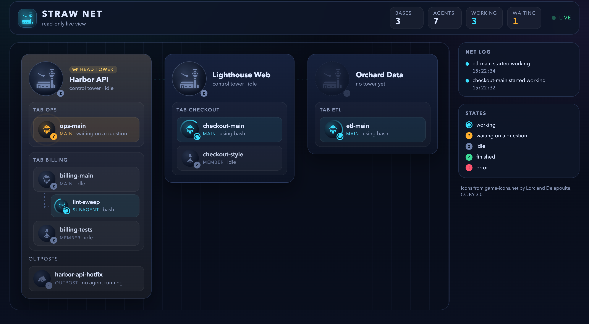
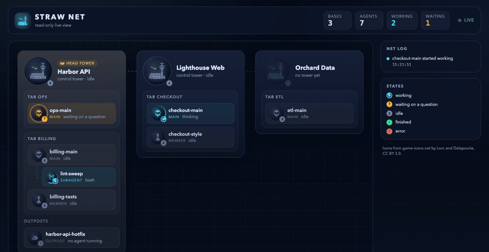

# How pi-straw-boss works

The full behavior behind the [README](../README.md).

## How it works

Joining is automatic; the chain of command is earned.

1. Every joinable pi in Herdr joins its tab's net at session start as a **member**: no reminder, no question. It does not join outside Herdr, as a pi-herdr-agents subagent (`PI_SUBAGENT_ID`, its parent represents it), in a sub workspace (below), or as the tower itself.
2. A member becomes its tab's **main agent** by promotion. The agent calls `boss_promote` when its work grows (several steps, dispatching workers, more than one app); the member prompt says so. A member that calls pi-herdr-agents' `subagent` or `subagent_resume` tool without promoting is promoted automatically, before the subagent starts or resumes. A join that failed at start and retries after the session's pane moved to another tab registers on the tab it is in now, so it never becomes a second main there.
3. A tab has one main. An agent never takes over an existing one: while the tab's main is live, `boss_promote` is refused with a message and the automatic promotion is skipped. The member may still dispatch its own subagents, but its prompt tells it to first message the main through intercom with what it will do and which resources it will use.
4. A main never demotes. When its session ends, the tab has no main until a member promotes (the members' prompt then offers promotion). `/boss` is the user's manual takeover: it makes this session the tab's main even when another is.
5. The workspace tower opens when agents start to collide: a member dispatches a subagent (it promotes itself first, and a promotion opens the tower), the workspace has two members while another workspace already has a live tower, or `/boss tower` asks for it. Mains and the tower go together. The owner of each tab channel (its earliest member) checks when Herdr reports an event that can change the answer (`workspace.metadata_updated` for any workspace, `pane.closed` and `pane.agent_detected` in its own, over one `events.subscribe` connection per session), when the tab channel's owner changes or a session leaves it, and once every 4 minutes for what no event reports (a tower that crashed); a member that joins checks the two-member rule once. A check that must wait out a grace sets one timer for it instead of polling: under a live tower a tab with no live main promotes it; with no tower, every main is turned back into a member, at once when the tower quit (`sb_tower_quit=<members it left>` on the workspace; the two-member rule then waits until the workspace has more members than that, so a tower closed on purpose stays closed, while a subagent or `/boss tower` opens it any time) or after 15 s otherwise (a `/reload` comes back within that), except a main younger than 60 s, whose tower may still be opening. A demoted main keeps its subagents; subagents never promote. A tower dispatches no subagents: its `subagent` and `subagent_resume` calls are blocked with a pointer to `boss_open_main`, so nothing outlives it with no one to take the result. A tower that quits closes its own pane (an emptied tab closes with it); a reload, `/new`, resume or fork keeps it. The tower stays open when mains leave.
6. A promoted session keeps the subagents it launched: the dashboard and the browser view link subagents through the launcher's session file, not through its role, so they count under it as main with no re-registration.
7. A **sub workspace** is treated like a subagent too. `herdr worktree create` opens a linked git worktree as its own workspace (`worktree.is_linked_worktree: true`); its parent is the workspace with the same `repo_key` that is not linked. Sessions there never join, `/boss` is refused, and they receive only scope `all` broadcasts. A sub workspace never gets a tower: `call_tower` from it, or aimed at it, goes to the parent workspace's tower (opened there on demand), and fails with a clear error when no parent workspace is open.

| Role | Who | Gets |
|---|---|---|
| main agent | the member that promotes first in a tab, or the `/boss` taker-over | a short prompt: split work by app, plan before the first dispatch, brief workers, check results, ask the boss before merging or deploying |
| member | every other joined session | a short prompt: with a main in the tab, tell it before dispatching subagents; without one, promote when the work grows |
| tower | one per workspace, in its own tab labelled with the Nerd Font radio tower glyph (U+F043B) | a prompt for coordinating agents and repairing coordination friction, and for opening a main when no session owns a request; it never asks the user |

Before its first dispatch a main reads `prompts/planning.md`, as it reads `prompts/apps-config.md` when it splits work, so the planning rules stay out of every run's system prompt. It chooses a coordination graph: single-loop (one task, carried by itself or one subagent) needs no plan. For fan-out/fan-in and orchestrator-worker it writes the plan as pi `todo` items: one per task, its `owner` the subagent (or `self`), `blockedBy` for the tasks it depends on (which leaves the rest parallel, up to a cap of 4), and in its description and metadata the anchor that checks it. Tasks that share one anchor share one checkpoint todo instead of each branch checking the same thing. The anchors are testing, pseudo-human, human, and adversarial-review, each the lightest check that can fail before the change. The main shows the boss the plan (graph, tasks, edges, shared anchors, human checkpoints) and dispatches only on their confirmation. The browser view shows the todos as the plan's progress.

The tower is opened by a main, by `/boss tower` from any session, or by the rule above (`call_tower` from a member opens nothing), without taking focus, and answers through intercom. Its tab is moved to the first position of the workspace right after it is created (or adopted), through Herdr's socket API (`tab.move`, no focus change); a failed move is reported as a warning and ignored. A tower tab is recognised by the `sb_role=tower` pane token that only Straw Boss writes, never by its label, because a pi-herdr-agents subagent can be named `tower`. A tab that lost its token because its tower quit is still adopted when its label is exactly the radio tower glyph (U+F043B), it holds a single pane, and no agent runs in that pane (a shell prompt): the next opening starts pi there instead of creating a second tower tab, marks the pane again, and moves the tab first. When several such leftover tabs exist, one is reused and the other shell-only ones are closed. A tab labelled only `tower`, or one whose pane runs an agent, is never adopted or typed into. When a tower quits (pi's `session_shutdown` with reason `quit`; a reload, `/new`, resume or fork keeps the tab), it clears its tokens and, once pi has exited, closes its own pane; Herdr closes the tab with its last pane, and other panes in the tab stay. If two towers ever race in one workspace, the live token holder wins, otherwise the lower tab id, and the other closes its own tab. Towers of different workspaces reach each other with `call_tower`; the **head tower** is the tower of the first workspace in `herdr workspace list` order that is not a sub workspace, so there is no election.

### Opening a main

A tower routes a request to the main that owns it, or to the member doing that work. When no session owns it, the tower no longer returns it to the sender: it calls its own tool, `boss_open_main`, and does not ask the user first. Its other limits stay: it runs no shell command, sends no process signal, and edits no file. The tool is registered in the tower only, takes the request (verbatim, with every user decision it quotes kept verbatim), the sender (intercom name or session id), and an optional tab label, and does this:

1. Resolves the sender to one live session; no live session of that name or id fails before anything opens, because the new main could not report back.
2. Creates one tab in the tower's own workspace, in the workspace's checkout path (the tower's cwd when it has none), with `--no-focus` and `STRAW_BOSS_ROLE=main`. It never switches the user's focus and never types into a pane that already exists. Work for another workspace goes to that workspace's tower with `call_tower`; the tool opens nowhere else.
3. Starts pi in that tab's pane under the Herdr agent name `main-<8 hex>`, with pi's default model (the `towerModel` setting is for towers only). A pi started with `STRAW_BOSS_ROLE=main` joins like any session and then promotes itself as `boss_promote` would: a tab that has a live main refuses it and the pi stays a member with a warning.
4. Waits up to 60 s for that pane to publish `sb_role=main`, then sends the new main one intercom message with the sender's name and session id and the request verbatim, so its first prompt is the main agent's and it reports back to the sender through intercom.

Limits, counted from live Herdr panes so they survive a tower restart: the tool marks the new pane with a token (`sb_opened_by=<sender session id>`, kept fresh by the opened main) and refuses, with an error the tower relays to the sender, when the workspace already has 2 live mains opened by towers or the sender already has one (opens are serialised, so one in flight counts). A refusal is not remembered, so the same request may be tried again once a main has finished. `STRAW_BOSS_ROLE=main` stays in the new tab's shell, so a pi promotes itself only when the pane also carries the one-time token `sb_open_main`, which the first such pi consumes; a later pi started in that shell stays a member.

Any failure (the start, the wait, the delivery) closes the tab the tool created, nothing having been handed over, and reaches the tower's model as an error that its prompt tells it to relay to the sender. The tower remembers each sender and request for the life of its session: the same request never opens a second main, whether the first attempt is still running, succeeded (the repeat answers that a main was already opened), or failed (the repeat is refused, not retried). A tower restarted in between forgets, and different wording is a different request.

The tower runs pi's default model unless you set one for it in `~/.pi/agent/straw-boss/config.json` (under `PI_CODING_AGENT_DIR` when that is set):

```json
{ "towerModel": "claude-bridge/claude-sonnet-5-5" }
```

Straw Boss passes it to pi as `--model` whenever it starts a tower, and reads the file at each start, so a change applies to the next tower without a reload. A tower already running keeps its model; restart it (or switch with `/model` in its pane) to change that one.

## Tower dashboard

A tower session with a TUI shows a monitoring widget above its editor. It is read-only: it never takes focus, never prompts, and is shown only while the session holds the tower role (a tower that yields, a headless tower, and main agents never show it). Its first lines say what the pane is, the channel main agents reach each other through with `call_tower`, and give the straw net GUI's link while a GUI server answers (otherwise that `/boss gui` opens it).

```text
╭─ ? 󰐻 Alpha ───────────────────────────────────────────────── head tower ─╮
│ Control tower: main agents talk here (call_tower).                       │
│ GUI  http://127.0.0.1:52662/<token>/                                     │
│                                                                          │
│ this net                                                                 │
│ ├─ tab api-main                                                          │
│ │  ├─ ○  api-main            main                                       │
│ │  │  └─ ⠸ [sub] psb-sleeper  subagent  bash                             │
│ │  └─ ○  docs-member         member                                     │
│ └─ tab other                                                             │
│    └─ ?  ops-main            main      waiting on a question            │
│ other towers                                                             │
│ ✓ 󰐻 Beta                      tower                                      │
╰──────────────────────────────────────────────────────────────────────────╯
```

- **This net**, in detail: the sessions that joined in this workspace, by tab (main agent first, then members), each with the subagents it launched, and this workspace's sub workspaces. Sessions that did not join are not listed, and neither is anything in other workspaces.
- **Other towers**: one line per workspace that has a live tower (workspace, status, and `head tower` for the head one).
- Each row carries the role mark Herdr's sidebar shows (see [Sidebar net view](#sidebar-net-view)), in Nerd Font glyphs one column wide: the radio tower (U+F043B) for a tower and in the title, Font Awesome's star (U+F005) for a main agent and person (U+F007) for a member, and `[sub]` for a subagent. A tab and a sub workspace have none. Their colors are pi theme roles, so they follow the active theme: the tower `warning`, the star `accent`, the person `success`, all bold, and `[sub]` `dim`.
- One glyph and theme color per state: a spinner in the accent color for working, `?` warning for waiting on a question, `○` dim for idle, `✓` success for done, `✗` error. Colors come from the active pi theme. The title mark shows the most urgent state of the net.
- The spinner runs at 8 fps only while something is working. The data is polled every 3 s while the widget exists, and an intercom presence, join, or leave event re-reads at once (at most every 0.5 s). Shutdown, or losing the tower role, removes the widget and every timer.

Where the data comes from: pi-intercom `listSessions()` (status `idle`, `thinking`, `tool:<name>`, and the Herdr location of each session), `herdr pane list` (`sb_role` token, Herdr's agent status where `blocked` means waiting on a question, and the pi session file), and `herdr workspace list` (workspace status, `tower` token, linked-worktree fields). Subagents are linked to their parent through pi-herdr-agents' own layout: the parent's session file names its artifacts directory, `subagent-activity/<child id>.json` there records each child's activity, and the child's pane session file contains the child id. So a subagent is grouped under the session that launched it wherever it runs, and it never counts as a net member of the workspace or tab it sits in.

## Orphaned subagents

A subagent's result reaches the session that launched it only while that session's own process keeps pi-herdr-agents' watchers and its registry of launched children (`runningSubagents`, in the process-wide slot `globalThis[Symbol.for("pi-subagents/runtime")]`).
`/reload`, `/new`, `/resume` and `/fork` keep them, quitting pi suppresses the delivery, and a crash or restart drops them for good: pi-herdr-agents does not recover watchers after a full restart.
A subagent that stays open after it finished, an interactive one for instance, is then stranded: it sits done in its pane and nobody is told.

Every session in Herdr that is not itself a subagent checks for this every 15 seconds.
While no subagent of the session is stranded, a check reads the registry and one directory; only a subagent that is not tracked and whose own activity says it waits brings a pi-intercom session listing, and after that one `herdr pane list` per check (and one `herdr pane process-info` when it is about to be asked).
A subagent is asked to report when all of these hold:

- **Its launcher no longer tracks it.** Its id is not in that registry. When the registry cannot be read (pi-herdr-agents is not loaded, or no longer keeps it there) nothing is known to be lost, so nothing is sent.
- **Its result is not in the launcher's transcript.** No `subagent_result` or `subagent_ping` message names the child's session file.
- **It has finished.** Its activity file says `waiting` (it ended its turn), its pane runs pi and Herdr says `done` (or `idle`, which a pane becomes once someone has looked at it), and pi-intercom says the session in that pane is `idle`. A child that works, waits on a question, or has not started is left alone.
- **It was found so twice in a row,** 15 seconds apart, so that a delivery just going out is not taken for a lost one.
- **Its pane runs the child itself.** The foreground processes of the pane (`herdr pane process-info`) include the launch script this session wrote for that run, `artifacts/<session id>/subagent-scripts/<name>-<run id>.sh`. A pane that only reuses the run's session file, such as a run another session resumed or a pi someone started on that file, is not the child, and neither is a pane whose processes Herdr does not list.

Straw Boss then sends that session one intercom message: the launcher's session id and name, and the request to send its final report to that session through intercom and stop.
The launcher shows a notification.
It sends at most one message per run, where a run is a child id: its activity file is named after it, and the child's own `/reload` starts that file again, so its creation time says nothing about a run.
The run is written to the launcher's session (a `straw-boss` entry with a `nudged` key) before the message goes out, so a restart does not repeat it, and a send that fails is shown as a warning and not tried again.
A child whose pane cannot be found or does not run its launch script, or that has no pi-intercom session of its own, is given up on after four looks, until the next session start (a reload counts).
A subagent whose process has exited cannot be asked; its result stays in its session file.
A resumed run (`subagent_resume`) has an id of its own that nothing in its pane's session file names, so it is never found and never asked.
The subagent's own launcher does this, not a tower: only the launcher's process knows what it tracks, so a tower never nudges the subagents of other sessions, and a subagent that launches subagents of its own does not (it runs no Straw Boss).

## Browser view

`/boss gui` shows the whole net in your default browser: a game-style map, live and animated, where you can read any unit's comms and type into its session.



- **Any session can open it**, in a Herdr workspace or a sub workspace, joined or not. It changes no role and writes no token; a joined session reads the sessions through its tab channel, and one that cannot join (a sub workspace) through a channel of its own (`straw-boss/view/<hex of the pane id>`, never owner-eligible) that takes no part in any tab. Outside Herdr the extension is inactive, so there is no command.
- **What it shows.** Each workspace the net reaches is a **base**: one with a live tower or with sessions that joined. Workspaces with neither are not shown, and neither are sessions that did not join. A base has its **control tower** (the head tower wears a crown; a base without a tower shows a dim ghost), each tab's main agent and members as units, subagents under the session that launched them (linked exactly as the dashboard does, wherever they run), and sub workspaces as **outposts** under their parent. A net log lists joins, leaves, and state changes as they arrive.
- **States** look the same everywhere: working is a spinning ring (and a spinner badge), waiting on a question an amber `?` that hops with a pulsing ring, idle a dim `z`, finished a green `✓`, error a red `!`. Changes animate; the page honors `prefers-reduced-motion`.
- **Routes.** The map is `/<token>/`.
  A base opens as `/<token>/w/<workspace id>` and a unit as `/<token>/w/<workspace id>/s/<session key>`, optionally with `?at=<entry id>` to open its comms at one entry.
  Links are real links (middle-click and copy-link work); a plain click, Back, and Forward change the view without reloading, and Escape goes up one level.
  The **Straw Net** title in the header goes back to the map.
  A deep link loads straight into its view.
- **A base, zoomed in.** The workspace route draws the base large on the map's grid: its control tower, each tab as a squad of unit tokens with the same icons and state badges, subagents tethered under the unit that launched them, outposts, and the workspace's other pi panes as unaligned units (outside the net, grey, with a dashed ring).
  Each unit shows its last assistant line, read from the end of its session file.
  Entering a base zooms out of its spot on the map.
- **A unit's comms.** The session route shows the session's chat as a comms log: your messages in gold on the right, the unit's transmissions on the left with its icon, each tool call as a collapsed action card with a state badge (running, done, failed), thinking folded behind its length, compactions as dividers.
  The side column shows the unit's dossier (portrait, role, state, model, context use, directory, base, squad, launcher, dispatched subagents).
  Its **Terminal** button opens the unit's **terminal mirror** as a tile beside the comms: what its pane shows, with colours and attributes, updated within a second while it changes (at most 4 reads a second, shared by every page that shows it, and none while no page does). On a phone the mirror is display only: typing or tapping in it sends nothing. The server keeps only colour and attribute escapes in what it sends, and the page builds the rows from text. **Fit width** scales it to the tile and scrolls to the bottom, where pi's editor is; otherwise it keeps its size and scrolls sideways, as on a phone. While the session waits for a secret (`secret_drop`) nothing is read and the tile says so; a tile pauses 5 s after its browser tab is hidden and resumes when it shows. A read-only question panel offers **Show terminal** too. Under the mirror, the **key pad** sends one key per tap: `esc`, `tab`, `⇧tab`, the arrows, `enter`, `space`, `⌫`, `home`, `end`, `pgup`, `pgdn`, and `1`–`9` (folded away). It has no letters, `/`, Ctrl, or Alt, and the server refuses them as keys; it works only while the tile shows the terminal live (a frame in the last 3 s), at most 8 keys a second, and only Escape while the session waits for a secret or on a question its panel answers. Before **enter** the server asks the session what Enter would submit; a command that ends or replaces the session (`/reload`, `/new`, …, recalled from history too), another `/` or `!` command, or an editor it could not read asks to confirm first, and so does a second Escape within a second on an idle session, which opens pi's tree (or fork); the confirm puts the focus on Cancel.
  On a desktop (a fine pointer) a click into the mirror gives it the keyboard until a click elsewhere (0.24.0); a drag that selects text to copy does not, and since 0.25.0 switching the session view to its terminal does it once. A ring sweeps out from its edge as it takes the keyboard, the edge stays lit, each key flashes it, and the bar above says so. The keys land in an invisible text box by the mirror's corner, so an input method shows its candidates there. What goes, all on the same `keys` endpoint and under the same guards:
  - the pad's keys by their own key (arrows, Enter, Escape, Tab, Shift+Tab, Backspace, Home, End, Page Up, Page Down), and Delete as its sequence;
  - Ctrl or Alt with a letter, Alt+Enter, Alt+Backspace, and Ctrl or Alt with ← or →, as Herdr names them (the letter from the key's position, since Alt on a Mac types å for A). Ctrl+Z never goes: pi would stop in the background, where nothing here brings it back. Ctrl+D asks first (it leaves pi on an empty editor), and so does a second Ctrl+C within a second (pi leaves on the second). ⌘ stays the browser's, and so do Ctrl+V and Ctrl+C on a selection off a Mac;
  - characters, `/` and `!` and an input method's text included, as typed text (`{text}`): one raw write of 1 to 64 printable characters, so no line break, tab, or escape sequence rides along and Enter still comes alone and asks first;
  - a paste as one paste (`{paste}`): up to 4,000 characters with line breaks and tabs but no other control character, which the server wraps in the terminal's bracketed-paste markers, so pi takes it as a paste and a line break in it submits nothing.
  Writes go one at a time, at most one every 130 ms, under the same 8 a second; characters typed meanwhile join the next write, a held key repeats only into an empty queue (never Enter, Escape, Tab, or a chord), and a refusal or a confirm drops what was still queued. Since 0.25.0 the pad's buttons join the same queue: a press while a write is on its way waits its turn, and the buttons stay enabled meanwhile, so they no longer flicker as you type. Escape goes to the pane, not to the page. While the session waits for a secret only Escape goes; otherwise nothing.
  New entries appear when pi writes them; text still being streamed is not in the file yet, so it shows at the end of the reply.
  The log opens at the newest entry and stays pinned there as new ones arrive.
  Scrolled up, it stays where you are and a floating button offers the way back (**jump to latest**, or **N new** once entries arrived); the button scrolls to the end and pins the log again.
  Older pages load as you scroll up; at most 600 entries stay in the page.
  Under the log, the **composer** types into the unit's terminal through Herdr, as if typed there: **Send** (Enter; Shift+Enter adds a line, off while the box is empty) sends a prompt when it is idle and a steering message while it works, **After this** (Alt+Enter, shown while it works) queues one for when the current task is done, and **Stop** sends Escape after a confirm. While the box holds only `/` and a name being typed, a menu above it lists the session's commands that match (extension commands, prompt templates, and skills, as its own pi lists them; pi's built-in commands are not listed): ↑ and ↓ move, Enter or Tab or a click puts `/name ` in the box, and Escape closes it. The session's dialog bridge answers the list, so it is the session's own set, and the menu shows nothing when it does not answer within a second.
  A leading `/` or `!` runs a pi or shell command; commands that end or replace the session (`/quit`, `/exit`, `/new`, `/resume`, `/fork`, `/clone`, `/import`, `/reload`) ask first.
  Text lands after anything still unsent in the terminal's editor and is submitted with it.
  The box clears only once Herdr confirmed the input, keeping anything typed meanwhile; a send that was not confirmed is never repeated (check the terminal). What the page could not say when the answer came (you were on another session, or the page reloaded) is kept and shown when you come back: why a send was refused, that it was not confirmed, or, if you edited text that had already been sent, that the original already went. It never says "your edits stayed" about an empty box (the browser refused storage).
  It is disabled, with the reason, while the stream is down, the session is gone, or it waits on a dialog (answer that in the panel above it when it can be answered there, else in the terminal).
  Subagents are typed into directly, like any session. Ctrl+C and Ctrl+D are never sent from the browser.
  On a touch screen Enter adds a line and Send sends; drafts survive a reload.
  Markdown is rendered by the page's own renderer into DOM nodes, never as HTML, and only `http`, `https`, and `mailto` links are links; block quotes and lists nest at most 16 deep, and deeper levels stay text.
- **Alerts and panels.** A unit that starts waiting on a question or fails, and a subagent that finishes, raise an alert.
  An alert never opens anything by itself: it joins the queue in the header (questions and errors first, then the rest, oldest first), and leaves it again when the unit moves on. Since 0.23.0 the header's alert holds questions and errors only; finished units wait under a **Done** button beside it, shown only when one has finished (below).
  You open alerts from the queue or by clicking a unit that waits; they open as dialogs in the dock over the side column.
  A second dialog you open stacks on top, with the one beneath peeking out; click the part that peeks out to bring it up (a click that really lands on a control under the strip, such as the Phone button, goes to that control). A dialog you are reading is never covered by one you did not open: alerts only queue, and the overlay model puts any open without your action beneath the top dialog, without focus (no such open exists yet; it is the rule for later arrivals). Closing the top reveals the one beneath, and with none beneath, the next queued question or error.
  **Later** puts the alert back in the queue and opens nothing else; if the unit moved on while its dialog was open, the alert is stale and leaves instead. A dialog is never closed under you: if its unit leaves the net while it is open, the dialog shows **gone** ("left the net"), without its question or Open comms.
  The queue is counted the same way in the header (its tooltip) and in every dialog ("Also queued: 1 needs you · 1 finished"): questions and errors need you and are what closing a dialog reveals next; a unit that only finished waits in the queue for you to open it and is counted apart.
  **Open comms** goes to the unit's comms at the entry the alert was about (read when the alert arrived: the reply with the tool call it waits on, else its last reply), loading older pages when needed, and lights that entry for a moment; the comms log stays there with **jump to latest** until you go down. It closes the alert without opening the next queued one, so nothing covers the comms you went to.
  The entry is in the URL (`?at=`), so Back, Forward, and the link itself land on it again; an entry no longer in the history opens at the newest one, as does opening a unit any other way.
  Escape closes the top dialog only, focus returns to where it was, and dialogs are not modal (the page stays usable, nothing traps focus).
  Documents open as **tiles** beside the current view instead, sharing its width; a tile that arrives by itself takes no focus, and narrow windows show tiles as tabs.
  A dialog shows the unit, its last line, and the tool call it waits on, with a link to its comms.
- **Questions and selectors.** When a unit waits on a dialog, its alert dialog and its session view (above the composer) show it. Two kinds can be answered from the page (0.6.0): pi-robot-hand's selector (`robot_hand` ≥ 0.3.0: its title as written, each choice with where it acts and the terminal's number, **Copy command**, which copies through the browser and answers nothing) and @juicesharp/rpiv-ask-user-question's questionnaires (`ask_user_question`: one to four questions, each with its header tag, options with descriptions as radio buttons or, when it takes several, checkboxes, "Or type your own answer", and "Note (optional)"). **Send answer** goes to the package that opened the dialog, which settles it exactly as a terminal answer would, so the terminal's dialog closes and the agent gets the answer once; the panel then says "Answered.", or "It was already answered in the terminal." when the terminal was first, the owner's reason when it refused (still answerable), and "Not confirmed. Check the terminal" with **Check again** (which resends the same answer, never a new one) when no confirmation came. From a phone over the tailnet, a choice that acts on this computer (robot_hand's clipboard) is hidden and refused. No key is sent and the screen is never read: each session's dialog bridge (`src/bridge.ts`, in every pi in Herdr, subagents too) relays the dialogs its packages publish on pi's event bus to the GUI server's session over an intercom extension channel only that session may own, and the server lets the page answer a dialog only when it is the session's one open dialog, belongs to the session file's open call, and matches what the page showed (dialog id and digest; see [Answering pi dialogs](specs/2026-10-18-dialog-answers.md)). Everything else stays read-only with the reason and **Show terminal**, which opens its screen on the page: `ask_user` (pi-ask-user), several open dialogs, an answer already on its way, a dialog too long to relay, or one that differs from the session file. `secret_drop` shows only that it waits for a secret and is never answerable. A unit with an open dialog counts as waiting at once; otherwise it is waiting while Herdr reports its pane `blocked`, which pi reports from the `herdr:blocked` event; Straw Boss's extension entry `src/blocked.ts` relays rpiv's `rpiv:ask-user:blocked` into it, once per open questionnaire, and pi's own dialogs too (see [Blocked dialogs](#blocked-dialogs)). The question shown is the newest unanswered call on the session's current branch; a call longer than 256 KB is read from further back in the file (up to 16 MB, shown clipped), and a longer one says it is too long to read.
- **Documents** (0.8.0). A session that shows documents with [pi-herdr-doc-review](https://www.npmjs.com/package/pi-herdr-doc-review) 0.4.0 or newer (`show_doc`, or a Mini SDD spec that opens on its own) lists them in its dossier under **Documents** within 2 s, and a parchment badge on a unit's token counts those still on screen in its terminal (a tower lists them only in its dossier). On that session's comms a document that arrives opens as a tile beside the log without taking focus, unless four tiles are open already (it never pushes out one you opened); anywhere else (the map, a base, another session) only the badge changes, and a page that opens on a session with documents opens none. A click in the dossier opens one, and so does **open beside** on a `show_doc` card while its document is listed (an older card stays text).
  An HTML document is a frame sandboxed without scripts: the page's attribute and the server's policy both leave it an opaque origin, so it runs no script, cannot read the API or the cookie, and loads only images, stylesheets, and fonts from its own directory. Its links open in a new tab, and a form with `action="cgi-bin:pi-answer"` answers the session exactly as a Chawan submission does (the owner delivers it): each page view can send once, so **Back** and submit says "Already sent" and **Reload** sends again. Answers travel in the URL of a GET, as in Chawan, and stay in the browser's history: keep secrets out of document forms. **Open in a new tab** shows the same sandboxed page. A text document renders read only, as markdown for `.md` and as plain text otherwise.
  When the owner reports a new revision a tile that shows reloads, and a hidden one (another tab of tiles) says so and loads when it shows; a document closed in its session, or a session that ended, leaves its tile saying it is no longer listed. A session lists at most 32 documents; a list too large for the dialog channel is dropped (the dossier says to read them in the terminal), and documents never hold back its dialogs.
- **Files** (0.16.0). A file pasted, dropped, or picked with **+** in a composer is posted as its bytes to `sessions/<key>/upload`, under the same origin and CSRF checks as typed input (a paired phone too), at most 20 MB. The server stores it under `pi-straw-boss-uploads` in the temp directory (folder 700, file 600) with a cleaned name, and the page puts the path into the message where the cursor is, the way a picture pasted into pi's terminal lands as a temp file path; the session reads it with its own tools. Text pastes as text.
- **Reminders and sounds** (0.21.0). Two header switches, kept per browser in `localStorage`: Remind (on by default) and Sound (off by default, so a page that opens makes no noise). They act on the alerts a snapshot raises (alerts.ts `arrivals`): a unit that turned to waiting on an answer, to error, or that finished. Reminders are system notifications, raised only while the page is hidden or unfocused, one per alert, tagged by unit, and a click brings the page forward on that unit; a focused page already shows the alert queue. A first press on Remind asks the browser's permission; until it is granted the switch shows amber, red when the browser blocks it. A batch plays one sound, the most urgent of its marks (waiting, then error, then finished), from three Kenney CC0 clips bundled as hashed MP3 files and fetched when one first plays. Since 0.23.0 Sound opens a small panel: the switch, a volume from 0 to 100 (60 by default, kept in `localStorage` as `sb.volume`), and a Try button; each change plays the finished sound. The clips play through Web Audio with a gain of the volume's square, because loudness follows the square more closely than the gain, and because an iPhone ignores an audio element's `volume`. Both follow every snapshot, a hidden page's included, through their own record of what was heard: the alert queue's record moves only while the page is shown, so it still queues what arrived while hidden. What was already waiting when the page opened raises neither.
- **Images** (0.20.0). A user message's or tool result's images (png, jpeg, gif, or webp, as pi stores them in the session file) show as thumbnails in the chat: under the message, or under the tool's card whether it is open or closed. The page loads each from `api/image/<key>/<entry id>/<n>`, which reads that one entry and answers with the image's bytes, cached for a day since an entry never changes; the history itself carries only the count. A thumbnail opens the lightbox: the image fitted to the screen, its own size on a tap, ← → or the arrows for the other images of the same message, and Escape, ×, or a tap beside it to close.
- **Queued messages** (0.20.0). What is typed while the agent works waits in pi's queue: a steer reaches the agent at its next turn, a follow-up when the run ends. The session view shows them under the chat as dimmed bubbles, labelled steer or follow-up, until a turn takes them. pi tells extensions only whether messages wait (`hasPendingMessages`), so each session's dialog bridge keeps what it saw arrive (pi's `input` event with a streaming behavior) and drops one when its user message starts (the one with the same text, else the oldest); a queue pi emptied another way (Esc, Alt+Up) clears at the bridge's next check, within 2 s. The bridge relays the five oldest, each cut to 200 characters, with its dialogs.
- **Monitors** (0.25.0). A session's background monitors from [pi-loop-monitor](https://www.npmjs.com/package/pi-loop-monitor) (`MonitorCreate`) show under its todos: folded to how many run and how many failed, with the newest running one's last output line; unfolded to each monitor (newest first, running ones before ended ones, six at most) with its description or command, its state (running, finished, failed, no output and stopped, or stopped), its exit code, its line count, and its last line. Each session's dialog bridge follows pi-loop-monitor's events on the session's bus (`monitor:started`, `monitor:output` at most once every 2 s, `monitor:finished`), strips terminal escapes and control characters, cuts text to 160 characters, and relays the list with its dialogs; an ended monitor stays 15 minutes, as long as pi-loop-monitor keeps its record. The list is read-only: pi-loop-monitor gives other extensions no way to stop a monitor. A monitor that fails (exit code other than 0) or goes quiet (stopped by its inactivity timeout) raises an error alert of its own, apart from its unit's state: its dialog names the monitor, and Open comms, its chat, its terminal, and a reminder's click all go to the unit. A monitor that finishes or is stopped raises nothing. The alert leaves the queue when the session stops listing the monitor.
- **Todos** (0.19.0). A session that keeps a todo list with [@juicesharp/rpiv-todo](https://www.npmjs.com/package/@juicesharp/rpiv-todo) shows it above its composer: folded to `Todos done/total` and the task in progress, unfolded to every task (○ waiting, ◐ in progress, ✓ done; deleted ones are left out). The server reads it from the session file, as it reads the history: the newest `rpiv-todo-state` entry on the current branch, else the details of the newest `todo` result (sessions from before those entries), sent with the history's first page, with every reset, and with each change that adds a snapshot. Terminal mode hides it, since pi's own widget shows it there.
- **Alerts that only finished** (0.19.0) are read once opened: they have no Later, and closing one does not put it back in the queue. Since 0.23.0 they wait apart from what needs you, under the header's **Done N** button: it opens a list of the finished units, each with its base and last line; a row goes to the unit's comms and clears it, and **Clear all** clears every one (questions and errors stay, to be answered). A finished unit whose pane has closed, and (since 0.24.0) a subagent whose run pi-herdr-agents recorded done (`phase: "done"` in its `subagent-activity` file, even while its pane still runs pi), clears itself from the list after its sound and reminder: its parent has the result. The map still shows a finished subagent for ten minutes.
- **Enlarge** (0.24.0). An alert dialog's ⤢ beside its × turns the dialog dock into one wide panel in the middle of the window (at most 880 px wide, nearly the window's height), for a long question; ⤡ puts it back. The choice is kept per browser (`sb.dialog-wide`), so the next dialog opens the same size. A phone has no Enlarge: its dialogs already take the width.
- **Closing** (0.17.0). **Quit** on the map, on a base, a squad, or a unit (not a subagent: its launcher closes it), and **Quit tower** under a base's name for its tower alone, asks first; since 0.26.0 the map is the only place to quit, and × only closes dialogs. Then it posts `close/base`, `close/tab`, or `close/unit` (closer.ts). Closing is each session's own: the server asks the session's bridge to quit it as `/boss close` does (pi's `shutdown`, reason `quit`, so its tokens clear and a tower's quit demotes the mains). A unit then closes its own pane from a detached process once pi has exited. For a squad or a base every agent of the net in it (mains, members, and the base's tower) is asked with its pane kept; one refusal or silence closes nothing, an agent still running after 30 s keeps the squad or base open, and otherwise the tab or workspace closes with what is left in it (shells, subagents). A page that was showing what it closed goes up to what is left (0.20.0): from a closed base to the map, from a closed squad's or unit's comms to its base.
- **Opening agents** (0.15.0). **+ New base**, the last card on the map, opens a Herdr workspace in a folder you pick with one member in its first tab and no tower: a base is never empty, and a failed open closes the workspace again. A base without a tower takes only members: **+ Member** on the base opens one in a new tab in a picked folder, and on a squad splits one into that squad's tab, in the folder of its main (or its first pane). Its tower opens by the rules of the tower, never from the page. A base with a tower takes only mains: **+ Main** opens one in a new tab in a picked folder, and it promotes itself as soon as it joins. Each form takes an optional first message, typed into the new agent once it has joined. The server enforces the same rules (a base counts as having a tower while its tower session is live), keeps the picker inside home and out of hidden folders, runs one opening at a time, and closes what it created when an opening fails.
- **The server** runs in the session that opened it, on `127.0.0.1` and a random free port. Every URL starts with a random token (`http://127.0.0.1:<port>/<token>/`); a request without it or with another `Host` header is refused with 403, so other local pages cannot read the net. The only writes are POSTs under `/<token>/api/sessions/<key>/` (`input`, `keys`, which takes one key pad key from a page that shows that terminal live, or Stop's Escape, `focus` (not offered by the page since 0.14.0: from a browser it changed nothing you could see), `commands`, which asks the session's bridge for the commands that match a typed `/name` and calls no Herdr method, `answer`, which carries a dialog's answer to its owner and sends no key, and `mirror`, which shows the pane's screen on the page's own stream) and `/<token>/api/remote/pair`; each needs the page's own `Origin`, `Sec-Fetch-Site: same-origin` when sent, a JSON body of at most 64 KB, and the CSRF secret written into the page, and for `input`, `keys`, `focus`, and `answer` the server asks Herdr right then that the pane still runs pi on that session's file (a mirror checks it before its first read and every 2 s, and starts afresh when the session moved to another pane). Typed text is never logged. The page is a built static bundle (`dist/gui`); any route answers the same page, which carries a `<base href>` so it loads from any depth. The stream (`/<token>/events`) names itself first (`hello`, a random id the page attaches terminal mirrors to; a server that has not read the net yet names it after its first reading), then sends the full snapshot on connect and on every change, a `ping` every 15 s, and a `problem` event when Herdr or intercom cannot be read; `events?watch=<session key>` adds that session's history, and `events?watch=w:<workspace id>` the last line of each unit there. `/<token>/api/history/<key>` and `/<token>/api/entry/<key>/<entry id>` page through a session and fetch one entry in full (capped at 1 MB). Documents are served by capability, a random 128-bit value the server gives each listed document, never by path: `/<token>/doc/<cap>/` is an HTML document (at most 2 MB) with each `cgi-bin:pi-answer` form pointed at a one-time nonce (30 minutes, bound to that document), `/<token>/doc/<cap>/<file>` an image, stylesheet, or font under the document's own directory (at most 8 MB, no `..`, no symlink out of it), `/<token>/doc/<cap>/answer/<nonce>` one form answer (at most 64 fields, 16 KB of query, 12 KB of answer, no control characters other than tab and line breaks), and `/<token>/api/doc/<cap>` a text document as JSON. Only documents a session lists now are served. Every `/doc/` response carries a CSP `sandbox` without `allow-scripts` or `allow-same-origin`, and its sources name the server's origin (WebKit does not match `'self'` in a sandboxed document); the app may frame only its own pages and sends `Cross-Origin-Opener-Policy: same-origin`. The rewrite also drops a document's own `<base>`, referrer policy, and its buttons' `formaction`, `formmethod`, `formtarget`; that is a best effort on HTML text, and the sandbox and policy are what hold. The net is read only while a page listens.
- **Session files.** The server reads only the session files of units in the net it just read (joined sessions, towers, subagents through their pane or launch script, and the other pi panes of a base); a path never comes from the browser. A file is read only from a pane running pi, only as a `.jsonl` under pi's sessions directory (`sessions/` in `PI_CODING_AGENT_DIR` or `~/.pi/agent`, symlinks resolved on both sides), and for an intercom session only when it is named for that session, so a net read during `/new` cannot pair the old session with the next file; a watched session whose file changes re-attaches to the new one. A file is indexed in 1 MB chunks from the first and last bytes of each line, about 25 ms for a 54 MB session, and only the index stays in memory; entries are read by offset for the page being sent. Indexing, appends, and reads run one at a time in order, so entries pi writes during the first index wait for it, and a read never uses the index of a file that was replaced. A rewritten file or a branch move resets the page. A first page that cannot be read is tried again on the next net reading. A unit that leaves the net stays readable for ten minutes, with a link to the pane's new session when there is one.
  Sessions stored elsewhere (`--session-dir`, `PI_CODING_AGENT_SESSION_DIR`, or pi's `sessionDir` setting) show on the map but have no history and cannot be typed into.
- **Remote access.** `/boss gui remote`, in the session that runs the server, puts the GUI on your tailnet: it adds one `tailscale serve` entry, HTTPS on port 8443 proxying to the local server (never Funnel), and shows a QR code in a pi overlay. Scan it with a phone signed in to Tailscale as this machine's user. In the overlay, **c** copies a link and **o** opens one in this computer's browser; every QR, copy, and open is its own one-time link that works once, within ten minutes, and **Esc** or **q** closes it. While the overlay is open the session counts as waiting, so input from the browser is refused rather than lost in it. The HUD's **Phone** button shows a fresh QR in the page too; it shows only on this computer's page (127.0.0.1), not on a paired device's (0.25.1). A paired device gets a session cookie (HttpOnly, Secure, SameSite=Strict, seven days); every remote request must also carry this machine's Tailscale user in `Tailscale-User-Login`, which `tailscale serve` sets, and the exact MagicDNS host. A document's own requests (`/<token>/doc/…`) need that identity and the document's capability but not the cookie, because Chrome withholds a SameSite=Strict cookie from a sandboxed frame's requests: on the tailnet, a device of the same Tailscale user that holds a document's link can read it and answer its form without pairing. Port 8443 is taken only when it is free or already this server's, and `/boss gui remote off`, `/boss gui stop`, or the end of the session remove only that entry (other serve entries are never touched) and end every remote session. It says why and changes nothing when Tailscale is missing, signed out, a tagged node, without MagicDNS, or 8443 serves something else. The layout works on a phone: no sideways scrolling, larger touch targets, safe-area insets, and the composer stays above the on-screen keyboard. Since 0.26.0 a session on a phone takes the whole screen (‹ goes back to its base, **Info** opens its dossier full-screen, and a tower's dossier lists its base's squads and units on every screen since 0.26.1), its composer fixed at the bottom over the keyboard, and a tile opens over it the same way; the composer puts its box on top with **+** on Send's row, its note line taking no room while empty. While a finger holds or flings the comms log, nothing pulls it back to the newest entry (0.26.1). The net log folds away from its heading, and on a phone shows only its two newest entries.
- **One server per machine.** Running `/boss gui` again, in this session or any other, opens the server that already runs instead of starting a second one; two calls at the same moment share one start. `gui.json` in `~/.pi/agent/straw-boss/` (or under `PI_CODING_AGENT_DIR`) records the running server (pid, port, token, CSRF secret, owner session, mode 600), `gui.lock` makes the check-and-start atomic, and `remote.json` records the serve entry's target, the owner's PID, and when that process started while remote access is on, so the next server removes an entry a crashed one left: a recorded server counts as running only when its PID is alive and that process is the one that started at the recorded time, so a PID another process now holds is not mistaken for the owner, while a server that really runs keeps its entry. `/boss gui stop` stops it only in the session that runs it; elsewhere it names that session. Closing that session stops the server too. The next `/boss gui`, from any session, asks for the old port and token, so a page that is still open reconnects by itself; if the port is taken it gets a new URL.
- **Background tabs.** The page treats a stream as dead after 45 s without a message and reconnects with a backoff of 1 s doubling to 30 s (±20 %), giving up after 8 failures until the tab is used again. Coming back (visible, focus, `pageshow`, `online`) reconnects at once when the stream is closed or has been quiet for 20 s, and takes a fresh full snapshot instead of replaying what was missed. While disconnected, the map is dimmed and the banner says so with the time of the last update. A hidden tab pauses its animations, draws only the newest snapshot when it returns, and holds no timer beyond the watchdog.
- **The QR encoder** is the package's own (`src/qr.ts`), adapted in part from Project Nayuki's QR Code generator library (MIT, see [`NOTICE.md`](../NOTICE.md)); there are still no runtime dependencies.
- **Motion rests.** A page left alone costs a phone's battery in frames, so the animations that never end (the spinning rings, the waiting unit's ping, the working badge's spinner, the connection dot's blink, the packets on the map's wires) stop after 30 s without input and show a still sign of the same state instead (a frozen ring or spinner, a faint halo for a unit that waits); any touch, key, mouse move, or scroll brings them back. A base scrolled out of view rests the same way, a wire's packet travels only while one of its two towers works, and a phone's dossier, which sits under the full-screen comms, is not drawn. With `prefers-reduced-motion` the page has no such motion and none of this runs.
- **Icons** come from [game-icons.net](https://game-icons.net) by Lorc and Delapouite, [CC BY 3.0](https://creativecommons.org/licenses/by/3.0/) (details in [`gui/ICONS.md`](../gui/ICONS.md)). Nothing is loaded from the network: no CDN, fonts, or runtime dependencies.



## Pane balance

A second extension entry, `src/balance.ts`, keeps Herdr tabs even. When a pi starts in a tab (once per process, so `/reload` does not count) and after a pi quits and Herdr closes its pane, the panes of that tab get equal widths along each split, and stacked panes equal heights. It runs in every pi inside Herdr, joined or not, and leaves a zoomed tab alone. A pane that outlives its pi (a shell you keep) changes nothing.

The work runs in `src/balance.mjs` as a detached `node` process: `balance.mjs now <pane>` at start, `balance.mjs after-close <pane> <tab>` at quit, because the quitting pi exits before Herdr closes its pane. Each resize is planned from a freshly read layout, and a per-tab lock under the system temp directory (`pi-straw-boss-pane-balance/`) makes concurrent sessions take turns instead of applying the same change twice.

## Blocked dialogs

Herdr's pi integration shows a pane as `blocked` while its count of `herdr:blocked` events (`{active: true, label}` up, `{active: false}` down) is above zero, and pi's own dialogs emit nothing, so a session waiting on one looked as if it were working. A third extension entry, `src/blocked.ts`, closes that for every pi in Herdr, joined or not, subagents included. It relays two sources into `herdr:blocked`:

- **rpiv's questionnaire**: `rpiv:ask-user:blocked`, once per open `ask_user_question`.
- **Every `select`, `confirm`, `input` and `editor` dialog of any extension** (an `mp-infra` command review, pi-robot-hand's selector), from pi's `ui_prompt_start` / `ui_prompt_end` events (pi 0.84.4 and later; on an older pi they never fire and nothing is relayed). Nothing wraps `ctx.ui`: pi wraps it once per runner for all extensions and emits one pair per outermost dialog, so overlapping dialogs make one pair that spans from the first start to the last end, and a dialog that resolves, is cancelled, aborted, times out or throws ends it all the same. The label is `Waiting for your answer: <title>`, with control and format characters turned into spaces and the title cut to 80 characters (`<kind> dialog` when it has none). A session without a UI (print mode) gets pi's no-op `ui`, which is never wrapped, so it emits nothing; `/reload` and a new session load a fresh runner and a fresh relay, and the old ones are dropped with their runner.

Pi emits both events without waiting and walks the extensions one after another, so behind an earlier extension's slow handler a dialog's end can reach this relay before its start (measured against the real runner). The relay therefore keeps a signed count and reports blocked only while it is above zero: an early end and its late start cancel out, and the pairs it emits always alternate and end balanced. `custom` dialogs are left out on purpose: pi's own program status does not count them as blocking either, and the ones that do wait for the user report themselves (`ask_user_question`, `secret_drop`, the pairing QR overlay). Because pi reports only the outermost dialog, a confirm opened while a `custom` dialog is already open is not reported either. A tool that reports its own dialog as well (pi-robot-hand's `robot_hand` selector, pi-ask-user's input) adds a second, balanced pair while it is open; Herdr counts both and clears them together. Skipping the relay's pair there would drop blocked when the tool's pair closes first while another dialog is still open. A blocked pane has no question to show, so the GUI lists it as waiting with "It waits on a dialog.", and its composer refuses a prompt while Herdr reports the pane `blocked`.

## Sidebar net view

The optional Herdr plugin in `herdr-plugin/` (id `wayne930242.straw-boss`, action `net`) toggles the sidebar's Agents list between Herdr's own view and a net view.
The net view lists the head tower's workspace first, then the other workspaces in Herdr's order.
In each workspace the tower comes first, then the tabs in their order, and in each tab the main agent and then the members.
Every subagent sits directly under the session that launched it, including one that pi-herdr-agents opened in a worktree sub workspace.
Agents the net does not know come last, in Herdr's workspace, tab and pane order, so nothing is hidden and an agent that waits for you stays on the list.
The sidebar header reads `net` while the view is on.
The view is on by default: the plugin turns it on when the Herdr server starts, and the key switches it off and on again.
The same order drives the collapsed sidebar, the mobile list, mouse targets, and `focus_agent` numbering and next/previous navigation.
Herdr's `agent.list`, notifications, and attention counts do not change.

**The tokens.**
Every session in the net writes display tokens next to `sb_role`, in the same report, on the same 4 minute refresh and with the same 10 minute TTL.
It writes them on the panes of the subagents it launched as well, because those never join and write nothing themselves.
A session that ends clears its own and its subagents'.

- `sb_order` is the sort key.
  A tower's is `WWW.0`.
  A main agent's or member's is `WWW.1.TTT.R.PPP`: `WWW` is the place of its workspace among the base workspaces (a sub workspace does not count, and the head tower's is `000`), `TTT` the place of its tab in the workspace, `R` is `0` for a main agent and `1` for a member, and `PPP` the place of its pane in the tab.
  Each subagent adds one `.NNN` segment, its place among the live and finished subagents of its launcher, at any depth (the dashboard lists eight per session, the keys cover every live one).
  Every number is zero-padded, so plain string order is numeric order, and a subagent's key sorts after its launcher's and before the launcher's next sibling's.
- `sb_mark` says what a net member is, in a few characters: a star alone (Font Awesome's, U+F005) for a main agent, a person alone (Font Awesome's, U+F007) for a member, and `[sub] <launcher>` for a subagent, with the launcher's name cut to 24 characters.
  A tower has none: its tab already carries the radio tower glyph.
- `sb_main_tab` is a main agent's tab label and `sb_tab` a member's, one token per role because a Herdr rule sees only its own token, so a row colors each by role.
  A member's keeps the `sb_tab` name it has had since 0.7.2, so the row works with sessions that have not reloaded; every other agent carries neither.
- `sb_indent` is on a subagent alone, and is the branch to it from its launcher, drawn like the worktrees in Herdr's Spaces panel: `├─` while a later subagent of the same launcher is marked, `└─` on the last one.
  Subagents of one launcher are siblings at every depth.
  A tower, a main agent and a member carry none, and a session clears the one a pane kept from when it ran a subagent.
- `sb_name` is on a subagent alone, and is its own name as pi-herdr-agents shows it, cut to 24 characters like the launcher's name in `sb_mark`.
  The name comes from the pane's Herdr label while it has one, else from the launch script's name.
  Herdr keeps the label in the server's memory too, so after a new server the label is gone and a row would show only the workspace's name; the token comes back with the others (see below) and a row can show it instead.
  A tower, a main agent and a member carry none, and a session clears the one a pane kept from when it ran a subagent.

The tokens rest on Herdr's order as of the session's last refresh, so moving a tab or workspace shows in the net view within 4 minutes, and a subagent that has a new sibling gets its `├─` at the next refresh.
A subagent is marked while its pane runs pi: its launcher publishes again 3 and 15 seconds after a `subagent` or `subagent_resume` call returns, so a new subagent hangs under it within seconds, and its tokens go at the next refresh once it has finished.

**A new Herdr server.**
Herdr keeps pane and workspace tokens in the server's memory, so a server that takes over (a live handoff during an update, or a stop and a start) begins with none of them, and the net view would stay unsorted, and a tower would look absent, until each session's next 4 minute refresh.
Every session that can join the net, and every tower, therefore keeps one `events.subscribe` connection open on Herdr's socket, only to see it close; it asks for `workspace.renamed`, which almost never happens, so the connection carries no traffic and costs nothing while the server runs.
When it closes, the session reconnects after 0.25 s, 0.5 s, 1 s, and then every 2 s, and when a server answers, it writes everything again at once: first, for a tower, the workspace token `tower` and its own `sb_role`, which is how another session finds the tower (without them a `call_tower` in the gap would open a second one), then the full publish of the 4 minute refresh (its role and net tokens, and the marks of the subagents it launched).
The first connection of a session is no takeover. A session that has not finished joining (or a tower that has not taken its role) writes nothing on a takeover, and a subagent and a session in a sub workspace hold no connection.
The connection and the retry timer never keep pi alive, and `session_shutdown` closes them: a `/reload` leaves one connection, the new instance's, and a session started again in the same instance replaces its connection.
A server that refuses `events.subscribe` is treated like one that is gone, so the session retries every 2 s without effect and keeps the 4 minute refresh as before.
The sidebar plugin needs nothing more: its startup hook turns the view on when the server starts (before any token exists), and Herdr 0.9.4 and later sort the view again when tokens change.

**Sidebar rows.**
The tokens also show the roles in Herdr's own grouped view, which a plugin cannot reorder.
Add them to a row of `[ui.sidebar.agents]` in `config.toml`.
`$sb_indent` goes before the state icon, so a subagent hangs under its launcher as the worktrees do in the Spaces panel; Herdr puts its own ` · ` after it, and an agent without the token shows nothing.
`$sb_name` goes right after the state icon, so a subagent row says which subagent it is even when Herdr has lost the pane's label.
Every glyph sits in the first row; the `[sub]` mark stays hidden because the branch already says what it is. The snippet leaves the colors to your Herdr theme; add an `fg` to a rule to color a mark.
Herdr drops a row whose every item is empty, so the second row, the tab label from `$sb_main_tab` or `$sb_tab`, gives a main agent and a member a second line and leaves every other agent one line; give the two tokens the colors of the star and the person. The first row leaves out Herdr's `tab`, which the second row carries.

```toml
[ui.sidebar.agents]
rows = [
  [
    { token = "$sb_indent", dim = true },
    "state_icon",
    { token = "$sb_name" },
    { token = "$sb_mark", rules = [
      { starts_with = "[sub]", hide = true },
      { starts_with = "\uF005", bold = true },
      { starts_with = "\uF007", bold = true },
    ] },
    "machine", "workspace",
  ],
  [{ token = "$sb_main_tab", bold = true }, { token = "$sb_tab", bold = true }],
]
```

Herdr's default has a second row with the agent name; put `"agent"` back in a row of its own, or in this one, if you want it.
The token colours take hex values only, so add an `fg` to a token or a rule to taste.
`herdr config check` accepts the snippet, and `herdr server reload-config` applies it.

**Install.**
Link the plugin from a checkout and bind the action to a key.
Herdr runs the startup hook when a server starts, not when a plugin is linked, so a server that is already running shows the view after one press of the key, or after a restart:

```bash
herdr plugin link /path/to/pi-straw-boss/herdr-plugin
herdr plugin action list --plugin wayne930242.straw-boss
herdr plugin action invoke wayne930242.straw-boss.net
```

```toml
[[keys.command]]
key = "prefix+alt+n"
type = "plugin_action"
command = "wayne930242.straw-boss.net"
description = "toggle the straw net view"
```

`prefix+?` lists the keys that are taken, `herdr server reload-config` loads a new binding, and `herdr plugin unlink wayne930242.straw-boss` removes the plugin.
The plugin needs Herdr 0.9.3 or newer and uses a Unix socket, so it runs on macOS and Linux only.
The tokens come from the sessions, so a session that still runs an older pi-straw-boss (before 0.6.5) has none until pi reloads it, and sorts after the others.

**How the view works.**
The view is one `agent.view.set` request on Herdr's socket, which the CLI has no command for, sorted by the `sb_order` token ascending, then by Herdr's workspace, tab and pane order.
Herdr sorts a present value before a missing one, so agents without the token come after the net, and among themselves in that place order.
The plugin writes no tokens of its own.
Herdr servers before 0.9.4 do not sort an installed view again when tokens change (0.9.4 does): the order stays as it was at the last install until the view is switched off and on again, so press the key twice to refresh it.

**On at start.**
`[[startup]]` in the manifest runs `net-view.mjs startup` once after the server has restored its session, and again when a new server takes over in an update handoff.
It installs the same view as the key and exits at once; no process stays running, and a failure (Herdr refusing the view) is in the plugin log and does not stop the server.
Every server start turns the view on, whatever an earlier server left: a press that turned it off lasts until the server stops.
The one exception is a startup that runs again in the same server, which leaves that server's own "off" alone.

**The toggle.**
Herdr cannot say whether a view is active, so the action records "on" and the identity of the running server (the socket file's inode and creation time) in `net-view.json` in the plugin's state directory.
The next press clears the view with `agent.view.clear` named to this plugin's own source, so it never clears a view that another owner installed.
A restarted server drops its view, and its different identity makes the stored state count as off; the startup hook then turns the view on and records it, so the first press switches it off.
A view another owner installed over this one also counts as off: the press installs this one again.

**Limits.**
Herdr keeps one Agents view per server, so another plugin's view and this one replace each other.
Unlinking or disabling the plugin while the view is on drops the view at once; the first press after linking it again only resets the state, and the second turns the view on.
Herdr starts plugin commands with the PATH of the process that started its server, and a Herdr launched from a macOS app has only `/usr/bin:/bin:/usr/sbin:/sbin`.
`run.sh` therefore looks for node on PATH, in Homebrew's, `/usr/local`, mise, asdf, and volta directories, and through a login shell, and says so in the plugin log (`herdr plugin log list --plugin wayne930242.straw-boss`) when it finds none.

## Tools

| Tool | Available to | What it does |
|---|---|---|
| `boss_promote` | joined sessions that are not the tower | Become this tab's main agent; refused while the tab has a live main. |
| `boss_status` | joined sessions and towers | The main agent of each tab, this workspace's tower, the head tower, and the other towers. |
| `boss_open_main` | towers only | Open a new tab in the tower's workspace with a new pi as its main agent and hand it a request no session owns, once per request (see [Opening a main](#opening-a-main)). |
| `call_tower` | joined sessions and towers | Send a message to this workspace's tower, or another workspace's by id or exact label. Opens the tower tab when none runs. |
| `boss_rename` | joined sessions, not towers | Sets the session's name (`pi.setSessionName`) to a short phrase for its current work, trimmed, at most 40 characters (16 fit a tab label). The net and the GUI show the session by its name, and pi-auto-tab-name, when loaded, renames the Herdr tab after it and keeps it through compactions as a chosen name. A main agent's prompt has it call this when its work turns to another task. A tower has no such tool: the net recognises it by its name. |
| `boss_broadcast` | joined sessions and towers | One message to every other session in a scope. `tab`, `workspace` and `towers` reach only sessions that joined the net (nearly every pi in Herdr, not sub workspace sessions); `all` reaches every pi session on the machine, joined or not (for notices such as going to sleep). Default `workspace`. |

| Command | Effect |
|---|---|
| `/boss` | Take over as this tab's main agent, even when it has one. |
| `/boss status` | Show `boss_status`. |
| `/boss tower` | Open this workspace's tower if none runs, then focus its tab. |
| `/boss gui` | Open the whole net in the browser (any session; joins nothing). `/boss gui stop` stops the server. |

`/boss` and `boss_promote` are unavailable in a sub workspace.

## What it writes

- Herdr pane token `sb_role` (`main`, `member` or `tower`; a tower tab is also marked right after it is created; a tab opened for a request is created with the environment variable `STRAW_BOSS_ROLE=main`, which makes its pi promote itself) and workspace token `tower` (the tower's intercom session id), both refreshed every 4 minutes with a 10 minute TTL, written again at once when a new Herdr server takes over (see [A new Herdr server](#sidebar-net-view)), and cleared at shutdown (a tower that quits then closes its own tab if it holds only that pane).
- Herdr pane tokens `sb_opened_by` (the sender's intercom session id, on a pane a tower opened for a request; refreshed by its main and cleared at shutdown, so the open limits count only live opened mains) and `sb_open_main` (a one-time mark the opener sets, consumed by the first pi that promotes itself from it).
- Pane tokens `sb_order` (a sort key), `sb_mark` (a role label) and, on subagents, `sb_indent` (a tree branch) and `sb_name` (the subagent's name) next to `sb_role`, and the subagent ones on the panes of the subagents the session launched, with the same refresh, TTL and takeover rewrite; they feed the sidebar net view and the optional rows below (see [Sidebar net view](#sidebar-net-view)).
- A pi session entry `straw-boss` (`tower`) so a resumed tower keeps its role. Members write no entry for their role: every session joins at start, so entries saved by 0.4.0 (`asked`, `joined`) are ignored. The one other entry carries `nudged`, a subagent run that was asked to report (see [Orphaned subagents](#orphaned-subagents)).
- Every message it sends through intercom (`boss_broadcast`, `call_tower`, the nudge, the request handed to an opened main) has a message id with a nonce of the current process: pi-intercom refuses an id it saw from a session again with other content, and a restarted pi keeps its session id.
- One `events.subscribe` connection to Herdr's socket per joined session or tower, which carries no events of interest and is read only for its closing (see [A new Herdr server](#sidebar-net-view)).
- While remote access is on, one `tailscale serve` entry (HTTPS 8443, proxying to the GUI server), removed when it goes off.
- One intercom extension channel per tab, `straw-boss/tab/<hex of the tab id>`, registered by every joined session and tower; the channel's owner (the first to join) only records the main, and it is not the main by that. Tab ids over 24 characters are refused.
- The dialog channel `straw-boss/gui/<sha256 prefix of the server's session id>`: registered owner-eligible only by the session running the GUI server, and joined by every session (subagents included) while `gui.json` (which records the server's session as `ownerSession`) names another session; each session checks `gui.json` once every 2 s from its start. Besides dialogs it carries the session's document list (pi-herdr-doc-review's ids, paths, display names, reasons, revisions; the bridge asks the owner for the list again when it starts, so a session that reloads lists what is open) and form answers addressed to one document and once per answer id, and the key pad's editor check: the server asks a session's bridge what Enter would submit, and the bridge answers with a class (empty, text, another slash or `!` command, or unknown) and at most the name of a command that ends or replaces the session, never the draft, and only to the server `gui.json` names now whose process is alive.

The tower tab is labelled with the radio tower glyph (U+F043B) alone and its Herdr agent is named `tower-<workspace id>` in lowercase (Herdr agent names are unique per server).

## From Claude Code or Codex

Read-only discovery works from any shell in a Herdr pane:

```bash
herdr workspace get "$HERDR_WORKSPACE_ID" | jq -r '.result.workspace.tokens.tower'
herdr pane list --workspace "$HERDR_WORKSPACE_ID" | jq -r '.result.panes[] | select(.tokens.sb_role) | [.pane_id, .tokens.sb_role] | @tsv'
node ~/.pi/agent/npm/node_modules/pi-intercom/cli.mjs ask --to "$TOWER_SESSION_ID" --text "<message>"
```

Opening a missing tower needs a pi session.

## Development

```bash
npm install
npm run check      # tsc --noEmit for the extension and for the page
npm run gui:build  # builds the page into dist/gui (npm test and npm pack do this first)
npm test           # node --test, against a fake Herdr and a fake intercom broker
npm run gui:dev    # the page with hot reload against a demo net; see below
```

The dashboard has its own file (`src/dashboard.ts`, budget 200 lines) and its rendering is a pure function of a snapshot, so tests drive it without a terminal. The browser view's data and server (`src/net.ts`, `src/gui.ts`) share a budget of 300 lines; `buildNet` turns sessions, panes, and workspaces into the JSON snapshot as a pure function (and fills the registry of readable session files), and `collectNet` reads Herdr and intercom and reuses the dashboard's subagent linking. The session reader (`src/history.ts`), the entry-to-item mapping (`src/items.ts`), and the stream and API glue (`src/watch.ts`) are tested against fixture files.

The page is vanilla TypeScript in `gui/`, built by Vite (a development dependency only) into `dist/gui`, which ships in the npm package; `dist/` is not committed. The page diffs the DOM by element id, animates with CSS on `transform` and `opacity` (the map's packets are `transform` keyframes along each wire, `gui/packets.ts`; `gui/calm.ts` rests the endless ones), and its reconnect logic (`gui/stream.ts`) is tested with a fake stream and a fake clock.
The map's chunk holds the map, the header, the router, and the alert spotting (`gui/alerts.ts`).
The focus views (`gui/views.ts` coordinates `gui/workspace.ts`, `gui/session.ts`, and `gui/dossier.ts`), the comms log with the markdown renderer (`gui/chat.ts`, `gui/markdown.ts`), and the overlay layer's DOM and tiles (`gui/layer.ts`) load on first use.
The overlay rules (`gui/overlay.ts` for the dialog stack, `createTiles` in `gui/layer.ts`) are pure and tested without a browser (`tests/overlay.test.ts`); phase 2 and 3 dialogs (ask_user, robot_hand, secret_drop) and show_doc documents (`gui/doc.ts`, its rules tested in `tests/doc-page.test.ts`) plug into the same stack and tiles.
Size budgets are checked by `tests/imports.test.ts`: the map's chunk ≤ 15 KB (6 KB gzipped), the lazy chunks together ≤ 35 KB (12 KB), the stylesheet ≤ 22.1 KB (6.1 KB).

The sidebar plugin is plain JavaScript in `herdr-plugin/` and imports nothing from `src/`, so the folder works wherever Herdr links or installs it.
`tests/netview.test.ts` drives it against a fake Herdr that keeps tokens and the one active view, and against a real Unix socket.

`npm run gui:dev` serves the page on a local port with hot reload, fed by a demo net with invented names that changes state every few seconds. The demo includes a session with every kind of chat entry (open any unit), and the fixture's toolbar (bottom left) has **drop stream**, **go silent** (no messages, no error: the 45 s watchdog), **restore**, to review the disconnected page, and **doc arrives**, which has billing-main show one more document: on its comms it opens as a tile, elsewhere its badge counts up. billing-main lists a markdown plan and an HTML review whose form posts nowhere in the demo. To point the dev page at a live stream instead, run `/boss gui` and start the dev server with its URL: `GUI_LIVE=http://127.0.0.1:<port>/<token>/ npm run gui:dev`.

To check a checkout in real pi while your own `/boss gui` server runs (one server per machine, so `/boss gui` would open that one), start a scratch pi with `--no-extensions`, `-e` for pi-intercom and your provider, and `-e` for a two-line wrapper that calls this checkout's `createStrawBoss({ stateDir: "<scratch dir>", openUrl: async () => {} })`.
Its `/boss gui` then runs a second server from the checkout, recorded in the scratch directory, and opens no browser.

Prompts are plain markdown in `prompts/`, read at session start, so an edit applies after `/reload`.
