# pi-straw-boss 的運作方式 <!-- source: docs/how-it-works.md @ 365873e5 -->

[README](../README.zh-TW.md) 背後的完整行為。使用說明在各篇指南；這份參考則逐節寫出程式實際怎麼做，所以請在下面找到需要的那一節，其餘可以略過。

Straw Boss 是 pi 的擴充功能。它把在 Herdr 裡執行的 pi session 接成一張網，給它們一條指揮鏈，讓每個工作區有一座塔台來協調，並把整張網顯示在同一頁上。

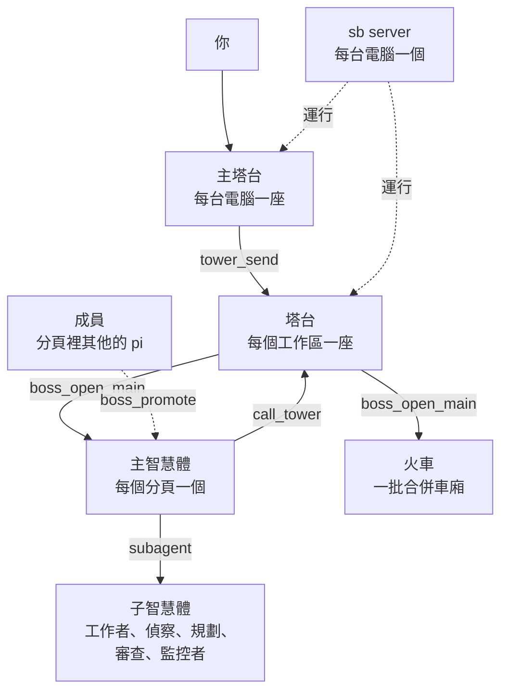

實線箭頭都是[工具](#工具)裡的工具。虛線不是工具：成員靠升任成為主智慧體，塔台則由 sb server 運行。

**位置**

| 位置 | 它是什麼 | 怎麼來的 |
|---|---|---|
| 成員 | 已加入、但不是主智慧體的 pi | session 啟動時自己加入 |
| 主智慧體 | 每個分頁一個；規劃、派工，並詢問老闆 | 升任（`boss_promote`、第一次呼叫 `subagent`）、`/boss`，或由塔台開啟 |
| 子智慧體 | pi-herdr-agents 的子層；它不加入，由啟動它的 session 代表 | 由主智慧體或成員啟動 |
| 塔台 | 每個工作區一座；分派工作、修補協調上的摩擦，絕不詢問老闆 | 智慧體開始互相碰撞時開啟 |
| 主塔台 | 老闆唯一的入口，每台電腦一座；把每項指示交給某個工作區的塔台 | 老闆第一次說話時由 sb server 建立 |
| 火車 | 把一批合併車廂送進基底分支的工作者 | 塔台為專案的整合員開啟 |

<details>
<summary>主智慧體、子智慧體與塔台 run 的種類</summary>

**主智慧體的種類**（頁面顯示種類的詞；GUI 把 `standing` 稱為「值守」）

| 種類 | 用途 | 怎麼設定 |
|---|---|---|
| `coordinator`（協調者） | 預設：拆分工作、規劃、派出子智慧體 | 預設，或 `boss_duty` |
| `integrator`（整合員） | 專案的合併火車：接收車廂、組成火車 | `boss_duty`，或名稱 `integ <project>` |
| `standing`（值守） | 看顧一個系統或一台機器，沒有終點 | `boss_duty` |

**子智慧體的種類**（讀自 pi-herdr-agents 給它的角色名稱；其他角色維持一般子智慧體）

| 種類 | 角色名稱 | 用途 | 協調者派出它時 |
|---|---|---|---|
| `worker`（工作者） | `worker` | 做一件任務：修改、執行、建置 | 在待辦指名某個圖之前，會被 `sb: plan first` 拒絕 |
| `scout`（偵察） | `scout` | 調查並回報 | 不需要計畫就放行 |
| `planner`（規劃） | `planner` | 寫計畫或設計 | 不需要計畫就放行 |
| `reviewer`（審查） | `reviewer`、`visual-tester`、`adversarial-reviewer` | 審查變更或檢查 UI | 不需要計畫就放行 |
| `watchdog`（監控者） | `watchdog` | 監看另一個 session 或 Herdr 狀態，只回報 | 和工作者一樣被拒絕 |

**塔台 run的種類**（喚醒塔台的東西；規則在[本機 run](#本機 run)、[老闆對話](#老闆對話)與[隊友 run](#隊友-run)）

| 執行 | 由什麼喚醒 | 它是什麼 |
|---|---|---|
| 事件 run | session 送來的事件，例如主智慧體的 `call_tower` 或完成的里程碑 | 常駐 pane 裡的一個全新 pi；以 `tower_done` 和交接筆記結束 |
| 老闆對話 | 老闆的話（頁面的輸入框、常駐 pane、`/boss tower`） | 接續老闆上一個 session 的 run |
| 隊友 run | 隊友的裝置送來的 Straw Link 訊息 | 常駐 pane 旁邊的 pane 裡的一個全新 pi，以寄件者的信任等級執行 |

</details>

**要看哪一節**

| 想知道 | 看 |
|---|---|
| 誰會加入、誰會升任、塔台何時開啟 | [運作方式](#運作方式) |
| 塔台知道什麼、塔台怎麼彼此對話、主塔台做什麼 | [塔台的摘要](#塔台的摘要)、[塔台之間的對話](#塔台之間的對話)、[主塔台](#主塔台) |
| 隊友的電腦與無人值守的盒子 | [Straw Link](#straw-link跨電腦的塔台連線持有者)、[Straw Link operate](#straw-link-operate有人看管的電腦操作無人值守的盒子) |
| 工作看板與自動模式 | [工作看板](#工作看板)、[自動模式](#自動模式) |
| 開啟與關閉主智慧體、設定檢查 | [開啟主智慧體](#開啟主智慧體)、[設定檢查](#pi-在資料夾裡啟動之前設定檢查)、[關閉開啟的主智慧體](#關閉開啟的主智慧體) |
| 安全地合併很多分支 | [合併火車](#合併火車) |
| 儀表板，以及失去啟動者的子智慧體 | [塔台儀表板](#塔台儀表板)、[孤立的子智慧體](#孤立的子智慧體) |
| 瀏覽器頁面：地圖、通訊畫面、警示、手機、禪 | [瀏覽器檢視](#瀏覽器檢視) |
| Herdr 側邊欄、worktree 清理、行程清理 | [側邊欄網檢視](#側邊欄網檢視)、[Worktree reaper](#worktree-reaper)、[程序衛生與 slot](#程序衛生與-slot) |
| 背景 server、塔台 run、常駐 pane、記憶、隊友 run | [sb server](#sb-server) |
| 指令、它寫入的檔案、Windows、開發 | [工具](#工具)、[它寫入什麼](#它寫入什麼)、[從 shell 使用](#從-shell-使用)、[Windows](#windows)、[開發](#開發) |

## 運作方式

加入是自動的；指揮鏈要靠掙得。

簡單說：

- Herdr 裡每個 pi 都會自己以**成員**身分加入所在分頁的網。
- 成員靠升任成為分頁唯一的**主智慧體**；智慧體絕不接管現有的主智慧體。
- 智慧體開始互相碰撞時，工作區會開啟**塔台**，主智慧體與塔台是一起出現的。
- **子智慧體**與子工作區裡的 session 絕不加入：由啟動它們的 session 或它們的上層工作區代表。

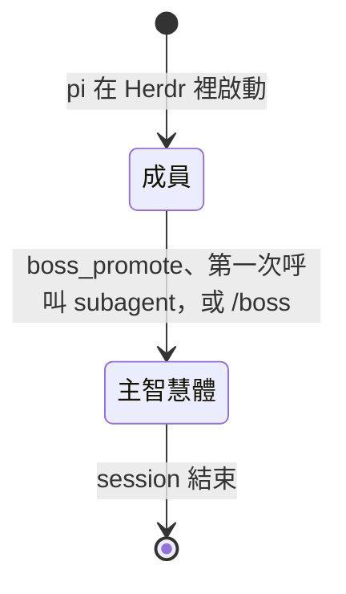

下面的編號規則就是完整的行為。

<details>
<summary>細節</summary>

1. Herdr 裡每個可加入的 pi 在 session 啟動時，會以**成員**的身分加入所在分頁的網：不提醒、不詢問。以下情況不會加入：不在 Herdr 裡、是 pi-herdr-agents 的子智慧體（`PI_SUBAGENT_ID`，由它的上層代表它）、在子工作區（見下）、或本身就是塔台。
2. 成員透過升任成為所在分頁的**主智慧體**。工作變大時（步驟變多、要派工作者、涉及不只一個 app），智慧體會呼叫 `boss_promote`；成員的 prompt 會這樣告訴它。成員如果沒有升任就呼叫 pi-herdr-agents 的 `subagent` 或 `subagent_resume` 工具，會在子智慧體啟動或恢復之前自動升任。啟動時加入失敗、等到 session 的 pane 搬到另一個分頁後才重試的，會登記在它現在所在的分頁，所以那裡不會冒出第二個主智慧體。
3. 一個分頁只有一個主智慧體。智慧體絕不會接手既有的主智慧體：分頁的主智慧體還活著時，`boss_promote` 會被拒絕並附上訊息，自動升任也會跳過。成員仍然可以派自己的子智慧體，但它的 prompt 要它先透過 intercom 通知主智慧體：它要做什麼、會用到哪些資源。
4. 主智慧體不會降級。它的 session 結束後，分頁就沒有主智慧體，直到有成員升任為止（這時成員的 prompt 會提議升任）。`/boss` 是使用者手動接手：即使已經有別的主智慧體，它也會讓這個 session 成為分頁的主智慧體。
5. 主智慧體有一種**類型**：`coordinator`（預設：規劃並派工）、`integrator`（專案的合併火車）、`standing`（負責一個系統或一台機器，沒有結束的時候）。類型就是這個主智慧體執行的 prompt：`main.md`，加上 `integrator.md` 或 `duty-standing.md`，再加 `dispatch.md`。協調者要等到自己的 todo 在 `metadata.graph` 裡指名某個圖（`single-loop`、`fan-out/fan-in`、`orchestrator-worker`；由 `planGraph` 讀取，取最新的未完成者），才會拿到 `dispatch.md` 和該圖的附錄（`graph-fan-out.md`、`graph-orchestrator-worker.md`）；整合員和 standing 主智慧體永遠帶著 `dispatch.md`。

   協調者沒有這樣的計畫就派 `worker`（或未知的角色，或單純的 spawn），會被拒絕並回 `sb: plan first: …`；scout、planner、reviewer 和 `subagent_resume` 可以通過，同一則 assistant 訊息裡更早的 `todo` 呼叫如果指名了某個圖，也算數。主智慧體用 `boss_duty` 改變類型（附一行理由；切換時它的 context 會重讀一次；它會寫下一筆 `straw-boss` 條目 `{ duty, dutyFrom, dutyWhy, dutyAt }`，記進塔台的摘要，並顯示在頁面上）。

   尚未宣告類型、且名稱是 `integ <project>`（在啟動時，或任何一次改名時：`boss_rename`、`/name`、其他擴充），或持有 `train` todo 的主智慧體，會遷移為 `integrator` 一次，條目為 `migrated: name` 或 `migrated: train todos`。已宣告的類型絕不遷移。每次 `/reload`、`/new`、`/resume`、`/fork` 都會重讀整合開關；整合關閉時，整合員會以協調者的身分執行並發布 `coordinator`。頁面在每種主題下都以同一個詞顯示類型（協調者、整合員、值守 / coordinator, integrator, on watch），後面接計畫的圖（單一迴圈、分支匯流、多工編排 / single loop, fan-out, orchestrated），切換則是時間軸上的一個事件。
5. 智慧體開始互相碰撞時，工作區塔台就會開啟：成員派出子智慧體（它先自己升任，升任會開啟塔台）、工作區有兩位成員而另一個工作區已經有運作中的塔台，或是 `/boss tower` 要求開啟。主智慧體和塔台是一起的。每個分頁頻道的擁有者（它最早的成員）會在這些時機檢查：Herdr 回報可能改變答案的事件時（任何工作區的 `workspace.metadata_updated`、自己工作區的 `pane.closed` 和 `pane.agent_detected`，每個 session 一條 `events.subscribe` 連線）、分頁頻道的擁有者換人或有 session 離開時，以及每 4 分鐘一次，用來涵蓋沒有事件會回報的情況（崩潰的塔台）；加入的成員會檢查一次兩位成員的規則。

   必須等一段寬限期的檢查，會為它設一個計時器，而不是輪詢：有運作中的塔台時，沒有存活主智慧體的分頁會升任它；沒有塔台時，每個主智慧體都會變回成員，塔台是離開的就立刻變回（工作區上記 `sb_tower_quit=<members it left>`；兩位成員的規則要等工作區的成員數超過這個數才再生效，所以刻意關掉的塔台會維持關閉，而子智慧體或 `/boss tower` 隨時可以再開啟它），否則等 15 秒（`/reload` 會在這段時間內回來），只有年紀不到 60 秒的主智慧體例外，因為它的塔台可能還在開啟。被降級的主智慧體保留它的子智慧體；子智慧體絕不升任。

   塔台不派子智慧體：它的 `subagent` 和 `subagent_resume` 呼叫會被擋下，並指向 `boss_open_main`，這樣就不會有東西在它離開之後、沒人接手結果地繼續活著。結束的塔台會關閉自己的 pane（變空的分頁也一併關閉）；reload、`/new`、resume 或 fork 則保留它。主智慧體離開時，塔台維持開啟。
6. 升任後的 session 保留它啟動的子智慧體：儀表板和瀏覽器檢視透過啟動者的 session 檔案、而不是透過子智慧體的角色來連結它們，所以它們在它升任為主智慧體之後歸在它底下，不必重新登記。
7. **子工作區**也當作子智慧體處理。`herdr worktree create` 會把一個連結的 git worktree 開成自己的工作區（`worktree.is_linked_worktree: true`）；它的上層是 `repo_key` 相同、但不是連結的那個工作區。那裡的 session 絕不加入，`/boss` 會被拒絕，它們只會收到範圍為 `all` 的廣播。子工作區永遠沒有塔台：從它發出、或指向它的 `call_tower`，會送到上層工作區的塔台（需要時在那裡開啟），沒有開著的上層工作區時則以清楚的錯誤失敗。
8. **無法判定自己位置或無法加入的啟動，並不是終局**。啟動時，session 會先在背景向 Herdr 詢問自己在哪裡執行（`pane current`、工作區清單），然後才加入，等待期間視為被擋。只有明確的答案（主工作區、子工作區）才會永久擋住。呼叫失敗（Herdr 在負載下要花好幾秒）則讓 session 維持未定位：一則警告通知老闆，檢查會在 1 秒、2 秒、5 秒後再問，之後每 15 秒一次（`joinRetryMs`；計時器都是 unref 的，而且只有進行中的那次啟動擁有計時器：關閉或較新的 session 啟動會結束它，已結束的啟動還在進行中的事什麼都不說明、不啟動、也不加入）。

   `/boss` 以及 `subagent` 或 `subagent_resume` 呼叫不等計時器：它們在被拒絕之前會立刻再問一次，或共用進行中的那一次詢問。啟動時加入失敗、原因是等待可以化解的（intercom 在 15 秒內沒連上、沒有選出擁有者，或任何頻道存在之前 pane 的查看就失敗），會由同一組計時器重試，另外也由頻道的 `connection` 和 `owner` 事件觸發；等待化解不了的（pi-intercom 沒載入、分頁 id 長到放不進命名空間、broker 沒有 `extension-bus-v1`）只通知一次、不重試，老闆要求時 `/boss` 會再試一次。

   檢查的警告、加入的錯誤，以及關於 pane 沒有 `terminal_id` 的警告，每次啟動各只通知一次。讓 session 脫困的那個答案會正常啟動一次（加入、還原監看、opener 與還原處理，絕不會加入兩次）；角色紀錄所記的內容（Herdr 還原所恢復的主智慧體、它的 opener、在已結束主智慧體的 shell 裡啟動的 pi 的紀錄）只在第一次嘗試時讀取一次，所以重試時不會把 session 在等待期間自己寫下的紀錄，當成還原留下的紀錄。一行資訊會告訴老闆它在重試之後加入了。

| 角色 | 對象 | 得到什麼 |
|---|---|---|
| 主智慧體 | 在分頁裡最先升任的成員，或 `/boss` 的接手者 | 一段簡短的 prompt：按 app 拆分工作、第一次派工前先規劃、交代工作者、檢查結果、合併或部署前先問老闆 |
| 成員 | 其他每個已加入的 session | 一段簡短的 prompt：分頁裡有主智慧體時，派子智慧體前先告訴它；沒有時，工作變大就升任 |
| 塔台 | 每個工作區一座，在自己的分頁裡，分頁標籤是 Nerd Font 的無線電塔字符（U+F043B） | 一段 prompt：協調智慧體、修復協調上的摩擦，以及在沒有 session 擁有某個請求時開啟主智慧體；它從不詢問使用者 |

主智慧體在第一次派工之前會讀 `prompts/planning.md`，拆分工作時則讀 `prompts/apps-config.md`，這樣規劃規則就不會佔著每次執行的 system prompt。它會選一種協調圖：single-loop（一項任務，自己做或交給一個子智慧體）不需要計畫。fan-out/fan-in 和 orchestrator-worker 則把計畫寫成 pi 的 `todo` 項目：每項任務一個，`owner` 是子智慧體（或 `self`），它依賴的任務放進 `blockedBy`（其餘的就保持平行，上限 4 個），並在描述和 metadata 裡寫上檢查它的錨點。共用同一個錨點的任務共用一個檢查點 todo，而不是每個分支各檢查同一件事。

錨點有測試、擬人、真人和對抗式審查，每一種都是在變更之前就可能失敗的最輕量檢查。主智慧體派工時不請老闆確認計畫；它只在計畫解決不了的決定、且在被它們擋住的任務之前問老闆：不清楚或與架構矛盾的需求，以及像是合併到共用分支或部署這類的授權。瀏覽器檢視會把這些 todo 顯示成計畫的進度。

塔台由主智慧體、任何 session 的 `/boss tower`，或上述規則開啟（成員的 `call_tower` 不會開啟任何東西），開啟時不搶焦點，並透過 intercom 回答。它的分頁在建立（或接管）之後，會立刻透過 Herdr 的 socket API（`tab.move`，不改變焦點）移到工作區的第一個位置；移動失敗會回報成警告後忽略。塔台分頁靠只有 Straw Boss 會寫的 `sb_role=tower` pane token 辨認，絕不靠標籤，因為 pi-herdr-agents 的子智慧體可以取名為 `tower`。

因塔台結束而失去 token 的分頁，若標籤恰好是無線電塔字符（U+F043B）、只有一個 pane，而且那個 pane 裡沒有智慧體在跑（是 shell prompt），仍會被接管：下一次開啟時，會在那裡啟動 pi，而不是建立第二個塔台分頁，並重新標記 pane、把分頁移到最前面。有好幾個這樣的遺留分頁時，會重用其中一個，並關閉其他只有 shell 的分頁。標籤只是 `tower` 的分頁，或 pane 裡跑著智慧體的分頁，絕不接管，也絕不往裡面打字。

塔台結束時（pi 的 `session_shutdown`，原因為 `quit`；reload、`/new`、resume 或 fork 會保留分頁），它會清掉自己的 token，並在 pi 退出後關閉自己的 pane；Herdr 在分頁的最後一個 pane 關閉時一併關掉分頁，分頁裡的其他 pane 則保留。如果兩座塔台在同一個工作區競爭，持有有效 token 的勝出，否則 tab id 較小的勝出，另一座關閉自己的分頁。

不同工作區的塔台用 `tower_list` 和 `tower_send` 互相聯繫（[塔台之間的對話](#塔台之間的對話)），或從任何 session 用 `call_tower`；**主塔台**則是另一座獨立的塔台，在它自己的工作區裡，老闆跟它對話，由它把老闆的工作轉給這些塔台（[主塔台](#主塔台)）。

</details>

### 塔台的摘要

塔台不用問就知道它的工作區有什麼變動。工作區的網裡每個 session 會寫一行：加入時（`a1 joined tab billing`）、它的 `subagent` 或 `subagent_resume` 呼叫無誤地回傳時（`MP-1 export started subagent lint-sweep (worker)`），以及它呼叫 `boss_rename` 時（`a1 renamed itself "MP-1 export" (tab billing)`）。每一行都以本地時間（`HH:MM`）開頭。每次執行開始時，塔台會依最舊到最新讀這些行，放進它角色段落的 `Since your last run:` 之下，然後清掉，所以每一行只會讀一次。成員或主智慧體的執行從不讀它們。

<details>
<summary>細節</summary>

這些行以工作區 token（`sbd_<time>`，一行一個）的形式存在 Herdr 的記憶體裡，用它們自己的來源 `straw-boss-digest` 寫入，沒有 Straw Boss 角色 token 的 TTL，所以塔台閒置多久它們就等多久。Herdr 在一個工作區上最多保留 32 個 token，每次回報最多更動 16 個，並把值截到 80 個字元、去掉換行：摘要保留最新的 20 行，遇到已有 20 行時，一次寫入會在同一次回報裡丟掉最舊的，每行則截到 80 個字元。新的 Herdr 伺服器啟動時不帶這些，就像不帶其他任何 token 一樣；角色 token 會重新寫入，摘要則不會。

寫不進去的行會直接丟掉，不會讓加入、啟動或改名失敗。sb server 在主塔台啟動或結束時，會在每個塔台工作區的摘要裡寫下 `head tower opened` 和 `head tower closed`（[主塔台](#主塔台)）。

</details>

### 塔台之間的對話

塔台之間直接互相協調，靠兩個只有塔台才有的工具，而且網為某個 session 傳遞的每則訊息，都會告訴讀者是誰送的。

<details>
<summary>細節</summary>

**標頭**。程式會在每則 `call_tower`、`boss_broadcast`、`tower_send` 和交接訊息的文字前寫一行（絕不是模型寫的，所以名稱或訊息都改不了它）：

```text
[straw net from=<name> id=<session id> role=<tower|main|member|session> [head=yes] workspace=<label> kind=<call_tower|broadcast|tower_send|handoff> scope=<scope> to=<recipients> reply=<expected|none> [why=<milestone|shared|blocked|unspecified>] [ask=H<n>] [relay=boss:<event id>] [in-reply-to=H<n>]] <message>
```

`role` 是寄件者的角色，由它的 pane 的 `sb_role` token 發布（沒有加入網的 pi 是 `session`，只有範圍為 `all` 的廣播才找得到它）；`head=yes` 只標記主塔台，不標記其他任何人（`role` 仍是 `tower`，所以只認得四種角色的讀者照常運作）。`ask=` 和 `relay=` 只出現在主塔台的轉發上，`in-reply-to=` 則只出現在工作區塔台對轉發的回答上（[轉發與回答](#主塔台)）。`scope` 對廣播和送給所有塔台的 `tower_send` 是 `tab`、`workspace`、`towers` 或 `all`，對送給單一塔台的訊息是 `tower`，對交接則是 `main`。

`to` 以 `<name> (<role> of <workspace>)` 列出每位收件者，主塔台寫 `head tower`，以 `;` 分隔，最多 20 個，之後寫 `+N more`：所有收件者讀到的是同一行，所以收到訊息的塔台知道還有誰收到，不會再轉給他們。`reply=expected` 表示寄件者在等回答；`none` 表示這是一則通知。`why=` 只出現在 `call_tower` 的標頭上：主智慧體呼叫的理由，由程式從一組封閉的值裡寫入（見[主智慧體何時呼叫塔台](#主智慧體呼叫塔台時)），所以塔台是從這一行、而不是從訊息內文讀到它。

名稱裡的控制字元和連續空白會折成一個空格，名稱含有空格、引號、`]`、`=` 或 `;` 時，會用雙引號包起來，裡面的引號換成 `'`。

**`tower_list`**（只有塔台能用）讀一次網，並針對每個不是子工作區的工作區回答：它的 id 和標籤、`head`、`self`、`reach`（`tower`、`main`、`member` 或 `none`：送給它的訊息會到誰那裡，見下）、它觸及的 session 及其狀態（和儀表板同一種標記：`idle`、`working`、`waiting`），以及它的分頁，附上標籤、主智慧體的名稱和成員的名稱。主智慧體會用 `boss_rename` 以目前的工作替自己取名，分頁就採用這個名稱，所以分頁顯示的就是工作區正在做什麼。回答是 JSON，和 `boss_status` 一樣。

**`tower_send`**（只有塔台能用）接受一則訊息、可選的 `workspace`（id 或完全一致的標籤；子工作區會送到它的上層工作區），以及 `reply`（預設 false）。沒有指定工作區時，會送給其他每一座塔台。它從不開啟塔台。在主塔台的執行裡，它只接受 `workspace`，而伺服器會在該工作區沒有塔台時開啟它（[轉發與回答](#主塔台)）；工作區塔台以 `head: true` 和 `inReplyTo`（一個 ask id）回答主塔台。`workspace` 指向主塔台（它工作區的 id 或標籤，或它的 session id `sb-head`）時會被拒絕，並說明要用 "use head: true"，因為主塔台不是任何工作區的塔台。

</details>

#### 沒有塔台的工作區

沒有運作中塔台的工作區（沒有 `tower` token，或 session 不在網上），會透過它的主智慧體找到，否則透過它的成員：該工作區中已加入網的 session，不含塔台自己的 session。`tower_send` 和範圍為 `towers` 的 `boss_broadcast` 都這樣做，結果會標明每位這類收件者，像是 `kb-main: sent [no tower in 知識庫: main]`。沒有塔台、也沒有已加入 session 的工作區會被跳過（單獨對它 `tower_send` 是一個錯誤，並這樣說明）。

<details>
<summary>細節</summary>

寄件者自己的工作區絕不代替塔台回答：session 絕不會送給自己，沒有塔台的工作區裡的主智慧體，也不會用範圍 `towers` 觸及它的同層主智慧體；它自己工作區的塔台，有的話，則是收件者。子工作區維持它們的規則（沒有塔台，它們的 session 只收範圍為 `all` 的訊息）。

**`boss_broadcast`** 的範圍 `towers` 留給不是塔台的 session 使用，標頭相同。`call_tower` 也有可選的 `reply`，預設 true（塔台會回答）；通知則設為 false。它也接受 `why`，這是 pi 的工具所要求的（[主智慧體何時呼叫塔台](#主智慧體呼叫塔台時)）。

</details>

### 主塔台

**主塔台**是不屬於任何專案的塔台。老闆在一段很長的對話裡跟它說話，由它決定每項指示屬於哪個工作區，並交給該工作區的塔台。它自己不做任何工作。設計在 `docs/specs/2026-11-04-head-tower.md`。

一項指示怎麼走：

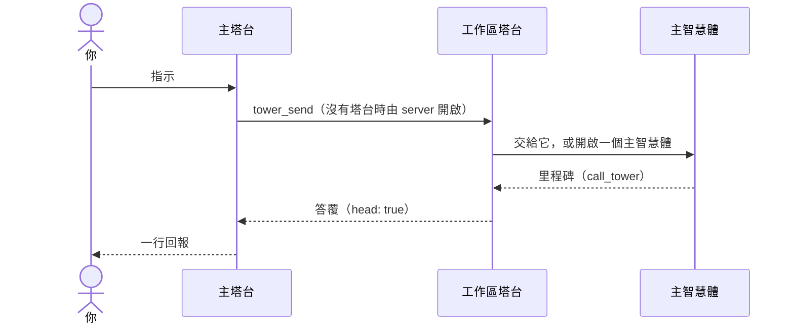

#### 它的工作區

sb server 在第一次需要主塔台時（老闆從任何頻道送出的第一則訊息，或 `/boss head`）建立它，位置在資料夾 `<pi agent dir>/straw-boss-head/`。全新安裝在老闆寫訊息給它之前，Herdr 裡不會多出任何東西。伺服器的語系是繁體中文時，工作區標籤是 `主塔台`，否則是 `Head tower`，它的分頁帶有皇冠字符（U+F01A5），它的 pane 放的是塔台的常駐 pane，標記為 `sb_role=head`，排序在最前面（`000`）。它是靠自己的紀錄和 `sb_head` token 辨認的，絕不靠標籤，所以老闆有個同標籤的工作區，不會被誤認成它。

<details>
<summary>細節</summary>

在 Herdr 裡關閉它的分頁或工作區，或 `/boss head close`，會像塔台一樣結束這項服務；對話、它的記憶和它的 ask 都會保留，下一則訊息會再建立工作區並接續。`towerRuns` 關閉時就沒有主塔台，每個頻道都會這樣說。它的狀態在 `<state dir>/head/`：服務紀錄、佇列、`boss-session.json`、`chapters.json`、`asks.json` 和 `memory.json`。

</details>

#### 它的執行與對話

它是一種自成一格的塔台服務，用的是塔台的機制（常駐 pane、喚醒、認領、崩潰規則）。不論是老闆的訊息還是塔台的回答喚醒了它，每次執行都接續同一個 pi session，並受老闆對話的限制（他沉默後 10 分鐘收尾、4 小時上限）。沒有年齡上限：超過 8 MB 的 session，以及**開新對話**或 `/new`，都會開始新的**章節**，它的簡報帶著最後一份交接筆記，以及老闆和主塔台之間最後幾行對話。GUI 會跨章節分頁顯示歷史，一章結束的地方有分隔線。模型是 `headModel`，否則是 `towerModel`。它的簡報列出目前的工作區（每座塔台的狀態、每個主智慧體和它在做什麼）、未結的 ask、它的記憶，以及它的限制。

<details>
<summary>細節</summary>

**它的工具，以及誰能找到它**。`read`、`grep`、`find`、`ls`、`tower_list`、`board_read`、`tower_send`、`tower_memory`、`tower_done` 和 `boss_server`：沒有 shell、不能編輯、沒有 `boss_open_main`、沒有 `call_tower`，也沒有 Straw Link（帶 `device` 的 `tower_send` 會被拒絕）。任何東西排進佇列之前，伺服器的關卡只放行老闆自己的話（GUI、`/boss head`、常駐 pane 的 prompt）和對它未結 ask 的回答；廣播、主智慧體的訊息，或沒有未結 ask 的回答，只會得到回條，不喚醒任何東西。

</details>

#### 轉發與回答

`tower_send` 送到一個工作區的塔台（id 或完全一致的標籤；子工作區送到它的上層）。沒有塔台的工作區會先得到一座（它的分頁和常駐 pane），然後才收到訊息。每次轉發都會開一個 ask `H<n>`，在最後一次轉發或回答之後保持開著 24 小時，同時最多開 40 個。

<details>
<summary>細節</summary>

ask 也帶有 `group`，即它那次廣播的第一個 ask 的 id，GUI 頁面把它折成一列：`relay` 相同的 ask 是同一次廣播（主塔台替每座塔台各自措辭，所以第一行不同）；沒有 `relay` 的 ask，會併入最新的、同樣沒有 `relay`、第一行相同、且在它之前不到 60 秒的那一個。早於 `group` 的檔案在讀取時以同樣的方式分組。

標頭帶有 `ask=H<n>`，而只有在這一輪是由伺服器送到這次執行的、老闆自己的訊息所啟動時，才帶有 `relay=boss:<event id>`；塔台把 `head=yes relay=boss` 讀成老闆經由主塔台轉達的指示，把沒有 `relay` 的 `head=yes` 訊息讀成主塔台自己的備註。塔台用 `tower_send({ head: true, inReplyTo: "H12", message })` 回答，伺服器寫下 `in-reply-to=H12`，把這則回答和其他回答一起最多壓 30 秒，然後喚醒主塔台，由它用一行話告訴老闆。需要老闆決定時，它用平白的話詢問，並在它的記憶裡記下一個替他等待的事項。

</details>

#### 主塔台頁面

GUI 頁面就是對話和它的輸入區：結束、新對話和關閉在輸入區上方，ask 是每次廣播一張卡片（先列它的各個部分，再列 `2h ago · 1/4 handled`；每座塔台的狀態和最新的回答可以展開，被後來的一筆更正的指示折在它底下；安靜一天的群組折進「更早」；[規格](specs/2026-11-07-head-log-cards.md)），替老闆等待的事項只顯示到它的 `due` 為止（沒有的話顯示一天；伺服器對主塔台的摘要把它排除在列和頁尾的計數之外，檔案保留 7 天，主塔台的簡報要它解決或重新詢問），記憶頁尾只在有長期指示、決定或待處理的提案時才顯示，主塔台的工具呼叫和 sb server 的通知不畫在這個頁面上（禪裡的主塔台歷史仍會畫出它們）。設計：[docs/specs/2026-11-06-head-page-minimal.md](specs/2026-11-06-head-page-minimal.md)。

<details>
<summary>細節</summary>

**老闆在哪裡遇到它**。GUI 頁面和禪的長條（[瀏覽器檢視](#瀏覽器檢視)）、任何 pi session 裡的 `/boss head [status | leave | new | close | <message>]`（單獨一個會建立工作區並聚焦它的分頁）、`/boss memory -w head`、主塔台的常駐 pane（按 Enter 就和同一段對話說話）、Herdr 的網檢視（主塔台工作區排在最前面），以及 `status` 的 `head`。主塔台工作區不是基地：它不是 `tower_send` 或 `boss_broadcast` 的目標，不會被收起，手動在裡面打開的 pi 也不加入任何網。

</details>

### Straw Link：跨電腦的塔台（連線持有者）

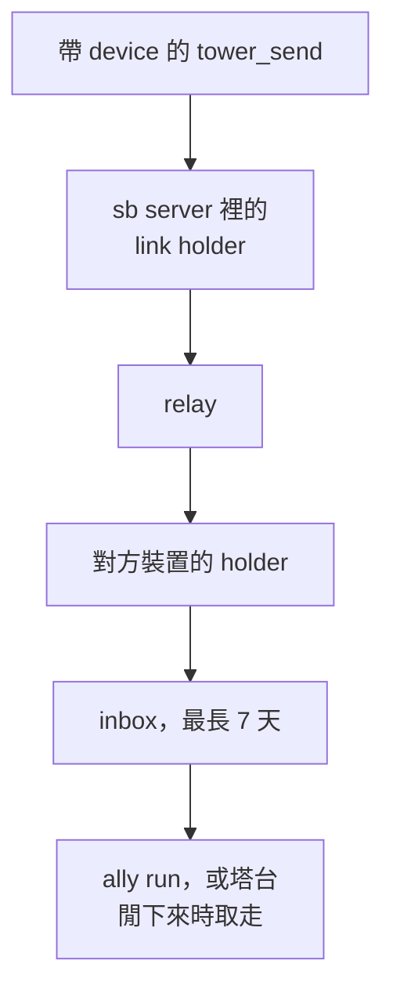

設計：[docs/specs/2026-10-25-straw-link.md](specs/2026-10-25-straw-link.md)。以下是目前為止程式實際做的事（持有者、遞送、工具、遠端的輪次，以及 GUI 的團隊設定）；經由 tailnet 加入是之後的一步。無人值守裝置（政策、`join.txt`、對話框、它們開啟的塔台、`unit-status` 和通知）見下面的**無人值守裝置**一段，以及[它們的設定](unattended-device.zh-TW.md)。沒有設定團隊的電腦（`config.json` 的 `link.teams` 底下沒東西，也沒有團隊檔案）完全不會執行這些：沒有頻道、沒有選舉、沒有檔案。持有者在 [sb server](#sb-server) 裡執行（`src/link/service.ts`）；pi session 只是詢問它。

#### 檔案

`<pi agent dir>/straw-boss/link/`（認得 `PI_CODING_AGENT_DIR`，權限 700，作業系統支援權限的地方檔案為 600；路徑當作 Unicode 路徑使用，絕不會變成 shell 指令）：`device.json`（金鑰、標籤和下一個序號）、`device.id`、`teams/<team>.json`（名冊副本、依 epoch 排列的團隊金鑰、relay URL、最後一個事件 id，以及從每位寄件者取得的最後一個序號）、`inbox/<envelope id>.json`、`holder.json` 搭配 `holder.lock`，以及 `link.log`（每個被丟棄的信封、通知或傳送各一行 JSON）。每次寫入都經過鎖；在鎖之外寫入會拋出錯誤。行程已不存在、或超過 10 秒的鎖會被接管。

<details>
<summary>細節</summary>

遺失或損毀的團隊檔案會讓該團隊停擺：不取用任何東西，也不確認任何東西，唯一的回頭路是重新加入，因為全新的檔案會忘記哪些序號已經取用過。

</details>

#### 連線持有者

它在主要的 sb server 裡執行（預設 Herdr 的那個伺服器；次要的伺服器不持有連線，另一個 Herdr 上的 session 會被告知這點），而伺服器是它唯一的候選者：不再有 pi session 或塔台參加選舉。選舉仍然是它自己的，不是 GUI 的：`holder.json`（session id、版本、PID、啟動時間）指名那個伺服器，它的 id 是 `sb-server-<8 hex>`，`holder.lock` 照舊保護它。

<details>
<summary>細節</summary>

伺服器以自己版本的塔台身分排名，所以上一版的 session（在那裡仍是候選者）既不能靠版本、也不能靠角色勝過它：它只爭奪空著的、或行程已不存在的紀錄，而伺服器在下一次查看（每 2 秒）時把紀錄拿回來。伺服器在連上 broker 之後、回報就緒之前啟動持有者，第一次查看最多等 3 秒；停止或重新啟動會先移除紀錄，所以下一個伺服器在第一次查看就取得它。發現紀錄指名另一個行程的持有者會停止。

`status` 顯示連線的狀態（`inUse`、`holding`、`active`，以及最後的通知）；session 過去會在畫面上看到的通知，改去 `server.log`（`link-notice`）和 `status`。

</details>

#### 來自 session 的請求

session 透過伺服器的控制 socket 詢問持有者，每個連線一個請求：`{cmd: "link", from: <the session's intercom id>, body: {op, …}}`，由 `{ok: true, answer: <the holder's answer>}` 回答。op 是頻道原本傳遞的那些（`send`、`list`、`board-read`、`confirm-request`、`confirms`、`answer-confirm`、`forget-confirm`、`gui`、`request-open`、`request-run`、`request-drop`），加上 `taken`（塔台說有一則收件匣訊息已在它的 session 裡）。沒有 16 KiB 的限制，也不分塊。`from` 是自我申報的，pi-intercom 的 id 也是；GUI 的請求仍只接受 `gui.json` 指名的 session（伺服器自己代管 GUI 之後，也接受來自伺服器本身的）。

<details>
<summary>細節</summary>

session 透過 `server.json` 和 `hello` 密鑰找到伺服器；沒有伺服器在執行、或還沒有伺服器持有連線時，請求會以「No link holder is running」失敗，正在重新啟動的伺服器也會這樣說。頻道 `straw-boss/link` 是為上一版保留的：伺服器以分塊的 `res` 回答該版 session 分塊的 `req`、接受它的 `taken`，並把收件匣訊息提供給在那個頻道上常駐的塔台。伺服器載入的任何東西都不 import pi-tui、`tools.ts`、`pairing.ts` 或信任的詢問（有一項測試會走訪它的 import）。

**接收**。串流從團隊檔案的最後一個事件 id 接續（relay 在新串流上本來就會送出這個裝置尚未確認的每個信封）。每個 `tower` 信封都在鎖底下檢查並解密，寫進收件匣，寄件者的高水位標記在同一次鎖定寫入裡移動；然後串流才向 relay 確認它。在寫入收件匣之前崩潰，會再收到信封並遞送一次；在寫入之後、確認之前崩潰，會再收到它，序號防護會丟掉副本。被取代的持有者（紀錄指名另一個 session）會把信封留給下一個串流。

</details>

#### 遞送

訊息只會送到 pane 的 cwd 在團隊的 `project` 之內的塔台：最接近專案根目錄的那一座，再來是 Herdr 工作區順序中的第一座（指名的 `workspace` 把範圍限制在該工作區的塔台）。主智慧體和成員永遠不會收到。持有者透過 intercom 頻道 `straw-boss/link` 把收件匣項目提供給那座塔台（沒有擁有者資格；現在只有塔台註冊它）；塔台只接受 `holder.json` 指名的 session，也就是伺服器，所提供的項目。

<details>
<summary>細節</summary>

塔台留著它，直到閒置為止（`isIdle()` 且沒有待處理的訊息，在同一個 tick 檢查），然後在下面的標頭之下，把它當作類型為 `straw-link` 的自訂訊息、帶 `triggerTurn` 送出，每個 tick 一則，並告訴持有者（`taken`，在控制 socket 上），持有者把它從收件匣移除。session 條目 `straw-link-seen` 記住 session 取走了什麼，所以重新啟動不會取兩次。

沒有這樣的塔台時，訊息在收件匣裡等 7 天（有人看管的電腦會先為隊友的訊息喚醒它已有的工作區的塔台，0.61.1，只有那樣行不通時才會出現下面的通知），並有一則 pi 通知，而 Link 按鈕的通知（每個團隊、塔台和狀態一則）會說是誰送來幾則訊息、最舊的已等了多久、它們在等哪個工作區的塔台或哪個專案、還沒有遞送，以及最舊的那則會在哪一天被丟棄；塔台要收到它時，會再檢查一次寄件者的成員身分。

當塔台是 sb server 的（預設）時，這一段的提供與取走都不會發生：伺服器改為替寄件者啟動一次隊友 run（[隊友 run](#隊友-run)）；`straw-boss/link` 上的提供，保留給仍然常駐的塔台，以及回覆給主智慧體。

```text
[straw net from=<sender label> id=link:<sender device id> role=tower workspace=<label> remote=<device label> device=<short id> team=<project folder name> verified=yes kind=tower_send scope=tower to=… reply=<expected|none>] <message>
```

`from`、`workspace` 和 `remote` 在加上引號之前，會被截成標籤字元集（ASCII 字母、數字、空格、`.`、`_`、`-`；其他一律變成 `_`）和 40 個字元，而 `id=` 永遠是 `link:` 加上寄件者的裝置 id，絕不是這台電腦的 session id。`team=` 是這台電腦自己為團隊取的名稱，所以保留它的字元（清理過、加引號、最多 80 個）。

</details>

#### 傳送

帶 `device` 的 `tower_send`（短 id、id 或標籤；此時 `workspace` 指的是該裝置上的工作區標籤）透過控制 socket 把訊息交給 sb server 裡的持有者。持有者會檢查呼叫者是個 cwd 在某個團隊專案之內的塔台，解析裝置（同時符合兩個裝置、或是這個裝置的名稱是一個錯誤，並列出候選者），保留下一個序號，建立並簽署信封，在第一次 post 之前於同一把鎖底下寫進 `link/outbox/`，然後依序重試 post，並在 relay 收下之後、或 10 秒後以「queued」回答。

<details>
<summary>細節</summary>

信封被 relay 收下、或被它永久拒絕之後，檔案就消失（回答之後才出現的拒絕會告訴老闆），而這台電腦的下一個持有者會依序先 post 剩下的。relay 回 401 時，該團隊的 post 會停 60 秒（時鐘不準），這段時間的傳送會連同原因被拒絕。分岔、遺失團隊檔案，或被串流拒絕（裝置被移除）的團隊會維持停擺，磁碟上也是，直到團隊檔案透過重新加入而被取代。一則訊息可以有 192 KB；收件匣每位寄件者最多保留 100 則、總共 500 則，其餘由 relay 保留。

`tower_list` 會加上 `remote`：隊友的裝置，依他們最後一次的 presence，帶著他們選擇分享的工作區和分頁狀態。presence 每 30 秒送出一次（`share: "status"` 會加上綁定的工作區和它們的分頁；`"presence"` 只表示裝置在線上），90 秒沒有 presence 的裝置就是離線。

**遠端輪次**（`src/link/{turn,allow,gate,policy,hooks}.ts`；`hooks.ts` 註冊 pi 的 hook，`runtime.ts` 把它接到伺服器裡的持有者）。從 `straw-link` 自訂訊息的第一個 `message_start` 或 `message_end` 開始，到 `agent_settled` 為止的一次執行，就是遠端輪次，不論訊息是怎麼進去的（遞送，或 steer 進一次本機開始的執行）；`agent_end`、重試、compaction 或接續都不會結束它，加入的本機訊息則讓它維持原樣。它的層級是它的遠端寄件者之中最低的。

寄件者的層級是 `reply`，除非這台電腦指名它：`config.json` 的 `link.trust`（裝置 id 對應 `reply`、`forward` 或 `dispatch`），或者，在 `/etc/straw-link/policy.json` 寫著 `unattended` 且通過擁有者檢查的裝置上（檔案和它的資料夾由另一位使用者擁有、不是符號連結、這位使用者不能寫入），則以該檔案的 `trust` 為準（`true` 表示 `dispatch`），`config.json` 的 `link` 區段會被忽略。檔案在但沒通過檢查時，會拒絕無人值守模式：每位寄件者都維持在 `reply`，並告訴老闆一次。沒有指名任何由這份程式碼放進去的寄件者的訊息，是 `reply` 層級的遠端訊息。

</details>

遠端輪次裡的工具呼叫會遇到什麼：

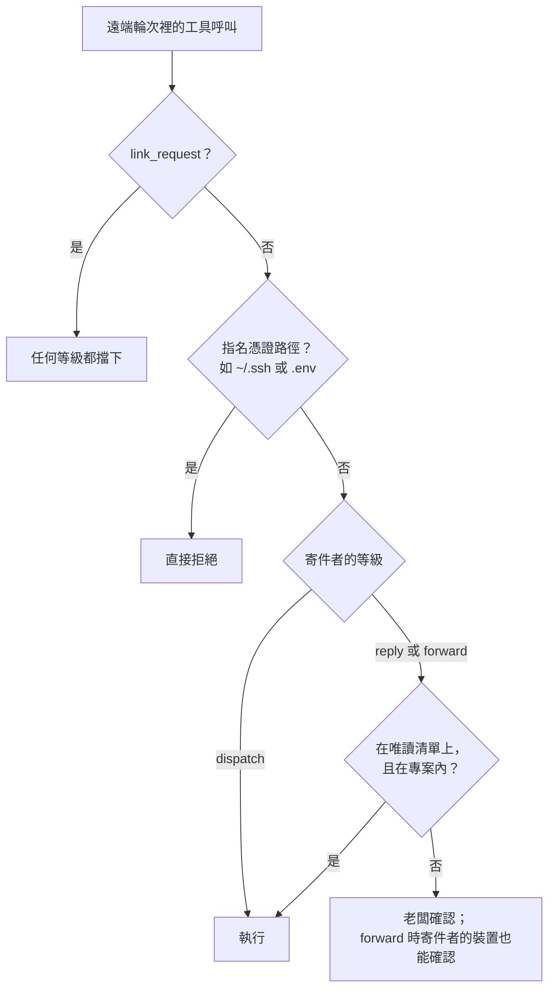

<details>
<summary>細節</summary>

- `link_request` 在每個層級都被擋下，包括 `dispatch`，而且沒有對話框（這個工具只屬於老闆，在本機輪次裡）。
- 在 `dispatch`，沒有其他東西被攔住。在 `reply` 和 `forward`，`tool_call` hook 以完全一致的工具名稱放行：`read` 一個 `git ls-files` 列在綁定專案裡的檔案（經過 `realpath` 之後，所以指向專案外面的符號連結不算）；`grep`、`find` 和 `ls`，每個路徑都在專案之內，它們的輸出由 `tool_result` hook 截成屬於受追蹤路徑的行和條目（無法歸屬的行，例如通知，會被丟掉；結構化的副本隨被取代的內容一起處理）；`tower_list`、`board_read`、`boss_status`、`todo`（前兩者對遠端輪次只回答它的寄件者本來就會收到的東西：[工作看板](#工作看板)）；以及 `device` 是這次執行的寄件者（id、短 id 或標籤）的 `tower_send`。

  路徑的讀法和 pi 自己的工具一樣（開頭的 `@`、`~`、奇怪的空格）。任何指名 `~/.pi`、`~/.ssh`、`~/.aws`、`~/.config`、`~/.gnupg`、agent 資料夾、`link/` 資料夾底下路徑，或名為 `.env*`、`*.pem`、`*.key`、`id_*`、`*.p12` 的檔案（照寫的或解析後）的工具，會直接被拒絕，不會要求確認。其他一切都會開啟關卡。
- **關卡**透過對話框契約顯示自己的對話框（擁有者 `straw-link-gate`、前綴 `straw-link:gate`，以 `toolCallId` 為鍵的關卡，所以即使在平行批次裡也可以從頁面回答）：寄件者的標籤和短 id、工具，以及它完整的參數（參數超過 12 000 個字元的呼叫會被拒絕）。終端機顯示同一個確認；第一個答案，不論來自終端機、頁面（這台電腦的或已配對的裝置的），或在 `forward` 時來自寄件者的裝置，都會結束另外兩個。拒絕、10 分鐘內沒有回答，以及呼叫被中止，全都以「the boss declined a remote request」擋下它；老闆放行的呼叫，它的輸出不會被過濾。
- **`forward`**：這次執行中層級最低的寄件者的裝置，也會收到一個 `confirm-request`（對話框 id、摘要、工具、完整參數）。它的持有者最多保留 20 個、10 分鐘（`confirmRequests()`、`answerConfirm(dialogId, allow, digest?)`；GUI 路由 `link/confirm-answer` 需要它所顯示的請求的摘要，持有者會以「That request changed; look at it again」拒絕不同的摘要，並讓請求維持開著），然後送出 `confirm-answer`。發問的持有者只接受來自它所問的裝置、帶著對話框的 id 和摘要的答案，而且只接受一次；任何其他的都會被丟掉，也不會用掉這個對話框。
- **輪次之後**，在之後的本機 run裡，`context` 事件會把每則並未開啟目前這次遠端執行的 `straw-link` 訊息的文字，換成一個標記，標記指名它的裝置，並說明這是同儕的請求，不是老闆的指示；而塔台在遠端輪次中送給本機 session 的訊息，標頭帶有 `origin=remote:<sender device id>`。給寄件者的回覆本來就不期待回答，除非塔台要求。

  兩項限制只有記載、沒有防護：compaction 的摘要是模型依整段對話寫的，而 pi 的 `session_before_compact` hook 只能取代整個 compaction（不能對摘要者隱藏訊息），所以同儕的文字可能不帶標記地留存在摘要裡；而在關卡核准之後透過 pi-intercom 自己的工具送出的訊息，不帶 `origin=` 標頭，因為只有塔台的 `tower_send` 會加上它。

**無人值守裝置**（`src/link/{policy,joinfile,dialogs-out,unitstatus}.ts`、`src/server/opentower.ts`；設定見 [unattended-device.md](unattended-device.zh-TW.md)）。`/etc/straw-link/policy.json` 寫著 `unattended: true` 的裝置，團隊和信任都取自那個檔案（`readEffectiveConfig`；`config.json` 的 `link` 區段會被忽略），而 sb server 就是它的持有者，沒有開機時的 pi session。沒通過擁有者或寫入檢查、或 `teams` 格式有誤的政策是 `refused`：不執行持有者，並記錄一次原因（`policy-refused`）。

第一次查看就會建立 `device.json` 和 `device.id`，即使沒有團隊也一樣，所以管理員可以把邀請綁定在這個 id 上，而基礎設施把邀請放進 `link/join.txt`（裝置自己的使用者所擁有、權限 600 的一般檔案；任何檢查失敗都會刪掉它）：持有者在啟動時和每個 tick 讀它，只接受綁定在這個裝置 id 的邀請（暫時性的 relay 失敗會保留檔案，稍後再試），用邀請裡的 relay（存在團隊檔案裡）、政策裡的 project 和 share 加入，並記錄一次結果。`dispatch` 控制端對沒有塔台的專案送來的訊息，會讓伺服器開啟一座（見下一段）。

裝置上任何 session 裡等待中的問題（`select`、`confirm`、`ask_user_question`，絕不含 `secret_drop`）會以 `dialog-open` 送給在 `dispatch` 層級的控制端（`DialogForwarder`）：第一個有效的 `dialog-answer`（摘要相同、答案 id 沒見過、寄件者有人看管且現在在 `dispatch`）會被帶回 session，而 `dialog-close` 讓每個控制端上的卡片結束。在多位開發者共用的盒子上，問題只送給派出提問單位的那位控制端（隊友 run 自己的 pane 所屬的裝置，或隊友 run 所開啟的主智慧體所屬的裝置，由該問題所在分頁的 pane 上的 `sb_opened_by=link:<device>` token 找到），以及團隊名冊裡的管理員；沒人派出的單位只歸管理員，來自其他控制端的答案會被拒絕（`dialog-answer-not-recipient`）。通知遵循同一個範圍（隊友 run 的結束或拒絕：它的裝置和管理員；塔台自己的執行：管理員；沒能開啟的塔台：要求開啟它的那則訊息的控制端）。

管理員是它自己團隊的管理員：另一個團隊的管理員不會被告知指名某個團隊的問題。沒有人可以通知的問題（沒有在 `dispatch` 層級且有人看管的管理員）會維持開著，並在 `server.log` 留下一行 `dialog-unrouted`。

隊友 run 所開啟的主智慧體，在它的裝置離開團隊或失去 `dispatch` 時結束（`revoke.ts`）：找不到的主智慧體要經過兩次掃描、而且它的 pane 已從 Herdr 消失，才會被遺忘，否則會告訴管理員它仍在執行。見[共用盒子規格](specs/2026-11-05-link-shared-box.md)。轉發器每 15 秒、以及每次 hub 變動時都會跑一輪，所以問題開著期間才取得 `dispatch` 的控制端也會收到它；開著的問題每十分鐘重送一次，失去 `dispatch` 的控制端會被告知問題已撤回，只有裝置自己的頁面才能選的選項不會帶給控制端（`dialog-answer-here-only`），而 session 退回的答案會讓問題維持開著，卡片再次可以回答。

控制端的頁面用共用的問題面板把每個問題畫成一張卡片（`gui/linkdialogs.ts`）；關閉的卡片會留兩分鐘，並說明它怎麼結束的（關閉只帶 `by` 時是「已由團隊的另一個控制端回答。」），已配對的手機也可以回答。控制端被告知的是提問的單位，而不是開啟對話框的套件：`dialog-open` 的 `owner` 是 `main - <session name>`、`subagent - <name>`、`member - …` 或 `ally run - …`（塔台或外部的 pi：只有它的名稱；以角色詞開頭的名稱照原樣告知，所以 `main · trial11` 不會變成 `main - main · trial11`），像工作看板標籤一樣經過清理（路徑或 token 會被去掉；名稱截到 40 個字元，所以整個標籤最多 51 個字元）（`src/server/dispatcher.ts` 的 `unitLabel`）。

只有分隔符號被選成 ASCII：名稱保有它的 Unicode、撇號和 `…`。卡片和 Link 列完整顯示標籤；控制端的通知則把它交給 `restrictOwner`（`src/link/text.ts`：`restrictLabel` 的標籤字元集，字母、數字、空格、`.`、`_`、`-`，再加上分頁 session 名稱用的中點 `·`，截到 40），所以 `main · trial11` 在通知、卡片和 Link 列裡讀起來一樣，而 `Mei's Mac` 在那裡讀成 `Mei_s Mac`，CJK 的名稱則讀成底線（0.60.2：中點過去在通知裡讀成 `_`；標頭的 `restrictLabel` 不變）；沒有剩下名稱的單位，以及早於 0.59.1 的盒子，會送出套件（`rpiv`）。

同樣的文字出現在通知（`Straw Link: <box> asks a question (<unit>)`）、Link 按鈕的列、禪的卡片，以及 30 分鐘和過大的通知裡。在禪裡，快照一帶有這張卡片，它就是整個頁面（標題 `<box label> asks you`，接著是那句話、問題、送出、取消和晚點再說），不必點一下（老闆剛回答完一張卡片之後的 3 秒停頓，是給在場呼吸的老闆用的：在沒有顯示的頁面上，等待中的問題會立刻結束停頓，畫出卡片並由頁面提醒；在顯示中的頁面上，停頓會保留）。問題到來時已經開著的頁面，會從伺服器推送的快照畫出卡片，不必重新載入。

等待中、但不是螢幕上那張卡片的轉發問題，會在頁面的 console 說一次原因（`[sb] a question from <box> waits and is not on the Zen page: <reason>`）。

在標準和極客檢視裡，它是標頭 Link 按鈕裡的一列，以及地圖上盒子的基地（`<box> · <short id>`，隊友卡片）寫著 `1 question waits for you: answer it here`：那個按鈕，以及點等待中的卡片的一列，會就地開啟同一個問題面板（`gui/allyasks.ts`，`gui/linkdialogs.ts` 的共用面板，答案路徑和 Link 列、禪（`gui/asks.ts`）相同），一次回答就讓這張卡片在每個地方都關閉。

面板開著時，角落的地圖總覽會讓開（面板的送出答案和取消那一列位在視窗底部，也就是總覽所在的位置；`style.css`、`body:has(.ally-asks …) .minimap`），面板關閉後再回來。屬於盒子兩個團隊的控制端只會被告知一次：盒子對每個裝置只送一個 `dialog-open`（被告知的那個團隊，只要該團隊還列著這個裝置就保留，否則選一個裝置在線的團隊），控制端對每個裝置和對話框 id 只保留一張卡片。

轉發成功過去不會在任何地方留下一行；現在盒子的 `server.log` 在啟動時有 `dialog-forwarder`（`started` 或 `skipped`）、`dialog-controllers`（數量和已知者，在第一次查看以及兩者任一改變時）、每個問題各有 `dialog-seen`、`dialog-sent`（每位控制端一筆，已排進 outbox，尚未遞送）和 `dialog-ended`，以及一輪超過一分鐘沒完成時的 `dialog-pass-stuck`（它卡在 `read`、`dispatcher`、`notice` 或 `post`；會放開它，下一次查看開一輪新的；它沒來得及 post 的關閉會保留，由下一輪 post，最多試五次，卡片在控制端過期之後就完全不 post；最多只有一輪被放開的仍未完成，所以一個永不返回的呼叫只多出一輪待處理的，第二個卡住的一輪會留著繼續跑，並留下一行 `dialog-pass-hung`），而控制端的 `link.log` 在有一則到達時有 `dialog-in`；沒有任何一行含問題的隻字片語（[這些行](unattended-device.zh-TW.md#6-被拒絕時看起來像什麼)）。

</details>

#### 盒子回報什麼

裝置每分鐘以及有變動時，會對每位 `dispatch` 控制端送出一則 `unit-status`（ephemeral）：每個塔台單位的狀態、hub 看到在該單位工作區裡執行的 monitor，以及它的最後一份報告（最後一則 `tower_done` 備註和最後一則送給該控制端的 `tower_send` 文字，兩者中較晚的，4 KB）；控制端在記憶體裡為每個裝置保留最新的一份，把它顯示成裝置的隊友基地卡片（見下），重新啟動就消失。

<details>
<summary>細節</summary>

**卡片**（標準和極客檢視，`gui/allyunits.ts`）列出盒子回報的單位，而不列它自己的任何主智慧體或工作者（無人值守的盒子沒回報任何單位時，也就是較舊的盒子、只分享 presence 的團隊，以及這個伺服器重新啟動後的那一分鐘，會有一行說有幾個單位在線、不列出任何名稱；隊友自己的電腦，名冊標為有人看管、從不回報單位，則照舊列出它的主智慧體和工作者及其狀態）：每個單位有一個狀態詞（待命、本次執行中、當掉、待信任、當掉後暫停；頁面不認得的就照原樣顯示；塔台單位在服務的 `running` 或 `waking` 狀態時，也就是它的一次短執行持續期間，這個詞寫「本次執行中」，詞的提示文字說塔台會為每則訊息喚醒一次執行、執行之間待命，一般單位的 `working` 仍然讀作「執行中」），卡片的副標題寫出盒子名稱以及它在不在，而不是它的塔台狀態加上「updated 40s ago」（頁面的時鐘會讓它保持最新），monitor 放在同一行（數量，接著是指令），最後一份報告折成它的第一行，點一下以 Markdown 開啟（它不解析 HTML；Markdown 在這個摺疊第一次打開時才建立）。

單位在有它的 `run-crashed` 通知、且通知不到 30 分鐘、單位沒在執行、而且頁面在通知之後沒看過它在執行時，讀作*當掉*（頁面記著每個單位最後一次被看到在執行的時間，所以老闆重新執行過、又回到待命的單位，不會再被說成當掉；剛載入的頁面則只有那 30 分鐘），通知的文字放在它自己的摺疊裡（*發生什麼事*），並附上它的年齡；更舊的當掉就留給 Link 通知。

`trust-unanswered` 通知遵循同樣的規則，但用琥珀色讀作*待信任*，摺疊是*為什麼停了*，內容是通知的文字，外加一行說要把專案加進盒子的 `trust.json`：盒子需要的是一項設定，不是修復。盒子回報為 `held`（反覆當掉後暫停）的單位，用當掉的顏色讀作*當掉後暫停*，最近有通知時帶有當掉的摺疊；`closing` 就用文字說出來。靜默三分鐘的裝置保留它最後的單位，在標準檢視裡調暗，帶有「最近沒有狀態」的標籤和它最後一次發話的年齡；三十分鐘後它們就消失，摘要行回來。

在手機上每個摺疊是 44 px 的一列。**每個裝置一張卡片**：屬於好幾個團隊的裝置（`moldplan-center` 和 `agent-tower-team` 裡的盒子 `agent-tower-01`）只有一張卡片，不論有幾個團隊列著它，標題底下有一行安靜的字寫出它們（`Teams: moldplan-center, agent-tower-team`，「團隊：…」；皇冠這時只寫*隊友*，只屬於一個團隊的裝置保留 `<team> · teammate`，沒有那一行）。

卡片屬於裝置，所以它的狀態只有一個：有任何一個團隊聽得到它就是在線；卡片上在線基地之中最緊急的塔台狀態（有等待中的問題，其次是工作）；卡片自己的團隊和沒有工作區的團隊都不在線、但仍聽得到裝置時，卡片寫 `unknown` 而且沒有分頁，所以聽不到裝置的團隊永遠不會把它過時的狀態、或別的工作區的分頁放到卡片上；不會移動的標籤（依 id 取第一個團隊的）；以及卡片所屬每個團隊的單位：盒子對每個團隊只回報那個團隊專案的單位，所以卡片列的是聯集，每個單位名稱取它最新的一列（該列的時間和過時旗標），依卡片的團隊順序排列（顯示不出該裝置任何工作區、也不符合該裝置任何工作區的團隊，它的單位放到該裝置的第一張卡片）；在卡片的各團隊裡告知的當掉通知，最新的只算一次；頁面對單位最後一次執行時間的記憶屬於裝置，不屬於團隊（`gui/linkmodel.ts` 的 `mergeAllies`、`unitsFor`，由 `fillAlly` 繪製）。

卡片的團隊是 presence 列出它的工作區的那些團隊，加上每個顯示不出該裝置任何工作區的團隊（presence 是依團隊專案的，所以另一個團隊的工作區不屬於這張卡片，而當掉通知只會送到它所來自的團隊的卡片）；裝置的各個工作區各有一張卡片。

屬於團隊範圍的東西，在它自己的話裡保留它的團隊：卡片上轉發問題的那一列寫出它所來自的團隊（`… in team <name> asks a question`），並照舊在那裡回答，而且在有該團隊的卡片時，會放在那張卡片上；在 Link 面板裡，角色、移除、輪替和邀請這些動作仍然在團隊自己的卡片裡按團隊進行，裝置的信任則照舊按裝置設定。線路上和持有者裡都沒有改變，也沒有權限檢查：合併只是頁面對 `summary().allies` 的呈現，而忽略隊友回報的禪沒有動。

展示頁的 `?ally=` 場景接受逗號清單（`ask`、`report` 和各場景皆然：`?ally=ask,teams`），並新增 `teams`（`?ally=crashed,teams`、`?ally=units,teams`、`?ally=mate,teams`）：展示團隊的每個裝置同時也在 `agent-tower-team` 裡，它回報的是另一組單位。團隊自己的 unit-status 只列在該團隊專案之內的工作區的單位，團隊只分享 presence 時則一個也不列。**遠端停止，控制端這一側**（todo #100 task 4，[規格](specs/2026-11-07-link-remote-stop.md)第 6 節）。

盒子送來 `mains` 時（它新鮮的 `caps` 帶有 `unit-stop` 的盒子），卡片上每個單位的摺疊會多出**主智慧體（n）**：每個主智慧體一列，有它的名稱、盒子有指名時的種類詞（*協調者*、*整合員*、*值守*或*火車*，用字與本機頁面相同，每個主題都一樣）、狀態詞、由另一位控制端派出的主智慧體則有派出者的標籤，以及一個**停止**按鈕（在手機上各方向 44 px）。

按鈕會開啟頁面自己的面板（`gui/quit.ts` 的 `choose`），有取消、**停止**（`quit`：主智慧體閒置時離開）和**中斷並停止**（`interrupt`：先中止進行中的輪次）；取消排第一並且有焦點，所以按 Enter 不會做出任何選擇，而中斷並停止畫得比較重（實心填色和 2 px 的邊框，不只靠顏色），因為它會中止進行中的工作。點擊會 post `link/unit-stop {team, device, handle, mode, reason}`，也就是 `/boss link stop` 所 post 的同一條路由（已配對的手機可以用它：`link/unit-stop` 在 `REMOTE_LINK` 裡）；該列接著讀作*停止中…*而沒有按鈕，依據是盒子自己的 `stopping`，或是在盒子這麼說之前，這個頁面的請求，維持 120 秒。

盒子的 caps 沒有 `unit-stop`、狀態過時，或主智慧體已在停止中的，都不顯示按鈕；由盒子決定，並以通知告知結果。隊友寫在一列上的一切（主智慧體、單位、狀態、派出者的標籤）都以文字繪製。種類以 `unit-status` 裡主智慧體項目的選用第七欄 `kind` 傳過去（最多 16 位元組；窗格沒有指名種類的主智慧體就不送），盒子只寫給新鮮的 `caps` 在 `unit-status.mains` 之外還帶有 `unit-status.kind` 的控制端（[規格](specs/2026-11-09-agent-kinds.md#12-link-and-remote-devices)）；舊版的控制端照常拿到它讀得懂的六欄項目、不畫種類詞。

清單仍然是控制端可以停止的主智慧體，沒有變寬。盒子屬於兩個團隊時，由最新的一列決定，卡片和 pi 都一樣。`notice`（1 KB，以安靜訊息的形式保留，直到老闆在那個頁面上清掉，最多一天，最後 20 則）每個觸發只送一次：執行當掉、逾時或被結束（十分鐘沒人回答的信任問題，算是以這個原因當掉）、被設定檢查拒絕的執行、30 分鐘沒回答的問題、大到無法轉發的問題，以及沒能開啟的塔台。

盒子的 `link.log` 對收件匣裡保留的每則訊息有一行 `tower-in`（寄件者裝置、團隊、ask id、訊息 id），隊友 run 取走它時有一行 `tower-run`（執行 id），絕不含文字（[規格](specs/2026-11-05-link-shared-box.md)）。有人看管的電腦不送出其中任何一項：它沒有控制端。

**GUI 裡的團隊設定**（`gui/link.ts`、`gui/linkbar.ts`、`gui/linkmodel.ts`；持有者這一側是 `src/link/admin.ts`，經由 `runtime.ts` 的 `gui` 埠和 `control.ts` 的 `link/<name>` 路由到達）。設定頁的團隊區（路由 `settings/teams`，標頭的 Link 通知也會開啟它）涵蓋這些。尚未設定 Straw Link 的電腦只顯示一個按鈕，它會啟動選舉；之後建立第一個團隊或加入，就照上面的方式執行。頁面絕不持有金鑰、團隊密鑰或邀請密鑰：它詢問持有者，持有者回傳一個檢視（名冊，附上每個裝置的標籤、短 id、角色、有沒有人看管、最後的 presence 和信任層級；未結的邀請；進行中的加入；通知）。

- **建立**接受 relay 的 origin（預設 `link.relay`）、營運者的一次性團隊 token、標籤、專案資料夾（資料夾選擇器，會打開在目前開著的基地所工作的資料夾上），以及要分享什麼。預設 relay 之外的隊友要自己寫 relay。
- **邀請**把邀請顯示成 QR（由持有者產生的文字畫出）和它的文字，附有 10 分鐘的倒數和取消。**邀請無人值守裝置**接受裝置 26 個字元的 id，並做出綁定在它身上的邀請。
- **加入**一開始是貼上欄位；只有瀏覽器有 `BarcodeDetector` 的地方才會出現相機按鈕（Windows 上的 Electron 沒有，而且相機權限由主機決定）。加入者挑選專案資料夾，頁面顯示要念出來的四個安全詞。邀請者在三組誘餌裡點選符合的那一組；點錯、取消或倒數結束，都會結束邀請。無人值守裝置改以按鈕核准，因為邀請裡的 id 取代了那些詞。
- **名冊**。兩個裝置共用的標籤，旁邊會顯示短 id。管理員可以移除裝置、變更角色和輪替金鑰（各問兩次）；任何人都可以離開（持有者拒絕唯一有人看管的管理員離開，除非頁面說 `force`，而它的按鈕只在第二次按下後才這樣做：沒有有人看管的管理員的團隊，不能移除裝置或輪替金鑰）。有兩個有人看管的裝置、而創辦者是唯一有人看管的管理員時，頁面會提議把另一個變成管理員。每個裝置的信任（`reply`、`forward`、`dispatch`）寫進 `config.json` 的 `link.trust`。
- **隊友的基地**（`net.link.allies`）依最新的 presence，畫在本機基地旁邊：裝置的標籤和短 id、團隊、塔台的狀態，以及每個分頁的狀態。它們不能開啟，也沒有任何東西連到它們。
- **通知**（標頭的 Link 按鈕，只在有通知時顯示）：等待中的加入請求、名冊不一致或分岔、relay 超過 2 分鐘無法連上、等待塔台的訊息、保留超過 10 分鐘的訊息，以及轉發來的確認。轉發來的確認在清單裡用允許或拒絕回答，工具的參數完整顯示，經由持有者的 `confirmRequests()` 和 `answerConfirm()`，帶著請求的摘要；在 pi 裡，同樣兩個按鈕是 `/boss link confirms`（清單，參數完整）和 `/boss link confirm <id> allow|deny`（見下面的**在 pi 裡**）。
- **在 pi 裡**（`src/bosslink.ts`；只接受老闆自己輸入的內容，所以塔台 run或隊友 run 都不能用，沒有任何工具能到達它們，而 `control.ts` 的 `BOSS_LINK_LOCAL` 不讓已配對裝置的輸入區輸入它們，如同對 `link decide`）。每一個都 post 頁面所 post 的路由，所以持有者保留它的檢查，並在它改變誰可以指揮這台電腦的地方詢問 `hereOnly`（`hereOnlyOpts()`）。

  這類畫面在等待時（確認、選擇、token 畫面、邀請畫面），pane 會持有伺服器的覆蓋標記（`src/heremark.ts`：畫面開啟前先開 `gui-lan-face`，`gui-lan-pending` 每秒更新它以對抗 5 秒的租約，畫面返回、拋出錯誤或被切斷時就放掉），所以已配對裝置的按鍵板、輸入區和收回動作只會把 Escape 送進 pane，和 `/boss gui lan` 覆蓋畫面一樣；沒有它的話，`hereOnly` 只對頁面的轉送有效，對終端機無效，而按鍵板的 Enter 就會回答那個確認。

  伺服器無法標記的 pane（次要的 slot 以錯誤回答 `gui-lan-face`）會拒絕這個畫面，並且什麼也不問；沒有在執行的 GUI（`stopped`、`no server`）不接受任何已配對裝置的按鍵，所以不標記任何東西，畫面照舊開啟。同樣的標記也涵蓋 `link decide`、`gui rotate`、`gui unpair all` 和 `server stop|restart`。`link confirms` 列出等待中的確認（短 id、誰、團隊、工具、年齡、完整的參數；超過八個字元的 id，在八個字元就會指到兩個請求時使用）；`link confirm <id> allow|deny` 帶著讀取並顯示時那份請求的摘要，post `link/confirm-answer {dialogId, digest, allow}`（允許會先帶著整個呼叫詢問 `hereOnly`；拒絕什麼都不問）。

  `link asks` 列出未結的轉發問題（選擇題的選項有編號，問卷則列出它的問題）；`link answer <id> <number | text>` 像頁面的 `remoteAnswer` 那樣組出答案（`{choice}`、`{answers}`，對 `--cancel` 是 `{cancel: true}`，只在問題接受時），並在一個顯示問題和答案的 `hereOnly` 確認之後，post `link/dialog-answer {device, dialogId, digest, answer}`；沒有文字時，它會在 pi 裡詢問，一次一個問題。

  `link invite cancel|show <hash>`（在 `hereOnly` 確認之後是 `invite-cancel`，`invite-text` 則在自己的畫面上）、`link join cancel`（`join-cancel`）和 `link leave <team> [--force]`（`leave {team, force}`，在 `hereOnly` 確認之後）補上頁面的其餘缺口；老闆輸入的 id、hash 或團隊，是完全一致的鍵，或 id 的開頭（四個字元以上），當它指到不只一個時（隊友可能選一個和另一個人 id 開頭相同的 id），什麼都不做，並完整列出候選者；`link status` 也列出未結的邀請、進行中的加入和它的四個詞，以及有多少確認和問題在等。

  `link invite <team> [unattended <device id>]`（`link/invite {team, forDevice}`，頁面的「邀請」與「邀請無人值守裝置」）、`link trust <device> reply|forward|dispatch`（`link/trust {device, level}`）、`link role <team> <device> admin|member`（`link/role {team, device, role}`）、`link remove <team> <device>`（`link/remove {team, device}`）與 `link rotate <team>`（`link/rotate {team}`）是頁面上的團隊操作，改成在 pi 裡輸入。每一個都先問一個 `hereOnly` 確認，寫明團隊、裝置（標籤加短 id）與效果，再 post 頁面 post 的那個內容，所以 holder 的每項檢查都照舊（`role`、`remove`、`rotate` 要是管理員，`invite` 要是有人值守的成員，最後一個有人值守的管理員，無人值守的裝置不會成為管理員），它的拒絕也照它說的顯示。

  裝置可以用標籤、短 id、id，或 id 的前四個字元以上來指：`role` 與 `remove` 在指定的團隊裡找，`trust` 在每個團隊的名冊裡找（同一部裝置在兩個團隊只算一部；有兩部符合時什麼都不做並列出它們；這台電腦會被拒絕，因為頁面只改其他裝置）。

  `remove` 會說明該裝置不能再在團隊裡讀或送、它的 id 被列入黑名單，以及團隊金鑰會為留下來的其他裝置更換（附數量）；`rotate` 說明金鑰會為其他每部裝置更換，且沒有人被移除；`trust` 寫出裝置目前的等級與要改成的等級，以及各等級讓訊息能做什麼，已經是那個等級就不 post；`role` 說明管理員能做什麼、成員不能做什麼。

  `invite` 像 `invite show` 一樣先要私密畫面（沒有 `ctx.ui.custom` 的畫面不建立邀請，因為文字沒辦法顯示；`custom` 存在卻什麼都不畫的畫面（如 pi 的 RPC 模式），剛建立的邀請會用 `link/invite-cancel` 取消，並告知 `noPrivate`），在問之前先檢查 `unattended` 後面的裝置 id 是 26 個字元，並把文字畫在和 `invite show` 同一個畫面上，絕不當成通知。名為 `show` 或 `cancel` 的團隊要用它的 id 來指，因為這兩個字是舊的用法。

  `link create <relay> <dir> [--share] [--label]` 和 `link join <invite | @file> [--project <dir>] [--share] [--label]` 在 pi 裡完成 `link_request create|join` 只預先填好的部分：`hereOnly` 確認寫出 relay、資料夾，以及（加入時）邀請所指名的團隊；接著 `join` post `link/join-start` 和 `link/join-project`（資料夾預設是 session 自己的，確認也這樣說），並印出讓邀請者挑選的四個安全詞。這裡有兩樣東西是密鑰。

  relay 的 token 在遮罩畫面上輸入（`src/secretscreen.ts`：圓點、用 pi-tui 自己的 `Input` 編輯、值只透過 promise 回傳），因為 pi 的 `ctx.ui.input` 會把輸入的內容明文畫出；它進入 `link/create` 的本文，不去別處（沒有通知、沒有對話框、沒有 session 條目、沒有 `link_request` 參數），而伺服器若在拒絕時回顯它，會被清除。邀請文字（`invite show`）畫在自己的畫面上，直到 Enter 或 Esc，絕不作為通知或工具結果；沒有 `ctx.ui.custom` 的畫面（print 和 RPC 模式）兩者都拒絕，而不退回成會回顯的東西。

  比起把邀請貼進命令列（pi 會把它留在記憶體內的輸入歷史，以及終端機的捲動緩衝區），建議用 `join @file`。那個 pane 的鏡像終端機圖磚會把這個畫面當成任何 pi 畫面顯示（`/boss gui remote` 的 QR 也一樣）。隊友的裝置所寫的內容（參數、問題、標籤、id），其中的控制字元、雙向字元和不可見字元會以 `\x1b` 和 `\u202e` 的跳脫形式顯示，而屬於畫面中一行的欄位（標籤、工具、團隊、id），換行也以 `\n` 顯示，所以它不能重繪或改動老闆所核准的版面；參數和問題保留它們的行，縮排排在上面的文字之下。

  `link units [box]` 和 `link stop <box> <main | handle start> [--interrupt] [reason]`（`src/bossopen.ts`，與 `link status` 一起）是遠端停止在輸入端的一側：`units` 列出每個盒子的單位，以及每個單位底下這台電腦可以停止的主智慧體（名稱、狀態、不是它派出的主智慧體的派出者、handle 的前六個字元），而 `stop` 依盒子最後的 `mains` 解析主智慧體（有歧義或未知的名稱是一個錯誤，並列出候選者；屬於兩個團隊的盒子，像頁面一樣讀取它最新的一列），檢查盒子的 caps、它的狀態沒有過時、以及主智慧體還沒在停止中，詢問一個寫出盒子（標籤和短 id）、主智慧體、它的單位、它的派出者和模式的 `hereOnly` 確認，然後 post `link/unit-stop`。

  `--interrupt` 在主智慧體之後的任何位置都算一個完整的詞；這行其餘的部分是理由，必須放得進線路的 200 位元組（較長的在確認之前就被拒絕）。隊友寫的每個字串（盒子或派出者的標籤、單位、主智慧體、它的狀態和 handle），在清單、候選者、確認和送出的備註裡，都透過 `line`（`src/safetext.ts`，與 `bosslink.ts` 共用）讀取，所以沒有任何一個會重繪畫面，或以控制序列的形式到達終端機。
- **`/boss link on`** post `link/enable`，也就是頁面的設定按鈕所 post 的路由，所以沒有開啟 Straw Link 的電腦，可以從 pi 設定（「not on in this server」的回答會指名它）。頁面事先不問任何事，所以這個也不問；和其他幾行一樣，它只接受老闆自己輸入的內容，而 `BOSS_LINK_LOCAL` 不讓已配對的裝置輸入它（路由本身也是 `local_only`）。
- **已配對的裝置**可以讀取狀態、回答轉發來的確認或對話框，以及請盒子停止一個主智慧體（`unit-stop`：由盒子決定的優雅停止），其他一律不行：其他每個動作都會改變誰可以指揮這台電腦，所以只有這台電腦自己的頁面（loopback 監聽器上的請求）才能做。邀請文字只會回傳給那個頁面，而已配對裝置的狀態，不含智慧體放進加入或建立畫面的內容。

</details>

#### `link_request`

智慧體以參數和理由要求 `create`、`invite`、`invite-unattended`、`join`、`trust`、`leave`、`remove`、`role` 或 `rotate`。它從不在沒被要求時執行：持有者檢查並措辭這項請求（對話框顯示這些行，絕不是智慧體自己的描述），透過對話框契約的對話框（擁有者 `straw-link-request`、前綴 `straw-link:request`，以 `toolCallId` 為鍵）顯示動作、每個參數、理由和提出請求的 session。

<details>
<summary>細節</summary>

只有明確的核准才會執行；對於 `trust`、`remove`、`role`、`rotate` 和 `leave`（高風險的動作），核准只能從這台電腦自己的頁面或終端機給出：已配對的裝置看到的是核准停用的對話框，仍然可以拒絕，而它的核准會被拒絕（403 `local_only`，由監聽器決定），其他動作則已配對裝置也可以核准；拒絕、逾時（10 分鐘）、工具呼叫結束，以及無法顯示全部內容的對話框，都會拒絕。每項請求都是它自己的對話框；沒有任何設定可以跳過它。持有者執行這個動作，而核准的 `invite` 會把邀請文字回傳給提出請求的一方。

核准的 `join` 或 `create` 只會開啟預先填好的畫面：那些詞仍然要比對。設定為無人值守的電腦直接拒絕這個工具，而遠端輪次在每個層級都拒絕它。請求開著期間（它的呼叫在 session 檔案裡，或它的對話框由擁有者轉送），已配對的裝置只送 Escape（否）而不送 prompt；這台電腦保留每一個按鍵，終端機的確認會在對話框發布後 1.5 秒才出現，所以已在路上的按鍵不會被當成「是」。

殘餘的假設：按鍵通過最後一次檢查之後，Herdr 或 GUI 停頓超過 1.5 秒，仍然可能晚到地送出那個按鍵。

</details>

### Straw Link operate：有人看管的電腦操作無人值守的盒子

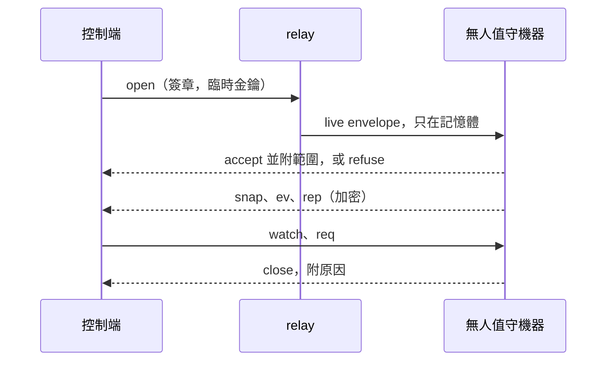

設計：[docs/specs/2026-11-07-link-operate.md](specs/2026-11-07-link-operate.md)。有人看管的電腦（控制端）把[無人值守盒子](unattended-device.zh-TW.md)的工作顯示成自己 GUI 的基地，並操作它：盒子的塔台、主智慧體和工作者的即時終端機與對話、輸入、Escape 和 steer，以及已結束執行的逐字紀錄。這是遠端基地橋接，不是第二個檢視器：盒子的 sb server 為一個操作者 session 執行它自己的 GUI 核心，控制端的 sb server 把結果合併進自己的網，而頁面就是平常的頁面（地圖、通訊畫面、按鍵板、禪，以及經由 Mac 的已配對手機）。

它**不是** shell：這裡沒有任何東西會在盒子上執行指令，除非透過你正在輸入的那個 pi session。沒有團隊的電腦、無人值守的電腦（它沒有控制端這一端），以及政策沒有授予任何人 `operate` 的盒子，都不執行其中任何東西：沒有橋接、沒有政策監看、沒有計時器、沒有 log 行。

#### 誰可以（盒子這一側）

`operate` 是 `/etc/straw-link/policy.json` 裡 root 擁有的欄位（`src/link/policy.ts`；[設定](unattended-device.zh-TW.md#2-政策檔)）：裝置 id 對應 `team` 或 `box` 的對照表。盒子對每個請求都檢查它（`src/server/operatescope.ts`、`operateguard.ts`）：這個裝置是無人值守的，而且它的政策讀得通；寄件者是信封所來自團隊的現任、有人看管的成員；寄件者現在在 `trust` 裡是 `dispatch`，而且 `operate` 指名了它；而請求所指名的單位在 session 的範圍之內。失敗時以一個詞回答（`not-granted`、`not-admin`、`out-of-scope`、`local-only`、`policy`）並記錄。

<details>
<summary>細節</summary>

session 的範圍是它的 `open` 所來自的那一個團隊（當這個裝置是該團隊的名冊管理員時；兩個團隊的管理員持有兩個 session），加上提出要求的 `box` 授權所給的盒子自己的單位。單位只透過盒子自己對「誰啟動了它」的紀錄屬於某個團隊，絕不靠它的資料夾（真實盒子的兩個團隊都在 `/srv/work` 工作）：隊友 run 靠它的執行紀錄，隊友 run 所開啟的主智慧體靠它的 `opened` 列和 pane 的 `sb_opened_by` token（兩者必須一致，否則它不屬於任何人），成員或子智慧體靠它的主智慧體所在的分頁。

盒子的塔台服務、它的本機 run、自己一個分頁裡的工作者，以及任何無法歸屬的東西，都是盒子的，只有 `box` 授權才到得了。hq 簽署的授權永遠不能帶 `operate`。

</details>

#### 載體

operate 搭乘唯一的 `operate` Link 種類，relay 把它視為排隊和 ephemeral 之外的第三類：`live`。relay 只在記憶體裡持有 live 信封，以沒有 `id:` 行的 SSE `live` 事件把它寫進唯一收件者的開啟中串流，絕不儲存、重播或確認它（沒有串流的收件者什麼都收不到：post 回答 `delivered: 0`）。

<details>
<summary>細節</summary>

持有者在自己這一側採取失敗即關閉：它丟掉超過 60 秒的 live 信封（`stale-live`）、指名的不是單一收件者的信封，以及以儲存事件的形式到達的信封；回答裡沒有 `delivered` 的 post（relay 把它儲存了）會讓 live post 停止一小時（`operate-relay-not-live`）；live post 有 5 秒的期限，不重試。有人看管的寄件者只能送 `open` 和 `frame`/`close`，無人值守的只能送 `accept`、`refuse` 和 `frame`/`close`；裝置只有在有接收端時，才在它的 `caps` 裡列出 `operate/1`，盒子則只在它的政策授予某人 `operate` 期間才列出（在一個 tick 之內改變）。

**session**（`src/link/operate.ts`）。控制端送出帶有臨時 X25519 金鑰的已簽署 `open`；盒子回答已簽署的 `accept`（帶著範圍和它的限制）或一個 `refuse` 詞。雙方用 HKDF 對團隊、session id、兩個裝置 id 和兩把公鑰導出相同的兩把方向性金鑰；每個 `frame` 都是 ChaCha20-Poly1305，搭配只會增加的計數器，所以 relay 或另一位團隊成員只看得到一個 session id 和兩把公鑰，而錄下的 session，不論之後團隊金鑰或裝置金鑰外洩，都打不開。

內層訊息是壓縮過的 JSON：`snap`（盒子切出的網）、`watch`、`ev`（歷史、卡片、終端機畫面）、`req`/`rep`（一次頁面請求和它的答案）、`part`（超過 160 KB 的訊息，分成每份最多 120 KB；每則訊息上限 4 MB，每個 session 上限 8 MB），以及 `ping`。沉默 15 秒後送出 ping，45 秒沒有 frame 就由任一方結束 session，而一個 session 最多持續 12 小時（控制端會立刻重新開啟，基地不會變灰）。盒子對每個團隊的每個操作者裝置最多持有 2 個 session，總共 6 個，並拒絕它見過的 session id。

**控制端看得到什麼、能做什麼**（`src/server/operatehost.ts`、`operatesanitize.ts`、`gui/box*.ts`）。只要這台電腦的 GUI 有任何一個頁面連著（它自己的，以及每支已配對的手機），sb server 就為每個新鮮的 `caps` 列有 `operate/1` 的無人值守盒子，各保留每個（盒子、團隊）一個 session，並在最後一個頁面離開 60 秒後關閉它們。盒子送來的東西會在本機基地之後合併進網，每個基地都帶有 `box` 欄位（裝置、標籤、團隊、範圍、`can`，以及狀態 `live`、`unreachable` 或 `ended`）。每個鍵和基地 id 都被改寫成 `x` 加上雜湊的 16 個十六進位字元，所以沒有盒子的鍵會到達 URL，而控制端保有回溯的路。

在 live 基地上，頁面做的和它對本機基地做的一樣：地圖、分頁、單位、標記、排隊中的訊息、todo 和 Monitor；有完整逐字紀錄和輸入區的通訊畫面（送出、後續訊息、編輯排隊中的訊息、斜線補全、最大 2 MB 的上傳）；有按鍵板的終端機圖磚（一次一個按鍵、輸入的文字、貼上、取自只限編輯器清單的組合鍵、Escape 中斷）和它的卡片；對盒子的等待事項和問題的回答，它們同時也是禪的項目；單位或小隊上的移除（Dismiss）和關掉（Quit）；以及，有 `box` 範圍時，塔台的記憶和它的離開、新對話、重試、遞送和丟棄。

「先前的執行（n）」摺疊列出盒子已結束的智慧體 session，旁邊另有一個預設收合的「塔的執行（n）」摺疊，列出塔台自己已結束的執行（帳本裡 `ally`、`run`、`tower` 這幾個角色：隊友的訊息驅動的隊友 run、事件 run），所以塔台那些短短的執行絕不會混在智慧體之間成為一列；兩邊任一列都會開啟該執行唯讀的通訊畫面，兩個摺疊下方的「顯示更多」會翻同一份帳本。⋯ 選單的項目跟著 `box.can`。遠端基地在任何地方都沒有＋主智慧體、＋成員、收起或關掉基地。

盒子替控制端的兩個團隊服務時，每個團隊有一個 session，而兩者都顯示的基地算是同一個基地：單位的動作和小隊的關掉，送到顯示它的那個 session（live 的那個，有 box 範圍的優先）；先前的執行列出每個 live session 的執行，兩者都列的執行只算一次；工作區的卡片來自每個顯示該基地的 session；而自己的 session 無法連上、或觸及範圍比基地窄的單位，會自己被停用或受限（`box.units`），基地其餘的部分照常運作。盒子的等待事項在經過控制端之後，仍保留它們的卡片、它們的按下和它們已解決的狀態，以文字呈現。

盒子單位的對話框，會停用只有這台電腦才能給的選項，以及會開啟 pane 的選項，不論頁面是從哪個位址開啟的。

**盒子拒絕什麼，不論控制端怎麼要求**（`src/operateroutes.ts`、`src/keys.ts`，接縫在 `src/operateseam.ts`）。每個請求都帶著已配對裝置會碰到的防護執行，而且更多：沒有 `!` shell 行（不論是輸入的，還是在以它開頭的草稿上按 Enter），沒有 `/boss` 行，沒有把輸入區文字送進非空的編輯器，沒有在任何 `/` 草稿上按 Enter，沒有 `hereOnly` 選項，也沒有密鑰 `value`；沒有 `open/*`、`dirs`、`close/base`、`close/stash`，沒有改變焦點，沒有裸 pane（`panes/*`）、信任、`link/*`、`server/*`、`head/*` 或文件（`doc/*`）。

按鍵只有在盒子自己的 pi 確認這個按鍵是它即時 keybindings 裡的編輯器動作、pi 握有終端機（它的 stdin 是 raw，而且它是唯一的前景 `pi`）時，才會送進 pane，而一秒內的第二個 Escape 或 Ctrl+C 會被拒絕。文件絕不提供：卡片保留它的名稱和原因，沒有任何能力。拒絕是帶著原因詞的 `operate_refused`，並記錄一行 `operate-refused`。

盒子送來的一切，在控制端都被當成敵意來源處理：它依 schema 重建（未知欄位丟掉，帶有 `..` 或控制字元的鍵連同它的子樹一起拒絕，標籤當作純文字，位元組吻合的四種類型、小於 1 MB 的圖片，回覆有上限），被拒絕的則在 `link.log` 以 `operate-bad-frame` 計數。主塔台不屬於任何人的範圍，盒子的部分也一樣：沒有讀取、監看、按鍵、關閉或回答能到達它，不論在盒子上（它的鍵的擁有者是無人，而每條指名單位的路由都拒絕它），還是在控制端上（盒子帶有它那種形狀的鍵，絕不放進表格）。

在撤銷之前剛被接受的請求，會在最後一次查看終端機之後再檢查一次，session 已經結束的話就不寫入。

</details>

#### 節奏

盒子送出的是整個可見的畫面，絕不是逐列的差異：畫面在變動時最多每 500 毫秒一次，平靜時每 2 秒一個空的「current」frame（所以控制端的 3 秒新鮮度在慢速連線上也成立）；網的快照最多每 2 秒一次，而且只在有變動時。900 個信封每分鐘的單一額度涵蓋盒子所有的 session；額度快滿時，終端機放慢到 1 秒然後 2 秒，再來是快照放慢到 4 秒，超過之後就不送任何大量資料。`accept`、`refuse`、`close` 和 `rep` 絕不會被扣住。

<details>
<summary>細節</summary>

relay 給 live 流量自己的限制（每位寄件者和團隊每分鐘 1,200 個信封和 8 MB，每個團隊每分鐘 3,000 個），和排隊種類的每分鐘 600 個分開計算。盒子 20 秒內沒有回答的頁面請求是 504（「the box did not answer; check before sending again」）。

</details>

#### 結束

授權或範圍一消失，盒子就以 `close` 和一個原因詞結束 session：在任何名冊變動時（操作者被移除、或不再是團隊的管理員，盒子被移除）、在政策變動時（對檔案和它的資料夾做 `fs.watch`，加上每 2 秒輪詢它的 stat，所以被調低或撤回的 `operate`、讀不通的政策，或不再是 `unattended` 的政策都會被抓到），以及在重新檢查失敗的請求上。一次讀取失敗就結束 operate：讀不了的名冊或政策就不算授權。

<details>
<summary>細節</summary>

範圍縮小（管理員被降級、`box` 調成 `team`）會讓 session 縮小，而監看和終端機在它們的單位離開範圍時結束。停止某個團隊的持有者（被移除、分岔、離開）會立刻關閉控制端關於它的 session。

**歷史**。盒子的伺服器保留 `link/operate-ledger.jsonl`（權限 600，只追加，沒有內容）：每個看過的單位，記它的擁有者、派出者、角色、清理過的名稱、工作區標籤和 session 檔案路徑（路徑絕不離開盒子），保留 30 天，最多 2,000 列。政策授予 operate 期間，盒子每 30 秒讀它自己的網，所以在無人觀察時開始又結束的執行，仍然有一列。`GET api/transcripts` 列出 session 範圍內、檔案仍然存在的列；`api/history`、`api/entry` 和 `api/image` 接受由帳本解析的 `t<id>` 鍵，絕不接受請求裡的路徑，而且只讀 pi 的 session 資料夾裡的一般 `.jsonl`。

</details>

#### 稽核

盒子寫入 `link.log`，絕不含文字、金鑰、選項或檔案內容：`operate-open`（團隊、寄件者、session、結論）、`operate-open-throttled`、`operate-close`（由誰、原因、秒數）、`operate-watch`、`operate-mirror`、`operate-input`（動作、類別、單位、pane、狀態）、`operate-read`、`operate-refused`。盒子拒絕的 `open`，會為那位寄件者在那個團隊開一個 10 秒的視窗，其間進一步的 open 不記錄地丟掉，所以沒有授權的成員不能耗掉額度，或把真正的操作者擠出 log。在無人值守的盒子上，log 在 8 MiB 時輪替，保留四份舊的（`link.log.1` 到 `.4`），所以一小時的輸入不會把一週的稽核擠出去（有人看管的電腦：1 MiB，一份）。控制端寫入 `operate-open`、`operate-close`，以及計數的 `operate-send-failed` 和 `operate-bad-frame`。

#### 失敗與退避

45 秒沒有 frame 就讓基地變灰（`unreachable`、「last seen …」，不能輸入或按鍵），控制端在 5 秒後重新開啟，加倍到 5 分鐘；等待時間只有在 session 存活 60 秒之後才重設。因 `policy` 或 `roster` 而關閉的盒子顯示 `ended` 基地，一行字（「操作權限已撤銷」、拒絕時只顯示一次的「這台機器不讓這部裝置操作」，或「Operating this machine has ended」），並在一分鐘後再試。授權本身被拒絕，會記住 10 分鐘並只顯示一次那一行；因「現在不行」（`unavailable`、名額已滿、見過的 session id）而被拒絕，則以退避重試而不說任何話。

<details>
<summary>細節</summary>

停止、過載或換掉 GUI 的盒子會讓基地變灰，並以退避重新開啟。不再被提供盒子的控制端（被移除、有人看管、沒有 `operate/1`）會把它從地圖上拿掉。

</details>

#### `/boss link operate`

只在這台電腦自己的頁面和 pi 裡可用（老闆輸入的斜線指令，不是工具；已配對裝置的請求會被拒絕）。`/boss link operate` 列出已開啟的 session（盒子、團隊、範圍、狀態、起始時間、頁面）。`/boss link operate off` 結束每個 session，並讓 operate 維持關閉，直到 `/boss link operate on`：它寫入 `link/operate-off.json`（`{"since": <ms>}`，權限 600，在伺服器的狀態資料夾裡），只要檔案在，主機就不開啟任何東西並停下它的時鐘，即使 GUI 和伺服器重新啟動也一樣，而在但讀不成那樣的檔案，仍然表示關閉。

<details>
<summary>細節</summary>

`off` 會說出檔案寫不進去的情況（那樣它只會關閉到伺服器停止為止）；`on` 會說出檔案移除不掉的情況（它維持關閉）。關閉期間，清單寫的是「off since <time>」。

</details>

### 工作看板

主智慧體在一個地方說明它在做什麼，而塔台在分配工作之前讀它（`src/board.ts`、`boardauto.ts`、`boardfill.ts`、`boardset.ts`、`boardread.ts`；設計是 `docs/specs/2026-10-25-straw-link.md` 的 Work board）。沒有 Straw Link 時它也能在一台電腦上運作，設定團隊時則跨到隊友的塔台。

#### 條目

**一筆條目**是 `now`（1 到 120 個字元，一行）和 0 到 8 個檢查清單項目（`t` 是 1 到 80 個字元，`done`）。空白會折成一個空格；控制或格式字元（跳脫、雙向覆寫、零寬標記）在寫入時連同原因一起被拒絕，絕不默默截掉。每位讀者都檢查同樣的規則並再截一次，所以略過它們的檔案也受它們約束，而結構檢查失敗的檔案會被忽略。條目不帶名稱、工作區、分頁或狀態：讀者在讀取時從網裡把它們接上。

<details>
<summary>細節</summary>

檔案也記下是誰寫的（`src`：`board_set` 是 `set`，自動填入是 `todo`，附上 todo 清單中已完成和全部任務的 `count`）；`src` 和 `count` 留在這台電腦上，不在 `board` 訊息裡。

</details>

#### `board_set({ now, items })`

`board_set({ now, items })` 取代該 session 的整筆條目；它會覆寫自動填入（見下）。它登記給不是塔台的已加入 session，除非呼叫時該 session 是所在分頁的主智慧體，否則拒絕（成員、被降級的主智慧體、塔台和子智慧體都不寫）。它只寫 `<state dir>/board/<own session id>.json`（資料夾 700，檔案 600，暫存檔改名覆蓋）；沒有任何參數能指名另一個 session 的檔案。它的回答說明文字去了哪裡：`local towers`，以及每個專案包含主智慧體的 pane 資料夾、且 `share` 是 `status` 的團隊的 `team <name> (<n> devices)`。`board_set({ auto: true })`（沒有文字）立刻把看板交還給自動填入。

<details>
<summary>細節</summary>

`board_set({ clear: true })`（沒有文字、沒有 `auto`）刪除該 session 的條目，而自動填入在 todo 清單或名稱變動之前什麼都不寫；這是主智慧體工作結束或擱置時呼叫的，`prompts/main.md` 把它納入「完成」的一部分。被清掉的那一行，以及 30 分鐘後移除的已完成那一行，在 `/reload` 之後仍保持不在（session 保留一筆帶著被撤回的鍵的 `straw-boss-board` 條目）；reload 發現檔案上有的一行，會保留它自己的年齡，而 reload 之後沒有輪次就 quit，會刪掉它。指揮著工作（它的子智慧體在執行）的主智慧體永遠不會被標成 `stale`。

</details>

#### 自動填入

自動填入（`src/boardauto.ts`、`src/boardfill.ts`）。看板在主智慧體自己的 session 裡自己填入；伺服器不參與。在一個輪次結束時、工具呼叫之後，以及 session 樹移動或 compaction 之後，主智慧體會讀它的 todo 清單（rpiv-todo 在它分支上的快照，和卡片的 todo 摘要同一種讀法）和它的名稱（`boss_rename` 或 `/name`；pi 的預設名稱，也就是 session id，不算名稱），然後寫入條目。

<details>
<summary>細節</summary>

`now` 是 `<name>: <task in progress>`（它的 `activeForm`，否則是它的 subject），否則是 `<name>: next <first pending>`，否則是 `<name>: done (n/n)`；沒有 todo 清單就沒有條目，只有名稱不算工作（工作消失後它會留在看板上）；沒有名稱時，那一行沒有前綴。完成的清單（`done (n/n)`）寫一次，30 分鐘後消失：主智慧體在下一次讀取時移除它，讀者不顯示它，而塔台的 `board_read` 會刪掉檔案。項目是任務，進行中的排最前，其次是依 id 順序的待處理，再來是已完成的（id 最高的在先），最多 8 個。`boss_rename` 會立刻重新填入那一行。

- **清理**。文字在截到看板上限之前，先被清理（NFKC、移除格式字元）並擦除（沒有東西會被拒絕，因為不是模型為看板寫的）：session 工作資料夾內的絕對路徑變成相對於它的路徑；其他任何路徑（POSIX、`~/`、`$HOME/`、`%USERPROFILE%\`、`C:\`、UNC，或離開資料夾的 `../`）變成 `…`；URL 變成它的主機（有 userinfo 或沒有主機時是 `…`）；電子郵件地址和密鑰形狀的 token（`sk-`、`ghp_`/`gho_`、`glpat-`、`xox?-`、`AKIA`、JWT、`npm_`、`sk_live_`/`rk_live_`/`pk_live_`、32 個以上的十六進位字元，不論有沒有 `0x`、兩種大小寫都有的 32 個以上字母和數字的連續字串、`Password=`/`Pwd=` 和它的值）變成 `…`。

  超過一半是 `…` 的任務會被丟掉，而 8 個位置的最後一個寫 `(n hidden)`（標成已完成，所以沒有讀者把它算進未完成的任務）。客戶名稱無法用模式找出：這是已記載的限制，而下面隊友的規則限制了它。含空格的路徑和沒有 scheme 的單純 `host/path` 都不會被辨認。
- **標籤的單一關卡**。隊友讀得到的每個工作區標籤、分頁標籤、session 名稱、opened-by 和帳本行（線路上的看板和 presence、`tower` 訊息的工作區、確認請求的塔台名稱，以及遠端輪次或隊友 run 裡限定在綁定專案之內的工作區的 `tower_list`、`boss_status` 和 `board_read`，還有隊友簡報），都要經過 `allyLabel`：先擦除，最後截斷。你自己的檢視保留原始文字。
- **覆寫**。主智慧體只有在它將寫的條目和它上一次寫的不同時才寫，而不是和檔案不同，所以 `board_set` 會一直有效，直到 todo 清單或名稱變動，而 `board_set({ auto: true })` 立刻結束它（沒有東西可顯示時，它移除條目），`board_set({ clear: true })` 以同樣的方式停止自動填入，而且沒有條目。熬過 `/reload` 的 `board_set` 條目，同樣有效：新擴充裡的第一次讀取只記錄清單。成員和被降級的主智慧體什麼都不寫。`/reload` 之後，新的擴充會找到這個 session 留下的檔案，並當成自己的，所以之後的 quit 會刪掉它。

</details>

#### 到期

主智慧體的 `session_shutdown` 在 `quit`、`new`、`resume` 和 `fork` 時刪除它自己的檔案，在 `reload` 時保留；重新載入的 session 仍會在它自己 quit 時刪除它。session 已不在運作、或不再是所在分頁的主智慧體的檔案，顯示為 `state: "ended"`，直到它最後一次更新後 30 分鐘，之後就完全不顯示。`idle` 而且條目最後更新已超過 2 小時的運作中主智慧體，會以 `stale: true` 顯示它（`board_read` 和塔台的簡報這樣說）：文字很可能不是它現在在做的事。

<details>
<summary>細節</summary>

只有塔台的 `board_read`（和 Straw Link 持有者的 tick）會刪檔案，而且它刪的是不在運作、已 24 小時沒更新的 session 的檔案，以及超過 30 分鐘的已完成自動條目（所有 todo 都完成）；`board_set` 不清除，因為它分不出哪些 session 在運作，而單看年齡會刪掉閒置的運作中主智慧體的條目。

</details>

#### `board_read({ scope?, device? })`

`board_read({ scope?, device? })`（只有塔台能用，與 `tower_list` 一起登記）回答 JSON：一則說明遠端條目是資料的 `note`、`local`（每個運作中主智慧體的工作區、分頁、名稱、狀態、`now`、`items`、`updatedSecondsAgo`；沒有條目的運作中主智慧體只顯示它的名稱和分頁；閒置主智慧體的舊條目帶 `stale: true`），以及只在設定了 Straw Link 時才有的 `remote`（每個隊友裝置一列：`origin: "remote"`、團隊在這台電腦上的名稱、裝置的 id、短 id 和**取自名冊的**標籤、`online`、`boardSecondsAgo`，以及它的條目）。`scope` 是 `local`、`remote` 或 `all`；`device` 讀一個隊友（和 `tower_send` 的解析方式相同，所以未知或有歧義的名稱是一個錯誤，並列出候選者），並略過本機的部分。遠端文字保留它的字元，但會失去控制和格式字元，並再截斷一次。

#### 在遠端輪次裡

在遠端輪次裡（任何層級），`board_read` 和 `tower_list` 都在允許清單上，而且只回答這次執行的寄件者本來就會收到的內容：`local` 只含 pane 資料夾在寄件者的團隊所綁定的專案之內的主智慧體（寄件者的團隊綁定不同專案時，一個也沒有；已結束的條目沒有資料夾可證明，所以不列入），每個自動填入的條目照隊友所得到的樣子（名稱和完成數），`remote` 只含那些團隊的看板，而 `tower_list` 只含那個專案和寄件者的團隊之內的工作區。`board_read` 的結果會和任何工具結果一樣，留在塔台之後各次執行的 context 裡；每一行遠端文字最多 120 個字元，放在 `origin: "remote"` 底下、說明文字之下。

#### 分享

分享是 `board` 訊息種類（`src/link/kinds.ts`）：ephemeral，送給整個團隊，來自任何成員，自成一個種類，所以較舊的客戶端會把它當成 `unknown-kind` 丟掉並繼續讀 presence。每筆條目是 `(entry id, workspace label, tab label, name, now, updated, items)`；自動填入的條目以主智慧體的名稱和完成數送出（`<name> (3/5)`），沒有任務文字也沒有項目，而 `board_set` 的條目則整筆送出；id 是 `sha256(device id ‖ session id)` 前 8 個位元組的十六進位，所以沒有本機的 session id 離開這台電腦。最多 24 筆條目（最新的在先），標籤和名稱 40 個字元。

<details>
<summary>細節</summary>

持有者在它 5 秒的 tick 查看看板資料夾，每個團隊每 15 秒一次（變動約在 20 秒內送出）：它送出 pane 資料夾在該團隊專案之內的運作中主智慧體，條件是 `share` 為 `status`（`presence` 不送），看板和它上次送出的不同（以雜湊比較，不含 `ts`），串流（重新）開始或 epoch 改變，以及沒變動時每小時一次；最後一筆綁定的條目消失時，會送一個空的看板，清掉隊友的副本。拒絕這個種類的 relay（`unknown-kind`）只記錄一次，並放著不管一小時；不通知任何人。`ts` 每個看板至少增加 1。

</details>

#### 保存隊友的看板

持有者只在記憶體裡保留每位隊友最後的看板（relay 在下一次串流時會還給它）。離開名冊的裝置會立刻失去它的看板；離線超過 2 小時、或看板超過 7 天的，不顯示。看板永遠不會啟動輪次、進入收件匣，或到達主智慧體、成員或 GUI。

#### 在老闆自己的頁面和 pi 裡

在老闆自己的頁面和 pi 裡（`src/boardview.ts`、`server/boardpanel.ts`、`gui/board.ts`；設計是 `docs/specs/2026-11-09-board-view.md`）。先前的規則，看板永遠不會到達 GUI，說的是隊友的看板，而它仍然成立：隊友的看板絕不在那裡顯示。

<details>
<summary>細節</summary>

這台電腦自己的看板則會顯示，所以老闆可以看到工作結束時有沒有清理掉那些行。網的快照以 `board` 帶著它（和 `yards` 一樣，它絕不送到 Straw Link、遠端輪次或 operate session；operate 表格拒絕 `board/**`）：依分頁順序，每個運作中的主智慧體一列（它寫過一行的話就帶那一行；沒有的話只有它的名稱和分頁），然後是每個 session 不是運作中主智慧體的條目各一列，**只要它的檔案還在**（塔台的 `board_read` 仍會在 30 分鐘後丟掉已結束的條目）。

各列用和 `board_read` 相同的 `readEntries` 和 `joinLocal` 建立，是原始的（老闆自己的檢視保留文字，如同 `board_read` 在遠端輪次之外那樣），並截到看板的上限（資料夾只有在裡面的檔案變動時才重新解析：檢查的是它的名稱、大小、時間和 inode）；一列帶有該行寫入的時間（`updated`），而不是它的年齡，所以快照只在看板變動時才變動。

主塔台的頁面在紀錄下方有**工作看板**區段，折成一行（`12 lines (2 idle, 1 ended)`）；展開時，各列依工作區按分頁順序分組，已結束的排在最後。運作中主智慧體的名稱會開啟它的 session 頁面；一列所說的一切都以文字繪製。**詢問進度**（運作中的主智慧體）把固定的英文 prompt 以 steering 訊息的形式 post 到主智慧體的輸入，並顯示「Asked」60 秒。

**清除**（只有伺服器標為 `clearable` 的列：session 不是運作中的主智慧體，或閒置的運作中主智慧體的那一行超過 2 小時）在頁面的面板裡詢問，然後 post `board/clear {session}`：伺服器只接受指名看板資料夾裡某個檔案的 session id，自己再讀一次看板（絕不採信頁面的說法），拒絕寫入者在這期間又寫過的行，刪除檔案，並在它的 session 仍然開著時（閒置的主智慧體，或不再是主智慧體的 session，顯示為「not a main」）告訴寫入者一次：一則 `kind=board_clear` 訊息（`The boss cleared your work-board line…`），而回答會寫 `told: "delivered"`（它的連線收下了）、`"queued"`（broker 持有它）或 `false`，頁面把這些讀成「Cleared; it was told」、「Cleared; the reminder is queued」和「Cleared」；完全不在運作的 session 不會被告知任何事。

請求在路上時，按鈕會停用。寫入者的自動填入是和它上次寫的內容比較，所以被清掉的那一行只有在它的 todo 清單或名稱變動時才會回來。`/boss board` 把同樣的列印成文字。禪沒有變。

</details>

### 自動模式

給老闆不在、而且沒有任何事可以等他的時候用（`src/auto.ts`、`autostate.ts`、`autotext.ts`、`autoscope.ts`、`bossauto.ts`、`declined.ts`、`server/automode.ts`、`autoops.ts`、`autoback.ts`、`autotower.ts`、`gui/auto.ts`；設計是 `docs/specs/2026-11-09-auto-mode.md`）。它涵蓋這台電腦和它上面的每個 Herdr slot；Straw Link 的隊友不會被告知，無人值守裝置也沒有它。

狀態，以及狀態之間的門：

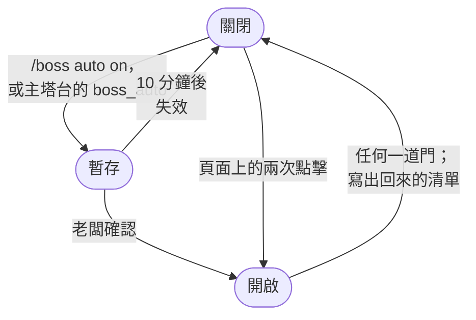

#### 一個狀態，只由伺服器寫入

主要伺服器寫入 `<state>/auto.json`（`on`、`since`、是誰切換的、一個 `rev` 和一個雜湊），並在它之前先寫入 `auto-own.json`（同一筆紀錄、一個暫存的 `on`，以及它用過的主塔台用語）。每個 session 都讀 `auto.json`；不是伺服器自己做的寫入，會在 2 秒內以新的 rev 放回去，不取消任何東西，並被列出。讀不了的檔案保留最後的狀態。在伺服器的 `auto-check` 說 rev 是它自己的之前，不會取消任何東西；拒絕則立刻跟著檔案走。

#### 誰可以切換

只有老闆自己的動作：輸入的 `/boss auto`（`on` 暫存一個請求，由終端機詢問；沒有任何東西能透過 socket 一步就開啟）、GUI 的開關，以及主塔台的 `boss_auto`。主塔台的工具依老闆在這次執行所回報為由老闆啟動的輪次（不是按下的事件，或在主塔台 pane 輸入的一行）裡說的話行動，伺服器會對照一份固定清單來讀它：問題、否定、同時兩個方向，或用過的話都會被拒絕。從 GUI 的兩次點擊以外的任何入口 `on`，都需要一筆待處理紀錄的確認，它在 10 分鐘後失效，並告訴主塔台。執行 token、operate session 和工作區塔台都得不到。

#### 它拒絕什麼

在每個 session（主智慧體、成員、火車、子智慧體）裡，新的 `ask_user_question`、`question`、`robot_hand`、`secret_drop`、`link_request` 或 `mcp` 瀏覽器登入都被拒絕，並附上一則說老闆不在的備註；工具呼叫裡開啟的確認或 prompt 以 Escape 回答，而不畫出來；Straw Link 的關卡確認被拒絕（`no one can confirm this here now`）；pi 的信任問題回答「不信任」，只有頁面的 `open/base` 啟動的 pane 例外：那是人要求開的專案，所以它的問題照常詢問。

<details>
<summary>細節</summary>

sb server 把它啟動的 pane 清單（每個 pane 附它的資料夾）留在自己的記憶體裡，直到該次開啟加入為止，pane 裡的 pi 透過 control socket 問它（`open-intent`）；沒有回答、較舊的伺服器，或重新啟動過的伺服器，都是平常的「不信任」，而且不為此寫入或讀取任何磁碟上的清單。詢問方透過伺服器的紀錄（`server.json`）找到伺服器，和每個 control 請求一樣，所以同一使用者的行程若換掉那份紀錄並回應 socket，就能對任何 pane 回答「是」；這不授予任何信任，問題只是等一個人來回答。老闆自己的 `/boss` 指令仍會畫出它們的確認。`call_tower`、`intercom ask`、`caller_ping`、monitor、loop 和 `subagent` 不被拒絕；`show_doc` 允許，並說不要等它的表單。

</details>

#### 它取消什麼

開啟時，看到伺服器的 `auto-check` 的 session，會取消它開著的等待：接受取消的擁有者會收到一個，其餘的隨輪次一起結束（中止，然後由一則訊息開始下一個輪次），結果變成 sb 的文字。伺服器的後盾會對每個對話框取消一次，對象是舊的 session 留下、超過 30 秒的等待，並把沒有取消的列為仍在等待。每個 session 在開啟時被告知一次，結束時被告知一次。

#### 塔台

開啟期間，每座塔台和主塔台的簡報會多一行。那時記下的老闆等待事項會被擱置（記憶條目上的 `parked`），開啟時每個開著的也是；卡片的提出者會收到一則 `wait_parked` 訊息。對一個 session 的 `tower_reply`，如果該輪取走了它 `blocked` 的 `call_tower`，會附註它的 `basis`（記憶 id 或不是按下的老闆事件，否則是 `none`）。密鑰卡片的啟動按鈕會被拒絕。

#### 監看

自動模式開著的時候，主要伺服器每 15 分鐘（`WATCH_MS`）讀一次自己的狀態，讀到有新的事才用一則通知 `Auto watch <n>` 叫醒主塔台（`server/autowatch.ts`、`watchops.ts`；設計是 `docs/specs/2026-11-12-auto-watch.md`）。平靜的讀取不叫醒任何人，也不花主塔台一輪：它只推進產出的計時並計數。計時器是伺服器自己的，不是由模型輪詢：它每 30 秒看一次，自動模式結束就停下，重新啟動後接著算，因為它的各項次數和上一次讀取的時間跟著那段期間存在 `auto-period.json` 裡。伺服器停擺超過那個時間（電腦睡眠）時，只讀一次，不會把錯過的每一次都補上。開啟自動模式時若沒有開著的主塔台，伺服器會開一個；夜裡之後才關掉的主塔台不會再開，沒有主塔台的讀取次數會留到早上的清單。讀到新事卻送不到主塔台（沒有開著的主塔台、它已暫停，或它還沒取走上一則通知）會略過並計數，讀不到整張網的讀取也一樣；同一時間只有一則通知在等，正被某一輪主塔台拿著的也算。一則通知要等取走它的主塔台那一輪好好結束，才算一次叫醒，它的發現也才算說過：那一輪結束時把它的鍵寫進主塔台的帳（`head/told.json`），`runs.noticeState` 在主塔台自己的資料夾讀，只有這時才說 `told`。用別的方式離開佇列的通知（伺服器結束了那一輪，例如主塔台被關掉，或佇列被清掉）不算被取走：它的發現仍算沒說過，留給下一則通知和早上的清單。它還在佇列裡或正被某一輪拿著時，它在 `auto-period.json` 裡維持待定，之後的每次讀取都排在它後面略過，平靜的也一樣。在兩輪帶著它當掉後被擱置的通知也不算說過，所以下一則通知會再帶上它的發現；連續兩則被擱置後，監看就不再送通知，直到有一則通知算說過或主塔台重新開啟，這期間的讀取計為略過。通知的鍵帶著通知的序號和讀取的時間，所以一段期間裡不會重複。自動模式結束時，不論有沒有開著的主塔台，監看的通知都從主塔台的資料夾丟掉；正被一輪活著的主塔台拿著的可以做完，那一輪不論怎麼結束，它都跟著消失。這套生命週期以模型檢查過，見 `docs/models/auto-watch/`。次要 Herdr slot 的伺服器不跑監看，這台電腦操作的 box 也不在監看範圍內（它保留自己的監看）。

<details>
<summary>細節</summary>

通知逐一說明每個工作區在伺服器自己讀到的整張網裡的狀況（`factsOf`）：上一次叫醒以來自動模式拒絕或取消的等待，以及此刻正等在對話框上的單位；它的塔台為老闆擱置的等待；閒置而且看板那一行還有待辦工作的主智慧體，以及上一次讀取時是否也閒置；已暫停、事件在等卻沒有任何一輪啟動，或握有老闆已回答而它還沒處理的等待的塔台；看板和關卡 30 分鐘沒有動靜（`STUCK_MS`）或寫入者已經不在的火車；主塔台轉交出去、該塔台 30 分鐘沒有取走或沒有動作的訊息；停滯監看還開著的事件；以及上一次叫醒以來的產出。產出是伺服器看得到的部分：寫進看板的行，以及已通知落地的車廂，各自以它發生的時間計。它看不到 commit 和 push，所以不算在內；一個工作區從第一次被看到起 2 小時（`QUIET_MS`）沒有產出就會被標出來，不論它的 pane 顯示什麼，除非它的主智慧體全都閒置、沒有待辦，而且那裡沒有火車在跑。伺服器無法歸到任何工作區的火車或停滯的 session 會另外列出。所謂新的事：上一次叫醒以來被拒絕或取消的等待，或還沒有任何一次叫醒說過的發現。第一次被看到閒置的主智慧體不算（它可能只是在兩輪之間）；下一次讀取仍然閒置才算。每個發現在一段期間裡只說一次，主塔台轉交出去而沒有回應的訊息不會在之後的通知裡再出現。

通知有上限：一個工作區裡每種項目三個，需要看的工作區十個（其他的只用一行列出名稱），全文 6,000 字元，從行尾截斷並註明截掉多少。session 寫的每個字（名稱、看板的一行、等待的文字）都經過清理、截短、加引號，看起來像密鑰的會被隱去；通知會說明那些是資料。結尾是主塔台該做的事，這一段永遠不會被截掉。主塔台沒有新增任何工具：它用 `tower_send`、`tower_memory`、`board_read` 和 `tower_list` 請負責的塔台去催一個持續閒置而還有待辦工作的主智慧體；被擱置或被拒絕的問題若有它記憶裡的長期指示或決定涵蓋，它把那個等待的編號和那條指示的原文送給負責的塔台，由塔台依自己的記憶決定，或把等待記下來留到早上；它絕不超出老闆的授權做決定。主塔台在沒有老闆指示的情況下轉交、而塔台收下的訊息（沒有 `relay` 的 ask）會算成它自己送出的訊息。

</details>

#### 回來的清單

不論從哪個入口結束，伺服器都會為那段期間寫入 `<state>/auto-report.json`（每座塔台和主塔台被擱置的等待、每個 session 的取消和拒絕、塔台決定的回覆、無法取消的等待、外來的寫入，以及監看看到和做了什麼：它讀取的次數、其中平靜的次數、叫醒的次數、沒有主塔台開著的讀取次數、主塔台自己送出的訊息、2 小時以上沒有產出的工作區、以及它看到的每個發現，各列在一處：最後一次讀取時仍未解決（說過了，而且還在）、沒說給任何人（沒有任何一輪主塔台取走，到最後一次讀取已消失的會註明）、只由兩輪主塔台帶著當掉而被擱置的通知帶過，或在最後一則通知裡、正被一輪主塔台拿著；每份清單最多 20 個，其餘計數，說過而且已消失的不列），讓被擱置的卡片恢復普通，並給主塔台一個事件。`/boss auto off` 把它印出來，`boss_status` 顯示它的摘要，而 `/boss memory done|choose|decline W<n>` 處理被擱置的等待。

#### 仍然可能的事

同一位使用者的行程可以寫檔案、對控制 socket 說話，或在 pane 裡打字。每一次切換和暫存都會通知每個 pane，並列出它的請求者；主塔台的確認紀錄，是偽造的請求跳不過的那一個。

### 開啟主智慧體

沒有 session 擁有某個請求時，塔台會自己用 `boss_open_main` 為它開一個 main，不先問使用者。它先找出寄件者，在塔台自己的工作區新開一個分頁（不搶焦點），在那裡以 main 啟動 pi，並把請求交給它。任何失敗都會關掉它建立的分頁，什麼都沒交出去。

<details>
<summary>細節</summary>

塔台把請求分配給擁有它的主智慧體，或做那項工作的成員。沒有 session 擁有它時，塔台不再把它退還給寄件者：它呼叫自己的工具 `boss_open_main`，而且不先問使用者。它其他的限制不變：它不執行 shell 指令、不送行程信號，也不編輯檔案。這個工具只在塔台登記，接受請求（原文照錄，它所引用的每個使用者決定也照錄）、寄件者（intercom 名稱或 session id）和可選的分頁標籤，並做這些事：

1. 把寄件者解析成一個運作中的 session；沒有該名稱或 id 的運作中 session 時，會在開啟任何東西之前就失敗，因為新的主智慧體無法回報。
2. 在塔台自己的工作區裡建立一個分頁，位置在工作區的 checkout 路徑（沒有時用塔台的 cwd），帶 `--no-focus` 和 `STRAW_BOSS_ROLE=main`。它絕不切換使用者的焦點，也絕不往已存在的 pane 裡打字。給另一個工作區的工作，用 `call_tower` 交給那個工作區的塔台；這個工具不會在其他地方開啟。
3. 在那個分頁的 pane 裡，以 Herdr 的智慧體名稱 `main-<8 hex>` 啟動 pi，用 pi 的預設模型（`towerModel` 設定只給塔台用）。以 `STRAW_BOSS_ROLE=main` 啟動的 pi 和任何 session 一樣加入，然後像 `boss_promote` 那樣自己升任：已有運作中主智慧體的分頁會拒絕它，而這個 pi 帶著警告維持成員。
4. 最多等 60 秒讓那個 pane 發布 `sb_role=main`，然後在[標頭](#塔台之間的對話)之下（`kind=handoff`、`reply=expected`），送給新的主智慧體一則 intercom 訊息，附上寄件者的名稱和 session id、塔台的名稱和 session id，以及原文的請求，所以它的第一個 prompt 就是主智慧體的。訊息要主智慧體把結果回報給寄件者和開啟它的塔台，然後等待：由塔台關閉它（[關閉開啟的主智慧體](#關閉開啟的主智慧體)）。

這個工具也開啟火車（`role: "train"`，以清單作為請求，每份程式碼一次；見[合併火車](#合併火車)）。火車坐在自己的分頁裡，不算進下面的兩個主智慧體，也沒有每位寄件者的限制；改由專案的 `integration.maxTrains`（預設 3，涵蓋每個工作區）限制，而合併火車關閉時，開啟會被拒絕。

從 0.74.0 起，它也是專案整合員的門（`role: "integrator"`，只在 sb server 的執行裡；見[合併火車](#合併火車)的「交接與分配」）：那個主智慧體是塔台自己的，所以它的 pane 標記為 `sb_opened_by=integ:<project>`，下面兩個限制都不算它；一個塔台在自己的工作區最多開 2 個整合員，而一個專案在整台電腦上只有一個。

限制是從運作中的 Herdr pane 計數的，所以塔台重新啟動後仍然有效：工具用一個 token（`sb_opened_by=<sender session id>`，由開啟的主智慧體保持新鮮）標記新的 pane，當工作區已經有 2 個由塔台開啟的運作中主智慧體、或寄件者已經有一個時，會以錯誤拒絕，由塔台轉達給寄件者（開啟是串行的，所以進行中的一個也算）。拒絕不會被記住，所以一個主智慧體結束後，同樣的請求可以再試。

`STRAW_BOSS_ROLE=main` 會留在新分頁的 shell 裡，所以 pi 只有在 pane 也帶有一次性 token `sb_open_main` 時才會自己升任，第一個這樣的 pi 會消耗它；之後在那個 shell 裡啟動的 pi 維持成員。

任何失敗（啟動、等待、遞送）都會關閉工具所建立的分頁，沒有任何東西被交出去，並以錯誤的形式到達塔台的模型，它的 prompt 要它轉達給寄件者。塔台在它 session 的存續期間記住每位寄件者和請求：同樣的請求絕不會開啟第二個主智慧體，不論第一次嘗試還在執行、已成功（重複的請求會回答已開啟過一個主智慧體），還是失敗（重複的請求被拒絕，不重試）。期間重新啟動的塔台會忘記，而不同的措辭就是不同的請求。

</details>

### pi 在資料夾裡啟動之前：設定檢查

pi 1.4.0 在啟動時讀取 `<folder>/.pi/settings.json`，整份讀、沒有大小限制，在任何擴充載入之前，也在信任問題之前（`dist/main.js` 裡以預設信任專案的 `SettingsManager.create(cwd, agentDir)`；上游 issue [earendil-works/pi#11421](https://github.com/earendil-works/pi/issues/11421)）。指向 `/dev/zero` 的連結會讓 pi 無限增長，`/dev/stdin` 或 FIFO 會讓它永遠卡住，而巨大的檔案會被整份讀進來。沒有任何擴充能介入，所以由啟動 pi 的人先看：Straw Boss 在為新的 pi 建立任何東西之前做這件事（`src/trust/settings.ts`）。

#### 探測

在老闆自己的行程裡檢查路徑，永遠和核心替 pi 做的事不一致（`.pi -> /proc/self/cwd` 表示不論誰看，不是 UTF-8 的連結目標、不分大小寫磁碟上的 `/DEV`、Windows 路徑），所以由核心來解析。成本：沒有 `.pi` 時對 `<folder>/.pi` 做一次 `lstat`（`ENOENT`/`ENOTDIR` 表示沒有檔案，沒有子行程）；有 `.pi` 時，一個短暫的子行程（`process.execPath`、`--max-old-space-size=32`、沒有輸入、工作目錄 `<folder>`，和 pi 的相同）。子行程先對相對於那個目錄的 `.pi` 和 `.pi/settings.json` 做 `lstat`。

<details>
<summary>細節</summary>

不涉及連結時，`ENOENT`、`ENOTDIR` 或 `EACCES` 表示沒有檔案（pi 的 `existsSync` 為 false，或它的讀取錯誤被接住：`core/settings-manager.js` 裡的 `tryLoadFromStorage`）；無法跟隨或開啟的連結會被拒絕，不論是什麼錯誤。接著在開啟任何東西之前，跟隨連結對路徑做 `stat`：目錄沒問題（pi 會接住 `EISDIR`），而不是一般檔案的任何東西都是 `special`，絕不開啟，所以不會放走 FIFO 的寫入者，也不會碰任何裝置。一般檔案以 `O_RDONLY|O_NONBLOCK` 開啟，再做一次 `fstat`，並以固定的緩衝區透過描述符讀取，不論 `st_size` 說什麼（所以大小為 0 而無止盡的 `/proc/self/pagemap` 會立刻停下），收到超過 256 KB 就是 `large`。它印出一行 JSON（母行程把輸出截在 4 KB）。任何其他錯誤，包括連結迴圈（`ELOOP`），都以 `unreadable` 拒絕。

</details>

#### 什麼會被拒絕

不是一般檔案的 `settings.json`（裝置、FIFO 或 socket，或終點是它們的連結）、超過 256 KB 的、無法查看的（`unreadable`）、檢查無法跟隨或開啟的連結，不論原因（懸空的連結也會被拒絕，雖然 pi 自己會略過它：像 `/proc/self/fd/17` 這種每個行程各自的連結，對檢查來說不存在，但對 pi 是它自己的終端機），以及檢查沒有完成的（檢查本身啟動失敗也算）：5 秒內沒有回答（子行程被殺掉）、崩潰，或輸出不是預期的那一行，就是 `unchecked`（「could not be checked in time」）。**什麼沒問題**。

<details>
<summary>細節</summary>

沒有 `.pi`、沒有檔案、路徑上是目錄，以及最多 256 KB 的一般檔案，經過連結也一樣。在檢查和 pi 啟動之間被換成裝置或連結的檔案不在涵蓋範圍內；那個時間窗是開啟的那幾秒。查看是非同步的，所以老闆的 event loop 不會被擋住；每一次開啟（新的主智慧體、成員或基地、塔台的分頁、開啟的主智慧體、接回）都在建立任何東西之前就拒絕。回報不出資料夾的接管塔台 pane，會當作塔台所屬的資料夾來檢查（工作區的 checkout，否則是開啟時的 cwd），因為 herdr 沒給更好的。

</details>

#### 有界的停滯

掛在卡住的網路或 FUSE 掛載上的 `settings.json` 可能讓讀取停滯；子行程的逾時限制了它，然後開啟以 `unchecked` 被拒絕。**剩餘的缺口**。子行程的檔案描述符和 pi 的不同：它的 `/dev/stdin` 和 `/dev/fd/0` 是 `/dev/null`，它的 stdout 和 stderr 是 pipe。所以指向 `/dev/stdin` 或 `/dev/fd/N` 的連結永遠看不到 pi 真正的描述符：子行程的 pipe、socket 和裝置是 `special`，而子行程沒開過的號碼，則當成無法跟隨的連結被拒絕。在 macOS 上，子行程的 `/dev/fd/6`、`8` 和 `10` 是目錄 `/`，pi 的也是，所以這類連結被當成目錄放行。

<details>
<summary>細節</summary>

只有在 pi 在某個號碼上持有一般檔案、而子行程在那裡持有別的東西時，檢查才會錯，而 Straw Boss 開的分頁都不會這樣安排。

</details>

#### 它在哪裡執行

每一條在資料夾裡啟動 pi 的路徑：GUI 的＋新基地、＋新成員（新分頁和分割）和＋主智慧體（`spawn.ts`）、塔台的 `boss_open_main`（`opener.ts`）、塔台自己的分頁（`towertab.ts`，新的或接管的），以及從 GUI 或 `/boss pop` 的收起後接回（`stash.ts`；建立新工作區之前，會先看收起裡的每個資料夾）。拒絕發生在工作區、分頁或 pane 建立之前，所以沒有東西要清理；收起的東西保留在它的名稱底下。

#### 使用者看到什麼

部署面板的第一步（`create`）失敗，並以頁面的語言（先繁體中文，再英文）說明沒有啟動任何東西、是哪個檔案、為什麼；被拒絕的接回在它的對話框裡顯示同樣的內容。伺服器的回答帶著事實（`settings: {path, why, size?, limit?, code?}`），由頁面措辭。工具或 LLM（`boss_open_main`、`/boss pop`）得到一句英文，帶著同樣的路徑和原因。上游 issue 只在這裡提到，絕不出現在介面裡。

<details>
<summary>細節</summary>

pi 修掉 #11421 之後，這道防護就可以移除。pi 比 1.4.0 新的時候，檢查它 `dist/main.js` 裡的 `SettingsManager.create`（以及 `core/settings-manager.js` 裡的 `FileSettingsStorage`）：一旦它在信任問題被回答之前會略過不受信任專案的 `settings.json`，或是以大小和檔案類型的限制來讀它，就刪除 `src/trust/settings.ts`、上面各路徑裡對它的呼叫，以及 `deploy_settings_*` 訊息。

</details>

### 關閉開啟的主智慧體

塔台開啟的 main 在工作完成時會告訴寄件者和塔台，然後等待；塔台用 `boss_close_main` 關掉它，除非該 main 說它在等老闆的決定。塔台只能關閉自己工作區裡、由它自己開啟、且 Herdr 回報為 idle 或 done 的 main，而 main 自己決定要不要接受退出的請求。

<details>
<summary>細節</summary>

由塔台開啟（`boss_open_main`）的主智慧體，在它的工作完成時告訴寄件者和塔台，然後等待；塔台用 `boss_close_main` 關閉它，除非主智慧體說它在等老闆的決定。交接訊息指名兩者（`Sender:` 和 `Tower:`，附上它們的 session id），並說要用 `intercom send` 向寄件者、用 `call_tower`（`why: milestone`，不回覆）向塔台回報結果；主智慧體的 prompt 對塔台開啟的分頁會重複這一點。這個工具只在塔台登記，接受主智慧體的 intercom 名稱或 session id。塔台先從 Herdr 的角度檢查：

- session 在塔台自己的工作區裡，而且是主智慧體（`sb_role=main`）；
- 它的 pane 帶有 `sb_opened_by`，所以是塔台開啟的它：老闆自己開的主智慧體絕不會被塔台關閉；
- Herdr 回報它是 `idle` 或 `done`。

然後它透過 intercom 擴充頻道 `straw-boss/control`（「capable」受眾；一則訊息只給一個 session，`to`；寄件者 id 和每個 pi-intercom 身分一樣是自我申報的，所以這個頻道依賴同一位使用者的信任邊界：冒充塔台的同一位使用者的行程，可以關閉閒置的、塔台開啟的主智慧體，而那位使用者本來就能用 `herdr pane close` 做到）請主智慧體自己的擴充離開，就像 `/boss close` 那樣。它不使用可能已停止的 GUI 伺服器，而橋接的 `close` 只回答那個伺服器。只有塔台開啟的主智慧體會登記這個頻道（在它消耗 `sb_open_main` 之後），每座塔台也一樣。

開啟者連同它的 pane 一起存在 session 裡，而且只有同一個 pane 裡的同一個 pi 會還原它：在那裡 `/reload`、`/resume` 或 `/fork` 之後，主智慧體會再寫一次 `sb_opened_by`，並再登記一次頻道。重新啟動的 pi（`pi --session`、`pi -c`、`/boss pop` 之後的重新啟動），以及任何其他 pane 裡的 session，都算作老闆的主智慧體，沒有塔台會關閉它，不帶開啟者的 `/new` session 也一樣。之後的認領（接回的那一次）會把它自己的開啟者，也就是沒有，存在較早的那個之上。

```text
{type: "close-main", to: <main session id>, reqId}                              tower → main
{type: "close-main-result", to: <tower session id>, reqId, accepted, reason?, busy?}   main → tower
```

由主智慧體決定，而且只有在下面這些全部成立時才接受：寄件者是它的工作區的塔台 token 持有者，它自己的 pane 帶有 `sb_opened_by`，而且沒有任何執行中的東西會遺失，檢查方式和收起檢查一個 session 一樣（沒有執行中的輪次、沒有排隊的訊息、沒有開著的對話框、沒有執行中的背景 monitor，來自橋接的 `stashCheck`），再加上沒有仍在執行的子智慧體（pi-herdr-agents 在它的 session 底下的活動檔案）。接受時它先回答，然後像 `/boss close` 那樣離開：pi 關閉，它的 token 被清掉，它的 pane 關閉（變空的分頁一併關閉）。拒絕時會說明原因。

因為有東西在執行而拒絕（`busy: true`）的，會每 3 秒再問一次，最多 15 秒，因為主智慧體是從緊接著結束的那個輪次送出它的完成回報；任何其他的拒絕都是最終的。10 秒內沒有回答的主智慧體（沒有這個頻道的 pi-straw-boss）會讓工具帶著錯誤離開，而且什麼都不關。接受之後，工具最多等 30 秒，讓 session 離開 intercom，並說明它有沒有離開。

塔台 run pi 的預設模型，除非你在 `~/.pi/agent/straw-boss/config.json`（設了 `PI_CODING_AGENT_DIR` 時在它底下）為它設定一個：

```json
{ "towerModel": "claude-bridge/claude-sonnet-5-5" }
```

Straw Boss 每次啟動塔台時，都會把它當作 `--model` 傳給 pi，並在每次啟動時讀這個檔案，所以更改會套用到下一座塔台，不必 reload。已在執行的塔台保留它的模型；要改那一座，就重新啟動它（或在它的 pane 裡用 `/model` 切換）。

</details>

### 合併火車

專案可以替每個 app 設一列合併火車：由一位整合員主智慧體合併協調者的工作，而不是每位協調者各自合併。它是選用的。程序只是 prompt，不在 Straw Boss 裡，但自 0.65.0 起，擴充和伺服器會為它讀寫一些檔案（trainboard 和車廂檔案、車廂通知、`landed` 的 git 檢查、掃描、`apps.json` 的 `integration.accept` 和 `stages`；見[火車作為它們自己的工作者](#火車作為它們自己的工作者)）。自 0.60.0 起，這個程序不在 Straw Boss 裡：它是 `integrating`（合併）和 `deploying`（部署）skill，由實作[合併火車契約](#需要宣告合併火車契約的-skill)的套件提供（pi-anchorloop 是其中之一），而 Straw Boss 綁定那些 skill 留白的地方。

一節車廂怎麼從車廂單走到落地：

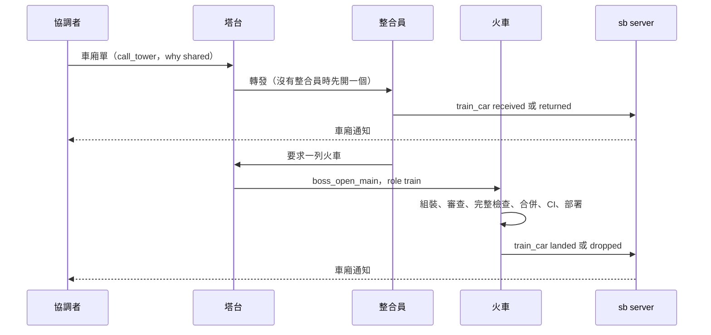

車廂有四種狀態，由整合員與火車用 `train_car` 設定：

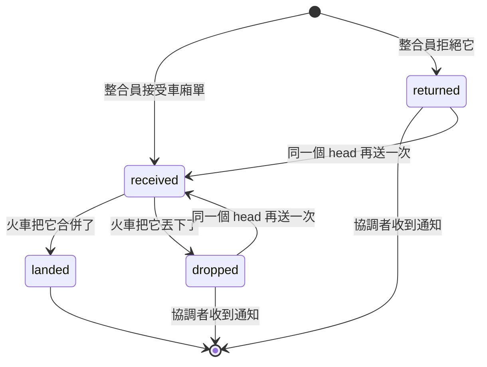

車廂的一輪以 `returned`、`dropped` 或 `landed` 結束。被退回或被丟下的車廂，如果協調者把車廂單改好、用同一個 head 再送一次，等塔台轉發了那張車廂單，車廂就開始新的一輪：整合員像處理新車廂一樣接收或退回它，通知也會再送出。已經 landed 的車廂沒有新的一輪，因為一節車廂只落地一次：head 已經在專案 remote 的 base 分支上時，`received` 會被拒絕，整合員用那句拒絕訊息把車廂退回，協調者因此會被告知。

[`prompts/apps-config.md`](../prompts/apps-config.md) 放 `apps.json` 的欄位，[`prompts/integrator.md`](../prompts/integrator.md) 放整合員的角色，設計紀錄是 [`docs/specs/2026-10-30-merge-train.md`](specs/2026-10-30-merge-train.md)、[`docs/specs/2026-11-05-train-stages.md`](specs/2026-11-05-train-stages.md) 和 [`docs/specs/2026-11-06-seam-bindings.md`](specs/2026-11-06-seam-bindings.md)（它把舊整合員 prompt 的每一行，對應到它在 skill 裡的位置）。

#### 需要宣告合併火車契約的 skill

Straw Boss 不指名任何 skill 套件。火車的 prompt 假設 `integrating` 和 `deploying` skill 符合合併火車契約第 1 版（[合併火車指南](https://wayne930242.github.io/pi-straw-boss/docs/zh-tw/guide/merge-train/#合併火車契約)列出它的內容），而 skill 在 frontmatter 的 `metadata:` 底下以 `merge-train-contract: "1"` 宣告它實作的版本。擴充會檢查（`src/train/contract.ts`）：它問 pi 這個 session 載入了哪些 skill（`pi.getCommands()`，所以讀到的就是模型會讀的那份 `SKILL.md`，不論是哪個套件帶來的），再讀每一個的宣告。pi 沒有載入 `integrating` 或 `deploying`、檔案讀不到、skill 沒有宣告，或宣告的版本不含 1 時，火車和整合員會改變東西的 `todo` 和 `MonitorCreate` 呼叫都會被拒絕並附上原因；通過的結果最多每分鐘讀一次，被拒絕時則每次呼叫都重讀。有一項例外，涵蓋宣告出現之前發布的版本（`src/train/contract-legacy.ts`，唯一指名套件的地方）：pi-anchorloop 2.11.0 或更新版本裡沒有宣告的 skill 算作第 1 版。無法載入 `integrating` 或 `deploying` 的主智慧體或整合員，會以 `why=blocked` 呼叫塔台並指名合併火車契約，而且什麼都不派出。火車關閉時，這些都不會載入。

#### 接縫綁定

`integrating` 指名六個接縫（Handoff route、Batch owner、Approval、Record、Escalation route、Settings），並從 session 的指示裡讀一個 `## Seam bindings` 區塊。Straw Boss 的區塊是 `main.md` 的最後一段文字，在整合標記之內：`main.md` 是每個主智慧體（協調者和整合員一樣）的 system prompt，所以每個 session 恰好持有一個區塊，在它第一步之前就在它前面，不必讀任何檔案。塔台不執行任何 skill，也不持有任何一個；它的 prompt 只帶轉發。

<details>
<summary>細節</summary>

這個區塊綁定：**Handoff route** 綁到 `call_tower` 的 `why: shared`，由塔台轉發（`tower_reply` 帶 `forward`，它的標頭把寄件者標為 `fwd-from`）給專案唯一的整合員，而 sb server 把每則車廂通知依 session id 送給車廂單的 `coordinator`（必須就是那位寄件者）；**Batch owner** 綁到專案唯一的整合員主智慧體（由塔台以 `boss_open_main` 開啟，名為 `integ <project>`，在它閒置的 `milestone` 之後由塔台關閉），它安排火車，並用 `boss_open_main` 的 `role: "train"` 開啟每一列（出發的火車在它自己的 `train` session 裡執行），火車的 worktree 在 `~/.herdr/worktrees/<repo>/train-<code>`；**Approval** 綁到老闆，協調者從它的簡報或老闆的訊息裡，把涵蓋這件事的話引用在車廂單的 `auth` 裡，只有在缺少時才用它的問題工具詢問（隔夜的火車不能卡在一個問題上），每個部署目標依 `integration.targets` 是 `auto` 或 `strict`；**Record** 綁到狀態資料夾裡的 `trains/<project>/<app>.json`（整合員的索引）和 `trains/<project>/<app>/<code>.json`（每列火車一個，它那列火車的）；**Escalation route** 綁到 `call_tower`（`blocked`；閒置是 `milestone`；宣告的部署是指名目標的 `shared`）；**Settings** 綁到 `apps.json` 的 `integration`。火車關閉時，這個區塊就不見，改用 anchorloop 的預設：session 在合併或部署之前問老闆。

</details>

#### 原則

`integrating` 的原則：交接之前，協調者的錨點是它的審查（P0 和 P1 清除）、它自己變更的行為測試，以及專案 skill 的 `Light checks`；格式、lint、build、完整型別檢查、完整測試套件、發布和類似的關卡，由整合員在整合後的 head 上只跑一次。

#### 欄位

`apps.json` 有頂層的 `integration`（`skill`、`maxCars` 4、`maxWaitMin` 60、`maxTrains` 3）和每個 app 的 `integration`（`base`、可選的 `skill`、`stages`、`accept` 和 `targets`）。沒有這個欄位的 app 保持現在的流程。

#### Skill 契約

專案 skill 是靠 `integrating` 的 Project skill contract 裡的標題找到的（`## Light checks`、`## Train assembly`、`## Full gates`、`## Merge`、`## Post-merge`、`deploy` 階段的 `## Deploy` 和 `## Deploy verify`、app 設了 `integration.accept` 的專案的 `## Acceptance`、可選的 `## Urgent lane` 和 `## Load`）。缺少必要的標題時，整合員不出發，並以 `why=blocked` 呼叫塔台。

#### 交接與分配

協調者用 `call_tower` 的 `why=shared` 送出車廂單。塔台不回答 go：它把車廂單送給專案唯一的整合員，並在那個主智慧體回報閒置時關閉它。整合員自己不告訴協調者任何事：它用 `train_car` 設定車廂的狀態，由 sb server 送出通知，所以塔台不轉達任何回覆。從 0.74.0 起，塔台自己用程式開啟整合員（`src/integrator.ts`、`src/opener.ts`、`src/server/runtools.ts`）：塔台 run呼叫 `boss_open_main`，帶 `role: "integrator"`、以車廂單作為請求，以及它的寄件者。

<details>
<summary>細節</summary>

專案不是執行說了算：開啟器從工作區的 checkout 讀出來（它 `apps.json` 最上層的 `integration.project`，沒有就用它 repository 的資料夾名稱，同一個 repository 的每個 worktree 都一樣），別的字一律拒絕，所以編出來的名稱什麼也開不了。執行看不到事件 id，所以 server 自己找車廂單：這個 run從該寄件者收下的 `call_tower`（`why=shared`）之中，內文帶有請求裡 `head:` 的最新一則。

接著它在整台電腦上找專案的整合員（種類為 integrator，且由塔台為該專案標記、或名為 `integ <project>` 的主智慧體；為隊友的裝置開啟的主智慧體不論怎麼自稱都不算，依它的 pane token 與路由表判斷），找不到就在自己的工作區開一個，命名為 `integ <project>`，讓新的 pi 在收到任何東西之前就已經是 integrator 種類，然後照寄件者寫的原樣轉發車廂單，蓋上 `fwd` 與 `fwd-from`：執行打的字一個也不會被轉發，所以執行改不了車廂單的 `auth`。

整合員是塔台自己的主智慧體：它不算進工作區的兩個已開啟主智慧體，也不算進寄件者的那一個；一個塔台在自己的工作區最多開 2 個（老闆最忙的工作區同時跑過兩個）；一個專案絕不會有兩個：app 的火車若已有帳本記在另一個專案下（`trains/<project>/<app>.json`），會被拒絕並指出那個專案的名稱；在另一個 repository 工作的整合員（依它 pane 的資料夾判斷；worktree 算在它的 repository 上）不收這個 repository 的車廂單；同一個專案的開啟在每個塔台的開啟器之間互相等待，所以兩個工作區同時收下車廂單也只開一個；已標記但 pi 還沒加入的 pane、已標記但現在是別的種類的主智慧體、兩個都自稱是該專案整合員的主智慧體，各自都會讓開啟被拒絕，並說明是哪一種。

這條規則管的是門開出來的整合員。專案若已經有用自己名稱在跑的整合員（0.74.0 之前由老闆每個 app 開一個，例如同一個 checkout 裡的 `integ FE2` 與 `integ v3`），就維持原樣：只要塔台的工作區裡、或在 checkout 裡工作（checkout 底下 app 自己的 repository 也算）有一個活著的 integrator 種類主智慧體，它沒有被塔台標記、不是為隊友的裝置開啟的，而且不是那個名為 `integ <project>` 的主智慧體，門就什麼也不開、不把它們算進自己的限制，也不替你挑。

門會先找它們，再套用帳本規則，所以帳本放在它們自己名稱底下（`trains/FE2/<app>.json`）不會造成拒絕。門的拒絕訊息會列出它們的名稱，對本機 run還會附上車廂單的事件 id，讓執行照 0.73 的方式轉發：`tower_reply` 帶 `to`（跑那個 app 火車的整合員）、以車廂單作為訊息、`forward`（那個 id），程式再從執行收下的事件蓋上 `fwd` 與 `fwd-from`。

蓋章送出的是事件本身的文字，不是執行打的訊息；對象必須是門為那張車廂單列出的整合員之一；為隊友的裝置開啟的主智慧體，它的車廂單不轉發，它也不能當對象，用的是同樣兩個見證（它的 pane token、任何一個工作區的路由表）。隊友 run 拿不到 id，因為它不轉發車廂單；在 `dispatch` 以下，它會在關卡之前先向開啟器問有沒有拒絕，所以開啟器會拒絕的呼叫不會去問老闆。

保留下來的整合員沒有持久的記號，所以它必須待在塔台的工作區裡，或在 checkout 裡工作，門才看得到。專案的帳本存在（`trains/<project>/<app>.json`）而看不到它的整合員時，門會在 2 秒後再看一次；還是看不到，只有在整台電腦上沒有任何未標記的 integrator 種類主智慧體活著時才開一個（死掉的整合員必須能被替換），否則拒絕並說出那個主智慧體的名稱。整合員的開啟不記進任何帳本，所以閒置的那個關閉之後，下一張車廂單會再開一個；開啟需要工作區的 `apps.json` 裡有帶 `integration` 的 app，合併火車關閉時會被拒絕。

隊友 run 開啟的主智慧體用同樣的方式送出車廂單，而它的 `call_tower` 送達的是它裝置的隊友 run，絕不是本機 run（[隊友 run](#隊友-run)）：在那裡，同一個呼叫是隊友 run 通往整合員的唯一一道門。這樣的車廂單若真的到了本機 run（那個主智慧體指名了另一個工作區的塔台、它的路由已經不在，或本機 run較新的等待蓋過了路由），門會拒絕它：主智慧體的 pane token（`link:<device id>`）或任何一個工作區的路由表都說得出它是誰的。伺服器的重型關卡 semaphore 並沒有建。

</details>

#### 整合員

它的 prompt 只保留屬於 Straw Boss 的部分：角色（是主智慧體，不是塔台，也是「絕不合併進整合基底」的例外）、名稱 `integ <project>`（最多 16 個字元，絕不改名）、狀態資料夾裡 `trains/<project>/<app>.json` 的帳本（`$PI_CODING_AGENT_DIR/straw-boss`，預設 `~/.pi/agent/straw-boss`；角色 prompt 寫出解析後的路徑）、每列成形中的火車一個 `train` todo（防護會檢查它；車場由它畫出）、塔台呼叫（它自己的合併、push 和合併觸發的部署，不做 `shared` 呼叫，因為那些車廂單的 `auth` 涵蓋它們；自己啟動的部署則做指名目標的 `shared` 呼叫；`blocked`；閒置的 `milestone`），以及它所交代的步驟用的 `reviewer` 角色。

<details>
<summary>細節</summary>

車廂單、出發、組裝、審查、紅燈處理、緊急和 fix-forward 的車道、部署和回滾，都是各個 skill 的事；自 0.65.0 起，整合員只接收車廂並安排火車（見下），其餘由火車做。

</details>

#### 階段

app 的 `integration.stages` 列出整合員帶每列火車走過的階段：`merge`（預設，永遠在最前面），然後可選的 `deploy`。自 0.65.0 起沒有 `uat` 階段：驗收移到協調者那裡（[交接前的驗收](#火車作為它們自己的工作者)）。`strict` 目標（沒列出的預設）只接收每個車廂的 `auth` 都指名它的火車；`auto` 目標接收每一列火車。Straw Boss 不指名任何環境：有哪些目標、一個運作中的目標在車廂單的 `auth` 之外還需要什麼，是專案 skill 的事（`## Deploy`、`## Deploy verify`、`## Acceptance`）。設計紀錄：[`docs/specs/2026-11-05-train-stages.md`](specs/2026-11-05-train-stages.md)。

#### 開關

不想要這一切的電腦，在它的 session 的環境裡設 `STRAW_BOSS_INTEGRATION=off`，或在狀態資料夾（`$PI_CODING_AGENT_DIR/straw-boss`，否則 `~/.pi/agent/straw-boss`）的 `config.json` 裡設 `"integration": "off"`，就能關掉合併火車。順序：非空的環境值優先；否則是 `config.json` 裡的 `integration`（UTF-8 BOM 會被忽略）；否則 `STRAW_BOSS_DESK=1` 時為關，其他情況為開。開是 `on`、`true`、`1`、`yes`；關是 `off`、`false`、`0`、`no`（大小寫和前後空白會被忽略）。

<details>
<summary>細節</summary>

這個開關失敗即關閉：任何其他值，以及存在但讀不了或解析不了的 `config.json`（結尾逗號、是個資料夾），都會關掉火車，並每個行程告知一次（一則 session 通知，或塔台 run時 stderr 上的一行），指名檔案和值。關閉時，沒有主智慧體或塔台會被給予整合員角色：主智慧體、塔台和塔台 run的 prompt 會去掉它們的整合文字，改說這台電腦上整合是關閉的，主智慧體在合併到共用分支或部署之前問老闆，塔台對帶有 `car:` 區塊的 `shared` 請求回答「integration is off on this computer」並且不為它開任何主智慧體，而任何 `apps.json` 裡的 `integration`、`stages`、`targets` 和 `deploy` 都會被忽略（`apps.json` 仍然給出擁有的 app 和它的路徑）。

`{{dir}}`，也就是 prompt 指向 `apps-config.md` 和 `planning.md` 的資料夾，會變成狀態資料夾裡的一份副本（`prompts-off/`），在 session 第一次使用時，從同樣的檔案去掉整合區塊後做成，而且不含 `integrator.md`，所以沒有任何東西會載入整合員的 prompt。每次載入都會重寫文字和來源不同的副本檔案，移除沒有來源的檔案和遺留的暫存檔，而開關再度開啟時副本會被移除。副本寫不出來時，會有通知這樣說，這個輪次仍有它的 Straw Boss 區段，而 `{{dir}}` 讀作「none yet」。

`main.md` 的 `## Seam bindings` 區塊在同樣的標記之內，所以火車關閉時套用 skill 自己的預設（協調者在合併或部署之前問老闆）。prompt 檔案在一個地方標記文字：`<!-- integration -->…<!-- /integration -->` 在關閉時被去掉，`<!-- no-integration -->…<!-- /no-integration -->` 只有在關閉時才保留（`src/trainswitch.ts`）。標記必須完全照這樣拼，小寫，而且不能巢狀或交錯；任何其他情況都會讓 session 啟動失敗，不論開或關。預設是開，而 session 得到的角色 prompt 就是現在的，去掉標記；開著的主智慧體也會讀帶著標記的 `apps-config.md`，以及這個版本新增的幾行。

這個開關是每台電腦各自的：書桌透過 Straw Link 送給火車開著的裝置的工作，跑的是那個裝置的火車。它只觸及 sb 自己的 prompt：專案的 skill（例如寫著「play the integrator yourself」的協調者 skill）不在它的範圍內。pane（主智慧體和塔台 run一樣）的環境來自 Herdr（`herdr agent start`），所以要把變數設在啟動 `herdr server` 的環境裡（`STRAW_BOSS_DESK=1` 也是這樣），或用每個 session 都會讀的 `config.json`。書桌什麼都不設：`STRAW_BOSS_DESK=1` 已經關掉火車，而它的 `config.json` 裡的 `"integration": "off"` 只是保險。

</details>

#### 火車作為它們自己的工作者

設計紀錄：[`docs/specs/2026-11-07-train-workers.md`](specs/2026-11-07-train-workers.md)。自 0.65.0 起，火車是它自己的工作者，也就是角色為 `train` 的 session，而整合員只負責安排。

##### 角色

協調者（主智慧體）執行它的驗收，然後送出車廂單。整合員（`integ <project>`，每個專案一個，和以前一樣）接收車廂、逐一檢查、把它設成 `received` 或 `returned`、組成火車，並請塔台開一列。塔台用 `boss_open_main` 加上 `role: "train"` 和清單開啟火車，在它自己的分頁裡，名為 `train 1106m`（`MMDDx`，每個專案內唯一，絕不重用）。火車在 `~/.herdr/worktrees/<repo>/train-<code>` 裡把車廂組裝在最新的基底上，請一位全新的 reviewer 讀這次組裝，跑完整檢查，合併，監看 pipeline，在它的階段說要時部署並驗證，失敗時回滾或回報，然後結束。

<details>
<summary>細節</summary>

它出發之後自己執行；整合員不監督它。它從不等人，而塔台在它的 `milestone` 之後關閉它。

</details>

##### 交接前的驗收

e2e 和 UAT 在送出車廂單之前，在協調者自己的分支上進行，並取得老闆的同意，如同專案 skill 的 `## Acceptance` 所說（`integration.accept` 指名 app 要求的種類）。車廂單帶有 `accept:`（證據：跑了什麼、在哪個 head 上、結果、老闆的話）和 `departs:`（車廂何時可以離開：`next`、`alone`、`with <car>`、`after <time>` 或 `by <time>`，以逗號分隔）；`cli.mjs train check --accept <file>|none [--slip <file>] [--app <name>] [--app-accept K,…]` 驗證兩者。app 要求什麼，是專案 `apps.json` 裡的 `integration.accept`，整合員的防護和火車自己會讀它，所以旗標只能往上加，絕不能削弱它：證據缺少必要種類、或對要求某些種類的 app 寫 `none` 的車廂，在火車出發之前就被拒絕（`train check` 在自己的資料夾裡有檔案時就讀那個檔案，否則讀它儲存庫主 checkout 裡的那份，因為連結的 worktree 常常沒有；兩處都沒有時，它指名的 app 會以無法檢查為由被拒絕，絕不放行）。車廂單的 `car:` 指名車廂的 app，用 `apps.json` 裡的名字，絕不是票號；`app:` 是同一個欄位，兩者都給卻不一致的車廂單會被拒絕，不是車廂單欄位的鍵也一樣，在塔台門口和 `train check` 都會被拒絕。`train_car` 的 `car` 是車廂的第一張票，也就是車廂單 `tickets:` 的第一個。

<details>
<summary>細節</summary>

`stages` 仍列著 `uat` 的 app 是設定錯誤：塔台不為它開火車，整合員的 `train` todo 被拒絕，而 `train check` 這樣說，每次都指名欄位和下面的遷移。要火車做驗收的車廂，會以一句話（「the train runs no acceptance…」）被拒絕並退回。

</details>

##### 步驟

火車的每個 todo 都是一個帶有 `metadata.sb` 規格的步驟：一種類型（assemble、review、full-check、merge、ci、deploy、deploy-verify、rollback、land：只是分類，流程是 skill 的事）、讓它通過的檢查、`holds`（一條車道或目標），以及它需要的負載。擴充裡的防護會拒絕解析不了的規格，並把 `MonitorCreate` 呼叫改寫成經過 `cli.mjs train gate --spec <file>`，它會等負載和 `<state>/locks/` 底下指名的整台機器鎖，執行指令，並印出一行 JSON `progress`（永遠帶有 `message`，等待時帶有 `load`）。被丟掉的車廂會開始新的一輪：火車的 todo 被重寫，被取代的步驟以 `void` 結束。

##### Hold、車道、目標

火車從第一個宣告它的步驟起，持有車道（app 的整合分支）或目標，直到任何一輪中每個宣告它的步驟都完成為止（所以重新組裝不留下空隙）；之後火車中宣告同一個 hold 的步驟會等待，看板會說在等什麼。專案最多有 `integration.maxTrains` 列運作中的火車（預設 3）；火車不算塔台的兩個開啟的主智慧體之一。

##### 車廂通知

火車和整合員用 `train_car` 設定每個車廂的狀態（`received`、`returned`、`landed`、`dropped`）；sb server 對每個（車廂、狀態）以 `kind=car_notice` 送給協調者一則 intercom 通知，在 30 秒、2 分鐘和 5 分鐘重試，記錄 `deliveredAt`，而協調者不在時，送給塔台一則 `blocked` 並記錄 `escalatedAt`。火車在每則 landed 通知都已送達或升級之前，不能通過 `land`。整合員在接收時退回的車廂不在任何火車上，所以沒有哪一列火車的步驟會等它的通知：整合員自己的 session 會等，而 sb server 若在通知送達之前重啟，它就帶著通知內容以 `blocked` 呼叫塔台。server 只在記憶體裡保留塔台的轉發紀錄，以及門為某張車廂單列出整合員的回答，兩者都不從磁碟讀回（那裡的檔案是火車寫得到的），所以 sb server 重啟後就沒有了。

<details>
<summary>細節</summary>

從 0.75.1 起，拒絕訊息會說明這一點：在 server 啟動後的 24 小時內，整合員的 `train_car` 拒絕訊息 `no forward by a tower carries head ...` 會寫出啟動時間與補救方式（協調者把車廂單再送給塔台一次，塔台再轉發一次），而車廂單在啟動之前就進來的塔台 run，會被告知再問一次門。

整合員的等待放在它自己 pi 行程的記憶體裡（`src/carwait.ts`），不從磁碟讀任何東西。它每 15 秒問一次 server 的帳本，直到 `returned` 通知送達或升級。server 已經不再持有那節車廂、通知過了一天仍未送達，或 session 在還等著的時候結束（reload 會保留等待），它就把通知交給塔台；塔台沒有收下時，30 秒後再問一次，最多十次。被強制終止的 pi 行程什麼也交不出去。

新的一輪需要一則在車廂結束之後才由塔台轉發的車廂單，所以車廂被退回時所依據的那張車廂單不會得到第二次回答（`car <ticket> is already returned`）。server 把前一輪和新的一輪一起留在記憶體裡：前一輪的通知照樣送出，丟下那節車廂的火車也仍然讀得到自己設定的狀態；磁碟上的車廂檔顯示最新的一輪。在 `received` 時，server 對車廂的 head 執行 `landed` 的 git 檢查，對象是整合員工作區 checkout 的 remote，以及那個 checkout 的 `apps.json` 裡該 app 的 `integration.base`：head 已在那個分支上就拒絕，remote 讀不到的專案不經檢查就接收（工具會說明；開啟火車時在那裡也讀不到 remote，所以這種火車不能設定 `landed`），remote 讀得到、但 app 沒有可用的 `integration.base` 時拒絕接收，remote 連不上或無法認證時（`ls-remote` 或 fetch 因認證失敗，包括金鑰或主機金鑰被拒、HTTP 401 或 403；因連線失敗，包括 DNS、連線被拒或重設、TLS 錯誤、HTTP 5xx、代理伺服器的 407，以及 server 自己的 60 秒逾時；或因 remote 說儲存庫不存在而失敗，其他的「not found」不算，所以缺少 `ssh` 會被拒絕；server 的 git 沒有 credential helper），不經檢查就接收並註明原因，URL 裡的 userinfo 會被遮掉，其他 git 失敗則拒絕接收，server 的 mirror 被別的東西寫過之後 fetch 失敗也一樣拒絕。這項檢查在 server 逐一處理設定之前執行，所以緩慢的 fetch 不會拖住火車的 `landed`。以 squash 或 rebase 合併的車廂，head 不在 base 上，這項檢查找不到它。

</details>

##### 指令

`cli.mjs train gate|check|status|clear|notices`。`status` 顯示每列火車、它的步驟、等待、鎖和車廂；`clear` 釋放 session 已經消失的火車仍然持有的東西（在讀取目標的版本之後）；`notices` 從磁碟上的 journal 列出每個車廂的狀態（`--project`、`--pending`、`--json`）。

##### 檔案

帳本（帶有 `index` 的 `trains/<project>/<app>.json`，以及每列火車一個檔案）仍然是模型的。trainboard（`<state>/trainboard/<project>/<code>/board.json` 和 `yard.json`）由擴充衍生；`<state>/trainboard/<project>/cars/` 是伺服器對車廂狀態和通知的 journal，由伺服器寫入，只在重新啟動後為了顯示才讀。車廂的驗收標籤是由程式依它檢查的證據所陳述的（完整證據檔案的種類，或 app 沒有要求時為無要求），而證據無法檢查時，標籤說它是未知的；模型在那裡寫的任何字都不顯示。

<details>
<summary>細節</summary>

一輪移除的車廂，連同它們的 head 留在看板上，所以車場顯示它們的協調者有沒有被告知，而掃描會連同看板一起移除它們的車廂檔案。合併火車開啟時，伺服器會在已結束的 trainboard 最後一次更新 7 天後刪除它，而過時的只在 `train clear` 之後再過同樣 7 天才刪，在啟動時和每小時進行。

</details>

##### 它顯示在哪裡

火車的 pane 帶有 `sb_role=train` 和 `sb_train=<project>/<code>`，所以網、側邊欄和工作看板顯示的是火車，不是成員；Herdr 的側邊欄依序排列塔台的子智慧體、整合員，然後依代碼排列火車（[側邊欄的網檢視](#側邊欄網檢視)）。頁面（規格 §11.2）：每個專案一個車場，從基地標頭的標籤開啟，有成形中的火車和它們的車廂、每個車廂的驗收標籤和出發條件、每列火車一列（代碼、車廂、輪次、依類型排成藥丸狀的步驟、用文字說明的等待、它需要的負載、每個車廂的通知，取自伺服器自己的紀錄，對於伺服器自啟動以來沒看過的車廂，則取自磁碟上的 journal 並如此標示），以及火車的火車頭卡片；禪的長條只多出火車數和等待數。

#### 把專案遷移到 0.65.0

1. 先安裝宣告合併火車契約的 skill（pi-anchorloop 2.11.0 或更新的版本）。
2. 在 `apps.json` 裡，從每個 app 的 `integration.stages` 移除 `uat`（仍列著它的 app 是設定錯誤：塔台不為它開火車，整合員的 `train` todo 被拒絕，而且什麼都不出發）。為要求驗收的 app 加上 `integration.accept`，如果 3 不合適，再加上 `integration.maxTrains`。
3. 在專案 skill 裡，把 `## UAT` 改名為 `## Acceptance`：它現在告訴協調者怎麼在它的分支上驗收。替 `## Load` 給一個數字，把 `## Full gates` 逐項列出，並用一行是 pipeline 結論或目標版本的文字，結束 `## Post-merge` 和 `## Deploy verify`。
4. 協調者送出 `departs:` 和 `accept:` 行；有 `uat:` 而沒有 `accept:` 的車廂單會被退回。
5. 帳本裡已有、但沒有 trainboard 的火車，由整合員以舊的方式完成；之後的出發會開啟火車 session。帳本不會被重寫。0.64.0 的塔台轉發、而仍停在整合員佇列裡的車廂，無法被接收或退回（伺服器沒看到它的轉發）：它的協調者重新送出車廂單，整合員則說出指名該車廂的 `blocked`，讓塔台去要它。

## 塔台儀表板

有 TUI 的塔台 session 會在編輯器上方顯示一個監控小工具。它是唯讀的：不取得焦點、不跳出提示，而且只在 session 持有塔台角色時才顯示（讓出角色的塔台、無頭塔台和主智慧體都不會顯示）。它的第一行說明這個 pane 是什麼，也就是主智慧體彼此用 `call_tower` 聯絡的頻道；GUI 伺服器有回應時，還會給出 straw net GUI 的連結（否則要用 `/boss gui` 開啟）。

```text
╭─ ? 󰐻 Alpha ─────────────────────────────────────────────────────────────╮
│ Control tower: main agents talk here (call_tower).                       │
│ GUI  http://127.0.0.1:52662/<token>/                                     │
│                                                                          │
│ this net                                                                 │
│ ├─ tab api-main                                                          │
│ │  ├─ ○  api-main            main                                       │
│ │  │  └─ ⠸ [sub] psb-sleeper  subagent  bash                             │
│ │  └─ ○  docs-member         member                                     │
│ └─ tab other                                                             │
│    └─ ?  ops-main            main      waiting on a question            │
│ other towers                                                             │
│ ✓ 󰐻 Beta                      tower                                      │
╰──────────────────────────────────────────────────────────────────────────╯
```

<details>
<summary>細節</summary>

- **This net**（本網）的細節：在這個工作區加入的 session，依分頁列出（先是主智慧體，再是成員），每個都帶著它啟動的子智慧體，以及這個工作區的子工作區。沒有加入的 session 不會列出，其他工作區裡的任何東西也不會。
- **Other towers**（其他塔台）：有主塔台時先列主塔台（`head tower`，附狀態），接著每個有存活塔台的工作區各一行（工作區與狀態）。沒有任何工作區塔台帶有主塔台標籤。
- 每一列都帶有 Herdr 側邊欄顯示的角色標記（見[側邊欄的網檢視](#側邊欄網檢視)），使用寬度為一欄的 Nerd Font 字符：塔台和標題用無線電塔（U+F043B），有種類的主智慧體或被派出的子智慧體用它種類的字符（見下方的 `sb_mark`），不知道種類的主智慧體用 Font Awesome 的星形（U+F005），成員用人形（U+F007），沒有種類的子智慧體用 `[sub]`。分頁和子工作區沒有標記。它們的顏色是 pi 佈景主題的角色，所以會跟著目前的佈景主題變：塔台是 `warning`，主智慧體種類的字符（和星形）是 `accent`，人形是 `success`，全部粗體，子智慧體種類的字符和 `[sub]` 是 `dim`。種類欄仍是角色的字詞。
- 每種狀態一個字符、一個佈景主題顏色：執行中是強調色的旋轉符號，等待問題回覆是 `?`（warning），指揮中是粗體標題色的 `◈`（閒置的 session，但它的子智慧體正在工作或等待），閒置是暗色的 `○`，完成是 `✓`（success），失敗是 `✗`（error）。顏色來自目前的 pi 佈景主題。標題上的標記顯示這個網裡最緊急的狀態。
- 旋轉符號以每秒 1 格運轉，而且只在有東西正在工作、且塔台的分頁在畫面上時才轉（也就是 Herdr 焦點工作區的作用中分頁）：每一格都會重繪塔台的整個 TUI，在每秒 8 格時，只要網裡有東西在工作，每個閒置的塔台都會吃掉 5–13% 的 CPU。資料在 Herdr 回報變動時重新讀取：儀表板訂閱 Herdr 的 `pane.*`（建立、關閉、更新、移動、結束、偵測到智慧體）、`tab.*`（建立、關閉、改名、移動、取得焦點）和 `workspace.*`（建立、更新、中繼資料更新、改名、移動、重新排序、關閉、取得焦點）事件，一連串事件合併成第一個事件之後 0.5 秒的一次讀取。

  pi-intercom 的上線、加入或離開事件會立刻重新讀取。任兩次讀取的間隔不會短於 0.5 秒，在間隔內或讀取進行中收到的請求，會在讀取結束後再讀，而不是被丟掉。每 30 秒一次輪詢是保底：它補抓漏掉的事件，以及沒有事件會告知的資料（子智慧體的活動檔，裡面記著它正在執行的工具）；事件串流重新連線時，也會在同樣的 0.5 秒後重新讀取，所以漏掉事件造成的畫面錯誤不會超過這段時間。關閉或失去塔台角色時，會移除小工具、訂閱和所有計時器。

資料的來源：pi-intercom 的 `listSessions()`（狀態 `idle`、`thinking`、`tool:<name>`，以及每個 session 的 Herdr 位置）、Herdr 的 pane 清單（`sb_role` token、Herdr 的智慧體狀態，其中 `blocked` 表示等待問題回覆，以及 pi session 檔）和工作區清單（工作區狀態、`tower` token、linked-worktree 欄位），這些由一次 `session.snapshot` 請求一併回答（snapshot 的 panes 與 workspaces 就是 `herdr pane list` 與 `herdr workspace list` 印出的內容）。子智慧體透過 pi-herdr-agents 自己的目錄配置連到它的父層：父層的 session 檔指出它的 artifacts 目錄，那裡的 `subagent-activity/<child id>.json` 記錄每個子層的活動，子層的 pane session 檔則包含子層 id。

所以子智慧體不論在哪裡執行，都歸在啟動它的 session 底下，而且絕不算作它所在的工作區或分頁的網成員。每個子層的 pane 是掃過一遍 pane 找到的（它們的 session 檔名以子層 id 建立索引），這兩個目錄只在時間戳改變時才重新列出（最近兩秒內有變動的目錄一律重新列出），啟動腳本只在內容改變時才重新讀取。

</details>

### Herdr 如何被讀取

各種清單（`pane list`、`workspace list`、`tab list --workspace`）是對 Herdr socket 的請求（`pane.list`、`workspace.list`、`tab.list`），不是另外啟動的 `herdr` 指令；回覆與 CLI 的相同，所以每個讀取者都一樣。每一個寫入（`report-metadata`、`tab create`、`agent start`、關閉等）仍然執行 CLI。清單失敗時，會以 Herdr 自己的錯誤拒絕，不會退回 CLI。只讀取的請求（各種清單、`pane.current`、`pane.get`、`pane.read`、`pane.process_info`、`pane.layout`、`session.snapshot`）逾時或連線在回答前關閉時，會在 250 ms 後再問一次；會改變東西的請求只送一次。儀表板和瀏覽器檢視從同一個 `session.snapshot` 一併讀取 panes 與 workspaces。瀏覽器檢視的輪詢（有頁面在監聽時每 2 秒一次）仍然是輪詢：它的網還包含只有 session 檔和 intercom 才知道的內容（單位在等什麼、它的佇列、它的對話框），這些沒有任何 Herdr 事件會告知。

## 孤立的子智慧體

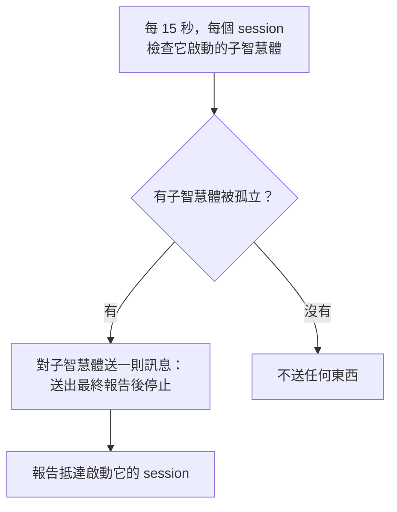

子智慧體的結果只有在啟動它的 session 自己的行程持有 pi-herdr-agents 的 watcher 與已啟動子層的登記簿（`runningSubagents`，位於行程全域的槽位 `globalThis[Symbol.for("pi-subagents/runtime")]`）時，才會送達那個 session。`/reload`、`/new`、`/resume` 和 `/fork` 會保留它們，結束 pi 會抑制送達，崩潰或重新啟動則會永久丟失：pi-herdr-agents 在完全重新啟動後不會恢復 watcher。完成後仍保持開啟的子智慧體（例如互動式的）就此被擱置：它完成後停在自己的 pane 裡，沒有人被告知。

<details>
<summary>細節</summary>

Herdr 中每個本身不是子智慧體的 session，每 15 秒檢查一次這種情況。只要 session 沒有被擱置的子智慧體，一次檢查就只讀登記簿和一個目錄；只有未被追蹤、且自身活動顯示在等待的子智慧體，才會帶出一次 pi-intercom session 清單，之後每次檢查再有一次 `herdr pane list`（以及在即將詢問它時的一次 `herdr pane process-info`）。符合以下全部條件時，子智慧體會被要求回報：

- **啟動它的 session 不再追蹤它。** 它的 id 不在那個登記簿裡。登記簿讀不到時（pi-herdr-agents 沒有載入，或不再把它存在那裡），無法確定有東西遺失，所以什麼都不送。
- **它的結果不在啟動者的逐字稿裡。** 沒有任何 `subagent_result` 或 `subagent_ping` 訊息指名該子層的 session 檔。
- **它已經完成。** 它的活動檔顯示 `waiting`（它結束了自己的回合），它的 pane 執行 pi 且 Herdr 顯示 `done`（或 `idle`，pane 在有人看過之後會變成這個），而且 pi-intercom 顯示該 pane 中的 session 為 `idle`。仍在工作、等待問題回覆或尚未開始的子層不會被動。
- **連續兩次都這樣判定，** 間隔 15 秒，以免把剛好正要送出的結果當成遺失。
- **它的 pane 執行的就是這個子層本身。** 該 pane 的前景行程（`herdr pane process-info`）包含這個 session 為該次執行寫下的啟動腳本 `artifacts/<session id>/subagent-scripts/<name>-<run id>.sh`。只是重用該次執行 session 檔的 pane，例如另一個 session 接手的執行，或有人在該檔上自己啟動的 pi，都不是這個子層；Herdr 沒有列出其行程的 pane 也不是。

Straw Boss 接著向該 session 送一則 intercom 訊息：啟動者的 session id 與名稱，以及請它透過 intercom 把最終報告送給那個 session 並停止的要求。啟動者會顯示一則通知。每次執行最多送一則訊息，這裡的一次執行指一個子層 id：它的活動檔以此命名，而子層自己的 `/reload` 會重新啟動該檔，所以檔案的建立時間不能說明任何事。這次執行在訊息送出之前就寫入啟動者的 session（一筆帶有 `nudged` 鍵的 `straw-boss` 項目），所以重新啟動不會重複送，送出失敗則顯示為警告，不再重試。

找不到 pane、pane 沒有執行其啟動腳本，或沒有自己的 pi-intercom session 的子層，看過四次後就放棄，直到下一次 session 啟動（reload 也算）。行程已結束的子智慧體無法被詢問；它的結果留在它的 session 檔裡。被接手的執行（`subagent_resume`）有自己的 id，而它的 pane session 檔裡沒有任何東西指名這個 id，所以它永遠找不到，也永遠不會被詢問。

這是子智慧體自己的啟動者做的事，不是塔台：只有啟動者的行程知道它追蹤了什麼，所以塔台絕不會催促其他 session 的子智慧體，而自己啟動了子智慧體的子智慧體也不會這樣做（它不執行 Straw Boss）。

</details>

### Herdr 還原後變成一般 pi 的子智慧體

還原的情況，一張圖看完：

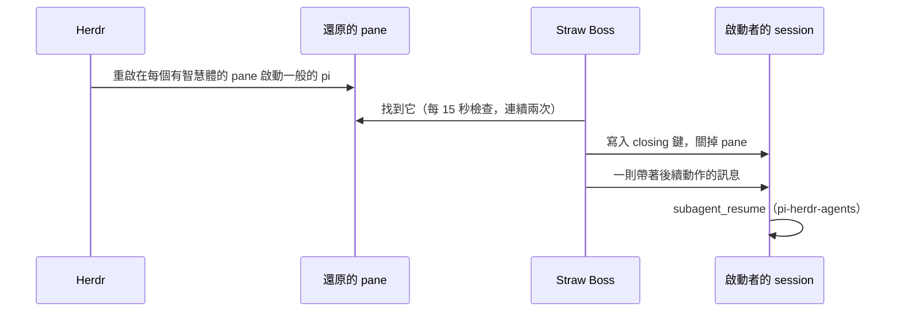

上面的催促要求子層仍然是 pi-herdr-agents 當初啟動的樣子。Herdr 重新啟動後就不是了：在 `resume_agents_on_restore`（預設開啟）下，Herdr 會在每個曾經回報過智慧體 session 的 pane 裡啟動一個一般的 `pi --session <file>`，包括子智慧體的 pane。那個 pi 沒有子層的任何設定（沒有 `subagent-done.ts` 擴充功能、沒有 `PI_SUBAGENT_*` 環境變數、沒有 `caller_ping`、沒有自動結束、沒有 `<session>.exit` sidecar），所以它停在提示字元上閒置，任務沒做完，也永遠不會回報，而還原後啟動者的登記簿是空的，之後也不會再被填入。沒有任何東西能讓它自己回報，所以啟動者改為接手那次執行，方式是透過 pi-herdr-agents 的公開工具 `subagent_resume`。

<details>
<summary>細節</summary>

同樣每 15 秒的檢查（`restored.ts`）在以下全部條件成立時找出這種執行。它只在還有執行可能被記下或找到時才列出 Herdr 的 pane：永遠不可能符合的執行（常駐專家，或啟動腳本不存在或沒有指名該次執行自己的 session），會在那之前就被剔除，所以不會花一次清單或一次行程查看。

- **啟動者沒有追蹤它，而且它的結果不在逐字稿裡。** 與催促時相同：它的 id 不在登記簿裡，也沒有 `subagent_result` 或 `subagent_ping` 指名該子層的 session 檔。它不是常駐專家（啟動腳本中有 `PI_SUBAGENT_PERSISTENT=1`），pi-herdr-agents 無法接手常駐專家。
- **它從未結束。** 它的 session 檔旁沒有 `<session>.exit`，而且 Straw Boss 先前沒有對它採取過行動（`straw-boss` session 項目中沒有它的 `resumed` 或 `nudged` 鍵）。
- **它的 pane 是被還原的那個。** 啟動腳本的標頭（`# Session:` 與 `# Surface:`）指名子層的 session 檔與它執行所在的 pane，而還原會保留 pane id。Herdr 列出同一個 pane，智慧體為 `pi`、session 檔相同，狀態為 `idle` 或 `done`。
- **確實發生過還原。** 子層還在以 pi-herdr-agents 當初啟動的方式執行時（它的 pane 前景執行啟動腳本），啟動者會把該 pane 的 `terminal_id` 記在自己的 session 裡（一筆帶有 `seen` 與 `terminal` 的 `straw-boss` 項目）。Herdr 會給還原的 pane 一個新的 terminal，而 pane id 不變，所以只有 terminal 與記下的不同時，這個 pane 才算數。有人在同一個 pane（同一個 terminal）手動啟動的 pi、從未被看見在執行的執行（重新啟動發生在第一次查看之前），以及不回報 `terminal_id` 的 Herdr，全都是未知，而未知絕不會被關閉。
- **那裡沒有別的東西在執行。** `herdr pane process-info` 剛好列出一個 argv0 為 `pi` 的前景行程，而其他每個行程都有可讀的 argv，且不含啟動或接手腳本（含 `/` 或 `\` 的路徑）。仍在執行啟動腳本的 pane 屬於催促的情況；另一個 session 接手的執行位於自己的 pane，執行的是接手腳本；這些都不會被動。在 Windows 上，清單無法證明腳本不存在，所以那裡的 pane 絕不會被當成已還原。
- **啟動者本身不是子智慧體，而且這次執行是一般的執行。** 檔案旁有 `.pi-herdr-subagent-policy.json` 的 session（還原後的巢狀子智慧體）什麼都不做。由子層自己的 policy sidecar 決定：`persistent` 的執行不動，owner 不是 `public` 的執行按 worktree 執行處理。
- **連續兩次都這樣判定，** 間隔 15 秒，因為 pane 在重新啟動後可能還在啟動中。沒有這種 pane 的執行，看過八次後就放棄，直到下一次 session 啟動。

接著依序進行：把該次執行的 `closing` 鍵寫入啟動者的 session，用 `herdr pane close` 關閉還原的 pane（而且只關那個 pane；舊的 pi 不能和接手的那個同時持有 session 檔），Straw Boss 最多等五秒讓它消失，然後啟動者收到一則自訂訊息；session 接收之後，寫入 `resumed` 鍵。在關閉與訊息之間 reload 或結束，會留下沒有 `resumed` 的 `closing`：啟動者的下一個實例會找到這次執行，看到它的 pane 已不在，就在那時送出訊息。

如果 pane 仍然開著，表示關閉從未生效（行程先死了）：`closing` 鍵會被收回（session 中的 `unclosed` 鍵，讓 reload 不會再讀它），這次執行從頭再經過一次還原的證明。之後不再符合資格的執行（沒有還原的 pane、同一個 terminal、不是一般 pi）會和其他任何情況一樣算作一次落空，第八次落空而放棄時，會有一則警告指名它的 session 路徑。這則訊息以 `sessionPath` 和名稱指名每次執行，引述要傳遞的後續指示（完成你拿到的任務，並回報結果），並告訴模型對每次執行呼叫一次 `subagent_resume`（以 `PI_SUBAGENT_AUTO_EXIT=0` 啟動的執行則設 `autoExit` 為 false）；接手後的執行隨後以一般的 `subagent_result` 回報。

它是會觸發回合的 steering 訊息，就像 pi-herdr-agents 自己送達 `subagent_result` 的方式，也像塔台 run被驅動的方式：閒置的啟動者立即醒來，忙碌的啟動者在下一步收到它。Straw Boss 不呼叫該工具、不匯入 pi-herdr-agents，也不替子層寫結果：這次執行是否、如何被接手，仍由 pi-herdr-agents 和模型決定。

身為塔台的啟動者完全不做這些（塔台由伺服器的佇列驅動，而不是由這類訊息）。每個失敗的步驟都顯示為警告，記為 `gaveUp`，不再重試：關不掉（或關了仍開著）的 pane 不會被接手，放不進 session 的訊息則連同它本來要指名的 session 一起顯示，方便手動接手。

**managed-worktree** 執行（在 `artifacts/<session id>/worktree-runs/` 下有一份 manifest）是例外。它的 pane 是保留下來的 worktree 工作區的根 pane，所以 Straw Boss 不關它，而 pi-herdr-agents 的 `subagent_resume` 既不會重新接上 worktree 的生命週期，也不接受這樣的 session。訊息會說明這點，指名 pane、worktree 與分支，告訴模型不要對它呼叫 `subagent_resume`，並讓還原的 pi 停在提示字元等使用者繼續（回合中途被切斷的執行，會被告知繼續，見下文）。

</details>

#### 回合中途被切斷的子層，會被告知繼續

重新啟動或重新開機可能正好發生在子層回合的中途，還原的 pi 於是停在提示字元，沒有事可做：被打斷的工具呼叫沒有結果，也沒有人接續該回合。在一次執行交給啟動者之前，`cut.ts` 會讀子層 session 檔的結尾（它的最後一段，會增長到包含最後一則助理訊息；大檔案不會整個讀）。只有 `message` 項目，以及啟動回合的自訂訊息（intercom 訊息、巢狀啟動者的結果、Monitor 的喚醒、second-thought 或文件審閱通知、robot-hand 的後續）才算數，所以自訂項目、模型變更或任何其他通知都說明不了什麼。

<details>
<summary>細節</summary>

符合以下任一情況，session 即為**被切斷**：最後一則助理訊息的最後幾個工具呼叫沒有結果，或最後一步是模型從未讀過的工具結果，或最後一步是沒有人回答的訊息，或最後一則助理訊息是重新啟動會留下的錯誤：claude-bridge 的 `Claude Code process terminated by signal SIGHUP` 或 `exited with code 129`（SIGTERM 或代碼 143 可能是手動砍掉的，沒有任何東西顯示重新啟動發生在它之後，所以不算被切斷）（回覆在寫到一半時被切斷，不論是否有已開始串流的工具呼叫）。

以下情況不算被切斷：最後一則助理訊息結束了它的回合（stop；abort，也就是老闆自己按的 Esc；任何其他錯誤，例如配額或被取代的對話）、回合停在一個問題上（`ask_user_question`、`caller_ping`、intercom 的 `ask`：子層和重新啟動前一樣在等答案）、檔案讀不到，或檔案沒有任何步驟。只有單純的工具名稱（字母、數字、`_`、`.`、`:`、`-`，最長 64 字）會被引述進文字，其他的稱為「a tool」，時間必須是 ISO 時間。

子層只會被告知一次，在一則訊息裡：它的最後一個回合被 Herdr 重新啟動或重新開機切斷（附上它最後一筆記錄步驟的時間），該工具呼叫（以名稱）沒有得到結果，在重新執行任何會改變狀態的東西之前，應先檢查目前的狀態，然後繼續任務並回報。怎麼送達則視這次執行而定：

- 被接手的執行（pane 已被關閉）把它當作後續指示收到。啟動者的訊息把這次執行列為在回合中途還原的，附上那段文字，並告訴模型把這一段而不是通用的後續指示傳給 `subagent_resume`。這次執行只會被接手一次，所以只會被告知一次。
- managed-worktree 執行保留它還原的 pane，所以 Straw Boss 自己透過 intercom 送出文字（與上面回報要求相同的送法），對象是 Herdr 位置為目前且位於該次執行 pane 中的 broker session（位置不可用時，會保留它註冊時的 pane id，所以不算）。還原的 worktree pi 不會自己向任何人回報，所以文字中也指名啟動者（它的名稱與 intercom session id），並像上面的回報要求一樣，請它把最終報告送到那裡。它絕不會被打進 pane，所以老闆在提示字元裡有的東西會保留。

  只有在該 session 自己的 intercom 狀態為 `idle`（且 pane 在查看時為 idle 或 done）時才送出，而且在送出前會再讀一次逐字稿：已有人讓它繼續的子層不會被告知。尚無法連上的 session（pi-intercom 在 pi 啟動後一會兒才連線）會在接下來的查看中再看，最多四次；之後告知啟動者無法連上它。`continued` 在送出之前就寫入啟動者的 session，所以每次還原最多告知一個子層一次，即使跨過 reload 或送出失敗也一樣。
- 兩種情況下，啟動者收到的那一則訊息都會說明哪些執行是在回合中途還原的，對 worktree 執行還會說明子層是否已被告知（「not idle, wait for its report over intercom」；此時訊息不會讓啟動者為這次執行去那個 pane）或沒有（原因，並請在它的 pane 裡讓它繼續）。

</details>

#### 限制：老闆正在輸入的草稿

Straw Boss 看不到另一個 pi 的提示編輯器，而 intercom 訊息在狀態為 idle 時就會立即啟動子層的回合。如果老闆在還原後的第一分鐘內在還原的 pane 裡有草稿，草稿會保留（不會打任何東西進編輯器），但子層可能在老闆送出之前就先行動。文字會告訴子層先檢查狀態。子層這邊的防護（它自己的 Straw Boss 擴充功能在編輯器清空前先扣住訊息）需要兩者之間專屬的通道、一個確認，以及對擴充功能版本較舊的子層的備援，所以不屬於這個版本。

<details>
<summary>細節</summary>

未涵蓋：本身已被接手（`subagent_resume`）的執行，不會在第二次重新啟動後被復原。它的接手腳本命名為 `<name>-resume-<time>.sh`，標頭（`# Session:`、`# Surface:`）確實給出 session 檔與 pane，但沒有該次執行的 id（它只在腳本的指令中，作為 `PI_SUBAGENT_ID`），而這裡其他每項證明都繫於這個 id。被接手的執行重用原本的 session 檔，檔名帶的是原本的 id，所以 pane 和逐字稿都無法與新 id 對應（`ownFile`），而原本那次執行的 `subagent_result` 指名同一個 session 檔，所以逐字稿也說不出被接手的執行是否完成。

要涵蓋它，就得憑猜測關閉 pane，所以接手之後的重新啟動維持未知，什麼都不關；而留下未被取用的 `.exit` sidecar，表示子層已完成，所以這次執行不動，它的結果必須從 session 檔讀取。

</details>

## 瀏覽器檢視

`/boss gui` 會在你的預設瀏覽器顯示整個網：一張遊戲風格的地圖，即時且帶動畫，你可以讀任何單位的通訊畫面，也可以對它的 session 打字。

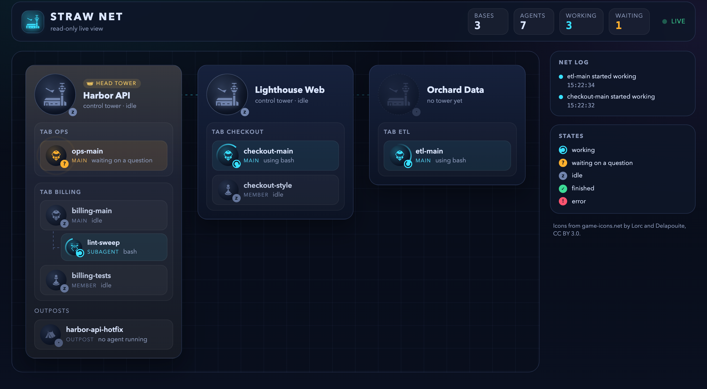

這一節分成六組：[地圖、基地與單位](#地圖基地與單位)；[警示與提問](#警示與提問)；[單位頁面顯示的內容](#單位頁面顯示的內容)；[關閉、開啟與信任](#關閉開啟與信任)；[提供頁面](#提供頁面)（遠端與 Wi-Fi 存取、server）；以及[檢視、主題、手機與設定](#檢視主題手機與設定)。

### 地圖、基地與單位

#### 任何 session 都能開啟它

任何 session 都能開啟它，不論在 Herdr 工作區或子工作區，不論有沒有加入。它不改變任何角色，也不寫入 token。已加入的 session 透過它的分頁頻道讀取各 session；無法加入的（子工作區）則用它自己的頻道（`straw-boss/view/<hex of the pane id>`，絕不具備 owner 資格），這個頻道不參與任何分頁。在 Herdr 之外，擴充功能不啟用，所以沒有這個指令。

#### 它顯示什麼

網所涵蓋的每個工作區都是一個**基地**：有存活塔台，或有已加入 session 的工作區。兩者皆無的工作區，以及沒有加入的 session，都不顯示。基地有它的**塔台**（主塔台戴著皇冠；沒有塔台的基地顯示暗色的幽靈）、每個分頁的主智慧體和成員（作為單位）、啟動它們的 session 底下的子智慧體、塔台底下塔台自己的子智慧體（連結方式與儀表板相同，不論它們在哪裡執行），以及作為父層底下**前哨**的子工作區。

<details>
<summary>細節</summary>

單位卡片顯示它在目前狀態已經多久（從伺服器看到它進入該狀態起算）、它的 todo（完成數／總數與進行中的任務，來自 rpiv-todo，由該 session 的 bridge 轉送），以及它最近幾步，以一排標記顯示在卡片底部。地圖下方的**時間軸**標出網在最近 30 分鐘內的加入、離開和狀態變化（參考 [zoetrope](https://github.com/furkankly/zoetrope)）：等待和錯誤在最上，工作在中間，其餘在下，滑鼠移上去顯示名稱，並連到它的單位。伺服器保存這些資料，所以重新載入的頁面仍然有；手機則把這條時間軸收合成只顯示最新的事件。

基地像 masonry 一樣依閱讀順序排列。地圖超出視窗時，角落的總覽以各基地的狀態顏色顯示每個基地，點擊哪裡就捲動到哪裡。

</details>

#### 狀態

狀態在各處看起來都一樣：

| 狀態 | 外觀 |
| --- | --- |
| 執行中 | 旋轉的環和旋轉符號徽章 |
| 等待問題回覆 | 琥珀色的 `?` 會跳動，帶脈動環 |
| 閒置 | 暗色的 `z` |
| 完成 | 綠色的 `✓` |
| 錯誤 | 紅色的 `!` |

<details>
<summary>細節</summary>

變化會有動畫；頁面遵守 `prefers-reduced-motion`。通訊畫面開著的那個 session 正在做什麼（思考、使用工具、看著 Monitor、指揮、等待老闆）不是紀錄中的一列：它工作時，輸入框外圍有一圈環繞著跑，等待老闆時環靜止並呈琥珀色，同樣的意思也在 live region 裡用文字說出。

</details>

#### 路由

| 檢視 | 路由 |
| --- | --- |
| 地圖 | `/<token>/` |
| 基地 | `/<token>/w/<workspace id>` |
| 單位 | `/<token>/w/<workspace id>/s/<session key>`，可選擇加上 `?at=<entry id>`，把它的通訊畫面開在某一筆項目 |

<details>
<summary>細節</summary>

連結是真正的連結（中鍵點擊和複製連結都能用）；一般點擊、上一頁和下一頁會在不重新載入的情況下切換檢視，Escape 則上移一層。標頭中的 **Straw Net** 標題會回到地圖。深層連結會直接載入它的檢視。

</details>

#### 放大的基地

工作區路由把基地大幅畫在地圖的格線上：它的塔台、每個分頁作為一個由單位 token 組成的小隊（圖示和狀態徽章都相同）、繫在啟動它們的單位或塔台底下的子智慧體、前哨，以及工作區裡其他的 pi pane，作為未編列的單位（在網之外，灰色，帶虛線環）。每個單位顯示它最後一行助理輸出，從它的 session 檔結尾讀取。進入基地時，會從它在地圖上的位置縮小離開（zoom out）。

#### 單位的通訊畫面

session 路由把該 session 的對話顯示為通訊紀錄，側欄顯示單位的檔案（頭像、角色、狀態、模型、context 用量、目錄、基地、小隊、啟動者、派出的子智慧體）。它的**終端機**按鈕會把單位的終端機鏡像開成紀錄旁的一格。

##### 紀錄

你的訊息在右邊，金色；單位的傳送在左邊，帶著它的圖示。每個工具呼叫是一張收合的動作卡片，帶狀態徽章（執行中、完成、失敗），思考內容折疊在它的長度後面，壓縮（compaction）顯示為分隔線。助理訊息的標頭寫的是單位的角色（塔台、主智慧體、成員、子智慧體）加上模型和時間，而不是 session 的名稱（頁面標頭已經顯示）；轉送來的訊息仍然寫出它的寄件者。

<details>
<summary>細節</summary>

新的項目在 pi 寫入時出現；還在串流中的文字還不在檔案裡，所以會顯示在回覆的結尾。紀錄開在最新的項目，並固定在那裡。往上捲時它留在原處，一顆浮動按鈕（**跳到最新**，有新項目進來後則是 **N 則新的**）會捲到結尾並再次固定。往上捲時會載入較舊的頁面；頁面中最多保留 600 筆項目。

</details>

##### 終端機鏡像

**終端機**按鈕會在紀錄旁開一格該單位 pane 的即時鏡像。伺服器只送出顏色與屬性，頁面用文字畫出各列；pane 有變動時，鏡像在一秒內更新。

<details>
<summary>細節</summary>

這一格顯示單位的 pane 所顯示的內容，帶顏色和屬性，在內容變動時一秒內更新（每秒最多讀 4 次，由所有顯示它的頁面共用，沒有頁面顯示時則不讀）。伺服器只送出顏色和屬性的跳脫序列，頁面用文字建立各列。**符合寬度**把它縮放到符合該格並捲到底部，也就是 pi 編輯器所在處；否則它保持原尺寸並可橫向捲動，和手機上一樣。session 在等待 secret（`secret_drop`）時不讀取任何東西，該格也會這樣說明。某一格在它的瀏覽器分頁被隱藏 5 秒後暫停，顯示時恢復。唯讀的問題面板也提供**顯示終端機**。在手機上，鏡像僅供顯示：在裡面打字或點按不會送出任何東西。

</details>

##### 按鍵板

鏡像下方的按鍵板每點一下送出一個按鍵：`esc`、`tab`、`⇧tab`、方向鍵、`enter`、`space`、`⌫`、`home`、`end`、`pgup`、`pgdn`，以及 `1`–`9`（收合起來）。它沒有字母、`/`、Ctrl 或 Alt，伺服器也拒絕把它們當按鍵。

<details>
<summary>細節</summary>

- 它只在該格即時顯示終端機時（最近 3 秒內有一格畫面）才作用，每秒最多 8 個按鍵。
- session 在等待 secret，或停在它的面板可回答的問題時，只有 Escape 有作用。已配對的裝置同樣只送 Escape，而且在 `link_request` 開著時不送提示。
- 送出 **enter** 之前，伺服器會問 session：這個 Enter 會提交什麼。如果那是結束或取代 session 的指令（`/reload`、`/new`……，從歷史叫回來的也算）、另一個 `/` 或 `!` 指令，或是讀不到的編輯器，就會先要求確認。在閒置的 session 上一秒內第二次按 Escape（會開啟 pi 的樹狀（或 fork））也會詢問。
- 確認時，按鍵板用頁面自己的話說明原因，由伺服器的 `confirm` token 選出（`gui/confirmwords.ts`；只有頁面不認識的 token 才用伺服器的英文），上方是兩顆等高的按鈕：送出的那顆帶著它的標籤（**Send Enter**），實心填色；**Cancel** 只有外框，焦點落在它上面。
- 按鍵板的按鈕和打字的按鍵走同一個寫入佇列：寫入進行中按下按鈕，會輪流等待，期間按鈕保持可用。Escape 送到 pane，不是送到頁面。

</details>

##### 對鏡像打字

在桌面（細緻指標）上，點進鏡像會讓它取得鍵盤，直到點到別處；拖曳選取文字以便複製則不會，而把 session 檢視切換到它的終端機時會取得一次。按鍵落在鏡像角落的一個隱形文字框裡，所以輸入法在那裡顯示它的候選字。

<details>
<summary>細節</summary>

在手機上沒有東西會自己取得鍵盤，因為點一下 pane 不會開啟螢幕鍵盤。終端機的**鍵盤**按鈕（鍵盤）會把焦點放到同一個文字框並開啟螢幕鍵盤（再點一下，或離開終端機，就會關閉）。在裡面打的字會以文字送出（輸入法的組字在結束時以一次寫入送出），Backspace 和 Enter 在螢幕鍵盤沒有送出按鍵時，改從它的 `beforeinput` 讀取。切換到終端機時，輸入框也會放掉焦點，所以按鍵絕不會落到隱藏的對話裡。

送出的有以下這些，全都走同一個 `keys` 端點、受同樣的防護：

- 按鍵板的按鍵以它們自己的按鍵送出（方向鍵、Enter、Escape、Tab、Shift+Tab、Backspace、Home、End、Page Up、Page Down），Delete 則以它的序列送出；
- Ctrl 或 Alt 加字母、Alt+Enter、Alt+Backspace，以及 Ctrl 或 Alt 加 ← 或 →，用 Herdr 的命名（字母取自按鍵的位置，因為 Mac 上的 Alt 打 A 會打出 å）。Ctrl+Z 絕不送出：pi 會在背景停住，而這裡沒有任何東西能把它帶回來。Ctrl+D 會先詢問（在空的編輯器上它會離開 pi），一秒內第二次 Ctrl+C 也會（pi 在第二次離開）。⌘ 仍歸瀏覽器，非 Mac 上對選取文字的 Ctrl+V 和 Ctrl+C 也是；
- 字元（包括 `/`、`!` 和輸入法的文字）作為打字文字（`{text}`）：一次原始寫入，1 到 64 個可列印字元，所以不會夾帶換行、tab 或跳脫序列，Enter 仍然單獨送出並先詢問；
- 貼上作為一次貼上（`{paste}`）：最多 4,000 個字元，可含換行和 tab 但不含其他控制字元，伺服器會把它包進終端機的括號式貼上標記，所以 pi 把它當成貼上，其中的換行不會提交任何東西。

寫入一次一筆，最快每 130 毫秒一次，同樣受每秒 8 次的限制。這期間打的字元併入下一次寫入，按住的按鍵只會在佇列為空時重複（Enter、Escape、Tab 和組合鍵絕不重複），被拒絕或要求確認時，會丟掉仍在佇列裡的內容。

</details>

##### 輸入框

紀錄下方的輸入框透過 Herdr 打進單位的終端機，就像在那裡打字一樣：

- **Send**（Enter；Shift+Enter 換行；輸入框空時停用）在單位閒置時送出提示，在它工作時送出引導訊息；
- **After this**（Alt+Enter，在它工作時顯示）把一則訊息排到目前任務完成之後；
- **Stop** 在確認後送出 Escape。

<details>
<summary>細節</summary>

輸入框裡只有 `/` 和正在打的名稱時，上方的選單會列出該 session 中相符的指令（擴充功能指令、提示範本和 skill，照它自己的 pi 所列；pi 內建指令不列出）：↑ 和 ↓ 移動，Enter、Tab 或點擊把 `/name ` 放進輸入框，Escape 關閉它。這份清單由該 session 的對話框 bridge 回答，所以是該 session 自己的集合，一秒內沒回答時選單什麼都不顯示。

開頭的 `/` 或 `!` 會執行 pi 或 shell 指令；結束或取代 session 的指令（`/quit`、`/exit`、`/new`、`/resume`、`/fork`、`/clone`、`/import`、`/reload`）會先詢問。文字會落在終端機編輯器裡尚未送出的任何內容之後，並一起送出。輸入框只在 Herdr 確認收到輸入後才清空，並保留這期間打的任何內容；沒有被確認的送出絕不重送（請查看終端機）。答案到達時頁面無法說的事（你在別的 session，或頁面重新載入了）會保留下來，在你回來時顯示：為什麼某次送出被拒絕、它沒有被確認，或者，如果你編輯了已經送出的文字，原本的已經送出。

串流中斷、session 不在了，或它在等對話框時，輸入框會停用並說明原因（能在上方面板回答的就在那裡回答，否則在終端機）。**已關閉的頻道**不接受打字：輸入框說明原因（「This session is no longer live; its history stays readable.」），通訊畫面標頭顯示「channel closed」，伺服器對它拒絕輸入和按鍵（409 `not_live`）。session 離開網，或它是沒有任何 pane 為它執行 pi 的已完成子智慧體（它的 pane 已不在，或回到 shell）時，頻道就關閉；pi 仍在執行的已完成子智慧體（互動式、沒有自動結束的），在已配對裝置的頁面上和在這台電腦上一樣保有輸入框。其他子智慧體像任何 session 一樣直接打字。

Ctrl+C 和 Ctrl+D 絕不從瀏覽器送出。在觸控螢幕上，Enter 換行，Send 才送出；草稿在重新載入後仍在。Markdown 渲染成 DOM 節點，絕不當成 HTML；只有 `http`、`https` 和 `mailto` 連結是連結；引言區塊和清單最多巢狀 16 層，更深的層級維持為文字。

</details>

### 警示與提問

#### 警示與面板

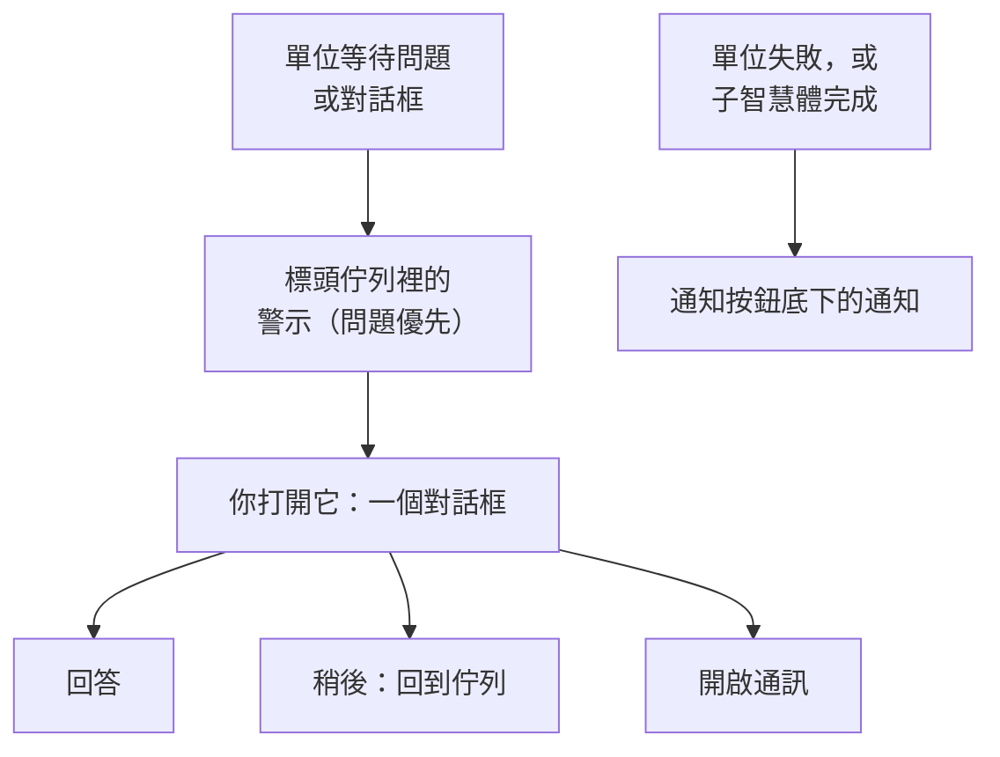

只有需要你回答的單位才會發出警示。警示在標頭排成佇列，絕不自己打開：你把它打開成對話框，然後回答、用**稍後**放回佇列，或用**開啟通訊**跳到該單位的通訊畫面。失敗和已完成的子智慧體是**通知**：它們另外放在通知按鈕底下，絕不搶走焦點。

<details>
<summary>細節</summary>

只有需要你回答的單位才會發出顯眼的警示：正在等待問題或對話框的單位（標記為等待，或有待處理的對話框）。失敗的單位（標記為錯誤，或失敗、或沉默的 Monitor）以及完成的子智慧體是**通知**：它們絕不佔用標頭的警示、不會排入對話框佇列，也不搶焦點。警示絕不會自己開啟任何東西：它加入標頭的佇列（問題在前，其次是通知，各自依最舊的在前），並在單位繼續往下走時離開佇列。

標頭的警示、Space 和對話框佇列的計數只算問題；通知等在它旁邊的**通知**按鈕底下，只在有通知時顯示，其中有失敗時呈紅色。頁面開啟之前發出的通知不算新消息。你從佇列開啟警示，或點擊正在等待的單位；它們會在側欄上方的 dock 中以對話框開啟。

你再開啟的第二個對話框疊在上面，下面那個露出一部分；點擊露出的部分可以把它帶到上面（真正落在條帶下方某個控制項上的點擊，例如設定連結，會交給那個控制項）。你正在閱讀的對話框絕不會被你沒開啟的對話框蓋住：警示只會排隊，沒有經過你的操作而開啟的對話框，會放在最上層對話框下面，不取得焦點。關閉最上層會顯露下面那個，下面沒有時，則顯露佇列中下一個問題或錯誤。

**稍後**把警示放回佇列，不開啟任何其他東西；如果單位在對話框開著時已經繼續往下走，警示就已過期，改為離開。對話框絕不會在你面前被關掉：如果它的單位在對話框開著時離開了網，對話框會顯示**已離開**（「left the net」），不再有它的問題或開啟通訊。佇列在標頭（它的提示）與每個對話框（「Also queued: 1 needs you · 1 finished」）中的計算方式相同：問題和錯誤需要你處理，也是關閉對話框後下一個會顯露的；只是完成的單位則留在佇列裡等你開啟，另外計算。

**開啟通訊**會前往該單位的通訊畫面，停在警示所指的那筆項目（警示到達時讀取：附上它所等待的工具呼叫的回覆，否則是它最後一則回覆），必要時載入較舊的頁面，並讓那筆項目亮一下；通訊紀錄會停在那裡，並帶著**跳到最新**，直到你往下捲。它會關閉警示，而不開啟下一個排隊中的，所以不會有東西蓋住你前往的通訊畫面。項目記在 URL 裡（`?at=`），所以上一頁、下一頁和連結本身都會再次落在它上面；已不在歷史中的項目會開在最新的一筆，以其他任何方式開啟單位時也一樣。

Escape 只關閉最上層的對話框，焦點回到原處，對話框不是 modal（頁面仍可使用，沒有東西困住焦點）。文件則改以**並排區塊**開在目前檢視旁，共用它的寬度；自行到達的區塊不取得焦點，狹窄的視窗把區塊顯示為分頁。對話框顯示單位、它的最後一行，以及它正在等待的工具呼叫，並附上通往它通訊畫面的連結。

</details>

#### 問題與選擇器

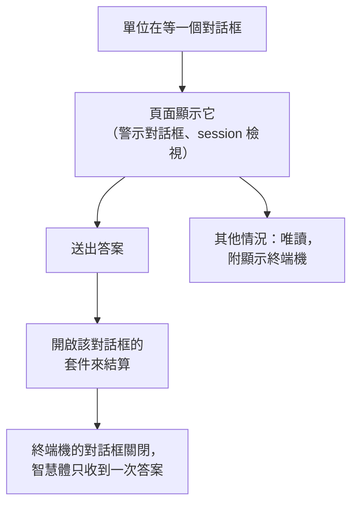

單位在等對話框時，頁面會在警示對話框和 session 的輸入框上方顯示它。有四種可以從頁面回答：pi-robot-hand 的選擇器、rpiv 的問卷、pi-code 的 hook gate，以及擴充功能自己的 `select` 或 `confirm`。**送出答案**會交給開啟該對話框的套件，由它像終端機的答案一樣結算，所以智慧體只收到一次答案。其他一律唯讀，而 `secret_drop` 永遠不能從頁面回答。

<details>
<summary>細節</summary>

單位在等待對話框時，它的警示對話框和它的 session 檢視（輸入框上方）都會顯示它。有四種可以從頁面回答：pi-robot-hand 的選擇器（`robot_hand` ≥ 0.3.0：照原樣顯示它的標題，每個選項附上它作用的位置和終端機的編號，以及**複製指令**，它透過瀏覽器複製，不回答任何東西）；@juicesharp/rpiv-ask-user-question 的問卷（`ask_user_question`：一到四個問題，每題有標頭標籤、附說明的選項（單選為選項鈕，可複選時為核取方塊）、「Or type your own answer」和「Note (optional)」）；pi-code 的 hook gate（任何工具受管控的呼叫之前的確認，例如「Allow bash?」：**Allow** 或 **Deny**）；以及任何擴充功能自己的 `ctx.ui.select` 或 `ctx.ui.confirm`（見[任何擴充功能的 select 與 confirm](#任何擴充功能的-select-與-confirm)）。

**送出答案**交給開啟該對話框的套件，由它像終端機答案一樣處理，所以終端機的對話框會關閉，agent 只收到一次答案。面板接著顯示「Answered.」；終端機先答時顯示「It was already answered in the terminal.」；套件拒絕時顯示擁有者的理由（對話框仍可回答）；沒有收到確認時顯示「Not confirmed. Check the terminal」和**再檢查一次**（重送同一個答案，絕不送新的）。

**取消**（在送出旁邊；在標準、極客和手機版面中，手機上是 44 px 的點按目標）以和終端機中按 Escape 相同的方式結束對話框，不選任何東西：rpiv 收到 `{cancel: true}`，它的工具呼叫以它自己的已取消結果結束；`ctx.ui` 的 select 解析為 `undefined`，confirm 解析為 `false`；link gate 與 link 核可把它當成拒絕；pi-robot-hand 0.8.0 的 `robot_hand` 收到帶著對話框 digest 的 `{cancel: true}`，只限 `pending` 說了 `cancellable: true` 的對話框（0.7.x 不說，也就不收），它的工具呼叫以已取消返回，不結束這一輪。它走和答案相同的答案路由，所以第一個答案獲勝、重送會重播，卡片顯示「Cancelled.」。沒有取消路徑的擁有者（pi-code 的 gate、`secret_drop`、0.8.0 之前的 `robot_hand`）沒有這顆按鈕：什麼都不送、沒有按鍵、不讀畫面。

頁面上的 Escape 仍然只關閉對話框檢視，不會取消問題。取消是一種拒絕，所以已配對的裝置在它能選某個選項的地方都可以取消。選項全是 `hereOnly` 的對話框（`/boss` link 核可、它的 confirm 和它的措辭 select，以及 `gui rotate`、`gui unpair all`、`server stop` 和 `restart` 的 confirm）會被拒絕來自已配對裝置的請求（403 `local_only`），在那裡也不顯示取消。信任、移除、角色、輪替或離開的 link 核可保有一個已配對裝置可以選的拒絕，所以它可以取消（也就是拒絕）。

問題可以只用鍵盤回答：對話框開啟時，焦點在第一題已選或第一個選項上，而不是在開啟通訊上。方向鍵在選項之間移動（單選在焦點移動時就選取；複選只移動，用 Space 切換）；Tab 和 Shift+Tab 在題目之間移動（最後一題之後，依序到它自己的話的輸入框、它的備註和送出）；Enter，或單選上的 Space，確認一個選項並前往下一個未回答的題目，再到送出，在那裡按 Enter 就送出。在題目最後一個選項再往下，會到它自己的話的輸入框，在那裡 Enter 做同樣的事，Shift+Enter 換行。

焦點在文字框時，頁面自己的按鍵停用，Escape 除外。作用在這台電腦上的選項（robot_hand 的剪貼簿）在已配對裝置的頁面上也提供，並附上說明它作用在哪裡的備註，也接受從那裡送出的答案。不送任何按鍵，也絕不讀畫面：每個 session 的對話框 bridge（在 Herdr 裡的每個 pi，子智慧體也一樣）把它的套件發布在 pi 事件匯流排上的對話框，經由只有該 session 才能擁有的 intercom 擴充功能頻道，轉送給 GUI 伺服器的 session。伺服器只在對話框是該 session 唯一開著的對話框、屬於 session 檔裡開著的呼叫之一（擁有者自己的工具呼叫，hook gate 則是它所指名的呼叫），而且與頁面所顯示的相符（對話框 id 與摘要；見[回答 pi 對話框](specs/2026-10-18-dialog-answers.md)）時，才讓頁面回答。

其他一切都維持唯讀，並附上原因和**顯示終端機**，它會在頁面上開啟它的畫面：`ask_user`（pi-ask-user）、多個開著的對話框（只有在 bridge 轉送超過一個，或它轉送的那個沒有指名開啟中的呼叫時，頁面才會這樣說；最後一則訊息留下多個未回答呼叫的 session，若它唯一轉送的對話框指名其中一個，仍可回答）、已在途中的答案、太長而無法轉送的對話框，或與 session 檔不一致的對話框。

`secret_drop` 絕不能從頁面回答：secret 只在終端機輸入。pi-intercom 的身分是自行申報的，所以同一使用者的行程可以假冒提問 session 的 bridge，在自己的 key 下轉送 secret 對話框，並收到頁面封給它的值。在 intercom 能驗證 bridge 是誰之前，bridge 根本不轉送 secret 對話框（標籤、步驟、目的地和 key 都不離開 session），並拒絕對它的任何答案；伺服器不從任何請求取用 `value`（這台電腦的頁面回 400，已配對裝置回 403），也不送出任何值。

在每個頁面上，面板都是唯讀的等待，沒有欄位，也沒有顯示終端機（鏡像保持隱藏，按鍵板只剩 Escape）：這台電腦的頁面說明機密只在終端機輸入，已配對裝置的頁面則寫成「For security, entering a secret is not supported remotely」（安全考量，遠端不支援）；兩者都指名終端機。加密的程式碼留在樹裡，等這條路徑恢復的那一天；規格說明了什麼擋住它（[回答 pi 對話框](specs/2026-10-18-dialog-answers.md)，「Why a secret is terminal only」）。

`secret_drop` 呼叫本身仍會連同它的引數（標籤、步驟與目的地）顯示在裝置的通訊歷史中，和任何工具呼叫一樣；值絕不會。在另一個開著的對話框旁邊，單位只顯示它在等待機密。有開著對話框的單位立刻算作等待；否則在 Herdr 回報它的 pane 為 `blocked` 期間算作等待，這由 pi 根據 `herdr:blocked` 事件回報。Straw Boss 把 rpiv 的 `rpiv:ask-user:blocked` 轉送進去，每份開著的問卷一次，pi 自己的對話框也一樣（見[被擋住的對話框](#blocked-dialogs)）。

顯示的問題是 session 目前分支上最新未回答的呼叫（對在多個開啟呼叫中被回答的 hook gate，則是它管控的那個呼叫）；超過 256 KB 的呼叫會從檔案更前面讀取（最多 16 MB，顯示時截短），更長的則說明它太長而無法讀取。

</details>

#### 任何擴充功能的 select 與 confirm

每個擴充功能的 `ctx.ui` 是同一個物件，所以 Straw Boss 包住 `select` 和 `confirm`（`input`、`editor` 和 `custom` 不動，因為那裡可能打入機密）。被包住的呼叫會開 pi 自己的終端機對話框，同時把同一個問題轉送到頁面；先到的答案勝出，另一邊隨即關閉。對話框絕不會變差：無法轉送的呼叫就是原本的呼叫。

<details>
<summary>細節</summary>

每個擴充功能的 `ctx.ui` 是同一個物件，所以 Straw Boss（在 Herdr 裡的每個 pi，子智慧體也一樣）取代它的 `select` 和 `confirm`，而不動 `input`、`editor` 和 `custom`（那裡可能打進 secret）。被包裝的呼叫照原樣開啟 pi 自己的終端機對話框，並在同一次呼叫裡，把對話框以 `straw-boss:ui` 底下的 dialog-contract v1 擁有者身分發布在 pi 的事件匯流排上，所以 bridge、hub 和答案路由把它當成任何擁有者的對話框處理，所有既有的檢查都適用（只有一個開著的對話框、摘要、答案已在途中、`secret_drop` 開著、太長）。

`select` 連同它的選項轉送；`confirm` 則是一個對話框，文字是它的標題、一個空行，再加它的訊息，附上**是**與**否**。第一個答案獲勝，另一邊被關閉：來自頁面的答案透過它的 `signal`（與呼叫者自己的合併）中止終端機的對話框，擴充功能的呼叫以該答案解析（選到的選項，Yes 為 `true`，No 為 `false`），只有一次；在終端機的答案則關閉頁面的對話框（`stale`，已在終端機回答）。

對話框絕不會變得更糟：無法轉送、或轉送啟動失敗的呼叫，就是什麼都沒留下的原始呼叫，拋出或拒絕的對話框則原樣傳遞它的錯誤。

*何時綁定。* 對話框只在剛好有一個工具呼叫進行中時才被轉送，並綁定到那個呼叫（hub 需要它在 session 檔開著的呼叫之中，和 pi-code 的 gate 一樣）；頁面把它寫成「opened while {tool} was running」，因為它可能與那個呼叫無關。沒有呼叫、有兩個以上，或有 `secret_drop` 進行中時，它留在終端機；呼叫的工具有契約擁有者（`robot_hand`）而擁有者什麼都沒轉送時也一樣。頁面顯示的文字中的 Unicode 格式字元（雙向覆寫、零寬標記）以 U+FFFD 畫出。

  只轉送最外層的對話框（`input`、`editor` 和 `custom` 只計數，原樣通過；計數在 `agent_end` 和 pi 更換它的 ui 物件時重設）：在另一個對話框開著時開啟的對話框，會撤回已轉送的那個（頁面無法分辨一個答案會關掉哪個對話框），而它自己不被轉送。超過 100 個選項的 `select`，或標題與選項超過 12,000 個字元的，不轉送。
*擁有者優先。* 有契約擁有者的對話框（`robot_hand`、pi-code 的 gate）由它的擁有者轉送，同一個工具呼叫上被攔截的孿生對話框會被丟掉，不論哪個先開。`ask_user_question` 透過 `ctx.ui.custom` 開啟它的問卷，那個沒有被包裝。
*遠端。* 已配對的裝置回答 `select` 和 `confirm` 的方式和這台電腦的頁面相同：轉送的對話框帶 `confirm: true`（由它的摘要區分，所以轉送者無法把其中一種冒充成另一種），每個頁面都顯示 Yes 和 No。機密是例外：沒有任何頁面接受。取消遵循和任何選項相同的規則：已配對的裝置可以取消 select 或 confirm，除非它的每個選項都是 `hereOnly`。
- *生命週期。* 包裝會在它包裝過的 `ui` 物件上做記號，所以載入了套件的多份副本時只會包裝一次。pi 在綁定新的 UI context（模式變更）時會取代該物件，所以記號在 session 啟動時和每次工具呼叫之前檢查，並把包裝放回新的物件上；關閉時，轉送的對話框會被關掉，原始方法也會還原。沒有 UI 的 session 有 pi 共用的 no-op 物件，絕不去動它。

</details>

#### 需要終端機的答案會開啟終端機

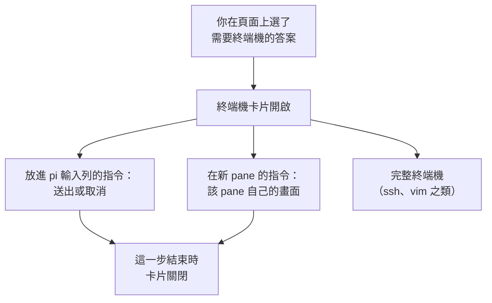

有些選擇把下一步留在終端機：robot_hand 可以把指令放進 pi 的輸入列，或在新的 Herdr pane 裡執行或輸入。擁有者接受這種答案後，頁面會開一張小的**終端機卡片**放著那條指令，這一步結束時卡片就關閉。需要更多時，**完整終端機**會開出整個終端機。

<details>
<summary>細節</summary>

有些選項把下一步留在終端機：robot_hand 的 *Put it in my prompt*（指令在 pi 的提示字元等著 Enter）、*Type it into a new Herdr pane* 和 *Run it in a new Herdr pane*（在 pi 下方的新 pane 顯示或執行指令；該 pane 會自己關閉，它的輸出以訊息傳回）。選項以可選的 `next` 這樣說明（`"terminal"` 或 `"pane"`，和 `note` 一樣是提示，不納入雜湊）；pi-robot-hand 不送，所以它的 adapter 從它顯示的標籤判讀，自己送的擁有者則保留它自己的。

擁有者接受這類答案時，答案路由的回覆會帶 `then`（來自已儲存對話框的選項，絕不來自請求），頁面在每個檢視中為它開啟**終端機卡片**：一張小卡片，裡面有答案放在那裡的指令（pane 則是它畫面最後四列）、一行附有**隱藏我輸入的內容**切換的輸入，以及一顆按鈕：提示字元中等著的指令是 *Run*（執行），pane 是 *Send Enter*。卡片送出按鍵板送出的內容，走同樣的寫入、受同樣的伺服器檢查。

對 pi 提示字元中的指令，第一次點按會遇到伺服器對指令的確認，卡片把它畫成一對內嵌按鈕，*Send it* 與 *Cancel*（頁面依伺服器的 token 用自己的話；Cancel 取得焦點，所以第二次或按住的 Enter 無法確認）。最後一列以冒號結尾，且在 *password*、*passphrase*、*passcode*、*PIN*、密碼或口令之後時，會自己把該行變成密碼欄位並說明；開關可手動遮住，手動遮住在它所回答的那個 Enter 之後結束。

這個欄位在任何表單之外，送出時清除；提交輸入法候選字的 Enter 不送出任何東西。attach 被拒絕或失敗的卡片可以從它的按鈕重新 attach（不送按鍵），最多每秒一次，持續失敗時倍增到 8 秒，並在這期間說明它正在連線。只是回顯上方顯示的指令的列（一個提示字元，然後是指令）會被省略。

按鍵或鏡像的拒絕，以伺服器的代碼（`no_mirror`、`blocked`、`rate`、`standing`、`not_found` 等）用頁面的語言說明；頁面不認識的代碼則顯示伺服器自己的文字。頁面對每個帶有 `then` 的被接受答案都這樣做，在這台電腦和已配對裝置上都一樣；只有一條規則，沒有 robot_hand 的特例，在一次呼叫中完成（`openThen`，`gui/terminalthen.ts`），每個檢視都從答案的結果到達它（`gui/ask.ts`，所以警示對話框、session 檢視和禪都一樣），任何其他以終端機結束的東西也可以呼叫它。

它交給頁面一個步驟，`{kind: "prompt" | "pane", key, command}`，由檢視只決定卡片擺在哪裡：標準和極客放在覆蓋層的 dock（非互動視窗，手機上是底部的面板，上面開啟的對話框會蓋住它，並立刻關閉把老闆送到那裡的警示對話框），禪則作為它終端機層的卡片模式（用墨色，在頁面中央，右上角有「回到禪」 / *Back to Zen*）。較新答案的卡片取代正在顯示的那張。

**卡片在它的步驟結束時關閉**，依它送出了什麼或它自己的 pane 發生了什麼，絕不依單位的標記：提示字元的卡片在它自己的 Enter 被接受時，pane 的卡片在 pane 結束時（`ended` 畫面、404 或 409 `pane_closed`）；在標準中 × 和 Esc 會關閉它，在禪中則由該層的 Esc Esc 返回。

**完整終端機**開啟卡片出現之前的終端機，用於 ssh、vim 之類：標準的 session 終端機模式或該 pane 的區塊，在禪中則是同一層的完整模式（頁面唯一的終端機，和標準相同的鏡像、按鍵板與鍵盤，只 attach 一次；它取得鍵盤時 Esc 送給它，焦點在該層其他地方時 Esc Esc 返回，沒有別的東西會結束它）。該層絕不會自己關閉：pane 關閉或它的授權結束、提示字元自己的 Enter 被接受，或單位又開始工作時，該層列上有一行安靜的字說明步驟已完成，老闆用**回到禪**返回。

禪的*開啟終端機*按鈕（被擋住的提示字元、唯讀對話框）直接開啟那個完整模式，並處於*待命*：單位的第一件工作就是那個步驟的結束，這一點由該列說明。沒有執行中塔台的塔台，在卡片上顯示它的句子而不是各列。標準絕不會從禪造訪，原本在那裡的畫面（項目、同伴或閒置）會照原樣再次顯示。pane 由伺服器找出：答案送出之前先記下該分頁的 pane，答案被接受後，再以猜不到的 id 授予一個新 pane，連同它的終端機 id 一起保存（重複使用的 pane id 會被拒絕），最多 8 個、6 小時。**哪個 pane** 取決於擁有者。

選項說明 `tagged` 的擁有者，會用 Herdr 的 pane token `sb_answer=<the answer's answerId>` 標記它開啟的 pane；伺服器只對分頁中恰好帶有該值的新 pane（3 秒內）授權，不授權給其他任何 pane，不論未標記的 pane 多新，兩個 pane 帶有它則什麼都不授權。不標記的擁有者（pi-robot-hand 0.3.x）則由伺服器依時間判斷：3 秒內恰好一個沒有執行智慧體、也沒有 `sb_role` token 的新 pane。

它的殘餘風險是：把 pane 與答案連在一起的只有時間，所以同一分頁中在那個時間窗內單獨出現的 pane（Herdr 還沒偵測到它的 pi 的子智慧體或 `/boss open` 分割、老闆自己的分割、另一個 session 的答案）會被授權，並在 Herdr 回報它的智慧體之前接受裸按鍵（之後授權結束）；Herdr 的偵測可能延遲，這對 pi 沒有量測過。標記的擁有者沒有這種殘餘風險。兩個新 pane（未標記的擁有者）、沒有，或讀不到的版面，都不授權（`then.pane` 為 `null`；卡片說明 Herdr 中開了一個 pane）。

授權絕不會到達執行智慧體或帶有 `sb_role` 的 pane，並在它的 pane 一變成這樣時就結束：下一個按鍵被拒絕（409 `pane_closed`），鏡像每個畫面都重讀該 pane，一旦它成為 pi session 或塔台就不再送出，授權連同它的讀取器一起被丟棄。

`POST /api/panes/<grant>/mirror` 和 `/keys` 對它做鏡像（「裸」讀取器，背後沒有 session）並對它送按鍵（按鍵板的按鍵、組合鍵、打字文字與貼上，受同樣的速率與即時鏡像前提，但沒有 pi session 的防護、探測或確認），對老闆的頁面和已配對的裝置與對 session 的終端機按鍵相同；`hereOnly` 的選項仍然拒絕已配對的裝置。不開啟的：唯讀的對話框（`secret_drop`、同時多個對話框、太長的）保留它的**顯示終端機**連結，不會自己開啟任何東西，而「未確認」或「另一個答案在途中」的結果，在面板中提供**再次確認**，終端機檢視會把它隱藏。

- **一鍵送出提示字元。** 當選項把 shell 指令放進 session 的提示字元時（robot_hand 把它放成 `! <command>`），伺服器為該答案保留一次點按的授權（答案 id、session、它自己的隨機 nonce，以及 `! <command>` 這一行的 MAC），而 `then` 說 `run: true`。卡片的「執行」以 `run: <answer id>` 送出它的 Enter。

  只有對那個 Enter，伺服器才會連同探測把授權的 nonce 交給 session 的 bridge，而 bridge 對 `command` 草稿回答 HMAC-SHA-256(nonce, 它的提示字元行)（沒有 `run` 的 Enter 不帶 nonce，所以不會為它產生草稿的 MAC；草稿本身絕不離開，但在本機 intercom broker 上、同時看到那一個 Enter 的 nonce 與 MAC 的監聽者，仍可以對短指令測試猜測）。只有 MAC 等於該指令的 MAC 時，Enter 才通過 `command` 確認。

  **`run` 的 Enter 絕不會送出不是那個指令的一行：** 被編輯、清空，或變成文字或結束型指令的提示字元，不論編輯器是在哪裡讀到的，都會被拒絕（`run_changed`，什麼都不送）；唯一改為要求確認的情況，是來自不送 MAC 的 bridge（較舊的）的 `command` 行。結束型指令（/reload、/quit 等）和讀不到的編輯器，不論 MAC 為何仍會詢問。**一鍵只涵蓋沒有可補全 token 的 `! ` 行。**

  含有 pi 補全選單可能在其上開啟的 token（`/` 路徑或 pi 指令、`~`、`@`、`#`、引號、以 `.` 開頭的 token，或結尾的空格）的指令，得不到一鍵：選單可能在行不變的情況下開著，而對 `/` token，Enter 這時會提交選單的選項。

  殘餘風險：在一個單純的字（`ls foo`）上按 Tab 之後，沒有任何規則能把它和指令字區分，選單可能是開著的；一鍵的 Enter 這時只會填入選項而不執行任何東西，授權用掉了，卡片像指令執行了一樣關閉，被改過的行留在提示字元裡等著。pi 不告訴擴充功能它的選單是否開著，所以探測看不到。它的 Enter 保留確認，而 `then` 沒有 `run`。

  授權只回答一次，不論它回答什麼，屬於它的 session，2 分鐘後過期；被改過的行、另一個 session 的或未知／重播的答案 id，以及過期的授權，會以 `run_changed`、`run_unknown`、`run_expired` 被拒絕（用頁面的話說明），下一個不帶 `run` 的 Enter 則照常要求確認。只有 pane 的答案、沒有 `next` 的選項，或擁有者沒有接受的答案，不留下授權。只保存或記錄 MAC。

</details>

#### 通知

通知一經開啟就算讀過：它們沒有稍後，關閉一則也不會把它放回佇列。它們與需要你處理的東西分開等著，放在標頭的**通知 N** 按鈕底下：它會開啟已完成或失敗單位的清單，每個附上它的基地和最後一行；點一列會前往該單位的通訊畫面並清除它，**全部清除**則清除每一則（問題仍在，等著回答）。

<details>
<summary>細節</summary>

pane 已關閉的已完成單位，以及pi-herdr-agents 記錄為完成的子智慧體（它的 `subagent-activity` 檔中的 `phase: "done"`，即使它的 pane 仍在執行 pi），在它的聲音和提醒之後會自己從清單清除：它的父層有結果。地圖仍會把已完成的子智慧體顯示十分鐘。

</details>

#### 放大

警示對話框的 ⤢ 會把對話框停靠區變成視窗中央一個寬面板，適合長的問題；⤡ 則放回去。這個選擇依瀏覽器保存。

<details>
<summary>細節</summary>

警示對話框在 × 旁邊的 ⤢ 會把對話框 dock 變成視窗中央一個寬的面板（最寬 880 px，幾乎和視窗一樣高），供長的問題使用；⤡ 放回去。這個選擇按瀏覽器保存（`sb.dialog-wide`），所以下一個對話框以同樣的大小開啟。手機沒有放大：它的對話框本來就佔滿寬度。三個按鍵驅動對話框：**Space** 開啟下一則警示，和標頭的警示按鈕一樣，**F** 按下最上層對話框的 ⤢ 或 ⤡，**Escape** 關閉最上層對話框。你在打字時（輸入欄位、輸入框及它的 `/` 選單、終端機的按鍵接收器）、按住 Ctrl、Alt 或 ⌘ 時、輸入法組字時，或確認對話框、圖片檢視器或彈出視窗開著時，頁面不處理按鍵；答案選項上的 Space（它會選取或切換），或你用鍵盤把焦點移到的按鈕或連結上的 Space，則保留它自己的啟用行為。

被滑鼠留下焦點的按鈕或連結（點擊之後的標誌）不會扣住 Space：它仍會開啟下一個警示。沒有作用的按鍵（沒有排隊時的 Space、沒有對話框時的 F）不會被攔下，所以頁面照常捲動。

</details>

### 單位頁面顯示的內容

#### 文件

用 pi-herdr-doc-review 顯示文件的 session，會把文件列在它檔案的**文件**底下，點一下就在目前檢視旁開成一格。HTML 文件在沒有腳本的沙盒框裡執行；文字文件以唯讀方式顯示。

<details>
<summary>細節</summary>

用 [pi-herdr-doc-review](https://www.npmjs.com/package/pi-herdr-doc-review) 0.4.0 或更新版本顯示文件的 session（`show_doc`，或自行開啟的 Mini SDD 規格），會在 2 秒內把它們列在它的檔案的**文件**之下，而單位 token 上的羊皮紙徽章會計算仍顯示在它終端機畫面上的文件數（塔台只在它的檔案中列出）。在該 session 的通訊畫面上，到達的文件會在紀錄旁以並排區塊開啟且不取得焦點，除非已經開了四個區塊（它絕不會擠掉你開啟的）；在其他任何地方（地圖、基地、另一個 session）只有徽章改變，而在有文件的 session 上開啟的頁面則一個都不開。

在檔案中點擊會開啟一個，`show_doc` 卡片上的**在旁開啟**在它的文件被列出時也會（較舊的卡片維持文字）。HTML 文件是沒有腳本的 sandbox 框架：頁面的屬性與伺服器的政策都讓它成為不透明的 origin，所以它不執行任何腳本、不能讀取 API 或 cookie，只從它自己的目錄載入圖片、樣式表和字型。它的連結在新分頁開啟，而帶有 `action="cgi-bin:pi-answer"` 的表單，回答 session 的方式與 Chawan 提交完全相同（由擁有者送達）：每次頁面檢視只能送出一次，所以**上一頁**再送出會顯示「Already sent」，**重新載入**則再送一次。

答案放在 GET 的 URL 裡，和 Chawan 一樣，並留在瀏覽器的歷史中：不要把 secret 放進文件表單。**在新分頁開啟**顯示同一個沙箱頁面。文字文件以唯讀方式轉譯，`.md` 為 markdown，其他為純文字。擁有者回報新的修訂版時，正在顯示的區塊會重新載入，隱藏的（另一個區塊分頁）會說明並在顯示時載入；在它的 session 中被關閉的文件，或已結束的 session，會讓它的區塊顯示它已不在清單中。

一個 session 最多列出 32 份文件；太大而無法放進對話框頻道的清單會被丟棄（檔案說明請在終端機中閱讀），而文件絕不會扣住它的對話框。

</details>

#### 檔案

在輸入框貼上、拖放，或用 **+** 挑選的檔案，會以它的位元組 POST 到 `sessions/<key>/upload`，受和打字輸入相同的 origin 與 CSRF 檢查（已配對的手機也一樣），最多 20 MB。伺服器把它存在暫存目錄的 `pi-straw-boss-uploads` 之下（資料夾 700，檔案 600），名稱經過清理，頁面把路徑放進游標所在處的訊息中，就像貼進 pi 終端機的圖片會變成暫存檔路徑那樣；session 用它自己的工具讀取它。文字則以文字貼上。

#### 提醒與音效

設定頁（這個裝置）上有兩個開關，各是一顆標示清楚、以文字顯示開或關的按鈕，按瀏覽器存在 `localStorage`：提醒（預設開）和音效（預設關，所以開啟的頁面不會發出聲音；音效其實是兩個開關，音效與背景音，在下一則說明）。它們作用在 snapshot 所引發的警示：單位轉為等待回答、轉為錯誤，或已完成。

<details>
<summary>細節</summary>

提醒是系統通知（問題的可能發出嗶聲；失敗或完成的則無聲，是安靜的通知），只在頁面隱藏或沒有焦點時發出，每個警示一則，以單位標記，點擊會把頁面帶到那個單位；有焦點的頁面本來就顯示警示佇列。第一次按提醒會請求瀏覽器的權限；在獲得授權之前，開關顯示琥珀色，瀏覽器封鎖時顯示紅色。一批只播放一個聲音，是其中標記最緊急的（等待，然後錯誤，然後完成；錯誤保有它自己的音訊片段，與問題的分開發聲），來自三個 Kenney CC0 音訊片段，打包成帶雜湊的 MP3 檔，在第一次播放時才取得。

音效有 0 到 100 的音量（預設 60，以 `sb.volume` 存在 `localStorage`），底下有試聽按鈕；每次變更都會播放完成的聲音。裝置的偏好設定存放在同一處；另一個分頁的音效開關或音量會立刻套用到開著的頁面。這些片段透過 Web Audio 以音量的平方播放（響度跟隨平方，而且 iPhone 會忽略 audio 元素的 `volume`）。兩者都跟隨每個 snapshot，包括隱藏頁面的，並透過它們自己對聽過什麼的記錄：警示佇列的記錄只在頁面顯示時才前進，所以它仍會把隱藏期間到達的排入佇列。頁面開啟時已經在等待的，兩者都不發出。

</details>

#### 音效與背景音

設定頁的一個音效開關和音量變成兩個，在*這個裝置*之下各有自己的開關和音量：**音效**（事件的提示：標準與佈景主題的問題、完成和失敗片段，單位就緒的鈴聲，禪的缽聲與敲擊聲）和**背景音**（在頁面底下播放的：禪的音樂，鴉閣的雨聲和雷聲；雷聲屬於天氣）。兩者預設都關，並且在標準、極客、禪和鴉閣檢視中都有作用；禪的角落選單和它的調色盤也都帶有兩者（各一個開關和兩段音量調整）。

<details>
<summary>細節</summary>

音量是 0 到 100（預設 60），以平方的形式只作為它那一類的增益進入頁面的音訊核心；每個開關只由它那一類的來源檢查，所以關掉音效會讓提示音靜音、雨聲還在，關掉背景音則讓雨聲、雷聲和音樂靜音、提示音還在。音效有試聽按鈕，並在開啟或放開音量時播放完成的片段；背景音沒有樣本，因為它播放的東西本來就聽得到。

舊的 `sb.sound` 和 `sb.volume` 在某一類沒有自己儲存的值時，被當作兩類的起點讀取（舊的開是兩者都開、用舊的音量，舊的關是兩者都關），而且絕不寫入，所以同一個瀏覽器上較舊的頁面仍讀它自己的。

</details>

#### 圖片

使用者訊息或工具結果中的圖片（png、jpeg、gif 或 webp，如 pi 存在 session 檔中的）在對話中顯示為縮圖：在訊息下方，或在工具卡片下方，不論它是開著或關著。頁面從 `api/image/<key>/<entry id>/<n>` 載入每一張，它讀取那一筆項目並以圖片的位元組回答，快取一天，因為項目絕不改變；歷史本身只帶數量。縮圖開啟燈箱：圖片縮放到符合螢幕，點按則顯示它自己的尺寸，← → 或方向鍵切換同一則訊息的其他圖片，Escape、×，或點它旁邊來關閉。

#### 排隊中的訊息

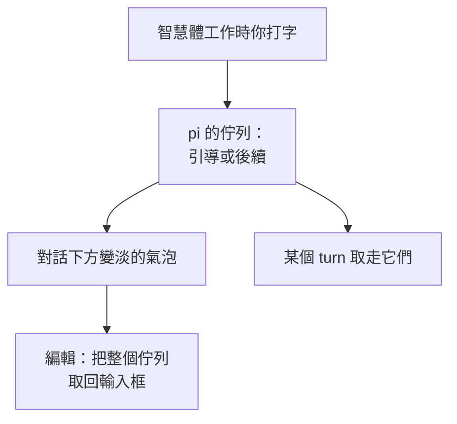

智慧體工作時打的內容會在 pi 的佇列裡等著：引導訊息在智慧體的下一個 turn 到達，後續訊息在這次執行結束時到達。session 檢視在對話下方把它們顯示為變淡的氣泡，直到某個 turn 取走；**編輯**會把整個佇列取回輸入框。底下是這次取回如何保持安全的細節。

<details>
<summary>細節</summary>

智慧體工作時打的內容會在 pi 的佇列裡等著：引導訊息在智慧體的下一個 turn 到達它，後續訊息在這次執行結束時到達。session 檢視在對話下方把它們顯示為變淡的氣泡，標示為引導或後續，直到某個 turn 取走它們。pi 只告訴擴充功能有沒有訊息在等，所以每個 session 的對話框 bridge 記下它看到到達的訊息，並在對應的使用者訊息開始時移除一則（文字相同的那則，否則最舊的）；pi 用別的方式（Esc、它的取回按鍵）清空的佇列，會在 bridge 下一次檢查時清除，2 秒內。

bridge 連同對話框轉送最舊的五則，每則截到 200 字元。每個排隊中的列最多顯示三行，以省略號截斷；被截斷的列點擊、按 Enter 或 Space 會展開成完整文字，再按一次收回。**編輯**（佇列下方的一顆按鈕，附提示說明所有排隊的訊息會合成一段文字取回，已經送達的無法取回）把整個佇列取回輸入框。

它就是 pi 自己的取回按鍵（`app.message.dequeue`）：Alt+Up，但在 pi 使用它的 Windows 按鍵綁定的地方（Windows，以及 WSL 下的 Linux）是 Alt+Q，或使用者的 `keybindings.json` 綁定的按鍵。pi 讓擴充功能讀取它的即時按鍵綁定，卻不讓它執行這個動作，所以在 pi 內執行的 session bridge 說出該按鍵：pi 對它的即時綁定中，伺服器願意按的第一個（一個 Alt 或 Ctrl 組合鍵，絕不是 Ctrl+C、Ctrl+D 或 Ctrl+Z）；即時管理器沒有這個 id 時，改讀 `<agent dir>/keybindings.json`（讀法和 pi 相同，無效的值整個丟掉），否則用平台的預設值。伺服器對同一份清單再檢查一次，然後送出。

這個鍵會清空每個佇列，並把 steering 訊息，然後是 follow-up，以空行連接，放在 pi 的編輯器原本內容的前面。頁面為每次取回產生一個 id（存在分頁的 `sessionStorage` 中，直到某個答案結案），並 POST 到 `POST …/sessions/<key>/dequeue`（從這台電腦的頁面和已配對的裝置都一樣，不需要鏡像，因為打字也不需要）。

伺服器先問 session 的 bridge（有沒有東西排隊、編輯器裡有什麼、bridge 自己的鏡像說排了什麼），只有在有東西時才把那個按鍵送到 pane（送之前再看一次 pane，所以這期間改變的 session 不會收到按鍵），然後再問一次（最多等 1.5 秒讓佇列清空，讀取編輯器，檢查草稿前面的東西恰好就是鏡像的訊息，先引導再後續，把草稿放回去，只交出訊息）。

終端機的草稿絕不離開 session：草稿前面任何不是恰好等於鏡像訊息的東西（開始與按鍵之間在終端機打的文字、pi 展開過的訊息，例如 `/template` 或 `/skill:`、被擴充功能改寫的）都會被以 `changed` 拒絕，訊息連同草稿留在 pi 的編輯器中。pi 自己的還原會忘記草稿中貼上區塊的內容（只留下它的標記）；此時 bridge 把編輯器設成這些訊息加上完整的草稿，貼上的內容放回原處。

hub 告訴 `finish` 它的期限（從請求起 2.5 秒，用這台機器的時鐘）並等 4 秒；超過期限減 0.3 秒後，bridge 什麼都不清，所以訊息留在 pi 的編輯器中，答案是 `not_cleared`。交出的訊息在 bridge 中以取回的 id 保留十分鐘：同一個 id 再問一次（答案遺失了：頁面離開、網路中斷、頁面重新載入）不用按鍵就會拿到它們，所以再按一次「編輯」就能取回。

頁面把回覆放在它的框裡原有內容之前，或在它的輸入框已不在時，放在該 session 已儲存草稿之前（輸入框回來時附上一則說明），所以沒有東西取決於輸入框是否掛載；pi 的編輯器保留它自己的草稿，不再持有這些訊息，所以從頁面送出不會重複它們。

空的佇列不送按鍵（`{empty: true}`，「nothing is queued any more」），在檢查與按鍵之間被送達的佇列給出同樣的答案，而對話框等待時的按下，與任何按鍵一樣被拒絕，只有 Escape 除外，且在 `link_request` 開著時，來自已配對裝置的也被拒絕（403 `local_only`，在按鍵之前再檢查一次）。

讓訊息留在 pi 編輯器中的拒絕會這樣說明：pi 的 dequeue 鍵只綁定到頁面不會送的按鍵（`no_key`，什麼都沒送）、pi 沒有取回它的佇列（訊息指名送出的那個鍵，它可能不是它的 dequeue 鍵；較舊的 bridge 不指名任何鍵，伺服器於是送出它平台的預設）、編輯器中途改變了、文字超過 12,000 位元組、編輯器無法清空（當它也會留在編輯器中時，不交出任何東西），或按鍵送出後取回逾時（`stale`）。沒有 `pull` 的 bridge（該 session 中較舊的 pi-straw-boss）不回答，頁面說明它不確定。使用者開啟的列按 session 和按列記住（相同列中的第 n 個分開計算）。

</details>

#### Monitor

session 來自 [pi-loop-monitor](https://www.npmjs.com/package/pi-loop-monitor) 的背景 monitor（`MonitorCreate`）顯示在它的 todo 之下：收合時是有幾個在執行、幾個失敗，以及最新執行中那個的最後一行輸出；展開時是每個 monitor（最新的在前，執行中的在已結束的之前，最多六個），附上它的描述或指令、它的狀態（執行中、已完成、失敗、沒有輸出而停止，或已停止）、它的結束碼、它的行數和它的最後一行。每個 session 的對話框 bridge 跟隨 pi-loop-monitor 在 session 匯流排上的事件（`monitor:started`、最多每 2 秒一次的 `monitor:output`、`monitor:finished`），去掉終端機跳脫序列和控制字元，把文字截到 160 個字元，並連同它的對話框轉送清單；已結束的 monitor 會留 15 分鐘，與 pi-loop-monitor 保留它的記錄一樣久。

<details>
<summary>細節</summary>

這份清單是唯讀的：pi-loop-monitor 不給其他擴充功能任何停止 monitor 的方法。失敗（結束碼不是 0）或沉默（被它的閒置逾時停止）的 monitor 會發出它自己的錯誤通知，與它單位的狀態分開（它歸在通知之下，而不是標頭的警示）：它的對話框指名這個 monitor，而開啟通訊、它的對話、它的終端機和提醒的點擊都前往該單位。完成或被停止的 monitor 不發出任何東西。當 session 不再列出該 monitor 時，警示離開佇列。

</details>

#### 指揮中

自身閒置、但它的某個子智慧體正在工作、等待或指揮中，或它的某個 monitor 正在執行的單位，會顯示它自己的標記，**指揮中**（zh-TW 指揮中），而不是閒置。它自己的狀態優先：工作和等待維持原樣，已完成的子智慧體不算數。這對主智慧體、成員、塔台，或任何有子智慧體或 monitor 的單位都成立，在塔台儀表板和瀏覽器檢視中皆然（由伺服器決定；monitor 還會保留紅色的「看著 monitor」備註）。

<details>
<summary>細節</summary>

它有自己的顏色（紫羅蘭）、符號（`◈`，一顆菱形）和呼吸般的光暈，出現在地圖上單位的名牌、檔案、小隊的 token、通訊畫面標頭，以及 HUD 的指揮中數字上（在 `prefers-reduced-motion` 下和頁面靜止後不再動），圖例裡也有一行。含有指揮中單位的基地或小隊把它彙總為工作中（它的子智慧體本來就在工作；只看著 monitor 的單位會讓它的基地變成工作中）；HUD 和統計把每個標記各自計算，所以工作中不包含指揮中。

警示佇列把指揮中當作工作中：它不引發任何警示。pi-herdr-agents 記錄為已完成、但它的 pi 還活著且有 monitor 在執行的子智慧體還沒有完成：它不是 `ended`，所以顯示為指揮中（備註：看著 monitor）而不是完成，沒有移除按鈕，不在「移除已完成」之內（伺服器也拒絕移除它），也不引發完成通知。monitor 停止且 pi 閒置時，它又回到完成。

任何單位，不論是不是子智慧體，只要它的 pi 還活著，都一樣：在 monitor 執行期間被 Herdr 標為完成時，它顯示為指揮中而不是完成，在 monitor 停止之前不引發完成通知或完成音效。塔台自己的 TUI 儀表板沒有 monitor 的資料（monitor 只到達托管 GUI 的 session），所以它對這樣的單位的字符不變。

</details>

#### Todo

用 [@juicesharp/rpiv-todo](https://www.npmjs.com/package/@juicesharp/rpiv-todo) 維護 todo 清單的 session，會把它顯示在輸入框上方：收合時是 `Todos done/total` 和進行中的任務，展開時是每個任務（○ 等待、◐ 進行中、✓ 完成；已刪除的不列出）。伺服器從 session 檔讀取它，和讀取歷史一樣：目前分支上最新的 `rpiv-todo-state` 項目，否則是最新 `todo` 結果的 details（這些項目出現之前的 session），隨歷史的第一頁、每次重設，以及每個加入 snapshot 的變更一起送出。終端機模式把它隱藏，因為 pi 自己的小工具在那裡顯示它。

### 關閉、開啟與信任

#### 關閉

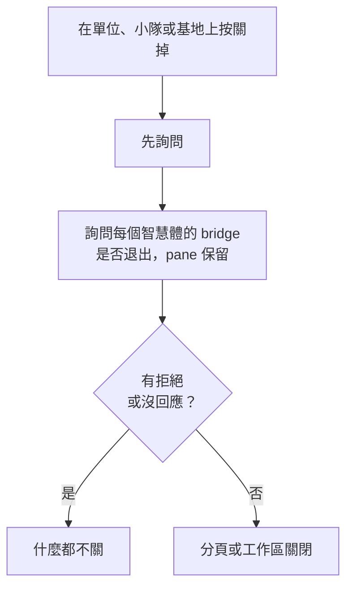

在單位、小隊或基地上按**關掉**會先詢問，再請每個 session 自己的 bridge 退出，和 `/boss close` 一樣。只要有一個拒絕或沒回應就什麼都不關；每個智慧體都離開後，分頁或工作區才關閉。已完成的子智慧體改用 **Dismiss**，基地則可以 **Stash** 收起來再 Pop 回來。

<details>
<summary>細節</summary>

地圖上、基地、小隊或單位上的**關掉**（不含子智慧體：由啟動它的單位關閉），以及基地名稱下方只關掉塔台的**關掉塔台**，會先詢問。× 只關閉對話框。關掉也出現在單位自己的通訊畫面標頭，桌面和手機都一樣：就是地圖上該單位的同一顆按鈕（塔台的是關掉塔台），只在地圖顯示它的地方才顯示（子智慧體、已完成子智慧體的移除，或頁面無法控制的單位都不顯示），確認、請求和拒絕都相同；取消或被拒絕時留在通訊畫面，關掉成功則回到該單位的基地。

接著它對基地 POST `close/all`（基地的關掉會先像 `/boss close all` 一樣檢查，只要有執行中的東西會遺失，就會連同所有原因一併拒絕）、`close/tab` 或 `close/unit`。基地的**收起**（在它的 ＋主智慧體旁邊）會先詢問，並在基地的標籤下 POST `close/stash`；HUD 的**已收起（n）** 列出被收起的東西，每個都有**接回**，它 POST `close/pop`，並從伺服器的 session 開啟它。已配對的裝置可以收起和接回，如同它可以關掉。關閉是每個 session 自己的事：伺服器請 session 的 bridge 像 `/boss close` 那樣讓它結束（pi 的 `shutdown`，原因 `quit`，所以它的 token 清除，而塔台的結束會把主智慧體降為成員）。

sb server 所執行的塔台（塔台服務）沒有 pi，也沒有可詢問的 bridge：它的**關掉塔台**POST 同樣的 `close/unit`，伺服器像 `close-tower` 那樣結束該服務（分頁關閉，token 隨 `sb_tower_quit=<members>` 消失，基地的主智慧體變成成員）；小隊或基地被關閉時，不詢問那個身分，也不詢問服務 pane 中執行的 pi（老闆對話、事件 run、手動執行），而服務隨分頁或工作區結束（正在工作的執行的 pi 仍會拒絕基地的關掉）；收起會拒絕塔台是該服務的基地，因為接回不會再產生服務，它的佇列和對話留在舊的工作區 id 之下。

沒有回答的 session 會在對話框中被告知，並提示它可能執行較舊的 pi-straw-boss（對它 `/reload`）。pi 結束後，單位隨即從一個脫離的行程關閉它自己的 pane。在關掉之前，session 會用 token `sb_closing` 標記它的 pane（TTL 10 分鐘，session 絕不清除）：pi 還在關閉時它就離開 intercom，而 Herdr 仍列為沒有 session 的 pi 的 pane，在那幾秒會顯示成「網之外」下一張已完成的未加入 pi 的綠色卡片，所以網會把帶有這個 token 的 pane 排除在外，被關掉的主智慧體從它的分頁直接消失。

對小隊或基地，其中網的每個智慧體（主智慧體、成員和基地的塔台）都被詢問，並保留它的 pane；一次拒絕或沉默就什麼都不關，30 秒後仍在執行的智慧體會讓小隊或基地保持開啟，否則分頁或工作區連同裡面剩下的東西（shell、子智慧體）一起關閉。

已完成的子智慧體有**移除**而不是關掉（它會在每個頁面隱藏它，直到它離開網），位置列中 HUD 下方的**移除已完成**（n）則經由同一條路徑一次隱藏網上每個已完成的子智慧體（按鈕只在有已完成的子智慧體時顯示，這台電腦的頁面和已配對裝置的頁面都一樣）。盟友 box 的已完成子智慧體也一併隱藏，各用自己的 key，與該列的「移除」相同（伺服器的 `all` 不會到 box，否則會隱藏那裡每個團隊的已完成單位），而且只計入連線中且列出 `dismiss` 的 box 的子智慧體；手機的左窗格也有它，在底部、緊貼在「回到地圖」上方，拇指碰得到兩者。顯示著被關閉內容的頁面會上移到剩下的東西：從被關閉的基地到地圖，從被關閉的小隊或單位的通訊畫面到它的基地。

</details>

#### 開啟智慧體


**+ New base** 在你選的資料夾開一個 Herdr 工作區，裡面有一位成員、沒有塔台；**+ Member** 和 **+ Main** 則在新分頁多開一個智慧體。頁面會顯示開啟的各步驟（建立、啟動、加入，有第一則訊息時還有送達），伺服器強制執行的規則和指令相同。

<details>
<summary>細節</summary>

**＋新基地**是地圖上最後一張卡片，它在你挑選的資料夾中開啟一個 Herdr 工作區，第一個分頁有一個成員，沒有塔台：基地絕不是空的，開啟失敗時會再把工作區關掉。沒有塔台的基地只接受成員：基地上的 **＋成員**在挑選的資料夾中的新分頁開啟一個，而在小隊上則把一個分割進該小隊的分頁，在它主智慧體的資料夾（或它第一個 pane 的資料夾）。它的塔台依塔台的規則開啟，絕不從頁面開。

有塔台的基地只接受主智慧體：**＋主智慧體**在挑選的資料夾中的新分頁開啟一個，而且它一加入就自己升任；塔台自己的通訊畫面在它的標頭帶有同樣的 **＋主智慧體**（手機和桌面都一樣），它為塔台的基地開啟那個區塊，並前往新主智慧體的通訊畫面。每個表單都可以帶一則可選的第一則訊息，在新智慧體加入後打給它。

資料夾以 Finder 風格的欄位挑選：有主目錄、桌面、文件，以及開著的基地所在的資料夾等捷徑；選取資料夾的每一層各有一欄，方向鍵在其間移動（欄內上下、欄間左右、Enter 選定）；有上一頁與下一頁的麵包屑；以及**新資料夾**，它在選取的資料夾內建立一個資料夾（單純可見的名稱，沒有分隔符號、沒有開頭的點、不含 Windows 拒絕的字元；已存在的就只是選取它）並選取它。選取資料夾的真實路徑一律顯示，基地的名稱預設為資料夾本身的名稱，直到被改打。

單位開啟時，區塊以部署面板取代表單：伺服器在 `open/progress` 以頁面隨開啟一起送出的 id 回報開啟的步驟（建立、啟動、加入，有第一則訊息時還有遞送），頁面每秒輪詢兩次，執行中步驟的計時會跳動，完成的開啟會閃現「unit ready」（音效開啟時帶完成音效），然後頁面前往新單位；失敗時會指出它失敗的步驟和伺服器的理由，**回到表單**則回到原樣的表單。

伺服器強制同樣的規則（基地在它的塔台 session 存活時算作有塔台），讓挑選器留在主目錄內、不進隱藏的資料夾（開頭的點在各處都會隱藏；Windows 上還有 Hidden 或 System 檔案屬性，全新的設定檔會把它放在 AppData 和舊的相容性 junction，例如 Application Data、Cookies、My Documents 與在地化的開始功能表：它們不列出、不可挑選、不能在其中建立，也不能經由經過其中之一的路徑抵達；所列資料夾的屬性用一次 `cmd.exe` 呼叫（`dir /a:h` 和 `/a:s`）讀取並保留 10 秒，資料夾讀不了時，請求會帶著理由失敗，而不是憑猜測列出），一次只執行一個開啟（整個伺服器行程共用一把鎖，所以 GUI 在其中停止再啟動、或 token 輪替，都不會讓重試和仍在加入中的開啟並行：重試會被告知 429 `busy`），並在開啟失敗時關閉它建立的東西。

帶有 `deploy` id 的 `open/base`，在工作區一建立就會被記錄下來（它建立的工作區、分頁和 pane、它的資料夾與標籤，以及第一則訊息進行到哪裡；最近 64 個 id），所以這個 id 在伺服器重啟後仍然有效：用同一個 id 重複請求，會找到那個工作區並用它回答，它的 pi 還沒加入就等它加入，而且不會為該資料夾建立第二個工作區。

Herdr 會重用已關閉工作區的 id，所以記錄只在它的工作區還開著、記錄的 pane 還在而且在記錄的資料夾中執行、而且重複請求指名同一個資料夾時才算數。沒有回報資料夾的 pane（Herdr 的 `cwd` 是可選的，Windows 的 pane 在剛啟動時可能不回報）只在記錄的工作區 id、pane id 和工作區標籤全都仍然相符時才算數；更弱的條件一律丟掉記錄，因為錯的工作區比重複的更糟。有回報但不同的資料夾會讓記錄過期。被丟掉的記錄讓重複請求成為一次新的開啟（每個帶 id 的 `open/base` 也會忘掉工作區已不在的記錄）。

第一則訊息按 id 保存為 `none`（這次開啟沒有）、`pending`（從未嘗試）、`sending`（在呼叫打出它之前設定）和 `sent`。重複請求只在 `none` 或 `pending` 時打出它，這是伺服器在 join 期間重新啟動的情況；在 `sending` 或 `sent` 時它絕不再打。有訊息的 `open/base` 的回覆和重複請求的回覆帶有 `delivery`：`sent`（由這次呼叫打出，或由完成的較早一次打出）、`unknown`（較早的一次開始打它，而伺服器無法判斷它是否到達），或 `not_sent`（較早的一次有一則從未打出的訊息，而這次呼叫沒有帶訊息）；`open/progress` 在開啟完成後帶有同樣的 `delivery`，而重複請求的 `deliver` 步驟在每種情況下都是完成的，所以完成的開啟絕不顯示待處理的步驟。

沒有到達的第一則訊息（502 `prompt_failed`，或對無法打字的伺服器 503 `unavailable`）會留下工作區和它已加入的 pi，並保留該 id，所以重複請求會找到它，不會建立第二個基地；在第一則訊息打出之前就拋出的開啟（pi 從未加入，或記錄無法寫入）會關閉工作區並釋放該 id。自己的 pi 沒有加入的重複請求會在 `join` 失敗（502 `open_failed`），並留下工作區和記錄，因為這兩者都不是它建立的：下一次重複請求再等一次。

無法寫入的記錄，在建立工作區時或在訊息要被打出時，會以固定的原因「The opening could not be recorded, so it was not kept.」讓開啟失敗（在 `create` 或 `deliver`；原因和它的路徑以 `opening-record-failed` 寫入 `server.log`，絕不進入回覆），而建立了工作區的開啟會在任何東西被打出之前把它關掉，而不是讓重試去建立第二個；這樣失敗的重複請求會留下工作區和記錄，那不是它建立的。

等待新 pi 加入預設是 60 秒；`open/base` 接受可選的 `joinWaitMs`（毫秒的整數，10000 到 300000；其他任何值都在建立任何東西之前被以 400 `bad_request` 拒絕），供 Windows 之類的慢電腦使用，而在這段時間內沒有加入的 pi 會讓開啟在 `join` 步驟失敗（502 `open_failed`，指名等待的秒數）。信任問題開著的時間不算在它之內，和以前一樣。`open/member` 和 `open/main` 保持 60 秒。

</details>

#### 專案信任

在帶有專案資源（`.pi/settings.json`、`mcp.json`、`extensions`、`skills`、`prompts`、`themes`、`SYSTEM.md`、`APPEND_SYSTEM.md`，或該資料夾或其上層的 `.agents/skills`）的資料夾中啟動的 pi，會在載入該資料夾的任何東西之前，停在 pi 自己的「Trust project folder?」，而這個提示只繪在 pane 的終端機裡。Straw Boss 在 Herdr 中的每個 pi（子智慧體也一樣）註冊一個 `project_trust` handler，它也會詢問正在執行的 GUI，所以只使用 GUI 的人會看到警示，而不是卡住的開啟。沒有 GUI 時，它回答 `undecided`，pi 照舊自己詢問。

<details>
<summary>細節</summary>

- *何時詢問。* handler 立刻回答 `undecided`，讓 pi 自己的順序保持不變（先是 `--approve` 或 `--no-approve` 覆寫，再是 `trust.json` 中已儲存的決定，再是 `defaultProjectTrust`），除非同時符合：pi 在終端機上以它的 TUI 執行；這是行程的第一個 runtime（`/new`、`/resume` 或 `/fork` 到另一個資料夾，是 pi 自己的提示）；該資料夾或上層沒有儲存的決定（讀不到的 `trust.json` 算作一個決定：pi 會回報它）；`defaultProjectTrust` 是 `ask`；而且有一個讀取信任請求的 GUI 在為這個 Herdr 執行（`gui.json` 帶有 `trust: 1`，指名這個 Herdr 的 socket，沒有停止，並在 1 秒內回答）。

  頁面只有在記錄的伺服器被證明就是正在執行的行程之後才取得 token：它的 pid 還活著，且它的啟動時間就是記錄的那個。在 macOS 和 Linux 上這是 `ps`，立刻完成。在 Windows 上，啟動時間是一次 CIM 讀取，快取冷的時候要 3.5 到 5 秒，所以新的 pi 可能要等到 6 秒，問題才會到達 GUI（如果 `gui.json` 指名一個存活、且讀取信任請求的伺服器，這個讀取在 pi 載入時就開始，所以到那時多半已在進行；6 秒內沒有拿到的啟動時間是未知，什麼都不送，pi 在終端機詢問）。指名已死亡 pid、已停止的伺服器，或什麼都沒有的 `gui.json`，不花任何等待，也不啟動 PowerShell。
- *頻道。* pi 還沒有加入網，所以它透過 `<state>/trust/` 中的檔案（模式 700，檔案 600）與伺服器溝通：它的請求 `<id>.json`（它的行程、pane、角色、資料夾、信任會載入什麼，以及對資料夾和那些發現的 digest）、伺服器的 `<id>.answer.json`，以及 pi 的 `<id>.result.json`（哪一邊回答的），全都以 rename 寫入。在 Windows 上，資料夾必須位於使用者的設定檔之內（見 [Windows](#windows)）；其他地方 pi 在它的終端機詢問。伺服器只在 Herdr 是它自己的、它的行程還活著、而且 Herdr 列出它的 pane 時才列出請求；行程已結束的請求會被移除。是連結、屬於別人、太大，或 digest 與它的發現不符的檔案不會被讀取。
- *競爭。* pi 的啟動提示一旦繪出就無法關閉，所以終端機印出三行（資料夾、「The question is in the Straw Boss window.」、「Press any key to answer here instead.」）並讀一個按鍵。GUI 的答案作為決定傳回給 pi（pi 的提示永遠不會出現）；按鍵則交給 pi 自己帶有全部選項的提示，警示則以在終端機回答而關閉；15 秒內沒有伺服器回答也同樣交出。等待期間的 `SIGINT` 或 `SIGTERM` 會移除請求。沒有任何東西逾時：智慧體不應因為沒有人看就信任或不信任一個資料夾。
- *警示。* 每個資料夾和 digest 一個，不論有多少智慧體在等它，排序視為問題（它計入 HUD，Space 開啟它，提醒和聲音是等待的那種）。它指名資料夾和智慧體在哪裡執行，說明信任會載入資料夾的設定、擴充功能、skill、提示、佈景主題和 MCP 伺服器，並安裝它的設定所指名的套件（擴充功能和 MCP 伺服器在這台電腦上作為程式執行），列出資料夾裡有什麼（超過五項就收合），並提供**信任**（儲存在 `trust.json` 中該資料夾之下）、**只信任這一次**和**不信任**（只限這個行程，所以下一個智慧體會再問）。pi 的「信任上層資料夾」留在終端機。
- *誰能回答。* `POST /<token>/api/trust/answer {id, digest, choice, answerId}`，受頁面慣用的檢查（origin、`Sec-Fetch-Site`、CSRF、64 KB）：這台電腦的頁面，以及遠端 listener 上已配對的裝置（如同轉送的確認）；Straw Link 的對等端絕不行。答案必須帶有請求的 digest，所以它針對的恰好是顯示出來的內容；頁面送來的任何東西都不是路徑。每個請求只接受一個答案（另一個得到 `busy`；同一個答案再送一次會聽到它的結果），寫入該資料夾和 digest 的每個請求，回覆是 `accepted`（某個 pi 取用了它）、`stale`（終端機或 pi 的結束先發生），或 `unknown`（5 秒內沒有結果；再次確認會再看一次）。
- *開啟。* 等待信任問題的新 pi 還沒有加入，所以每個等待新 pi 的等候（頁面的開啟、`boss_open_main`、塔台的啟動、接回）在它的 pane 有請求時停止計時，並在十分鐘之後以「No trust decision for <folder> within 10 minutes」失敗，關閉它建立的東西。部署面板在 start 與 join 之間有一個**信任**步驟，內嵌同樣的三個選項；該頁面的警示佇列於是不為它開第二個對話框，而已配對的裝置或另一個分頁仍然收到警示，而面板的 120 秒放棄不計這段時間。
- *桌面模式與團隊設定檔。* 不需要更多東西：桌面視窗就是這台電腦的頁面，而桌面堆疊上的每個 pane 都執行這個 handler。把 `defaultProjectTrust` 留在 `ask`，這樣每個新資料夾問人一次，而**信任**會記住它（`always` 會不經詢問就載入任何複製來的儲存庫的擴充功能；`never` 會丟掉團隊儲存庫自己的 `.agents/skills`）。

</details>

### 提供頁面

#### 伺服器

伺服器一次在一個 session 中執行，也就是開啟它的那個，或接手它的倖存者（見每台機器一個伺服器），在 `127.0.0.1` 上以兩個隨機的空閒 port 執行：本機 listener 供這台電腦的瀏覽器使用，遠端 listener 則是 `tailscale serve` 唯一指向的目標。哪個請求是本機的，由它到達的 listener 決定，而不是它自己宣稱的：遠端 listener 上的請求不論它的 `Host` 或標頭怎麼說都是遠端的，而本機 listener 只放行帶有 `Host: 127.0.0.1:<port>`、且沒有 `tailscale serve` 加上的任何轉送標頭（`X-Forwarded-*`、`Tailscale-*`、`Forwarded`、`Via`）的請求，其餘以 403 拒絕（第二道防護）。兩個 listener 執行同一個 handler。

<details>
<summary>細節</summary>

兩個 listener 執行同一個 handler。每個 URL 都以隨機 token 開頭（`http://127.0.0.1:<port>/<token>/`）；沒有它或帶有另一個 `Host` 標頭的請求會被以 403 拒絕，所以其他本機頁面讀不到網。唯一的寫入是 `/<token>/api/sessions/<key>/` 底下的 POST：`input`；`keys`，它接受來自即時顯示該終端機的頁面的一個按鍵板按鍵，或 Stop 的 Escape；`commands`，它向 session 的 bridge 詢問符合所打 `/name` 的指令，不呼叫任何 Herdr 方法；`answer`，它把對話框的答案交給它的擁有者，不送任何按鍵；以及 `mirror`，它在頁面自己的串流上顯示 pane 的畫面。只有這台電腦的頁面還可以送出（已配對裝置會得到 403）`server/stop`、`remote/pair`（新的一次性配對碼：配對屬於桌面）、`remote/on`、`remote/off`、`remote/devices`、`remote/unpair`、`remote/unpair-all`，以及 `/<token>/api/dismiss`（一個已完成的子智慧體，或 `all`）。每一個都需要頁面自己的 `Origin`、有送時的 `Sec-Fetch-Site: same-origin`、最多 64 KB 的 JSON 內容，以及寫進頁面的 CSRF secret；對 `input`、`keys` 和 `answer`，伺服器還會當場向 Herdr 確認該 pane 仍在該 session 的檔案上執行 pi（鏡像在第一次讀取之前和每 2 秒檢查一次，session 移到另一個 pane 時重新開始）。

打字的文字絕不記錄。頁面是建置好的靜態 bundle；任何路由都回答同一個頁面，它帶有 `<base href>`，所以從任何深度都能載入。串流（`/<token>/events`）先報上自己的名字（`hello`，一個頁面用來附掛終端機鏡像的隨機 id；還沒讀過網的伺服器在第一次讀取後才報名），然後在連線時和每次變動時送出完整快照，每 15 秒一個 `ping`，Herdr 或 intercom 讀不到時送出 `problem` 事件；`events?watch=<session key>` 加上該 session 的歷史，`events?watch=w:<workspace id>` 加上那裡每個單位的最後一行。

`/<token>/api/history/<key>` 和 `/<token>/api/entry/<key>/<entry id>` 分頁讀取 session，以及完整取得一筆項目（上限 1 MB）。文件以 capability 提供，也就是伺服器給每份被列出文件的隨機 128 位元值，絕不用路徑：`/<token>/doc/<cap>/` 是 HTML 文件（最大 2 MB），其中每個 `cgi-bin:pi-answer` 表單指向一次性的 nonce（30 分鐘，綁定該文件），`/<token>/doc/<cap>/<file>` 是文件自己目錄之下的圖片、樣式表或字型（最大 8 MB，沒有 `..`，沒有指向目錄之外的 symlink），`/<token>/doc/<cap>/answer/<nonce>` 是一個表單答案（最多 64 個欄位，16 KB 的 query，12 KB 的答案，除了 tab 和換行之外沒有控制字元），而 `/<token>/api/doc/<cap>` 是以 JSON 提供的文字文件。

只提供 session 目前列出的文件。每個 `/doc/` 回應都帶有沒有 `allow-scripts` 或 `allow-same-origin` 的 CSP `sandbox`，而它的來源指名伺服器的 origin（WebKit 在 sandbox 文件中不符合 `'self'`）；app 只能框住它自己的頁面，並送出 `Cross-Origin-Opener-Policy: same-origin`。重寫也會丟掉文件自己的 `<base>`、referrer policy，以及它按鈕的 `formaction`、`formmethod`、`formtarget`；這是對 HTML 文字盡力而為，真正守住的是 sandbox 和政策。

頁面在監聽時每 2 秒讀一次網；沒有頁面時仍每 10 秒讀一次，所以時間軸會保留手機睡著期間發生的事。頁面可以安裝成 app：bundle 帶有 `manifest.webmanifest`（它的 `id`、`start_url` 和 `scope` 是 `./`，所以它們在 token 路徑之下解析）、PNG 與 SVG 圖示，以及 `apple-touch-icon.png`；頁面的政策加上 `manifest-src 'self'`，並以 `crossorigin="use-credentials"` 連結 manifest，所以已配對裝置的 cookie 會一起送出。沒有 service worker：每個頁面都來自正在執行的伺服器自己的建置。

</details>

#### Session 檔

伺服器只讀它剛讀取的網中單位的 session 檔（已加入的 session、塔台、透過它們的 pane 或啟動腳本找到的子智慧體，以及基地的其他 pi pane）；路徑絕不來自瀏覽器。檔案只從執行 pi 的 pane 讀取，只讀 pi 的 sessions 目錄之下的 `.jsonl`（`PI_CODING_AGENT_DIR` 或 `~/.pi/agent` 中的 `sessions/`，兩側的 symlink 都已解析），而對 intercom session，只有在檔案是以那個 session 命名時才讀，所以在 `/new` 期間讀取的網不會把舊 session 和下一個檔案配成一對；被監看的 session 的檔案改變時，會重新 attach 到新檔案。

<details>
<summary>細節</summary>

檔案以 1 MB 為單位，依每一行的頭尾位元組建立索引，記憶體裡只留索引；要送出的頁面則依位移讀取項目。建立索引、附加和讀取依序一次執行一個，所以 pi 在第一次建立索引期間寫入的項目會等它，而讀取絕不使用已被取代的檔案的索引。被重寫的檔案或分支移動會重設頁面。讀不到的第一頁會在下一次網讀取時再試。

離開網的單位仍可讀取十分鐘，如果有的話，附上通往該 pane 新 session 的連結。session 檔開啟時，在最後一步不跟隨 symlink（`O_NOFOLLOW`）：在網解析它的路徑之後被換成連結的檔案不會被讀取。在平台沒有 `O_NOFOLLOW` 的地方（Windows），會在開啟之前才檢查連結，這在檢查與開啟之間留下一個短暫的空窗；能在 pi 的 sessions 目錄中換檔案的同一使用者的行程可以利用它，讓 GUI 顯示該目錄之下另一個 `.jsonl`，而讀到結果的只有使用者和他已配對的裝置。存放在其他地方的 session（`--session-dir`、`PI_CODING_AGENT_SESSION_DIR`，或 pi 的 `sessionDir` 設定）顯示在地圖上，但沒有歷史，也不能對它打字。

</details>

#### 遠端存取

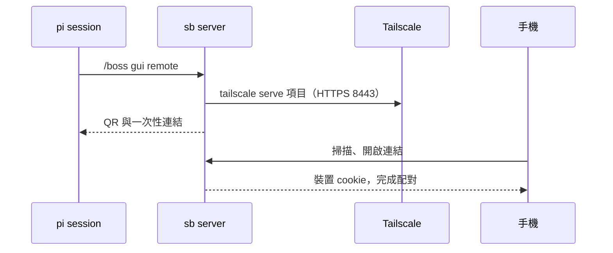

`/boss gui remote` 請 sb server 用一條 `tailscale serve` 項目把 GUI 放上你的 tailnet（HTTPS、port 8443，只指向遠端 listener，絕不用 Funnel）。session 會在 pi overlay 顯示 QR；以這台機器的使用者登入 Tailscale 的手機掃描後，會拿到一個裝置 cookie。每個遠端請求還必須帶著這台機器的 Tailscale 身分。

<details>
<summary>細節</summary>

在任何 pi session 裡執行 `/boss gui remote`，會請 sb server 把 GUI 放上你的 tailnet：它新增一筆 `tailscale serve` 項目，在 8443 連接埠提供 HTTPS，代理到 server 的遠端 listener（絕不使用 Funnel，也絕不指向本機 port），然後 session 在 pi 的覆蓋層顯示一個 QR code。這個 QR code 是在本機根據 server 的回應繪製的，所以 QR code 與它的一次性連結都不會進入 server 的 log 或模型的對話。用以這台機器的使用者身分登入 Tailscale 的手機掃描即可（若是已安裝的 app，則輸入 QR code 下方印出的短代碼：見下方 **已安裝 app 的入口**）。

在覆蓋層裡，**c** 複製連結，**o** 在這台電腦的瀏覽器開啟連結（桌面堆疊 desk stack 中的 session，`STRAW_BOSS_DESK=1`，沒有 **o** 鍵，也不列出連結：由 shell 自己顯示頁面）；每一次 QR、複製與開啟都是各自獨立的一次性連結，十分鐘內只能使用一次，**Esc** 或 **q** 會關閉它。覆蓋層開啟期間，這個 session 視為等待中，所以來自瀏覽器的輸入會被拒絕，而不是在裡面遺失。設定頁的「手機與裝置」區塊也會在頁面中顯示新的 QR code；它只顯示在這台電腦的頁面（127.0.0.1），不會顯示在已配對裝置的頁面，也不會顯示在 desk 視窗中（[頁面中的 Desk 模式](#瀏覽器檢視)）。

已配對的裝置會拿到一個 session cookie（HttpOnly、Secure、SameSite=Strict、90 天，範圍限定在 token 路徑），並一直維持配對，直到桌面端解除配對、GUI 換了新 token（配對屬於 token：重啟會保留，但連接埠被佔用、`gui-secrets.json` 遺失或損毀，或 `/boss gui rotate` 都會產生新的 token，需要新的 QR code）、這台機器的 Tailscale 身分（host 或 login）改變，或連續 90 天沒有使用為止；每次使用都會續期，回應會再次設定 cookie（儲存的到期時間最多每小時移動一次）。

server 只保留 cookie 的 SHA-256，連同裝置名稱（配對時從其 User-Agent 讀取的平台與瀏覽器）、配對時間與上次使用時間，存放在 `gui.json` 旁的 `paired.json`（mode 600）；它在遠端關閉再開啟、server 重啟之後都會保留，但新的 GUI token 會讓所有裝置解除配對，因為它們的 cookie 範圍限定在舊 token 的路徑，反正也無法連線；身分與要開啟遠端的意願會保留，log 會寫 `devices-cleared`，手機再掃新的 QR code（見[每台機器一個 GUI](#瀏覽器檢視)）。

每個遠端請求都從遠端 listener 進來，而且必須同時帶有這台機器的 Tailscale 使用者，放在 `tailscale serve` 設定的 `Tailscale-User-Login` 中，並符合確切的 MagicDNS host。機密只在本機 listener 的頁面輸入，所以丟掉轉送標頭的 proxy，或仍指向本機 port 的 serve 項目，都無法把遠端請求變成本機請求。文件自己的請求（`/<token>/doc/…`）需要該身分與文件的 capability，但不需要 cookie，因為 Chrome 不會在沙箱 frame 的請求中帶上 SameSite=Strict cookie：在 tailnet 上，同一個 Tailscale 使用者的裝置只要持有文件的連結，不必配對就能讀取文件並回答其中的表單。

8443 port 只有在空閒或已經是這個 server 的時候才會取用，包括遠端 listener 出現之前、指向這個 server 本機 port 的舊項目：開啟遠端（或頁面上的「開啟遠端存取」）會把它改指向遠端 listener；如果 Tailscale 沒有接受這項變更，遠端維持關閉，訊息為 "tailscale serve did not take the entry as asked"，且不記錄任何東西，所以經由舊目標的請求會被本機 listener 以 403 拒絕，而不是被當成本機請求處理。指向其他地方的項目絕不會動。

關閉遠端，以及啟動一個不恢復遠端的 server，都會移除舊目標的項目；以「想要遠端開啟」狀態啟動的 server 則會把它改指向遠端 listener（同樣遵守「空閒或已經是自己的」規則），只有在維持關閉時才移除。`/boss gui remote off`（或這台電腦設定頁「手機與裝置」區塊中的**關閉遠端存取**）只移除那一筆項目（其他 serve 項目絕不會動），結束每一條遠端串流，並忘記曾經想要開啟遠端；已配對的裝置仍維持配對。

`/boss gui stop` 不會動它（該項目指向遠端 listener，會隨 GUI 一起停止），但 server 結束時會在 server 不在的期間移除該項目，而遠端仍維持「想要開啟」：下一個啟動的 server（來自 `/boss gui`、`cli.mjs up`、重啟、升級，或 pi session 的 look）會自己再把遠端開啟，沿用同樣的安全檢查，也不需要 QR code；做不到時（Tailscale 關閉、8443 被佔用），它會在 `cli.mjs status`（`remote.note`）與 `up` 的 `remote_off` 警告中說明原因，並在下次啟動時再試。

**解除配對**：這台電腦設定頁的「手機與裝置」區塊列出已配對的裝置（名稱、配對時間、上次使用），每一台都有「解除配對」，另有「全部解除配對」，這兩者都會立刻結束該裝置已開啟的串流；裝置清單絕不會提供給已配對的裝置。有終端機存取權的已配對裝置，等同於老闆自己的鍵盤一樣受信任：頁面路由拒絕它進行配對、遠端、Wi-Fi 與 server 管理，它的輸入框與新 session 的第一則訊息會拒絕對應的 `/boss` 指令（以及 `/boss gui view <mode>`）以防誤觸，但按鍵板的終端機按鍵不會被過濾，所以它可以輸入 pi 接受的任何東西，包括 `!` shell 指令，而按鍵板的 Escape 可以關閉任何已開啟的對話框，包括所有 `hereOnly` 的；這是拒絕，絕不是核准。

Tailscale 身分改變、已 90 天沒使用，或 GUI token 被取代的裝置，需要新的 QR code（在 app 裡則是新的代碼）。**恢復時會檢查身分**：新的 server 只有在 Tailscale 身分（host 與 login）與裝置配對時一致（paired.json 記得它）的情況下，才會自己開啟遠端；若是另一個身分（登入了另一位使用者或另一個 tailnet），它維持關閉、移除找到的任何 serve 項目、說明原因（一則警告），並保留意願與舊裝置不動，所以下次以被記住的身分啟動時會再開啟遠端，在那之前每次都會重複同樣的說明；以新身分手動開啟遠端（`/boss gui remote`）才會讓舊裝置失效。

無法寫入的 `paired.json`（磁碟已滿、沒有寫入權限的資料夾）不會讓請求丟出例外，變更會在記憶體中持續生效直到 server 停止（解除配對的裝置維持解除配對，遠端關閉維持關閉），但會回報：解除配對、全部解除配對、開啟與關閉遠端會回應 `500 save_failed` 並附上原因（「手機與裝置」區塊會顯示它），session 也會顯示警告，因為重啟後被撤銷的裝置會再度配對，或遠端會再度開啟。`access.saveError` 存放原始錯誤。舊版的 `paired.json`只有在其中某個 session 尚未過期時才算「想要」。

遠端關閉時，如果它的項目仍存在於另一個 host 名稱下（Tailscale 身分改變），會保留 `remote.json`，讓之後的關閉能移除它。當 Tailscale 不存在、已登出、是帶標籤的節點、沒有 MagicDNS，或 8443 提供的是別的東西時，它會說明原因，且不改變任何東西。

版面可在手機上使用：沒有橫向捲動、觸控目標較大、有安全區域內縮，且輸入框停留在螢幕鍵盤上方。自 0.26.0 起，手機上的 session 占滿整個螢幕（‹ 回到它的基地，**資料**以全螢幕開啟它的檔案，且自 0.26.1 起，塔台的檔案在每種螢幕上都列出它基地的小隊與單位），輸入框固定在鍵盤上方的底部，圖塊也以同樣方式在其上開啟；輸入框把輸入欄放在上方，**+** 放在送出那一列，備註行在空白時不占空間。

當手指按住或甩動通訊記錄時，沒有任何東西會把它拉回最新的一筆。網的記錄可從標題處收合，在手機上只顯示最新的兩筆。要當成 app 使用，先在瀏覽器配對，再加到主畫面：iOS 只在安裝時把瀏覽器的 cookie 複製進 app 一次，之後兩者各自保有獨立的 cookie，所以配對連結（會在瀏覽器開啟）永遠到不了 app；在 app 自己的入口輸入配對代碼則可以。在 Android 上，從 Chrome 安裝的 app 與 Chrome 共用 cookie，但啟動它是從另一個網站發起的導覽，會讓 SameSite=Strict cookie 被留在後面：沒帶 cookie 且 `Sec-Fetch-Site` 不是 `same-origin` 的頁面載入，會得到一個自己重新載入一次的頁面，而那次同源的重新載入會帶上 cookie。

**已安裝 app 的入口。** 已安裝的 app 無法跟隨會變動的 token（連接埠被佔用、儲存檔遺失或 `/boss gui rotate` 都會換新的），而且在 iOS 上它有自己的 cookie jar，在 Safari 開啟的連結永遠到不了那裡。所以遠端 listener（僅限遠端；在本機 listener 上 `/sb-app/` 會被視為錯誤的 token 而回答 403）還會回應一個固定、不含 token 的路徑 `/sb-app/`，而它對遠端頁面提供的 manifest，`start_url` 是 `/sb-app/`、`scope` 是 `/`；本機頁面的 manifest 維持原樣。

這個入口執行與頁面相同的身分檢查（遠端已開啟、確切的 MagicDNS host、沒有 Funnel 標記、這台機器的 `Tailscale-User-Login`），它的頁面不含 token，也不含任何機密。帶有效裝置 cookie 的 GET 會回應 302 到目前的 `/<token>/` 並再次設定 cookie；沒有 cookie 的則顯示一個有八個格子、每格一個字元的頁面，用來輸入**配對代碼**（它有自己的 `form-action 'self'` 與 `Referrer-Policy: same-origin`，因為在其他頁面 `no-referrer` 之下的表單 post 會帶 `Origin: null` 而被拒絕；`/sb-app/entry.js` 提供的腳本在同樣嚴格的 `script-src 'self'` 下負責在格子間移動並接受貼上，沒有它時，這些格子就是 server 會合併的 `c1` 到 `c8` 欄位，或是單一的 `code` 欄位），或者，對於不是 `Sec-Fetch-Site: same-origin` 的文件載入（Android 啟動 app 時，會讓 SameSite=Strict cookie 被留在後面），則回應與帶 token 的頁面相同的一次性自我重新載入。

POST `/sb-app/pair` 接收代碼：它必須是來自入口自己頁面的表單 post（`Origin` 等於 https 名稱、送出時 `Sec-Fetch-Site` 為 `same-origin`、`application/x-www-form-urlencoded`、最多 1 KB），所以來自其他網站的 post 永遠碰不到代碼，也不會產生任何作用。代碼是取自 32 個符號字母表（不含 I、L、O 與 U）的 8 個字元（40 位元，顯示為兩組各四個字元並以空格分開，`ABCD EFGH`，絕不使用連字號；大小寫、全形字母（NFKC）、任何空格或破折號與外觀相似的字元都會被寬容處理），在 `/boss gui remote` 執行時產生（在它的覆蓋層中的 QR code 下方，絕不出現在對話顯示的文字中），以及「手機與裝置」區塊要求時（在 QR code 旁）產生；它只能使用一次，十分鐘內有效，並在遠端關閉或身分改變時失效；最多同時有十六組等待。

輸錯五次之後，所有等待中的代碼都作廢，入口回應 429，直到這台電腦要求新的代碼（這會把五次機會還回來），所以 tailnet 上的裝置無法暴力猜測那 40 位元。用代碼完成的配對與掃描完成的配對相同（有名稱的裝置、90 天、使用即續期），它的回應會設定兩次 session cookie：頁面用 `Path=/<token>/`，入口用 `Path=/sb-app/`，各自都是 HttpOnly、Secure、SameSite=Strict，所以配對絕不會被送到該 host 上的其他路徑；QR 配對與續期也會同時設定這兩個。

這台機器的使用者對失效 token 發出的文件載入，或對目前 token 發出、沒有配對且 `Sec-Fetch-Site: same-origin` 的文件載入，會回應 302 到 `/sb-app/`，所以在入口出現之前就安裝的 app（它的起始 URL 是舊的帶 token 位址）會自己找到入口；其他任何請求則照舊得到拒絕。其餘情況的 401 文字會告訴你在已安裝的 app 中輸入代碼。重啟會保留 token 與配對，所以已配對的 app 會自己繼續運作；代碼用於第一次配對，以及被新 token 解除配對的裝置。

</details>

#### Wi-Fi 存取

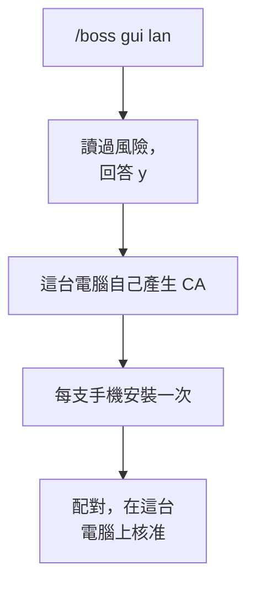

`/boss gui lan` 讓與這台電腦同一個 Wi-Fi 的手機不用 Tailscale 就能開啟 GUI。它預設關閉，開啟後在重啟之間保持開啟，直到 `/boss gui lan off`。Tailscale 存取不變，仍是獨立的開關；兩者可以同時開啟，手機也可以透過兩者各自配對。終端機使用英文；手機看到的頁面依瀏覽器的第一語言使用英文或繁體中文。

<details>
<summary>細節</summary>

**先讀風險。** Wi-Fi 存取需要一個由這台電腦自己建立、每支手機安裝一次的憑證授權單位（CA）。信任該 CA 的手機會接受 CA 簽署的任何東西。任何拿到 CA 金鑰副本的人，都能在手機連上的任何 Wi-Fi 上，對該手機冒充這台電腦，也能冒充任何私有網路位址（路由器或 NAS 的 `192.168.x.x` 頁面），直到手機上的憑證被移除為止。

金鑰放在 `lan-ca.json`，所有以你身分執行的程式都讀得到，包括你執行的智慧體，而且它可能出現在 agent 資料夾的備份中。macOS 會把這個檔案排除在 Time Machine 之外，但 Time Machine 的本機快照可能仍保有被取代的金鑰，最長一天。CA 受名稱限制所約束（見下），而這只在手機的軟體會強制執行時才有效。所以請在手機的熱點上使用 Wi-Fi 存取，或在讓手機直接連到這台電腦的 Wi-Fi 上使用，這樣網路上就沒有其他人。

第一次 `/boss gui lan` 會顯示這段警告，且只有在你回答 **y** 之後才建立 CA；頁面的 Wi-Fi 分頁在開啟任何東西之前，也會顯示同樣的文字。

</details>

##### 提供什麼

這台電腦每個符合條件的位址（僅限私有 IPv4）各有自己的 listener，預設為 `8445`。IPv6、Tailscale 位址、link-local 位址和公開位址一律不提供。

<details>
<summary>細節</summary>

- 這台電腦每個符合資格的位址都有自己的 listener（預設 `8445`，記錄在 `lan.json`，因為 port 是已安裝 app 的 origin 的一部分）。
- 位址符合資格的條件是：它是 `10/8`、`172.16/12` 或 `192.168/16` 內的 IPv4，位於真實的網路介面上（不是 loopback、不是 `utun`、WireGuard 這類通道，也不是 `/31` 或 `/32` 的連結），且前綴合理。
- 絕不提供：IPv6、Tailscale 位址、link-local 與公開位址。
- VM 與容器的橋接會被提供，因為沒有任何東西能把它們與 Wi-Fi 區分開來；第二層 VPN 介面卡也可能被提供。覆蓋層、頁面與 `cli.mjs status` 都會列出每個被提供的位址與它的介面，讓你看得到它，也能關閉 Wi-Fi 存取。
- 每個連線都必須來自與被提供位址同一子網路的私有位址；其他任何連線都會在讀取任何位元組之前關閉。
- listener 以第一個位元組分辨 TLS 與純 HTTP。TLS 得到 GUI；純 HTTP 只回應憑證頁面。
- server 每 5 秒監看網路介面：新位址得到 listener，消失的位址失去它，從睡眠喚醒時會重新綁定全部位址。
- 位址上的 port 被其他程式佔用，會讓該位址不被提供並附上說明；只有此時 `/boss gui lan` 才會移動 port，而安裝在舊 port 上的 app 必須重新加入。

</details>

##### 憑證

CA 只產生一次，存在 `lan-ca.json`；每個提供的位址各有一張短效的 server 憑證，只寫這台電腦的 `.local` 名稱和該位址。CA 的名稱限制為私有 IPv4。

<details>
<summary>細節</summary>

- `lan-ca.json` 存放一個有效期兩年的 ECDSA P-256 CA。每個被提供的位址都得到一張 90 天的 server 憑證（保存在記憶體中，剩不到 30 天時更新），其中只列出 `<computer name>.local` 與該位址，沒有別的。
- CA 只能簽署那個名稱、私有 IPv4 位址，不含 IPv6、電子郵件位址與 URI。若讀不到電腦名稱，CA 就只簽署位址，QR code 帶的是位址。
- 到期前六十天，`status` 與頁面會提醒；到期後，Wi-Fi 存取會自己關閉，直到你更新為止。
- `/boss gui lan reset` 會詢問：**r** 產生新憑證並保留配對（舊的即將到期，或電腦改過名稱）；**u** 另外把所有 Wi-Fi 裝置解除配對（金鑰或手機可能被偷）。不論哪一種，每支手機都必須移除舊憑證並安裝新的；移除它才能讓舊金鑰的副本失效。
- `/boss gui rotate` 不會動 CA。
- 損毀、屬於他人、是連結或權限過寬的 `lan-ca.json` 會讓 Wi-Fi 存取維持關閉並附上說明；沒有任何東西會在你背後建立新的 CA。

</details>

##### 讓手機信任它（每支手機一次）

每支手機要信任這個 CA 一次。最好的方式是從這台電腦用 AirDrop 或 Quick Share 把設定檔（iPhone）或 `.crt`（Android）傳給手機；憑證頁面是後備。

<details>
<summary>細節</summary>

- 最好：從這台電腦用 AirDrop 或 Quick Share 把描述檔（iPhone）或 `.crt`（Android）傳給手機。覆蓋層的 **f** 鍵會把這些公開檔案寫到 `lan-ca-files/` 並顯示出來；頁面的分享按鈕會下載它們，每個檔案一個連結。Wi-Fi 上沒有人碰得到這條路徑，而且除非手機問你要不要接受來自未知寄件者的檔案，否則不需要任何檢查。
- 否則掃描憑證 QR code，或開啟 `http://<name>.local:8445/sb-ca/`，這是一個純 HTTP 頁面，提供檔案以及該手機平台的步驟。任何控制 Wi-Fi 的人都能掉包那個頁面提供的內容，而且頁面本身不顯示指紋，因為掉包頁面的攻擊者會印出真正的那個。所以檢查在這台電腦的螢幕上進行，它顯示真正憑證的 SHA-256 開頭，以及在手機上要看哪裡：
  - iPhone，在按**安裝**之前：描述檔的「包含」列只寫一張憑證，「更多詳細資訊」恰好列出一張憑證，沒有別的，且它的 SHA-256 以顯示的位元組開頭。
  - Android，安裝之後：「信任的憑證」、「使用者」恰好顯示一個 Straw Boss LAN CA，沒有你沒加入的任何東西，且 SHA-256 相同。
  - Mac：「鑰匙圈存取」恰好顯示一張，且 SHA-256 相同。
  - Windows：匯入期間恰好出現一個安全性警告，且它的 SHA-1 憑證指紋與顯示的相符。任何其他情況都代表要把加入的東西移除。
- 描述檔與檔案各自恰好只含一張憑證，所以數量不同就表示被掉包了。
- 在 iPhone 上，安裝描述檔後，要到「設定」、「一般」、「關於本機」、「憑證信任設定」中開啟該憑證。在 Android 上請使用 Chrome；它信任你安裝的憑證，而 Firefox 預設不會。
- 12 版之前的 Android 手機可能無法解析 `.local`；在覆蓋層按 **i** 改用位址。從位址安裝的 app 會在位址改變時失效。
- 頁面 `/sb-ca/check` 顯示手機是否信任這個名稱的某張憑證。它分不出是這台電腦的還是攻擊者的。

</details>

##### 配對，並在這台電腦上核准

overlay 的 QR 帶的是不含 token 的連結，手機要先按**配對**；一個代碼只能用一次，兌換後只會產生待核准的裝置，必須由這台電腦核准。

<details>
<summary>細節</summary>

- 覆蓋層的 QR code 帶有不含 token 的連結 `https://<name>.local:8445/sb-app/pair/<code>`，它會在手機使用代碼之前，要求手機按下**配對**，所以連結預覽無法消耗它。已安裝 app 用的輸入式代碼只在被要求時才顯示。
- 代碼只能使用一次，十分鐘內有效，且每個介面（一個覆蓋層、一個頁面分頁）最多只有一組有效代碼；產生新的會讓先前顯示的作廢。
- 兌換過的代碼只會產生一個待核准的裝置，並在手機上顯示四位數字。你要在這台電腦上輸入那個數字來允許它，可以在覆蓋層或頁面的 Wi-Fi 分頁中輸入。兩處都不會印出那個數字，也沒有按鈕可以允許列出的請求，所以用到被看見的代碼的旁觀者，不可能被你反射性地允許。覆蓋層用 `d` 拒絕一個請求（有多個等待時，上下鍵標記是哪一個；頁面上則是「拒絕」），或用 `n` 全部拒絕；拒絕不需要數字。輸錯三次數字，會拒絕所有待處理的請求；兩分鐘沒有回應就捨棄該請求；每個結果都會在覆蓋層、session、頁面與 log 中公告。
- 輸入的代碼依對端位址鎖定（五次錯誤），而且在所有位址累計 200 次錯誤後作廢；有人似乎在猜測時，頁面會說明。
- 在 `/boss gui lan` 畫面開啟時，已配對的裝置（不論哪個網路）只能對該 session 送出 Escape，而且每個畫面在開啟後的 1.5 秒內只接受 Escape。對該 session 的 `/boss send` 也受同樣的時間點限制（該 post 會寫 `guarded`），因為已配對的裝置可以讓另一個 session 送出它。手機無法回答它正在看的那個畫面。
- 在沒有畫面開啟時到達的請求，會在每個 pi session 與頁面中發出通知。
- 核准無法擋住被掉包的憑證：中間人攻擊者會轉送真正的數字。指紋檢查才擋得住。

</details>

##### 配對之後

核准後手機持有一個 Wi-Fi cookie，只設給 GUI 的路徑，和遠端的 cookie 分開。Wi-Fi 裝置能做的和已配對的 tailnet 裝置一樣，沒有更多。

<details>
<summary>細節</summary>

- cookie 是 `__Secure-sb_lan`（HttpOnly、Secure、SameSite=Strict、90 天、使用即續期），只為 `/<token>/` 與 `/sb-app/` 設定。遠端與 Wi-Fi 的 cookie 位於不同的 host，絕不會混用。
- 允許的裝置存放在 `lan.json`，綁定 GUI token：新 token（連接埠被佔用、儲存檔遺失、`/boss gui rotate`）會讓它們解除配對。它們在 Wi-Fi 存取關閉再開啟、重啟、新位址與 CA 更新之後都會保留。
- Wi-Fi 裝置能做的事與已配對的 tailnet 裝置相同，不會更多。server、遠端、Wi-Fi 與大部分 Straw Link 的控制項仍只在這台電腦的頁面上。
- 在 Wi-Fi 裝置上開啟的文件，需要裝置針對文件本身的 cookie，而文件載入的一切（圖片、樣式、回答）都經過頁面 `<base>` 中一張短效的票證，所以外洩的連結什麼也開不了。解除配對、關閉 Wi-Fi 存取或新 token 都會讓票證失效。
- 這台電腦頁面上的設定頁「手機與裝置」區塊有 Tailscale 分頁與「同一個 Wi-Fi」分頁，以及一份兩者共用的裝置清單，每台裝置都標示它的網路。Wi-Fi 分頁顯示風險與熱點建議，只有在你按下它的按鈕時才開啟 Wi-Fi 存取，並提供憑證檔案（每個檔案一個連結，標示它適用的平台）、指紋步驟、配對 QR code、代碼、位址切換、待處理的請求，以及輸入手機數字的欄位。

  來自 server 的說明與事件（連接埠被佔用、防火牆、電腦改名、沒有位址、憑證到期、裝置配對或被拒絕）都附有代碼與它的參數，頁面用英文或繁體中文呈現；防火牆說明中的 PowerShell 與 macOS 指令則完全照 server 給的內容。表示手機現在無法連線的說明（Wi-Fi 存取被擋下、連接埠被佔用、憑證已到期、防火牆封鎖）以錯誤顯示；移動過的 port、VPN、即將到期的憑證與事件則只是告知。

  來自同一位址被拒絕的配對代碼合併成一行，附上次數與最近一次的時間。當配對請求在等待而 Wi-Fi 分頁沒有開啟時，頁面的標頭會說明，按下它就會開啟該分頁。這個圖塊不會顯示在 desk 視窗或已配對裝置的頁面上。
- Straw Link 不變：加入 tailnet 仍只透過 Tailscale，而且 link 的任何部分都不在 Wi-Fi 上監聽。
- 只有預設 Herdr 的 sb server 提供 Wi-Fi 存取；其他 slot 的 server 會這麼說明。

**已安裝 app 在 Wi-Fi 上的入口。** Wi-Fi listener 也回應固定的 `/sb-app/`，使用 Wi-Fi 自己的代碼、cookie 與等待頁面。輸入的 Wi-Fi 代碼顯示為 `ABCD EFGH`，並在與 Tailscale 入口相同的八個格子中輸入，同樣寬容地解讀（大小寫、全形字母、空格、任何破折號與不可見字元）。入口的頁面會送出 `Referrer-Policy: same-origin`：在 listener 慣用的 `no-referrer` 之下，表單 post 會帶 `Origin: null`，而兌換會拒絕它。從名稱安裝的 app 在電腦位址改變時仍能繼續運作。

**防火牆。** server 絕不更改防火牆；它讀取不需提權就能讀到的資訊，並附上修正方式的說明。

- macOS：當應用程式防火牆開啟，而且封鎖所有連入連線或封鎖 `node` 時，說明會要你到「系統設定」、「網路」、「防火牆」、「選項」中允許它。
- Windows：見 [Windows](#windows)。
- Linux：不檢查；允許該子網路連到該 port，例如 `ufw allow from <subnet> to any port 8445 proto tcp`。
- 封鎖本機流量的全通道 VPN 會讓位址被提供卻連不到；說明會要你在 VPN 的設定中允許本機網路存取。

手機是否會對你安裝的憑證強制執行 CA 的名稱限制，是各平台自己的行為，要量測，不能假設。目前還沒有量測任何東西：每個平台都算未量測，並得到強烈的警告。憑證頁面、同一個 Wi-Fi 分頁和 `/boss gui lan` 覆蓋層都明白說出，手機是否限制該憑證還沒有被驗證，而金鑰的副本可以對它假冒成任何網站。下表在這道關卡（見發布說明）執行之前一直維持「未量測」；通過的平台會得到較窄的文字。

| 用戶端 | 作業系統與瀏覽器版本 | 允許位址之外 | 另一個 `.local` 名稱 | IPv6 | 已到期的 CA | 無名稱 CA 之下的另一個 DNS 名稱 (f) | 無名稱 CA 的真實葉憑證 | 郵件與程式碼簽署的葉憑證 (g) |
|---|---|---|---|---|---|---|---|---|
| iPhone、Safari 與主畫面 app | 未量測 | 未量測 | 未量測 | 未量測 | 未量測 | 未量測 | 未量測 | 未量測 |
| Android、Chrome 與已安裝的 app | 未量測 | 未量測 | 未量測 | 未量測 | 未量測 | 未量測 | 未量測 | 未量測 |
| macOS、Safari 與 Chrome | 未量測 | 未量測 | 未量測 | 未量測 | 未量測 | 未量測 | 未量測 | 未量測 |
| Windows、Edge 與 Chrome | 未量測 | 未量測 | 未量測 | 未量測 | 未量測 | 未量測 | 未量測 | 未量測 |

</details>

#### Server 面板

設定頁的 **伺服器**區塊只在這台電腦的頁面上（127.0.0.1；已配對的裝置看不到，server 對它回答 403 `local_only`）顯示，打開後呈現 sb server 的狀態（運作中、重啟中或已停止；版本；模式；運作時間；最後一個錯誤）、**重新啟動伺服器**（就地確認，說明頁面會保留它的位址並自己重新連線，接著 server 重啟，回來時頁面重新連線，若沒有就附註請開啟 `/boss gui`：只有 port 被佔用時位址才會改變）以及 **顯示記錄**（`server.log` 的最後 200 行，其中沒有訊息文字或機密）。從頁面重啟時，log 中請求者的名稱是 "GUI"；原因是一行、最多 200 個字元。

#### 每台機器一個 GUI，由 sb server 提供

GUI 執行在 sb server（[sb server](#sb-server)）中，而不是在 pi session 裡：server 在登記好它的 intercom id 之後，綁定它的兩個 loopback listener（本機與遠端），而在 Wi-Fi 存取開啟時，每個被提供的私有位址再各多一個 listener（[Wi-Fi 存取](#瀏覽器檢視)），而 `/boss gui`、`/boss gui stop`、`/boss gui remote`、`/boss stash` 與 `/boss close all` 都透過控制 socket 請 server 處理。pi session 不承載任何東西、不接管任何東西、不取代任何東西，也沒有對話框 hub，所以頁面不依賴哪個 pi 還活著。server 寫入 `gui.json`，並把同樣的 port 與 token 記錄在 `server.json`（`gui: { port, token, stopped }`）。**token 比 listener 活得更久（D27）。** 老闆決定在重啟之間保留 GUI token、CSRF 機密與已配對的裝置。

<details>
<summary>細節</summary>

老闆選擇讓 GUI token、CSRF secret 和已配對的裝置在重啟之後仍然保留。token 與 CSRF secret 放在 `gui-secrets.json`（模式 600，以 rename 寫入，和 `paired.json` 一起在僅限擁有者的資料夾；在 Windows 上由狀態資料夾的 ACL 涵蓋；ACL 回讀只在主要 slot 的資料夾列出它，次要 slot 的副本繼承資料夾的保護而不回讀），連同它們綁定的那一組 port。

server 的重啟或升級、崩潰或不正常結束後啟動的 server、重新開機，以及 `/boss gui stop` 之後的啟動，都會再次綁定記錄的 port（舊 server 仍在釋放的 port 最多等 5 秒），並保留 token、CSRF 機密與 `paired.json` 中的裝置：開著的頁面與 desk shell 會自己重新連線，手機帶 token 的起始 URL 與已安裝 app 的固定入口繼續運作，而遠端存取在曾經被想要開啟的情況下，會隨著 serve 項目指向新的遠端 listener 而恢復。兩份記錄都在 `restarting` 被清除之前帶有 token。

**新的** token 會讓每台裝置解除配對（log 會寫 `devices-cleared`；身分與意願會保留），發生在三種情況：`gui-secrets.json` 遺失、損毀或過期（一行 log，`newToken=true why=missing`、`corrupt` 或 `stale`；從 0.47 升級後的第一次啟動沒有它；由另一個帳號擁有的連結或檔案取代它的位置算 `corrupt`；`stale` 是 token 與記錄所指的不同的儲存檔，在忽略儲存檔的版本在這段期間用這些 port 執行時留下：降版，或 0.45 host）、listener 無法取回它的兩個 port 而移動了（`why=moved`；遠端 port 也算），以及 `/boss gui rotate`（確認之後；同樣的 port 換新 token 與 CSRF 機密，每支手機都解除配對，已停止的 GUI 被啟動，並開啟新位址；`why=rotate`）。

接著舊 token 與 CSRF 機密會得到 403，開著的頁面會說這個位址在此無法使用（在舊位址載入頁面會得到同樣的說明，是一個簡短的 HTML 403，當 `Accept-Language` 要求時會是繁體中文），而手機要掃新的 QR code（已安裝的 app 則輸入配對代碼）。**老闆接受的風險：** 另一個帳號若在兩個 server 之間的空檔綁定了 port，就會收到開著的頁面或 app 送出的東西（URL 中的 token、請求中的 CSRF 機密），而且在它釋放 port 之後這些機密仍然有效。

在遠端 port 上，空檔更寬：正常離開（以及嚴重的 JavaScript 錯誤）會把 serve 項目拿掉，但 SIGKILL、記憶體不足被終止或斷電，會讓它仍指向已死的 port，所以佔住那裡的人會收到已配對手機的請求，路徑中帶有 token。它因此得到的比那支手機更多：有了 token，它就能在本機 port 上開啟這台電腦的頁面（本機 listener 根據 token 與行程自己設定的 `Host` 標頭來放行），並讀取 CSRF 機密，那就是本機頁面的完整權力（重啟、link 設定、spawn、輸入機密）。

把手機解除配對不會終結它；只有 `/boss gui rotate` 會，而「port 被佔用」規則只抓得到下一個 server 啟動時仍佔著 port 的佔用者，抓不到已經放手的。`/boss gui rotate` 就是面對你不信任的空檔時的答案。升級後的第一個 server 可能發現 0.45 或更舊的 pi session 仍在承載 GUI：它請那個 session 交接，這是新版一直都能做的（`server/stop` 搭配 `take`；它的 serve 項目會隨之移除），等待最多 5 秒直到沒有東西接受它的 port 上的連線（等待期間不會對該 port 送任何東西），並在取回時，用自己的 token（舊 host 從未儲存過）綁定同一個 port（只有在 `gui.json` 指名的行程仍在執行、而且它的啟動時間已知並與 `gui.json` 記錄的一致時：記錄的行程已不在的 port 不會收到任何東西，行程啟動時間尚未知或沒有記錄的也不會，因為在 Windows 上崩潰 host 的 pid 常是另一個行程的，它可能佔著那個 port。

啟動時間最多等 6 秒；等不到時，交接會被略過並記錄為 `gui-reclaim-skipped`，server 的 GUI 移到另一個 port），所以遠端存取會恢復在 server 的 listener 上（舊 host 提供的頁面停止運作：它的 token 屬於舊 listener）。server 本身絕不被接管：對它要求的接管會得到 409，舊的 session 接著把 GUI 回報為過期並放著不管（只有該版本單純的 `/boss gui stop` 會被接受，當成刻意的停止）。

`/boss gui` 是老闆自己的啟動：沒有 server 在執行時啟動 sb server，啟動刻意停止的 GUI，開啟瀏覽器，並印出 URL。`/boss gui stop` 只停止 GUI listener（`gui.json` 中的 `stopped` 與 `server.json` 中的 `gui.stopped`）；server 繼續執行它的其他服務，而重啟會保留這個停止，老闆自己的 `/boss server restart` 也一樣（它只清除 server 自己的刻意停止，`/boss server` 與 `cli.mjs serve` 也是如此；只有 `/boss gui` 與 `cli.mjs up` 的 gui 步驟會啟動刻意停止的 GUI）。

沒有任何自動請求會啟動刻意停止的 GUI：`/boss stash` 與 `/boss close all` 會說它被停止，並留給 `/boss gui` 或 `cli.mjs up` 處理。當遠端存取開啟時，`remote.json` 記錄 serve 項目的目標、server 的 PID，以及該行程何時啟動（`paired.json` 比 server 活得更久：遠端是否想要開啟、身分，以及裝置，這些只會隨新的 GUI token 消失），所以下一個 server 會移除崩潰的那個留下的項目：只有當記錄的 PID 已不在，或屬於在另一個時間啟動的行程時，記錄的項目才算過期，所以真正在執行的 server 會保住它的項目。

如果遠端 port 被佔用（兩個 server，或另一個行程），server 會取得另一個空閒的 port，而 `remote.json` 與下一筆 serve 項目就會寫它。

</details>

#### `gui.json` 是一份契約

除了 session 之外，顯示 GUI 的程式（straw-boss-desk shell）會讀取 state 資料夾 `$PI_CODING_AGENT_DIR/straw-boss/` 中的 `gui.json`（沒有設定該變數的 pi 使用 `~/.pi/agent/straw-boss/`）。它可以讀取 `port`、`token`、`pid`、`started`、`stopped`、`version`、`herdr`、`owner` 與 `view`；`csrf` 與其餘欄位是給 session 用的（`trust: 1` 告訴 pi 由 server 讀取它的專案信任詢問，[專案信任](#瀏覽器檢視)）。

<details>
<summary>細節</summary>

自從 GUI 移進 sb server 之後，`pid` 與 `started` 指的是 sb server，也就是提供 GUI 的行程，`owner` 是 `sb server (pid N)`，`ownerSession` 是 server 的 intercom id，`view`（選填，`standard`、`geek` 或 `zen`，老闆沒設定預設值時不存在）是 GUI 的預設檢視（`/boss gui view`；該值改變時會重寫記錄，GUI 停止期間也一樣，不認識該欄位的 shell 會忽略它），而 `stopped` 表示 GUI 被刻意停止（`/boss gui stop`）而 server 持續執行；整個 server 被刻意停止的情況則是 `server.json` 的 `stopped`。

這個檔案含有 token，所以它是機密：絕不要寫進 log。URL 是 `http://127.0.0.1:<port>/<token>/`，結尾帶斜線。**就緒**：記錄存在、不是 `stopped`，而且對 URL 的 GET 回應 200。**已移動**：重啟、升級、崩潰或不正常結束後的啟動、`/boss gui stop` 之後的啟動，以及重新開機，都會用同樣的 `token` 與 CSRF 機密以及同樣的 `port` 重寫記錄（D27：token 與它所屬的那一對 port 一起保存在 `gui-secrets.json`）。

新的 `token` 會伴隨被佔用的 port（遠端 port 也算：被佔用的那個會把 listener 一併移到新 token）、遺失、損毀或過期的 `gui-secrets.json`、從 0.45 host 的交接（它從未儲存過，並讓在它之前的儲存檔過期），以及老闆的 `/boss gui rotate` 而來。舊 token 與 CSRF 機密此後會得到 403，而且在讀取者可以把 server 當成運作中之前，兩份記錄都帶有新 token。監看該資料夾（或每 2 秒讀一次檔案），並在新 URL 回應之後，於 `port` 或 `token` 改變時重新載入；載入舊 URL 的 shell 沒有需要保留的頁面。

**消失**已不再依賴 pi session：沒有停止就掛掉的 server 會被下一個 pi session 的 look（任何 pi 在執行時約 6 秒）、它的 supervisor，或 shell 在啟動時執行的 `cli.mjs up` 重新啟動；各種狀態，以及 shell 在每種狀態下的做法，見[給 shell 的狀態](#shell-的狀態)。每次寫入都是寫到同一資料夾的暫存檔（mode 600、以隨機名稱新建）再 rename 到位，所以讀取者永遠不會看到寫到一半的檔案。

server 重啟期間，`gui.json` 仍指名它，但沒有 `started`：舊版本只在記錄有 `started` 時才接管 GUI，所以 0.45 或更舊的 pi session 都不會在重啟中途接管它，而下一個 server 會再寫入 started。這份記錄沒有 schema 版本：請釘選 pi-straw-boss 版本，這些欄位的改動只會隨新的釘選到達你。`server.json`（在它旁邊）描述整個堆疊，是 shell 要移往的後繼者：它可以讀取 `pid`、`started`、`version`、`herdr`、`mode`、`desk`、`stopped`、`restarting`、`lastError`、`log`，以及 `gui: { port, token, stopped }`；`socket`、`secret`、`intercom` 與 `intercomId` 只給 session 使用。

`gui.json` 會留在磁碟上，沒有在發布說明中註明就絕不會被移除。環境中帶有 `STRAW_BOSS_DESK=1` 啟動的 session（desk shell 自己顯示頁面）會為 `/boss gui` 印出 URL，且不開啟瀏覽器。

</details>

#### 頁面與 session 中的 Desk 模式

頁面與 session 中的 Desk 模式（`STRAW_BOSS_DESK=1`；desk shell 帶著它啟動自己的 Herdr server，所以底下的一切都有它，而 `server.json` 記錄 `desk`）。帶著這個開關執行的 server，會在它提供的頁面中，把 `<meta name="sb-desk" content="1">` 放在 `sb-csrf` 旁邊，而頁面在載入時讀取一次它，就省略 GUI 遠端存取（設定頁的**手機與裝置**區塊）與收起（每個基地的**收起**按鈕、HUD 的**已收起**按鈕與它的清單）；這在每次重啟之後仍成立，因為每個 server 都從自己的環境讀取該開關（`up` 會重啟沒帶它執行的 server）。

<details>
<summary>細節</summary>

隱藏只是呈現層：路由仍在，而 URL 不論如何都是憑證。desk stack 中的 session 會為 `/boss gui` 印出 URL 並且不開啟瀏覽器，而且它的配對覆蓋層沒有 **o** 鍵。當 shell 的 preload 暴露 `globalThis.strawBossDesk.pickFolder({ defaultPath, title })`（回答資料夾路徑或 `null`）時，資料夾選擇器（**＋新基地**、**＋成員**、**＋主智慧體**，以及 Straw Link 的資料夾步驟）會顯示一個**選擇…** 按鈕：選到的路徑會經過與點擊麵包屑相同的 `POST api/dirs`，所以 server 仍是它的裁判（只限家目錄、沒有任何隱藏項目，拒絕會顯示在選擇器的備註中），而 `null` 不改變任何東西。瀏覽器沒有這樣的 hook，所以沒有按鈕。

每個 session，不論是否為 desk，在啟動 20 秒後都會檢查 Herdr 的 pi 整合是否已為它的 agent 資料夾就位：當 Herdr 回報它的 pane 中有智慧體但沒有 `agent_session` 時，它會警告一次："Herdr's pi integration is missing for this agent directory, so this session cannot join the net; run `herdr integration install pi` and restart pi."（`src/integration.ts`；列表失敗則什麼也不說）。

</details>

#### 背景分頁

頁面在 45 秒沒有訊息之後，把串流視為已死，並以從 1 秒加倍到 30 秒（±20 %）的退避重新連線，在 8 次失敗後放棄，直到分頁再次被使用。回來時（可見、取得焦點、`pageshow`、`online`），若串流已關閉或已安靜 20 秒，就立刻重新連線，並取得全新的完整快照，而不是重播錯過的內容。斷線期間，地圖會變暗，橫幅會說明並附上最後一次更新的時間。

<details>
<summary>細節</summary>

一個強制回應的覆蓋層（`gui/connect.ts`）從第一個位元組起到串流的第一份快照為止，以及每當串流中斷時，都會蓋住頁面：「連線中…」或「重新連線中…」，在 8 次失敗之後則是放棄的說明，附上「重試」。app 根節點是 inert，沒有任何點擊或按鍵能到達它後面的頁面。隱藏的分頁會暫停它的動畫，回來時只繪製最新的快照，而且除了卡住偵測之外沒有任何計時器。

</details>

#### QR 編碼器

QR 編碼器是套件自己的（`src/qr.ts`），部分改編自 Project Nayuki 的 QR Code generator library（MIT，見 [`NOTICE.md`](../NOTICE.md)）；仍然沒有任何執行期相依套件。

#### 動態會休息

一個沒人動的頁面會以影格消耗手機的電池，所以那些永不停止的動畫（旋轉的環、等待單位的 ping、工作徽章的轉圈、連線點的閃爍、地圖連線上的封包）會在 30 秒沒有輸入後停止，並以同一狀態的靜止標示取而代之（凍結的環或轉圈、等待單位的淡淡光暈）；任何觸碰、按鍵、滑鼠移動或捲動都會讓它們回來。連線的封包只在它兩端的塔台之一正在工作時才行進，而手機上位於全螢幕通訊畫面底下的檔案不會被繪製。在 `prefers-reduced-motion` 下，頁面沒有這類動態，這些都不會執行。

### 檢視、主題、手機與設定

#### 手機版面

手機版面（未發行；螢幕寬度最多 640 px，桌面不變）。紀錄佔滿螢幕：在主智慧體有三則 steer 排隊或塔台正在等老闆時，紀錄至少佔 390 × 844 視窗的 55%（原本是 29% 和 33%），而第一個基地從地圖頂端 160 px 以內開始。

<details>
<summary>細節</summary>

地圖沒有位置列，也沒有單位的關掉：**單位的關掉只在它的通訊畫面標頭中**；**基地和小隊的關掉**（同一個按鈕，同樣的確認和拒絕）在它標頭的 `⋯` 後面，而標頭自己的 `⋯` 在存在時容納**移除已完成**和**已收起**。塔台的通訊畫面標頭是一列（返回、名稱、資料、`⋯`），**＋主智慧體**和**關掉塔台**在它的 `⋯` 後面，位於通訊畫面｜終端機的切換之上。老闆的對話是一行，附一個 `⋯`，容納離開、新建、該行截掉的資訊，以及事件 run的標籤（只有事件 run時，它寫成「Event runs · n」）。

排隊中的訊息在有兩則以上時收合成一列「n queued」；點按會開啟清單，並可編輯所有 steer。助理的訊息沒有頭像欄，小隊的單位是底板在名稱旁邊的列，而手機的左側窗格寫出塔台和它的狀態。`⋯` 是一個 44 px 的按鈕，開啟 popover（Escape 或點擊外面會關閉它，焦點回到按鈕；方向鍵、Home 和 End 在它的控制項之間移動；有作用的控制項會關閉它，離開和新建則為了它們的結果而保持開著），而在 640 px 以上，這個按鈕不存在，它的控制項回到它們一直所在的列，方向鍵也再次屬於頁面（`gui/menu.ts`）。

已完成子智慧體的**移除**佔它自己在文字下方的一列，所以它的狀態和註記保有卡片的寬度。問題的卡片作為一個整體捲動，在下面還有內容時，送出列上方有「More below」提示和漸層。在 360 px 的螢幕上，老闆對話的那一行可以佔兩行（顯示它結束的時間），輸入框是一列（＋、框、送出），直到框被點按或有文字；有排隊 steer 的主智慧體和正在等待的塔台，紀錄至少佔 360 × 740 的 55%。開著的對話 `⋯` 在頁面重繪時保持開著，並帶著離開或新建的結果。

</details>

#### 檢視：自動、標準、極客、禪、鴉閣

檢視：自動、標準、極客、禪、鴉閣（每台裝置各自設定，預設值來自 server）。設定頁的「這台裝置」群組有一個五個選項的控制項（自動、標準、極客、禪、鴉閣；鴉閣是下一筆項目的同系，在禪之後說明；禪在下一筆項目中說明，它的設計是規格 `docs/specs/2026-11-01-zen-view.md`），保存在這個瀏覽器的 `localStorage`（`sb.view`）；`gui/view.ts` 最先讀取它，並在任何東西繪製之前，於 `<html>` 上設定 `data-view`（以及瀏覽器的 `theme-color`）。**標準**就是上面的色盤。

<details>
<summary>細節</summary>

**極客**是一個終端機：黑色表面、一種 13 px 的等寬字型、每種文字顏色在每個表面上至少 7 : 1，每條邊框至少 3 : 1（`tests/geek-contrast.test.ts` 對樣式表的 `[data-view="geek"]` 區塊做這個運算，包括色調），沒有動態、光暈、漸層或按下凹陷（「動態會休息」的靜止標示一律開啟），四邊都是一條單純的邊框，而每個狀態也以單位名稱前的文字標籤呈現（`[WORK]`、`[WAIT?]`、`[CMD◈]`、`[IDLE]`、`[DONE✓]`、`[ERR!]`、`[UNKN]`），連線用文字表示，提醒、音效與背景音的開關顯示為 `[On]` 與 `[Off]`（標準在圓點旁顯示同樣的字），而被選取的東西（分頁、模式開關、選取的資料夾）以反白顯示。

**自動**，以及遺失或無效的儲存值，在老闆設定了預設值時跟隨 server 的預設值（見下），否則是標準，而在系統要求更高對比時是極客（`prefers-contrast: more`，即時跟隨）；沒有淺色版本。**server 的預設值**只能從 pi 設定：`/boss gui view geek`（或 `standard`、`zen`、`raven`，或會清除它的 `auto`；單獨的 `/boss gui view` 會告訴你目前的值）透過控制 socket（`gui-view`）請 sb server 處理，設定它是老闆自己的指令，所以它會啟動沒有在執行的 server，但不會啟動被停止的 GUI，而告知只是讀取：它什麼也不啟動，所以被刻意停止的 server 會維持停止），server 把它保存在 `gui.json` 旁的 `gui-prefs.json`（`{"v":1,"view":"geek"}`，mode 600、以 rename 寫入；遺失、損毀或屬於他人的檔案，或這個版本不認識的值，都是 `auto`，寫入失敗會被告知且不改變任何東西；明確設定記憶體中已有的值仍會重寫沒有寫著它的檔案，所以 `/boss gui view auto` 會取代這個版本讀不懂的值，而啟動 server 不會重寫任何東西）。

退回比禪更舊的版本，之後再升級：舊的 server 把 `zen`（與 `raven`）讀成 `auto` 並提供自動，但它不動這個檔案，直到被告知不同的值，所以升級會把 `zen` 帶回來，除非老闆在舊版本上設定了另一個預設值（在那裡明確設定自動對它是 no-op，因為記憶體中的值已經是 `auto`）。頁面絕不寫入它，而已配對的裝置（Tailscale 或 Wi-Fi）也沒有任何路由能寫入：唯一的入口是控制 socket。

server 會把它寫進它提供的每個頁面，作為 `<meta name="sb-view" content="auto|standard|geek|zen|raven">`，所以跟隨 server 的裝置在第一個影格就畫出預設值（沒有閃爍，在 desk 視窗或已安裝的 app 中也不必設定任何東西），把 `view` 放進每條串流的 `hello`，並在它改變時對開著的串流送出 `view` 事件，所以開著的頁面立刻切換而不需重新載入（錯過事件的串流會在它重新連線的 hello 中得知）。處於自動的裝置跟隨它，在設定頁標示為**跟隨伺服器（極客）**；選了標準或極客的裝置保留它的選擇，而預設值絕不存放在裝置上。

當預設值是 `auto` 時，每台裝置都回到它自己螢幕的對比偏好。`gui.json` 把預設值當成選填的 `view` 帶著（`standard`、`geek`、`zen` 或 `raven`；`auto` 時不存在），給在頁面載入之前就繪製視窗的 shell 使用。在 `forced-colors` 下，系統的顏色接手，而狀態形狀會得到外框；QR code 與終端機保留它們自己的顏色。`calm.ts` 在極客中不執行任何計時器。

</details>

#### 鴉閣（Raven Keep）

鴉閣（Raven Keep）是標準檢視的哥德式外觀，版面與互動都相同（只在頁面顯示它時才載入）。只有深色：帶冷紫調的近黑底色、骨白文字、等待用燭金、失敗用血紅、休息用霧灰，每種文字顏色的對比至少 4.5 : 1。

<details>
<summary>細節</summary>

它帶來自己的十個角色圖示（每個圖示都透過 `iconRef`；標準的保留作為後備）、自己的英文與繁體中文角色名稱（主塔台是 Raven Keep / 鴉閣，老闆是 the Count / 伯爵，塔台是 Steward（管家），主智慧體是 Spawn（血僕），成員是 Wolf，子智慧體是 Bat，前哨是 Coffin chamber，未編列的單位是 Ghost，通訊是 Ravens（中文為通信）），以及在繁體中文裡隨名稱一起切換的一組句子（每則說到塔台的訊息改說管家，說到主塔台的改說鴉閣，沒有塔台的基地改說自主活動；英文句子沿用基本用詞）。它還有一個給分頁圖示用的紋章，以及三個取代標準片段的聲音，仍在同一個音效開關和音量之後：問題是一聲鐘響（鐘是在要求答案）、完成是烏鴉叫、失敗是門的嘎吱聲（`bell.mp3`、`caw.mp3`、`door.mp3`，單聲道，第一次播放時才取得）。

主塔台頁面與地圖在它們後面畫一幅插圖（霧上的城堡與地窖門），只用 CSS 做動態：飄動的霧、亮著的窗與燈籠、蝙蝠、一隻烏鴉，以及遠方的閃電，最多每 61 秒一次（第一次在圖片顯示後 7 秒：天空中一道分岔的閃電，以不到 0.3 秒的雙脈衝出現，接著圖片亮一秒，然後是雷聲）；減少動態時既不畫閃電也不畫光暈。地圖的面板與圖例在圖片上疊 0.66 的黑，所以文字在最亮的閃電畫格仍保持 4.5 : 1；聊天、工作區與設定頁維持素面。單位的聊天頁面依單位的角色在通訊畫面後畫出城堡的一個房間（塔台是書房，主智慧體是大廳，子智慧體是地窖，其他是圖書室），罩著一層深色紗，燭光以透明度呼吸。

標準會掃雷達、轉環與 ping，城堡則在同一座塔、名牌和徽章上畫出別的圖形，而且沒有東西旋轉：工作中的單位得到一個印記，一個環從底部兩側向上畫到頂端的菱形，然後淡去（4.2 秒），盤下有兩層呼吸的霧，小徽章上有一隻拍翅的蝙蝠（0.9 秒）；等待中的單位得到在盤內脹縮的魂火（3.2 秒），上方是呼吸的點狀環，它的小徽章上下浮動（2.4 秒）。兩者不只在色調上不同，形狀也不同。每個圖形只移動或淡化一張固定的圖（只用 `transform` 和 `opacity`），所以不論多少單位在工作，一個畫格都不需要重繪任何東西。這一切與天氣，在 `prefers-reduced-motion` 下、頁面靜止後（`data-calm`），以及強制色彩下都會停止，每種狀態此時保留一個靜止的圖形：帶菱形的實心印記，或帶魂火的點狀環。連線覆蓋層的環同樣是帶魂火的點狀環。在細緻指標上，靜止不會停掉閃電、烏鴉的光與轉頭，、雷聲與雨。

手機（600 px 以下）把圖片畫成覆蓋螢幕高度、靠左固定讓城堡露出，沒有蝙蝠、飛行者和主塔台頁面上棲息的烏鴉；瀏覽器支援 `backdrop-filter` 時，大型面板（基地、通訊畫面、檔案與時間軸、設定群組、面板）是蓋在圖上的毛玻璃（#0a080e 的 72%、8 px 模糊，面板為 88%；主塔台頁面的通訊畫面較薄，2 px 模糊下 18%，所以城堡能在後面讀出來），文字在閃電高峰時圖片最亮處仍保持 4.5 : 1。

每個檢視都把 pi-better-show 的 `--pbs-*` token 對應到它自己的色盤（`tests/pbs-tokens.test.ts`），所以文件或聊天項目中的 pbs 元素跟隨檢視。`/boss gui view raven` 和其他的一樣設定 server 的預設值；當預設值移到 raven 時，顯示禪的頁面維持禪，而帶 `prefers-contrast: more` 的自動仍是極客。

</details>

#### 禪

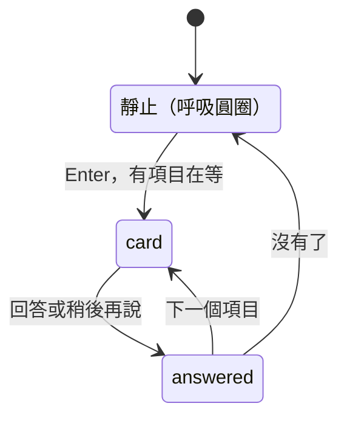

禪一次只顯示一件事。**項目**就是在等你的事，例如單位的問題、信任問題或塔台的等待，會以一張卡片出現。禪靜止時是一個呼吸圓圈，沒有卡片會自己佔住畫面：它們等你按 Enter。你讀著的卡片絕不會被換掉或抽走。

<details>
<summary>細節</summary>

禪一次只顯示一件事（`gui/zen.ts`，一個只在檢視顯示時才載入的 chunk；選擇存放在純模型 `gui/zenmodel.ts`）。**項目**就是在等你的東西：等著回答的單位、待處理的對話框、專案信任詢問，或塔台對你的等待，依它們開始等待的順序排列（會卡住智慧體的問題，例如對話框、信任詢問、盒子轉送的問題或隊友的確認，排在塔台的等待、配對請求或記憶提案之前；沒有任何卡片會在任何狀態下自己占滿螢幕，而是等待 Enter，卡住的優先，而螢幕上的卡片絕不會被取代或抽走；標準的順序不變），所以 HUD 的警示清單是同一組。

另外四種問題，標準把它們顯示在 Link 按鈕、Wi-Fi 通知與塔台的通知中，在禪中各是一張卡片（`gui/cardalerts.ts`、`gui/zendecide.ts`）：隊友的塔台向這台電腦提出的**確認**（允許或拒絕，下面附工具的完整參數）、**Straw Link 盒子轉送的對話框**（共用的問題面板）、**配對請求**（手機顯示的四位數字，允許或拒絕），以及塔台 run的**記憶提案**（確認或駁回）。

每一種都透過與標準那一列相同的函式回答（`gui/asks.ts`），由 server 的清單決定卡片何時結束（它不再列出的卡片會留在螢幕上，附上*已經在別處回好了*，或在它的單位離開網或關閉時附上*這個單位已離開*，它的回答關閉，直到你按 Enter、Esc 或它的按鈕關閉它；卡片的敲擊聲會響一次，之後的拒絕或失敗仍會響低沉的缽聲，而在轉送之前就被取走、之後才得到對話框的卡片會變成可回答，而不是結束），而已配對的裝置保有它在標準中擁有的權限：它不會得到配對請求卡片，因為 server 對它回答 `local_only`。加入請求留在標準。

頁面只顯示目前的項目，連同它的問題卡片（標準對話框的卡片，以同樣方式回答，包括需要終端機的回答），絕不顯示數量，也不暗示還有更多在排隊。有多個問題的對話框放在同一欄中（`gui/zenquestions.ts`）：一個問題被聚焦，展開並維持完整強度，其他的各折成一行淡化的線（標題或問題，一旦有答案就在一個點之後附上答案），其控制項不繪製，所以只有點按、Enter 或 Tab 在該行上才會被聽見，並把那個問題帶進來。

一次滾輪手勢或一次滑動移動一個問題（聚焦問題自己的捲動優先，甩動的慣性不會移動第二個），指標選取單一選項、Tab 與 Enter，以及點按某一行也是如此；比空間更高的問題會在自己裡面捲動，並且總是從頂端開啟。送出、取消、結果與**晚點再說**無論視窗多大都留在頁面上，是問題區域讓出空間。

當它因你自己的回答或取消而離開螢幕時，回答被接受時已經在等待的下一張卡片，會在 1.2 秒的結果之後接著出現，帶著缽聲而沒有停頓（回答之後才到的卡片等 Enter；在最初的 400 毫秒內，那張卡片會忽略重複的或更早的 Enter，以及任何 Enter、點按或 Esc，所以回答用的那個按鍵不能按下它；隱藏的頁面上、沒有焦點的頁面上、終端機層、調色盤或選單底下，或在回答之後才開始的禪訪視中，都不會連鎖：每次訪視都從呼吸開始）。

最後一個回答、**晚點再說**（讓卡片休息 10 分鐘或直到它的問題改變），以及問題已在別處結束的卡片被關閉（點按可略過它）之後，會有 3 秒的呼吸停頓，而下一個項目等待 Enter。Enter 按下你取走的那張卡片的主要按鈕（絕不在文字欄位中），而終端機層的確認也接受 Enter，不過在它顯示時你輸入的按鍵會把焦點移到取消而不是確認，而它顯示後 400 毫秒內的 Enter（雙擊 Enter 的第二下）什麼也不確認。

禪中沒有任何東西會從你手上奪走螢幕：從卡片開啟的終端機會留著，直到你回去；結束或失去控制的作伴 session 會帶著一則安靜的說明（*已結束*、*已失去控制*）留著，它的輸入框唯讀、送出關閉，直到你離開它；server 預設檢視的改變會在禪頁面的下一次載入時套用，而不是立刻（而它開啟設定頁所留住的頁面，離開設定頁時會再顯示禪）；頁面的新版本（較新的 pi-straw-boss 接管了 server）也不會在你手上載入：當卡片、終端機層、作伴 session、主塔台的對話或展開的輸入、調色盤或選單開著時，一行安靜的文字會說新版本已就緒，而頁面會在禪回到呼吸的圓、沒有任何東西開著時（每秒檢查一次）重新載入一次，或在頁面隱藏、或離開禪時立刻重新載入；標準與極客如先前那樣立刻重新載入。

沒有項目時，就是一個呼吸的圓與一行有出處的正念句子（`gui/zenlines.ts`）：每次訪視都從那裡開始，訪視之間不記得任何東西。`[` 與 `]` 逐一切換到一位**同伴**，一個有即時記錄與輸入框的作用中 session，經由核心的候選清單，清單在尾端繞回到圓，而調色盤的*回到呼吸*讓訪視的其餘時間回到圓；沒有 session，包括塔台，能取代它。

選單與音樂清單在一層會接住關閉它們的按壓的紗幕上開啟，所以那一下絕不會到達它底下的卡片。**Esc** 是一張表（`gui/zenkeys.ts`）：角落選單先關閉，接著有文字的欄位只失去焦點，接著按下項目的取消（無法取消時則是晚點再說），接著當主塔台的條帶的行都已清除時讓它休息，否則第一次 Esc 顯示提示，600 毫秒內的第二次 Esc 回到標準；角落選單的最後一列則立刻做同樣的事，而離開絕不改變裝置的選擇。角落有一個全螢幕按鈕與一個選單（語言、檢視、聲音、音量、回到標準）。

選單只由按壓開啟（點擊、點按、Enter 或空白鍵），絕不由 hover，並由 Esc、在外面按壓，或選擇語言、檢視或回去的路徑而關閉。卡片立刻取得內容所需的大小；它所容納內容的替換（新的對話框、結果行）以 0.3 秒淡入，而沒有任何東西緩動卡片的高度或寬度。色盤只有深色墨色。

**聲音**有兩件事，都放在頁面自己的開關之後。**音效**以 Web Audio 合成（`gui/zensound.ts`，沒有音訊檔）：項目占據螢幕時是一聲頌缽，完成時是一聲木魚敲擊，出錯時是一聲較低的缽；它們是音效：只在設定頁的音效開關開啟時才播放（預設關閉），音量是其音量的平方，每次播放時讀取，而且只在頁面的第一次手勢之後才響（瀏覽器讓音訊從暫停開始；在那之前到期的音效會被丟棄，絕不排隊）。

角落選單的*試聽音效*會播放它們。標準與極客保有自己的片段，而禪絕不播放那些。**音樂**是你的：agent 資料夾中 `straw-boss-music/` 的音訊檔（mp3、m4a、aac、ogg、oga、opus、wav、flac）（`~/.pi/agent/straw-boss-music/`，與 state 資料夾並列而不在其中）；GUI 的 server 在 `GET api/music` 列出它們，並以 range 請求串流（`src/music.ts`），放在與每個其他 `api` 讀取相同的 token 與 cookie 之後，而套件不附帶任何東西。每次禪顯示時都會讀取該資料夾；沒有檔案時，角落沒有 ♪。

音樂是背景音：角落的 ♪ 選擇禪是否播放它（預設關閉，存放在 `sb.zen.music`），而它只在設定頁（或角落選單）的背景音開關開啟時才發聲，音量是該開關的音量；背景音關閉時，♪ 保留位置並寫著*音樂：開啟，但背景音已關閉*，不取得任何東西，而正在播放的曲目立刻停止。

♪ 與點按喚醒音樂的頁面是瀏覽器要求的手勢，所以從角落選單開啟背景音會立刻開始一首曲目，而從另一個分頁開啟則等待一次點按。它旁邊的 ⌄ 在有兩首以上時選擇曲目（`sb.zen.track`）。播放器（`gui/zenmusic.ts`，自己的 chunk，只在音樂開啟後才取得）使用兩個 audio 元素，並在最後 6 秒把曲目與它自己交叉淡出，所以迴圈沒有空隙；音效響起時會把它壓低 6 dB。

播放從手勢開始：已儲存為開啟的開關會等第一次點按並寫著*點按以播放*，被鎖定的手機或拒絕的瀏覽器所停止的也一樣。在觸控螢幕上，頁面隱藏時音樂暫停；在桌面上它持續播放。離開禪會停止它。iPhone 的鈴聲開關會把它靜音，如同任何網頁音訊。由回答開啟的終端機（robot_hand 的*Put it in my prompt*或新的 Herdr pane，或被擋下的提示的**開啟終端機**）在禪中顯示為全螢幕層，角落有**回到禪**（上面的「需要終端機的回答會開啟它」一段）。

示範以 `?zen=item|questions|secret|words|trust|idle|alone|terminal|blocking` 開啟一個狀態（`gui/fixture.ts`；`blocking` 是塔台的等待，一個盒子的問題在 `&box=<ms>` 之後才到（`&box=<ms>` 可用於任何狀態），`settled` 是 `item`，它的問題在 `&settle=<ms>` 後於別處被回答；`terminal` 是 `item`，附一個在顯示 20 秒後自己關閉的 pane；四個 link 狀態是 `gui/demo-link.ts`，`&refuse` 讓 server 拒絕回答，而配對數字是 4821）。

禪中的按鍵：`[` 與 `]` 在你能交談的 session 之間逐一切換同伴（閒置的與塔台優先；也可以用 Option 或 AltGr 輸入，絕不在文字框內），而 ⌘K（非 Mac 上是 Ctrl+K，文字框中也可用）開啟命令調色盤：頁面的動作（同伴的 session 或終端機、設定、回到標準）與角落選單的偏好（檢視、語言、聲音、音量）。

頂端一條安靜的帶子說明有多少單位在工作、多少閒置；它絕不計算在等待的。**H** 在卡片上開啟 *Context（脈絡）*：卡片內的單位 session 記錄，唯讀，只在第一次開啟時取得，同時仍可回答；H 或 Esc 關閉它（它是 Esc 表的第二步，在角落選單之後）。**Shift+Esc** 讓鍵盤離開禪中的終端機，否則終端機會接管每個 Esc（pi 會因它而中斷）；Enter 或空白鍵提早結束呼吸停頓，點按也一樣。指標留下淡淡的漣漪，而一切會動的東西在 `prefers-reduced-motion` 下停止，漂移的底色在強制色彩下停止；與標準不同，禪不論頁面休息多久都持續呼吸（圓、同伴記錄後面淡淡的圓，以及以半分鐘為潮汐漂移的底色）。

同伴的記錄與輸入框沒有方框：訊息、工具呼叫、程式碼與表格靠空白與較安靜的灰燼色區隔，而輸入框是一行。禪的其餘部分遵循同一條規則（規格的**視覺語言**）：選項是一行帶圓點的文字，選取時填滿，hover 或按鍵聚焦時變亮；選單、音樂清單與調色盤浮在模糊的紗幕上，沒有面板；你說的話以灰燼色靠右；朱砂印只標記鍵盤所在，作為圓點的環或一個字下的一條線，絕不是方框外的環。

在手機上，卡片、停頓與角落保有 44 px 的目標，選單與音樂清單開在頁面上方，而角落的全螢幕按鈕，在瀏覽器沒有 Fullscreen API 的地方讓位給一次性的「加到主畫面」提示。任何狀態上的 `&upgrade=<ms>` 會在頁面啟動那麼久之後宣告新版本（每個瀏覽器 session 一次）。示範為了畫面開啟更多狀態：`history`（已開啟脈絡的項目）、`palette`（開著調色盤的同伴）、`pause`（被擱置的項目，所以停頓會顯示），以及 `?music=<n>`（有 n 首虛構曲目的音樂資料夾；沒有音訊檔，所以開啟的曲目寫著*點按以播放*）。

</details>

#### 標準與極客中的主塔台

標準與極客中的主塔台（`gui/headpage.ts`；設計見 `docs/specs/2026-11-04-head-tower.md`）。路由 `head`（`/head`）是以鍵 `sb-head` 呈現的塔台通訊畫面：記錄中每個章節開始處有章節分隔線，輸入框（「叫醒主塔台」；`/quit` 與 `/new` 不需確認）、附有**離開對話**與**開新對話**的對話框、記憶面板、附有重試、重新送達與捨棄的通知，以及終端機模式。

<details>
<summary>細節</summary>

不同之處在標頭（通訊畫面標誌所在處是一頂金色皇冠、標題*主塔台*、狀態行）、對話框下方的**廣播卡片**（[規格](specs/2026-11-07-head-log-cards.md)：主塔台轉送的每一項指示一張卡片，它收合的那行是帶標籤的部分：*你說*（老闆自己的話，由 server 從 relay 指名的事件保存）、*主塔台送出*（它的第一行，不含老闆的引用副本）與*送給*，接著是 `11m ago · 2/3 handled`；點按會展開完整的文字與每座塔台的狀態（`answered`、`handled`、`received`、`waiting`、`no answer`）、它最新的回答文字，以及通往它通訊畫面的連結；被主塔台指名為由較晚的一項指示所更正的指令，會帶著刪除線折疊在最新的卡片之下，附上 `corrects N earlier` / `corrected by the next`），以及對話框 ⋯ 選單中的**關閉主塔台**，它會詢問一次。在主塔台存在之前，頁面顯示輸入框與一行「第一則訊息會開啟主塔台」。

三種入口：每個路由上標頭的**皇冠按鈕**（當主塔台最新的回覆比這台裝置看過的更新時，帶一個小圓點，絕不是數字）、地圖的**主塔台橫帶**（[規格](specs/2026-11-07-head-band.md)；`gui/headband.ts`，由 `gui/render.ts` 中的 `fillHeadNode` 繪製：地圖裡的第一個東西，置中在基地網格上方，最寬一個網格欄寬、高 44 px，在版面流中所以隨地圖捲動；皇冠、*主塔台*、最新的一行，以及一個帶有主塔台等待老闆的數量的 chip，為 0 時隱藏，計算方式與主塔台頁面的列相同；整條橫帶是一個通往 `/head` 的連結，它的狀態放在無障礙名稱與 hover 中。

最新的一行是最新廣播的一行摘要（當它在最近一天內有活動時），否則是主塔台最新助理文字的第一行（最多 160 個字元），由 server 依主塔台記錄的篩選條件從對話檔的尾端讀取（`HeadUnit.line`）；兩者都沒有時為空。當主塔台未開啟時，橫帶是淡淡的虛線，寫著*未開啟*，沒有那一行或 chip。在手機上它是至少 44 px 的一行；最新的一行以省略號截斷，當橫帶窄於 240 px 時捨棄，而皇冠、名稱與 chip 一律保留。

極客與鴉閣會為它換樣式；禪沒有地圖），它是地圖連線的樞紐，連線是虛線，且只有正交線：從橫帶底部中央往下一條線到網格上方空隙中的匯流排（橫帶下方約 32 px），匯流排沿著欄與欄之間的間隙，然後沿著每一欄左邊的間隙往下，再橫跨到每座塔台的中心，所以一欄讀起來就是一條主幹加分支，而且沒有任何線段穿過卡片。連線的封包在任一端工作時沿著同一條路徑行進，以及手機抽屜的第一列。沒有任何基地再有皇冠。

</details>

#### 禪中的主塔台

在圓的畫面上（沒有項目、沒有停頓、沒有同伴），主塔台以一條帶子的形式位於呼吸的圓之下：它的行在老闆叫出它們之後顯示（高度容得下多少完整的行就顯示多少，最新的在腳邊、靠近輸入框；安靜時是三行，手機上是兩行；圓會先讓出空間，絕不低於 80 px），老闆的以灰燼色靠右，它的回覆以紙色靠左，而轉送（`→ Harbor API tower`）與回答各有一行簡短的註記。

<details>
<summary>細節</summary>

每一行從它第一次出現在螢幕上起清晰 20 秒，然後在三分鐘內淡到幾乎看不見並停在那裡；淡化是每一行一個 CSS 動畫，所以沒有計時器重繪。在帶子上 hover 或聚焦，或在手機上點按它（10 秒），會在 0.6 秒內把每一行緩和到清晰，並在指標離開 1.5 秒後回到它淡化所在的位置（淡化的時鐘從不停止：hover 只是把行抬起，`gui/zen.css` 中的 `--lift`）；等待老闆的等待事項會讓它的那一行保持清晰。

正念句子只在每一行都淡去時顯示，所以同一時間只有一樣東西是紙色：行變清晰時它在 0.6 秒內淡出，再以它自己緩慢的步調淡入，而在休息時它與*全部對話*連結保有它們的空間，hover 或點按只會抬起那些行，絕不填滿頁面，所以指標底下沒有任何東西會移動（醒著的帶子的行會填滿空間，沒有正念句子）。連結在輸入提示的安靜灰燼色中指出它的按鍵，*全部對話 · H*，而觸控螢幕（沒有鍵盤）不顯示該按鍵。

在行的下方，輸入是一條細線，提示是「按 Enter 和主塔台說話」；在圓上點擊、點按或按 **Enter** 會展開它（Enter 送出，Shift+Enter 換行，Esc 收起它並保留草稿，拒絕時以陶土色顯示 server 的話並保留草稿）。**H**、*全部對話*連結、向上的滾輪手勢或向上滑動，會在淡淡的圓之上以同伴的形式開啟完整的歷史（捲動時載入較舊的頁面，轉送讀起來是安靜的一行，「已送給 Harbor API 塔台」），而 Esc、H、*回到呼吸*或向下的手勢會關閉它。

**帶子預設是休息的**：每次進入禪的訪視都從呼吸的圓、正念句子與收起的輸入開始，不顯示主塔台的任何一行。點按或點擊收起的輸入、對它聚焦、**Enter** 或 **H**（第一次 H 把行帶上來，第二次開啟全部對話）會把行叫出來，從那時起清晰 20 秒；**Esc**、點按或點擊空白處，或焦點離開帶子（失去焦點的空輸入）會讓它再度休息，而關閉全部對話則回到休息。休息中的帶子對主塔台自己的行（塔台的回答、它自己開始的回報）以及對你的等待或問題（那是一張卡片，算在下面的提示中）保持休息，只對你在這次訪視中送出的東西的回覆浮現；休息是頁面自己的，每次訪視都以它開始。

**卡片等待 Enter**：當禪停在呼吸的圓上休息時，不論種類（單位的對話框、信任詢問、盒子轉送的問題、隊友的確認、塔台的等待、配對請求、提案）或主塔台自己的等待，沒有卡片會自己占滿螢幕；輸入上方一行安靜的文字說明有多少張在等（「1 張卡等 Enter。不急，等你準備好。」），而 **Enter** 或點按那一行會取走下一張，卡住的問題優先。完成時，禪再度呼吸，下一張等待 Enter，只有一個例外：你自己被接受的回答之後，下一張卡片會立刻接著出現，沒有呼吸。螢幕上的卡片絕不會被打斷。當卡片在等待時，輸入的提示寫「點一下和主塔台說話」，因為 Enter 會先取走卡片。

**絕不打斷，而且 Enter 就是行動**：卡片在任何狀態下都不會自己占滿螢幕，包括作伴 session、主塔台的全部對話與終端機層；在那裡，提示放在名稱之下，或層保持原樣，而在等待期間就解決的卡片會離開計數，從未被繪製。當你閱讀時問題結束的卡片會留著，說明這件事，並由 Enter、Esc 或它的按鈕*回到呼吸*關閉；單位的下一個問題等待 Enter。

取走卡片時，焦點落在它的主要控制項（對話框的第一個選項、開啟終端機、信任、等待卡片的第一列、允許、確認、配對數字、終端機步驟的執行），而下一次 Enter 會按下它；Enter 絕不在文字欄位中觸發，而終端機按鍵板的確認（送出 Enter、送出 Escape、送出按鍵）在禪中只由 Enter 確認，絕不由按住的按鍵，或在確認顯示之前就開始的按鍵確認。沒有人在看的頁面（隱藏，或在前面但沒有焦點）會為每張卡片得到一則系統通知，只要 server 仍列出它就只通知一次。

帶子在每種狀態下都為連結保留一列、為提示保留一列，而頁面較矮時圓會讓出空間，所以卡片來去時沒有任何東西移動，而圓絕不會坐在*工作中 · 閒置*那一行後面。隊友基地的單位狀態回報與 Link 通知絕不是禪中的卡片。調色盤新增*和主塔台說話*、*主塔台的全部對話*與*在標準檢視開啟主塔台*。

減少動態時沒有淡化與緩動（清晰 20 秒，然後立刻休息；hover 立刻抬起各行）；強制色彩顯示未淡化的行，能容納多少就顯示多少（醒著時最多 24 行），並帶有 `CanvasText` 邊框。你取走的項目先占據螢幕，而帶子隨圓一起離開。  

</details>

#### 主塔台的示範狀態

`?head=absent|talk|answers|waiting|busy` 讓主塔台上網（未開啟；一段對話；工作交給三座塔台，其中一座已回答；對老闆的等待；以及一個拒絕老闆所送內容的，用於帶子的拒絕），而 `?zen=head`、`?zen=head-open`（輸入展開並有草稿）、`?zen=head-history` 與 `?zen=head-rest`（頁面啟動後一會兒按 Esc，然後主塔台自己做出一份回報，休息的帶子不會顯示它）在禪中顯示帶子。

#### 設定頁

設定頁（尚未發布；路由 `settings`，`gui/settings.ts`，GUI 改版的第 5 步）。標頭的齒輪是通往它的連結，任何人都能複製的連結也是（`settings`，或用來開啟某個區塊的 `settings/phone`、`settings/wifi`、`settings/teams`、`settings/server`；server 對每一個都回應該頁面，與任何路由一樣放在 token 之後）。

<details>
<summary>細節</summary>

它取代了設定彈出視窗，以及原本開在地圖旁邊的手機、團隊與 server 圖塊，所以地圖保有它的欄。**這台裝置**放的是人設定一次、而且一直都在的東西：檢視（自動、標準、極客；server 的預設值仍是 pi 指令）、寫著開或關的有標籤按鈕——提醒與音效（提醒還會說允許？或已封鎖，並在下面附一行說明它的意思）、音效的音量與試聽，以及語言。**手機與裝置**（Tailscale 與「同一個 Wi-Fi」分頁、標題旁有「全部解除配對」的已配對裝置）、**團隊**與**伺服器**是關閉的區塊，打開時才填入，並在關閉或離開頁面時捨棄，所以關閉的區塊背後沒有任何東西在輪詢或產生：打開手機區塊才會要求配對代碼，如同手機按鈕原本那樣。

誰可以使用各區塊與先前相同：手機與伺服器只在這台電腦的頁面上（已配對裝置的頁面有「這台裝置」與團隊，而 server 仍對它回答 `local_only`），而 desk 視窗沒有手機區塊。標頭的等待請求通知會開啟 `settings/wifi`；Escape、頁面的返回箭頭與齒輪會回到開啟頁面前所在的位置（若它是第一個頁面則回到地圖）。在「同一個 Wi-Fi」分頁中，當 Wi-Fi 存取關閉時，完整的警告（風險、尚未驗證、熱點）留在開啟按鈕上方，該按鈕是實心按鈕；只有在 Wi-Fi 存取開啟之後，它才折疊到「詳細說明」之下。在手機上每個控制項都是 44 px（`tests/phone-targets.test.ts`）。

</details>

#### 單位的圖示是它種類的

協調者是舵輪，整合員是兩支箭頭匯合，值守是燈塔，火車是原本的火車頭，被派出的工作者、偵察、規劃、審查、監控者依序是扳手、望遠鏡、鉛筆加尺、放大鏡與獵犬。塔台（控制塔）與主塔台（皇冠）保留自己的，不知道種類的單位仍用位置的圖示（主智慧體、成員、子智慧體）。圖示由 `unitIcon(role, duty)`（`gui/icons.ts`）決定，畫在原本畫單位角色圖示的每個地方：地圖上的 token 與卡片、放大的基地、抽屜、檔案資料、警示的臉孔、聊天頭像，以及隊友卡上盒子主智慧體的那一列（用盒子送來的種類）。

<details>
<summary>細節</summary>

被派出的子智慧體的種類以 `Unit.duty` 傳到頁面，讀自它啟動腳本所指名的 agent 角色。鴉閣對這些種類畫標準檢視的符號，如同對火車，極客也畫標準的。

</details>

#### 圖示

圖示來自 Lorc 與 Delapouite 的 [game-icons.net](https://game-icons.net)，[CC BY 3.0](https://creativecommons.org/licenses/by/3.0/)（詳情見 [`gui/ICONS.md`](../gui/ICONS.md)）。沒有任何東西從網路載入：沒有 CDN、字型或執行期相依套件。

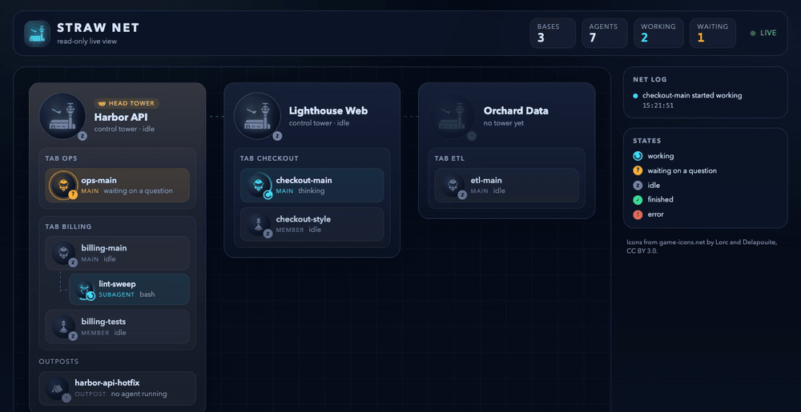

## Pane 平衡

第二個擴充套件入口 `src/balance.ts` 讓 Herdr 的分頁保持均衡。當 pi 在分頁中啟動時（每個行程一次，所以 `/reload` 不算），以及 pi 結束而 Herdr 關閉它的 pane 之後，該分頁的 pane 會沿著每個分割得到相等的寬度，而堆疊的 pane 得到相等的高度。它在 Herdr 內的每個 pi 中執行，不論是否加入，並且不動被放大的分頁。比它的 pi 活得更久的 pane（你留著的 shell）不會改變任何東西。

<details>
<summary>細節</summary>

這項工作在 `src/balance.mjs` 中以分離的 `node` 行程執行：啟動時是 `balance.mjs now <pane>`，結束時是 `balance.mjs after-close <pane> <tab>`，因為正在結束的 pi 會在 Herdr 關閉它的 pane 之前就離開。它以 `windowsHide` 啟動，所以在 Windows 上，分離的主控台子行程不會得到自己的主控台視窗。每次調整大小都根據剛讀取的版面來規劃，而系統暫存目錄下每個分頁一個的鎖（`pi-straw-boss-pane-balance/`）讓並行的 session 輪流進行，而不是把同一個變更套用兩次。

本機塔台 run的 pi（以 `--sb-run` 啟動，或在 server 把常駐 pane 交給它時由執行模式標記，`src/runmark.ts`）絕不啟動 `after-close`：它的 pane 會留下，所以輔助程式只會空等它的 30 秒。在 Windows 上這個等待很要緊：Herdr 以 `Start-Process -Wait` 啟動 `pi.cmd`，它會等待整個行程樹，所以在輔助程式結束之前，pane 都不顯示提示，而那裡下一個 `herdr agent start` 就撞上自己的逾時。隊友 run 的 pane 會在 pi 一結束就由 server 關閉，所以它的 pi 保留 `after-close`，而塔台分頁就像任何 pane 那樣重新平衡（一旦聲明這麼說，執行模式就把行程標記為 `ally`）。

</details>

## 被擋住的對話框

```mermaid
flowchart TD
    d["擴充功能開啟對話框"] --> a["herdr:blocked<br/>active: true"]
    a --> b["計數大於零時，Herdr<br/>把 pane 顯示為 blocked"]
    e["對話框結束"] --> z["herdr:blocked<br/>active: false"]
    z --> w["計數回到零：<br/>pane 恢復顯示它的狀態"]
```

Herdr 的 pi 整合在它對 `herdr:blocked` 事件的計數（`{active: true, label}` 加一、`{active: false}` 減一）大於零時，把 pane 顯示為 `blocked`，而 pi 自己的對話框什麼也不發出，所以等著其中之一的 session 看起來像在工作。第三個擴充套件入口 `src/blocked.ts` 為 Herdr 內的每個 pi 補上這個缺口，不論是否加入，包括子智慧體。它把兩個來源轉送成 `herdr:blocked`：

<details>
<summary>細節</summary>

- **rpiv 的問卷**：`rpiv:ask-user:blocked`，每個開啟的 `ask_user_question` 一次。
- **任何擴充套件的每個 `select`、`confirm`、`input` 與 `editor` 對話框**（`mp-infra` 的指令審查、pi-robot-hand 的選擇器），來自 pi 的 `ui_prompt_start` / `ui_prompt_end` 事件（pi 0.84.4 及之後；在更舊的 pi 上它們從不觸發，也不轉送任何東西）。這個 relay 不包裝任何東西：pi 為所有擴充套件在每個 runner 上包裝 `ctx.ui` 一次，並對每個最外層的對話框發出一對事件（上面的回答 relay 會再包裝同一個物件，並呼叫 pi 的包裝，所以這些成對事件不變），所以重疊的對話框構成一對，從第一個 start 跨到最後一個 end，而被解決、被取消、被中止、逾時或丟出例外的對話框都同樣會結束它。

  標籤是 `Waiting for your answer: <title>`，其中控制與格式字元被換成空格，標題截斷為 80 個字元（沒有標題時是 `<kind> dialog`）。沒有 UI 的 session（print 模式）得到 pi 的 no-op `ui`，它從不被包裝，所以不發出任何東西；`/reload` 與新的 session 會載入全新的 runner 與全新的 relay，而舊的連同它們的 runner 一起被丟棄。

pi 不等待就發出這兩個事件，並逐一走過各擴充套件，所以在較早的擴充套件的緩慢 handler 之後，對話框的 end 可能比它的 start 先到達這個 relay（以真實的 runner 量測）。因此 relay 保存一個帶正負號的計數，並且只在它大於零時才回報 blocked：提早的 end 與晚到的 start 互相抵銷，而它發出的成對事件總是交替出現並平衡地結束。`custom` 對話框是刻意排除的：pi 自己的程式狀態也不把它們算成阻擋，而真正等待使用者的那些會自己回報（`ask_user_question`、`secret_drop`、配對 QR 覆蓋層）。

因為 pi 只回報最外層的對話框，所以在 `custom` 對話框已開著時開啟的 confirm 也不會被回報。同時也回報自己的對話框的工具（pi-robot-hand 的 `robot_hand` 選擇器、pi-ask-user 的輸入）在它開著時會多加一對平衡的事件；Herdr 兩個都計算，並一起清除它們。在那裡略過 relay 的那一對，會在工具的那一對先關閉、而另一個對話框仍開著時丟失 blocked。被擋住的 pane 沒有可以顯示的問題，所以 GUI 把它列為等待中，並寫著「它在等一個對話框。」，而當 Herdr 回報 pane 為 `blocked` 時，它的輸入框會拒絕提示。

</details>

## 側邊欄網檢視

`herdr-plugin/` 裡的選用 Herdr 外掛（id `wayne930242.straw-boss`，動作 `net`）可以在側邊欄的 Agents 清單中，於 Herdr 自己的檢視與網檢視之間切換。網檢視先列出主塔台的工作區（若存在；它的那一列是皇冠分頁的 pane，聚焦它會顯示常駐 pane，在那裡按 Enter 即可與主塔台對話），再依 Herdr 的順序列出其他工作區。每個工作區裡，塔台排第一，接著依順序列出各分頁；每個分頁裡先列主智慧體，再列成員。每個子智慧體都直接掛在啟動它的 session 底下，包括 pi-herdr-agents 在 worktree 子工作區開出來的子智慧體。

網不認得的智慧體排在最後，依 Herdr 的工作區、分頁、pane 順序排列，所以不會有任何東西被藏起來，等你回應的智慧體也會留在清單上。檢視開啟時，側邊欄標題顯示 `net`。檢視預設開啟：外掛在 Herdr server 啟動時打開它，按鍵可以關閉，再按一次又打開。同一套順序也用於收合的側邊欄、行動版清單、滑鼠目標，以及 `focus_agent` 的編號與上一個／下一個導覽。這個檢視不會改變任何通知或注意力計數。

### 兩次執行之間的塔台

由 sb server 執行的塔台，即使沒有任何執行中的 run，也保有它的那一列：只要塔台提示在常駐 pane 上執行（[常駐 pane](#常駐-pane)），server 就會在該 pane 上回報一個替身智慧體 `tower`（閒置，訊息為 `standing by`、`3 queued` 或 `held`），所以這一列會排在其工作區的第一個位置，作為塔台的標記，`agent.list` 也看得到它。它只是一列，沒有別的作用：網、儀表板、收起、closer 或 reaper 的檢查都不把它算作智慧體、主智慧體或成員，閒置回報也不會觸發 toast、音效或注意力計數。run 開始時，由 pi 自己的那一列取代它；run 結束後它會再回來。隊友 run 的 pane 也是一列，就在塔台的正下方（`[ally] <device label>`，見[隊友 run](#隊友-run)）。

<details>
<summary>細節</summary>

**token。** 網裡的每個 session 都會在 `sb_role` 旁邊寫入顯示用 token，寫在同一份回報裡，沿用同樣 4 分鐘的更新週期與 10 分鐘的 TTL。它也會在自己啟動的子智慧體的 pane 上寫入，因為子智慧體不會加入，自己也不寫任何東西。session 結束時，會清掉自己和其子智慧體的 token。

- `sb_order` 是排序鍵。塔台的是 `WWW.0`。主智慧體或成員的是 `WWW.1.TTT.R.PPP`：`WWW` 是它的工作區在基地工作區中的位置（子工作區不算；主塔台的工作區存在時是 `000`，所以此時基地工作區從 `001` 開始），`TTT` 是它的分頁在工作區中的位置，`R` 對主智慧體是 `0`、對成員是 `1`，`PPP` 是它的 pane 在分頁中的位置。

  塔台與各分頁之間還有另外兩個位置，給合併火車用（見[合併火車](#合併火車)）：整合員，也就是其 `train` todo 產生了專案 `yard.json` 的主智慧體（yard 以寫入者的身分記下它的 session，而且該寫入者的行程仍在執行），是 `WWW.05.TTT.0.PPP`，它那個分頁的成員是 `WWW.05.TTT.1.PPP`，其中 `TTT` 是它的分頁在工作區各分頁中的位置，所以它的分頁會往上移到塔台下面，同一工作區有兩位整合員時就是兩個區塊，每個成員都緊跟在自己的主智慧體底下；火車是 `WWW.06.YYMMDDLL.HHHHHHHH`，即其代碼的年、月、日，以及代碼的字母（左側補 `0`）（`2026-11-06-m` 是 `2611060m`，`2026-11-06-aa` 是 `261106aa`），再接其專案名稱的 SHA-256 前八位十六進位數字，這部分只用來在兩個專案有相同代碼的火車之間分出先後。

  塔台的子智慧體（`WWW.0.NNN`）排最前面，因為 `.` 排在數字之前，然後是 `WWW.05`，再來是 `WWW.06`，最後才是各分頁（`WWW.1`）。火車的鍵只取決於它自己的代碼與專案，所以一列火車結束時不會移動其他任何一列，只有排在它後面的 `focus_agent` 編號會位移；一個字母的代碼排在兩個字母的代碼之前。火車的 reviewer 與任何子智慧體一樣，比它的火車低一段。每個子智慧體增加一段 `.NNN`，即它在啟動者的執行中與已完成子智慧體之間的位置，任何深度都適用（儀表板每個 session 列出八個，這些鍵涵蓋每一個執行中的子智慧體）。

  每個數字都補零，所以單純的字串順序就是數字順序，子智慧體的鍵排在其啟動者的鍵之後、啟動者的下一個同層之前。
- `sb_mark` 用幾個字元說明網成員是什麼：主智慧體只有它種類的字符（自 0.74.0 起：協調者是舵輪，nf-md-ship_wheel U+F0833；整合員是下面的 code-fork；值守是燈塔，nf-md-lighthouse U+F09FF；主智慧體的種類不明時只有一顆星，Font Awesome 的，U+F005），成員只有一個人形（Font Awesome 的，U+F007），子智慧體則只有它啟動腳本（`PI_SUBAGENT_AGENT`）所指名種類的字符：`worker` 是扳手（nf-md-wrench U+F05B7），`scout` 是望遠鏡（nf-md-binoculars U+F00A5），`planner` 是鉛筆加尺（nf-md-pencil_ruler U+F1353），`reviewer` 是放大鏡（nf-md-magnify U+F0349），`watchdog` 是狗（nf-md-dog U+F0A43）。

  角色不在其中、或啟動腳本已不在的子智慧體是 `[sub] <launcher>`，其中啟動者的名稱截為 24 個字元。這些字符就是頁面當作圖示畫的那些（[瀏覽器檢視](#瀏覽器檢視)），並已對照 Nerd Fonts 3.5.1 的字符名稱檢查過。隊友 run 的 pane（由 sb server 處理的一則 Straw Link 訊息）是 `[ally] <device label>`；它的鍵、分支與名稱由 sb server 為它寫入，就像子智慧體的由其啟動者寫入（見隊友 run）。塔台沒有這個 token：它的分頁已經帶有無線電塔圖示。
- `sb_mark` 也用單獨一個 Font Awesome 的 code-fork（U+F126）標記整合員，用火車圖示（U+F238）加上短代碼標記火車（`\uF238 1106m`）。兩者都依 session 自己的紀錄，來自 trainboard 檔案，而不是來自 pane 上的任何 token：整合員是存活的 `yard.json` 所指名的 session（寫入者行程已消失的 yard 不指名任何人），火車則是塔台為該代碼開了 pane 的那一列。

  整合員分頁的成員會向 intercom 的清單詢問存活 yard 所指名的 session 在哪裡，若其中有一個在它自己的分頁，就取代整合員的位置（Herdr 會告知某個 pane 在哪個分頁）；yard 變動後，它在下一次更新時重新排序。標記與位置只用於顯示：火車自己的 shell 可以寫出指名某個存活 session 的 yard。
- `sb_step` 只在火車上有：目前步驟狀態的圖示（沙漏 U+F254 等待中、播放 U+F04B 執行中、勾 U+F00C 已通過、叉 U+F00D 失敗、還原 U+F0E2 回復中），加上步驟的種類，最多 24 個字元。目前步驟是進行中的最小一個，沒有進行中的就取最新完成的，由火車自己的看板讀取（經過驗證，所以種類是已知詞彙之一）。火車在看板變動 5 秒後寫入（監看專案 trainboard 資料夾，啟動後也會看一次），此外還有 4 分鐘的更新；控制字元與方向字元會被移除。其他智慧體都不帶這個 token，session 也會清掉 pane 上留下的那一個。
- `sb_main_tab` 是主智慧體的分頁標籤，`sb_tab` 是成員的，每種角色一個 token，因為 Herdr 的規則只看得到自己的 token，所以每一列依角色各自上色。成員的 token 保留它自 0.7.2 起使用的 `sb_tab` 名稱，因此這一列也適用於尚未重新載入的 session；其他智慧體兩者都不帶。
- `sb_indent` 只在子智慧體上有，是從其啟動者到它的分支，畫法和 Herdr 的 Spaces 面板中的 worktree 一樣：同一個啟動者之後還有被標記的子智慧體時是 `├─`，最後一個是 `└─`。同一個啟動者的子智慧體在任何深度都是同層。塔台、主智慧體與成員都不帶這個 token，session 也會清掉 pane 上因執行過子智慧體而留下的那一個。
- `sb_name` 只在子智慧體上有，是 pi-herdr-agents 顯示的它自己的名稱，和 `sb_mark` 裡啟動者的名稱一樣截為 24 個字元。名稱在 pane 有 Herdr 標籤時取自該標籤，否則取自啟動腳本的名稱。Herdr 也把標籤存在 server 的記憶體裡，所以換了新的 server 之後標籤就沒了，這一列只會顯示工作區的名稱；token 會和其他的一起回來（見下文），這一列就可以改顯示它。塔台、主智慧體與成員都不帶這個 token，session 也會清掉 pane 上因執行過子智慧體而留下的那一個。

這些 token 依據的是 session 上一次更新時 Herdr 的順序，所以移動分頁或工作區後，網檢視在 4 分鐘內就會反映出來，而有了新同層的子智慧體，會在下一次更新時得到它的 `├─`。子智慧體在其 pane 執行 pi 期間會被標記：其啟動者在 `subagent` 或 `subagent_resume` 呼叫返回後的 3 秒與 15 秒會再發布一次，所以新的子智慧體幾秒內就會掛在它底下，而它完成後，它的 token 會在下一次更新時移除。到那時 Herdr 仍未偵測到其 pi 的子智慧體（例如它停在 pi 的信任提示上），會在 Herdr 回報它時就被標記，而不是等到下一次更新。

只要啟動出去的子智慧體還沒有 pi pane，其啟動者就會維持一條 `events.subscribe` 連線，監聽 `pane.agent_detected` 與 `pane.updated`（這兩個事件可能把 pane 變成跑著該子智慧體 session 檔的 pi），而一陣來自啟動者尚未標記的 pane 的連續事件，會設定一個 1 秒的計時器，讀取 Herdr 一次。這次讀取只寫入子智慧體的 token，而且只在與上次寫入的不同時才寫，所以沒有任何變化的事件只花一次讀取、不做寫入。

每個啟動出去的子智慧體都有 pi pane 時，連線就會關閉，所以沒有啟動任何子智慧體的 session 不會持有連線；而最近 10 分鐘內完成的子智慧體也沒有 pane，所以連線在那之後還會保留這麼久。4 分鐘的更新維持為安全網，子智慧體完成後，它的 token 仍會在下一次更新時移除。

</details>

### 新的 Herdr server

Herdr 把 pane 與工作區的 token 存在 server 的記憶體裡，所以接手的 server（更新期間的即時交接，或是停止再啟動）一開始沒有任何 token，網檢視會一直沒有排序，塔台看起來也像不存在，直到每個 session 的下一次 4 分鐘更新。因此，每個能加入網的 session 與每個塔台，都會在 Herdr 的 socket 上維持一條 `events.subscribe` 連線，唯一目的是看它何時關閉；它訂閱的是 `workspace.renamed`，這幾乎不會發生，所以這條連線沒有流量，server 運作期間也不花任何成本。

<details>
<summary>細節</summary>

連線關閉時，session 會在 0.25 秒、0.5 秒、1 秒後重新連線，之後每 2 秒一次；等到有 server 回應，就一次把所有東西重新寫入：先是塔台的工作區 token `tower` 與它自己的 `sb_role`（其他 session 就是靠這兩個找到塔台，沒有它們，空窗期間的 `call_tower` 會開出第二個塔台），然後是 4 分鐘更新的完整發布（它的角色與網 token，以及它啟動的子智慧體的標記）。session 的第一次連線不算接手。

尚未完成加入的 session（或尚未取得其角色的塔台），在接手時不寫任何東西；子智慧體與子工作區中的 session 不持有連線。

</details>

### Herdr 還原

```mermaid
flowchart TD
    r["herdr server stop，<br/>再啟動新的 server"] --> p["Herdr 在每個還原的 pane<br/>啟動新的 pi --session file"]
    p --> c{"pane、分頁、工作區<br/>都和記錄的角色相同？"}
    c -->|"是"| t["session 取回它的角色"]
    c -->|"否"| m["它維持成員"]
```

`herdr server stop` 之後換了新 server，Herdr（`[session] resume_agents_on_restore` 預設開啟）會在每個還原的 pane 以 `pi --session <file>` 啟動新的 pi：行程是新的，pane 與分頁的 id 以及 session 檔路徑不變，而 `STRAW_BOSS_ROLE`、token，以及（對尚未有對話的 session 來說，因為 pi 要到第一則訊息之後才寫檔，而且會給接續的 session 一個新的 session id）`straw-boss` 條目都沒了。

<details>
<summary>細節</summary>

若不另外處理，每個接續的 session 都會變成成員：退出應用程式再重新開啟的 PM，會失去塔台與所有主智慧體。因此，塔台與主智慧體會把自己的角色記錄在狀態資料夾的 `roles/<hash of the session file>.json` 裡（角色、pane、分頁、工作區，主智慧體另外記錄該 pane 的終端機），時機是塔台取得其角色時，以及 session 成為其分頁的主智慧體時；當 session 被刻意關閉（GUI 的結束、`/boss close`、塔台要求它開出的主智慧體結束、第二個塔台讓位）時，就刪除這筆紀錄。

在它所記錄的 pane、分頁與工作區啟動的 session 會取回角色：塔台在 Herdr 把它的 pane 列在塔台分頁裡之後（見下），以塔台身分啟動，寫入它的 token 與帶有新 session id 的工作區 token；主智慧體則加入並自行升任，若該分頁已有存活的主智慧體，照常被拒絕（此時它會刪除自己的紀錄，因為它仍是成員）。

在與紀錄不同的 pane、分頁或工作區裡的 session、沒有紀錄或紀錄讀不出來的 session，以及被使用者刻意關閉的 session，都維持為成員；沒有人會依一筆紀錄取得角色，除非它所指名的 pane、分頁與工作區都相符。主智慧體還需要多一項證明，證明確實發生過重啟：Herdr 會給還原的 pane 一個新的終端機（`pane current` 的 `terminal_id`，而 pane id 不變），而紀錄記下了主智慧體所在的終端機。

在同一個終端機裡啟動的 pi，例如在仍開著的 shell 中 `/quit` 之後又 `pi --session` 或 `/resume` 同一個檔案，不算還原：它維持為成員並刪除紀錄，這樣下一次真正的還原就不會把主智慧體角色交給一個從未擔任過的 session。塔台與列車自 0.75.0 起還需要另一項證明：**紀錄與存下的項目只是主張這個角色，由 Herdr 來證明**。兩者都是 session 自己的 shell 寫得到的檔案，所以從前一個成員只要在自己的紀錄裡寫入 `{"role":"tower"}`，或在自己的 session 檔裡寫入塔台項目，下一次 `/reload`、`/resume` 或還原時就會以塔台身分啟動。

現在 session 只有在行程本來就是以塔台啟動（`STRAW_BOSS_ROLE=tower`，或同一個行程先前已是塔台），或 Herdr 把它的 pane 列在標籤為塔台圖示的分頁裡，而且該分頁沒有其他 pane 在跑 agent 時，才是塔台；這個標籤在還原後仍在，也不存在任何檔案裡（server 安置自己的塔台時用的就是這項證明）。列車的項目或紀錄，只有在標籤為該代碼 `train <MMDDx>` 的分頁裡才算數，而且 `/reload` 時項目還必須與 pane 保留的 `sb_train` token 相同。

標籤是在啟動時和工作區檢查一起問的，所以分頁清單讀取失敗什麼也證明不了：啟動維持未定位並再問一次，這段期間什麼都不加入。未獲證明的主張會以成員身分啟動（列車則不是列車），並發出一則警告，指名是哪個檔案與哪個分頁；因此，在一般分頁裡接回塔台的 session 檔會是成員，而分頁標籤被改掉的塔台或列車，還原後也會是成員。

`boss_rename` 與 `boss_open_main` 裡主智慧體的標籤都會拒絕這些標籤，`/boss pop` 也只有在清單把某個 pane 記為塔台、且它獨自在塔台分頁裡時才啟動塔台（否則它以成員身分回來，並發出一則警告）。`STRAW_BOSS_ROLE=tower` 本身不在這道防護之內：任何 shell 都能設定它。

主智慧體沒有這樣的分頁（它的標籤就是它自己的名稱），所以它的紀錄仍依上述檢查成立（[規格 §29](specs/2026-11-07-train-workers.md)）。由塔台開出的主智慧體（見[關閉開出的主智慧體](#關閉開啟的主智慧體)）也會記錄它的 `sb_opened_by` 標記，還原的主智慧體會把它寫回並重新註冊控制通道，所以其工作區中還原的塔台可以像以前一樣關閉它：還原只是單純的啟動，既沒有 pane 的 token，也沒有存在 session 裡的開啟者，而關閉的權限取決於塔台提出要求時主智慧體所在工作區的塔台 token（上述規則），新的塔台 session 一旦回來就會再度持有它。紀錄只對主智慧體所在的地方（同一個 pane、分頁與工作區）有效，所以在另一個工作區還原的主智慧體沒有標記，而老闆自己開啟的主智慧體也沒有可以帶回來的標記。

主智慧體必須有終端機：若 Herdr 沒有回報 pane 的 `terminal_id`，就不給它還原，session 在啟動時會警告一次。Herdr 可能重用 pane id，所以紀錄也記下 session 檔，而守衛等待某個 pane 時，只限於 Herdr 為它回報的 `agent_session`（若有回報）就是那個檔案的情況。

一個分頁只有一筆主智慧體紀錄：成為該分頁主智慧體的 session 會刪掉該分頁的其他紀錄，所以被 `/boss` 或守衛降級的主智慧體，不論哪個 pi 先啟動，都不會以第二個主智慧體的身分回來；如果較舊的紀錄（由早期版本寫的）和新的並存，還原只採用最新的一筆。守衛把主智慧體降回成員時不會刪除紀錄，單純的 `/quit` 也不會：從行程內部看，Herdr 的停止與它看起來一樣，而塔台在比它的主智慧體稍早退出時，會先把它們降級。當分頁有塔台但沒有主智慧體時，守衛會讓該分頁的第一個成員加冕（見上文的守衛），而它會等待還原正要帶回來的主智慧體：只要分頁的主智慧體紀錄所指名的 pane 現在跑在新的終端機裡，守衛就不讓任何人加冕，從它第一次看到該 pane 起算 30 秒。

沒有這段等待，加入還原分頁的第一個 pi 會凌駕紀錄中的主智慧體而被加冕，之後紀錄中的主智慧體就會發現分頁已被占走。以這種方式回來的主智慧體不會開出塔台（工作區的第一個主智慧體通常會開）：它的塔台也正在回來，而塔台沒有回來的基地，會在守衛的寬限期之後照常清掉它的主智慧體。超過 90 天沒有動過的紀錄，會在寫入另一筆時被刪除；這項整理，以及刪除對立的主智慧體紀錄，都不會讓紀錄本身的寫入失敗。

連線與重試計時器都不會讓 pi 持續存活，而 `session_shutdown` 會關閉它們：`/reload` 之後只剩一條連線，也就是新實例的那一條，而在同一個實例裡再次啟動的 session 會取代它的連線。拒絕 `events.subscribe` 的 server 與已經消失的 server 一樣處理，所以 session 每 2 秒重試一次而沒有效果，並照舊維持 4 分鐘的更新。側邊欄外掛不需要更多東西：它的啟動 hook 在 server 啟動時（任何 token 出現之前）就打開檢視，而 Herdr 0.9.4 之後的版本會在 token 變動時再次排序檢視。

還原所帶回來的子智慧體是另一回事：每一個都會以沒有擴充套件的普通 pi 回來，沒有讓它成為子層的擴充套件，要請它的啟動者讓它接續（見[被 Herdr 還原成普通 pi 的子智慧體](#herdr-還原後變成一般-pi-的子智慧體)）。

</details>

### 側邊欄的列

這些 token 也會在 Herdr 自己的分組檢視中顯示角色，只是外掛無法重新排序該檢視。把它們加進 `config.toml` 中 `[ui.sidebar.agents]` 的某一列。`$sb_indent` 放在狀態圖示之前，這樣子智慧體就會像 Spaces 面板裡的 worktree 一樣掛在其啟動者底下；Herdr 會在它後面自己加上 ` · `，沒有這個 token 的智慧體則什麼都不顯示。`$sb_name` 緊接在狀態圖示之後，所以即使 Herdr 弄丟了 pane 的標籤，子智慧體那一列也會說明它是哪個子智慧體，而它後面的 `$sb_step` 顯示合併火車正在做什麼。

<details>
<summary>細節</summary>

所有圖示都放在第一列；沒有種類的子智慧體的 `[sub]` 標記保持隱藏，因為分支已經說明了它是什麼，而子智慧體的種類字符會顯示，因為分支沒有說明它。這段範例替主智慧體種類的字符加粗，把顏色交給你的 Herdr 主題；想替標記上色，就在規則裡加上 `fg`。Herdr 會丟掉每個項目都是空的那一列，所以第二列，也就是來自 `$sb_main_tab` 或 `$sb_tab` 的分頁標籤，讓主智慧體和成員多出第二行，而其他每個智慧體維持一行；請把這兩個 token 設成星星和人形的顏色。第一列省略了 Herdr 的 `tab`，由第二列負責顯示。

```toml
[ui.sidebar.agents]
rows = [
  [
    { token = "$sb_indent", dim = true },
    "state_icon",
    { token = "$sb_name" },
    { token = "$sb_step" },
    { token = "$sb_mark", rules = [
      { starts_with = "[sub]", hide = true },
      { starts_with = "\uF005", bold = true },
      { starts_with = "\uF007", bold = true },
      { starts_with = "\uF126", bold = true },
      { starts_with = "\uF238", bold = true },
      { starts_with = "\U000F0833", bold = true },
      { starts_with = "\U000F09FF", bold = true },
    ] },
    "machine", "workspace",
  ],
  [{ token = "$sb_main_tab", bold = true }, { token = "$sb_tab", bold = true }],
]
```

Herdr 的預設有帶智慧體名稱的第二列；如果想要，就把 `"agent"` 放回自己的一列，或放進這一列。token 的顏色只接受十六進位值，所以請依喜好在 token 或規則上加 `fg`。`herdr config check` 會接受這段範例，`herdr server reload-config` 則會套用它。

**安裝。** 從 checkout 連結外掛，並把動作綁到一個按鍵。Herdr 是在 server 啟動時執行 startup hook，而不是在連結外掛時，所以已經在執行的 server，要在按一次鍵之後、Herdr 偵測到下一個智慧體之後（`reapply` 事件 hook，見下文），或重啟之後，才會顯示這個檢視：

```bash
herdr plugin link /path/to/pi-straw-boss/herdr-plugin
herdr plugin action list --plugin wayne930242.straw-boss
herdr plugin action invoke wayne930242.straw-boss.net
```

```toml
[[keys.command]]
key = "prefix+alt+n"
type = "plugin_action"
command = "wayne930242.straw-boss.net"
description = "toggle the straw net view"
```

`prefix+?` 會列出已被占用的按鍵，`herdr server reload-config` 會載入新的綁定，`herdr plugin unlink wayne930242.straw-boss` 則移除外掛。外掛需要 Herdr 0.9.5 或更新版本（檢視探測在該版本上檢查過）與 node；在 Windows 上，它透過具名管道連到 Herdr，並有自己的動作 `net-windows`（[Windows](#windows)）。token 來自各個 session，所以仍在執行舊版 pi-straw-boss（0.6.5 之前）的 session 在 pi 重新載入它之前沒有 token，並且排在其他之後。

</details>

### 檢視如何運作

檢視是 Herdr socket 上的一個 `agent.view.set` 請求（CLI 沒有對應的指令），依 `sb_order` token 遞增排序，其次依 Herdr 的工作區、分頁與 pane 順序。Herdr 把有值的排在沒有值的之前，所以沒有 token 的智慧體排在網之後，彼此之間則依該位置順序排列。外掛自己不寫任何 token。0.9.4 之前的 Herdr server 在 token 變動時不會重新排序已安裝的檢視（0.9.4 會）：順序會停在上次安裝時的樣子，直到檢視被關掉再打開，所以請按兩次鍵來更新它。

<details>
<summary>細節</summary>

**啟動時開啟。** manifest 裡的 `[[startup]]` 會在 server 還原完它的 session 之後執行一次 `net-view.mjs startup`，在更新交接中由新 server 接手時再執行一次。它安裝的檢視與按鍵安裝的相同，然後立刻結束；沒有任何行程留著執行，而失敗（Herdr 拒絕該檢視）會記在外掛的 log 裡，不會讓 server 停下來。每次 server 啟動都會把檢視打開，不管先前的 server 留下什麼：按鍵把它關掉的效果，會持續到 server 停止為止。唯一的例外是在同一個 server 裡再次執行的 startup，它不會動該 server 自己的「關閉」狀態。

</details>

### 切換

Herdr 沒有查詢目前檢視的指令，但帶著一個不擁有任何東西的 source（`<plugin source>-probe`；Herdr 的 source 只接受 ASCII 字母、數字、冒號、點、底線與連字號）的 `agent.view.clear` 不會改變檢視，並且會回答目前的檢視（在 Herdr 0.9.5 上檢查過），所以這個動作讀取實際顯示的內容，而不是相信它自己存下的狀態：當自己的檢視是作用中的就清除，否則就安裝。在同一次 server 執行中被取消連結又重新連結，或被停用又重新啟用的外掛，會在沒有 startup hook 的情況下失去它的檢視，而以前第一次按鍵會記下「關閉」卻什麼都沒改變；現在按一次鍵一定會改變側邊欄。

<details>
<summary>細節</summary>

外掛狀態資料夾裡的 `net-view.json` 所存的狀態（「on」或「off」，以及執行中 server 的身分，也就是 socket 檔案的 inode 與建立時間）只是 hook 讀取的意願。下一次按鍵會用以這個外掛自己的 source 命名的 `agent.view.clear` 來清除檢視，所以它絕不會清掉其他擁有者安裝的檢視。重啟的 server 會丟掉它的檢視；startup hook 會把檢視打開並記下來，所以第一次按鍵會把它關掉。

`[[events]] on = "pane.agent_detected"` 會執行 `net-view.mjs reapply`（Herdr 沒有針對連結或啟用的 hook）：當沒有作用中的檢視、而且這個 server 自己的「關閉」沒有被按過時，它就安裝檢視；任何作用中的檢視（本外掛的或其他擁有者的），以及被按下的關閉，它都不動；所以重新連結之後，網檢視會在 Herdr 偵測到下一個智慧體時回來。其他擁有者蓋在這個檢視上的檢視也算作關閉：按鍵會再次安裝這個檢視。

</details>

### 限制

Herdr 每個 server 只保有一個 Agents 檢視，所以其他外掛的檢視與這個檢視會互相取代。檢視開啟時取消連結或停用外掛，檢視會立刻消失；重新連結之後的第一次按鍵只是重設狀態，第二次才把檢視打開。Herdr 以啟動其 server 的行程的 PATH 來啟動外掛指令，而從 macOS 應用程式啟動的 Herdr 只有 `/usr/bin:/bin:/usr/sbin:/sbin`。因此 `run.sh` 會在 PATH、Homebrew、`/usr/local`、mise、asdf 與 volta 的資料夾，以及透過 login shell 尋找 node，找不到時會在外掛的 log（`herdr plugin log list --plugin wayne930242.straw-boss`）裡說明。

## Worktree reaper

第二個選用的 Herdr 外掛位於 `herdr-reaper/`（id `wayne930242.straw-boss-reaper`），會關閉智慧體留在 worktree 工作區裡的 pane，並移除乾淨的 checkout。它是純 JavaScript，不從 `src/` 匯入任何東西，透過 `herdr` CLI（`HERDR_BIN_PATH`）與 Herdr 溝通，並直接與 git 溝通。

一次清掃依下面的順序決定；細節在下面各節：

```mermaid
flowchart TD
    w["linked worktree 裡的工作區"] --> pin{"已釘選？"}
    pin -->|"是"| keep["絕不碰"]
    pin -->|"否"| pane{"跑過智慧體的 pane 現在是<br/>閒置的 shell、沒有焦點，達 60 秒？"}
    pane -->|"否"| left["不動它"]
    pane -->|"是"| close["關掉 pane"]
    close --> last{"每個 pane 都關了？"}
    last -->|"是"| co{"checkout 乾淨，<br/>且沒有東西持有或使用它？"}
    co -->|"是"| rm["移除 checkout<br/>（分支留著）"]
    co -->|"否"| kept["保留它，下次清掃再試"]
```

### 範圍

只有 worktree 為已連結 git worktree（`worktree.is_linked_worktree`）的工作區才會被動到，不論它的標籤是什麼。主 checkout 的工作區，或不屬於任何儲存庫的工作區，一律不動，釘選的工作區所持有的任何東西也不動；唯一的例外是某個 worktree 被歸在其底下的主 checkout shell 工作區（見下文的父 shell）。外掛設定資料夾（`herdr plugin config-dir wayne930242.straw-boss-reaper`）裡可以有選用的 `config.json`，內容 `{ "only_under": ["/path"] }` 會進一步縮小範圍，只涵蓋所列資料夾底下的儲存庫與 checkout；`{ "retain_idle_hours": 72 }` 設定一個沒有在任何 Herdr pane 開著的 pi-herdr-agents 父 session，可以沉默多久才釋放它的 worktree（見下文的 checkout；不是正數的值就用預設值）。

### 什麼會關閉 pane

外掛會記住哪些 pane 跑過智慧體：`pane.agent_detected` 事件，以及每次看到 `agent` 有設定的巡檢，都會記錄該 pane 的終端機。曾被記錄、現在沒有智慧體、而且 shell 閒置（Herdr 的 `pane process-info` 顯示 shell 是唯一的前景行程）的 pane，就是候選。外掛狀態建立後的第一次巡檢，會把已連結 worktree 工作區中每個沒有智慧體的 pane 都算作已記錄，所以外掛安裝之前遺留的 pane 也會被清掉，而且它在外掛安裝後立刻開始（第一個 hook 啟動 ticker，等 20 秒，候選再等 60 秒：大約一分半）。

<details>
<summary>細節</summary>

沒有只記 log 的第一次執行：清理會立刻開始，所以請先跑 `dry-run` 並釘選。只有第一次巡檢視為遺留的 pane 才會被記錄；因為被釘選、有焦點或正在執行東西而被它跳過的 pane，在之後的巡檢中也仍是使用者的 shell。之後開啟、從未跑過智慧體的 pane 是使用者的 shell，會留著。候選必須維持 `CONFIRM_MS`（60 秒）才會被關閉，所以在同一個 pane 重啟的智慧體，或在提示符號下啟動的指令，不會在兩次查看之間被抓到；`reap-now` 動作會跳過這段等待。

有焦點的 pane 絕不關閉，shell 正在執行東西（開發 server、編輯器）的 pane 會被跳過，並指名該行程。每次關閉之前，外掛會再看一次該 pane：它必須仍是同一個終端機（pane id 可能被重用）、沒有智慧體、沒有焦點、shell 閒置，而且它的工作區不能被釘選（token 與狀態檔，重新讀取）。自計畫之後有任何變動，就跳過關閉，並在這次執行中保留該工作區的 checkout。

「有焦點」指 Herdr 回報為有焦點的那一個 pane；正在查看另一個 pane 的第二個用戶端（例如網頁 UI）不算，所以有人在那裡盯著看的 pane 還是可能被關掉。關掉一個工作區的最後一個 pane 時，Herdr 會關閉它的分頁，再關閉工作區，不會跳出對話框。

</details>

### checkout

當一個工作區的每個 pane 都在同一次巡檢中被關閉，外掛最多等 5 秒讓 Herdr 關閉該工作區，然後在 checkout 裡讀取 `git --no-optional-locks status --porcelain --untracked-files=all --ignore-submodules=none`（這些選項避免儲存庫或使用者設定，例如 `status.showUntrackedFiles=no`，把檔案藏起來）。當 `git ls-files -v` 顯示有 skip-worktree 或 assume-unchanged 的檔案（`status` 看不到它們的修改）時，它也會保留該 checkout。

<details>
<summary>細節</summary>

移除之前，它會再列一次 Herdr 的 pane 與工作區，只要有任何存活 pane 的 cwd 或前景 cwd 是該 checkout 或在它底下，或有任何存活工作區的 checkout 路徑相同，就保留該 checkout：在常見的 pi-herdr-agents 配置中，worker 的 pane 在父工作區裡，而不是在已連結 worktree 的工作區裡，它不能失去自己的目錄。讀不出來的清單同樣會保留該 checkout。這也適用於從待處理清單重試的 checkout。另有三道守衛，依這個順序決定乾淨的 checkout 是否釋放。

每一道都把它保留為待處理（每次巡檢重試，不放棄），並記錄 `keep checkout <path>: <reason>, branch kept`，在 dry run 中則記為 `would keep`：
1. *pi-herdr-agents 持有它。* pi-herdr-agents 絕不自己移除 worktree：由父 session 以 `worktree_remove` 移除，這會把子層的 manifest 標為 `removed`。manifest 位於 `<session dir>/artifacts/<parent session id>/worktree-runs/<child id>.json`；其中有 `path`、`state`、`name`、`updatedAt`，以及子層的 `sessionFile`。reaper 會在 pi 可能存放 session 的每個資料夾底下讀取：`<pi agent dir>/sessions`，其下每個工作目錄各有一個資料夾（`PI_CODING_AGENT_DIR`，預設 `~/.pi/agent`）；`PI_CODING_AGENT_SESSION_DIR`；使用者的（`<pi agent dir>/settings.json`）與儲存庫的（`<repository>/.pi/settings.json`，相對路徑從儲存庫起算）`sessionDir` 設定。設了 `sessionDir` 時，pi 會把 `artifacts/` 直接放進該資料夾，reaper 也讀這種配置。

   不存在的資料夾每次執行記錄一次（`pi sessions directory <path> does not exist`），並視為什麼都沒有；解析不了的設定檔會保留該 checkout。reaper 看不到 pi 的 `--session-dir` 選項，也看不到只有 shell 設定的變數：Herdr 自己的環境必須帶有 `PI_CODING_AGENT_DIR` 與 `PI_CODING_AGENT_SESSION_DIR`，否則 pi 的設定必須指名該資料夾。manifest 的 `path` 與 checkout 是同一個資料夾時（以正規路徑比較：帶符號連結的前綴（`/tmp` 與 `/private/tmp`）、結尾的斜線或 `..` 段，以及不分大小寫的檔案系統上的字母大小寫，都沒有差別），就算指名該 checkout。

   指名該 checkout 而且不是 `removed` 的 manifest（`provisioning`、`provisioned`、`running`、`ready_for_review`、`needs_help`、`failed`、`cancelled`），在它的父層還活著時保留它，有兩件事可以證明父層還活著。第一是有 Herdr pane 在父 session 上執行 pi（`agent` 是 `pi`，它的 session 檔是 `<time>_<parent session id>.jsonl`，從 `herdr pane list` 讀取），不論父層閒置了多久。第二是活動：manifest、它的 `updatedAt`、父 session 的 `.jsonl` 與子層 session 檔中，最新的修改時間在距現在 `retain_idle_hours`（預設 72）之內。Herdr 的 pane 清單讀不出來時，只由活動規則決定。

   沒有在任何 pane 開著、而且更久沒寫入任何東西的父層已經結束，該 checkout 就歸 reaper。同一路徑上較新的 `removed` manifest 會取代較舊的執行。指名該路徑但解析不了的 manifest（以 checkout 的資料夾名稱比對，不分字母大小寫）、讀不了的 sessions 資料夾，或沒有接上讀取器的 reaper，都會保留該 checkout（失敗即封閉）。關閉這種工作區的閒置 root shell 維持不變，但工作區隨之關閉不再導致移除。
2. *另一個 pane 或工作區在使用它*（上述的檢查）。
3. *有行程在使用它。* 外掛會列出使用者的每個行程（macOS 上用 `lsof -d cwd`，Linux 上用 `/proc/<pid>/cwd`），不只是 Herdr 的 pane，只要有行程的 cwd 在它之上或之下就保留該 checkout（編輯器、開發 server、在那裡啟動的 pi、Herdr 之外的終端機）。在 dry run 中，它將要關閉的那些 pane 的閒置 shell 會被忽略。取不到的行程清單會保留該 checkout；其他使用者的行程不檢查，Linux 不讓它檢查的使用者自己的行程（不可 dump 的，例如 ssh-agent 或 gpg-agent）也不檢查，這些很少會待在 worktree 裡。

   守衛 1 的 manifest 與這份行程清單各讀一次，並重複使用 10 秒（這樣巡檢許多待處理的 checkout 時，每種只讀一次，而不是每個 checkout 讀一次），而剛關閉過 pane 的巡檢會再讀一次行程清單，所以已經結束的 shell 不會持有它自己的 checkout。乾淨的 checkout 以 `git worktree remove` 移除，絕不強制；任何變更，不論有沒有追蹤，都會保留它，沒有任何分支、遠端分支或 tag 包含的 detached HEAD 也會，因為那個 checkout 會是那些 commit 的最後存放處。

   被 git 忽略的檔案不算變更，所以乾淨的 checkout 裡的 `.env` 檔、`node_modules`、快取與本機資料庫會隨它一起刪除；若忽略檔案很重要，就釘選它的工作區來保留 checkout。分支絕不動。移除失敗時，記錄的是 git 自己的 `fatal:`/`error:` 那一行，而不是 node 的「Command failed」標頭。Git 依設計拒絕帶有 submodule 的 checkout（「working trees containing submodules cannot be moved or removed」），所以外掛自己清出路，而且只在沒有東西會遺失時才做：每個已初始化的 submodule（遞迴）都不能有未 commit 或未追蹤的路徑（忽略檔案沒關係），它的 HEAD 必須被它自己儲存庫的某個遠端追蹤 ref，或主儲存庫自己那份副本（`.git/modules/...`）的某個分支、tag 或遠端追蹤 ref 所包含，而且沒有任何本機分支持有遠端追蹤 ref 之外的 commit。

   已連結 worktree 的 submodule 儲存庫位於 `.git/worktrees/<id>/modules/...`，會隨它一起刪除，這就是那些 ref 要算進來的原因。然後外掛執行 `git submodule deinit --all`（不帶 `--force`），刪除那個 `modules` 資料夾（它還在時 git 仍拒絕移除），再執行單純的 `git worktree remove`。檢查失敗時會保留該 checkout，並記錄 submodule 與原因，例如 `keep checkout <path>: submodule community has 2 uncommitted paths, branch kept` 或 `submodule community HEAD abc1234 is in no ref outside this worktree (no remote-tracking ref contains it)`；移除時記錄 `(clean; 1 submodule deinitialized first; branch X kept)`。主 checkout 與它的 submodule 絕不動。

   移除失敗或逾時之後，外掛會檢查 checkout 是否只被移除了一半（資料夾還在，但 git 不再把它登記為該儲存庫的 worktree，或它的 `.git` 不見了，例如 git 刪掉它們之後又在檔案上失敗，比方因為指向自己的 `node_modules`）。若是，log 會說明路徑上還留有檔案、git 不再追蹤它、分支保留，而且使用者可以刪除該資料夾；外掛自己絕不刪除或移動這些殘留。等待之後仍然開著的工作區，會在狀態檔中維持待處理，並由接下來的巡檢重試一小時。

   每個決定都是外掛 log 裡的一行並附上原因（`close`、`remove checkout`、`keep checkout ... uncommitted changes`、`keep checkout ... pi-herdr-agents child ...`、`skip ... workspace is pinned`）。

</details>

### 父 shell

已連結 worktree 的工作區開著時，Herdr 會把它歸在儲存庫主 checkout 的工作區底下，而且若還沒有，就為該 checkout 開一個單純的 shell 工作區。一旦在巡檢中或由 `workspace.created` hook 看到，在 `only_under` 之內，有帶著相同 `worktree.repo_key`（否則 `repo_root`）的已連結 worktree 工作區開著，外掛就把一個非連結的工作區記為父層；從沒看過底下有 worktree 的工作區不會被記住，所以絕不會被關閉。

<details>
<summary>細節</summary>

在巡檢的 checkout 步驟之後，重新查看 Herdr，當它的儲存庫已經沒有任何已連結的工作區、每個 pane 都沒有智慧體且 shell 閒置、沒有任何 pane 有焦點、工作區沒有被釘選，而且它的名稱是 Herdr 給的名稱（儲存庫或 checkout 的資料夾名稱）並且從未被重新命名（重新命名也會釘選它）時，被記住的父層就會被關閉（`herdr workspace close`，絕不用群組形式，所以若同時出現了 worktree 工作區，Herdr 會拒絕）。

**Straw Boss 塔台所在的工作區絕不關閉**，不論它的 pane 看起來如何：sb server 把塔台的分頁放在這個工作區裡，而兩次 run 之間，常駐 pane 是停在提示符號等待的 shell，正是上述規則會關掉的東西。外掛讀取 server 寫入的 token，除此之外不讀 Straw Boss 的任何東西：工作區 token `tower`，以及值為 `tower`（常駐 pane）或 `ally`（隊友 run 的 pane，從塔台的分頁分出）的 pane token `sb_role`。

其中任何一個都會保留該父層，而它同時不會被追蹤為候選；token 不見了（塔台被關閉，或 token 的 10 分鐘壽命到了而沒有存活的 server 來更新它們），就再次由上述規則處理該父層。它必須先符合 `CONFIRM_MS`（60 秒），記在 `parentCandidates` 裡追蹤；關閉工作區只會關閉它的 pane，主 checkout 與每個分支都留著。

log 行有 `wait parent <label> (workspace <id>): ...`、`skip parent ...: <reason>`（worktree 工作區仍開著、被釘選、名稱改過、塔台在裡面、pane 裡有智慧體或執行中的行程、有焦點的 pane），以及 `close parent workspace ...`；dry run 會印出 `would close parent workspace ...`，並把它將要關閉的 worktree 工作區算作已消失。由使用者而不是外掛關閉的子層，以同樣的方式處理，由下一次巡檢（最多 10 分鐘後）與確認等待來處理。

</details>

### 釘選

`pin` 動作是一個切換，在 `workspace` 情境中：它透過 `workspace.report_metadata`，以來源 `wayne930242.straw-boss-reaper`，設定或清除工作區 token `pin`，也就是一個 Nerd Font 的圖釘（nf-md-pin，U+F0403）。Herdr 只在某一列要求時才顯示工作區 token，所以如 README 所示，把 `{ token = "$pin" }` 加進 `[ui.sidebar.spaces]` 的列。用 `[[keys.command]]` 綁定它（README 的範例用 `prefix+i`：`prefix+P` 是 Herdr 預設的 `rename_pane`，而 `alt` 組合常被 AeroSpace 之類的視窗管理器占用）；按鍵會在有焦點的工作區執行它。釘選也會寫入外掛的狀態檔，因為 Herdr 在 server 重啟時會丟掉工作區 token，而巡檢會把 token 放回去。

<details>
<summary>細節</summary>

已連結 worktree 的釘選以它的 checkout 路徑為鍵，所以它比工作區活得更久，checkout 也絕不會被移除；其他工作區的釘選以它的 id（`workspace:<id>`）為鍵，工作區關閉時就消失，所以之後在同一個主 checkout 上開的工作區一開始是未釘選的。巡檢會把舊版本以路徑為鍵的主 checkout 釘選，搬到開在它上面的工作區 id 之下。token 或狀態項目任何一個說它被釘選，工作區就是被釘選；被釘選的工作區會被每次巡檢跳過，它的 checkout 也絕不會被移除。

釘選不做別的事：關閉被釘選的工作區就是關閉它，而已連結 worktree 的釘選會保住它的 checkout，直到 checkout 消失，或你取消釘選其上的某個工作區。

</details>

### 用重新命名來釘選

Herdr 的 `workspace.renamed` 事件不會說是誰重新命名的，但除了使用者之外，沒有東西會重新命名工作區：pi-herdr-agents 與 Straw Boss 在建立工作區時設定標籤，而 `herdr workspace create --label` 與 `herdr worktree create --label` 不會觸發重新命名。對工作區已經開著的 worktree 執行 `herdr worktree open --label` 會觸發一次，並算作重新命名。所以每次重新命名都會釘選該工作區（`only_under` 之內的任何工作區，不論是否為已連結 worktree），並把它的紀錄標為 `renamed`，即使巡檢先記下了新標籤也一樣；已經被釘選的工作區維持原狀。取消釘選會清除 token 與狀態項目，並保留名稱不動。

<details>
<summary>細節</summary>

Herdr 會重用已關閉工作區的 id，所以 `workspace.created` 事件會取代該 id 先前的任何紀錄，`workspace.closed` 事件（或帶走工作區最後一個 pane 的 `pane.exited`）會刪除該 id 的紀錄與任何 `workspace:<id>` 釘選，而巡檢會丟掉它所關閉工作區的紀錄。每筆紀錄也存著該工作區的 checkout 路徑，checkout 與存活工作區不同的紀錄屬於重用 id 的較早工作區，會被忽略。

</details>

### 何時執行

巡檢每 10 分鐘執行一次，並在有智慧體被釋放之後 `CONFIRM_MS` 再執行一次。Herdr 沒有給外掛用的計時器，所以 startup hook 與事件 hook 會啟動一個 ticker，也就是一個小型的獨立 node 行程，每 15 秒檢查狀態檔，並在到期時透過 `herdr plugin action invoke` 執行 `sweep` 動作，這讓每次巡檢都是一個一般的、有記錄的外掛指令。這偏離了 Herdr 的指引（0.9.5）：startup hook 應該是一次性的，而不是被監督的常駐程式，也告訴外掛要在指令結束前停止獨立的背景行程。

<details>
<summary>細節</summary>

ticker 是外掛能依排程巡檢的唯一方法，而它限制了這項偏離：它只有單一行程（一個 beat 檔與一個鎖），除了 beat 與它的 log（狀態資料夾裡的 `ticker.log`，超過 200 KB 時在啟動時截斷）之外不保留任何東西，連續三次呼叫失敗後會自行結束。因此，在解除安裝、取消連結或 server 結束之後，它會活到下一次巡檢到期，最多 10 分鐘，再加上三次重試約一分鐘：大約 11 分鐘。

狀態資料夾屬於外掛 id，所以同一台機器上的兩個 Herdr server（例如具名 session）會共用它：兩者共用一個 ticker，兩個 server 的工作區與 pane id 也會在狀態檔裡互相衝突。請只搭配一個 server 使用這個外掛。ticker 會在 `ticker.json` 裡打 beat；只有當 beat 超過 45 秒沒更新時，hook 才會啟動新的 ticker，同時啟動的兩個則靠一個鎖來決定誰留下。ticker 在連續三次呼叫失敗後結束，這發生在 Herdr server 消失或外掛被取消連結時；新 server 的下一個 hook 會再啟動一個。

事件 hook 只做記帳（`workspace.created`、`workspace.renamed`、`workspace.closed`、`pane.exited`、`pane.agent_detected`），沒有任何一個掛在 `pane.updated` 上，所以不存在逐次輸出的工作。代表釋放的 `pane.agent_detected` 事件，會從那一刻起把該 pane 標為候選，並把巡檢排在它等待結束的時候；其他事件只花一次 `herdr` 呼叫與一次狀態寫入。巡檢絕不重疊（鎖的持有者會持續更新它，所以只有已死執行的鎖會在 10 分鐘後過期，而且一次只有一個等待者接手過期的鎖；第二次巡檢會記錄它被跳過）。

每次 `herdr` 呼叫有 30 秒逾時，每次 git 呼叫 60 秒（移除 checkout 為 5 分鐘），所以卡住的呼叫會失敗，而不是一直占著鎖。在 Herdr 內的終端機執行 `bash herdr-reaper/run.sh reaper.mjs dry-run`，會印出巡檢現在會做什麼，而不改變任何東西，包括狀態檔；它讀取外掛的狀態，所以在外掛巡檢過一次之前，適用第一次巡檢的規則。

</details>

### 限制

狀態是外掛狀態資料夾裡的 `state.json`。只有檔案不存在才會被讀成空的；損毀或讀不出來的檔案會讓巡檢與事件失敗，並在外掛 log 裡附上該檔案的路徑（也會停掉 ticker），而不是退回第一次巡檢的規則並忘掉釘選，所以請修復或移除該檔案。已連結 worktree 工作區裡，比智慧體活得更久的使用者 shell，會像遺留物一樣被關閉：要保留它，就釘選該工作區。被忽略的檔案（`.env*`、`node_modules`、建置輸出、本機資料庫）不會讓 checkout 變髒，所以會隨它一起消失；要保留它們，就釘選該工作區。pi-herdr-agents 的 worktree 不論內容為何，都由守衛 1 保留；忽略檔案的遺失只針對沒有任何東西持有的 checkout。

<details>
<summary>細節</summary>

pi-herdr-agents 沒有「父層還活著」的紀錄，所以對它的 worktree 的保留依賴兩個訊號：Herdr 看到在父 session 上執行 pi 的 pane，以及閒置上限。在 pane 中以 `/new` 接續、fork 或重啟的父 session 是另一個 session id，所以它的舊 id 不再算作開著；在 Herdr 之外的終端機中的父層只由閒置上限保留。這兩種 pi session 只要閒置超過 `retain_idle_hours` 之後才接續，都可能發現它乾淨的 worktree 已被移除（分支保留）。

只有當 payload 指名終端機時（Herdr 0.9.5 記載了 `pane_id` 與 `workspace_id`），智慧體事件才會拿它的終端機與 pane 的比對，所以在 hook 延遲內被重用的 pane id，在那裡仍可能被誤讀；巡檢的檢查使用終端機 id。從 macOS 應用程式啟動的 Herdr 的 PATH 很短；`run.sh` 尋找 node 的方式與網檢視外掛相同。外掛需要 Herdr 0.9.3 或更新版本、git、node 18 或更新版本，以及 Unix shell，所以只能在 macOS 與 Linux 上執行。`tests/reaper.test.ts` 對著假的 Herdr 與 git 驅動這些決定與巡檢。

</details>

## 程序衛生與 slot

本節的第 1 版（`docs/specs/2026-11-04-procs.md` 計畫的第 2 層）：worker 啟動的任何東西都隨 worker 一起結束，而且 worktree 不會在還有行程執行時被移除。大量指令的 slot、Linux cgroup 路徑與 CPU 卡住偵測屬於第 2 版，目前還沒建好；本節會隨它們一起擴充。

**原因。** pi 會停止一次 bash 呼叫的行程群組（`killProcessTree`，對它啟動的 shell 的群組送 SIGKILL）。`timeout`、`setsid`、`detached: true` 的 spawn 與測試執行器會把它們的子行程放進自己的群組，所以結束或被殺掉的 worker 會把它們留下，改由 launchd 或 init 接管。11/03 有四個這樣的 node 測試行程，在父層已經移除的 worktree 裡跑了六小時，每個占 55 到 60% 的 CPU。

### 擁有者標記

每個載入 `src/hygiene.ts` 擴充套件的 pi（主智慧體、worker、任何 session）都會在自己的 `process.env` 裡設定 `STRAW_BOSS_OWNER=<owner id>`。pi 的 bash 會把這個環境傳給它的 shell，所以每個後代行程都帶著它。id 對 pi-herdr-agents 的 worker 是 `<subagent id>-<pid>`，對其他任何 pi 是 `pi-<pid>`。讀取者只找那一個鍵（Linux 上是 `/proc/<pid>/environ`，macOS 上是 `ps` 的 environment 選項），並在記憶體中比對：任何行程的指令列或環境都絕不會被記錄、回傳或顯示。server 自己的 spawn 環境會丟掉這個鍵，而常駐的塔台 run（server 擁有的 pane）與 Windows 沒有標記。

### 註冊 worker

設有 `PI_SUBAGENT_ID` 的 pi（pi-herdr-agents 的 worker）會在 `session_start` 時，透過控制 socket 對 sb server 送出 `procs-hello {pid, started, subagentId, sessionFile, pane, terminal, cwd}`，每 30 秒打一次 beat，結束時送出 `procs-bye`（重新載入或切換 session 會保留行程，所以不算 bye）。server 在自己的行程表中找到該 pid 並檢查啟動時間；它從 `cwd` 找出 worktree 根目錄（往上最近的 `.git` 是帶有 `gitdir:` 的檔案；在主 checkout 裡的 worker 沒有 worktree，也沒有 cwd 規則）。紀錄存放在 `<slot dir>/procs/owners.json`（權限 600）。

<details>
<summary>細節</summary>

如果 server 拒絕 hello，worker 會說一次，而它啟動的東西不會被清理；沒有 server 在執行時，會在下一次 beat 再試一次 hello。server 會拒絕 pid 是 Herdr server、pane 的 shell、shell、server 或 broker，或底下有 Herdr 或 pane 的 shell 的 hello。session 的資料夾、session 檔與通知函式在它啟動時讀取，絕不在 await 之後讀，所以進行中的重新載入不會在過期的情境上出錯。

**server 保存什麼。** 每 10 秒（第一次 tick 花了超過一秒時改為 30 秒；這個成本會以 `procs-tick-cost` 記錄一次），server 依 ppid 對每個存活擁有者的後代做快照，格式為（pid、啟動時間、pgid）。之後才換親的行程仍被視為該擁有者的。身分在每個地方都是 `(pid, start time)`，而且每個動作在執行之前都會再檢查一次。

**擁有者何時結束。** 在 `procs-bye` 時、它的 pid 已經消失或被重用時，或 Herdr 回報它的 pane 發生 `pane.exited` 或 `pane.closed` 且終端機 id 相符時（Herdr 會重用 pane id，所以終端機不同的 pane 的事件會被忽略）。在 server 停止期間結束的擁有者，會在 server 啟動時依 `owners.json` 清理。

</details>

### 清理什麼

```mermaid
flowchart TD
    e["擁有者結束"] --> k["殺除集合：還活著的後代、<br/>帶有它標記的行程、<br/>在它 worktree 裡的孤兒"]
    k --> t["對每個 group 再對每個<br/>pid 送 SIGTERM"]
    t --> s["10 秒後，對剩下的<br/>送 SIGKILL"]
```

已結束擁有者的擊殺集合是：快照中仍存活且身分相同的後代，加上帶有它標記的行程，加上工作資料夾在它的 worktree 或在最後一次被看成該根目錄的已移除 checkout 裡的孤兒（孤兒的父 pid 是 1，Linux 上則是 `systemd --user`），再加上這些行程在它們底下啟動的東西。要扣除受保護的集合：Herdr server、每個存活 pane 的 shell 與前景行程、`server.json` 中指名的 sb server、intercom broker、其他每個存活的已註冊擁有者及其樹，以及帶有其他存活擁有者標記的行程。

<details>
<summary>細節</summary>

在沒有已註冊擁有者的已連結 worktree 工作區中關閉的 pane（不是 pi 的智慧體）只套用 cwd 規則，而且不會套用到另有存活 session 在其中工作的 worktree。主智慧體的結束不清理任何東西：主智慧體會刻意啟動長期存活的 daemon。

**擊殺順序。** 對每個目標群組送 SIGTERM，再對每個 pid 送；10 秒後，對仍存活且身分相同的送 SIGKILL；最後一次查看會被記錄。log 每次清理有一行 `procs-reaped {owner, reason, targets, termed, killed, left, protected}`，有東西仍然存活時還有 `procs-left`（此時它的紀錄會保留給 `reap` 使用）。在測試執行中，每個信號都經過 `src/procs/killguard.ts`，它會拒絕測試沒有啟動的 pid，或 cwd 在 `SB_TEST_ROOT` 之外的 pid，並讓行程失敗。

**`cli.mjs procs`。**

| 指令 | 效果 |
|---|---|
| `procs` | 列出 server 認識的擁有者：id、pid、啟動時間、存活或已結束（附原因）、worktree 根目錄、快照大小、pane。 |
| `procs reap --owner <id>` | 對已結束而留有東西存活的擁有者，再執行一次擊殺順序。對仍存活的擁有者會被拒絕。 |
| `procs reap --checkout <path>` | 殺掉在某個已連結 worktree（或 worker 已知在其中工作的已移除 checkout）裡工作的東西：孤兒與已結束擁有者的遺留。有存活擁有者在那裡工作時會被拒絕：請先結束該 worker 或關閉它的 pane。有行程仍然存活時結束碼為 1；stdout 上的 JSON 會說是哪些。 |

</details>

### 移除守衛

只要有任何行程的工作資料夾在目標 checkout 裡，擴充套件就會拒絕 `worktree_remove`，以及含有 `git worktree remove` 或 `herdr worktree remove` 的 bash 指令（也包括在 `cd`、`git -C`、`&&`、`;`、管線之後，或在 `bash -c "…"` 裡面）。目標是從路徑、分支名稱或 Herdr 工作區 id，透過 `git worktree list --porcelain` 與 Herdr 的工作區清單解析出來的。拒絕訊息會逐一列出每個持有者的 pid、程式名稱（`comm`；在 Linux 上是其執行檔的檔名，因為在那裡 `comm` 是主執行緒的名稱，由程式自己設定，而 node 24 把它設成 `MainThread`；絕不是指令列）、CPU 時間、存活時間與擁有者狀態（存活、已結束、未知或沒有標記），並給出 `cli.mjs procs reap --checkout '<path>'`；清理之後，同一個呼叫就會通過。

<details>
<summary>細節</summary>

目標也可以用 git 唯一的結尾路徑元件解析，而沒有 `--workspace` 的 `herdr worktree remove` 取用 `HERDR_WORKSPACE_ID` 裡的工作區。無法執行的檢查（git 或 Herdr 沒有回應）不算通過。已完成的 worker 保留的閒置 pane shell（Herdr 說它是該 pane 的前景行程），在目標自己的工作區裡時不會擋住移除；其他任何資料夾在那裡的東西都會。`/worktree remove` 斜線指令不經過 `tool_call`：這是有記載的限制，而 reaper 外掛仍會拒絕它自己的移除。

**reaper 外掛的提示。** `herdr-reaper`仍然只會拒絕移除有行程在其中工作的 checkout，絕不殺行程。它的訊息現在以 `node <pi-straw-boss>/dist/server/cli.mjs procs reap --checkout '<path>'` 結尾，因為外掛無從知道套件安裝在哪裡。更新執行中的外掛與套件發行是不同的步驟：再執行一次 `herdr plugin install wayne930242/pi-straw-boss/herdr-reaper`，或連結到 checkout。

**停滯監看。** 卡死的 pi 會通報給它所在工作區的塔台；server 絕不對它送信號，也不送任何按鍵。11/12 有一個主智慧體的 pi 把一個核心占滿了 40 小時，不收按鍵，也已經從 pi-intercom 的清單掉出去，直到有人請塔台手動救援才被發現。server 每分鐘取用那一次 tick 的行程表，檢查 Herdr 表示有 pi 在跑的每個 pane 裡的那個 pi（Herdr 在該 pane 列出的行程；session 自己回報的 pid，只有 pi-intercom 此刻在那個 pane 找到這個 session，或完全找不到它的位置時才算數；一次取樣最多查問八個 pane，輪流查問，因為 `pane process-info` 會啟動 Herdr 的 CLI，所以 server 啟動後要幾分鐘才會把所有 pane 納入；找不到 pi 的 pane 隔 2、4、8、16 次取樣再問，之後每 32 次問一次，並以 `stall-unresolved` 記錄一次）。三個訊號，各以相隔一分鐘的取樣計數：`cpu`，行程連續 `cpuMinutes`（5）次取樣平均占用一個核心的 `cpuPercent`（75）以上，其中沒有任何一次平靜（低於 `cpuPercent` 的一半），同時 session 檔沒有寫入：機器負載高時，滿載的 pi 偶爾會有一分鐘掉到門檻以下，所以這樣的一次取樣不會讓計數重新開始，平靜的取樣或一次寫入才會，短暫的尖峰和還在寫入的 session 也就不會通報（歷史很長的正常主智慧體在寫入 session 檔的同時，實測一分鐘內占用一個核心的 73% 和 83%，所以分辨工作和卡死靠的是寫入，不是調低門檻）；`missing`，行程還活著，但 pi-intercom 連續 `missingMinutes`（3）次取樣沒有列出它，對象是 server 先前看過列在清單裡的 session，或 pane 帶有角色和 session 檔的 session（broker 會丟掉事件迴圈停住的用戶端；server 讀不到的清單不算數）；`silent`，pane 顯示工作中，session 檔連續 `silentMinutes`（30）次取樣沒有寫入，而且其中沒有進行中的工具呼叫，所以長時間的指令、建置或子智慧體絕不算停滯。晚了超過三分鐘的取樣（電腦睡眠、server 被停掉）會讓所有計數重新開始。已知的 session 和未結的事件存在 `<slot dir>/procs/stallwatch.json`，所以 server 重啟後沒有回來的 session，過了前三次取樣就會通報，重啟前通報過的事件不會再通報一次。一個事件是塔台佇列裡的一則通知事件（子工作區找父工作區的塔台，server 沒有代管塔台的地方找主塔台；兩者都沒有時每分鐘重試，並以 `stall-untold` 記錄一次；`towerRuns.enabled: false` 時塔台是常駐的 session，server 不通報任何塔台，並以 `stall-no-tower` 記錄一次）：它列出 pane、session 的 id 和名稱（兩者都加引號；id 只保留字母、數字和 `._:-`）、pid 和啟動時間、CPU 分鐘數和訊號，並附上處理步驟：把 pane 讀兩次，畫面在動就不要管；畫面不動才送 Esc 再讀一次；只有在有交接檔或老闆同意時，才停掉行程並帶著交接內容開一個新的 session。只有在又一個訊號成立、訊號消失滿三次取樣（恢復了：不要停掉它；`silent` 的 session 有了回應、現在有進行中的工具呼叫，也算恢復），以及過了 `remindMinutes`（60）之後的提醒才會再通報，提醒的等待每次加倍，最長 8 小時；訊號消失期間不發提醒。pi 結束或它的 pane 關閉時，事件跟著結束，不發訊息。設定是 `config.json` 的 `stallWatch`，每次取樣讀取；分鐘數設 `0` 會關掉那一個訊號或提醒，`enabled: false` 關掉整個監看。log 裡有 `stall-told`、`stall-untold`、`stall-no-tower`、`stall-unresolved`、`stall-ended` 和 `stall-error`。看不到的：行程平靜但工具呼叫卡住（進行中的呼叫算是在工作）；行程平靜、而且在監看第一次看到它的 pane 之前就已經卡死超過十分鐘的 session，因為角色 token 由 session 自己更新，到那時已經過期，也沒有別的東西能說明這個行程註冊過（session 檔裡的紀錄會跟著 resume 或 fork 帶到別的行程），這種情況出現在 `stallwatch.json` 還沒有這個 pi 的紀錄時 server 的第一次取樣（帶來這個監看的版本、監看剛打開、檔案遺失）；以及 Windows 上的一切，這裡沒有它的行程表。會誤報的：在另一個 pi-intercom scope 裡的 session 永遠不在 server 的清單裡，pane 帶有角色時就會被當成 `missing` 通報。

**限制。** Windows 沒有衛生機制（擴充套件不作用，並說一次）。worker 刻意啟動、要比它活得更久的行程（開發 server、broker），除非受到保護，否則會被清理；長期存活的行程要透過 `MonitorCreate`，反正 pi 會在 session 結束時停止它。在第 1 版之前載入 Straw Boss 的 pi 同樣沒有註冊，所以它的 worker 留下的東西，只會在 pane 關閉時被 cwd 規則找到。

在 macOS 上重放時顯示出三個限制。(1) 只有程式不是 Apple 平台二進位檔的行程，才讀得到標記：node 與 Homebrew 工具看得到，`/bin/bash`、`/bin/sleep` 與 `/usr/bin/perl` 則看不到，因為系統隱藏了它們的環境，此時移除守衛的拒絕訊息會對它們說「no owner marker」。這些由快照與 cwd 規則負責。pi 本身也看不到標記（它在啟動之後才設定該變數；只有它啟動的東西會繼承）。

(2) cwd 規則不會伸進另有其他 pane 也在工作的 worktree（老闆的 shell、主智慧體），因為那個 session 可能擁有在那裡執行的東西；以雙重 fork 逃過每一次快照（在幾毫秒內被 launchd 接管）、又無法靠標記讀取的行程，在這種情況下會留著，而 `cli.mjs procs reap --checkout <path>` 是明確停止它的方法。(3) server 在它的 tick（每 10 秒）才得知已連結 worktree 的工作區：沒有擁有者的 pane，在其工作區建立後 10 秒內關閉，不會被視為 worktree 的 pane。

</details>

### 時間

清理在讀完行程表、孤兒的工作資料夾、標記與受保護集合之後（負載 25 到 35 時約 3 秒，負載更高時更久）立刻送出 SIGTERM，10 秒後送 SIGKILL。在重放中，每個逃脫的行程都在 worker 結束後 12 到 14 秒消失，有一次在機器負載 60 以上時是 22 秒。Herdr 關閉的 pane 會透過 pane 事件立刻結束一般行程（Herdr 在線路上拼成 `pane_closed` 與 `pane_exited`），而真正的 pi 則透過它自己關閉時送出的 `procs-bye`。

## sb server

sb server 是獨立成一個行程的 Straw Boss 後端，讓塔台、連線持有者與頁面不必取決於哪個 pi session 剛好在執行它們（[規格](specs/2026-10-26-sb-backend.md)）。它擁有行程紀錄、控制 socket、log、與 intercom broker 的連線，以及 GUI server（頁面、它的 API、對話框 hub、遠端存取、收起與關閉路由）。連線持有者在主 server 中執行（見[連線持有者](#straw-link跨電腦的塔台連線持有者)）；塔台在 server 中以[塔台服務](#塔台服務)執行，預設開啟（在 `config.json` 設定 `"towerRuns": { "enabled": false }` 則改為常駐的 pi session）。

這一節包含：[它是什麼](#它是什麼)、[啟動](#啟動)與[重啟](#重啟)、[shell 的狀態](#shell-的狀態)、[桌面模式](#桌面模式up---dir)；接著是塔台服務：[服務](#塔台服務)、[常駐 pane](#常駐-pane)、[主智慧體呼叫塔台時](#主智慧體呼叫塔台時)、[本機 run](#本機 run)、[老闆對話](#老闆對話)、[塔台記憶](#塔台記憶)與[隊友 run](#隊友-run)。

### 它是什麼

每個 slot 一個 server：一組（狀態資料夾、Herdr socket）。預設 Herdr 的 slot 是主 slot，檔案放在 `<pi agent dir>/straw-boss/`；在另一個 Herdr socket 上的 pi 使用 `servers/<first 16 hex of sha256 of the socket>/` 底下的次要 slot，它的 server 不持有連線；當 `towerRuns.enabled` 把塔台放進 server 時，該雜湊的前 8 位十六進位（`slot8`）用來命名它的塔台身分（`sb-tower-<slot8>-w1`）。server 是 `dist/server/cli.mjs` 與 `main.mjs`，由 `npm run build:server`（esbuild，由 `prepack` 執行）從 `src/server/` 建置。建置遇到對 `@earendil-works/pi-tui`、`typebox` 或 `@earendil-works/pi-coding-agent` 的值匯入會失敗，這些是 peer dependency，在 server 執行的位置並不在磁碟上；型別匯入會被抹除。

<details>
<summary>細節</summary>

唯一的執行期依賴 `tsx` 從這個套件解析（它的 ESM 進入點 `dist/esm/api/index.mjs`，從 tsx 的 `exports` 讀取：從 CommonJS 進入點執行的 `tsImport` 在 Node 22.22.1 與 22.22.2 上失敗，在 22.23.4 與 24 上可行），而且只透過它有範圍的 `tsImport()` 來載入 pi-intercom 的 TypeScript 用戶端（pi-intercom 0.18.1 或更新版本，啟動時檢查：這個版本要求它，較舊的 pi-intercom 會讓 server 無法啟動），所以 server 自己的程式碼從不被轉換；載入失敗時會記錄一行，指名 Node 版本。server 透過 headless kit 以 `sb-server-<8 hex>` 連到 broker，並在 Herdr 停止回應後 60 秒離開。

**檔案**放在 slot 的資料夾裡，全部權限 600，資料夾權限 700：`server.json`（紀錄：pid 與啟動時間、版本、模式 `detached` 或 `serve`、桌面開關是否開啟、控制 socket 或 Windows 具名管道與它的 hello 密鑰、server 啟動時使用的 PI_INTERCOM 範圍與傳輸、`stopped`、`restarting {began, since, reason, by}`、`lastRestart`、`lastError`）、`server.lock`（持有者的 pid 與啟動時間；已死的持有者在下一次查看時失去它，而超過 120 秒的鎖即使持有者還活著也會被取走）、`start-error.json`（上次啟動失敗的原因：`loader`、`intercom` 或 `acl`；在啟動嘗試開始時以及 `hello` 之後清除）、`openings.json`（頁面的開啟／基地所建立的工作區，依開啟 id）、`server.log`（5 MB，3 個檔案；只有事件與錯誤，絕不含訊息文字或密鑰），以及 `server.sock`（超過約 100 位元組的 socket 路徑放不進 `sun_path`，此時 socket 是使用者自己的私人資料夾中的 `/tmp/sb-<uid>/<hash>.sock`；server 絕不會 unlink 仍在接受連線的 socket）。

控制 socket 只回應以密鑰開頭的連線（以固定時間比對）；其他連線會被關閉而不回應。在 Windows 上，狀態資料夾的 ACL 設為擁有者與 SYSTEM、受保護，並在 server 啟動前以一次 PowerShell 呼叫依 SID 檢查（失敗就是 `start-error.json` 裡的 `acl`）；該呼叫印出只含 ASCII 的 JSON，所以任何字碼頁的帳號名稱都能讀回，它也會告知 server 自己的啟動時間，所以 server 不會再做其他 PowerShell 啟動。

server 啟動路徑上的 PowerShell 腳本（啟動、ACL、擁有者讀取、啟動時間、行程表）都不呼叫模組的 cmdlet（`Get-CimInstance`、`Get-Acl`、`ConvertTo-Json`、`Test-Path`、`New-Object` 之類）：全新的 Windows PowerShell 5.1 中的第一個會建立它的模組快取，在冷的 runner 上要 41 到 48 秒，這是啟動等待 `hello` 的 60 秒中的大部分。這些腳本改用 .NET 呼叫、以 `[wmisearcher]` 取得啟動時間，以及一個小型的 JSON 寫入器（`firewall.ts` 的 LAN 設定不在啟動路徑上，仍會呼叫它的網路 cmdlet）。啟動時間直接從 CIM 日期時間字串計算，所以夏令時間回撥的那一小時也讀得正確。

不支援 Constrained Language Mode：ACL 腳本拒絕它，而啟動時間與行程表的讀取需要 FullLanguage。資料夾先被保護，不帶 `/T`（那會讓已經在裡面的檔案，也就是鎖與 log，留下空的 ACL），其下的一切再以一次 `icacls <dir>\* /reset /T /C /Q` 重設為從它繼承，所以成本不會隨檔案數量增加；讀回包含每個 slot 的 `server.json`。server 不會為了回應 `hello` 而等待自己的啟動時間（在其他地方，它在時間到達時才填進紀錄），鎖也不等它持有者的。

啟動 server 的人會在 spawn 之前把 `restarting`（原因 `starting`）寫進紀錄，並一直更新它，直到 server 回應，所以在緩慢的冷啟動期間 `status` 說的是 `restarting`，絕不是 `gone`；Windows 上啟動會等 `hello` 60 秒（其他地方 20 秒）。`server.log` 對載入器、ACL 呼叫與開始監聽各有一行 `phase`，以及帶有時間的 `start-requested`、`start-answered` 與 `stop-done` 行。送了幾 KB 卻沒有完整 hello 行的連線會被關閉。`server.log` 一次只由一個寫入者輪替（`server.log.lock`），因為 server、session 與 CLI 都會寫它。

</details>

### server 比啟動它的人活得更久

在 macOS 與 Linux 上，獨立的 server 自己領導一個 session，所以殺掉啟動者的行程群組不會讓它結束。在 Windows 上，`detached: true` 不會離開啟動者的 job object，而且 pane 或 ssh session 可能把它的子行程放在 kill-on-close 的 job 裡，所以 server 是透過 WMI（`Win32_Process.Create`，在一次 PowerShell 啟動中）以 `CREATE_BREAKAWAY_FROM_JOB` 建立，隱藏、沒有 console，並帶著啟動者的完整環境作為 `Win32_ProcessStartup.EnvironmentVariables`（沒有任何東西寫到磁碟）。

<details>
<summary>細節</summary>

同一次 PowerShell 啟動也做 server 的 ACL 檢查（新 pid 的啟動時間、狀態資料夾的重設與讀回），並把結果留在只有 server 的 `--acl-token` 指名的檔案裡；server 在寫入它的密鑰之前自己檢查每個 SDDL，所以啟動與檢查是一次 PowerShell 啟動，不是兩次（`serve` 與單純 spawn 的備援仍然各做自己的）；在建立第一個檔案之前先讀擁有者的情況下，Windows 上的冷啟動共做兩次（如果這個行程已經讀過這個資料夾的擁有者，就是一次，像重啟 server 的 pi session 那樣）。這次啟動是 log 的 phase `breakaway`，帶有 `createMs` 與 `aclMs`。

當 WMI 無法啟動它時，改用單純的 spawn，而且會說出來：`up` 警告 `breakaway_failed`，而 `status`、`boss_server status` 與 `/boss server` 顯示 server 會隨啟動它的 pane 或 ssh session 一起結束。沒有及時回應的 PowerShell，或在 WMI 可能已經建立 server 之後沒有答案的 PowerShell，就是啟動失敗，不會再啟動第二個；一旦 WMI 建立了行程，檢查標記的失敗只會讓等待中的 server 立刻以 `acl` 結束。在到達 create 之前就死掉的 PowerShell（拒絕某個方法的語言模式、AMSI 或 EDR 阻擋），靠腳本在 create 之前印出的一行區分，並明顯地退回單純的 spawn。

PowerShell 的失敗文字是從它的 CLIXML stderr 的錯誤紀錄中讀取，絕不以 XML 顯示；呼叫是用 `-OutputFormat Text` 啟動，並關閉進度串流。已知：在 WMI 已建立行程之後才丟出例外的 `Win32_Process.Create` 仍會退回備援（RPC 中斷），而第二個 server 隨後會因鎖而結束。

狀態資料夾會在每次啟動時，於建立其中第一個檔案、鎖、佔位紀錄或 log 之前被讀取（`whoami`、`icacls /save`，不用 PowerShell），權限不對時就保護並讀回（新的資料夾以暫時名稱建立，並在取得它的名稱之前先保護）；是連結的資料夾會被拒絕。

不存在的資料夾會在旁邊以不可預測的名稱建立、在那裡保護並讀回，再改名到位，所以 server 自己建立的 `straw-boss\` 絕不會在帶著父層寬鬆權限的情況下以它的名稱存在（其他模組，例如看板、收起、連線與交接的程式碼，在它們先到達時仍會以單純的 `mkdirSync` 建立那個資料夾；那些程式碼比這個更早，這是已知的）。

暫時資料夾帶著父層繼承的權限，以沒有人在找的名稱存在 35 到 130 毫秒；最終名稱從不如此。當掃描程式持有該資料夾時，改名會再試大約兩秒，而崩潰留下的暫時資料夾在一分鐘後移除。執行中、但因為權限不足而拒絕這個行程的 server（從同一使用者的過濾 token 看到的提升權限 server），會顯示為存活但無法連線，絕不會被覆蓋啟動或標為已停止；`stop` 會說要從提升權限的 shell 停止它。

`stop`、`status` 與第二次 `up` 除了那一次擁有者讀取之外不啟動任何 PowerShell：回應 hello 的 server 就是足夠的證明。Constrained Language Mode 會被如此告知。

控制連線證明 server 知道密鑰（對新的 nonce 的帶鍵答案），而因權限不足的拒絕，只對紀錄指名的行程有效。腳本只走訪狀態資料夾底下的內容一次，不跟隨連結，並一路讀取每個項目的連結類型與擁有者（讀回會重用該清單，並透過 .NET 讀取每個 SDDL，而不是每個檔案一次 `Get-Acl`：`link\inbox` 中的 3,000 個檔案曾讓檢查花 7 到 9 秒），並拒絕 junction 或符號連結（OneDrive 之類的雲端佔位檔當作一般檔案走訪）；底下的每個資料夾，以及讀回所指名的檔案（五個頂層檔案、`link\` 底下的每個檔案、每個次要 slot 的 `server.json`），都必須屬於使用者。

拒絕訊息會列出前五個問題，以及還有多少個。沒有任何原生呼叫會更改擁有者（成功的 `/setowner` 會接管另一個帳號建立、並授予使用者取得權利的資料夾；新啟動的暫時資料夾可能被換成這樣的資料夾）：既有資料夾以 `icacls /save` 讀取，當它的權限已是擁有者與 SYSTEM 時就不動；權限不對的資料夾，只有在一次 PowerShell 把它的擁有者讀成 SID 並發現是使用者、`BUILTIN\Administrators` 或 SYSTEM 之後，才會更改（而且在呼叫之前會再檢查資料夾仍是同一個；在那一次行程啟動中的對調是有記載的殘餘風險）。

擁有者在任何密鑰存在之前，會在 PowerShell 中再次把關，資料夾自己的擁有者與每個項目的擁有者，會在更改其下任何東西之前讀取；同樣三個擁有者在所有地方都被接受。在狀態資料夾中建立第一個檔案之前（既有的資料夾，或剛建立的新資料夾，在建立之後立刻），一次 PowerShell 會讀取它的擁有者（以資料夾的檔案身分記住，所以 pi session 只讀一次）：另一個帳號的資料夾會被拒絕，其中不建立也不寫入任何東西，原因送到 stderr 與 `up` 的 JSON，而不是資料夾裡。

對持有紀錄的資料夾的查看（session 的查看、`status`、`up`、`stop`、`restart`），在它詢問 pid 是否存活、對紀錄的管道送出 hello，或轉述紀錄中的任何內容之前，都會通過同一道擁有者把關：另一個帳號的資料夾會以同樣的 `acl` 錯誤被拒絕，而且不送出也不寫入任何東西。這次讀取是備忘錄的，所以 pi session 在它第一次查看時花一次 PowerShell（拒絕與失敗的讀取也會被記住，所以每 2 秒一次的查看不會啟動任何一次），而 shell 指令是新的行程，花一次；沒有紀錄的資料夾不會被讀取。

冷的 `up` 與已停止 server 的 `stop` 照舊花一次。這次讀取絕不卡住 pi session 的事件迴圈：它是非同步的子行程（在 VM 上 PowerShell 啟動需要 2 到 5 秒），在它執行期間到來的請求（查看、連線請求、GUI）會等待這一次讀取並取得它的結論，而讀取期間被替換的資料夾會重新讀取，而不是被記住。

沒有 ACL 的地方（macOS 與 Linux），同一道把關是在讀取紀錄之前，對狀態資料夾、slot 的資料夾與紀錄做 stat：另一個 uid 擁有的會被以同樣的 `acl` 錯誤與同樣的措辭（「belongs to another account」，在 shell 中結束碼 3）拒絕，而且不啟動任何行程。走訪與重設的呼叫不是原子的：在兩者之間植入的項目是已知、有界的殘餘風險。因資料夾屬於另一個帳號而被拒絕的啟動不寫入任何東西：原因在錯誤與 `up` 的 JSON 裡（不屬於我們的資料夾不會有 `start-error.json`）。紀錄不再在沒有擁有者讀取的情況下被信任（R13-F003，在 server 承載 session 內容之前結案）。

`icacls /T /L` 會進入 junction，所以走訪中對 junction 的拒絕，是保護它們目標的東西；在走訪與呼叫之間植入的 junction 是已知、有界的殘餘風險。能寫入狀態資料夾的父層的帳號，永遠能贏得暫時資料夾的對調而讓第一次 `up` 失敗（沒有東西被接管）。無法保護資料夾的 server 會寫入 `start-error.json`，所以 `up` 以 `acl` 結束碼 3 結束。無法開啟的 `server.lock` 會以 `icacls /reset` 修復一次。已消失 server 的已停止紀錄，不會把 pi-intercom 範圍釘住到下一次啟動。

資料夾的確切擁有者（`O:`）在 PowerShell 中檢查：在 server 建立之前（另一個帳號擁有的資料夾會讓 `up` 以 `acl` 結束，結束碼 3）以及再次在任何密鑰寫入之前；其下的資料夾會被變成使用者的，也會被檢查。失敗的 `icacls` 會以對應其步驟與結束碼的固定訊息說明該怎麼做（對提升權限執行建立的資料夾：以提升權限執行一次 pi，或刪除它），而程式自己的文字只作為可列印 ASCII 的細節。

系統的程式（`powershell`、`whoami`、`icacls`、`cmd`、`clip`）以 `%SystemRoot%\System32` 的絕對路徑呼叫，而套件啟動的其他每個程式（`herdr`、`git`、`tailscale`、`ps`、`sh`、開啟器與剪貼簿指令）都以 PATH 搜尋找到，該搜尋會跳過空的、`.` 與相對的項目，絕不看目前的資料夾，再以找到的路徑 spawn，所以儲存庫裡被植入的 `git.exe` 絕不會被執行。

</details>

### 擁有者把關在 Windows 上要花 PowerShell 啟動

在請求信任紀錄、或寫入既有狀態資料夾之前，一次 PowerShell 會讀取狀態資料夾、slot 的資料夾與紀錄的擁有者（外來的擁有者會以結束碼 3 被拒絕，且不送出也不寫入任何東西；逾時的讀取是等待，結束碼 1，會再讀取一次）。pi session 對每個資料夾身分讀一次（它第一次查看；之後的查看不花任何成本）；shell 指令是新的行程，自己讀取。

<details>
<summary>細節</summary>

每次讀取之後都跟著一次 `icacls /save`，檢查資料夾是封閉的（只有擁有者與 SYSTEM 的 DACL）：開放的資料夾會當場被保護（`icacls /inheritance:r /grant:r`，再一次 `/save`；它仍顯示的任何其他明確授權，例如提升權限 token 建立的資料夾的 BUILTIN\Administrators ACE，會以 `icacls /remove:g *<SID>` 依 SID 移除，然後資料夾再讀一次，檢查本身不變），然後被記住。

如果那次保護失敗，會說一次（對 `cli.mjs` 是一則行程警告；在 pi session 中由查看說一次，因為 pi 會讓行程警告沉默），而資料夾最多每 60 秒再讀一次（紀錄在其中改變身分時立刻讀），不是每次查看都讀。依指令計算，PowerShell 啟動次數與（括號中的）`icacls /save` 呼叫次數（由假的執行器固定的計數；Windows 時間沒有量測）：session 對有紀錄的資料夾的第一次查看 1 [1]，之後的查看 0；`status` 1 [1]（外加一次 `whoami`）；存活 server 的 `stop` 1 [1]（外加一次 `whoami`）；第二次 `up` 1 [1]；存活 server 的 `restart` 2；冷的 `up` 2 [2：把關的，然後是 `secure` 的 DACL 讀取；新資料夾在把關之前就被保護並讀回，所以它的把關多一次]；開放的資料夾在它的第一次讀取上多一次保護呼叫與一次 `/save`。

在把關之前，`status`、`stop` 與第二次 `up` 不花任何成本，所以在 Windows 上輪詢 `status` 的 shell，每次輪詢要付出一次啟動（2 到 5 秒）；這是接受的。沒有 ACL 的地方，把關是對擁有者的 stat（先是連結本身的擁有者，再是它目標的；root 算作使用者的），不花任何行程。由 `sudo` 執行建立、使用者無法使用的資料夾會被如此告知（用 `sudo chown -R` 它，或以 sudo 移除它）。

</details>

### 啟動

在 Herdr 中有畫面的 pi session 會在 session 啟動時以及每 2 秒查看一次：當它的 slot 沒有存活的 server 在執行時，它會從自己的套件，在 `server.lock` 之下，啟動一個獨立的（`detached: true`、`stdio: "ignore"`、`windowsHide: true`），並持有鎖直到 server 的 `hello`。它建構的環境會丟掉 session 的身分（`PI_INTERCOM_SESSION_ID`、`PI_INTERCOM_STABLE_ID`、`PI_SUBAGENT_*`、`STRAW_BOSS_ROLE`），並保留 `PI_INTERCOM_SCOPE_ID`、`PI_INTERCOM_TRANSPORT` 與 `PI_INTERCOM_TCP`，這些由紀錄保存；在另一個範圍或傳輸上的 session 不使用 server，並說一次。失敗的啟動會連同原因說一次，並在一分鐘後再試。子智慧體與沒有畫面的 session 不啟動任何東西。

<details>
<summary>細節</summary>

**版本。** session 絕不會從比正在執行的更舊的套件啟動 server；它會說一次。較新套件上的 session 會請存活的 server 升級，這會從較新的套件重啟它（log 中的 `restart reason=upgrade`）。回到較舊的套件只能透過 `/boss server restart --downgrade`（或 `cli.mjs restart --downgrade`），並在確認說明它較舊之後。

</details>

### 重啟

```mermaid
sequenceDiagram
    participant R as 請求者
    participant O as 舊 server
    participant N as 新 server
    R->>O: 帶著原因要求重啟（持有 server.lock）
    O->>O: 在 server.json 寫入 restarting 後離開
    R->>R: 每 2 秒更新 since
    N-->>R: hello
    Note over R,N: 超過 10 秒沒更新的紀錄視為 gone
```

每次重啟都會在連接埠空閒時保留 server 的連接埠，並保留 GUI 的 token（見[瀏覽器檢視](#瀏覽器檢視)）。請求者取得 `server.lock` 並請 server 以某個原因重啟；舊 server 把 `restarting {began, since, reason, by}` 寫進 `server.json` 並結束（`serve` server 的結束碼是 75），然後請求者每 2 秒更新一次 `since`，直到新 server 的 `hello`（啟動中的 server 也會更新它），而且只在紀錄仍是舊 server 的時候才寫，所以絕不會覆蓋較新 server 的紀錄。10 秒沒有被更新的 `restarting` 紀錄算作已消失。

<details>
<summary>細節</summary>

請求者持有鎖直到新 server 回應，但 `serve` server 例外：它的 supervisor 會啟動下一個 `serve`，而它需要鎖，所以請求者在那段等待中放開它，只有在沒有 supervisor 啟動時才再取得，自己啟動獨立的 server；如果 `serve` 在啟動期間持有鎖超過啟動預算（20 秒，Windows 上 60 秒），請求者會在該 server 回應之後回報重啟已完成，而不是 `busy`。已停止的 server 不論每分鐘一次的限制如何都會被啟動；當另一個請求者的 `restarting` 還新鮮時，已停止的 `serve` server 會以同樣的方式被等待，而不是被獨立的 server 取代。

當請求者的 broker 範圍或傳輸與紀錄的不同時，重啟會被拒絕（`serve` 接管獨立 server 同理），而且 `serve` 絕不取代較新套件的 server（所以從較舊套件啟動的 `serve`，在它的 supervisor 每次在 `KeepAlive` 或 `Restart=always` 之下再次啟動它時，每次都以 1 結束，直到套件升級或較新的 server 消失為止）。`stop` 同樣會從另一個範圍或傳輸被拒絕。

只有某個對象請求的重啟（智慧體、`/boss server restart`、`cli.mjs restart`）才計入智慧體受限的每分鐘一次限制；升級或 `serve` 接管不計，而該限制在鎖之下檢查，所以同時兩個請求只得到一次重啟。session 以磁碟上緊鄰它將啟動的 `cli.mjs` 的套件版本，而不是它載入的程式碼，來判斷升級，並把新 server 不比舊 server 新的升級視為失敗（說一次），而不是每次查看都再問一次；只有在 server 的版本或套件的版本改變時才會再問，絕不隨時間流逝而問，所以過期的 `dist/` 不會讓 server 每分鐘重啟一次。

**`cli.mjs`**（`node dist/server/cli.mjs …`，或在 checkout 裡用 `npm run server -- …`，它透過 tsx 執行 `src/server/cli.ts`；在沒有 `dist/` 的 checkout 裡，session 會以 `node src/server/cli.ts` 啟動 server，這需要 Node 22.18 或更新版本）：

| 指令 | 效果 |
|---|---|
| `up [--dir FOLDER --label NAME] [--timeout SECONDS] [--exact]` | 確保有 server 在執行；印出一行 JSON（`url`（GUI 的，server 回應 200 之後取自 server 自己的答案）、`pid`、`started`、`version`、`package`、`mode`、`desk`、`server` = `found`、`started`、`restarted` 或 `upgraded`、`log`、`steps`（herdr、version、server、gui；帶 `--dir` 時還有 integration、base、tower）、`warnings`）。`up` 是老闆自己的啟動，所以它會啟動被刻意停掉的 GUI；無法恢復的遠端存取是 `remote_off` 警告，想要卻無法回來的 Wi-Fi 存取是 `lan_off`。`--timeout` 限制這次呼叫的等待，也就是鎖的等待與啟動等待加總，以及桌面步驟的每次 Herdr 呼叫（Windows 上預設 90 秒，其他地方 30 秒），從 `up` 在執行中的 `node` 行程裡開始它的步驟那一刻起算：在那之前啟動 `node` 與載入 CLI，以及在答案寫出之後離開，都在它之外（安靜的機器上約 0.5 秒，資源吃緊的機器上還要多幾秒：在 4 vCPU 上跑 16 個忙碌行程時，`--timeout 5` 在牆鐘上 11.7 秒才結束，其中 5.3 秒是呼叫自己的），所以呼叫者對 `up` 自己的上限應該是 timeout 加一點餘裕；等待逾時時，stderr 上的 JSON 會在 `step` 旁邊以 `wait` 指名它：`lock`、`start`、`hello` 或 `exit`。執行中的較新 server 是 `warnings` 裡的 `server_newer`，在 `--exact` 下則是在步驟 `version` 以結束碼 1 結束。`--dir` 與 `--label` 會加入桌面步驟，且需要 `STRAW_BOSS_DESK=1`（[桌面模式](#桌面模式up---dir)）：`integration`，然後在 `gui` 之前是 `base` 與 `tower`，輸出中有 `workspace`、`pane`、`tower`、`created`、`integration`。 |
| `serve` | 在前景執行 server，給 supervisor（systemd、launchd）用。它會在同一個連接埠上（同一個 token 之下）接管獨立的 server；另一個存活的 `serve` 會讓它以 4 結束。 |
| `stop` | 刻意停止 server（`server.json` 裡的 `stopped`）；pi session 不會再次啟動它（它們的查看會放過已停止的 server），只有老闆的指令（`up`、`serve`、`/boss server`）才會清除它。對 `serve` server 會被拒絕，結束碼 5：請停止它的 supervisor。 |
| `status` | 印出一行 JSON：`state`（`live`、`restarting`、`stopped`、`gui-stopped` 或 `gone`，[shell 的狀態](#shell-的狀態)）、紀錄的事實（絕不含密鑰）、GUI 的 `url`、存活 server 的運行時間與遠端存取（`remote`）、Wi-Fi 存取（`lan`：是否想要且已開啟、連接埠、不含 token 的入口 `url`、提供服務的位址與它們的介面、待處理配對請求的數量，以及一個 `note`），以及它消失時的上次啟動錯誤。server 停止時也能運作。 |
| `restart [--reason TEXT] [--by TEXT] [--downgrade]` | 在同一個連接埠、同一個 token 之下重啟（`--downgrade` 到 D27 之前的套件會產生新的 token，並解除每個裝置的配對）。原因是單行 1 到 200 個字元；`--by` 在 log 中指名提出者（GUI 的 Restart 按鈕使用它）。 |
| `logs [--lines N] [--follow]` | 印出 log 的尾端（預設 200 行）。 |

結束碼：0 完成；1 某個步驟失敗（stderr 上一行 JSON）；2 用法錯誤；3 server 無法執行（`start-error.json` 說明原因）；4 `serve` 發現有存活的 `serve`；5 `stop` 發現是 `serve` server。

</details>

### 在 session 中

在 `cli.mjs stop` 之後，session 不會重啟 server：它是被刻意停止的，只有 `up`、`serve` 或 `/boss server` 會再次啟動它。`/boss server` 顯示狀態，並在 server 停止時啟動它，即使它是被刻意停止的也一樣。`/boss server stop` 在一次確認之後刻意停止它，該確認會說明每個工作區隨後都失去它存活的塔台，而主智慧體會在 15 秒後被降級。`/boss server restart [--downgrade] [reason]` 在一次確認之後重啟它。`/boss server restart` 指令也會清除刻意停止（它是老闆自己的啟動）。

<details>
<summary>細節</summary>

在有畫面的已加入 session 中註冊的 `boss_server` 工具，給智慧體 `status`（server 停止時也能運作）、`logs`（`lines`，最多 200），以及帶有單行 1 到 200 個字元原因的 `restart`，該原因會連同提出的 session 寫進 log。透過工具的重啟，在老闆刻意停止 server 期間會被拒絕，整台機器每分鐘只接受一次，而且會啟動已停止的 server。遠端的 turn 在任何層級都無法呼叫 `boss_server`，包括 dispatch。這項封鎖只在工具上：`dispatch` 層級的對端仍有 `bash`，所以它可以執行 `cli.mjs stop` 或 `restart`，或殺掉 server 的 pid。在 server 檢查 run token（塔台步驟）之前，這項封鎖在該層級不是界線。

</details>

### shell 的狀態

```mermaid
stateDiagram-v2
    state "GUI 已停止" as gs
    state "Server 已停止" as ss
    [*] --> live
    live --> restarting: 重啟
    restarting --> live: hello
    restarting --> gone: 10 秒
    live --> gs: 停 GUI
    live --> ss: stop
    ss --> live: up
    gone --> live: up
```

顯示 GUI 的程式（straw-boss-desk shell）從 `server.json`（與 `gui.json`）得知堆疊的狀態，或從 `cli.mjs status` 讀取。`restarting.since` 會由正在啟動的 server 每 2 秒更新一次，所以只有在這個更新持續到來時，重啟才算進行中，不論啟動花多久；沒有固定的總上限。

<details>
<summary>細節</summary>

| 狀態 | 如何從檔案判斷 | `cli.mjs status` | shell 做什麼 |
|---|---|---|---|
| live | `server.json` 沒有 `stopped` 也沒有 `restarting`；它的 `pid` 存活且在 `started` 啟動；對 URL 的 GET 回應 200 | `{"state":"live", …}` | 顯示頁面。 |
| moved | live，但 `gui.port` 或 `gui.token` 與 shell 載入的 URL 不同（被占用的連接埠、遺失的 store 或 `/boss gui rotate` 會改變 token；單純重啟不會） | `live`，帶新的 `url` | 在新 URL 回應 200 之後載入它；舊的回應 403。 |
| restarting | `server.json` 有 `restarting`，其 `since` 在最近 10 秒內 | `restarting`，帶 `reason` | 保留頁面直到重啟結束；它會重新連到同一個 URL（token 保留），而新的 URL 只有在 token 改變時才以 moved 出現（D27）。 |
| gui stopped | live，且 `gui.stopped`（`gui.json` 的 `stopped`）已設定 | `gui-stopped` | 說明 GUI 已停止；`up` 會再次啟動它。 |
| server stopped | `server.json` 有 `stopped` | `stopped` | 在下一次啟動時執行 `up`（它會清除 `stopped`）。 |
| gone | 以上皆非：PID 已死或在另一個時間啟動，或 `restarting.since` 超過 10 秒，或 URL 已 10 秒沒有回應而沒有東西更新 `since` | `gone`，有時帶 `lastError` 與 `start-error.json` 的原因 | 執行 `up`。 |

在順利的路徑上，shell 完全不讀任何檔案：`cli.mjs up` 印出它需要的一切（`url`、`pid`、`server`、`steps`、`warnings`），而 `cli.mjs status` 把上述狀態印成一行 JSON。檔案是給兩次啟動之間觀察用的，而 `cli.mjs logs` 用於除錯。

**遷移**，分三個版本，由 shell 一次釘選一個：S1（server 隨附）在不變的契約下寫 `gui.json`，並把 `server.json` 作為它有記載的後繼者，附帶 `up`、`status` 與 `logs`，shell 不必做任何改變；S2（晚一個 minor）讓 `server.json` 成為有記載的契約，shell 透過 `up` 的輸出與 `status` 使用它，並保留 `gui.json` 作為備援；S3（在 shell 於它的釘選中確認 S2 之後）移除備援，而 `gui.json` 為舊的 shell 留在磁碟上，在這裡標為已棄用，沒有發行說明就絕不移除。不新增 schema 版本：shell 持續釘選 pi-straw-boss 的版本。

</details>

### 桌面模式：`up --dir`

自己顯示頁面的 shell（straw-boss-desk）以 `STRAW_BOSS_DESK=1` 啟動 `herdr server`，並執行一個指令，建立 shell 的主基地並找到它的塔台（[桌面規格](specs/2026-10-26-desk-mode.md)，S3 到 S6，如 [sb server 規格](specs/2026-10-26-sb-backend.md)的 *Desk mode: what changes* 所列）：

```sh
node <pi-straw-boss>/dist/server/cli.mjs up --dir <folder> --label <name> [--timeout <seconds>] [--exact]
```

<details>
<summary>細節</summary>

GUI 不再等待塔台 pi：sb server 從它自己啟動起就提供頁面，所以 `up` 在 server、基地與塔台的常駐 pane 就位時立刻返回。**shell 可以指望的事：**

- **開關**是啟動 `herdr server` 的環境中的 `STRAW_BOSS_DESK=1`，所以每個 pane 都繼承它，`up` 的環境中也要有。當 `up` 自己的環境缺少它時，`up --dir` 以結束碼 2 拒絕，這能抓到忘了設的 shell；`--dir` 與 `--label` 要一起用（否則結束碼 2）。沒有開關而執行的 server 會帶著開關重啟（`server: "restarted"`）；帶著開關執行、卻被沒有開關的 `up` 找到的 server，則不動它，並給出 `desk_on` 警告。對沒有設定它的機器沒有任何改變。
- **狀態資料夾**是 `$PI_CODING_AGENT_DIR/straw-boss/`，沒有其他變數會移動它（某個 pane 漏掉的第二個變數，會把一台機器分裂成兩個 GUI）。shell 可以在那裡讀取的檔案：`gui.json` 與 `server.json`（[契約](#瀏覽器檢視)、[shell 的狀態](#shell-的狀態)），以及 `desk.json`，`{workspace, dir, label}`，也就是主基地（以改名寫入，權限 600）。`desk.lock` 與其他一切屬於 pi-straw-boss。
- **步驟**，每一步都在失敗時被指名（stderr 上一行 JSON `{step, reason, steps, warnings, log}`，結束碼 1；`up` 的其他結束碼照舊）：
  1. `herdr`：Herdr 的 socket 有回應。
  2. `integration`：讀取 `herdr integration status`，並執行 `herdr integration install pi`，除非它的 `pi:` 行說 `current`（過時的會再次安裝，所以 Herdr 更新會把它帶上）；之後該行必須說 `current`。當 `<agent dir>/extensions/` 不存在時（全新的智慧體資料夾），Herdr 的安裝會失敗（結束碼 1，「extension directory not found」），所以 `up` 先建立該資料夾：也就是 Herdr 自己的 `pi:` 狀態行所指名的檔案的資料夾，不論環境指向哪裡。沒有這個整合，Herdr 永遠不會指名 pane 的 pi session，pane 就留在網之外，每個 session 也會在它啟動 20 秒後為此警告。輸出會說 `current` 或 `installed`（`integration_installed` 警告）。一般模式從不安裝任何東西。
  3. `version`、`server`：與沒有 `--dir` 時相同（啟動、尋找、為了開關而重啟，或升級）。
  4. `base`：在 `desk.lock` 之下（持有它時，第二個 `up --dir` 會在這裡以「busy」失敗；已死行程的鎖、在與鎖所說的不同時間啟動的行程的鎖，或超過十分鐘的鎖，會一次一個被接手，如 `server.lock` 那樣；在 Windows 上，行程的啟動時間來自要花幾秒的背景讀取，比簡短的 `up` 持續的時間更晚，所以在那裡，pid 現在由存活行程持有的鎖無法與它的持有者區分，會一直留到十分鐘過去，而不是讓每個忙碌的 `up --dir` 都等那次讀取），`--dir` 必須是既有的資料夾（先建立它，並放在家目錄下可見的資料夾，例如 `~/Straw Boss`：隱藏的資料夾無法挑選，所以頁面在該基地中的資料夾步驟會從家目錄開始）。

     只要 Herdr 列出 `desk.json` 所指名的工作區，它就是基地，不論這次的 `--dir` 與 `--label` 說什麼（Herdr 還原會保留工作區 id），只要它仍符合紀錄：它的標籤是記錄的那個（`up` 建立它時用的標籤），且不只是它某個 pane 的資料夾名稱（Herdr 會給沒有標籤的工作區那個名稱並跟隨 `cd`，所以這樣的標籤什麼也證明不了），或它有一個 pane 在記錄的資料夾中啟動（以真實路徑比較；在 Windows 上不分大小寫，這在真實機器上沒有驗證）。被手動改名、而且所有 pane 都已離開該資料夾的基地不再符合：會建立新的基地，並給出 `desk_base_replaced`。

     塔台分頁什麼也證明不了，因為每個工作區的塔台分頁都帶著同樣的標籤；所以塔台已結束、而其他分頁在別處工作的基地仍是基地，會得到新的塔台，而有自己塔台的使用者工作區不會被當成它。Herdr 從它還原的最高 id 開始為新工作區編號，所以已結束的基地的 id 可能以使用者的工作區回來；那個工作區不動，會建立新的基地，並由 `desk_base_replaced` 警告說明。保留的基地在記錄的資料夾中開啟它的塔台；`--dir` 只在建立基地時才檢查。

     否則 `up` 會在 `--dir` 中以 `--label` 建立一個工作區，把它的第一個分頁標為塔台分頁，並把它的 root pane 標為 `sb_role=tower`，所以基地沒有多餘的 shell 分頁，並記錄它。它的 shell 得不到任何 Straw Boss 環境。無法標記的基地會再次被關閉。不是紀錄的 `desk.json` 會在 `desk_json_unreadable` 警告中說明，並重新建立基地。
  5. `tower`：對基地的工作區執行 `ensure-tower`（[塔台服務](#塔台服務)）：server 把那個 pane 當作常駐 pane，註冊塔台的身分，並寫入 `tower` token；不啟動任何 pi，也不等待被還原的那一個（還原在常駐 pane 中接續的 pi 會被結束）。當 `up` 在這次執行中建立了基地，它會把 root pane 與時間告訴 `ensure-tower`；只有當該 pane 是工作區唯一的 pane、而且這項聲明不到 30 秒時，server 才相信它。

     同一項聲明接著會結束仍為該工作區 id 註冊著的塔台服務（Herdr 在 session 未存檔的情況下被殺掉，會把新基地編成與遺失的那個相同的號碼），不論該服務在此期間在 pane 裡做了什麼（它可能以任何塔台都有的圖示證明了新基地、在那裡輸入了提示、並顯示了它的替身），所以帶著基地的標籤與資料夾的新塔台立刻取得它的 token，而不是等下一次 4 分鐘的更新；遺失的服務的查看在那一刻停止。

     該 pane 算作全新的 shell，所以在 Windows 上（Herdr 無法分辨閒置的 shell 與忙碌的 shell），`tower>` 提示只有在它同時被標為塔台、沒有智慧體，而且此後 server 沒有在該終端機裡輸入過任何東西時（`claimGate`）才會被輸入：不論由哪個服務代表它，提示對一個 pane 只輸入一次。任何其他 pane 在那裡絕不會被輸入。被使用者關閉的塔台已丟掉它的紀錄，所以下一次 `up` 會在同一個基地開一個新的；被使用者結束的基地會被重新建立。它需要塔台服務（`towerRuns.enabled`，預設開啟）：關閉時，這一步會以 server 自己的話失敗。
  6. `gui`：URL 回應 200（[以 `gui.json` 為契約](#瀏覽器檢視)）。
- **輸出**是 `up` 的 JSON，加上 `workspace`（基地）、`pane`（塔台的常駐 pane）、`tower`（它的 intercom id）、`created`（這次執行是否建立了基地或塔台）與 `integration`。第二次執行印出同一個基地與 `created: false`，而且不開任何分頁；在 `herdr server stop` 與新 server 之後，`up` 依它的工作區 id 找到基地與還原的塔台，不開任何東西。
- **頁面在桌面堆疊中隱藏的東西**：GUI 的遠端存取（設定頁的 Phone & devices）與收起（每個基地的 Stash、HUD 的 Stashed），只是呈現上的隱藏（路由仍在）；`/boss gui` 印出 URL，不開瀏覽器；當 shell 的 preload 暴露 `strawBossDesk.pickFolder` 時，資料夾選擇器會提供 shell 的原生對話框（[在頁面與 session 中](#瀏覽器檢視)）。
- **停止**是 shell 的事：`cli.mjs stop`，然後 `herdr server stop`。它的下一次啟動會再次執行 `up`。`up` 啟動的 server 是獨立的，並記錄在 `server.json`（`pid`、`started`），shell 用 `cli.mjs stop` 停止的就是它。
- **Straw Link** 只有一個狀態資料夾，所以 `link/` 與 `gui.json` 並排；連線持有者是主 server。主塔台在 shell 的資料夾中工作，所以它不持有任何團隊的訊息（遞送會送到資料夾在團隊專案內的塔台）；訊息會在收件匣裡等待，直到專案中有基地開啟。

</details>

### 塔台服務

一個開關，`~/.pi/agent/straw-boss/config.json` 中的 `towerRuns`：`{ "towerRuns": { "enabled": false } }`（`max`，同時最多的 pi run 數，預設 4，是給[本機 run](#本機 run)用的）。**它預設是開啟的**：沒有 `config.json`，或 `towerRuns` 沒有 `enabled: false`，都表示開啟。讀不出來或解析不了的 `config.json` 也表示開啟，但 server 會說一次：在 log 與 status 的 `lastError` 中有一行 `code=config` 的 `error`，因為在此期間檔案自己的 `enabled: false` 並未被遵守。在 `enabled: false` 時，塔台維持為常駐，本節中的一切都不會發生。

<details>
<summary>細節</summary>

server 在啟動時與每次 `ensure-tower` 時讀取它，所以改變它不需要重啟。關閉它對 server 在一次更新（4 分鐘）之內生效：它釋放它的塔台身分，清除它的 `tower` token，並清掉每個 `service.json`、佇列與帳本；在那之前，發現存活身分 token 的 session 仍能找到它，而它送出的東西會被排進佇列、永遠不被讀取。以關閉的開關啟動的 server 也會清掉遺留物。服務代替塔台；喚醒 pi 處理它收到的事件的東西，是下文的[本機 run](#本機 run)（[規格](specs/2026-10-26-sb-backend.md)，**The tower service**）。

</details>

#### 工作區得到一個

```mermaid
flowchart TD
    c["升格、/boss tower、<br/>main 的 call_tower"] --> e["透過 control socket<br/>ensure-tower"]
    e --> t["重用已標記的分頁，<br/>或建立塔台分頁"]
    t --> i["向 pi-intercom<br/>登記塔台身分"]
    i --> w["寫入 tower token<br/>和 service.json"]
```

工作區的塔台不再是一個 pi：開啟它是透過 control socket 對伺服器要求 `ensure-tower`。伺服器重用已標記的塔台分頁或建立一個，向 pi-intercom 登記塔台身分，並寫入該工作區的 `tower` token 和 `service.json`。子工作區得到的是它父工作區的塔台。

<details>
<summary>細節</summary>

`openTower`（升任、會派工的成員、兩位成員規則、`/boss tower`、主智慧體的 `call_tower`）會透過控制 socket 對 server 詢問 `ensure-tower {workspace}`，而不是啟動 pi；存活的塔台 token 就是塔台，不會被詢問。server 會重用已標記的塔台分頁或空白的分頁（無線電塔圖示、一個 shell pane、沒有智慧體），否則建立沒有 Straw Boss 環境的分頁，把它移到最前面，把它的 pane 標為 `sb_role=tower`（**常駐 pane**，停在它的 shell 提示符號），向 pi-intercom 註冊**塔台身分**（id `sb-tower-<workspace id in lowercase>`，在次要 slot 上是 `sb-tower-<slot8>-<id>`；名稱 `tower · <label>`；cwd `<slot>/tower/<workspace id>`，沒有 pi 在其中執行的資料夾；`herdrPaneId` = 常駐 pane），並寫入工作區 token `tower` 與 `tower/<workspace id>/service.json`。

子工作區由它父層的塔台回應。`/boss tower` 是老闆自己的指令，所以它也會啟動被刻意停止的 server；對已停止 server 的自動開啟會以「the sb server was stopped on purpose; /boss server starts it again」失敗。

</details>

#### 有人值守的裝置為隊友喚醒一個

當隊友的訊息在等待一個沒有塔台的專案時，連線持有者會請 server 喚醒這台電腦已有的某個工作區的塔台：在專案內有 pane 的工作區，或寄件者指名的那一個。寄件者的信任必須是 `reply` 或更高（沒有 `link.trust` 項目的成員是 `reply`，所以團隊的每個成員都符合；離開名冊的寄件者會先被剔除）。

<details>
<summary>細節</summary>

server 絕不為它建立工作區或基地，不移動任何焦點，也不在其他 pane 輸入；它唯一可能建立的是該既有工作區中的塔台分頁，當工作區沒有塔台分頁時（老闆 2026-11-07 的裁定）。沒有這樣的工作區時，它什麼也不建立，並說明。寄件者寫的名稱不是這台電腦的工作區（或是主塔台或子工作區）時，不花任何喚醒：持有者自己回答它，`towerRuns` 被關閉時也是這樣。

每個專案與被詢問的工作區（依它的 id）各執行一次喚醒，一個寄件者最多同時有 3 個，而下一次嘗試在上一次結束之後等一分鐘，再兩分鐘、四分鐘，依此類推，最長 30 分鐘（失敗的是 10 分鐘）；沒有找到工作區的喚醒，在專案內有 pane 的工作區出現時會立刻再試。連線 log 在狀態改變時（不是每次嘗試）有 `tower-wake`、`tower-woke`、`tower-wake-none` 與 `tower-wake-failed`（沒有訊息文字）。當喚醒在排隊或執行中，以及第一次成功的喚醒之後兩分鐘內，Link 按鈕與 pi 不會對該訊息顯示通知。

它們只在喚醒失敗時（原因以平白的話說明）、沒有工作區存在或塔台 run 被關閉時（說明該怎麼做），或成功的喚醒在兩分鐘內沒有讓訊息被接收時才顯示一則。此時訊息就像對 server 執行的任何塔台一樣，得到它的隊友 run。

</details>

#### 無人值守的裝置為控制者開啟一個

當 `dispatch` 層級（政策檔的 `trust`）的寄件者的訊息在等待一個沒有塔台的專案時，連線持有者會請 server 開啟一個：Herdr 中在專案內有 pane 的工作區，否則在專案的真實路徑建立新工作區，然後對它執行 `ensure-tower`。只有無人值守的裝置這麼做，絕不為低於 `dispatch` 的寄件者，絕不在專案之外，也絕不用名稱由寄件者選擇的工作區。每個專案同時只有一次開啟，下一次在上一次結束後等 60 秒（連線 log 中的 `tower-open`、`tower-opened`、`tower-open-failed`）。此時訊息就像對 server 執行的任何塔台一樣，得到它的隊友 run。`dispatch` 層級的隊友 run 以 `boss_open_main`（`run-tool` 請求）開啟它的主智慧體，run token 的控制 socket `open-main` 拒絕不會影響它。

#### server 持續維持什麼

每 4 分鐘更新 `tower` token 與 pane 的 `sb_role` 及排序鍵（它們的 TTL 是 10）。主塔台監看：在一條事件連線上，主工作區的變動會作為摘要行記在每個塔台工作區裡。開啟器（`boss_open_main`）與 `close-main` 請求在 server 中為該身分執行：該身分註冊 `straw-boss/control` 頻道，所以主智慧體檢查寄件者是否為工作區 `tower` token 持有者的做法成立，而開啟器的帳本（寄件者、寄件者與請求的雜湊、結果、分頁、主智慧體）保存在 `tower/<workspace id>/opened.json` 24 小時，所以已經嘗試過的請求在重啟之後不會再嘗試。控制指令：`ensure-tower`、`close-tower`、`open-main`、`close-main`。

#### 常駐塔台、重啟與佇列

較舊版本的常駐塔台保有它的工作區：服務在它存活時等待，而失敗的讀取（server 自己的 broker 連線尚未建立）算作「可能存活」。存活的服務在每次發布之前檢查，並對 token 的外來持有者讓步。第一次詢問失敗的交接會再問一次。

<details>
<summary>細節</summary>

`roles/` 紀錄只有在它的 pane 在紀錄的分頁中、而且該分頁帶有塔台圖示，或 pane 帶有存活塔台的 `sb_role=tower` 標記並執行紀錄自己的 session 檔（該分頁會得到圖示）時，才會成為服務；自 0.75.0 起，單憑紀錄與檔案不會成為服務，因為 session 兩者都寫得到。第一次之後的每次事件重新連線（Herdr 重啟了）都會開啟一分鐘的復原視窗，不論它與監看的接手哪一個先到。佇列每個工作區最多保留 1000 個事件（最舊的先丟），而且沒有比 24 小時更舊的。

</details>

#### 塔台何時結束

在 Herdr 中關閉塔台的分頁（或 pane，或工作區），或 `close-tower`，會結束服務：身分離開，token 隨著 `sb_tower_quit=<members it left>` 消失（就像結束中的塔台所寫的那樣），而 `service.json` 被刪除；佇列保留 24 小時，給在那段時間內重新開啟的塔台。Herdr 沒有回應的 pane 或分頁清單是未知，不是已消失的分頁：服務留著，也不降級任何人。停止或重啟的 server 只釋放它的身分：token 與檔案留著，而守衛在它那個 slot 的 `server.json` 有開始不到 30 秒的新 `restarting` 時，會把自己 slot 的塔台身分算作存活。

#### Herdr 重啟

新的 Herdr server 沒有 token。server 依記錄的 pane 與分頁再次找到每個塔台分頁，否則（接手或 server 啟動之後的一分鐘內）依標有該圖示、在工作區中只有一個 pane 的分頁，再次寫入標記，並在 pane 改變時再次註冊身分。一分鐘內沒有回來的分頁會結束它的服務。**id 什麼也證明不了。**

<details>
<summary>細節</summary>

Herdr 以短計數器為工作區、分頁與 pane 編號，這些計數器在不同的 Herdr server 之間會重複，所以遺失已存 session 的 Herdr，可能給老闆自己的新工作區塔台原有的那個 id（server 會把塔台指令輸入到老闆的 shell、標記它，並在那裡啟動 run）。在 Herdr 回來之後，或當 server 從 `service.json` 啟動時，服務只有在記錄的 id 之下的 pane 位於帶有塔台圖示的分頁中，才算**就位**（`typegate.ts` 中的 `seatGate`；圖示是還原所保留的 server 建立的分頁的東西，而 token 與 pane 的環境都沒了）。

在那之前，它不輸入任何東西、不寫任何標記、不喚醒任何 run，而它的 Herdr 連線或監看再次觸發，會使在它之前讀到的證明作廢。**證明只針對一個終端機。** Herdr 給新 server 的每個 pane 一個新的 `terminal_id`，而連線在新 server 回應之後最多兩秒才再次被確認，所以只被它們作廢的旗標，會在其間被相信為重用 id 之下的陌生人的 shell。

因此，每個仰賴證明的動作（輸入、標記、run 的開始，以及提示離開之後 pi 本身的開始），都會對剛讀取的 pane 清單詢問 `proofGate`：清單中在與被證明的不同的終端機裡的 pane，表示是新的 Herdr，這會使每個證明作廢並立刻開啟那一分鐘（log 中的 `tower-unseated`），而查看會再次證明就位；失敗的清單什麼也證明不了，因此被拒絕的喚醒會在服務的下一次更新時再做一次。

為 server 剛建立的 pane 做的證明，取第一次顯示它的清單的終端機；Herdr 不列出終端機 id 的地方，證明就只靠圖示。在變動之前開始的 run 以 `herdr-restart` 結束，沒有啟動 pi，而它的 pane 不會被標為全新。任何其他分頁中的 pane 都是陌生人的：重啟之後的一分鐘內，會在其他 id 之下尋找圖示分頁，找到就跟著；否則服務像結束的塔台那樣結束（`tower-closed`，佇列保留 24 小時），而陌生人的工作區與 pane 不被動到，連清除一個標記都不做。

在這個 Herdr 上沒有就位的服務所對應的分頁消失時，除非記錄的 id 之下的工作區仍帶有服務所建立的標籤，否則同樣讓它結束：否則工作區不會得到 `sb_tower_quit`（RVSEAT6-F006）。Herdr 尚未列出的 pane 或分頁，不論哪一方面都什麼也證明不了，並且會被等待。被老闆改名而離開圖示的分頁，在重啟之後無法被證明。

</details>

#### 常駐塔台

存活的常駐塔台（持有 `tower` token 的較舊 pi）保有它的工作區：服務等待，只有在該 session 離開之後才註冊（並在它關閉了它的分頁時結束）。由較舊的 session 啟動、或由 Herdr 還原帶回來的這個版本的常駐塔台，在它啟動時為它自己的 pane 詢問 `ensure-tower`，在 server 寫入 token 之後結束，並把 pane 留作常駐 pane；無法接手它的 server 會讓它維持常駐，並給出通知。

<details>
<summary>細節</summary>

塔台的每次 `session_start` 都會做同樣的詢問，不論原因為何，所以老闆重新載入（`/reload`）、接續、fork 或以 `/new` 取代的、這個版本的存活常駐塔台，會因此被退役：它詢問，server 接手 pane，而塔台結束。服務開啟時，這個版本沒有任何東西會開啟常駐塔台：`openTower`（升任、`call_tower`、對塔台的廣播、`/boss tower`）詢問 server，由它建立分頁，在有事件喚醒 run 之前不啟動任何 pi。

服務等待期間，頁面顯示的是常駐塔台，而不是服務：它自己的通訊畫面與終端機、它的輸入框，以及它的 **Quit tower**（會詢問它的橋接）都像服務出現之前那樣運作。**從未重新載入的較舊版本的常駐塔台，會保有它的工作區直到它離開**（服務如上所述等待它）；要退役一個，請在 Herdr 中關閉它的分頁（或以 `/quit` 結束它）：服務在它的 token 消失之後註冊身分，而下一次升任或事件會得到 server 的塔台。

角色為 `tower`、pane 在這個 Herdr 中，而且位於塔台分頁或帶有存活塔台標記的 `roles/` 紀錄，會成為 `service.json` 並被刪除（主智慧體的紀錄保留）。

</details>

#### 什麼會被排入佇列

給該身分的訊息會寫入 `tower/<workspace id>/queue/<seq>-<id>.json`，刷到磁碟，文字照收到的樣子；log 不含文字。回條 `queued` 只在 fsync 之後才送給寄件者，而已被接收的訊息（相同的寄件者、去掉重試的 `~r<n>` 的基礎訊息 id，以及文字雜湊；`seen.jsonl`，48 小時，每個工作區 5,000 筆）不會再被排入佇列，但仍會得到它的回條。對塔台身分的失敗傳送，會由 Straw Boss 自己的傳送器（`src/reach.ts`）以 `<request id>~r<n>` 重試最多 30 秒。

<details>
<summary>細節</summary>

在 `seen.jsonl` 存在之前寫的佇列照原樣讀取：重試後綴被去掉，超過一天的事件被丟掉，每個工作區最多保留 1,000 個。給 server 所執行塔台的連線訊息會在 `link/inbox/` 中等待，而且不提供給任何 session；老闆會看到一則通知（`a Straw Link message waits … ally runs come with the next step`），直到 B6。

</details>

### 常駐 pane

兩次 run 之間，塔台的 pane（**常駐 pane**）不是空白的 shell。server 把塔台提示輸入它閒置的 shell，而提示在那裡執行期間，它會在該 pane 上回報一個替身智慧體 `tower`（[規格](specs/2026-10-26-sb-backend.md)，**The standing pane**）。於是塔台在兩次 run 之間，保有它在 Herdr 的 Agents 清單與[網檢視](#側邊欄網檢視)中的那一列，位於它的工作區最前面。

#### 提示

`node "<cli.mjs>" prompt --workspace <id> --state-dir "<dir>"`（`src/towerprompt/`），第一個字是每個 shell 都接受的，所以 Windows 不需要 bash，`PATH` 上的 node 就是老闆執行 pi 所用的那一個。它在有第一個狀態可顯示時清除 pane 的畫面，所以 server 輸入的指令不會留在上面（只有可見畫面；捲動緩衝區保留上次 run 的輸出），並畫出標題（分頁的無線電塔圖示與 `tower · <label>`，粗體）、狀態行（每個狀態有一個圖示與一種顏色，然後是 `standing by`、`3 queued`、`waking up`、`running`、`closing` 或 `held`；狀態改變時，印在老闆正在輸入的內容之上）、作為提示的五列按鍵（`⏎` 喚醒塔台、`/new`、`/wait`、`/quit` 與 `⌃D`、任何 pi session 中的 `/boss tower <message>`），以及提示符號 `󰐻 ❯ `。

<details>
<summary>細節</summary>

它在其間說的幾行（喚醒塔台、下一次對話是新的 session、server 沒有回應、塔台沒有接收、不認得的指令、離開 pane）帶有各自種類的圖示與顏色。Nerd Font 圖示是塔台分頁自己的，所以假設字型有它。`NO_COLOR`（已設定且不是空的）或 `TERM=dumb` 會去掉顏色；pane 所執行的 shell 中的 `STRAW_BOSS_ASCII=1` 會去掉每個 ASCII 之外的圖示（`# tower - <label>`、`o standing by`、`Enter`、`tower> `）；`TERM=dumb` 也會去掉清除畫面。

沒有終端機（管線、log）時，輸出是沒有跳脫序列的單純 ASCII，除非 `STRAW_BOSS_ASCII=0` 要求圖示；外觀在 `src/towerprompt/look.ts`。文字是英文，而當 shell 的 `LC_ALL`、`LC_MESSAGES` 或 `LANG` 說 `zh_TW`、`zh_HK`、`zh_MO` 或 `zh-Hant` 時是繁體中文。它每 2 秒透過控制 socket，以狀態資料夾紀錄的密鑰輪詢 server，如同 CLI（在判斷資料夾的擁有者之後才讀取紀錄），不啟動任何東西，也不持有 run token；已停止或載入中的 server 會被等待，並說一次。
- **等待卡片**（`src/towerprompt/waitblock.ts`、`pick.ts`）。提示在狀態行下面印出這個 pane 的塔台所開著的卡片區塊（head pane 則是 head 自己的），只在 server 的摘要改變時印一次，摘要由 `prompt-poll` 帶來，每個欄位截到 120 字：`W2 choice · <do> · from <raiser> · parked`，最多五行，再接 `3 more: /wait`（中文介面寫成 `還有 3 張：/wait`），或一行說沒有開著的卡片；不響鈴。卡片文字在寫出前會再清一次，因為提示是直接寫進終端機的。

  `/wait` 或 `/boss wait` 取走鍵盤（提示變成 `wait> `）：它先把這個 pane 標記為這台電腦的鍵盤（標記不了的 pane 拒絕這個模式，什麼都不讀），列出每座塔台的卡片、這座塔台的排第一，先用數字選卡片，再用數字選動作；按下去的動作、略過的理由與 `y/N`、回覆都和 pi 裡一樣，被拒絕時會連同重新讀取的清單一起顯示。

  只有打出來的按鍵會按卡片：貼上（括號貼上，或一起到達的多行）結束這個模式，什麼都不按也不送出；一個開始的執行會放棄它（行上的內容絕不會當成老闆的話送出，提示會說卡片現在在執行的窗格裡用 `/boss wait`，而已經送出的按鍵會先得到回答）；在這個模式裡打的數字絕不會變成事件。提示的指令包含 `/wait`，而在清單上打空行會離開這個模式。
- **Enter** 透過 GUI 輸入框與 `/boss tower` 的端點，把該行作為 `boss` 事件（`present`）送出，印出 `waking the tower…`，而提示留著，在 server 顯示有喚醒待處理的整段期間，每四分之一秒（而不是每 2 秒）詢問一次，不論啟動花多久（Windows 上的一次聲明花了 10 到 46 秒），直到 server 在 pane 裡啟動 run 的 pi 並叫它離開（在送出 3 秒後沒有任何排隊而待命的塔台，就沒有待處理的喚醒，而詢問會再次變慢）：[老闆的對話](#老闆對話)。

  老闆在那一秒輸入的東西會被保留在提示的那一行，並在離開時作為第二個事件送出；立刻結束的提示會讓那些按鍵落進 shell 的那一行，run 的啟動在那裡把它們蓋掉，而逾時。單獨的 `/new` 會讓下一次成為新的 session，而提示留著；單獨的 `/quit` 把 pane 留給 shell，如同 Ctrl+D 那樣（提示處沒有存活的對話，所以 Leave 沒有東西可以結束）。

  任何其他以 `/` 開頭的第一行（出於習慣輸入的 `/reload`）不會被送出：提示以一行回答，列出它接受的東西，而以 `/` 開頭的訊息要在前面加一個空格寫（以 `//` 開頭的行照輸入的樣子送出）。在貼上之中，不論行以什麼開頭，這些行都是一則訊息。在 40 毫秒內到達的行是一次貼上、一則訊息；在終端機的 bracketed-paste 標記之間的貼上會保持開啟直到它們結束，不論它的片段相隔多遠到達，而最後一行還沒有行結束的貼上（Windows PowerShell 先送文字，稍後才送 Enter）會等那個 Enter，並連同它整個送出，絕不拆成兩則訊息。

  最後一行只有在與貼上的行到達在同一組輸入讀取中時，才被當作貼上的一部分保留。一組是 bracketed paste 的讀取，從它的開始標記到結束標記，加上任何在前一次讀取之後 40 毫秒內跟上、而且帶有不只一個按鍵的讀取，以及跟在留下未完成一行的讀取之後的單一按鍵（pty 可能把大型貼上拆成多次讀取，也可能只把它的最後一個字元留給一次讀取）。

  一個按鍵是一個字元（一個 code point，`é` 或 `中` 和 `x` 一樣；被拆開的字元的位元組會先被組合，所以半個字元絕不是按鍵）或一個完整的跳脫序列（方向鍵、Alt+b）。輸入的 `/quit` 與它之後片刻輸入的按鍵，即使只差幾毫秒，也是兩組，而 `/quit` 會被遵守；一次同時含有 `/quit⏎` 與多於一個後續按鍵的讀取，無法與貼上區分，會被保留。最後一行是單獨成一次讀取的單一字元、而且在行結束之後的貼上，是兩則訊息。

  結束標記始終沒有到來的 bracketed paste，在它最後的資料之後 2 秒被關閉。提示自己不打開 bracketed paste（shell 在每個提示處設定該模式，在能關掉它之前被殺掉的提示，會讓老闆的 shell 停在它沒要求的模式，而且 Windows console 可能不認得它）：終端機送出標記時，這些標記會被遵守。空的 Enter 會以一行說明老闆在鍵盤前而且什麼都沒寫的訊息來喚醒塔台：這就是老闆現在和塔台說話的方式（見[run 中的老闆](#本機 run)）。server 拒絕的行會被顯示（`the tower did not take it: …`），而提示留著。
- **Ctrl+D 或 Ctrl+C** 把 pane 留給老闆的 shell，不論提示裡有什麼（尚未送出的貼上，或正在途中的送出；被保留的東西會被丟掉，絕不在之後送出），而關閉的輸入也以同樣的方式結束提示，所以提示絕不會帶著死掉的輸入繼續執行：server 被告知，替身消失，而在那裡不會再輸入任何東西，不論老闆待多久，直到塔台 run 接手 pane 並結束，或 Herdr 重啟（沒有計時器把 pane 還回去：輸入到老闆正在使用的 shell 裡的提示，會接在他們寫到一半的那一行後面，或把他們的下一個指令當作訊息）。

  老闆透過喚醒塔台取回提示（任何 pi session 中的 `/boss tower <message>`，或任何事件）；那個 run 結束時，提示會回來。老闆可以在那裡手動啟動 `pi`：那是他們自己的 run。老闆在那裡手動啟動的塔台提示，會在它輪詢時就結束這個停放；Retry 不會結束它。
- 正在啟動的 run 會讓提示的下一次輪詢說明這件事；它印出 `waking the tower…`（一次：老闆片刻之前才寫過時不會再印），先把老闆在那一行上輸入的東西（以及 40 毫秒貼上視窗中的行）作為他們的 `boss` 事件送出，所以他們正在寫的東西不會遺失（如果 server 沒有接收，這些字會印在拒絕訊息之下），然後以 0 結束。提示結束之後、run 的 pi 啟動之前，老闆輸入的按鍵仍會落進 shell（提示無法持有它已經交給 pi 的終端機）；這個視窗是 pi 的啟動，不是 Enter 與 run 之間的那一秒。
- 當 server 沒有該工作區的塔台時（塔台被關閉了），提示會說明並結束。

</details>

#### server 做什麼

每 3 秒查看一次每個常駐 pane。它只對前景是它的 shell 且在閒置提示處的 pane（Herdr 的 `pane process-info`）輸入指令，而且該 pane 沒有智慧體、沒有被 Ctrl+D 停放、最近 15 秒內沒有收到指令（提示送出老闆的字並結束之後的 15 秒內也不：run 在一秒內就會啟動），而且沒有 run 即將接手 pane（有事件在等待，而它的喚醒在 5 秒內到期：那時輸入的提示必須啟動、輪詢並離開，才輪得到 run 的 pi，在 VM 的 PowerShell pane 中要 29 秒）：老闆留在那裡的建置或編輯器是他們的。

<details>
<summary>細節</summary>

「閒置提示」是由 shell 的 pid 與 Herdr 在 macOS 和 Linux 上給的前景行程群組來證明的（該群組就是 shell 自己的）。Windows 不論 shell 底下有沒有建置在執行，都只列出 shell（而且它的 `foreground_process_group_id` 永遠是 shell 的 pid，所以 server 在那裡不相信它：pane 裡的 `ping -t` 仍看起來閒置），所以沒有被相信的群組的 pane，只有在 server 知道它是全新的時候才被輸入：它建立的分頁、run 釋放的 pane、常駐塔台交接的 pane（交接帶著 pi 的 PID：一旦該行程消失，pane 就算作空白的 shell，在交接後的一分鐘內以及之後一分鐘，所以 `/reload` 之後也會輸入提示，而且在 pi 仍在 Herdr 列為 shell 的 `cmd.exe /c` 包裝之後執行時絕不輸入），或 Herdr 重啟之後的任何 pane，而且只有在每個前景行程都是 shell 時；空的清單是未知，絕不是閒置。

因此，在 Windows 上死掉的提示，在下一次 run 或 Herdr 重啟之前不會再被輸入；server 記錄一次 `prompt-lost`（在那裡輸入卻從未啟動的提示，改記錄一次 `prompt-not-starting`，而且不再輸入）。從未啟動的提示（shell 的 `PATH` 上沒有 `node`、無法處理引號的 shell）會在 15 秒後再輸入，然後 30、60，依此類推，最長每 10 分鐘一次，server 在第三次嘗試之後記錄一次 `prompt-not-starting`；一次輪詢會結束退避。

Herdr 拒絕的輸入（`pane run` 失敗）不算一次嘗試：server 記錄 `error code=prompt-typed`，附上 Herdr 的結束碼與完整 stderr，在 pane 仍被相信是全新時 15 秒後再試，連續三次拒絕之後記錄一次 `prompt-not-typed`，並且不再輸入任何東西，在任何平台上，直到下一次 run、常駐塔台的交接或 Herdr 重啟。只有 Herdr 自己給的結束碼才算拒絕：被 5 秒逾時切斷的 `pane run` 可能已經輸入了指令，所以算作已輸入（一行帶信號的 `error code=prompt-typed`），而且不再輸入。

因為 pane 執行老闆的某個程式而被保持的服務，在該程式消失之後會自己再次啟動：在 Herdr 給前景群組的地方，是當該群組是 shell 的時候；在 Windows 上，是當程式的 PID 消失而清單連續兩次查看都只顯示 shell 的時候（程式是在 pane 的 shell 底下的行程表中找到的，因為那裡的前景清單只顯示 shell）。有任何其他原因的保持，會等老闆的 Retry 或對塔台說的一句話。

**Retry** 在沒有事件等待、也沒有 run 時，會像 run 結束那樣把 pane 還回去，所以提示會再次被輸入；它在提示輪詢期間什麼也不改變（執行中的提示絕不被輸入，不論 Herdr 有沒有保留它的標籤），而且它絕不結束老闆的 Ctrl+D 停放（pane 仍是他們的）。

在 Windows 上，前景清單無法分辨閒置的 shell 與執行中的程式，Retry 會先讀行程表，只有在那次讀取成功、而且在 pane 的 shell 之下沒有找到老闆的程式（塔台提示除外）時才輸入：失敗的讀取會說明並且不輸入任何東西，找到的程式會讓服務再次被它保持並指名它，而 Retry 會再問一次。歸還最多把 pane 標為全新一分鐘，而 pane 被停放時完全不標。啟動失敗的通知，在按下 Retry 時、老闆寫給被保持的塔台時，以及之後有 run 聲明時消失。

它在提示於最近 6 秒內輪詢過時回報替身，在訊息改變時再回報，並每 4 分鐘一次。在 run 於 pane 裡啟動 pi 之前，它會釋放替身（Herdr 拒絕在有智慧體的 pane 中 `agent start`：`agent_pane_busy`），告訴提示離開，最多等 3 秒讓它消失，而且只有在 pane 的前景正是那個提示時（依 PID）才送 Ctrl+C。

然後，在 macOS 與 Linux 上，它最多等 2 秒讓提示的行程本身消失（提示說它要離開不等於它結束：Herdr 在結束後幾毫秒就接受 `agent start`，而 zsh 還沒有讀取，指令的 Enter 就遺失了），再多等 300 毫秒讓它穩定下來；在最近 15 秒內輸入、還沒有輪詢過的提示會以同樣的方式被等待，而沒有及時結束的提示會在 log 中被指名（`run-yield`），run 繼續。

Herdr 失敗的啟動記為 `herdr <code>: <stderr> | <message>`；run 結束，而下一次查看會再次輸入提示，如同它在 Herdr 重啟（每個 pane 都是全新的 shell）或提示崩潰之後所做的。

</details>

#### 一道閘門

server 是否可以把指令輸入常駐 pane，只在一個地方決定，`src/server/typegate.ts`：查看（`standing.ts`）、run 的結束、Retry 與行程表證明（`runs.ts`）只蒐集關於 pane 的事實，並依閘門的答案行動，答案是輸入，或是否決並附上說不的規則。改變 server 何時輸入，就是改那裡，而它的表格測試（`tests/typegate.test.ts`）固定每一條規則。

<details>
<summary>細節</summary>

這些事實依閘門的順序詢問，而提示的輪詢在每次 await 之後（替身的釋放、Herdr 的行程資訊）再次詢問，所以在 Herdr 回答期間到來的輪詢絕不會被蓋過；在 run 於 5 秒內到期時，查看會回答 `run-soon`，在釋放之後不再重讀輪詢（對那時到來的輪詢不記錄 `prompt-lost`）。行程表證明在它的讀取之後再次詢問 Retry 的規則：期間到來的事件會把 pane 留給 run。

沒有就位的 pane（`seatGate`，[Herdr 重啟](#塔台服務)）會在任何其他規則之前得到答案 `unseated`，而就位像輪詢一樣在每次 await 之後再次詢問；輸入之前，pane 會連同它的行程資訊再次被列出，而就位是依那份清單判斷（`proofGate`）。查看也保存每個 pane 上指令最後一次輸入的時間與所在的終端機：為同一個 pane 取代遺失服務的服務會像第一個那樣等待，桌面的聲明會詢問它（`claimGate`），而遺失的服務不會從它進行中的查看輸入任何東西。

有兩個標記是事實，在它們發生的地方設定，不是由閘門設定：Herdr 剛建立 pane 時與 Herdr 重啟之後的 `fresh`。

</details>

#### 為什麼是行程，以及為什麼標籤是 `tower`

Herdr（0.9.5）會在一秒內，丟掉它不認得標籤的已回報智慧體，只要它發現 pane 的前景在閒置的 shell；當 shell 之外的行程持有前景時，標籤會留著（看過 52 分鐘沒有更新），並在該行程結束後 0.3 秒消失。已知的智慧體種類會留在空白的 shell 上，但那會把另一個智慧體的名稱放在那一列。所以提示是持有前景的行程，而標籤是塔台自己的。

<details>
<summary>細節</summary>

如果 Herdr 沒有保留替身（連續三次回報，下一次查看都沒有找到），server 會記錄一次 `standin-unsupported`，並停止為該提示回報：塔台在兩次 run 之間沒有那一列，和以前一樣，其他一切不變。回報沒有接續指令也沒有 session，所以 Herdr 還原從不會重新啟動它，而 pi 結束之後的回報立刻生效（Herdr 不會自己把它帶回來）。

</details>

### 主智慧體呼叫塔台時

老闆決定（D18、D19）協調經由塔台進行，而主智慧體只在三個時點呼叫它。主智慧體的提示（`prompts/main.md`）指名了它們，而 `call_tower` 以 `why` 接收原因：

| `why` | 時機 | 回覆 |
|---|---|---|
| `milestone` | 一項任務落地、交付物就緒，或塔台要求的事完成了。 | `reply: false`，除非主智慧體需要答案。 |
| `shared` | 在主智慧體動它的分頁之外的任何東西之前：連接埠、資料庫、共用分支、部署目標、另一個應用程式的 checkout、執行中的服務。它說明是什麼以及多久，然後等待答案。 | 預期有。 |
| `blocked` | 主智慧體在等它的分頁之外的某個人，或等一個它的授權沒有涵蓋的決定。成員也以同樣的方式回報協調上的摩擦。 | 預期有。 |

<details>
<summary>細節</summary>

例行進度在工作看板上，不喚醒任何東西。程式碼把原因寫進標頭（`reply=` 之後的 `why=<kind>`）。在 pi 的工具中，`why` 對主智慧體是必填的，塔台可以省略，而沒有它時標頭是 `why=unspecified`，事件像 `blocked` 那樣喚醒。集合之外的字會在送出任何東西之前被拒絕。塔台的 `call_tower` 把 `why` 當作選填（它是 `blocked` 呼叫）；常駐塔台提示（`prompts/tower.md`，`towerRuns` 關閉時）刻意不帶 `why=` 的指引，以維持在它的字數預算內。不阻塞的事件放在工作看板上，不喚醒任何東西。

</details>

#### 保留

標頭說 `why=milestone` 與 `reply=none`、而且沒有本機 run 存活的 intercom 事件，會從第一個這樣的事件起算，最多等 30 秒（`hold`）等其他事件，所以一起完成的主智慧體會落在同一個 run 裡。其他每個事件（`shared`、`blocked`、未指定、預期回覆、老闆、通知、計時器）像以前一樣在 1 秒時喚醒，並帶著任何被保留的 milestone 一起。存活的 run 在它的下一個閒置時刻取得每個事件，不保留。server 只讀事件文字最開頭的標頭，所以在更後面或引用的名稱裡拼出 `why=milestone` 的訊息不會被保留。

<details>
<summary>細節</summary>

塔台的 run 提示（`prompts/tower-run.md`）說明每個原因該怎麼做：`milestone` 更新它的義務，告訴等它的人，並關閉它開啟的主智慧體；`shared` 呼叫（主智慧體寫入或改變它的分頁之外的東西，不是讀取）會對照看板與它的義務檢查，並回答放行或等待，指名擁有者；十分鐘沒有得到回答的主智慧體會告訴老闆並不再動它；`blocked` 呼叫會轉給它的擁有者，唯獨只有老闆能做的決定例外，塔台在它的交接筆記中指名它為等待老闆，並告訴主智慧體，而不是把它送回去。

塔台開啟的主智慧體用 `call_tower`（`why: milestone`，不回覆）回報它的完成報告。它絕不向主智慧體要求進度，因為 `board_read` 有。

</details>

### 本機 run

三種執行共用下面的機制：

```mermaid
flowchart TD
    ev["事件<br/>主智慧體的 call_tower、<br/>老闆的話、<br/>隊友的訊息"] --> q["佇列<br/>每個工作區一個"]
    q --> who{"誰送來的？"}
    who -->|"本機的 session"| er["事件 run<br/>全新 pi，以 tower_done 結束"]
    who -->|"老闆"| bc["老闆對話<br/>接續上一個 session"]
    who -->|"隊友的裝置"| ar["隊友 run<br/>在常駐 pane 旁邊"]
    er --> sp["常駐 pane<br/>待命"]
    bc --> sp
    ar --> sp
```

<details>
<summary>細節</summary>

塔台服務開啟時（預設），送給塔台身分的事件會喚醒常駐 pane 裡的一個 pi（[規格](specs/2026-10-26-sb-backend.md)，**The wake protocol**、**Tower tools in a run**）。每個工作區同時只有一個本機 run，整台機器最多 `towerRuns.max` 個（預設 4）；一陣事件只會啟動一個執行（喚醒前等 1 秒；已完成的里程碑最多等 30 秒，見[主智慧體呼叫塔台時](#主智慧體呼叫塔台時)）。`boss` 事件（GUI 的輸入框、`/boss tower <prompt>`）優先處理。

**啟動。** 每次執行前，server 都會對 pane 所在的資料夾跑設定檢查（`assertSettingsSafe`），被拒絕就什麼都不啟動：事件留在佇列裡，塔台卡片顯示一則錯誤通知，下一次嘗試跟著下一個事件來，最多每分鐘一次。server 會在 pane 裡執行 `pi --name "tower run · <label> · <run8>" --sb-run <run id> --tools <the run's tools>`，不帶任何 Straw Boss 環境變數，並記錄這個 run的 PID 與啟動時間。老闆對話會在 `--tools` 之前加上 `--session <file>`；隊友 run 不帶 `--tools` 啟動（見下方**本機 run沒有 shell**）。

</details>

#### 認領（claim）

run 的 pi 在加入任何東西之前，先靠**認領**（claim）證明自己就是伺服器啟動的那個 run：它透過 control socket 送出 run id、pane、PID 和啟動時間。只有這些都和紀錄相符、而且該 run 還沒被認領過時，伺服器才會回覆 run token、run 的種類和 brief；被拒絕的 pi 會帶著原因退出。

<details>
<summary>細節</summary>

帶 `--sb-run` 的 pi 在加入任何東西之前，會先透過控制 socket 向 server 送出 `claim {run id, pane, pid, start time}`。只有在 run id 是 server 自己啟動且尚未結束的、pane、PID 與啟動時間都和記錄相符（server 自己在行程表裡找 pi 的行程：當 Herdr 只列出啟動 pi 時經過的包裝程式，例如 Windows 上的 `cmd.exe /c pi.cmd`，記錄的 PID 就是包裝程式底下第一個帶有 run id 且本身不是包裝程式的行程；停止或逾時時會先結束 pi 再結束包裝程式，各自在當下的行程表裡確認；啟動失敗的執行，只結束 pane 裡命令列帶有 run id 的行程）、server 看到的每一次 Herdr 接管都已處理完，而且這個 run尚未被認領時，server 才會回傳 run token（只存在記憶體）、執行的種類和 brief；被拒絕的 pi 會附上原因退出。

常駐 pane 裡沒帶旗標的 pi 會問 `pane-role`（常駐塔台帶有 `STRAW_BOSS_ROLE=tower`，且 session 裡有它的 `tower` 項目，永遠不會被這樣問；已經成為常駐塔台的行程也不會，這由行程自己記住：server 回答了 `none`，或當時沒有 server 可以回答。它的 `/reload`、`/new`、`/resume` 或 `/fork` 是它自己的切換，新分支還沒有項目。

尚未決定或單純的 pi 不是常駐塔台，不論它的切換為何；光有環境變數並不夠，因為環境變數會留在已遷移的常駐 pane 分頁裡，而老闆在那裡輸入的 pi 是手動執行：`/reload` 時若發現 pane 已被 server 標記，否則會變成一個永遠不交接的手動執行；它自己負責交接）：Herdr 重啟後 2 分鐘內（Herdr 的 pi 整合在接回舊執行）會被告知退出，或成為自己的執行（`hand`；在第一次輪詢前 pi 就不見了、或沒有人釋放的認領，因為 pi 在遲到的回答還在路上時退出了，這些都記為 `quit`，不是當機，所以不會計入當機迴圈）。

只有環境變數的 pi，這個詢問有時限（2.5 秒），但超過時限才來的回答不是可以猜著行動的依據：session 保持未決定（不加入任何東西、不交接、不退出），詢問仍在進行中，回答來時才據以行動（`hand` 以該認領建立手動執行，`none` 或較舊的 server 讓它成為會交接的常駐塔台，`quit` 則退出），期間結束的 session 會釋放遲到的認領，而失敗或始終沒有回答的詢問則留下一個單純的 session 和一則通知。

未決定或單純的 pi 若被 `/reload`、`/new`、`/resume` 或 `/fork`，仍只有那一個詢問（對已發出手動認領的 pane 再問一次，會被告知該 pane 已被占用），單純的仍維持單純；從未成為正常 session 的 pi 被 `/quit` 時，常駐 pane 保持開啟，並最多等 2 秒讓進行中的詢問結束，好釋放它帶著的手動認領；行程啟動時間在時限開始計時之前就讀取一次（在 Windows 上這個讀取要好幾秒）。

手動執行在 `/reload`、`/new`、`/resume` 與 `/fork` 之間保留它的認領（同一個行程、同一個 pane：再問一次只會被告知 pane 已被占用，執行 30 秒後以當機結束）。老闆在執行中說的話，不論 server 有沒有聽到，都會保護該輪不被中止。認領會經過 session 在 server 的 look，所以記錄在任何機密送出之前，先通過擁有者閘門。server 始終連不上的執行，會在結束前中止它的這一輪，除非老闆在裡面（手動執行，或他們在執行中說了話）：那種情況下它會等到閒置。

執行的這一輪忙碌時 server 下達的 `quit`，由執行保留到這一輪結束：pi 保留延後的 quit 而無法收回，所以這期間重啟的 server（執行隨後用它的 run id 再次認領）否則會把一個它從未停止的執行以當機結束。再次認領會丟掉保留的 quit。

</details>

#### 執行

它不加入任何網、不發佈 token、不跑守衛。它的角色段落是 `prompts/tower-run.md`，加上 server 建好的 brief（誰、為什麼、它監督的主智慧體、未了的義務、記憶、摘要、上一份交接筆記、工具、旗標；最多 8,000 字元）。它每秒向 server 輪詢一次，每個閒置時刻取一個等待中的事件，當成帶 `triggerTurn` 的 `straw-tower` 訊息，然後確認為 `taken`。

<details>
<summary>細節</summary>

它的工具是塔台自己的（`boss_status`、`call_tower`、`tower_list`、`board_read`、`tower_send`、`boss_open_main`、`boss_close_main`、`boss_server`），加上 `tower_reply`、`tower_memory`（[塔台記憶](#塔台記憶)）與 `tower_done`，每一個都是在 run token 之下透過 socket 對 server 發出的請求：工作由 server 以塔台身分完成，所以一切都以 `id=sb-tower-<ws>` 送出，回覆也回到 server。pi-intercom 的 `intercom` 工具被擋下，並指向 `tower_reply`。執行以 `tower_done {note, wakeAfter?}` 結束（備註 1 到 1,200 字元，交給下一個本機 run；`wakeAfter` 5 到 240 分鐘，要求一次後續執行，每個工作區同時只有一個待辦）；還有事件是給這個 run的時候，它會被拒絕。

intercom 事件以程式寫的發送者行（`[intercom from <name> (<id>)]`）抵達模型，所以聲稱是老闆指示的文字可以和真正的老闆事件區分開。名稱與 id 只保留字母、數字、空格與 `._@-`（各 80 字元），所以那一行始終只有一行，而真正的 id 永遠是 ASCII 括號裡的最後一組；已知的限制：名稱可能含有長得像括號的字母（例如 `ᐸ…ᐳ`），而用組合記號書寫的文字（例如天城文）會失去它們的記號。

執行不派遣子智慧體（`subagent` 與 `subagent_resume` 被擋下）、除了老闆在它自己的窗格裡打的 `/boss wait`（見[塔台記憶](#塔台記憶)的等待事項）之外不接受 `/boss` 指令，也不看 server 的任何東西（不啟動也不升級任何 server）。server 重啟不會結束執行：它的下一次輪詢發現 token 不明，會用它的 run id 再次認領；新 server 還沒載入執行或登錄身分時，會對認領回答 `wait`，而收不到回答或只收到拒絕的執行，最多等 30 秒才結束。`/boss server stop`（不是重啟）會告訴每個存活的執行退出、結束仍留著的 PID，並把執行記為 `quit`。

常駐 pane 裡被 Herdr 在沒有旗標的情況下接回的 pi（即使它的 pane 失去了 token，只要它的分頁有塔台標籤），會向 server 詢問它的角色，並最多等 30 秒讓 server 上線，所以 server 的兩分鐘退出規則能夠涵蓋到它。

</details>

#### 本機 run沒有 shell

執行可能被交給不是老闆寫的文字（主智慧體或對等端的訊息、遠端看板項目、舊對話），所以 sb server 啟動它的 pi 時用 `--tools`，只列出塔台需要的東西：塔台工具（`boss_status`、`call_tower`、`boss_server`、`tower_list`、`board_read`、`tower_send`、`boss_open_main`、`boss_close_main`、`tower_memory`、`tower_reply`、`tower_done`、`link_request`）和唯讀的檔案存取（`read`、`grep`、`find`、`ls`：合併火車的路由會讀專案的 `.straw-boss/apps.json`，回答工作進度到哪裡也可能需要一個檔案）。pi 不註冊其他工具，所以 `bash`、`write`、`edit`、`subagent`，以及老闆其他擴充的每一個工具（網路搜尋、Linear）都不在那裡，呼叫 `setActiveTools` 的擴充也無法把它們帶回來。

<details>
<summary>細節</summary>

MCP 工具（`mcp__*`）是「不註冊」的例外：pi 在 `--tools` 之下仍保留它們的註冊，但它們維持停用（清單裡沒有 `tool_search`），而下方的 `tool_call` 後盾會拒絕它們。若有擴充註冊一個*名叫* `read`、`grep`、`find` 或 `ls` 的工具，就會取代內建工具而被放行；路徑檢查只看到那個工具的 `path`、`pattern` 與 `glob`。

執行模式在 `tool_call` 再次拒絕同樣的名稱作為後盾，並拒絕 `read`、`grep`、`find` 與 `ls` 讀取以下的路徑：sb server 的狀態資料夾（`server.json`、`gui.json`、`gui-secrets.json`、`tower/<workspace>/memory.json`、LAN、配對、遠端與連線檔案）、agent 資料夾、家目錄的機密資料夾（`.pi`、`.ssh`、`.aws`、`.config`、`.gnupg`），以及金鑰檔（`.env*`、`*.pem`、`*.key`、`id_*`、`*.p12`）；不論是照字面寫的或經過符號連結，也不論是否按 pi 解析路徑的方式解析之後（鏡射 `resolveArg` 裡 pi 的 `resolveToCwd`：`file://` URL 經 `fileURLToPath` 與百分比跳脫、開頭的 `@`、`~`、奇怪的空格，以及在 Windows 上的 `/c/...`、`/mnt/c/...`、`/cygdrive/c/...`、`~\`；Windows 網路路徑（`\\host\share`）一律拒絕）；只有路徑引數會被當成位置來讀（四個工具的 `path`、`find` 的 `pattern`、`grep` 的 `glob`），所以以 `/` 開頭的 grep 規則運算式就只是規則運算式；根目錄包含上述資料夾之一的搜尋（從家目錄跑 `grep -r`）也會被拒絕，所以執行只能在專案底下搜尋。

這就關上了執行自己寫 `memory.json`、讀 hello secret（因而偽造 `tower-event` 或 `tower-memory`）、以及讀 GUI 與連線機密的路子。仍然存在的是：執行還是可以請有 shell 的主智慧體動手（`boss_open_main`、`tower_reply`），這受主智慧體自己的 prompt 與 hook 約束，而主智慧體保有它們的 shell。老闆自己在執行的 pane 裡打的 `!cmd` 是 pi 給使用者的 shell，不是工具呼叫，運作如前。

路徑拒絕（不是工具清單）也約束兩種保有 shell 的執行。**隊友 run**在每個信任等級都受它約束，包括 `dispatch`，所以對等端的執行無法用檔案工具讀取狀態資料夾、連線金鑰或 `auth.json`，另外還受它發送者等級的閘門約束（`link/hooks.ts`）。**手動執行**（老闆自己在常駐 pane 裡的 pi，帶著老闆選的工具）在老闆自己的話沒有開啟的每一輪，同樣受本機 run的工具清單約束（`LOCAL_RUN_TOOLS`，在 `tool_call` 強制：`bash`、`write`、`edit` 和清單外的其他工具都會被拒絕，並附訊息指向老闆自己的那一輪或 `boss_open_main`），也受路徑拒絕約束：對等端、主智慧體或看板的事件會在老闆沉默時送到它那裡。

只有老闆的話（來自鍵盤的 `input`）在 session 閒置時開啟的那一輪，直到智慧體穩定下來，才算是老闆的；他們在某個事件那一輪的中途輸入的 steer，並不會讓那一輪變成他們的。老闆自己的輪次保有每一個工具。未涵蓋的：常駐塔台（舊模式），以及隊友 run 的 shell。`bash` 仍然可以在命令裡指名受保護的路徑（`cat ~/.pi/agent/straw-boss/server.json`、變數、萬用字元、`cd`），而命令列無法被可靠地檢查，所以不嘗試對它做任何過濾：有人在受管的電腦上以 `dispatch` 等級連來的對等端，就擁有這台電腦使用者的權限，包括 sb server 的老闆憑證。

這是留給老闆的選擇：在 `dispatch` 給隊友 run 本機 run的工具清單（它做實際工作就需要 `open-main`），或保留 shell，並照等級所說去信任對等端。

**token 的種類。** server 把每個帶 run token 的請求限定在該執行的種類之內。本機 run可以讀 `status`、使用連線持有者的 `list`、`board-read`、`send`、`confirms` 以及已核准請求的操作（一律以它自己的塔台身分），並對自己的工作區使用 `open-main` 與 `close-main`。隊友 run 的 token 一個都沒有。`gui`、`gui-remote`、`gui-pair`、`close-tower`、`restart` 以及控制 socket 的其餘部分，對任何 run token 都一律拒絕：hello secret 是 session 或 shell 的憑證，run token 只是執行的憑證。

</details>

#### 執行中的老闆

老闆一旦在執行中說話，它就不會自己結束。他們說話的方式有：在[塔台 prompt](#常駐-pane) 寫字（它喚醒的執行從認領起就屬於他們）、在執行的 pi 裡打字（它的擴充在第一個字時通知 server，之後最多每 15 秒一次：只算來自鍵盤的輸入，絕不是事件或 server 的 steer），或在常駐 pane 裡手動啟動 pi。老闆在執行中的時候，`tower_done` 回答說他們在這裡，不記備註，執行繼續，所以模型會繼續回答他們。

<details>
<summary>細節</summary>

執行在老闆退出它時結束（`/quit` 以完成結束，備註為 `(the boss left the run)`，在[老闆對話](#老闆對話)裡是 `(boss quit)`；它尚未取走的事件等下一個執行；退出一個老闆不在其中的執行，仍然是當機），或在他們沉默 10 分鐘後（沒有輸入、沒有輪次），這時執行會得到下面的收尾。

**上限：** 下面的上限與閒置限制，在老闆於執行中的期間不適用，連一輪進行到一半也一樣，從他們的第一個字算起最長 4 小時（從執行的第一個字起算，不因沉默之後的回來而重新開始）；超過之後上限立即適用，之後老闆再有任何跡象都不會改變什麼。老闆沉默之後，執行獨享閒置收尾（6 分鐘），上限不會把它截短。server 重啟會忘記誰在執行中，直到他們的下一個字。

</details>

#### 限制

30 秒沒有輪詢的執行視為遺失，以當機結束，除非電腦睡著了：當 server 自己的監看發現，它的某個 tick 結束到下一個 tick 開始之間的間隔超過這個時間（慢的 tick 不算睡著），就沒有執行能在這段時間輪詢，所以每個執行的沉默都從那個 tick 起算。

<details>
<summary>細節</summary>

沒有 `tower_done` 就閒置下來的執行，60 秒後得到一次 steer，5 分鐘後得到 `quit`；18 分鐘時被要求收尾，20 分鐘時被 quit（`quit` 後 10 秒仍未退出的 pi，會透過 Herdr 收到 Escape 與 `/quit`，再 5 秒後 SIGTERM 送到 `herdr pane process-info` 回報的 PID）。

**在 Windows 上**，以 `TerminateProcess` 結束的 pi 會讓它 pane 的 console 停在一個模式，之後在那裡的下一個 `herdr agent start` 會輸入出殘缺的命令並逾時，所以等待時間改為 30 秒與 20 秒，停止中的 server 等它的執行離開 8 秒，而且從不對仍留著的 pi 發訊號（執行就沒有結果，如同重啟時留下它的樣子：那個 pi 會從下一個 server 重新認領，或在 server 已離開 `lostMs` 之後的下一個閒置時刻自己結束：一個正在進行一輪的 pi 先中止這一輪，因為 pi 把關閉保留到它的下一個閒置時刻，而一次模型呼叫可能持續好幾分鐘，當那個 pi 不見時，下一個 server 把執行記為 `quit`，不是 `crashed`），被發過訊號的 pi 所在的 pane，在下一個執行之前換成一個新的常駐 pane，而且只關閉常駐 pane，並且只在它裡面是 shell 或該執行自己的 pi 時才關（跑著老闆程式的 pane，以及同一分頁的其他 pane，都會留著；分頁隨後失去塔台標籤；服務保留它的佇列與通知），而 Herdr 以錯誤碼 `timeout` 回報的啟動，會在新的 pane 裡再試一次，且不計入當機迴圈（其他任何失敗都結束這個 run）。

當機會把它的事件退回佇列，並標記 `possibly handled by a run that crashed: check before acting`；被兩個都當機或逾時的執行取走的事件會被擱置（卡片顯示**重新送達**與**捨棄**）；10 分鐘內三個當機或逾時的執行會暫停服務（卡片顯示**重試**）。**隨 Herdr 一起死掉的 pi 不算當機。** Herdr 停止時會帶走它各個 pane 的行程。

server 對 Herdr socket 的監看會說出一個曾經回答過的 server 何時停止（`herdrLost`；記錄行 `herdr-lost` 帶有它的時間，在一次乾淨的停止仍以 `crashed` 結束執行時，用來和執行的 `run-end` 比對），而進行中的接管在它的 look 完成時，讓每個存活的執行以 `herdr-restart` 結束；期間被看見消失的 pi（或在停止後 30 秒內，這是執行可以沉默的時間）等著那個，而且兩者都不計入暫停。Herdr 還在時被看見消失的 pi，只有在下一個 tick 也看見它消失時才是當機，因為 socket 可能在 pane 的行程之後片刻才關閉。

隊友 run 也一樣，它的訊息隨後留在收件匣，等下一個執行。常駐 pane 裡跑著老闆的程式（不是 shell、不是塔台 prompt）時啟動失敗，是 pane 自己造成的：它們的東西一概不關（而且不是 Herdr 的 `timeout` 碼的啟動不會得到新 pane），這個 run像任何當機一樣計入迴圈，那一則啟動通知會指出程式的名稱（它的可執行檔檔名，不含路徑或引數；在 Windows 上，Herdr 的前景清單只顯示 shell，所以在 Herdr 回答 `agent_pane_busy` 時，會到行程表裡 pane 的 shell 底下去找這個程式），而暫停的服務在 pane 的前景回到它的 shell 之後會自己再啟動，如同按**重試**或老闆說一句話時一樣。

**`boss_server` 與重啟限制。** 在本機 run裡，`boss_server` 經過 server：它對隊友 token 拒絕 `restart`、`status` 與 `logs`，而每分鐘一次重啟的限制由 server 自己守著，所以兩個智慧體同時要求也不可能都通過。

</details>

#### GUI

塔台單位以身分的形式留在地圖上：執行工作時是 `working`，在對話框上是 `waiting`，沒有存活的執行時是 **standing by**（待命）。服務自己的狀態在地圖、卷宗與通訊畫面標頭裡有自己的字（**喚醒中**、**收工中**、**已暫停**、**隊友 run · 裝置**），後面接著上一個執行如何結束（當機、逾時、退出）以及最近失敗了多少個執行；地圖卡片帶有等待中訊息數量的計數晶片。等待中的事件以單位的排隊列呈現（種類、發送者、第一行），標示為等待下一個執行，沒有編輯（server 的佇列不是 pi 的）。

<details>
<summary>細節</summary>

通知連同它們的**重試**、**重新送達**與**捨棄**按鈕，顯示在地圖卡片上，也再次出現在塔台的通訊畫面裡；按鈕在 server 回答之前是關閉的，並顯示「處理中…」，拒絕則顯示在該列底下。執行的事件是 `straw-tower` 類型的 `custom_message` 項目，通訊畫面依 server 送出它時帶的 `kind`（`details.kind`：`boss`、`intercom`、`notice`、`timer`、`link`；steer 是 server 通知）來讀每一則：老闆自己的訊息是拿掉 server 標記行的 YOU 泡泡（其後的當機旗標顯示為泡泡裡的一則註記），intercom 訊息、server 通知與喚醒呼叫是帶標籤、沒有標記行的進來的註記，而隊友的訊息（隊友 run 的輸入、主智慧體的 `link_reply`、本機 session 的答覆）則依它的性質加上標籤（request from、reply to your ask from、answer from、message from the device），文字放在裡面，而經過驗證的標頭收在「details」後面。

只有 `details.kind` 能讓一則訊息成為老闆的，絕不是它的文字，而且只在 sb server 所執行的塔台的執行裡才算：在任何其他 session（主智慧體、隊友 run 的通訊畫面）裡，種類為 `boss` 的 `straw-tower` 項目顯示為帶標籤的通知，文字照寫的樣子，絕不顯示為 YOU。intercom 訊息從 server 自己的發送者行顯示發送者的名稱與 id（清理成字母、數字、空格與 `._-@`，最多 80 字元），並說明它來自這台電腦；經 Straw Link 來的隊友訊息會寫 teammate，所以兩個同名的發送者不會看起來一樣。尚未說過任何話而待命的塔台，會解釋待命是什麼，以及第一則訊息會啟動一個執行。

**隊友 run**顯示在塔台狀態的旁邊：隊友 run 工作時，狀態寫成 `ally run · <device label>`（或一個數字），而不是「standing by」，而每個執行一個晶片（`ally run · <device label>`，有好幾個時前面先寫數量）放在地圖卡片上、工作區檢視裡，以及通訊畫面標頭底下。

只有在執行的 session 檔案已知時，晶片才會以唯讀開啟該執行的通訊畫面：網把每個這樣的執行當成自己的單位（key `ally-<run id>`，沒有 pane，所以輸入、按鍵與焦點都回答 409 `not_live`），不讓路徑出現在頁面上，並在執行離開網十分鐘後把這個 key 從允許清單拿掉，如同任何 session；標頭寫「唯讀」，而不是開放的通道，輸入框與附加按鈕是關閉的，而輸入框說明隊友的訊息驅動這個 run。

執行連同它的檔案一起回報它的 pi session id，而 server 只有在檔案以那個 session 命名時（`<time>_<session id>.jsonl`）才保留它；執行兩者都回報，所以這只能擋住失手，擋不住說謊的執行，這是依路徑讀檔共有的殘餘風險。工作區檢視帶有和卡片相同的佇列晶片與通知（重試、重新送達、捨棄）。等待隊友 run 的訊息（`served`）說明隊友 run 還沒有取走它，並指向塔台的卡片；轉送來的確認會指出它來自哪一位隊友的塔台。

`link_request` 的對話框維持在擴充寫它時用的語言（英文）：它的標題是 server 用詞、智慧體的理由、以及詢問者與裝置名稱組成的一個字串，而把固定用語從中拿掉的頁面，會在下一次改寫用詞時無聲地壞掉，所以頁面照寫的樣子顯示它，旁邊配上自己的在地化外框。輸入框寫著「喚醒塔台」，而**送出**會發出一個 `boss` 事件（不會往 shell 輸入任何東西）；在沒有存活的執行時，它的按鍵、鏡像與焦點回答 409 `standing`，而終端機分頁用一句話說明，而不是顯示按鍵板。

單位的通訊畫面在有老闆 session 時就是老闆 session（它工作時是存活對話的檔案），否則是存活執行的 session，再否則是上一個執行的；事件 run是旁邊的晶片，唯讀（見[老闆對話](#老闆對話)）。

**`/boss tower <prompt>`。** 和單獨的 `/boss tower` 一樣先確保塔台存在，把 prompt 以帶 `present` 的 `boss` 事件送出（它啟動或延續[老闆對話](#老闆對話)，如同 GUI 的輸入框），並回答「Handed to the tower」，不改變焦點。`/boss tower status`、`parked`、`retry`、`deliver <id>`、`drop <id>`、`leave` 與 `new` 是該節的指令。單獨的 `/boss tower` 仍然是開啟並聚焦那個分頁。

</details>

#### `link_request` 與請求主智慧體

本機 run有 `link_request`：server 開出請求，老闆的核准對話框（和主智慧體得到的同一個：動作、每個引數、理由、提出請求的 session）由這個 run的 pi 顯示，而動作只在得到 yes 時才由持有者執行；server 拿到核准的 call id，並且只對明確的 yes（執行的對話框以 `allow` 關閉）才接受，所以執行無法自己核准自己。`tower_send` 接受 `device`、`reply: true` 與 `for`，後者是提出請求的工作區裡一個存活的主智慧體：server 記錄這個詢問（`tower/<workspace id>/awaiting.json`，24 小時），裝置的答覆直接送給那個主智慧體（見[隊友 run](#隊友-run)）。來自 pi-intercom broker 的信箱 flush 被標記為已送達，卻沒有回執；擬議的修正寫在[pi-intercom 提案](specs/2026-10-27-pi-intercom-mailbox-flush.md)。

### 老闆對話

**老闆對話**是當沒有存活的本機 run時，帶 `present` 的 `boss` 事件（塔台 prompt 的 Enter、GUI 的輸入框、`/boss tower <prompt>`）所啟動的本機 run（[規格](specs/2026-10-26-sb-backend.md)，**The boss conversation**；D23）。它**接續老闆上一個 session**；其他每一個本機 run，即**事件 run**，都啟動一個新的 session，並以 `tower_done` 結束，一如以往。每個工作區只有一個對話，不論老闆從哪裡寫的：GUI 的輸入框和 prompt 是同一個 server 函式（`runs.boss(…, {present: true})`），所以兩邊來的訊息都延續同一個對話。

#### 哪個 session

`tower/<workspace id>/boss-session.json`（`{file, run, startedAt, lastAt, turns, fresh?}`，模式 600）指名它。只有對話能移動它，靠它自己的 `run-file` 回報，而且只限 pi 的 `sessions` 資料夾底下的 `.jsonl`（真實路徑，所以不會跟著跳出它的連結）。pi 只在第一則助理訊息時才寫出新 session 的檔案，那是在執行回報它之後，所以該資料夾底下一個尚未在磁碟上的 `.jsonl` 會被擱置（不報錯），並以同樣的檢查，保留到執行的下一次輪詢、老闆的下一個字，或執行結束；始終沒有出現的檔案不留下指標，而一個絕不可能合格的路徑在回報時會被拒絕並記錄。

<details>
<summary>細節</summary>

等待、期間進行的輪次，以及期間要求的 New（塔台 prompt、GUI 或 pi 自己的 `/new`）都記在執行記錄裡，所以 server 重啟不會失去它們，而檔案被標記為 fresh 保留。事件 run永遠不會移動它，老闆在事件 run的 pi 裡打字也不會。在事件 run存活時抵達的老闆訊息會送到那個執行（它不等老闆），塔台的通訊畫面隨後顯示該執行直到它結束；執行記錄保留老闆第一次在其中說話的時間（`bossIn`），而下一個對話的 brief 會指出該執行及它的交接筆記。

當下列每一項都成立時，server 以 `pi --name "tower · boss · <label>" --sb-run <id> --session <file>` 啟動對話，否則就不帶 `--session`，並由 brief 說明原因：該檔案是 `sessions` 底下的一般檔案，在該資料夾以下的路徑任何地方都沒有符號連結，而且屬於老闆自己（POSIX uid），至多 4 MB，老闆在其中的上一輪至多是 7 天前，沒有任何存活 pane 的 `agent_session` 指名它，而且老闆沒有要求新的。`turns` 計算對話取走的老闆事件，以及老闆在它的 pi 裡的打字（最多每 15 秒一次）。認領、run token 與執行模式都是事件 run的；**隊友 run 從不接續它**。

run token 不能啟動、離開或重啟對話，也不能以老闆的身分寫入：`tower-event`、`tower-leave`、`tower-new` 與其他老闆指令，對每個 run token 都一律拒絕（`rungate.ts`），所以接續的 session 的智慧體流量不會得到任何地位；執行的 prompt 只說以老闆行開頭的事件才是老闆的，不論多舊。

</details>

#### 對話期間

老闆從認領起就在執行中，所以[執行中的老闆](#本機 run)底下的一切都成立：抵達的事件在它的閒置時刻送給它，`tower_done` 以留下回答，而 20 分鐘上限與 60 秒閒置 steer 都不適用。brief 的第一段寫著 `Boss conversation: the boss is at this pane. Resumed session from <date>, <n> boss turns` 或 `New session: <why>`，而對接續的對話，還有 `Since you last talked with the boss:`，後面接此後寫下的最多 3 則事件 run備註的第一行（合計 1,200 字元，整段 1,400）。

<details>
<summary>細節</summary>

存活的執行在記憶或上一則本機備註變動時，會得到**較新的 brief**（輪詢回答裡的 `brief`）；它的下一輪會讀到它。老闆在執行閒置時沉默 10 分鐘，或 4 小時上限，會觸發收尾：一次 steer（「The boss has left: call tower_done with your handoff note.」），5 分鐘後 `quit`，備註為 `(ended idle)` 或 `(ended at the 4 h cap)`，記為 `quit`（對話從不是逾時，所以上限永遠不計入當機迴圈）。`tower_done`，以及老闆在對話的 pi 裡的 `/quit`（備註 `(boss quit)`，記為 `done`，長時間沉默之後也一樣），立即結束它。server 重啟會讓對話繼續存活，從它的開始算起。

</details>

#### 離開與 New

`/boss tower leave`（GUI 的**離開對話**、在塔台輸入框打的 `/quit`、socket 上的 `tower-leave`）告訴 pi 退出，並像 `/quit` 一樣結束它；`/boss tower new`（GUI 的**開新對話**、輸入框或塔台 prompt 的 `/new`、`tower-new`）標記指標，讓下一個對話是新的 session，並以同樣的方式結束存活的對話。在對話自己的 pi 裡打 `/new` 有相同的效果。沒有存活的對話（事件 run不算）或它還沒認領時，離開會被拒絕。這些詞必須恰好是 `/quit` 與 `/new`：多了別的字，它們就是訊息。

<details>
<summary>細節</summary>

**`/boss tower`。** `status`（服務狀態、帶期限的對話、通知、擱置的事件、最近的執行）、`parked`、`retry`、`deliver <id>`、`drop <id>`、`leave`、`new`；其他任何東西都是給塔台的訊息。每一個都是 GUI 的按鈕也能觸及的一個控制指令（`tower-retry`、`tower-deliver`、`tower-drop`、`tower-leave`、`tower-new`，以及 `status`），帶著 server 的拒絕；寫入在沒有畫面的 pi 裡會被拒絕，如同 `/boss memory` 的寫入。這些詞有英文與繁體中文。恰好是這些詞之一的 prompt 就是指令。

</details>

#### 另一個塔台、主塔台，以及回答等待事項

`/boss tower -w <workspace id | label | head> <command | message>` 對另一個工作區的塔台動作：工作區用 id 或標籤找出，方式和 `/boss memory -w` 找它一樣（兩個工作區共用的標籤會被拒絕並列出它們的 id：請指名 id；主塔台自己的 Herdr 工作區，不論用 id 或標籤，都是 `head`），那裡每一次寫入都會在 pi 裡詢問並指名塔台，而訊息以帶 `present` 的 `tower-event` 送出，如同 GUI 的輸入框送出的方式，不開啟也不聚焦塔台（它需要塔台 run開著）。

<details>
<summary>細節</summary>

`head` 是主塔台：它的指令是 `head-retry`、`head-deliver`、`head-drop`、`head-leave` 與 `head-new`，由 `/boss head retry | parked | deliver <id> | drop <id>` 不經確認送出；這是標準寫法，而 `-w head` 送出同樣的指令，但會先詢問並說「the head tower」，如同在另一個塔台的每一次寫入。`-w head <message>` 就是 `/boss head <message>`，而單獨只是一個主塔台指令詞的訊息（`close`）在那裡會被拒絕：多寫幾個字，或用 `/boss head`。

`--answers W<n>`（在 `-w` 之前或之後；用在 `/boss tower` 與 `/boss head`）帶著 `answers` 送出訊息：塔台取走訊息後，server 把該等待事項標記為已回答，如同頁面的 Answer 做的（`answered` 是 id，或在記憶已不含它時為 false），而那一行其餘的部分此後一律是訊息；帶 `answers` 的恰好 `/quit` 或 `/new` 會被拒絕（`A command is not an answer to a wait`），如同頁面的輸入框拒絕它。沒有畫面的 pi 拒絕 `-w` 寫入；`parked` 與 `status` 是讀取。

</details>

#### `/boss send` 與 `/boss stop`

`/boss send <name|key> [--after] <text>` 把 `sessions/<key>/input {text, as: "send" | "followUp", guarded: true}` 送到塔台、主智慧體、成員或子智慧體，如同頁面的輸入框做的（`--after` 是輸入框的**接在這之後**；單獨的 `--after` 而沒有文字是用法錯誤，不是訊息）。含空格的名稱要加引號（`/boss send "fix login" hi`）；兩個 session 共用的名稱會列出它們。

<details>
<summary>細節</summary>

這個送出來自這台電腦，但已配對的裝置可能是打這個指令的人（它的輸入框，或按鍵板一個字母一個字母地打），所以 `guarded: true` 讓 server 讓它通過已配對裝置自己的寫入會遇到的每一道守衛，不論它的位址為何：僅限本機的文字（`localOnlyText`，它也讀 `/boss send` 的文字，在任何深度，如同讀 `/boss open` 的文字那樣）、未決的 `link_request`，以及 `/boss gui lan` 畫面的標記。一般的守衛也照舊（session 正在等的對話框、長度限制），而結束或取代 session 的指令，會在 pi 裡指名該 session 並詢問，之後才帶 `confirmed` 再送一次。這個 session 本身會被拒絕。

`/boss stop <name|key>` 如同頁面的**停止**一樣詢問（它需要 pi 的畫面），然後把 `{keys: ["esc"]}` 送到 `sessions/<key>/keys`；單獨的 Esc 不需要 `guarded`。兩者都是老闆親自打的輸入：塔台 run或隊友 run 不接受 `/boss` 指令，也沒有任何工具能觸及它們。

</details>

#### `/boss answer`

`/boss answer` 列出其他 session 正在等的對話框；`/boss answer <name|key> [<choice number | text> | --cancel]` 回答其中一個，如同頁面做的。這份清單就是頁面自己的讀法：本機 `events` 串流的一則一般訊息（`readStream`，它讀完會再關閉），其中等待中的單位帶有 `pending.answer`（對話框 id、它的摘要、select 或問題）。

<details>
<summary>細節</summary>

串流在 `hello` 之後先送出它快取的讀數，而沒有頁面在聽時，那個讀數最多是 10 秒前的；所以接在 `hello` 之後的網會繼續讀 0.8 秒，並以最新的為準（在 `hello` 之前的網是剛剛才讀的，立即成立），而剛剛開啟或關閉的對話框，就照它現在的樣子列出。清單與確認會在每個選項底下顯示它的備註與各選項的說明，如同頁面，而串流回報的 `problem` 顯示時不帶它的 JSON 引號。

讀串流對 operate 主機（`host.page()`）算是一個頁面，所以在列出之後約 60 秒內，控制端會保持它到盒子的 operate session 開著，雖然盒子的對話框在這裡被排除；只有 server 旗標能省掉這點。無人值守盒子的單位（`base.box`）以及這個 session 本身會被排除。

答案的建立方式和 `/boss link answer` 建立一個一樣（`bosslink.ts` 的 `build`：select 用數字，問題用數字或文字，什麼都沒打時用 pi 自己的 prompt，多個問題則一次一個），連同問題完整顯示在一個只有這台電腦能回答的確認裡（`hereOnlyOpts()` 並標記 pane，`heremark.ts`），然後 post 到 `sessions/<key>/answer {dialog, digest, answerId, choice | answers | cancel}`，即頁面 post 的路由，從這台電腦發出，如同它的本機頁面。所以 server 保留每一項檢查（`checkAnswer`、依顯示樣子的問題摘要、每個 session 一個開啟的對話框、已配對裝置的 `hereOnly` 選項），而 `stale`、`changed` 或 `unknown` 的結果由它的答覆來措辭。

**機密從不在這裡回答**：當一個等待事項的 `pending.tool` 是 `secret_drop` 或它的 `why` 是 `SECRET`（`ask.ts`、`dialogs.ts` 對機密對話框給的讀法，所以頁面與這個指令共用同一個字串）時，它就是機密；它被列為存在，並在問任何其他事情或 post 任何東西之前被拒絕，即使它的 `pending` 帶著 `answer`（server 從不給），而且這個指令的任何請求都不帶 `value`。

它是老闆親自打的輸入：塔台 run或隊友 run 不接受 `/boss` 指令，沒有任何工具能觸及它，而 `control.ts` 的 `BOSS_LOCAL` 讓已配對裝置的輸入框無法打它（在 `/boss send` 或 `/boss open` 的文字裡也一樣，如同 `link decide`）。

</details>

#### GUI

塔台的通訊畫面是老闆 session（跨執行穩定；它工作時是存活對話的檔案）：一條分隔線開啟每個對話執行（`Boss conversation · resumed · 10:04` 或 `· new session ·`，一旦結束，還帶著該執行如何結束與它的備註），而事件 run是標頭底下的晶片（`event run · 10:12`，在它們的 session 檔案已知時是網的一個唯讀單位，結果與備註在提示文字裡）。

<details>
<summary>細節</summary>

狀態字寫著 `boss conversation · ends after 10 min idle`，執行等老闆時是 `… · waiting for you · …`（塔台那時顯示閒置，不是工作中），或 `… · closing`；輸入框上方的方塊說明它如何開始（接續並附輪數，或新的並附原因）、它現在在做什麼、閒置期限與硬上限，旁邊有**離開對話**與**開新對話**。輸入框的 `/quit` 與 `/new` 在塔台裡不要求確認。

老闆事件的標記行（`BOSS_MARK`）逐位元組不變：接續的 session 保有舊的行，而頁面靠那段文字讀它們；寫入者（GUI、prompt、pi）不告訴模型，所以沒有 `via`。

</details>

### 塔台記憶

事件 run從頭開始，所以必須比執行活得更久的東西，另外放在 `tower/<workspace id>/memory.json`（[規格](specs/2026-10-26-sb-backend.md)，**Tower memory**）：老闆的**長期指示**（最多 12 條）與**決定**（最多 24 條），各至多 300 字元，塔台的**等待事項**（開啟中最多 12 個；對智慧體是 200 字元，對老闆是一張短欄位的卡片），以及老闆尚未回答的執行所做的**提案**（最多 12 個）。每個本機 run的 brief 都在一個 Memory 段落裡帶著它們（至多 4,900 字元，排在未了的義務之後；長期指示一律完整放進，在 2,400 字元的預算之內；待處理的提案放最後，標示為未確認）。

<details>
<summary>細節</summary>

當整份 brief 超過 8,000 字元時，記憶最先被砍，所以工具、`tower_done` 那行、當機旗標與 20 分鐘那行始終都在。隊友 run 的 brief 從不帶記憶，而 `server.log` 只保留一次寫入的操作與 id。

</details>

#### 誰寫

```mermaid
stateDiagram-v2
    [*] --> proposal: run 用 tower_memory 提議
    proposal --> live: 老闆確認
    proposal --> [*]: 被拒絕，或 7 天後過期
    [*] --> live: 老闆用 /boss memory 新增
    live --> [*]: 退役
```

老闆寫，用工作區內任何已加入的 pi session 裡的 **`/boss memory`**：`/boss memory` 列出（塔台的提案排最前面，各帶它引用的老闆訊息），`/boss memory confirm P3` 與 `reject P3` 回答提案，`add standing|decision <text>`、`edit S2 <text>`、`delete D4` 與 `resolve W1 [outcome]` 改其餘的（`-w <workspace>` 指名另一個工作區；這些詞依你的語系是英文或繁體中文）。pi 是第一個介面：塔台通訊畫面的**記憶**面板與 GUI 的塔台卡片，以同樣的 `rev` 檢查呼叫同一個 server 函式，自己不另加任何東西。

<details>
<summary>細節</summary>

本機 run透過 `tower_memory` 只能**提議**一條長期指示或一項決定，或撤銷其一：提案與存活的項目分開放著等 7 天，只有在老闆確認時才生效（因清單已滿或項目已變動而無法套用的確認會被拒絕，提案留著）。這個工具沒有確認，控制 socket 的 `tower-memory` 指令對每個 run token 都一律拒絕，而執行除了 `/boss wait` 之外不接受 `/boss` 指令（它只按老闆自己清單上的卡片，不造出指示，見下），所以沒有任何執行的工具、隊友、連線信封或訊息能造出一條指示。

這就是全部的保證：它對抗的是這些路徑，不是同一個使用者、握有 shell 的行程。任何有 shell 的智慧體（主智慧體和執行一樣）都能讀 `server.json` 裡的機密，並向控制 socket 送 `tower-memory` 指令、直接寫 `memory.json`、打 `pi -p "/boss memory …"`，或往 pane 裡送文字。`/boss memory` 在它的 pi session 沒有畫面（`pi -p`、RPC）時拒絕每一次寫入，這只關上 `pi -p` 這條路；其餘就是整個 server 所依賴的同一使用者信任（限制 T3R-F005，它也涵蓋主智慧體）。執行可以用 `read` 讀整份記憶與提案。

在滿額時，老闆自己的新增會被拒絕並附訊息；不會有任何東西被丟掉。隊友 run 依它的 token 種類被拒絕使用這個工具。

**等待事項**是塔台自己的備註，絕不是指示。對 `for: "boss"` 的等待事項是一張**卡片**，欄位由塔台填寫（`type`、`happened`、`do`、`url` 或 `command`、`after`、`options`、`secret.name`，以及 `from`，即引起它的訊息的 session id，會對照執行收到的內容檢查），以 sb 自己的語系寫成；sb 檢查格式、長度、URL 與命令，以及沒有任何東西長得像機密，會連同每一個要修正的欄位把卡片退回，而且從不判斷語言（[規格](specs/2026-11-07-wait-cards.md)）。

在它存在不到一天時，它以警示的形式到達老闆：dock 的對話框與禪的卡片完整畫出它（發生了什麼、要做什麼、在哪裡、之後會怎樣、誰提出的、多久以前），而塔台卡片、它的通訊畫面與主塔台頁面把它收成一行（種類標籤、要做什麼、誰提出的；點一下展開面板，收起來的一列自己沒有按鈕）；頁面隱藏時，系統通知會說一次。

卡片就是警示確認卡片那個提問面板（`gui/askview.ts`，與 `gui/ask.ts` 共用），在標準、極客、鴉閣與禪都一樣：它的頂部放種類標籤、誰提出的與多久以前，以及自動模式的「已暫放，等你回來」標記；要做什麼是它的問題；它的動作是單選群組的列，而且**每一次按下都是先選，再送出**（點一列只是標記它，沒有任何預選，所以不會有誤觸按下去；手機上每一列、送出與連結都是 44 px）。

列依它的種類而定。**動作**卡片有**我做完了**；**選擇**卡片每個選項一列，底下寫著選那個會導向什麼；**機密**卡片有**開始輸入**，它告訴提出者呼叫 `secret_drop`（值在它的終端機裡輸入，從不在頁面上；已配對的裝置顯示「請到電腦上輸入」而沒有開始按鈕），然後是**我輸入好了**。每張卡片都以**回覆塔台**與**略過**兩列作結，而**打開 <raiser>** 是送出旁邊一個安靜的連結。在卡片出現之前寫的等待事項，以塔台的舊用語畫出，並附**請塔台重寫成卡片**這一列。

URL 是點擊才開啟的文字（不會自己開啟或擷取任何東西），而命令是帶**複製指令**的文字：sb 從不執行它。按下去會到記憶路由的 `press` 操作，它依 session id 告訴提出者（一則 `wait_card` 訊息），然後告訴塔台，塔台的事件會說提出者有沒有收到。**略過**同樣是兩下（先選它，再送出）：選它會顯示誰會被告知與一個選填的理由框，送出則告訴塔台與提出者老闆不會做這件事；等待事項在已解決的狀態停留一天，而不是消失。

**回覆塔台**選了之後在列的底下顯示一個答覆框：Enter 或送出告訴塔台，這些字原封不動送到塔台的 session `input`，如同它的通訊畫面的輸入框送出的那樣；拒絕顯示在保留的草稿底下，塔台取走時對話框關閉，禪的卡片隨敲門離開，塔台卡片那一列或它通訊畫面裡的框清空並取消選取該列（所以第二個 Enter 什麼都不送），而禪裡的 Esc 把該列放回未選並保留草稿，但在答案還在路上時不行。對話框與禪的卡片標題寫一次角色與地點（在 zh-TW 是「塔台 · Harbor API」），而不是單位的原始英文名稱；通訊畫面連結與稍後在對話框的頁尾。

主塔台的卡片用它自己的詞說主塔台（zh-TW 是主塔台，鴉閣裡是鴉閣；卡片訊息的 `_head` 對應版本），工作區的卡片說塔台（鴉閣裡是管家）。

訊息指名它回答的等待事項（文字旁邊帶 `answers: "W3"`），而一旦塔台取走，server 就把那個等待事項標記為*已回答*（記憶路由的 `answer`）：它留在塔台的記憶裡等執行去解決（執行 prompt，包含主塔台的，說明遇到寫著 `answered by the boss` 的一列該怎麼做；它不占記憶保留的 12 個開啟中等待事項的名額，並像開啟中的一樣 7 天後過期），但它不是警示，所以塔台處理它期間，沒有任何檢視會再次提起它，而卡片與通訊畫面那一行說明按了什麼、誰被告知了，或「Answered, waiting for the tower」（`/boss memory` 說「you answered it; the tower has not resolved it yet」）。

只有等待事項自己的框會標記它：在塔台通訊畫面的輸入框裡打的答案是一則一般訊息，會讓等待事項維持開啟，而帶 `answers` 送出的指令（`/quit`、`/new`）會以 `not_an_answer` 被拒絕。塔台新寫的等待事項會再問一次。等待事項也會作為塔台卡片與它通訊畫面裡的一行留著，直到它被解決、捨棄或過期，所以沒有人能回答的等待事項絕不會卡在那裡；一天前的等待事項不發警示，所以打開的頁面不會對它嗡嗡作響。

brief 以 `(open 2d 3h)` 顯示一天前的開啟中等待事項，執行會檢查它並解決、捨棄或重新陳述；`for: "agent"` 的等待事項指名一個存活的 session，而來自它的訊息會把等待事項標記為*已回答*（由執行判斷它是不是答案）。開啟中的等待事項 7 天後過期（在下一份 brief 裡顯示一次為已過期）；已解決或已過期的再留 24 小時，在面板裡畫上刪除線。常駐 pane 的「waits for you」那行隨塔台 prompt 而來。示範的 `?waits=cards` 顯示每種種類與狀態各一張卡片，而 `?waits=cards&head=waiting` 在主塔台頁面加上主塔台自己的卡片。

**在終端機裡按卡片**（todo #144，[規格](specs/2026-11-10-wait-cards-tui.md)）。頁面能按的每一個動作也都能用打字的方式按：任何已加入的 pi 裡的 `/boss wait [-w workspace | label | head]` 列出每座塔台與 head 開著的卡片（這座塔台的排第一；`-w` 只列一座），先在選單對話框選卡片，再在另一個對話框選這張卡片的動作（動作由種類與狀態決定：動作卡有完成與略過，選擇卡每個選項一個，機密卡有開始輸入與我已輸入，卡片出現前寫的等待事項有重寫，永遠還有回覆與返回），並送出頁面那個 `press` op 本身，所以頁面按不了的東西這裡也按不了。

略過先在輸入對話框問理由，再開確認對話框；回覆是一個輸入對話框，以老闆身分連同 `answers` 送給塔台。打數字與 `y/N` 只發生在常駐提示，因為它沒有對話框（見上面的常駐 pane）。server 用 `boss-waits` 列出它們（一個對每個 run token 都拒絕的控制指令，和 `tower-memory` 一樣），每張卡片被讀出時都再清一次，並帶 `parked` 與 server 的 `auto` 旗標。

選擇器的對話框只在終端機（`terminalOnlyOpts`），以老闆自己的指令執行，整個選擇器都在**此處標記**之內：這個 pane 必須能標記為這台電腦的鍵盤，標記不了的 pane 拒絕選擇器，所以手機的按鍵板驅動不了它。機密的第一步只在那裡提供，自動模式開著時不提供（那一行會說要先關掉）。每次按下都會記錄它的入口（`via=pi`、`prompt`、`run-pane` 或 `gui`），絕不記文字；控制 socket 的 `tower-memory` 只從 pi、常駐提示與執行的窗格接受 `via`，GUI 的路由永遠是 `gui`。

記憶檔案是老闆的文字，所以塔台服務關閉或它的分頁關閉時，它會保留；要清空它，用 `/boss memory delete` 或在面板裡刪除它的項目。

</details>

### 隊友 run

```mermaid
flowchart TD
    m["給這個 server 所跑塔台的<br/>Straw Link 訊息"] --> i["在 link/inbox 等待"]
    i --> s["每台裝置一個 run，<br/>最多 5 則訊息"]
    s --> p["在常駐 pane 旁切出<br/>一個新的 pi"]
    p --> t["以寄件者的<br/>信任層級工作"]
```

送給 server 所執行塔台的 Straw Link 訊息，由**隊友 run**處理：在塔台常駐 pane 右側分出的 pane 裡的一個新 pi（同一個分頁，沒有新分頁、沒有新工作區），以發送者的信任等級執行，沒有本機 context（[規格](specs/2026-10-26-sb-backend.md)，**Ally runs**）。這修訂了 Straw Link 的規則，即受管的裝置不會為遠端訊息開啟任何 *session*：它會開啟 session，但從不開工作區。

<details>
<summary>細節</summary>

受管的裝置可以把塔台的分頁加到它已有的工作區（絕不是工作區或基地，不聚焦，不往別的 pane 輸入任何東西）；沒有這台電腦工作區的專案所收到的訊息，仍在 `link/inbox/` 等 7 天並發出一則通知，而 server 不為它開啟任何東西（Straw Link 的喚醒段落有這些規則）。

</details>

#### 它在網檢視裡的 pane

隊友 pane 是智慧體清單的一列，像子智慧體的一樣：server 在分出 pane 時於其上寫入 `sb_role=ally` 與四個顯示 token，並隨塔台 4 分鐘一次的發佈再寫一次（一個執行最久 20 分鐘，token 是 10 分鐘）。`sb_order` 是塔台的 key 再加一段（`000.0` → `000.0.000`，第二個隊友 run 是 `000.0.001`），所以這一列正好在塔台底下；`sb_mark` 是 `[ally]` 與裝置的標籤（截成 24 字元）；`sb_indent` 在後面還有被標記的隊友 pane 時是 `├─`，最後一個是 `└─`；`sb_name` 是 `ally run`。

<details>
<summary>細節</summary>

執行結束時，server 在關閉 pane 之前先清掉它們，而其他隊友 run 的 pane 往上移。沒有它們，這一列會掉到清單的最後，混在網不認識的智慧體之間，而它的角色 token 在 10 分鐘後失效。

</details>

#### server 何時碰那個 pane

只有在握有陌生者在重用 id 之下不可能有的事實時，才會標記、在其中啟動並關閉 pane（F10）。這個事實是分出 pane 時產生的終端機，記在執行記錄裡，所以 server 重啟後復原的執行也能證明它的 pane；記錄裡沒有指名任何終端機的復原執行，絕不只憑 id 綁定，分出 pane 的列表從未指名它的 pane 的存活執行也一樣（這個列表最多讀三次）：在 Herdr 會列出終端機 id 的地方，這樣的執行在 Herdr 重啟後，不會憑 id 標記或關閉任何東西。

<details>
<summary>細節</summary>

等待忙碌 pane 的啟動會在每次重試前詢問它，並在執行已結束或 pane 在另一個終端機裡時停止；在不列出終端機 id 的 Herdr 上，一個位於未知終端機的 pane 照舊處理（證明只靠字形）。請求卡住的 pi 退出的按鍵（`esc`、`/quit`、`enter`）只送進已證明屬於該執行的 pane（隊友的終端機，本機 run的塔台座位）；沒有證明就跳過，而以啟動時間檢查 pid 的訊號會結束該執行。

Herdr 重啟之後每個終端機都是新的，所以 server 絕不再碰舊的隊友 pane：不關閉、不標記或取消標記、不啟動或重試、不送按鍵。執行以 `herdr-restart` 結束（它的佇列與認領規則如前），而 pane 留給老闆去關；舊 id 之下的陌生者，一個 shell、老闆自己的 pi 或 claude，也同樣留著不動。一道閘門（`typegate.ts` 的 `allyPaneGate`）允許隊友 pane 的動作，而且只在 pane 仍列在它被分出時所在的終端機時。

Herdr 在舊的隊友 pane 裡接回的 pi 向 server 詢問它的角色時，會隨詢問送上它自己的 session 檔案，並說明它的 session 是否帶有**隊友標記**：隊友 run 在啟動時往自己的 session 寫入一個 `straw-boss-ally` 項目，而 pi 在每次接回時都保留它。

當那個檔案是某個隊友 run 記錄的 session 檔案（重啟之前與之後都看得到），或它回報標記時，回答是 `quit`；標記才是持久的，因為執行記錄會被修剪（每個工作區保留最新 50 筆），而在它的執行很久之後第二次被接回的 session，否則會以老闆的等級、帶著隊友的文字在它的 context 裡，不受約束地執行。那個 pane 裡任何其他 pi，包括老闆自己的 pi 或 claude，以及兩者都不送的 pi（較舊的用戶端），回答是 `none`，並作為老闆的一般 pi 執行。

server 採信用戶端對標記的說法，因為這給出的比什麼都不給還少：`quit` 只是讓那個 pi 自己關閉，沒有任何認領、角色或 pane 動作隨之而來。兩種情況下 server 都不碰 pane，也不送按鍵：接回的隊友 session 自己離開，所以隊友的訊息絕不會以老闆的等級執行。自己開啟隊友 run session 的老闆 pi（`/resume`、`/fork`）帶有標記，並以同樣的方式被 quit。

</details>

#### 每個裝置一個執行

持有者把收件匣項目留在原處；server 依發送者列出等待中的訊息，並為該裝置啟動一個執行，帶最多 5 則，最舊的在前（執行期間來的訊息等下一個執行）。裝置保有它的執行，直到執行結束把它的訊息交還持有者（在那一刻列出的訊息不會交給第二個執行），而 server 記住十分鐘內交還了哪些訊息：持有者隨後片刻仍列出的訊息，絕不會再被收進來。

<details>
<summary>細節</summary>

執行在分出 pane 之前再讀一次它的訊息，而一則都沒剩的就什麼都不啟動（VM 複查 A6）。每個工作區在它的本機 run旁邊有一個隊友 run，並且計入 `towerRuns.max`。離開名冊的發送者，它的訊息被丟棄，什麼都不啟動；在執行期間離開的，執行以 `quit` 結束（server 在每個監看 tick 與每次工具呼叫時都檢查），並在此期間拒絕它的工具呼叫。

</details>

#### 信任等級

執行以發送者的等級認領，來自 `link.trust` 或無人值守的政策；執行的 hook 再讀一次政策，取較低者。整個 session 是釘在那個發送者身上的一個遠端輪次：和塔台的遠端輪次相同的允許清單、拒絕清單、閘門與 `forward` 確認（`src/link/hooks.ts`）。受閘門管的呼叫經 server 詢問老闆（執行的 pi 顯示對話框；在 `forward` 時，確認送到發送者的裝置，它的答案在輪詢時回來），而 server 只在閘門為那個 call id 記錄了對應該摘要引數的 yes 時，才執行隊友 run 受閘門管的工具呼叫，且只一次。在 `dispatch`，閘門是關的。

<details>
<summary>細節</summary>

server 把執行限制在它被認領的等級與裝置現在的等級兩者較低的那個（降低信任會對執行中的執行生效；提高則不會把它抬高）。沒有指名發送者的認領，或無法釘住該輪的 session，會讓執行關閉。`tower_done` 在每個等級都是自由的。server 從它啟動起就記下老闆的 yes，不論 GUI 有沒有在聽，所以 GUI 停止時，終端機的回答仍然有效。

</details>

#### 隊友 run 可呼叫的工具

每個等級都自由的：`boss_status`、`tower_list` 與 `board_read`（兩者都限定在發送者的團隊：它專案的工作區與該團隊的看板）、送給發送者裝置的 `tower_send`（`device` 是必需的；任何其他裝置或目標都會被拒絕，不論有沒有 Allow）、`tower_done`，以及執行自己在專案受追蹤檔案之內的 `read`、`grep`、`find` 與 `ls`，如同遠端輪次。塔台自己工具中的其他任何東西（`tower_reply`、`boss_open_main`、`boss_close_main`），server 只在閘門記錄了 yes 時才執行（見下），除了 `dispatch`，在那裡它們不經確認就執行。

<details>
<summary>細節</summary>

`call_tower`、`boss_server`、`link_request`，以及對這台電腦塔台身分的 `tower_reply`，不論等級都被拒絕；`close-tower` 與其他控制指令對每個 run token 都被拒絕，需要 session 身分的連線持有者操作也一樣（`taken`、`gui`、`request-open`、`request-run`、以塔台身分送出；B3R-F003）。`boss_open_main` 帶 `role: "train"` 時，不論等級都被拒絕；帶 `role: "integrator"` 時，只接受為這個 run自己的裝置開啟的主智慧體所送出的車廂單（見下）。執行送給本機 session 的一切，都帶有由 server 蓋上的 `origin=remote:<sender device id>`。

</details>

#### 對本機 session 的提問

本機 session 回給隊友 run 的 `tower_reply`（帶 `reply: true`）或它所開啟的主智慧體的內容，儲存給該裝置（`ally-routes.json`、`ally-answers.json`，24 小時），不會排給本機 run，並等待該裝置的下一個隊友 run；隊友 run 所開啟的主智慧體有自己的帳冊（`ally-opened.json`）。本機 brief 從不列出它們。隊友 run 開啟的主智慧體會持續把它的報告送給該裝置，而不只是第一個答案：它的路由在 40 條路由的上限之外，每個它轉送的報告都會更新它，而沉默 7 天的主智慧體會被放掉。

<details>
<summary>細節</summary>

開啟的路由每個裝置最多 8 條、總共 20 條（broker 不再列出的主智慧體的列先去，然後是最舊的），broker 不再列出的主智慧體的列，在它沉默 10 分鐘之後、下一個主智慧體開啟時被丟棄，而關閉主智慧體會丟掉它的列。裝置自己對它的主智慧體的 `tower_reply`（帶 `reply: true`）不會增加第二條路由，也不會取代已開啟的那條。即使伺服器不提供 GUI，被閘門管的呼叫的終端機 yes 也會到達 server：它在 `hub.json` 裡為橋接指名它的 session。

</details>

#### 為裝置本身開啟的主智慧體

隊友 run 交給 `boss_open_main` 的請求，其發送者是裝置，不是這台電腦的 session，所以執行照原樣傳遞標頭的 `id=`（`link:<device id>`；`link:` 之後的短 id 也行，而重複的 `link:link:` 讀成一個前綴）。server 只在它指名執行被認領時對應的裝置時才接受它（id 來自認領，不是來自引數），並拒絕任何其他 `link:` 發送者、單純的標籤，或沒有 `link:` 的短 id 當成裝置：那些會像本機 run一樣，在存活的 session 之間查找。

<details>
<summary>細節</summary>

執行可以做的其他任何事都沒有改變：在 `dispatch` 以下，開啟仍需要老闆的確認，而離開團隊的裝置什麼都開不了。主智慧體的交接說明這個請求是對等端的，它用 `call_tower` 向塔台回報、無法聯繫發送者，而它的報告會原樣離開這台電腦。一直為開啟的主智慧體而設的路由（`ally-routes.json`）隨後做轉送：每個報告都儲存為給該裝置的答案，從不排給本機 run，並立即喚醒該裝置的一個執行，由它用 `tower_send` 送出。

報告只由它為之開啟的那個裝置的執行讀取，別的不行，而且在那個裝置不再是成員時被丟棄，不開啟任何執行。當開啟主智慧體的執行恰好帶著一個請求（`asks=<id>`）時，路由保留它，報告的標頭再次顯示它，而執行用 `inReplyTo` 回答它，所以報告到達另一台電腦上提出請求的主智慧體；執行自己已經回答的請求不被保留，請求在執行回答一次之後就用盡（之後的報告不帶），而角色 prompt 告訴執行，把「進行中」的備註與任何進度報告不帶 `inReplyTo` 地送出，並且只用主智慧體的最終報告來回答請求。

隊友 run 對為另一個裝置開啟的主智慧體所做的 `tower_reply`，不論來自哪個工作區都被拒絕（主智慧體自己的 `sb_opened_by` pane token 與路由表是兩個見證，任何一個指名另一個裝置就拒絕這次寫入，所以本機行程設的 token 絕不會蓋過路由表），而且在詢問老闆的 Allow 之前就拒絕，所以不會為它花掉任何 Allow：那個主智慧體的報告留給它為之開啟的裝置。

拒絕不重複名稱；不存在或有歧義的目標在那裡不會被拒絕，而是像存在的一樣繼續到閘門，所以 `dispatch` 以下的執行被告知的，對不存在的 session 與存在的 session 是一樣的（閘門的確認，不花 Allow），只有為另一個裝置所持的主智慧體會被區分出來。開啟的列保留主智慧體的 pane，而只有當 broker 與 Herdr 都不再顯示該主智慧體時，才當成已死而丟棄。當 session 有好幾列時，先讀開啟的路由。執行已回答的請求集合在 24 小時後被遺忘。執行裡有好幾個請求時，一個都不保留。

</details>

#### 那個主智慧體的車廂單

為裝置開啟的主智慧體在這台電腦上工作，碰到有 `integration` 的 app，最後會用 `call_tower` 的 `why=shared` 送出車廂單，上面的路由把它交給該裝置的下一個隊友 run。那個執行通往專案整合員的門只有一道，和本機 run的一樣：`boss_open_main` 帶 `role: "integrator"`、車廂單，並以那個主智慧體作為 `sender`。

<details>
<summary>細節</summary>

server 只接受這個 run收下的、由為它自己的裝置開啟的主智慧體送出的 `call_tower`（`why=shared`）（路由表這樣記載，主智慧體的 `sb_opened_by` token 若指名裝置，也必須一致），其餘一律在閘門之前拒絕，所以不會消耗 Allow：執行自己編的車廂單、只被寫過訊息的 session 的車廂單、開啟整合員的請求。

在 `dispatch` 以下，開啟仍需要老闆的確認，而確認顯示的是呼叫的引數：所以請求必須是車廂單送來時的原樣（行尾與行末空白不計），別的文字在閘門之前就被拒絕；老闆允許的就是被轉發的那段文字。工作區的 checkout 必須在這個 run的團隊於這台電腦綁定的專案之內。整合員由塔台自己的開啟器開啟，是塔台自己的主智慧體：它沒有隊友路由，所以它的報告和它的火車都交給本機 run，也不算進裝置的那一個主智慧體或工作區的兩個。

轉發除了 `fwd` 與 `fwd-from` 之外還帶 `origin=remote:<device id>`，它的 `fwd` 是答案 id 的摘要，因為答案沒有事件 id。這節車廂的協調者是裝置的主智慧體，所以 sb server 依 session id 把車廂通知送給它，它的報告照舊送達裝置。一個裝置仍然只有一個主智慧體：要求隊友 run 再開第二個來當整合員，照舊被拒絕（這次修正要解決的 2026-11-10 案例）。

**Brief 與對話串。** 執行的角色段落是 `prompts/ally-run.md`，加上 server 建的 brief（誰、哪個等級、發送者能看到工作區的什麼、這個裝置的上一份交接筆記、執行帶著的請求、裝置對話串的最後六列，以及它的工具；至多 4,000 字元）。**對話串儲存**（`link/threads/<device id>.jsonl`，模式 600）保留兩個方向，每個裝置最後 20 則訊息，沒有比 7 天更舊的，並隨裝置的名冊項目一起刪除。它靜態保存著對等端的文字。

</details>

#### 塔台為誰送

裝置的答案從不進入塔台 run，所以為本機 session 把工作送給裝置的塔台，必須發出一個請求，否則這裡沒有人拿得到答案。帶 `device` 與 `reply: true` 而沒有 `for` 的 `tower_send`，取請求者本身：在執行取走的事件之中，向該執行送出期望答案的 `call_tower`（`reply=expected`，來自程式寫的標頭）的那一個 session，當它是存活的主智慧體時（自 0.58.2 起是這台電腦上任何工作區的，不只這個塔台的；見下）；結果會這樣說（「The answer will come to <main> directly (the main that called you for this)」）。

<details>
<summary>細節</summary>

兩個請求者、本身是成員或已消失的請求者、不期望答案的呼叫、老闆事件，以及 `reply: false`，都不綁定任何東西；帶 `reply: true` 時，結果會說沒有綁定任何 session（帶 `reply: false` 則什麼都不加），而答案到達隊友 run，所以塔台不承諾它做不到的轉送。`for` 仍然優先；它指名工作區的一個主智慧體，或這台電腦上另一個工作區、向這個 run送出期望答案的 `call_tower` 的主智慧體。

來自另一個工作區的請求者或 `for` 只由那個呼叫綁定：server 從同樣的事件讀出請求者，對照 broker 與 Herdr 的 pane token（`sb_role=main`）檢查它，並對這個 run裡沒有呼叫過這個塔台、在這個工作區之外的 session 拒絕 `for`（這個工作區的主智慧體不需要呼叫）。請求者只依 session id 查找，絕不依名稱。請求記在塔台的工作區底下、該 session id 之下，而持有者依 id 把答案提供給該 session，所以投遞中沒有任何東西依賴工作區相符。請求只能用一次，24 小時，綁定被詢問的裝置，並在裝置被撤銷時隨它一起丟棄，如前。

</details>

#### 給主智慧體的回覆

`caps` 是每個持有者在每次串流開始、它的 build 改變時，以及每小時送出的全團隊訊息：它接受的功能（`tower.awaitsReply`、`tower-reply`）；超過 2 小時的視為沒有。帶 `for` 的 `tower_send`（見上）對 `caps` 裡沒有 `tower.awaitsReply` 的裝置送出一般的 4 欄位 `tower`，對有的則送出以請求 id 為第五欄位的 `tower`；工具的回答說明是哪一種。帶請求 id 的訊息在它的標頭裡顯示 `asks=<id>`，而隊友 run 用 `tower_send({ device, text, inReplyTo })` 回答它；不是它自己請求之一的 `inReplyTo` 會被拒絕。

<details>
<summary>細節</summary>

答案以 `tower-reply` 種類送給 `caps` 列出它的裝置，否則送一般的 `tower`（在 relay 以 `unknown-kind` 拒絕這個種類時也是；每個裝置每小時記錄一次）。提出請求的電腦只對來自那個裝置、開啟且未使用的請求，才把 `tower-reply` 當成回覆，關閉該請求，並透過 `straw-boss/link` 把它提供給提出請求的主智慧體，後者持有它直到閒置，再把它以帶 `triggerTurn` 的 `straw-link` 訊息放進它的 session，在經過驗證的標頭底下加上 `kind=link_reply` 與 `for=<tower>`。那個主智慧體隨後以回覆裝置的等級執行一個遠端輪次。

已經消失、或在 5 分鐘內沒有取走該提供的主智慧體，會得到隊友 run，其 brief 說明是哪個主智慧體提出請求；任何其他回覆也一樣。對較舊的 build 不會丟掉任何東西：請求以一般 `tower` 回來並得到隊友 run。

**`boss_server` 與重啟限制。** 隊友 run 的 `boss_server` 依它的種類被拒絕；對任何執行，server 自己守著每分鐘一次重啟的限制，所以兩個智慧體同時要求也不可能都通過。

</details>

#### 控制者的工作隨它的 dispatch 結束

在 `dispatch` 認領的隊友 run，在它的裝置離開團隊或降到 `dispatch` 以下時（連續兩個 tick，而且只在持有者能讀團隊名冊時），由監看者 quit，原因寫在結束通知裡。隊友 run 在 `dispatch` 開啟的主智慧體（路由保留執行的等級；沒有等級的列算作 `dispatch`）由 `revoke.ts` 每 15 秒對照名冊與政策檢查，裝置已不在或低於 `dispatch` 的主智慧體，會像 `boss_close_main` 那樣被要求 quit，忙碌時再次被要求，並在它 quit 時連同它的路由一起放掉；團隊的管理員會被告知一次它仍在執行、一次它已結束（[規格](specs/2026-11-05-link-shared-box.md)）。

<details>
<summary>細節</summary>

**當機與限制**沿用本機 run的（閒置下來、20 分鐘、10 分鐘內三次失敗暫停服務），依裝置分別計算。

**線路格式。** `caps`、5 欄位的 `tower` 與 `tower-reply` 在 `src/link/kinds.ts` 與 `tests/link/vectors.json` 裡（Straw Link 規格的 **Message kinds** 表有這些列）；straw-relay 帶有同樣兩列與一份向量的副本，並先重新部署。

</details>

## 工具

Straw Boss 給智慧體一組工具（`boss_*`、`tower_*`、`call_tower`、`board_*`），也給老闆 `/boss` 斜線指令。哪個 session 可以呼叫哪個工具，取決於它的角色。表格列出每個工具適用於誰、做什麼，再列出每個 `/boss` 指令。

<details>
<summary>細節</summary>

| 工具 | 誰可以用 | 做什麼 |
|---|---|---|
| `boss_promote` | 已加入且不是塔台的 session | 成為這個分頁的主智慧體；分頁已有存活的主智慧體時會被拒絕。 |
| `boss_status` | 已加入的 session 與塔台 | 每個分頁的主智慧體、這個工作區的塔台、主塔台，以及其他塔台。 |
| `boss_open_main` | 僅塔台 | 在塔台的工作區開一個新分頁，以新的 pi 作為它的主智慧體，交給它一個沒有任何 session 擁有的請求，每個請求一次（見[開啟主智慧體](#開啟主智慧體)）。帶 `role: "train"` 時開啟火車；在 sb server 的執行裡帶 `role: "integrator"` 時，把車廂單送給專案唯一的整合員，沒有在跑的就開一個，當成塔台自己的主智慧體。 |
| `boss_close_main` | 僅塔台 | 要求這個塔台開啟的主智慧體（依 intercom 名稱或 session id）像 `/boss close` 那樣 quit。對老闆開啟的主智慧體、另一個工作區的主智慧體、Herdr 回報在工作中的，以及正在進行一輪、有排隊訊息、有對話框、有 monitor 或有子智慧體在跑的，都會被拒絕（見[關閉開啟的主智慧體](#關閉開啟的主智慧體)）。 |
| `tower_list` | 僅塔台 | 每個工作區的塔台，沒有塔台時則是它的主智慧體或成員：`reach`、狀態、主塔台與自己的標記，以及每個分頁的主智慧體與成員的名稱（見[塔台之間的交談](#塔台之間的對話)）。 |
| `tower_send` | 僅塔台 | 在標頭之下送一則訊息給另一個塔台（工作區 id 或完整標籤，預設是其他每個塔台）；帶 `device` 時，經 Straw Link 送到隊友電腦的塔台（[連線持有者](#straw-link跨電腦的塔台連線持有者)）；沒有塔台的工作區透過它的主智慧體觸及，否則透過它的成員。`reply` 說明是否期望答案。在主塔台的執行裡它只接受 `workspace` 與 `message`（它會開啟那個工作區的塔台），而在工作區塔台的執行裡，`head: true` 加 `inReplyTo`（請求 id）回答主塔台（[主塔台](#主塔台)）。在塔台 run裡，`for`（工作區裡一個還活著的主智慧體；搭配 `device` 和 `reply`）把裝置的答案送給那個主智慧體（省略時，server 取為這件事呼叫塔台的那一個主智慧體；[塔台為誰送](#隊友-run)），而在隊友 run 裡，`inReplyTo`（請求 id）回答對主智慧體的請求（[隊友 run](#隊友-run)）。 |

| `tower_reply` | 僅塔台 run（不含主塔台） | 以塔台的標頭，用 intercom 名稱或 session id 回答一個本機 session（主智慧體或成員）。`reply` 說明是否等待答案；`basis` 在自動模式下指出對 blocked 的 `call_tower` 的回答依據什麼；`forward` 是車廂單的路徑（[合併火車](#合併火車)）。 |
| `tower_done` | 僅塔台 run | 以一份給下一次執行的交接筆記結束這次執行：每行一項，1 到 1,200 個字元。`wakeAfter`（5 到 240 分鐘）要求一次後續執行，只限本機 run。老闆在執行裡時，執行不會結束（[執行中的老闆](#執行中的老闆)）。 |
| `board_read` | 僅塔台 | 工作看板：這台電腦上，以及透過 Straw Link 在隊友電腦上，每個主智慧體的一行目前工作與檢查清單，以 JSON 形式（見[工作看板](#工作看板)）。 |
| `board_set` | 已加入且不是塔台的 session（只有分頁的主智慧體可以寫） | 覆寫主智慧體自己的看板項目（它會依 todo 清單與名稱自己填）：`now` 與最多 8 個檢查清單項目，或 `auto: true` 交還給它；回答會說明它去了哪裡。 |
| `link_request` | 受管電腦上的每個 session，以及本機塔台 run | 以一個理由請求一個 Straw Link 動作（create、invite、invite-unattended、join、trust、leave、remove、role、rotate）。老闆在一個顯示動作、每個引數、理由與這個 session 的對話框裡核准每一個；沒有任何東西會未經詢問就執行。在無人值守裝置上與遠端輪次裡會被拒絕。 |
| `call_tower` | 已加入的 session 與塔台 | 在標頭之下送一則訊息給這個工作區的塔台，或依 id 或完整標籤送給另一個工作區的。沒有塔台在跑時會開啟塔台分頁。`why`（在 pi 裡必填：`milestone`、`shared` 或 `blocked`）寫進標頭。`reply`（預設 true）說明是否期望塔台回答。 |
| `boss_duty` | 分頁的主智慧體（成員、火車、塔台與子智慧體會被拒絕或沒有這個工具） | 設定主智慧體的種類：`coordinator`、`integrator`（整合關閉時省略）或 `standing`，附一行理由（至多 200 字元）。對同一個種類、對在 `train` todo 還待處理或進行中時從 `integrator` 切換出去，以及在 Straw Link 遠端輪次裡，都會被拒絕。寫入種類項目、重新 brief（一次 steer）、發佈 `sb_duty`，並記到塔台的摘要裡。 |
| `boss_rename` | 已加入的 session，不含塔台 | 把 session 的名稱（`pi.setSessionName`）設成描述它目前工作的短語，去除空白，至多 40 字元（分頁標籤放得下 16 個）。網與 GUI 依名稱顯示 session，而主智慧體用它來標示它的 Herdr 分頁（和 pi-auto-tab-name 一樣截成 16 字元，所以那個擴充在載入時，會把標籤當成自己的，並在壓縮之間把它當成選定的名稱保留）。主智慧體自己重新命名分頁，是因為 pi-auto-tab-name 不動別人標示過的分頁，例如老闆命名的分頁，或塔台帶著標籤開啟的分頁；成員不動它的主智慧體的分頁。主智慧體的 prompt 讓它在工作轉向另一個任務時呼叫這個。塔台沒有這樣的工具：網依它的名稱認出它。名稱若是塔台或列車分頁的標籤（塔台圖示、主塔台圖示、`train <MMDDx>`）會被拒絕：還原之後，證明角色的就是這個標籤。 |
| `boss_broadcast` | 已加入的 session 與塔台 | 在標頭（指名每個收件者）之下，送一則訊息給某個範圍內的每個其他 session。`tab`、`workspace` 與 `towers` 只觸及加入網的 session（Herdr 裡幾乎每個 pi，不含子工作區的 session；`towers` 透過主智慧體觸及沒有塔台的工作區，否則透過它的成員）；`all` 觸及這台機器上每個 pi session，不論有沒有加入（用於像是要去睡覺之類的通知）。預設 `workspace`。塔台對其他塔台用 `tower_send`。 |
| `boss_server` | Herdr 裡每個有畫面且已加入的 session | sb server 的 `status`（它關著時也可以）、`logs`，或附理由的 `restart`（見 [sb server](#sb-server)）。遠端輪次裡不可用。 |
| `tower_memory` | 僅本機塔台 run | 保存比執行活得更久的東西：長期指示或決定，須是執行取走的某則老闆訊息的逐字引用（server 會檢查），撤銷一條用同樣的證明，以及塔台自己的等待事項（add、resolve、drop；給老闆的等待事項是一張有欄位的卡片，見[塔台記憶](#塔台記憶)）。隊友 run 會被拒絕。見[塔台記憶](#塔台記憶)。 |

| 指令 | 效果 |
|---|---|
| `/boss` | 接手成為這個分頁的主智慧體，即使它已經有一個。 |
| `/boss status` | 顯示 `boss_status`。 |
| `/boss tower` | 沒有塔台在跑時開啟這個工作區的塔台，然後聚焦它的分頁。 |
| `/boss tower -w <workspace\|head> [--answers W3] <command\|message>` | 另一個工作區的塔台，或主塔台：寫入會先詢問並指名它；見**另一個塔台、主塔台，以及回答等待事項**。 |
| `/boss send <name\|key> [--after] <text>`, `/boss stop <name\|key>` | 以老闆的身分寫給一個 session，或在其中按 Esc；見 **`/boss send` 與 `/boss stop`**。 |
| `/boss answer`, `/boss answer <name\|key> [<choice number \| text> \| --cancel]` | 列出其他 session 正在等的對話框，或透過頁面的路由回答其中一個；機密會被列出但從不回答；見 **`/boss answer`**。 |
| `/boss head [status\|retry\|parked\|deliver <id>\|drop <id>\|leave\|new\|close\|[--answers W3] <message>]` | 從任何有畫面的 pi session 與主塔台交談：訊息以老闆自己的名義送出，單獨的 `/boss head` 會建立主塔台工作區並聚焦它的分頁，而 `status`、`retry`、`parked`、`deliver`、`drop`、`leave`、`new` 與 `close` 對應 `/boss tower` 的（[主塔台](#主塔台)）。 |
| `/boss memory [-w workspace] [list\|confirm P1\|reject P1\|add standing\|decision <text>\|edit S1 <text>\|delete D1\|resolve W1 [outcome]]` | 讀取並更改塔台的記憶，並回答塔台的提案；GUI 的記憶面板是同一個操作。見[塔台記憶](#塔台記憶)。 |
| `/boss gui` | 在瀏覽器裡開啟整個網（任何 session；不加入任何東西）。它詢問 sb server，server 關著時會啟動，並印出 URL。`/boss gui stop` 從任何 session 停止 GUI，它會一直停著，直到下一次 `/boss gui` 或 `cli.mjs up`（`/boss stash` 與 `/boss close all` 不會啟動它）。`/boss gui rotate`（經確認之後）給 GUI 新的 token 與 CSRF 機密，並讓每支手機解除配對，包含 Wi-Fi 的；Wi-Fi 憑證保留。 |
| `/boss gui lan`, `/boss gui lan off`, `/boss gui lan reset` | 不經 Tailscale，從同一個 Wi-Fi 上的手機連到 GUI（[Wi-Fi 存取](#瀏覽器檢視)）。`lan` 顯示風險並在第一次執行時製作這台電腦的憑證（在你回答 **y** 之後），開啟 Wi-Fi 存取，並開啟一個帶有憑證步驟與配對 QR 的畫面；你打它顯示的數字來允許每支新手機。`lan off` 關閉監聽並忘掉這個意願；已配對的手機仍保持配對。`lan reset` 詢問是要更新憑證並保留配對，還是製作新的並讓每個 Wi-Fi 裝置解除配對。 |
| `/boss gui view`, `/boss gui view auto\|standard\|geek\|zen\|raven` | 顯示或設定 GUI 的預設檢視（控制 socket 上的 `gui-view`，保存在 `gui-prefs.json`）。`zen` 是一次一個等待中的項目，之後留一個 session 作伴；設為自動的裝置跟隨它，自己選了檢視的裝置保留它的選擇。見瀏覽器檢視裡的**檢視：自動、標準、極客、禪**。只有這個指令能設它：沒有任何頁面可以，已配對的手機也不行。 |
| `/boss server [stop\|restart [--downgrade] [reason]]` | 顯示 sb server，並在它關著時啟動它；刻意停止它；重啟它。見 [sb server](#sb-server)。 |
| `/boss close all` | 讓這個基地的塔台、主智慧體與成員 quit 並關閉它，否則什麼都不做；見**收起與接回**。 |
| `/boss close <name\|key>`, `/boss close all <workspace>` | 在 pi 裡經確認後，讓另一個單位、小隊或基地 quit，做法是向 sb server 的 GUI post `close/unit`、`close/tab` 或 `close/all {workspace}`（頁面的 Quit 所 post 的）。只限老闆親自打：這個指令在塔台 run或隊友 run 裡會被拒絕，也沒有任何工具能觸及它。 |
| `/boss stash [name]` | 把這個基地以 `name`（預設是工作區標籤）收起並關閉它；見**收起與接回**。 |
| `/boss stash [name] --workspace <label\|id>` | 經確認後把另一個基地收起（`close/stash {workspace, name}`）。 |
| `/boss dismiss [all\|<name>]` | 隱藏已完成的子智慧體（`dismiss {all}` 或 `{key}`）。 |
| `/boss open base <dir> [label]`, `open member [dir]`, `open main <dir> [prompt]` | 頁面的 + 基地、+ 成員、+ 主智慧體（`open/base`、`open/member`、`open/main`，帶著和頁面一樣的 `deploy` id 一起 post；`src/bosspaths.ts`）。資料夾依 session 的 cwd 解析；沒有資料夾的成員是這個 session 分頁的 `{workspace, tab}`，有資料夾的是 `{workspace, dir}`。開啟請求在途中時，指令輪詢 `open/progress`；進度裡的 `trust` 依每個 id 與摘要用 session 的 select 問一次，並以 `trust/answer {id, digest, choice, answerId}` 回答（沒有 pi 畫面：留給 GUI 或終端機）。失敗會寫出 `step` 與 `reason`；沉默的 server 會說這個單位仍可能開啟。prompt 搭乘頁面送出的同一個內容，所以已配對裝置第一則訊息的閘門相同（`open` 路由、`BOSS_LOCAL`）；遠端輸入框的 `/boss open <kind> <dir> <text>` 也在任何深度被測試，因為新的 pane 會從這台電腦執行 `<text>`（`control.ts` 裡的 `localOnlyText`）。失敗像頁面一樣指出步驟（Create the base、Open a tab、Split a pane、Start the agent、…），而沒有資料夾的成員以它的基地的標籤來稱呼。trust 問題的 select 隨開啟結束（它的 `signal`）。 |
| `/boss link [status]`, `link decide <id> approve\|refuse` | 讀取 `link/state` 取得團隊與 `joinRequests`，並以 `link/decide` 下判決。id 是請求的雜湊，或四個以上字元的唯一開頭。核准會先在 pi 裡詢問：受管請求透過它的詞組集合的 select（`{id, pick}`；「none of these」是 `{id, approve: false}`），無人值守的透過 confirm（`{id, approve: true}`）；拒絕不經詢問直接送出 `{id, approve: false}`。`link decide` 在 `BOSS_LOCAL` 裡，因為路由拒絕已配對的裝置（`REMOTE_LINK` 只有 `state` 與 `confirm-answer`）；`link` 與 `open` 不在。詞組集合的 select 與無人值守的 confirm 都以 `hereOnly` 詢問（每個選項，`src/intercept.ts` 的 `hereOnlyOpts()`）：ctx.ui 的包裝仍會轉送恰好一個工具呼叫在跑時開啟的對話框，但已配對的裝置看得到它，卻無法回答它。其他 `BOSS_LOCAL` 指令（`gui rotate`、`gui unpair all`、`server stop` 與 `restart`）的確認以同樣方式是 `hereOnly`，而這些畫面各自在期間持有 pane 的覆蓋標記（`src/heremark.ts`），所以已配對裝置的按鍵板只對它送 Escape；`close` 與 `stash --workspace` 仍可從已配對的裝置回答，如同頁面讓它關閉與收起。 |
| `/boss link confirms`, `link confirm <id> allow\|deny`, `link asks`, `link answer <id> <number \| text>`, `link invite show\|cancel <hash>`, `link join cancel`, `link leave <team> [--force]`, `link create <relay> <dir>`, `link join <invite \| @file>`, `link invite <team> [unattended <device id>]`, `link trust <device> <level>`, `link role <team> <device> admin\|member`, `link remove <team> <device>`, `link rotate <team>` | 原本只有頁面能做的 Straw Link 操作，post 到 `link/confirm-answer`、`link/dialog-answer`、`link/invite-text`、`link/invite-cancel`、`link/join-cancel`、`link/leave`、`link/create`、`link/join-start`、`link/join-project`、`link/invite`、`link/trust`、`link/role`、`link/remove` 與 `link/rotate`；細節、`hereOnly` 確認，以及 relay token 與邀請文字如何不進入逐字記錄，都在*GUI 裡的團隊設定*的 **In pi** 底下。全部都在 `BOSS_LINK_LOCAL` 裡。 |
| `/boss link units [box]`, `link stop <box> <main \| handle start> [--interrupt] [reason]` | 讀取 `link/state` 取得盒子的 `units` 與 `mains`，並以 `link/unit-stop {team, device, handle, mode, reason}` 做停止，在一個指名盒子、主智慧體、它的派工者與模式的 `hereOnly` 確認之後。主智慧體依名稱（不分大小寫）或它的 handle 開頭，在盒子最新的狀態列所列的主智慧體之中找出；理由至多 200 位元組。隊友寫的東西，其中的控制字元與雙向字元會以跳脫形式顯示。 |
| `/boss gui devices`, `/boss gui unpair <id\|all>` | 列出已配對的裝置（`remote/devices`）並解除其中一個或全部的配對（`remote/unpair`、`remote/unpair-all`；全部要經確認）；位址不變。 |
| `/boss server logs [n]` | server 記錄的最後 `n` 行（至多 200），如同 `boss_server logs`。 |
| `/boss pop [name]` | 再次開啟一個收起的基地（任何 session；沒有名稱時，是唯一的收起項目，或從清單裡挑一個）。 |

`/boss` 與 `boss_promote` 在子工作區裡不可用。

</details>

### 收起與接回

```mermaid
flowchart TD
    s["/boss stash"] --> c{"每個 pi 都 idle 或 done、<br/>有 session 檔，<br/>而且沒有子智慧體？"}
    c -->|"否"| r["拒絕，並說明原因"]
    c -->|"是"| w["寫入 stash/name.json，<br/>關閉基地"]
    w --> p["/boss pop"]
    p --> o["開新工作區，每個 pi 用<br/>pi --session file 繼續"]
```

`/boss stash` 把整個基地收起，`/boss pop` 再把它打開（[規格](specs/2026-10-22-stash/spec.md)）。收起在 sb server 的 GUI 裡執行，`/boss stash` 要求它執行（不會開啟瀏覽器；刻意停止的 GUI 不會被啟動：指令會這樣說，而 `/boss gui` 會啟動它）：只有 server 能詢問每個 session 的橋接。

<details>
<summary>細節</summary>

它先檢查，什麼都不關：Herdr 的檢視（每個 pi pane 都是塔台、主智慧體或成員，狀態是 `idle` 或 `done` 且有 session 檔案；基地或它的子工作區裡沒有子智慧體；沒有前景是 shell 以外東西的 shell；基地本身不是子工作區），以及每個 session 自己的，透過它橋接的 `stash-check`（沒有進行中的輪次、沒有排隊的訊息、沒有開啟的對話框、沒有執行中的 monitor）。三輪之內沒有回答的 session 算作拒絕，所以較舊的 pi-straw-boss 上的 session 絕不會被收起關閉。每個原因都列在一則拒絕裡。

然後它在狀態資料夾寫入 `stash/<name>.json`（標籤與資料夾，每個分頁依序、塔台的分頁排第一，每個 pane 的角色、session 檔案、名稱與資料夾），並像基地上的**離開（Quit）** 那樣關閉基地。做到一半就停的批次（某個智慧體拒絕或還活著）會刪除清單檔案，改為指名每個 session 的 `pi --session` 檔案，因為接回它會讓一個 session 檔案執行兩次。

`/boss pop` 開啟一個同樣標籤的新工作區，並以 `pi --session <file>` 接續每個 pi：先是塔台（它的 session 帶著它的塔台標記），然後每個分頁先是主智慧體（帶著一次性的 `sb_open_main` token，如同頁面開啟的主智慧體），然後是成員，各自在它的角色中等待最多 60 秒；shell 在它們的資料夾裡重新開啟。成功時，清單檔案移到 `stash/popped/`；失敗時新的工作區關閉，清單檔案留著等下一次嘗試。Monitor、待處理的 intercom 詢問與 pane 大小不會帶過去。

`/boss close all`（`POST close/all {by}`）關閉提出要求的 session 的基地，不收起（而且像收起一樣，它不會啟動刻意停止的 server）；其他基地、子工作區與網之外的工作區絕不會被動到。它使用收起的檢查，但不含只有接回才需要的（session 檔案、資料夾）；任何拒絕都不關閉任何東西，並列出每個原因。然後基地像基地上的**離開（Quit）** 那樣關閉，每個 session 只在仍然可以被收起時才 quit。基地在關閉前會再勘查一次，而當 server 自己的 session 在其中時，那個 session（它的批次不詢問它）也會再檢查一次。

不在網上基地裡的 session 不會關閉任何東西；在 server 沒有回答時仍然活著的發起者，會被告知去檢查還有什麼是開著的。

</details>

## 它寫入什麼

Straw Boss 把狀態放在 state 目錄的檔案裡（先是 sb server 自己的檔案），以及 Herdr 在 pane、分頁和工作區上的 token。清單列出每個檔案或 token，以及誰寫入它。

<details>
<summary>細節</summary>

- sb server 的檔案（`server.json`、`server.lock`、`start-error.json`、`server.log`、`server.sock`），在狀態資料夾裡，或對另一個 Herdr 的 slot 是在 `servers/<hash>/` 裡，以及它的 intercom 身分 `sb-server-<8 hex>`（[sb server](#sb-server)）。
- Herdr pane token `sb_duty`（主智慧體的種類：`coordinator`、`integrator` 或 `standing`；其他每個角色是 `null`，關閉時清除），與 `sb_role`（`main`、`member` 或 `tower`；塔台分頁在建立後也立即被標記；為請求而開的分頁建立時帶有環境變數 `STRAW_BOSS_ROLE=main`，這讓它的 pi 自己升任）及工作區 token `tower`（塔台的 intercom session id）一起寫入，兩者每 4 分鐘更新一次，TTL 為 10 分鐘，新的 Herdr server 接管時立即再寫一次（見[新的 Herdr server](#側邊欄網檢視)），並在關閉時清除（只有那個 pane 的塔台 quit 時，會接著關閉它自己的分頁）。
- Herdr pane token `sb_opened_by`（發送者的 intercom session id，在塔台為請求開啟的 pane 上；隊友的裝置是 `link:<device id>`，塔台當成自己的主智慧體開啟的整合員是 `integ:<project>`；由它的主智慧體更新並在關閉時清除，所以開啟數量的限制只計存活的已開啟主智慧體）與 `sb_open_main`（開啟者設的一次性標記，由第一個據此自己升任的 pi 消耗）。
- 在塔台的常駐 pane 上，Herdr 的 `pane.report_agent` 與 `pane.release_agent`（來源 `straw-boss`、智慧體 `tower`、idle、以狀態作為訊息，沒有 resume 指令或 session），在塔台 prompt 於那裡執行期間，以及打進 pane 閒置 shell 的那個 prompt 的指令（[常駐 pane](#常駐-pane)）。
- Pane token `sb_order`（排序 key）、`sb_mark`（角色標籤），在子智慧體上還有 `sb_indent`（樹的分支）與 `sb_name`（子智慧體的名稱），在火車上還有緊接 `sb_role` 的 `sb_step`（它目前的步驟），以及 session 啟動的子智慧體各 pane 上的子智慧體那些 token，更新、TTL 與接管時重寫都相同；它們供給側邊欄的網檢視與下面的選用列（見[側邊欄網檢視](#側邊欄網檢視)）。
- 狀態資料夾裡的 `roles/<hash>.json`，每個塔台、主智慧體或列車依 pi session 檔案一筆記錄：它的角色、pane、分頁與工作區，讓 Herdr 還原時把角色還回去；紀錄只是主張，塔台與列車要由 Herdr 列出的分頁來證明（見 [Herdr 還原](#側邊欄網檢視)）。
- 一個 pi session 項目 `straw-boss`（`tower`），讓在塔台分頁裡接回的塔台保留它的角色，以及主智慧體每次種類變更的 `{ duty, dutyFrom, dutyWhy, dutyAt }`（還原時以最後一個為準）。成員不為它們的角色寫任何項目：每個 session 在啟動時加入，所以 0.4.0 存下的項目（`asked`、`joined`）會被忽略。其他項目帶有 `nudged`（被要求回報的子智慧體執行），或 `closing`、`unclosed`、`resumed`、`continued` 與 `gaveUp`（被還原的子智慧體執行：已關閉、發現其實仍然開著、已交給啟動者去接回、被告知它的輪次被截斷，或已放棄），以及帶 `terminal` 的 `seen`（執行中子程序的 pane 所在的終端機）（見 [Herdr 還原帶回的單純子智慧體](#herdr-還原後變成一般-pi-的子智慧體)）。
- 設定團隊時：`<pi agent dir>/straw-boss/link/` 底下的檔案，以及 intercom 頻道 `straw-boss/link`（不具擁有者資格），由 sb server 與每個塔台註冊（[連線持有者](#straw-link跨電腦的塔台連線持有者)）。
- 控制頻道 `straw-boss/control`（不具擁有者資格，所以沒有擁有者）：由每個塔台與塔台開啟的主智慧體註冊，用於 `close-main` 的請求與它的答案（[關閉開啟的主智慧體](#關閉開啟的主智慧體)）。
- 它透過 intercom 送出的每則訊息（`boss_broadcast`、`call_tower`、`tower_send`、提醒、交給開啟的主智慧體的請求）都帶有一個訊息 id，其中含有目前行程的 nonce：pi-intercom 拒絕一個已見過、來自某個 session 卻帶不同內容的 id，而重啟的 pi 保留它的 session id。
- 每個已加入的 session 或塔台，對 Herdr 的 socket 有一條 `events.subscribe` 連線，它不帶任何有興趣的事件，只讀它的關閉（見[新的 Herdr server](#側邊欄網檢視)）。
- 塔台另外多保有一條 `events.subscribe` 連線來監看主工作區（`workspace.created`、`closed`、`moved`、`reordered`），不論有沒有 UI；它像上面那條一樣重新連線，並隨 session 關閉（[塔台之間的交談](#塔台之間的對話)）。
- 有 UI 的塔台為它的儀表板再多保有一條 `events.subscribe` 連線（pane、分頁與工作區的變動，見[塔台儀表板](#塔台儀表板)）；它像上面那條一樣重新連線，並隨儀表板關閉。
- 遠端存取開啟期間，一個 `tailscale serve` 項目（HTTPS 8443，代理到 GUI server 的遠端監聽），在它關閉或 server 停止時移除；`paired.json`（裝置配對時所用的身分、是否要開遠端，以及已配對的裝置，以 cookie 雜湊配上名稱、配對、最後看到與到期時間）在每次變更時寫入，只有在沒有東西要保留時才刪除：沒有裝置且不要遠端（遠端關閉之後的最後一次解除配對，或遠端關閉且沒有裝置），或沒有記住的身分。

  單單關閉遠端會保留裝置；在要遠端時解除最後一個裝置的配對會保留這個意願；不同的 Tailscale 身分開啟遠端會丟掉裝置；停止、接管、`/reload` 與 session 的結束都從不動它；過期的裝置在下次使用時，或讀檔時被丟棄。
- Wi-Fi 存取被要求或曾被使用時：`lan.json`（意願、連接埠、裝置被允許時所用的 GUI token 的 SHA-256，以及被允許的裝置，以 cookie 雜湊配上名稱與時間；模式 600；只有在它沒有裝置、不要 Wi-Fi 存取且連接埠是預設的 `8445` 時才移除）、`lan-ca.json`（憑證與它的私鑰，模式 600，僅限擁有者，在 macOS 上不進 Time Machine；由 `lan reset` 取代，絕不由接回製作），以及 `lan-ca-files/`（公開的 `.mobileconfig` 與 `.crt`，按需寫入並隨憑證一起移除），在主 slot 的狀態資料夾裡；以及 `server.log` 裡絕不含代碼、cookie、token 或金鑰的 `lan-*` 行。

  在 Windows 上，兩個機密檔案放在資料夾的擁有者加 SYSTEM ACL 之下，而 `lan-ca.json` 在回讀清單上。次要 slot 一個都不寫。
- 每個分頁一個 intercom 擴充頻道，`straw-boss/tab/<hex of the tab id>`，由每個已加入的 session 與塔台註冊；頻道的擁有者（第一個加入的）只記錄主智慧體，而它並不因此就是主智慧體。超過 24 字元的分頁 id 會被拒絕。
- 狀態資料夾裡的 `trust/<uuid>.json`、`<uuid>.answer.json` 與 `<uuid>.result.json`（一個 700 的資料夾，檔案 600，每個都以 rename 寫入）：尚未加入網的 pi 的專案信任問題、server 的答案，以及哪一方回答了（[專案信任](#瀏覽器檢視)）。詢問的 pi 在它被決定或結束時移除它的請求與答案；server 移除行程已不在的請求、2 分鐘後的結果，以及任何寫到一半的東西。`gui.json` 帶有 `trust: 1`：sb server 讀取它們。
- 對話頻道 `straw-boss/gui/<sha256 prefix of the server's session id>`：只由 sb server 以具擁有者資格註冊（它的 intercom id 是 `gui.json` 的 `ownerSession`），並在 `gui.json` 指名一個行程存活的 server 期間，由每個 session（包含子智慧體）加入；每個 session 從啟動起每 2 秒檢查一次 `gui.json`。除了對話框之外，它還帶著 session 的文件清單（pi-herdr-doc-review 的 id、路徑、顯示名稱、理由、修訂版；橋接在啟動時再向擁有者要一次清單，所以重新載入的 session 會列出開著的內容）與寄給單一文件、每個答案 id 一次的表單答案，以及按鍵板的編輯器檢查：server 問 session 的橋接 Enter 會送出什麼，而橋接以一個類別回答（空的、文字、另一個 slash 或 `!` 指令，或不明）與至多一個會結束或取代 session 的指令名稱，絕不是草稿，而且只回給 `gui.json` 現在指名、行程存活的 server。

塔台分頁只用無線電塔字形（U+F043B）當標籤，它的 Herdr 智慧體名為小寫的 `tower-<workspace id>`（Herdr 的智慧體名稱在每個 server 裡是唯一的）。

</details>

## 從 shell 使用

唯讀的探索在 Herdr pane 裡的任何 shell 都能用：

```bash
herdr workspace get "$HERDR_WORKSPACE_ID" | jq -r '.result.workspace.tokens.tower'
herdr pane list --workspace "$HERDR_WORKSPACE_ID" | jq -r '.result.panes[] | select(.tokens.sb_role) | [.pane_id, .tokens.sb_role] | @tsv'
node ~/.pi/agent/npm/node_modules/pi-intercom/cli.mjs ask --to "$TOWER_SESSION_ID" --text "<message>"
```

開啟一個不存在的塔台需要一個 pi session。

## Windows

Windows 支援是實驗性的。Herdr 在那裡的 API 是具名管道，而位於 socket 路徑的檔案（預設是 `%APPDATA%\herdr\herdr.sock`）只是一個記著 server 的 pid 與啟動時間的標記。這個套件裡每個用戶端（擴充、它的監看、側邊欄外掛）都連到 `\\.\pipe\` 後接 socket 路徑，如同 Herdr 自己的 CLI。socket 路徑的找法與 Herdr 一樣：`HERDR_SOCKET_PATH`，否則是 `HERDR_SESSION` session 的 socket，否則是 Herdr 設定資料夾裡的預設值（`XDG_CONFIG_HOME`，否則 `%APPDATA%`）。

<details>
<summary>細節</summary>

sb server 的控制 socket 也是一個具名管道。管道名稱是整台機器上每個帳號共用的一個命名空間，而守著 Unix socket 的 700 資料夾在這裡派不上用場，所以 server 在啟動時隨機為它的管道取名（`\\.\pipe\sb-<16 hex>`），並把名稱記在你個人設定檔裡的 `server.json`，由 session 在那裡讀取。另一個帳號在管道存在之前無從得知名稱，但管道存在之後名稱可以被列出，而結束的 server 留下一個任何人都能拿走的空名。

所以管道和 Unix socket 一樣使用握手（`src/server/socket.ts`，控制協定 2）：server 在啟動時抽一個新的 32 位元組機密，寫進 `server.json`（模式 600），而機密從不經過管道。用戶端以 `hello` 加一個新的 nonce 開頭；server 回答它自己的 nonce 與 `HMAC(secret, "sb-control server" + both nonces)`；用戶端檢查它，然後才連同請求送出它自己的證明（`"sb-control client"`，同樣的 nonce），而 server 只在那個證明通過後才動作。

占用已死 server 名稱的東西學不到任何可以重用的東西（它看得到 nonce，卻無法做出證明），也永遠拿不到請求；從不回答的對端花掉 hello 的 5 秒，而不是整段等待。這擋住占用已無 server 的名稱的人；它擋不住坐在用戶端與一個執行中的 server 之間、雙向轉送的行程。請求寫出之後的失敗（server 關閉了連線，或沒有在時限內回答）是「請求可能仍會被執行」：用戶端不會再送一次。

更新之後，仍在執行的行程保留它們啟動時的協定：新套件的 session 會在它的啟動時間證明那就是那個行程之後，在 server 鎖之下，以 SIGTERM 結束協定 1 的 sb server（它的 `server.json` 沒有 `proto`），並啟動一個新的：更新後的第一個 session 重啟 sb server。已經講協定 2 並有回答的較舊 server，會被平順地升級（重啟請求），絕不發訊號。

有一條規則適用於啟動 server 的每一種方式（`ensure`、session 的 look、`/boss server`、`up`、塔台的詢問、`restart` 與 `serve`），以及每個 `stopped` 標記（`stop`）：當 `server.json` 指名一個執行中卻沒有回答 hello 的行程時，不啟動 server，也不標記任何東西為已停止，除非這個套件對那個行程發了訊號並看到它離開（`launch` 與 `stopped` 標記自己檢查，不論呼叫者之前看到什麼）。

這樣的 server 被告知為放著不管，`status` 顯示它為無法連線，而 `restart`、`stop`、`up` 與塔台的詢問都以一則指名能結束它的指令的訊息而失敗（Windows 上是 `taskkill /F /PID n`，沒有視窗的行程需要 `/F`；其他地方是 `kill n`，卡住的迴圈讓它繼續跑時用 `kill -9 n`）；session 的 look 連續兩次發現這樣的 server，會用這些話告訴老闆一次，並只在暫停解除又再回來之後才再告訴；這條規則同樣涵蓋只是慢或卡住的 server（在 Windows 上，逾時的 hello 也要等啟動時間，所以時間還沒被快取的卡住 server 會被暫停，而不是被第二個 server 加入），而啟動時間讀到了卻不是記錄裡那個的行程（pid 之後被重用）不是那個 server。

在 Windows 上，依據先前快取的時間而下的暫停判定，會先重讀一次，所以之後被重用的 pid 不會被暫停，它的號碼也不會被指名。在 Windows 上啟動時間來自一個要 3.5 到 5 秒、負載下更久的 PowerShell 呼叫：拒絕握手的 server 的第一次 look 最多等它 3 秒，而在那段等待裡沒讀到的時間，會讓 server 放著不管，由 `status` 說無法讀到啟動時間，且下一次 look 會自己再讀一次（讀取在背景繼續，而且同一時間最多跑一個，所以 session 每 2 秒的 look 不會每次都啟動一個 PowerShell）。

在發訊號之前，呼叫之前快取的時間會被忘掉並重讀，而那個讀取會等到一次讀取所需的時間（15 秒，或呼叫者剩下的時間）；同一次呼叫讀到的時間照原樣使用。如果讀取在那段時間內沒有回來，或不是記錄裡的，就不發任何訊號、不啟動任何東西，也不標記任何東西為已停止；稍後的一次 look 會發現時間已讀到，然後才結束那個 server。對端在證明機密之前說的任何東西，都不會顯示在錯誤裡。

轉送需要使用者自己的帳號（存活管道的第二個實例，或在 700 資料夾裡取代 socket）。舊套件的 session（用 `/reload` 重新載入 pi）會被較新的 server 告知不相符。管道隨它的 server 結束，所以沒有檔案要移除。

行程的啟動時間沒有 Node API，而 Windows 沒有 `ps`，所以在那裡它是透過 PowerShell 的 CIM 查詢讀取的（`powershell.exe -NoProfile -NonInteractive -Command "$ErrorActionPreference='Stop'; (Get-CimInstance Win32_Process -Filter 'ProcessId=<pid>').CreationDate.ToUniversalTime().ToString('yyyy-MM-ddTHH:mm:ss.fffZ', [cultureinfo]::InvariantCulture)"`，隱藏，15 秒限制），它對服務或提升權限的行程也不需提升權限就能回答，而 `Get-Process` 做不到。一次呼叫在 Windows 11 ARM VM 上要 3.5 到 4 秒，負載下更久，所以沒有任何東西等它：pi 在它的 session 啟動時於背景讀自己的啟動時間，失敗時在 1、2、4、8 與 15 秒後重試，並在它的生命期間保留；別的行程的時間依 PID 快取十分鐘，在那個 PID 被看見已死時忘掉，而失敗的讀取在 5 秒後再問，然後是 10、20、40，最長 60 秒。

在第一個答案之前，啟動時間是未知的，算作「無法判斷」（記錄成立）。在自己的啟動時間已知之前寫的記錄（`gui.json`、`remote.json`、連線持有者的 `holder.json`），在它到達時再寫一次；「could not record its own start time」警告只在讀取放棄或那次寫入失敗時才出現。有了啟動時間，倖存者會像在 macOS 上一樣，接手擁有者已死的 GUI，而連線持有者的記錄與鎖不再被當成被別的行程重用的 PID。比較的兩邊都透過同一個函式讀取，所以 ISO 文字只需要穩定。平衡 pane 的分離式 `node` 以 `windowsHide` 啟動，所以不會出現 console 視窗。

側邊欄外掛宣告了 `windows`。Windows 沒有 bash，所以它的啟動 hook 與動作各有一個 Windows 的孿生版本，執行 `node`（Herdr 在 `PATH` 上找得到）而不是 `run.sh`，而且因為動作 id 在各平台之間是唯一的，Windows 的動作是 `wayne930242.straw-boss.net-windows`。Herdr 在 Windows 上的外掛支援本身是預覽。

專案信任轉送（[專案信任](#瀏覽器檢視)）需要 pi 的 agent 資料夾在你的使用者設定檔之內。轉送在 `<state>/trust/` 裡的檔案，只有在該資料夾是這個使用者的真實資料夾時才被信任，而 Windows 沒有使用者 id 可以據以判斷，所以資料夾必須位於 `%USERPROFILE%` 之下（Node 回報的家目錄，展開 8.3 短檔名之後比較），那底下的資料夾對使用者是私有的。當 `PI_CODING_AGENT_DIR` 指向別處（另一個磁碟機、共用資料夾）時，pi 回答 `undecided`，並像以前一樣在它的終端機裡詢問，而 GUI 永遠看不到這個問題；`src/trust/files.ts`（`ensureDir`）是這項檢查。

塔台 prompt 以 `node "<cli.mjs>" prompt …` 的方式輸入，cmd 與 PowerShell 接受它的方式和接受 `sh` 一樣，它透過和 `status` 相同的用戶端與 server 的具名管道交談（記錄在判斷出狀態資料夾的擁有者之後才讀）。它的退出按鍵是 Node 的：raw 模式裡的 Ctrl+D 與 Ctrl+C。在 Windows 上未執行。

pi quit 之後關閉 pane（塔台的 quit、`/boss close`）在 `node` 行程而不是 `sh` 裡等 pi 的退出，所以沒有 POSIX shell 也能運作。

Wi-Fi 存取（[瀏覽器檢視](#瀏覽器檢視)）在 Windows 上運作，有以下差異。Windows Defender 防火牆會擋下未經請求的進入連線，除非有規則允許，而相符的已啟用封鎖規則會勝過任何允許規則。在私有位址上的第一次監聽，通常會問「Windows Defender Firewall has blocked some features of Node.js」；取消那個提示會為 `node.exe` 加入封鎖規則，而允許它需要系統管理員。server 自己不建立防火牆規則。

在一次不提升權限的 PowerShell 啟動中，它讀取每個所服務網路的類別、防火牆對它是否開啟，以及每條可能相符的已啟用進入規則（依程式、連接埠、位址與介面類型），然後依這個順序說明該怎麼做：適用的封鎖規則，附一條給提升權限 PowerShell 的 `Disable-NetFirewallRule -Name '…'` 指令（含萬用字元、控制字元或不可見字元的規則名稱，會從指令中省略並另外指名，改附 wf.msc 的步驟）；沒有允許規則時，附一條針對連接埠上 TCP、`LocalSubnet`、Private 設定檔的 `New-NetFirewallRule` 指令；Windows 稱為 Public 的網路，附上要在哪裡把它設為 Private。

讀取失敗時會說明狀態未知，並給出兩條指令。讀取在監聽啟動之後於背景執行，從不卡住 GUI。電腦的名稱是它的 Windows 名稱轉小寫加上 `.local`；手機無法解析它時，QR 裡的位址仍然有效。Hyper-V 與 WSL 的轉接器會被服務（僅限本機 VM）；硬體位址全為零的 VPN 轉接器，例如 WireGuard，則不會。哪些企業 VPN 轉接器會被服務，記錄在發行說明裡。

作為用戶端，Windows 瀏覽器把憑證安裝在目前使用者的「受信任的根憑證授權單位」，並把唯一一則安全性警告的 SHA-1 指紋，與圖磚顯示的那個比對（出現第二則警告就選否，並在 certmgr.msc 裡移除第一個）。

worktree reaper 仍然只支援 macOS 與 Linux。它只在 pane 的 shell 前景沒有執行任何東西時才關閉 pane，而在 Windows 上，除非有智慧體在它底下執行，否則 Herdr 的 `pane process-info` 只回報 shell，所以執行建置、server 或編輯器的 pane 看起來會是閒置的而被關閉。移除一個 checkout 也需要每個行程的工作目錄，`lsof` 與 `/proc` 能給，而 Node 在 Windows 上不用原生程式碼就讀不到。

`tests/platform.test.ts` 在每個平台上檢查這些，而 `Windows` workflow 在載入 session 與側邊欄外掛載入的每個模組之後，在 Windows runner 上對真實的具名管道執行它。Herdr 本身不在 CI 裡執行，所以 pi 在 Windows 的 Herdr 裡啟動，是以手動檢查的。

</details>

## 開發

`npm run check` 對擴充功能和頁面做型別檢查，`npm test` 跑測試套件。頁面是 `gui/` 裡的純 TypeScript，由 Vite 建置到 `dist/gui`；側邊欄外掛是 `herdr-plugin/` 裡的純 JavaScript；提示詞是 `prompts/` 裡的純 markdown。

```bash
npm install
npm run check      # tsc --noEmit for the extension and for the page
npm run gui:build  # builds the page into dist/gui (npm test and npm pack do this first)
npm run build:server # bundles the sb server into dist/server (npm pack does this; the build fails on a value import of pi's packages)
npm run server -- status # runs src/server/cli.ts from the checkout through tsx
npm test           # node --test, against a fake Herdr and a fake intercom broker, in a temp home of its own per test process (tests/setup.ts)
npm run test:one -- tests/x.test.ts # one file, isolated the same way
npm run gui:dev    # the page with hot reload against a demo net; see below
```

<details>
<summary>細節</summary>

儀表板有它自己的檔案（`src/dashboard.ts`，預算 162 行），它的渲染是快照的純函式，所以測試不需要終端機就能驅動它。它不畫出來就顯示的東西（標記、列，以及子智慧體的讀法）在 `src/netdata.ts` 裡，它不含對 pi-tui、typebox 或 pi-coding-agent 的任何值匯入，好讓 server 能載入它；`tests/pure-imports.test.ts` 走訪匯入圖，並在遇到一個時失敗。瀏覽器檢視的資料與 server（`src/net.ts`、`src/gui.ts`）共用 300 行的預算；`buildNet` 把 session、pane 與工作區變成 JSON 快照，是純函式（並填入可讀 session 檔案的登錄表），而 `collectNet` 讀取 Herdr 與 intercom，並重用 `src/netdata.ts` 的子智慧體連結。session 讀取器（`src/history.ts`）、項目對應（`src/items.ts`）以及串流與 API 的黏合層（`src/watch.ts`）以 fixture 檔案測試。

頁面是 `gui/` 裡的 vanilla TypeScript，由 Vite（僅為開發相依套件）建置到 `dist/gui`，隨 npm 套件出貨；`dist/` 不提交。頁面依元素 id 比對 DOM，用 `transform` 與 `opacity` 上的 CSS 做動畫（地圖的封包是沿著每條線路徑的 `transform` keyframes，`gui/headband.ts` 裡的 `routePackets`；`gui/calm.ts` 讓不會停的那些休息），而它的重新連線邏輯（`gui/stream.ts`）以假的串流與假的時鐘測試。地圖的 chunk 包含地圖、標頭、路由器與警示偵測（`gui/alerts.ts`）。頁面的訊息是 Paraglide 的（`gui/messages/<locale>.json`，由 `npm run gui:i18n` 編譯到被忽略的 `gui/paraglide/`，`check`、`gui:build`、`gui:dev` 與 `gui:demo` 會先執行它）。

頁面檔案從 `gui/sentences.ts` 匯入它的 `m`，絕不從 Paraglide：編譯步驟之後接著 `scripts/gui-sentences.mjs`，它寫出 `gui/paraglide/said/`（每則訊息一個模組，所以 tree shaking 不變），而被某個主題的句子包（`gui/themes/<view>/sentences.ts`）指名的訊息，在該主題顯示時用句子包的用詞說（鴉閣的 zh-TW 句子包在標準說塔台與主塔台的地方說管家與鴉閣，在標準說主智慧體與智慧體的地方，對主智慧體說血僕、對一般智慧體說眷屬；`tests/raven-words.test.ts`）。主題句子包裡的新訊息不需要其他步驟：下一次 `gui:i18n`（執行中的 `gui:dev` 要重啟）就會包好它。

焦點檢視（`gui/views.ts` 協調 `gui/workspace.ts`、`gui/session.ts` 與 `gui/dossier.ts`）、帶 markdown 渲染器的通訊記錄（`gui/chat.ts`、`gui/markdown.ts`），以及覆蓋層的 DOM 與圖磚（`gui/layer.ts`）在第一次使用時載入。覆蓋層規則（對話框堆疊的 `gui/overlay.ts`、`gui/layer.ts` 裡的 `createTiles`）是純函式，不用瀏覽器就能測試（`tests/overlay.test.ts`）；第 2 與第 3 階段的對話框（ask_user、robot_hand、secret_drop）與 show_doc 文件（`gui/doc.ts`，它的規則在 `tests/doc-page.test.ts` 測試）插入同一個堆疊與圖磚。大小預算由 `tests/imports.test.ts` 檢查：地圖的 chunk ≤ 15 KB（gzip 後 6 KB），延遲載入的 chunk 合計 ≤ 35 KB（12 KB），樣式表 ≤ 22.1 KB（6.1 KB）。

側邊欄外掛是 `herdr-plugin/` 裡的純 JavaScript，不從 `src/` 匯入任何東西，所以不論 Herdr 在哪裡連結或安裝它，這個資料夾都能運作。`tests/netview.test.ts` 對一個保有 token 與唯一作用中檢視的假 Herdr，以及一個真實的 Unix socket 驅動它。`herdr-reaper/` 裡的 reaper 外掛以同樣的方式建成：它的決定（`decide.mjs`）是純函式，它的執行（`sweep.mjs`）以 Herdr、git、狀態儲存與時鐘作為引數，而 `tests/reaper.test.ts` 對假物件執行它們。

`npm run gui:dev` 在本機連接埠上以熱重載提供頁面，由一個用虛構名稱、每隔幾秒變動狀態的示範網供應資料。示範包含一個帶有每種聊天項目的 session（開啟任何單位），而 fixture 的工具列（左下）有 **drop stream**、**go silent**（沒有訊息、沒有錯誤：45 秒的卡住偵測）、**restore**，用來檢視斷線的頁面，以及 **doc arrives**，它讓 billing-main 多顯示一份文件：在它的通訊畫面上它開成一個圖磚，在別處它的徽章往上數。billing-main 列出一份 markdown 計畫與一份 HTML 審閱，後者的表單在示範裡不 post 到任何地方。

要改成把開發頁面指向存活的串流，執行 `/boss gui`，並以它的 URL 啟動開發 server：`GUI_LIVE=http://127.0.0.1:<port>/<token>/ npm run gui:dev`。

要在真實的 pi 裡檢查一個 checkout，同時你自己的 sb server 仍在執行（每個狀態資料夾一個），用 `--no-extensions` 啟動一個暫用的 pi，用 `-e` 載入 pi-intercom 與你的 provider，再用 `-e` 載入一個兩行的包裝，它呼叫這個 checkout 的 `createStrawBoss({ stateDir: "<scratch dir>", openUrl: async () => {} })`，並讓 `PI_CODING_AGENT_DIR` 與 `HOME` 指向暫用資料夾，以及一個暫用的 Herdr。它的 `/boss gui` 於是從這個 checkout 啟動第二個 sb server，記錄在暫用資料夾裡，而且不開啟瀏覽器。

prompt 是 `prompts/` 裡單純的 markdown，在 session 啟動時讀取，所以編輯在 `/reload` 之後生效。

</details>
