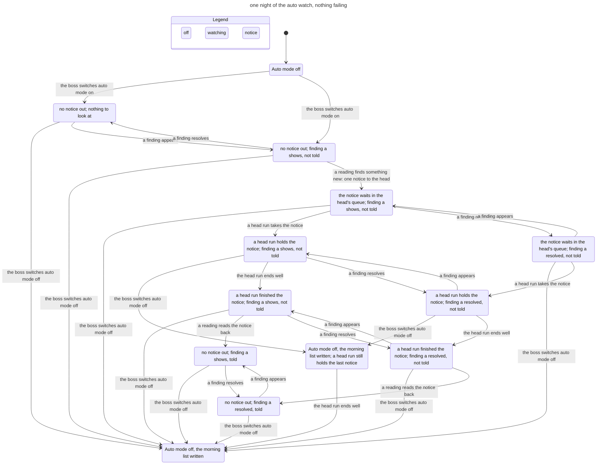

# The auto watch's notices: a model

A TLA+ model of the head tower's auto watch (issue #16, [the spec](../../specs/2026-11-12-auto-watch.md)): a notice from the reading that sends it, through the head tower's queue and runs, to the morning's return list. It was written after four review rounds had each found new P2s in this lifecycle, some of them brought in by the previous round's fix (R2-F001, RV3-F001, RV4-F001 to RV4-F005). TLC checks six rules on every path the model allows, including a head run that crashes, is quit by the server, or is cut off by a server restart, a queue purged, the head tower closed and opened again, two periods of auto mode, and a period file that is broken or lost.

`Design = "today"` is the code at `1ffea42f`. `Design = "decided"` is the design the code now has: ten fixes, each an entry of `Fixes`, so leaving one out is a config edit.

## The rules

The parent session decided them on 2026-11-13 under the boss's standing "non-destructive recommendations accepted"; W4's bound is its decision for RV4-F002.

| Rule | In the model | Today (`1ffea42f`) | Decided |
| --- | --- | --- | --- |
| W1. A notice counts as told only when a head run that took it ended well. A run the server quit, a purge, or a removal with no finished run is "not taken". | `ToldOnlyWhenTaken` | Broke (path A) | Holds |
| W2. At most one notice of the watch waits at a time. No notice of a period survives that period's switch off, with or without a head open; one a live run holds may finish, but nothing of the old period is offered to a head opened later. | `OneWaits`, `NoStaleNotice` | `NoStaleNotice` broke (paths B, C); `OneWaits` broke only after a lost period file | Holds |
| W3. Every finding present at any reading of the period is on the morning list in exactly one place (in flight, told to nobody, parked, still open), unless it was told and has resolved; a parked wait of the boss's is in the return list's own parked section alone (RV5-F003). | `MorningWhole` | Broke (paths D, E) | Holds |
| W4. After two notices parked in a row, the watch sends none until a notice is told or the head is opened again. | `CrashBound` | Broke (path F) | Holds |
| W5. A notice key is never used twice in a period, even after a restart or a bad period file. | `KeysUnique` | Broke (path G) | Holds |
| W6. A wake never sends over a notice that waits, and never for a calm reading. | `NoSendOver`, `NeverCalm` | Held, but for a lost period file while a run held the notice | Holds |

## The chart (the small config)

One period, one finding, nothing failing, the decided design: 171 states, every rule holds. This is the flow the reader confirms; the chart does not draw the 119 steps that stay in one state (a calm reading, mostly).



## The configs

`check.sh` writes every config from one table and reruns them all; `sh check.sh small` (or any names) reruns some. Each takes 1 s to 2 min. `check/small/` is kept here; the other configs' output is not (`.gitignore`), and each has its line below.

| Config | What it adds | States | Result |
| --- | --- | --- | --- |
| `small` | one period, one finding, nothing failing | 171 | every rule holds |
| `crash` | two findings, four crashes | 43,216 | every rule holds |
| `restart` | two findings, four crashes, a server restart | 27,644 | every rule holds |
| `head` | two findings, a crash, a quit, a purge, the head closed and opened again | 55,516 | every rule holds |
| `periods` | two periods, a crash, the head closed and opened again | 9,606 | every rule holds |
| `badfile` | a quit, four crashes, the period file broken or lost (W3 and W4 are not kept across a lost file, see below) | 14,541 | every rule checked holds |
| `today/crash` | `crash` on the code at `1ffea42f` | 24,327 | breaks `NoStaleNotice`, `MorningWhole`, `CrashBound` |
| `today/restart` | `restart` on `1ffea42f` | 21,844 | breaks `NoStaleNotice`, `MorningWhole`, `CrashBound` |
| `today/head` | `head` on `1ffea42f` | 34,274 | breaks `ToldOnlyWhenTaken`, `NoStaleNotice`, `MorningWhole` |
| `today/periods` | `periods` on `1ffea42f` | 3,812 | breaks `NoStaleNotice`, `ToldOnlyWhenTaken`, `MorningWhole` |
| `today/badfile` | `badfile` on `1ffea42f` | over the rerun bound | breaks `ToldOnlyWhenTaken`, `OneWaits`, `NoStaleNotice`, `KeysUnique`, `NoSendOver`; `NeverCalm` not checked |

## Each fix left out, and each rule shown able to break

| Config | Fix left out, or change made | Breaks |
| --- | --- | --- |
| `without/Ledger` | `gone` reads as taken (no ledger of runs that ended well) | `ToldOnlyWhenTaken` (path A) |
| `without/DropHead` | the switch off drops only through an open head | `NoStaleNotice`, 5 steps (path B) |
| `without/DropMark`, `without/DropMark-restart` | the notice a run holds at the switch off is not marked to go | `NoStaleNotice`, 6 steps (path C), and after a restart |
| `without/WaitAll` | the queue guard counts only untaken notices | `OneWaits`, `NoSendOver`, 6 steps: the period file is lost while a run holds the notice |
| `without/Untold`, `without/Untold-crash` | no list of findings told to nobody | `MorningWhole`, 7 steps (path E) |
| `without/MorningOpen` | the still-open list is filtered at the reading | `MorningWhole`, 6 steps (path D) |
| `without/CrashBound` | no bound on parked notices | `CrashBound`, 13 steps (path F) |
| `without/KeyTime` | no reading time in the key | `KeysUnique`: a lost period file restarts the count |
| `without/KeyCounter` | the key counts wakes and parks, not notices | nothing: the reading's time in the key is a second guard |
| `without/KeyCounter+KeyTime` | both | `KeysUnique`, 6 steps: a quit notice is neither a wake nor parked, and its key is used again |
| `without/KeepCount` | a broken parked field resets the count | nothing: the count of notices and the time are the guards |
| `without/KeepCount+KeyCounter+KeyTime` | all three | `KeysUnique` |
| `mutate/NoPendingCheck` | a reading ignores its own pending mark | nothing: the queue guard holds W6 |
| `mutate/NoWaitGuard` | a reading ignores the queue | nothing: the pending mark holds W6 |
| `mutate/NoPendingCheck+NoWaitGuard` | both | `OneWaits`, `NoSendOver`, 4 steps |
| `mutate/SendCalm` | a calm reading sends a notice | `NeverCalm`, 2 steps |

The configs that break a rule early leave others not checked past the 100,000-state rerun bound (`without/KeyTime`, `without/KeepCount+KeyCounter+KeyTime`, `today/badfile`); each of those rules is checked whole in the decided family configs.

## The paths of `1ffea42f`

Each is the shortest TLC found, in the words of `view.mjs`.

### A. W1 (RV4-F004): a notice nobody read counts as told

`today/head`, `ToldOnlyWhenTaken`; the quit variant (`today/badfile`) is the same with "the server quits the head run" at step 5.

```
The shortest path has 5 steps:
0. Auto mode off
1. the boss switches auto mode on: no notice out; nothing to look at
2. a finding appears: no notice out; finding a shows, not told
3. a reading finds something new: one notice to the head: the notice waits in the head's queue; finding a shows, not told
4. a day-old notice is purged from the queue: the notice left the queue untaken; finding a shows, not told
5. the boss switches auto mode off: Auto mode off, the morning list written
```

### B. W2 (RV4-F003): the head was closed at the switch off

```
The shortest path has 5 steps:
0. Auto mode off
1. the boss switches auto mode on: no notice out; nothing to look at
2. a finding appears: no notice out; finding a shows, not told
3. a reading finds something new: one notice to the head: the notice waits in the head's queue; finding a shows, not told
4. the boss closes the head tower: the notice waits in the head's queue; the head tower closed; finding a shows, not told
5. the boss switches auto mode off: Auto mode off, the morning list written; 1 notice of an ended period left in the head's queue
```

The next head bound to the folder is offered it.

### C. W2: a crash after the switch off puts the old notice back

```
The shortest path has 6 steps:
0. Auto mode off
1. the boss switches auto mode on: no notice out; nothing to look at
2. a finding appears: no notice out; finding a shows, not told
3. a reading finds something new: one notice to the head: the notice waits in the head's queue; finding a shows, not told
4. a head run takes the notice: a head run holds the notice; finding a shows, not told
5. the boss switches auto mode off: Auto mode off, the morning list written; a head run still holds the last notice
6. the head run crashes: Auto mode off, the morning list written; 1 notice of an ended period left in the head's queue
```

### D. W3 (RV4-F001): a notice taken after the last reading

```
The shortest path has 6 steps:
0. Auto mode off
1. the boss switches auto mode on: no notice out; nothing to look at
2. a finding appears: no notice out; finding a shows, not told
3. a reading finds something new: one notice to the head: the notice waits in the head's queue; finding a shows, not told
4. a head run takes the notice: a head run holds the notice; finding a shows, not told
5. the head run ends well: a head run finished the notice; finding a shows, not told
6. the boss switches auto mode off: Auto mode off, the morning list written
```

The finding was told and is still there, but the still-open list had left it out at the reading that sent the notice.

### E. W3: a finding nobody was told, gone by the morning

`without/Untold` (the code at `1ffea42f` has no list of untold findings either):

```
The shortest path has 7 steps:
0. Auto mode off
1. the boss switches auto mode on: no notice out; nothing to look at
2. a finding appears: no notice out; finding a shows, not told
3. a reading finds something new: one notice to the head: the notice waits in the head's queue; finding a shows, not told
4. a finding resolves: the notice waits in the head's queue; finding a resolved, not told
5. a reading with nothing to send: the notice waits in the head's queue; finding a resolved, not told
6. a day-old notice is purged from the queue: the notice left the queue untaken; finding a resolved, not told
7. the boss switches auto mode off: Auto mode off, the morning list written
```

### F. W4 (RV4-F002): a notice every reading, for a head that crashes on each

```
The shortest path has 13 steps:
0. Auto mode off
1. the boss switches auto mode on: no notice out; nothing to look at
2. a finding appears: no notice out; finding a shows, not told
3. a reading finds something new: one notice to the head: the notice waits in the head's queue; finding a shows, not told
4. a head run takes the notice: a head run holds the notice; finding a shows, not told
5. the head run crashes: the notice waits again after a crash; finding a shows, not told
6. a head run takes the notice: a head run holds the notice; finding a shows, not told
7. the head run crashes: the notice parked after two crashes; finding a shows, not told
8. a reading finds something new: one notice to the head: the notice waits in the head's queue; 1 parked before; finding a shows, not told
9. a head run takes the notice: a head run holds the notice; 1 parked before; finding a shows, not told
10. the head run crashes: the notice waits again after a crash; 1 parked before; finding a shows, not told
11. a head run takes the notice: a head run holds the notice; 1 parked before; finding a shows, not told
12. the head run crashes: the notice parked after two crashes; 1 parked before; finding a shows, not told
13. a reading finds something new: one notice to the head: the notice waits in the head's queue; the watch stopped after two parks in a row; finding a shows, not told
```

The label of step 13 says "the watch stopped" because the view reads the count of parks in a row, which the code at `1ffea42f` keeps nowhere: it sent the third notice anyway.

### G. W5 (RV4-F005): a key used twice

`today/badfile`: the shortest goes through a lost period file; the review's path (a hand edit of `parked`, then a park) is longer and breaks the same rule.

```
The shortest path has 6 steps:
0. Auto mode off
1. the boss switches auto mode on: no notice out; nothing to look at
2. a finding appears: no notice out; finding a shows, not told
3. a reading finds something new: one notice to the head: the notice waits in the head's queue; finding a shows, not told
4. a head run takes the notice: a head run holds the notice; finding a shows, not told
5. the period file is lost: no notice out; finding a shows, not told
6. a reading sends a notice over one that waits: a head run holds the notice; finding a shows, not told
```

## The decided design

- `Ledger` (W1): a head run that ends `done` writes the notice's key to `head/told.json`; `runs.noticeState` says `told` only for a key there, `gone` otherwise.
- `DropHead`, `DropMark` (W2): the switch off drops the watch's notices from the head's own folder, open head or not; one a live run holds is marked `drop` and goes when that run ends, whatever its end.
- `WaitAll` (W2, W6): `runs.noticeWaits` counts a notice a live run holds as waiting.
- `Untold`, `MorningOpen` (W3): the watch keeps every finding no notice told; the morning sorts each finding of the period into one list, after the pending notice is asked about once more.
- `CrashBound` (W4): two parked in a row stop the watch until a notice is told, or a reading finds no head or a head in another workspace.
- `KeyCounter`, `KeyTime`, `KeepCount` (W5): the key is the count of notices sent and the reading's time; `watchOf` keeps a parked count whose other fields broke.

## The replay tests

`tests/model-auto-watch.test.ts` (the watch, with the queue as a seam) and `tests/model-auto-watch-queue.test.ts` (the test server's real queue and runs). On `1ffea42f` nine were red, each for the reason of its path:

```
✖ model W1 (RV4-F004): a notice whose head run the server quit is not counted as told; the morning names its finding as told to nobody
    a run the server quit did not take the notice to the end ({… "wakes":1 …})
✖ model W2 (RV4-F003): auto mode switched off while the head tower is closed drops the period's notice, so a head opened later is not offered it
    no notice of the period that ended is left for the next head: actual [ 'auto-watch:2026-11-12T22:00:00.000Z:1' ]
✖ model W2: a notice a live head run holds at the switch off may finish, but a crash of that run does not put it back for a later run
    the notice of the period that ended is gone, not queued again: actual [ 'auto-watch:2026-11-12T22:00:00.000Z:1' ]
✖ model W6: a notice a live head run holds is one that waits, so the watch sends none over it even when its own mark of the notice is lost
    actual: false, expected: true
✖ model W3 (RV4-F001): a notice the head takes after the last reading still leaves its findings on the morning list, as still open
    the morning list ends at "1 wake; 0 messages it sent on its own." with no finding named
✖ model W3: a finding seen at a reading that woke nobody and gone by the last reading is named as told to nobody
    the morning list names no finding
✖ model W4 (RV4-F002): after two notices in a row were parked, the watch sends no more until the head tower is opened again; ...
    a head that crashes on every notice gets two, not one a reading (8 sent)
✖ model W5 (RV4-F005): a parked count in a period file whose parked notice is broken is kept, and no notice key of the period is used twice
    the count of parked notices is kept: actual undefined, expected 1
✖ model W5 (RV4-F005 wording): a parked notice that held only a refused wait does not say it told nothing new
    "2 notices were parked after two head runs crashed with them; the last (16:30) told nothing new."
```

`model W1 (control)` (a run that ended well counts as told) and `model W6` (calm readings, one notice at a time) were green there too: W6 held on `1ffea42f` except after a lost period file. With the fixes all eleven pass.

## Where each actor's steps come from

- **The watch** (readings, settle, the morning): code, `src/server/autowatch.ts`, `watchops.ts`.
- **The head's queue and runs** (take, end well, crash, park after two, quit, the server's stop): code, `src/server/runs.ts` `finish`, `detach`, `stop`; `towerstore.ts` `parkEvent`, `purgeQueues`.
- **The head tower** (close, open again) and **the switch**: the boss's moves; the code they reach is `towers.head.close`, `head.ensure`, `automode.switchOff` and `watchSwitch`.
- **The world** (a finding appears or resolves): what a reading of the net returns.

## What the model leaves out

- A finding stands for anything new at a reading: a lasting finding, a wait refused since the last wake, a quiet workspace. The model has no waits or quiet clocks of their own, and no boss's parked waits (the return list names those in its own section, so the still-open list leaves them out).
- Offered and taken are one step: a run that was offered a notice and ended without taking it leaves it queued (the code marks an offered notice `drop` at the switch off too).
- A held head tower, a net that cannot be read, and a wake the queue refuses are skips like a closed head.
- The crash loop guard of the runs (three crashes in ten minutes hold the service) is not modeled: the watch's bound does not rely on it.
- A head closed and opened again in the same Herdr workspace between two readings: the code sees no new head, so the bound holds until a reading finds none or another workspace. The model's head opened again is always seen.
- A parked notice the boss delivers again from the tower panel is not modeled; if a run then finishes it, the morning still names its findings as parked.
- A lost period file loses what the watch saw and its row of parks: `badfile` checks W1, W2, W5 and W6 only.
- The 24-hour purge is one step at any time; the notices' text and their bounds are not modeled.

Rerun:

```sh
cd docs/models/auto-watch && sh check.sh            # every config
sh check.sh small without/Ledger                     # some of them
```

`STATECHART` names the command; it defaults to `~/.agents/skills/statechart/scripts/statechart`.
