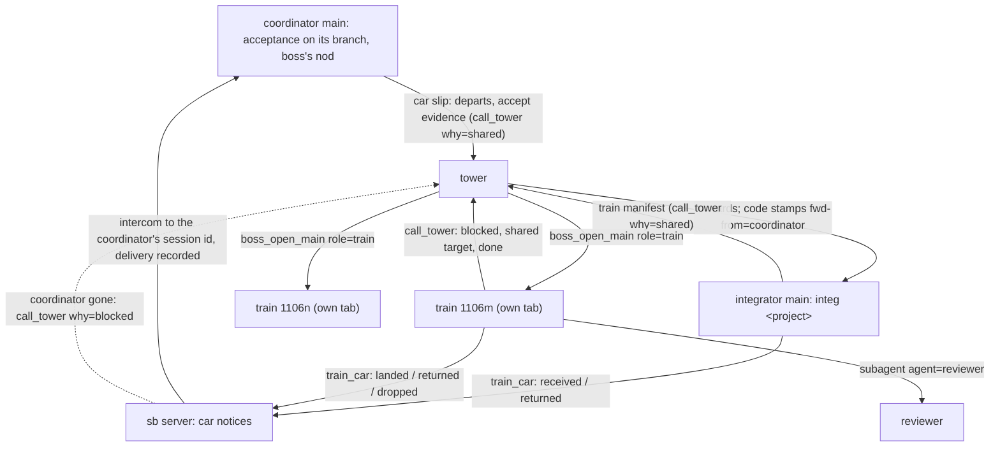
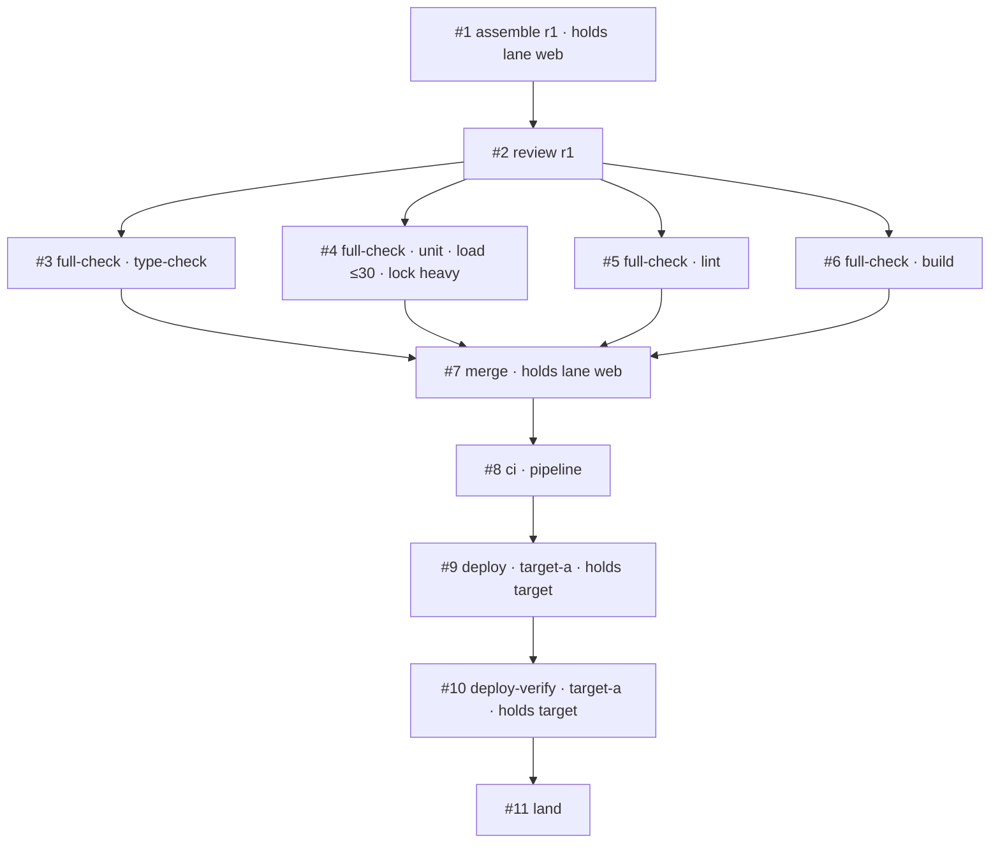

# Trains as their own workers

Status: decided. Todo #125. Tasks 1 to 6, 5a and 8 landed on main; task 7 (the page) is on the page branch; task 9 (docs and release prep, no release) is this branch; task 10 is the pilot. Base `main` 9b2cbe48 (0.61.0); first committed at 3874ae4b, revised the same day after the boss's correction D11 (a train carries no acceptance). Extends [the merge train](2026-10-30-merge-train.md), [train stages](2026-11-05-train-stages.md) and [seam bindings](2026-11-06-seam-bindings.md). The boss's summary page is `~/.local/share/sbd-review/train-workers/decisions.md`; the task 0 spike is `~/.local/share/sbd-review/train-workers/spike.md`.

## 1. The request and the decisions

The boss (verbatim, 11/07):

- 「我想把火車當成一種新的獨立 worker，這樣可以在 gui 上面也看到塔臺那邊的運送狀況（要求火車要建立 todo，然後用 todo 來顯示現在有幾個火車在互相等待），也能看出重新組裝的時候，如果監看格式統一，甚至可以看他們要求的負載」
- 「這樣我們的 sb net herdr plugin 的排序和 icon 也可以調整一下」
- 「火車的每一節 todo 也可以帶規格（可以用 sb 指令來確保規格，包括監看器的規格），分成 UAT or e2e、Full Test、Review 等等種類（你幫我規劃）」

Decisions (ask_user, the decision form, and the correction, 11/07):

| # | Decision |
|---|---|
| B1 | A train is a worker of its own, a new role `train`, named like `train 1106m`, with its own todos. |
| B2 | Waits show through the todos: what a step waits for is readable from it, and the GUI draws the waits and counts them. |
| B3 | One monitor format: every command a train runs goes through `MonitorCreate` and reports e.g. `{"progress":{"load":{"max":30,"now":42}}}`; the GUI shows 「等負載 ≤30（現在 42）」 and each train's CPU need. `progress.message` is always present (§8.2). |
| D1 | 「獨立 agent，不需要綁定整合員。需要在 sb 記錄上看出他是火車而非一般 main agent」: the tower opens a train in a tab of its own (`boss_open_main` with the role `train`); it calls the tower itself; it does not count toward the tower's two opened mains, and the project's `maxTrains` limits it. Straw Boss's records (Herdr tokens, role records, the net, the registry, the work board) carry the role `train`, distinct from `main` (§3.3). |
| D2 | 「整合員要設，可能我誤會了。我一開始以為成塔台了」: the integrator stays. It takes the cars and schedules trains (which train a car rides, when a new train is asked for). Once a train departs it runs on its own; the integrator does not supervise it. |
| D3 | Train codes are unique per project and shown as `MMDDx` (`2026-11-06-m` is `1106m`). |
| D4 | `maxTrains` defaults to 3 per project. |
| D5 | A named machine-wide lock, now, in the gate wrapper. All slots of the computer use one lock folder: the primary slot's, which is the state folder's own `locks/` (§9.1, §20). |
| D6 | The sidebar: the integrator right under the tower, the trains by code; a row keeps its place while its state changes. |
| D7 | 「由 main agent 把貨物搬上車以後，指定出車條件。貨物的驗收條件 type 只是分類，流程中立。」: the coordinator loads its car and states on the slip when it may depart. A step's kind is a classification only: Straw Boss prescribes no flow per kind. (Its acceptance part is replaced by D11.) |
| D8 | 「每個 todo 都必須是一節，因此如果重新打包組裝，需要更新 todo」: every todo of a train is a step, and a re-assembly rewrites the train's todos. |
| D9 | Zen shows counts only. |
| D10 | No switch for the pilot. |
| D11 | The correction: 「我覺得我好像搞錯了，UAT 指的是 e2e（有必要的話），我說的是全檢查，火車不要被 UAT 卡住。事實上 e2e 好像也不宜讓火車做，火車主要是做組裝和 pre push、pre merge、pre ci/cd 前的資源總調度，而非把驗收留到這裡」. Acceptance (e2e, UAT) happens before loading: the coordinator runs it on its own branch with the boss's nod, and every car on a train is already accepted. A train never waits on a person. The earlier decision that a train waiting on acceptance does not count toward `maxTrains` (old D11, Q1) is void with it. |
| D12 | A train ends only after CI/CD has finished and a machine check reads the train's own version on each target. On a failure it rolls back or reports, then ends. It owns the order of its deploy targets. |
| D13 | 「火車如果被要求要做 UAT 或進一步驗收，要拒絕直接退回要求重寫驗收標準」: a car, slip, evidence file, or step that asks the train for UAT, e2e, or any acceptance is refused at once and returned to its coordinator, with words that name what was asked and ask for the acceptance criteria to be rewritten (§5.4). The train never runs it, never waits for it, and never turns it into a weaker check. |

| D14 | The boss's choice on coordinator notices (11/07), after seeing trains forget to tell the main a car came from: **"sb sends the notices itself and confirms delivery."** The train (and the integrator, for a car it returns at receipt) only sets each car's state; the sb server sends the intercom to the car's coordinator session id, records the broker's delivery, and holds the car's step until then; a coordinator that is gone is reported to the tower. The slip's `coordinator` must be the session the tower's code-written header names as the sender (§5.5). |

Straw Boss stays project-neutral: no environment is named here or in a prompt (train stages D3).

## 2. What exists today

- **The integrator does everything.** `prompts/integrator.md` makes one main per project carry every train through `merge`, `deploy`, `uat`, following pi-anchorloop 2.10.1's `integrating` and `deploying`. It keeps "one todo per train" and the ledger `trains/<project>/<app>.json`.
- **UAT waits inside the train.** `deploying`'s UAT stage runs after `Deploy verify`, and a `uat` car "counts as landed only after the page accepts it"; the integrator reports idle only when no UAT page waits. The live ledgers show trains parked for a day on a boss verdict.
- **The ledgers are free text.** The four live ledgers of the pilot project (`trains/<project>/*.json` in the state folder, read only) hold 100 trains. `stage` is prose (`"deployed; boss UAT: all accepted except …"`), keys vary by train (`gates_run1`, `uat_page`, `deploy_verify`, a target's name as a key), and codes come in two forms (`1107g`, `2026-11-07-d`), each counted per app. One ledger names `"integrator": "integ v3 (tower-opened)"`: in practice several integrators ran per project. No reader can tell from a ledger which train waits on which.
- **Roles are two words.** `sb_role` is `main` or `member` on a pane (`tower`, `head`, `ally` are written by the server). The spike (d) found no reader that crashes on an unknown value: each compares a literal, tests a `Set`, or tests truthiness. A value such as `train` is ignored as "not joined" by the net, the dashboard, `awaitJoin`, the member counts, and the closer; the stash refuses a tab that holds it; message headers call it `session`; `isPiPane` treats it as a pi pane. `boss_open_main` (`src/opener.ts`) opens at most `MAX_OPENED_MAINS` = 2 per workspace and one per sender, counted from live panes that carry `sb_opened_by`.
- **The GUI sees a todo list only in short.** A session's bridge sends `TodoSum` (`done`, `total`, `now`; `src/todo.ts`). rpiv-todo 2.15.0 keeps `metadata` in every snapshot (create copies it, update merges keys, `null` deletes one; spike (a)), but `todosOf` (`src/items.ts:16`) rebuilds each task as `{id, subject, status, activeForm}`, so nothing of Straw Boss sees it.
- **Monitors show their last line.** `trackMonitors` (`src/monitors.ts`) keeps the newest output line, cut to 160 characters. pi-loop-monitor 0.2.8 sends at most one `monitor:output` per second, carrying only the latest line. Its JSONL parser takes `progress` only with a numeric `current` or `total` or a string `message`: `{"progress":{"load":{...}}}` alone is no progress to it and does not renew the inactivity timeout (the 11/07 lesson: a redirected 25-minute test run was killed at its timeout).
- **A `tool_call` handler can block a call and rewrite its arguments.** pi hands the same validated arguments object to the `tool_call` handlers and then to `execute`, with no re-validation (spike (b): `agent-loop.js:489-492, 534-538`); pi-loop-monitor's `MonitorCreate` reads `params.command` and `params.timeout` at run time. A rewrite mutates `event.input` in place (the handler's return value carries only `block` and `reason`), keeps the types (`command` a string, `timeout` a number ≥ 0), and keeps `command` and `herdrPaneId` exclusive.
- **Machine-wide admission is not built.** Procs release 2 (slots, `cli.mjs slot run|hold`, `docs/specs/2026-11-04-procs.md` §4) is designed only. Projects wait for load in their own words: one skill's `## Load` waits while the 1-minute load is above twice the core count and runs one heavy gate at a time across projects.
- **Car notices are unconfirmed.** The slip's `coordinator` session id, the tower's code-written header (`from=… id=…`), and the manifest all carry where a car came from, but nothing checks that the coordinator was told: `land` was a `report` check on the train's own ledger, and a car returned at receipt (D13) or dropped at a re-assembly had no check at all. The boss saw trains forget to tell the original main. pi-intercom 0.18.1's client answers a send with `delivered` and `delivery` (`socket_delivered`, or `queued` when the broker holds it; `broker/client.ts:400-417`), which the sb server's own intercom connection can read. The tower forwards a slip with `tower_send` as it came, and only the model names the original sender in the text. Subagent sessions appear on intercom as `subagent-chat-<id>` (todo #49), so a name does not reliably reach a session; a session id does.
- **The sidebar.** The Herdr plugin (`herdr-plugin/`, id `wayne930242.straw-boss`, manifest 0.5.1) installs one view sorted by the `sb_order` token and reads no `sb_role`. Order and marks come from the tokens each session writes (`src/order.ts`): star for a main, person for a member, `[sub] <launcher>` for a subagent.

## 3. Roles



### 3.1 The coordinator (accepts, then loads the car)

- **Acceptance first.** Before the slip, the coordinator runs the acceptance its app requires (`integration.accept`, §5.1) on its own branch, as the project skill's `## Acceptance` says (e2e, UAT, where and how), and gets the boss's nod on the result. A car whose project requires none needs no acceptance.
- **The slip** is today's, with two lines (§5.1): `departs:` (when the car may leave) and `accept:` (the evidence that acceptance passed: what ran, on which head, the result, and the boss's words quoted). It checks the evidence with `cli.mjs train check --accept <file>` before it sends the slip.
- **Notices** about its car (received, returned, dropped, landed) come from the sb server, addressed to its session id, under a code-written header with `kind=car_notice` (§5.5). It answers none of them to the train unless it has a question.
- **After landing** it closes its ticket as today; no acceptance follows the train.

### 3.2 The integrator (schedules)

Unchanged in identity: opened by the tower with `boss_open_main`, one per project, named `integ <project>`, closed after its idle `milestone`; it counts toward the tower's two opened mains as today.

It now does only this:

- Receives cars (`integrating` receive-car) and checks each: the slip's fields as today, that its `coordinator` is the sender the tower's code-written forward names (§5.5), `train check --accept` on the evidence, and that the car's `auth` covers every `strict` target the train would deploy to. A failed check returns the car: the integrator sets it `returned` with the reason (`train_car`), and sb tells the coordinator (§5.5), so a train never meets a missing approval or acceptance.
- Sets each car it takes `received` with the train number and the departure conditions; sb sends that receipt. It writes no notice about a car itself.
- Forms trains: places each car on a forming train by its `departs` line and `integrating`'s train step 1 (`maxCars`, `maxWaitMin`, `Load`, a red pipeline). It puts together only cars whose `auth` covers the same `strict` targets, since a deploy ships every car.
- Departs a train when its conditions hold and the project has fewer than `maxTrains` live trains, by asking the tower: `call_tower` `why: shared` carrying one `train:` manifest (§5.3). Its `train` todo for it completes when the tower answers with the opened train's session id.
- Keeps the project's index in the ledger (§10) and one `train` todo per forming train (§7.4).
- Reports idle when its queue is empty and no train it formed waits to be opened. Running trains do not keep it alive.

It does not watch, relay for, resume, or close a train. A car a train returns comes back as a new slip from its coordinator.

### 3.3 The train

A session of its own role, opened by the tower:

```text
boss_open_main({ role: "train", request: <the manifest verbatim>, sender: <integrator>, label: "train 1106m" })
```

- **Who opens it.** The tower only, on an integrator's manifest. A coordinator never asks for one, and a train never asks for another.
- **Where.** A new tab in the tower's own workspace, as an opened main; the train works in `~/.herdr/worktrees/<repo>/train-<code>`.
- **Quota.** The workspace's two opened mains do not count it, and it does not count toward them; the per-sender limit of one does not apply to the role. The open is refused when the project already has `maxTrains` live trains on the computer (D4 is per project, over every workspace), counted from the panes of all workspaces whose `sb_train` names the project and from the project's live trainboards (a train whose pane is gone but whose board is not ended or stale), so the limit survives a tower restart as the main limit does. It is refused too when the code's trainboard folder `<state>/trainboard/<project>/<code>/` exists: a code is used once for good, and an ended train's code is never reused.
- **What it does** (D11, D12): assemble the cars on the latest base; have a fresh reviewer read the assembly; run the project's full checks (`## Full gates`: full suite, type-check, lint, build); push `pre-dev/<code>` and run `## Merge`; watch the pipelines `## Post-merge` names until each concludes; where the train starts a deploy, run `## Deploy` per target in the order it chooses from that heading; read each target's version with `## Deploy verify`; on a failure, roll back as `## Deploy` says and verify the rollback, or report. Each of these is a step (§6). It tells the coordinators nothing itself: it sets each car `landed` (version, commit), `returned` (§5.4's word), or `dropped` (reason, evidence) with `train_car`, and sb sends the notice and confirms its delivery (D14, §5.5). It calls the tower itself: `blocked`; `shared` naming a target before a deploy it starts; `milestone` when done.
- **Never acceptance** (D13). A car that asks the train for UAT, e2e, or any acceptance is returned with §5.4's word; the train never runs it, waits for it, or weakens it.
- **Never a person.** A train has no step that waits on the boss, a coordinator, or a page. What it would need a person for (approval, acceptance) was checked at receipt; anything that still needs one is a failure it reports as `blocked`, then ends.
- **Done** when every target the train deployed reads the train's version (or its rollback's), every pipeline concluded, and every car is landed, returned, or dropped with its notice delivered or escalated (§5.5). It reports `milestone` with the outcome and waits; the tower closes it with `boss_close_main`, which accepts the `train` role on the same checks as an opened main.
- **Name.** `train <MMDDx>`, set by the open and never renamed (`boss_rename` is refused in the role).
- **Prompt.** Its system prompt is `prompts/train.md`, not `main.md`; it ends with its own `## Seam bindings` block (§13), so the session holds exactly one, as `integrating` requires.
- **Hygiene.** A train registers with the sb server as an owner (`procs-hello` with `role: "train"`), as a worker does, so what its gates leave dies with it.

**How the records say "train" (spike (d)).** Two ways were open: a new `sb_role` value `train`, with the readers taught it, or `sb_role=member` plus a separate `sb_train` token. Decision: **a new value `sb_role=train`**, beside `sb_train=<project>/<code>`, which names the train.

- As a `member` a train would be wrong in the records the boss asked about: the net, the board, and the sidebar would show a member (the person mark), not a train.
- It would also be wrong in behavior. The guard crowns a tab's first member when the tab has a tower and no main, so a train alone in its tab would be promoted to main. The election and quit-time counts would count it as a member, and the closer would ask its tab to close. Each of these would need an "unless `sb_train`" exception, scattered and silent where one is missed.
- A new value fails closed where a reader is not taught it (spike (d): ignored as not joined, never treated as a main; the stash refuses), and a table test over the readers makes every one decide.

| Reader | With `sb_role=train` |
|---|---|
| `net.ts` `joinedRole` | joined: a unit with `role: "train"` and `train: {project, code}`; a ref with role `train`; not in `outside` |
| `dashboard.ts` | a row with the train mark |
| `spawn.ts` `awaitJoin`, `opener.ts` | the open waits for `train` exactly |
| `guard.ts:75`, `server/towers.ts:565`, `session.ts:266` (member counts) | counted as a joined session of the workspace (it needs the tower); never crowned, never a main; `boss_promote` refused in its tab; a later pi in that tab stays a member the train does not command |
| `stash.ts` | refused, naming the reason: "a train runs in this tab" |
| `closer.ts` | skipped: only the tower closes a train (`boss_close_main`) |
| `closemain.ts` | accepts `train` with the same checks as an opened main |
| `roles.ts` | a role record with `role: "train"`, the project and the code; a Herdr restore brings it back as a train with the main's terminal proof, in the tab that carries its code (§29) |
| `reach.ts` `ROLES`, `agent/sidecar.ts`, `header.ts` | header role `train`; a new kind `car_notice` (§5.5) |
| `order.ts` | `orderKey` takes `train` (§12) |
| board (`boardauto.ts`, `boardread.ts`), `tower_list`, `boss_status` | entries carry `role: "train"`; a train's board line auto-fills from its todos as a main's does |
| `answerpane.ts` `isPiPane`, `runmode.ts` `RUN_PANE_ROLES`, `link/*` | unchanged (a pi pane; not a run pane; never routed as a main) |

### 3.4 Concurrency

- **`maxTrains`** (top-level `integration`, default 3): the project's live trains, from the open to the close. With D11 a train never idles on a person, so there is no state that holds a place without work.
- **Holds.** A step may declare `holds` (§6.1): `lane` (an app's integration branch) or `target`. A train holds a lane or target from the start of the first step that declares it until every step of the round that declares it has completed. A later train's step that declares the same hold waits (§7.3). Which steps declare which hold is the project skill's and `integrating`'s (one train per integration branch from assembly to its merge; one per target from its deploy to its verify), not a rule of any kind.

### 3.5 Re-assembly

A dropped car starts a new round, and the todos say so (D8):

1. The train waits for the running monitors of round `n` to end (or stops them), then completes every step of round `n` that has not passed, and every passed step whose `on.head` is round `n`'s head, as `void` with `why: "superseded"`, naming the dropped car.
2. It creates `assemble` for round `n+1`, whose spec lists the cars kept and `removed`: each dropped car, why, and the evidence (failing tests and log path, or a review finding).
3. It creates round `n+1`'s steps again against the new head.
4. It sets each dropped car `dropped` with the reason and the evidence (`train_car`); sb tells its coordinator (`integrating` train step 5) and confirms the delivery. Round `n+1`'s `assemble` cannot pass until every car in its `removed` is notified (§5.5). The car comes back, reworked and accepted again where its project requires it, as a new slip to the integrator.

A red pipeline after the merge, and a failed target, are not re-assemblies: the train rolls back or reports and ends (D12); a revert or a fix-forward car goes as a new train the integrator forms.

## 4. One train in todos



`blockedBy` orders the steps inside one train (rpiv-todo checks it within one list). The order is the train's, from `integrating`, `deploying` and the project skill; Straw Boss reads only each step's spec and evidence. A failed `deploy-verify` adds a `rollback` step and its own `deploy-verify` of the rolled-back version.

## 5. What the slip and the manifest carry

### 5.1 Two slip lines, one setting

```text
departs: next | alone | with <ticket or branch> | after <ISO time> | by <ISO time>   (several, comma-separated)
accept: <evidence file> | none
```

- `next` (the default) rides the next train of its app. `alone` rides a train of its own. `with` waits for the named car, at most `maxWaitMin`. `after` does not leave before the time; `by` leaves no later than the time, even below `maxCars`, while `Load` and a red pipeline still hold it.
- `accept` replaces the `uat:` line. `none` is allowed only for an app whose `integration.accept` is empty.
- **`integration.accept`** (per app in `apps.json`, default `[]`): the acceptance kinds a car of that app must show evidence of, such as `["e2e"]` or `["e2e", "uat"]`. It replaces `uat` in `stages`, which now lists `merge` and optionally `deploy` (§14).

### 5.2 The evidence file

```json
{ "v": 1, "car": { "app": "web", "tickets": ["T-15"], "branch": "fix/t-15", "head": "<40 hex>" },
  "accepted": [
    { "kind": "e2e", "what": "checkout flow, browser run", "on": { "head": "<40 hex>" }, "result": "passed", "evidence": "<log or report path>", "at": "2026-11-07T07:10:00Z", "nod": "<the boss's words, verbatim>" },
    { "kind": "uat", "what": "order form checkpoints", "on": { "head": "<40 hex>" }, "result": "accepted", "evidence": "<captures folder>", "at": "…", "nod": "<the boss's words, verbatim>" }
  ] }
```

`train check --accept <file> [--app-accept e2e,uat]` refuses (exit 2, one line per refusal) when:

- a kind the app requires has no entry, or an entry's kind is not `e2e`, `uat`, or `other` (with `label`);
- an entry's `result` is not `passed` or `accepted`, its `evidence` path does not exist, its `nod` is empty, or its `at` is not a time;
- an entry's `on.head` is not the car's `head`. The one allowed difference: `on.head` is an ancestor of `head` and the entry names `delta`, a review report of the diff since that head, when the project skill's `## Acceptance` allows it;
- the file is over 32 KB, or `car.head` differs from the slip's `head`.

The check proves the evidence is complete and names the car's head; it does not prove the boss said the quoted words (§16). The integrator runs the same check at receipt.

### 5.3 The manifest

The integrator's `train:` block, which the tower passes verbatim as the open's request: `project`, `app`, `code`, `base`, `stages`, `targets`, `skill`, the integrator's session id, and each car's slip verbatim with its evidence file. The train copies each evidence file into its trainboard folder (`car-<n>.json`) and records it in its ledger file; it does not use it further.

### 5.4 A request for acceptance is refused (D13)

Acceptance is done before loading, so anything that asks the train to accept a car is a slip to rewrite, not work for the train. It is refused wherever it appears, with one refusal word:

```text
sb: the train runs no acceptance: car <ticket> asks for <what> (<where>); rewrite its acceptance criteria and run them before loading, then send the evidence in accept:
```

| Where | What counts as asking | Who refuses | Then |
|---|---|---|---|
| The slip | a `uat:` line; an `accept:` that names a checkpoints or conditions file instead of evidence; free text in any field (but `head`, `tested-on`, `coordinator`, `departs` and `accept`, which have their own rules) asking for UAT, e2e, or acceptance on the train or after deploy; a slip that does not parse (a repeated key, a key that is not a slip's, a line with no key, an open quote or parenthesis) | `train check --accept` (reads the slip with `--slip`), the integrator at receipt | the integrator sets the car `returned` with the word; sb sends it to the coordinator and confirms delivery (§5.5); it joins no train |
| The evidence file | an entry without `result` or with `result` other than `passed` or `accepted` (`pending`, `todo`); an entry with `check`, `run`, `page`, or `checkpoints` to be done; a top-level `conditions` (the old format) | `train check --accept`, the integrator | as above |
| The manifest | a car that carries any of the above (a check was skipped) | the train, before `assemble` | it leaves that car out of round 1 (it is in the round's `removed`) and sets it `returned` with the word; sb tells the coordinator, and round 1's `assemble` cannot pass until that notice is delivered; the train runs nothing of it |
| A train's todo | a step of kind `e2e`, `uat`, or anything not in §6.2; a check type other than `run`, `git`, `report`, `notice`; a step whose `kind`, `name` or check type holds one of the words in the rule below | the guard (§7.1) | the call is blocked with the word; the train completes no such step and opens no page |

**One rule reads every text** (a step's kind, name and check type, a slip's free text, an evidence entry's `what`, `label` and `nod`): the text is folded (NFKD, combining marks and format or control characters stripped, Cyrillic and Greek look-alikes of Latin letters mapped, case ignored), cut into words at non-alphanumerics, camelCase, and letter-digit boundaries, and refused when a word is `uat`, `e2e`, `accept` (also `accepts`, `accepted`, `accepting`, `acceptance`; not `acceptable`), or the run `end`, `to`, `end` (`end-to-end`, `endtoend`), or when it holds 驗收 or 验收 anywhere. Free text is a request only when such a word comes with the train or a stage after loading (`after deploy`, `once deployed`, `post-deploy`, `on the train`, `after merge`, `after landing`, 部署後, 上線後, 火車, 上車). `check.run` is not read.

The refusal never degrades: the train does not run a weaker check in place of the asked one, does not wait for the acceptance, and does not keep the car waiting on the train. A car returned this way comes back as a new slip once its coordinator has rewritten its criteria and run them.

### 5.5 Car states and notices (D14)

The train and the integrator decide what happened to a car; the sb server tells its coordinator and proves it did. No session writes a notice about a car's fate itself.

**The states.** A car's state is set with the tool `train_car`, registered in a train and in the integrator only:

```text
train_car({ car: "<first ticket>", state: "received" | "landed" | "returned" | "dropped", ... })
```

| State | Set by | Fields | Checked by the tool | The notice says |
|---|---|---|---|---|
| `received` | the integrator | `train` (code), `departs` (the conditions in words) | the car's slip is on the integrator's branch with a matching `fwd-from` (below) | `received: your car <ticket> (<head12>) rides train <MMDDx>; it departs <conditions>` |
| `returned` | the integrator (receipt), the train (manifest, §5.4) | `reason`: §5.4's word or the failed receipt check, verbatim, at most 600 characters | the car is the integrator's (on its branch) or the train's (in its manifest) | `returned: your car <ticket> (<head12>): <reason>` |
| `dropped` | the train | `round`, `reason`, `evidence` (a path that exists) | the car is in the current round and in the next round's `removed` | `dropped from train <MMDDx> round <n>: <reason>; evidence <path>` |
| `landed` | the train | `version`, `commit` (40 hex) | the server's own `git merge-base --is-ancestor <commit> <the base's branch on the project's remote>`, in a mirror it owns, fetched from the remote it read at the open (§24) | `landed in <version>, your commit is <commit>` |

The sb server appends the state to `<state>/trainboard/<project>/cars/<app>-<head12>.json` (the car, its coordinator, and every state with who set it and when; folder 700, file 600; one writer, the server, which keeps its own copy in memory; the files are a display journal for the yard that the server never reads back; §24). A car has one terminal state (`landed`, `returned`, or `dropped`); a second is refused (`sb: car <ticket> is already <state>`). A dropped or returned car that comes back is a new car with a new head and a new file.

**The coordinator is the sender.** When the tower forwards a car slip, `tower_send` takes `forward: <event id>` (the `call_tower` event the slip came in), and the code stamps `fwd=<event id> fwd-from=<sender session id>` into the header from the event it recorded; the model cannot write those fields, and a forward without them is no car slip. At receipt the integrator's guard requires the slip's `coordinator` to equal `fwd-from` on a forwarded message on its branch that carries the slip's `head`; otherwise the `train` todo and `train_car received` are refused: `sb: car <ticket> names coordinator <id>, but <fwd-from> sent it; the slip is refused`, and the integrator sets the car `returned` with that word, which sb sends to `fwd-from`, the session that really sent it.

**Sending.** `src/server/carnotices.ts` in the sb server watches the `cars/` folders (`fs.watch` and a 5 s tick). For each state without a delivery record it:

1. Resolves the coordinator by session id in the broker's list of live sessions. A name is never used, since subagent sessions appear as `subagent-chat-<id>` (todo #49).
2. Sends one intercom message to that id under a code-written header: `from=<train or integrator name> id=<its session id> role=<train|main> kind=car_notice … reply=none`, then the line from the table. The server is the intercom sender; the header names the session that set the state, so a reply goes to it.
3. Records in `<car file>.notice.json` (the server is its one writer): per state, the message id, each attempt, the broker's answer, and `deliveredAt` when the answer is `delivered: true` with `delivery: "socket_delivered"`.
4. Treats `queued`, a failure, and an unknown outcome as not delivered, and tries again at 30 s, 2 min, and 5 min.
5. When the coordinator is not live at an attempt, or after the last retry, sends `call_tower` `why=blocked` to the workspace's tower, naming the car, the state, the coordinator's id, and the notice text, and records `escalatedAt` once that message is delivered. A coordinator that comes back live later still gets the notice, once.

Every state is sent once while the server runs: the records are keyed by (car, state). A server restart starts with an empty book (§24), so a state set again after it is sent again; a coordinator may then see a notice twice.

**What waits for it.** A step that depends on a notice cannot pass until the notice is delivered or escalated:

- `land` is a `notice` check (§6.3) over every car that landed.
- An `assemble` whose spec lists `removed` cars passes only when each one's `dropped` or `returned` notice is delivered or escalated, besides its `git` check.
- The integrator's `train` todo goes `in_progress` (the manifest's `call_tower`) only when every car's `received` notice is delivered or escalated.

Escalated counts, because the tower then owns finding the coordinator's owner; a train is never held for good by a session that ended. The yard shows which notices are delivered, pending, or escalated (§11.2).

## 6. Steps

### 6.1 The step spec

Every todo of a train carries one object under `metadata.sb`; nothing else of a todo is Straw Boss's.

```json
{
  "sb": {
    "v": 1, "project": "acme", "app": "web", "train": "2026-11-06-m", "round": 1,
    "kind": "full-check", "name": "unit",
    "spec": {
      "check": { "type": "run", "cwd": "~/.herdr/worktrees/web/train-2026-11-06-m", "run": "<the gate's command>", "log": "<path>" },
      "on": { "head": "<40 hex>" },
      "load": { "max": 30, "weight": 4 },
      "lock": "heavy",
      "holds": { "lane": "web" }
    },
    "result": { "outcome": "passed", "evidence": "<one line>", "at": "2026-11-07T08:40:00Z" }
  }
}
```

- `kind` is one of §6.2's words; `name` tells apart steps of one kind (several gates, several targets).
- `check` says how the step passes (§6.3); it is the one required part.
- `on` is what the check is against: `{ head }` (a commit) or `{ target, version }` (a deployed result). It is required for every check except `notice`, and it decides what a re-assembly voids (§3.5).
- `load` is `{ max }` (a load average) or `{ perCore }` (resolved against the core count where it runs), with an optional `weight`, the cores the step expects to use (the slot weight of procs release 2). It is the CPU need the GUI shows. Only a `run` check takes it.
- `lock` is a name of the machine-wide lock (§9.1); only a `run` check takes it.
- `holds` declares a lane or a target (§3.4).
- `result` is set only on `completed`: `outcome` is `passed`, `failed`, or `void` (with `why`: `superseded` or `skipped`, a stage the app does not declare). rpiv-todo has no failed state, so a failed step is `completed` with `outcome: "failed"`, and the GUI colors by outcome.
- `project` and `app` are path-safe names (letters, digits, `.`, `_`, `-`; 1 to 64 characters); `train` is `YYYY-MM-DD-<letters>`; `metadata.sb` is at most 8 KB as JSON.

### 6.2 Kinds: a classification

The kind names the step for the GUI, the sidebar, and the counts; it decides nothing about order, check, or holds (D7). The set is closed, so a reader can name every step, and it holds only what a train does (D11): no `e2e`, no `uat`.

| Kind | 中文 | Usually | Typical check (guidance only) |
|---|---|---|---|
| `assemble` | 組裝 | `## Train assembly` | `git` |
| `review` | 審查 | the fresh reviewer of the assembly | `report` |
| `full-check` | 全檢查 | `## Full gates`, one step per gate (full suite, type-check, lint, build, …) | `run` |
| `merge` | 合併 | `## Merge` (push of `pre-dev/<code>` and the merge) | `run` |
| `ci` | CI/CD | `## Post-merge`: each pipeline until it concludes | `run` with `expect` |
| `deploy` | 部署 | `## Deploy`, one per target | `run` |
| `deploy-verify` | 部署驗證 | `## Deploy verify`, one per target | `run` with `expect` |
| `rollback` | 回滾 | `## Deploy`'s rollback, one per failed target | `run` |
| `land` | 落地 | every car's `landed` notice delivered by sb (§5.5) | `notice` |

A test scans the prompts and the code for exactly this set.

### 6.3 Checks: how a step passes

The check type is what Straw Boss enforces, whatever the kind. Each is read by a machine; no check waits on a person (D11).

| Type | Spec | Runs through | Passes when (the guard checks it) |
|---|---|---|---|
| `run` | `cwd`, `run`, `log`; optional `verify` (a command after `run`), `expect` (the last stdout line of `verify` must equal it), `poll` (`everySec`, `forMin`, for `expect`) | `MonitorCreate`, rewritten to the wrapper (§8) | the wrapper's outcome for this frozen spec is `passed` |
| `git` | `cwd`, `contains` (commits that must be ancestors), optional `ref` | the guard itself | `git -C cwd` shows `result.head` as `HEAD` (or `ref`), every `contains` commit is its ancestor, and `on.head` equals `result.head` |
| `notice` | `cars` (tickets), `state` (`landed`, `returned`, or `dropped`) | the sb server (§5.5); the session only sets the state with `train_car` | every named car's terminal state is `state` and its notice record has `deliveredAt` or `escalatedAt`; of several car files of one ticket (a car that came back) the one changed last counts, and a tie is refused |
| `report` | `path`, `expect` (the verdict, such as `P0=0 P1=0`) | a subagent or the session | the file exists, is not empty, changed after the step went `in_progress`, and `result.verdict` equals `expect` |

`ci` and `deploy-verify` are `run` checks with `expect`: the project's command prints the pipeline's conclusion or the version the target runs as its last line, and the wrapper polls it. "A finished monitor is not done" is then enforced, not only said. A step whose check failed completes `failed`; the train follows `integrating`'s red handling before the merge, and `deploying`'s rollback after it.

## 7. The guard: sb checks a spec before a step starts

`src/trainguard.ts`, a `tool_call` handler in the Straw Boss extension. In a session with the role `train` it handles every `todo` and `MonitorCreate` call; in the integrator, only `todo` calls that carry `metadata.sb`. Following spike (a), policy checks read the call's `event.input` (`action`, `metadata`, each `tasks[].metadata` of a batch create), and state checks read the todo list from the session's branch (`ctx.sessionManager.getBranch()`, the walk of `todosOfBranch`, with metadata) with the call applied to a copy, since an update merges metadata (`null` deletes a key) and only the merged snapshot shows the result. A refusal blocks the call (`{ block: true, reason }`); the list does not change, and the model reads the reason.

### 7.1 `todo` calls

| Check | Refusal |
|---|---|
| A step asks for acceptance (§5.4's rule on its kind, `name` and check type) | `sb: the train runs no acceptance: car <ticket> asks for <what> (<where>); rewrite its acceptance criteria and run them before loading, then send the evidence in accept:`; a step has no ticket, so its word reads `a step asks for <what>` |
| A train's todo carries `metadata.sb` (D8) | `sb: every todo of a train is a step: add metadata.sb (kinds: assemble, review, full-check, merge, ci, deploy, deploy-verify, rollback, land)` |
| `kind` is in the set | `sb: kind "<x>" is not a step kind (…)` |
| The common fields hold (§6.1) | `sb: metadata.sb.<field> <what is wrong>` |
| The check type is `run`, `git`, `report`, or `notice`, and its fields are present and well formed (§6.3) | `sb: a <type> check needs <field>`, `sb: check type "<x>" is not one a train runs (run, git, report, notice)` |
| `train`, `project`, `app` are this train's, and `round` its current round | `sb: step #<id> names train <x>, round <n>; this train is <y>, round <m>` |
| A new round's `assemble` comes after every step of the old round has completed | `sb: round <n> still has step #<id> <status>; complete it (void) first` |
| `completed` carries `result`, and `passed` meets the check (§6.3) | the validator's words, which the guard prefixes with `step #<id>:` (`sb: a git check passes with result.head, the commit HEAD showed`, `sb: result.verdict must equal the check's expect (<expect>)`) |
| A `run` step completes `passed` only after its monitor ended `passed` for this spec | `sb: step #<id> has no passed run of its spec (last: <state>)` |
| A step that depends on a notice passes only after it is delivered or escalated (§5.5) | `sb: waits for sb to tell <coordinator> that car <ticket> is <state> (<n> attempts, last: <answer>)`, which the guard prefixes with `step #<id>:` |
| `metadata.sb` nests more than 32 levels, or is not JSON | `sb: metadata.sb is nested more than 32 levels` (never walked), `sb: metadata.sb is not JSON (<why>)` |
| `metadata.sb` within 8 KB | `sb: metadata.sb is <n> KB, more than 8` |

### 7.2 `MonitorCreate` calls

A train's monitor runs exactly one `run` step. The model calls `MonitorCreate` with `description: "train <code> #<step id> <kind>"` and `command` set to the step's `check.run` verbatim. The guard then:

1. Checks that step `#<id>` exists, is this train's, is `in_progress`, has a spec that passes §7.1 and a `run` check, that `command` equals `check.run`, that `herdrPaneId` is absent, and that no monitor of the step runs. Refusals: `sb: a train's monitor runs one step: describe it "train <code> #<id> <kind>"`, `sb: step #<id> runs "<check.run>", not this command`, `sb: step #<id> is <status>; a monitor starts only for an in_progress step`, `sb: step #<id> already has a running monitor (#<monitor>)`.
2. Freezes the spec into `<state>/trainboard/<project>/<code>/step-<id>.json` (mode 600).
3. Mutates `event.input` in place (spike (b)): `command` becomes the wrapper, `'<node>' '<cli.mjs>' train gate --spec '<that file>'`, and `timeout` becomes a number of at least 120000 ms (the wrapper prints a line every 30 s, so the inactivity timeout never ends a long gate). `description` stays, so the bridge's monitor list and the trainboard join on it.

This is the monitor spec the boss asked sb to enforce: the description names the step, the command is the step's, and the lines follow §8.2 because the wrapper writes them. A gate cannot run outside it in a train. Heavy commands run through plain `bash` are not caught; procs release 2's heavy-command hook is where that belongs (§16).

### 7.3 Waits

Straw Boss derives every wait from the spec; the model writes none. Every wait is on a machine or another train (D11).

| Wait | From | Resolved when | Who checks | The GUI says |
|---|---|---|---|---|
| load | `load` | the 1-minute load average is at most the limit | the wrapper, every 30 s | 等負載 ≤30（現在 42） |
| lock | `lock` | the named lock is free | the wrapper | 等鎖 heavy（train 1107d 持有） |
| lane | `holds.lane` | no earlier train holds the lane | the wrapper, or the guard at `in_progress` for a step without a monitor | 等 1106l 合併道（web） |
| target | `holds.target` | no earlier train holds the target | as lane | 等 1106l 部署目標（target-a） |

"Earlier" is by departure order (the code), so two trains never wait on each other in a cycle. Holding is computed from the trainboards by one pure function (`holders`, §11.1). A trainboard that cannot be read, and the board of a train whose session is gone without ending (§10), hold what they held: the wait says why, and only `train clear` (§9.2) releases it. 「互相等待」 in the GUI is the count of trains with a lane or target wait held by another train.

### 7.4 The integrator's `train` todo

```json
{ "sb": { "v": 1, "project": "acme", "app": "web", "train": "2026-11-06-m", "kind": "train",
  "spec": { "cars": [{ "tickets": ["T-12"], "branch": "fix/t-12", "head": "<40 hex>", "coordinator": "<session id>", "departs": "next", "accept": "<path>", "arrived": "…" }],
            "departs": { "maxCars": 4, "maxWaitMin": 60, "oldest": "…" } } } }
```

`pending` while the train forms, `in_progress` from the manifest's `call_tower` (refused until every car's `received` notice is delivered or escalated, and each car's `coordinator` matches its `fwd-from`, §5.5), `completed` when the tower answers (`result.outcome` `passed` with the train's session id, or `failed` with the refusal). `result` is `{ outcome: "passed", session, at }` or `{ outcome: "failed", refusal, at }`. The guard checks the todo with `validateTrainTodo` (`board.ts`: `kind` is `train`, 1 to 32 cars as the yard holds them, optional `departs`, no other field, within 8 KB and 32 levels) and runs `train check --accept` on each car's evidence.

## 8. The wrapper and the monitor format

### 8.1 `cli.mjs train gate --spec <file>`

The process `MonitorCreate` runs. It reads the frozen spec (refusing, exit 3, one that does not validate), then:

1. **Waits** while a load, lock, lane, or target wait of the step is unresolved, rechecking every 30 s and printing a `waiting` line each time.
2. **Runs** `run` in `cwd` through the shell as a child in a process group of its own, with stdout and stderr appended to `log`. It holds a lock in this parent process for the child's life (not `exec`: the lesson of a lock dropped across `exec`). It prints a `running` line every 30 s with the elapsed time, the load now, and the log's last line cleaned and cut to 200 characters.
3. **Verifies**: after `run` exits 0 it runs `verify` when the spec has one, and compares its last stdout line with `expect`, polling as `poll` says.
4. **Ends** with one outcome line and an exit code: 0 `passed`, 1 `failed`, 3 `refused`, 143 `stopped` (SIGTERM: it sends SIGTERM to the child's group, SIGKILL after 4 s, releases the lock, and says so; all inside the 5 s between MonitorStop's SIGTERM and its SIGKILL).

Beside its stdout it writes `<state>/trainboard/<project>/<code>/gate-<id>.json` on every line: state, since, load now, the holder it waits on, pid and start time. The server reads that file (§11.1), so the GUI does not depend on which stdout line pi-loop-monitor happened to pass on.

### 8.2 The line format

One JSON object per line, at most 1000 characters, and nothing else on stdout:

```json
{"progress":{"message":"waiting: load <=30 (now 42)","load":{"max":30,"now":42}},"sb":{"v":1,"train":"2026-11-06-m","step":4,"kind":"full-check","state":"waiting","waits":[{"load":{"max":30,"now":42}}],"since":"2026-11-07T08:00:00Z"}}
{"progress":{"message":"running 12m: unit (load 18)","load":{"max":30,"now":18}},"sb":{"v":1,"train":"2026-11-06-m","step":4,"kind":"full-check","state":"running","since":"2026-11-07T08:12:00Z","tail":"✓ 1204 tests"}}
{"monitorOutcome":{"status":"passed","message":"exit 0 in 18m3s"},"sb":{"v":1,"train":"2026-11-06-m","step":4,"kind":"full-check","state":"passed","exit":0}}
```

- `progress.message` is always present, so pi-loop-monitor counts every line as progress and renews the inactivity timeout; `progress.load` is the boss's shape. `message` is English for the model; the GUI words the wait itself from the fields (§11.2).
- `sb.state` is `waiting`, `running`, `verifying`, `passed`, `failed`, `refused`, or `stopped`; `monitorOutcome.status` is the same word, so `onSignal` and `onDone` see the end.
- Every line carries the whole state, so the latest line alone is enough wherever only the latest line arrives.
- `src/monitors.ts` learns the format for every monitor, not only trains': a line that parses as `{progress: {message}}` shows its `message` as the monitor's last line instead of raw JSON, and `progress.load` is kept as `load` on the `Monitor` (checked by `monitorsOk`).

## 9. The lock and the other `train` commands

### 9.1 The lock (D5)

The wrapper takes a named lock under `<state dir>/locks/<name>.lock` (the primary slot's folder), held by the wrapper process for the child's life (§20: a file only one process can make, not a `flock` descriptor), with its holder (train, step, pid, start time) as the file's body. It is machine-wide: every Herdr slot of the computer, the primary and the secondary ones (`<state dir>/servers/<hash>/`), reads and takes the same lock folder, so two slots contend for one name. Names are `[a-z0-9-]{1,32}`. A holder whose pid is gone or reused loses the lock at the next look. Procs release 2's slots take over the same names later.

### 9.2 Commands

| Command | Effect |
|---|---|
| `train check (--step <spec.json> \| --accept <file> [--app-accept K,…] [--slip <file>])` | Validates one step's `metadata.sb`, or a car's acceptance evidence (§5.2) and, with `--slip`, the slip itself for a request for acceptance (§5.4), with the guard's validator; prints the refusals, exit 2 when any. The coordinator runs it before it sends a slip, the integrator at receipt. |
| `train status [--project P] [--json]` | Every train on this computer from the trainboards: project, app, code, session (live or gone), round, steps with state, the waits with their holders, the load each needs, the locks held, and each car's state with its notice (delivered, pending with its attempts, or escalated). `/boss trains` shows the same in a session. |
| `train notices [--project P] [--pending] [--json]` | Every car's states and notice records from `cars/`: who set each state, the text sent, the attempts, `deliveredAt` or `escalatedAt`. |
| `train clear --train <code> --project P (--lane <app> \| --target <name>) --reason TEXT` | Releases what a train whose session is gone still holds, writing who cleared it and why into its trainboard. Refused while the train's session is live. Run only after reading the target's version with the project's `Deploy verify`; when it cannot be read, the asker calls the tower `blocked` instead. |

## 10. Trainboards and the ledger

Two kinds of file, one writer each:

- **The ledger** stays the model's (the Record seam): `trains/<project>/<app>.json` keeps the queue and an `index` (code, train session, file, state), written by the integrator; `trains/<project>/<app>/<code>.json` holds one train (cars with their acceptance evidence, SHAs, review, gates, pipelines, versions per target, rollbacks), written by the train. One writer per file ends the race between several sessions on one JSON file. Old entries stay where they are.
- **The trainboard** is Straw Boss's derived state, as the work board is: `<state>/trainboard/<project>/<code>/board.json` is written by the train's extension from its todo list after every `todo` call and turn end (atomic rename, folder 700, file 600); `<state>/trainboard/<project>/yard.json` by the integrator's from its `train` todos. Each holds `v`, `project`, `app`, `code`, the writer (session id, pane, pid, start time), `updated`, `round`, `cars`, and each step's id, kind, name, status, round, holds, derived waits, and outcome. The copied evidence files, the frozen `step-<id>.json`, and the wrapper's `gate-<id>.json` sit beside it. The car files and their notice records are in `<state>/trainboard/<project>/cars/` (§5.5).

A trainboard outlives its session on purpose: a train that crashed while it held a target stays visible and keeps its hold. It is `ended` when its `land` step completed, and `stale` when its writer is gone and it was not updated for 10 minutes. The server deletes an ended trainboard 7 days after its last update; a stale one only after `train clear` and the same 7 days.

## 11. The GUI

### 11.1 Data

- `src/server/trainyard.ts` reads `<state>/trainboard/*/` on the net's read (at most 64 trains, 64 KB per file, the writer's validator; a file that fails is shown as unreadable, never guessed), computes `holders` and each train's waits, and adds `yards` to the snapshot: per project the forming trains and their cars (from `yard.json`), and every train with the unit key of its session, so the page can open its comms.
- The bridge's todo summary keeps the step: `todosOf` (`src/items.ts`) and `Todo` widen to carry `metadata.sb` (bounded: known keys only, strings cut to their caps, the 8 KB limit), and `todoOk` (`src/todo.ts`) checks the widened shape on the hub side (spike (a)). The trainboard writer reads the branch directly and does not depend on this path.
- `net.load`: the server's 1-minute load average and core count, for the header chip.
- A train is a unit with `role: "train"` and `train: { project, code }` in its tab.
- `yards` stay on this computer: they are not part of the `board` message, a remote turn, or the operate slice of [link-operate](2026-11-07-link-operate.md). A train's work-board entry goes to allies as a main's does (its name and done count).

### 11.2 What the page shows

- **The yard** (調車場), one per project, opened from a chip on the base header (「火車 3（等待 2）」) and from the integrator's card, so it stays reachable after the integrator closed: the forming trains with their cars, each car's acceptance as a chip (「已驗收：e2e、UAT」, the boss's nod in its tooltip) and its departure condition (「滿 4 節或 60 分（還 23 分）」, 「T-15：單獨出車」); then one row per train: code, app, the cars' tickets, the round (「第 2 次組裝：移除 T-12（unit 紅）」), its steps as pills by kind (組裝、審查、全檢查、合併、CI/CD、部署、部署驗證、回滾、落地) colored by state and outcome, the wait in words (§7.3), the load it needs (「需負載 ≤30，約 4 核」), and each car's notice (「已通知 T-12：已落地」, 「通知中 T-15：退回（重試 2）」, 「已上報塔臺：T-9 的協調者已離線」). The header: 「3 列火車：1 運行、2 等待（互相等待 1）」 and 「負載 42／14 核」.
- **A train's unit card** uses the locomotive icon; its note line is the current step and its wait. Its tab shows on the map as any tab.
- **Zen**: the strip adds the train count and the waiting count only (D9).
- **Language**: zh-TW first, English; the kind words, wait words and counts are paraglide messages.
- **Icon**: game-icons.net "Steam Locomotive" (Delapouite, CC BY 3.0) for a train, added to `gui/ICONS.md` and the sprite; check the file exists before task 7 starts.

## 12. Herdr: tokens, order, and the plugin

The plugin sorts by `sb_order` and changes no code; order and marks come from the tokens (`src/order.ts`), so the work is there plus the documented `config.toml` snippet.

| Row | `sb_order` | `sb_mark` | `sb_name` | `sb_step` (new) |
|---|---|---|---|---|
| Tower | `WWW.0` | none | none | none |
| Tower's subagents, ally runs | `WWW.0.NNN` | as today | as today | none |
| Integrator | `WWW.05.TTT.0.PPP` (its tab moved up, `TTT` its tab place; its members `WWW.05.TTT.1.PPP`) | code-fork, U+F126 | none | none |
| Train | `WWW.06.YYMMDDLL.HHHHHHHH`, `LL` the code's letters left-padded with `0` (`261106` + `0m`), `HHHHHHHH` the first eight hex digits of the SHA-256 of the project's name (the tie between two projects' same code) | train, U+F238, and the short code (`\uF238 1106m`) | none | state glyph and kind, at most 24 characters |
| Its reviewer | one segment more, as any subagent | `[sub] train 1106m` | `reviewer` | none |
| Other tabs | `WWW.1.TTT.R.PPP` | as today | as today | none |

- `.` sorts before digits, so the tower's own subagents come before the integrator, and `WWW.05`, `WWW.06` both come before the tabs (`WWW.1…`). A train's key does not move when another train ends, so a row keeps its place (D6) and `focus_agent` numbers move only when a row comes or goes.
- `sb_step` glyphs: hourglass U+F254 waiting, play U+F04B running, check U+F00C passed, times U+F00D failed, undo U+F0E2 rolling back. The train writes it on its own pane when its current step changes (debounced 5 s), besides its 4-minute refresh.
- The integrator is known by the `train` todos on its list (a live `yard.json` names its session); a train by its `sb_role`.
- The documented row snippet gains `{ token = "$sb_step" }` after `$sb_name`, and rules for `\uF126` and `\uF238` (bold). The plugin's manifest version moves only if its files change.

## 13. Prompts and skills

### 13.1 Straw Boss prompts

| File | Change |
|---|---|
| `prompts/integrator.md` | The scheduler of §3.2: receipt with `train check --accept --slip` and the `strict`-target check, a car that asks for acceptance returned with §5.4's word, placing cars by `departs` and by the `strict` targets their `auth` covers, departure under `maxTrains`, the `train:` manifest through `call_tower` `why: shared`, the `train` todo with `metadata.sb`, the idle condition; no supervision of a running train; no UAT page; every car's fate set with `train_car` (`received`, `returned`), never a notice sent by itself (D14). Budget 340 to about 380 words. |
| `prompts/train.md` (new) | The train: one train; its tab; assembly and the checks before push, merge, and CI/CD; every todo a step with `metadata.sb` (§6); kinds classify and the order comes from `integrating`, `deploying` and the project skill; a `run` step through `MonitorCreate` described `train <code> #<id> <kind>`; rounds and void steps on re-assembly; deploy targets in its own order, each read back by machine; rollback or report on failure, then end; never wait on a person; each car's fate set with `train_car` (`landed`, `returned`, `dropped`), never a notice to a coordinator sent by itself, and `land` passes only when sb has delivered or escalated them (D14); `call_tower` for `blocked`, `shared` naming a target, and `milestone` when done; the name never changes. It ends with its own `## Seam bindings` block, seven lines (§13.2). Its system prompt; budget 520 words (measured, fix round 2). Inside the integration markers as a whole: with the switch off the role is refused at the open. |
| `prompts/main.md` | Seam bindings: Batch owner reads "the project's one integrator main schedules trains; each departed train runs in a `train` session the tower opens"; Record names the index and the per-train files; Handoff route adds that the sb server sends every car notice (received, returned, dropped, landed) to the slip's `coordinator` by session id, and that the slip's `coordinator` is the session that sent it; Approval says the boss's nod on acceptance is quoted in `accept`. Still six lines. Budget on 700 to about 720. |
| `prompts/planning.md` | A coordinator runs its app's `integration.accept` before the slip, on its branch, as the project skill's `## Acceptance` says, gets the boss's nod, and writes the evidence file it checks with `train check --accept`; a `human` anchor is this acceptance, not the train's. Budget unchanged (trim elsewhere). |
| `prompts/apps-config.md` | `integration.maxTrains` (top level, default 3); per app `integration.accept`; `stages` is `merge`, then optionally `deploy` (`uat` is gone). |
| `prompts/tower.md`, `tower-run.md` | A `shared` request from the integrator with a `train:` block is no go: open the train with `boss_open_main` role `train`, the manifest verbatim, once per code; a train is no main and does not count toward the two; its `shared` naming a target is checked for a clash like the integrator's deploy; close it after its done `milestone`. A car slip is forwarded to the integrator with `tower_reply` (`to`: the integrator, `forward: <event id>`), in the run that took the event, so the code stamps its sender (§5.5); `tower_send` reaches towers only. With no integrator the tower opens one with `boss_open_main` naming the project and no slip, then forwards the slip the same way (an open's handoff text carries no stamp). It answers the integrator with `tower_reply` once the train is opened or refused. The resident tower (`towerRuns.enabled: false`) cannot forward: it answers a car slip that the merge train needs the tower runs, and opens no integrator. A `blocked` from the sb server about a car notice names a coordinator that is gone: find its owner on the board or record a wait for the boss, as for any `blocked`. |

### 13.2 pi-anchorloop (`wayne930242/anchorloop`), for 2.11.0

The acceptance leaves the train, and the train runs its checks through a seam:

- `integrating` Principle: "Where `stages` include `uat`, a `human` anchor is the train's UAT" becomes "a car's acceptance (`accept` in Settings, such as e2e or UAT) runs before handoff, by its author on its own branch with the approver's nod, and the slip carries the evidence; the train accepts nothing". The Project skill contract: `## UAT` becomes `## Acceptance`, read by the coordinator only (which kinds, where and how, whether a delta since the accepted head is allowed).
- `integrating` Stages: `merge`, then optionally `deploy`; the `uat` stage is removed. After the train: a car is landed when it has no stage left; "accepted in UAT" and "no UAT page waits" go.
- `deploying`: the UAT stage section is removed (the `human-feedback` uat playbook stays for the coordinator's own use); deploy step 2's "ask the approver whether to deploy it or hold the cars" moves to receipt (`receive-car` checks that `auth` covers every `strict` target the train will deploy to, and the owner groups cars by the targets their `auth` covers), so a train never asks; each command of deploy, verify, and rollback through the Step runner; the owner of a train orders its targets per `Deploy`.
- `references/seams.md`: a seventh seam, **Step runner**: how a train's steps are recorded and how a step that runs a command starts, waits for load, locks and holds, and reports its state and outcome. Default: the owner's one todo per train, each heavy check in the session's own shell after `Load`'s wait. Batch owner: "may schedule trains and give each departed train to a session of its own, which then owns it to the end". Record: "one file per app, or an index per app and one file per train". Settings keys: `stages` without `uat`, a new `accept`.
- `integrating/playbooks/receive-car.md`: the slip's `departs` and `accept` lines (§5.1), replacing `uat`; the owner checks the evidence and the `strict` targets.
- `integrating/playbooks/train.md` step 1 departs by the cars' `departs` lines too; steps 2 to 4: one train per integration branch holds it from assembly to its merge; each gate through the Step runner; step 4's pipeline read becomes the train's last pre-deploy step; step 6: a re-assembly voids the old head's steps and recreates them; a red pipeline after the push ends the train with a report, and the revert or fix-forward goes as a new train.

- `integrating`'s Handoff route default and After the train: the owner may hand each car's outcome to the host as a state, and the host then sends the notice and reports its delivery; the owner's step waits for that report. Straw Boss binds it so (D14).

Straw Boss binds the Step runner in `train.md`: "every step is a todo with `metadata.sb` (this prompt); a step that runs a command runs as `MonitorCreate` described `train <code> #<id> <kind>` with `command` its `check.run`, which Straw Boss wraps, and whose lines report `{progress: {message, load}}` and the outcome". Straw Boss then requires pi-anchorloop 2.11.0 or newer (README, the `blocked` lines of `integrator.md` and `train.md`).

## 14. Migration

1. pi-anchorloop 2.11.0 is released first; this Straw Boss release requires it.
2. A project moves `uat` out of `stages` into `integration.accept` (and renames its skill's `## UAT` to `## Acceptance`, read by its coordinators) before it pins this release. An app whose `stages` still lists `uat` is a config error: the integrator does not depart and calls the tower `blocked`, naming the field and the fix, as for a missing heading.
3. A running integrator picks up the new prompts at its next `/reload` or restart. A train already in its ledger with no trainboard is a legacy train: the integrator finishes it itself, the old way, its open UAT pages included, and tells coordinators by intercom as before (no car files, no sb notices); every departure after that opens a train session, and every car received after the release is notified by sb.
4. A slip without `departs` departs `next`; one with `uat:` and no `accept:` is returned with the new format named.
5. The live ledgers are not rewritten. New trains add `index` entries and per-train files; old `trains` entries stay as history.
6. One integrator per project: where several ran per app, the tower's rule already holds for new openings; the extra ones go idle and are closed as usual.
7. A project skill reads better when `## Load` gives a number or a per-core factor, `## Full gates` lists its gates one by one (each becomes a `full-check` step), and `## Post-merge` and `## Deploy verify` give commands whose last line is the pipeline's conclusion or the target's version (the `expect` of a `run` check). That is the project's change.
8. With the merge train off nothing of this loads: no role, no guard, no trainboard, no `yards`; a `boss_open_main` with role `train` is refused with "integration is off on this computer".

## 15. Tasks

Every task is red first; its anchor is `npm run check && npm test` plus its files through `npm run test:one`. GUI key tests also run with a Linux `navigator.platform`, and a post-merge check includes `tests/imports.test.ts`.

Task 0, the spike, is done (`spike.md`): (a) rpiv-todo keeps `metadata` and a `tool_call` handler can read and block `todo` input, but `todosOf` drops it; (b) a `MonitorCreate` rewrite works by mutating `event.input`; (c) a form answer waiting for hours is no longer needed (D11); (d) no reader crashes on a new `sb_role`, and the readers are listed (§3.3).

| # | Task | Files | Red tests | Depends on | Fresh review |
|---|---|---|---|---|---|
| 1 | The contract, pure: kinds, check types, `metadata.sb` and acceptance-evidence schemas, slip lines `departs` and `accept`, `integration.accept`, the validator and its refusal words, holds and `holders`, wait derivation, the trainboard format (read, write, caps) | new `src/train/spec.ts`, `src/train/accept.ts`, `src/train/waits.ts`, `src/train/board.ts` | `tests/train-spec.test.ts` (each check type's fields; `answer`, `e2e`, `uat` refused as a train's; a kind decides nothing: one check passes the same under every kind; a metadata patch with `null`; a batch create), `tests/train-refuse-acceptance.test.ts` (D13: a `uat:` slip line, an `accept:` naming a checkpoints file, free text asking for UAT after deploy, an evidence entry with `result: pending` or a `check` to run, the old `conditions` format, each refused with §5.4's word naming the item; nothing in the refusal path produces a step or a wait), `tests/train-accept.test.ts` (a required kind missing, an empty `nod`, `on.head` not the car's, an ancestor with and without `delta`, a path that does not exist, `none` for an app that requires acceptance), `tests/train-waits.test.ts` (holds from first declaring step to last, earlier-only order so no cycle, an unreadable or stale board holds, `clear` releases), `tests/train-board.test.ts` | 0 | Yes (shared contract) |
| 2 | The wrapper, the lock and the CLI: `train gate\|check\|status\|clear`, the line format, the gate file, SIGTERM | new `src/server/traingate.ts`, `src/server/trainlock.ts`, `src/server/cli.ts` | `tests/train-gate.test.ts` on a fake clock and load source: waits then runs, a line every 30 s and each with `progress.message`, `verify` and `expect` with `poll` (a pipeline that concludes `failed` fails the step), exit codes, a lock held across the child and released on SIGTERM, a dead holder loses the lock, a child group killed, no line over 1000 characters; real children only inside the test root | 1 | Yes (processes, locks) |
| 3 | The role `train` in Straw Boss's records: `boss_open_main` with `role: "train"` (its own count per project against `maxTrains`, not the two, no per-sender limit, once per code), `sb_role=train` and `sb_train`, every reader of §3.3's table, role records and restore, `boss_close_main` for a train, hygiene's hello | `src/opener.ts`, `src/bossopen.ts`, `src/net.ts`, `src/dashboard.ts`, `src/spawn.ts`, `src/guard.ts`, `src/server/towers.ts`, `src/session.ts`, `src/stash.ts`, `src/closer.ts`, `src/closemain.ts`, `src/roles.ts`, `src/reach.ts`, `src/agent/sidecar.ts`, `src/board*.ts`, `src/hygiene.ts`, `src/server/procs.ts` | `tests/train-role.test.ts`: one table over the readers of §3.3, each with `sb_role=train` (fails while any reader is untaught); `tests/train-open.test.ts` (opens beside two opened mains; two trains from one integrator; the fourth live train of a project refused; the same code twice refused; off refused); `tests/train-tab.test.ts` (no crowning, promote refused, a later pi stays a member, stash refused with the reason); restore cases in the roles tests; close accepted for a train and refused for a busy one | 1 | Yes (roles, closing rights) |
| 4 | The train's session: `train.md` as its system prompt, the guard (`todo`, `MonitorCreate` rewrite, completion evidence for each check type), the trainboard writer, `sb_step`; the integrator's `train` todo check; `todosOf`, `Todo` and `todoOk` widened for `metadata.sb` | new `src/trainguard.ts`, `src/trainboard.ts`; `src/session.ts` (prompt choice), `src/items.ts`, `src/todo.ts` | `tests/train-guard.test.ts` (every refusal of §7; a todo of kind `uat` or `e2e`, or a `run` named `accept`, blocked with §5.4's word; a manifest car that asks for acceptance left out of round 1 with the word and no step created for it; the rewrite mutates `event.input` and keeps `description`; a `herdrPaneId` call refused; a `run` pass refused without a passed run; a `git` pass read from a real repository in the test root; a `report` pass refused for a file older than the step; a re-assembly that leaves a step open refused), `tests/todo.test.ts` (metadata kept within its caps, an oversized or unknown-keyed one cut, `todoOk` on the wide shape), `tests/trainswitch.test.ts` additions | 1, 2, 3 | Yes (enforcement) |
| 5 | Server and net: the trainyard reader, `yards` and `load` in the snapshot, monitor progress for every monitor | new `src/server/trainyard.ts`; `src/net.ts`, `src/monitors.ts`, `src/dialogs.ts` | `tests/server-trainyard.test.ts` (server world: two projects, forming and running trains, a stale board, a hostile file refused, the train's unit key joined, acceptance chips from the evidence), `tests/monitors.test.ts` (a JSON progress line shows its message and keeps `load`) | 1, 4's board | With 4 |
| 6 | Herdr tokens and the snippet: the integrator's key and mark, the train keys and marks, `sb_step` | `src/order.ts`, `src/herdr.ts`, `docs/how-it-works.md` Sidebar net view | `tests/order.test.ts` (tower subagents, then the integrator, then trains by code, then tabs; a train ending moves no other row; a reviewer under its train; two-letter codes after one-letter ones) | 3 | No |
| 7 | The page: the yard, the base chip, the train icon and card, Zen's count, strings, demo states | `gui/trains.ts` (pure model), `gui/yard.ts`, `gui/ICONS.md`, `index.html` sprite, messages | `tests/gui-trains.test.ts` (counts, 互相等待, wait words, round text with the removed car, acceptance chips, load need); `visual-tester` for Standard, Geek, Zen and the phone width | 5 | No (anchor + visual check) |
| P | pi-anchorloop 2.11.0 (§13.2): acceptance before handoff and `## Acceptance`, `stages` without `uat`, the UAT stage out of `deploying`, `strict` targets checked at receipt, the Step runner seam, Batch owner, Record and Settings wording, the slip's `departs` and `accept`, lanes and targets as holds, re-assembly voiding | anchorloop `skills/integrating/` (`SKILL.md`, `references/seams.md`, `playbooks/receive-car.md`, `playbooks/train.md`), `skills/deploying/` (`SKILL.md`, `playbooks/deploy.md`) | that repository's own tests | none | Yes (shared contract) |
| 5a | Car states and notices (D14): `train_car` in a train and the integrator, the car files, the server's sender and retries, the `notice` check, `tower_send` `forward` stamping `fwd`/`fwd-from`, the coordinator match at receipt, the `car_notice` header kind | new `src/train/cars.ts`, `src/traincar.ts` (the tool), `src/server/carnotices.ts`; `src/server/runtools.ts` (`forward`), `src/header.ts`, `src/trainguard.ts` | `tests/train-car.test.ts` (each state's fields; a `landed` commit not on the base's remote branch refused; a car not in the manifest or not on the integrator's branch refused; a second terminal state refused), `tests/server-car-notices.test.ts` (server world with a fake intercom client: one send per (car, state) addressed by session id, a `subagent-chat-<id>` name never used; `socket_delivered` records `deliveredAt`; `queued` and a failure retried at 30 s, 2 min, 5 min on the fake clock; a coordinator not live sends one `blocked` to the tower naming the car and records `escalatedAt`; a coordinator back live gets it once, with a back-off between looks; a server restart reads no journal), `tests/train-coordinator.test.ts` (a forward without `forward` has no `fwd-from`; the model cannot write `fwd-from`; a slip whose `coordinator` differs from `fwd-from` is refused and returned to `fwd-from`), guard cases in `tests/train-guard.test.ts` (`land` refused before every landed notice is delivered or escalated; a round-2 `assemble` refused before its `removed` cars are notified; round-1 `assemble` refused before a car returned from the manifest is notified; the integrator's `train` todo refused `in_progress` before `received` is delivered; hand-off from task 4's review, SB4-F003: a `land` step is not passed by a car file or `.notice.json` the train wrote itself, and an assemble with `removed` is not passed on its git check alone) | 1, 3, 4 | Yes (shared contract, messaging) |
| 8 | Prompts | `prompts/integrator.md`, new `prompts/train.md`, `main.md`, `planning.md`, `apps-config.md`, `tower.md`, `tower-run.md` | `tests/prompts.test.ts`: budgets on and off; `train.md`'s block of seven lines in the order of `seams.md`, directly at its end; `main.md`'s six; every kind of §6.2 named in `train.md`; no `uat` stage and no UAT page in `integrator.md` or `train.md`; `train.md` and `integrator.md` state D13's refusal and its word; neither tells a coordinator a car's fate itself, both name `train_car`; the tower prompts name `forward`; no environment named; the tower prompts name `role: "train"` and the manifest | 3, 4, P | Yes (with P) |
| 9 | Docs and release: `how-it-works.md` Merge train, Opening a main, the work board and GUI sections; README (pi-anchorloop 2.11.0); `docs/specs/2026-11-05-train-stages.md` gets a note that its UAT stage and D5 moved to the coordinator's acceptance; this record's status; a minor release | — | full suite, then CI | 1 to 8 | One fresh reviewer over the whole change-set before release (roles, enforcement, shared contract) |
| 10 | Pilot in one project: the project moves `uat` into `accept` (migration step 2); first an app with `merge` only, then one with `deploy` and acceptance | the project's apps.json, skill, integrator and coordinators; no Straw Boss files | The acceptance list of §17 | 9 and the boss's go for the project | — |

Order: 1 first. Tasks 2, 3 and P run in parallel worktrees from 1's commit (P needs none of it). 4 follows 2 and 3; 5, 5a and 6 follow 4 and 3; 7 follows 5 and 5a; 8 follows 4, 5a and P.

## 16. Not built, and limits

- Heavy commands a train runs through plain `bash` are not wrapped; procs release 2's heavy-command hook is the place.
- On Windows the load average is not available: the guard refuses a `load` spec there with that reason.
- Claude Code and Codex sessions cannot be trains (no rpiv-todo, no `MonitorCreate`); they can still be coordinators, and a sidecar coordinator runs `train check --accept` like any other.
- Yards do not cross Straw Link.
- The guard trusts what `verify` prints and what a `report` says: the project skill owns the commands that read a pipeline's conclusion and a target's version, and the reviewer's verdict line.
- A notice counts as delivered when the broker answers `socket_delivered`: the message reached the coordinator's session, which says nothing about whether its model read it. A `queued` message is not counted, because a session that is gone may never take it.
- Escalation lets a train end when a coordinator is gone; the car's outcome then rests on the tower finding its owner, as any `blocked` does.
- `train check --accept` proves that the evidence is complete, names the car's head, and points at files that exist. It does not prove that the boss said the quoted `nod`: that rests on the coordinator, as `auth` does today.

## 17. Acceptance

- [ ] A coordinator's slip with `departs` and an `accept` evidence file passes `train check --accept`; a car of an app that requires acceptance with `accept: none`, a missing kind, an empty `nod`, or evidence on another head is returned with the validator's words.
- [ ] A car, slip, or evidence file that asks the train for UAT, e2e, or any acceptance is refused with §5.4's word and returned to its coordinator; a train's todo of an acceptance kind is blocked with the same word; the train never runs, waits for, or weakens such a request.
- [ ] A car whose `auth` does not cover a `strict` target of its train is returned at receipt; no train asks the boss anything.
- [ ] A departure opens `train <MMDDx>` in its own tab beside two opened mains; Herdr tokens, the role record, the net, and the work board say `train`, never `main` or `member`; the tab is never crowned; a fourth live train of the project is refused.
- [ ] The integrator closes when idle while trains keep running.
- [ ] Every todo of a train is a step with `metadata.sb`; a todo without it, of an unknown kind, or with a check type other than `run`, `git`, `report` is refused with §7.1's words.
- [ ] A command step runs only as a `MonitorCreate` of its step, rewritten to the wrapper; its lines follow §8.2 and pi-loop-monitor counts each as progress.
- [ ] A gate waiting on load shows 「等負載 ≤30（現在 42）」 in the yard within 30 s, with the load the train needs.
- [ ] A second train holding the same lane waits for it, one holding the same target waits for that target, and the header counts them as 互相等待.
- [ ] Every car's coordinator is told by the sb server, by session id, that its car was received, returned, dropped, or landed; `train notices` shows each delivery; a `land` or `assemble` step that depends on a notice is refused until it is delivered or escalated; a coordinator that is gone produces one `blocked` to the tower naming the car.
- [ ] A slip whose `coordinator` is not the session the tower's code-written forward names as its sender is refused at receipt and returned to the real sender.
- [ ] A dropped car shows as round 2 with the car and its evidence; the old head's steps are void, and round 2's steps exist before any of them passes.
- [ ] A train ends only after its pipelines concluded and each target's version was read by `deploy-verify`; a failed target is rolled back and the rollback read back, or reported, and the train then ends and is closed by the tower.
- [ ] The sidebar lists the integrator right under the tower and the trains under it in code order, each with its step glyph; a train ending moves no other row.
- [ ] With the merge train off, none of it loads.

## 18. Notes from task 1 (the contract, `src/train/`)

Choices the spec left open, built in `spec.ts`, `accept.ts`, `waits.ts`, `board.ts` and `cars.ts` (the last holds §5.5's fields only; the sender is task 5a):

- **Acceptance words** are matched as words (§5.4's rule: folded, cut at camelCase, digit and script boundaries), not as substrings, so `evaluate` is no request and `runE2E`, `UATpage`, `ＵＡＴ`, `U\u200bAT` and `驗收` are. Look-alike letters are mapped for Cyrillic and Greek only; other confusables are not. A step is checked in its kind, name and check type; the text of `check.run` is not scanned (a project's own `test:e2e` script is its business, and a guess would refuse real gates). With no ticket the word says "a step asks for" (§5.4's table does not list this form; §7.1 does).
- **Slip free text** is a request only when a field names UAT, e2e or acceptance together with the train or a stage after loading (§5.4's rule). Every value is read, including `auth` and `branch` (a quote of the boss that says "run UAT after deploy" is a request, and a branch named for it is a rewrite), a repeated key's later values and a line with no key; only `head`, `tested-on`, `coordinator`, `departs` and `accept` are not read as text. A target named `uat-env` or a light check that ran e2e asks nothing. A false refusal costs a rewrite and the rule has no way to tell `fixed e2e flake; merge after deploy freeze` from a request, so that line is refused.
- **The slip parse fails closed.** Keys match in any case (`UAT:` is the `uat:` line). A repeated key, a key outside the slip's fifteen (`car tickets branch head tested-on review light migrations lane deploy departs accept uat auth coordinator`), a segment with no key, and an open quote or parenthesis each refuse the slip with `sb: slip line <n>: …`; the first value of a repeated key is the field and every value is read.
- **`uat:` lines** are always refused: a value is the word of §5.4, `uat: none` is the old format (§14.4). A slip with no `accept:` line is refused too (`accept: none` must be said). An `accept:` that is not a `.json` file is refused; one whose file name has the word `checkpoints` or `conditions` gets the §5.4 word.
- **Evidence results**: a missing or not-yet result (`pending`, `todo`, …) and an entry with `check`, `run`, `page` or `checkpoints` to do take the §5.4 word; `failed` or any other finished result is a plain refusal (the car was not accepted; nothing is asked of the train). A `delta` is honored whenever it names an existing report and `on.head` is an ancestor; whether the project skill allows it is the integrator's check, not the validator's.
- **Times** must carry their zone and be real dates; a path-safe name is never made only of dots.
- **Holds**: a train holds a lane or target from its first started declaring step until every declaring step of any round has completed, so a re-assembly never opens a gap. An ended train holds nothing, a stale one what it held, an unreadable board every lane and target of its project (a `clear` does not release what cannot be read). Earlier is by code: day, then letters, one before two.
- **Checks**: a `git` check needs a non-empty `contains`; a passed `git` result carries `head` (equal to `on.head`), a passed `report` result a `verdict` equal to `expect`, a `void` result its `why`.
- **Bounds**: a value nested more than 32 levels (a cycle always is) is refused before anything walks it, and a value that is not JSON is a refusal, so no input makes a validator throw. A board or yard file that fails to read for any reason shows as unreadable, and the other boards still read. `capBoard` cuts a board to its caps and then, while it is over 64 KB, its derived waits, the text of cars, clears and step names, and last whole cars; only 256 steps that each hold two 64-character names stay too big for the writer.
- **Clears** release a train's holds only while it is stale; a train that resumed holds again.
- **Notice check and car files**: a ticket in several car files counts by the file changed last; a tie is refused (`noticeSatisfied` takes the app to leave out another app's car). The tool of task 5a may still name a car by head if it wants to.
- **The `train` todo** (§7.4) has `validateTrainTodo`; its `result` fields (`session`, `refusal`) are chosen here, the spec named none.
- **Boards**: a board's project and code must match its folders; a train folder with any letters is listed (and unreadable if wrongly named) rather than hidden. The writer checks a board before it writes and the reader again after it reads.

## 19. Notes from task 3 (the role `train` in Straw Boss's records)

Choices the spec left open, built in `src/trainrole.ts` (the words and small rules), `opener.ts`, `session.ts` and the readers of §3.3's table; `tests/train-role.test.ts` has one test per reader.

- **The manifest is read by two key lines.** The tower passes the integrator's `train:` block verbatim; the open takes the first `project:` and the first `code:` (a `key: value` line, or a JSON member) and refuses a request with neither, an unsafe project name, or a code that is not `YYYY-MM-DD-<letters>`. The integrator's prompt (task 8) keeps them first in the block, so a car's slip below them cannot name another train.
- **The name is the code's.** The tab and the pi are named `train <MMDDx>` whatever `label` the caller sends; the Herdr agent name is `train-<uuid8>`.
- **The quota.** Live trains are counted per project over the whole computer (D4, §3.3), not per workspace: from the panes of every workspace that carry `sb_train` (so a tower restart keeps counting) and from the project's live trainboards, a train once for a pane and board together; a code is refused while a pane carries it and for good once its trainboard folder exists (an ended train's code is never reused; the tower reads the folder through `OpenerEnv.stateDir`). `maxTrains` is `integration.maxTrains` of `<workspace checkout>/.straw-boss/apps.json` (a whole number from 1 to 32, default 3). A file that cannot be read, or says otherwise, refuses the open with that reason instead of falling back to 3. A train carries `sb_opened_by` (the tower closes it by that mark) but is left out of both counts of the mains: it is the role that leaves the count (a pane with `sb_role` other than `train` that carries an `sb_train` token is still a main). A refusal (limit, code in use, merge train off, bad manifest, bad role) creates nothing and is not kept in the ledger, so the open may be asked again; the same sender and manifest repeated gives the first open back.
- **Identity before the join.** A train knows what it is before it joins the net: the tower's one-time claim (`sb_open_main` with a valid `sb_train` in a pane started with `STRAW_BOSS_ROLE=train`), the same pi in the same pane after a `/reload` (the saved entry), or a Herdr restore (the role record, on the main's terminal proof); the entry and the record count only in the tab Herdr labels `train <MMDDx>` for that code (§29). The join then publishes `sb_role=train` at once, and the guard has no moment in which it sees a member to crown. In the intercom the train still joins its tab's channel as an owner-eligible member (the channel needs an owner); only the records say `train`.
- **No one is crowned beside a train.** The guard skips the crown in a tab with a train, the owner drops a claim there, and `boss_promote` (and the boss's forced `/boss` promotion) is refused for the train and for a later pi in that tab, which stays a member. A train that dispatches a subagent is not promoted. A pane list that cannot be had is no reason to hold a crown back (the guard reads it that way already).
- **Closing.** `boss_close_main` accepts a train on the checks of an opened main (opened by the tower, nothing running would be lost). A stash refuses a base with a train in it ("a train runs in this tab"). The page's close of a tab or base does not ask a train to quit and refuses while one runs there (the table said "skipped"; closing the tab behind its back would end it), so only the tower closes a train. A GUI close of the train's own unit stays the boss's right.
- **Records.** A role record can be `train` with its project, code and opener; a train that was closed on purpose leaves none; a pi started again in the shell of a train that quit takes no role from it.
- **Hygiene.** The session that knows it is a train (its claim, entry or record, not the shell's `STRAW_BOSS_ROLE`, which a later pi in the tab inherits) says so on pi's event bus (`straw-boss:train`); process hygiene then says `procs-hello` with `role: "train"` and the owner id `train-<pid>`, and `procs-bye` at its quit; the server keeps the role on the owner's record and in `procs list`. A subagent id wins over the word.
- **A /reload keeps the train's tokens.** On a shutdown with the reason `reload` a train does not clear `sb_role`, `sb_train` and `sb_opened_by` (they lapse by TTL when no pi comes back); a `quit`, `/new`, `/resume` or `/fork` clears them. Otherwise a pi that joined the tab later would be crowned in the gap and the project would count one train less.
- **The tower run's brief** shows a tab with a train as `train <name> …` with its state and board line, and its opened line says `train … close it after its milestone report`; the head's and an ally's view of a base name it a train too.
- **Readers.** `board_set` and the auto-fill treat a train as a board owner; `board_read` rows of a train carry `role: "train"`; `boss_status` and `tower_list` add a `train` key to a tab that has one (no key otherwise, so nothing changes for a tab without); the header names the role `train`; the dashboard and the net list a train with its project and code. `ROLE_WORDS` (header.ts) is the one list of role words that `reach.ts` and the sidecar read.
- **Left to later tasks.** The train's own prompt (until task 4 it works from `main.md`), the sidebar keys and marks of §12 (`orderKey` treats a train as a member for now, with the mark U+F238), the `car_notice` header kind (5a), the page (7). `operatescope.ts` (a train's unit is not a main of the operate scope), `link/*` and the trust question's role (`none`: the request file's role list is a protocol with older servers) are unchanged. An ally run may not open a train.

## 20. Notes from task 2 (the gate wrapper, the lock and the `train` commands, `src/server/`)

Choices the spec left open, built in `traingate.ts` (the wrapper), `trainlock.ts` (the lock) and `traincmds.ts` (`check`, `status`, `clear`, and the dispatcher `cli.ts` calls, kept out of `cli.ts` for its line budget):

- **The lock is a file, not a descriptor.** Node has no `flock`, so `<state dir>/locks/<name>.lock` (one folder for every slot) is a file that only one process can make (a finished temp file hard-linked into place, so it is never seen half written) and whose body is the holder: train, step, pid, start time, since. There is no `<name>.json` beside it. The wrapper process holds it for the command's life and never execs the command (so nothing is lost across an exec, the old lesson); a wrapper that is killed outright leaves the file, and its holder is dead at the next look.
- **A holder is alive when its pid answers and, when its start time was recorded and can be read, that is the time it answers to** (a reused pid). A start time that cannot be read for a live pid is not a reason to take its lock. A dead holder's lock is taken over under a numbered marker, `<name>.lock.looking.<n>`, whose body is its looker (pid and start time, linked into place finished; a looker that cannot tell its own start time writes none and answers `looking`). A looker reads the markers: one whose looker is alive stops it (`looking`, looked at again at the next poll, however old the marker is, so a looker that stalls inside its takeover is not robbed); when all are dead it makes the number above the highest, which only one of the lookers that read the same markers can (the link fails for the others), reads the markers again, and backs off, removing its own, if another one is alive (its view was stale). Nothing is moved aside or put back. Under its marker the looker reads the lock again, replaces only a body that is still the one it judged dead (an atomic rename of its own finished body), and reads the lock back to be sure the body is its own; its marker goes when it leaves the takeover, and a dead looker's marker goes only with a looker that has won (its own marker the only live one; any marker made meanwhile backs off), so no removal can reach a live looker's marker. Only a marker or a lock body that does not read, older than 5 s, is a crashed writer's. Two lookers of one dead holder never both win, for any number of lookers and stalls (tested with overlapping real processes, dead and reused pids, and a crashed looker's marker).
- **The frozen spec** (`step-<id>.json`) is the step's `metadata.sb` as it is, at `<state>/trainboard/<project>/<code>/`. The wrapper takes the state folder, project and code from that path (they must be the spec's own) and the step id from the file name; a spec that does not validate (§7.1), is not a `run` check, is over 16 KB, or sits elsewhere is `refused`, exit 3. Task 4's guard writes it; nothing else is in the file.
- **Where things live:** the locks under the state folder's `locks/`, the one folder of every slot (D5), the gate file and the step file under the state folder's trainboard. On Windows the gate is refused (it needs process groups), as is a `load` spec where there is no load average.
- **Order of a wait round:** load, lock, lane, target (`stepWaits`). The lock is taken last, only when nothing else waits, so a step does not hold a lock while it waits for load or a lane; a lock lost to a rival between the look and the take is a lock wait with its holder. Lanes and targets come from every trainboard of the project (up to 4096), read each round; a read that was cut holds everything, which for a gate is a refusal (exit 3, `more than N trainboards`), never a free pass. An earlier train's unreadable or stale board waits as §7.3 says. A waiting line goes out at once and then every 30 s; the check repeats at those times.
- **Lines:** every line, the outcome line and a refused one too, carries `progress.message` (the example in §8.2 shows none on the outcome line; one more field costs nothing). `progress.load` is `{max, now}` whenever the step has a load spec. A line over 1000 characters gives up its tail first, then its waits, then its message; the tail is the log's last line, cleaned (escape sequences, a carriage return's earlier rewrites, control characters) and cut to 200 characters. `sb.exit` is the command's exit code.
- **The gate file** `gate-<id>.json` (atomic, mode 600) also holds the project, app, name, the last message, `updated`, the load (`max`, `now`, `cores`), the waits, the first holder's code, and the SHA-256 of the frozen file as `spec`, so task 4's guard can tell the outcome of this frozen spec from an earlier run's. It stays after the end with the final state. `readGate` is its reader, with the same bounds.
- **Verify and poll:** `verify` runs in the same shell, group and folder as `run`, its stdout in `verify-<id>.out` (removed after the read) and its stderr in the log. Its last non-empty stdout line, trimmed, must equal `expect` (trimmed). Without `poll` one try decides. With `poll` it is tried again every `everySec` until the line equals `expect`, until the last line is a concluded-and-not-expected word, or until `forMin` minutes (the last try is the one that starts no later than the end); a verify that exits non-zero inside a poll is tried again (a service that restarts). A try inside a poll ends with the poll: at `forMin` plus a 10 s grace its group is killed and the step fails (`verify was still running after …`), so a hung `gh` or `curl` does not hold the gate and its lock for ever. The concluded words are `failed`, `failure`, `startup_failure`, `error`, `errored`, `cancelled`, `canceled`, `aborted`, `timed_out`, `timeout`, `skipped`, matched against the whole last line, case-insensitively, never against words inside a longer line. A `verify` without `expect` passes on exit 0. Beats of `verifying` go out every 30 s through a poll.
- **Signals:** SIGTERM, SIGINT and SIGHUP all mean stop: the group gets SIGTERM, the wrapper polls for it to go and sends SIGKILL after the 4 s grace if it is still there (then waits at most 0.5 s more), then releases the lock, then prints the `stopped` line and exits 143: at most 4.5 s, inside the 5 s that MonitorStop gives between its SIGTERM and its SIGKILL, so the lock is never free while the command's group lives. A wrapper killed outright still leaves the command's group to the process hygiene reaper (procs), and its lock to liveness.
- **`train check`** prints one JSON object, `{"ok":…,"refusals":[…]}`, and exits 2 when there are refusals (a file that cannot be read is one). `--step` takes `metadata.sb` or the todo's whole metadata (`{"sb":…}`); `--accept` takes `--app-accept` and `--slip`, with paths read from the working folder and ancestry from `git merge-base --is-ancestor` there.
- **`train status`** reads the trainboards (the newest 64, and says when it cut), derives each in-progress step's waits with the load and locks of now, adds the gate file's last word, and lists the locks held and the load; `--json` prints the same as one object. The cars' notices are task 5a's and are not in it yet. A board's writer is alive by `writerAlive`: its pid answers and the process started no later than the writer's `started` (+2 s), since a board's time is ISO and `ps` answers in text.
- **`train clear`** is refused (exit 1) unless the board reads, the train is stale (its writer gone and the board 10 minutes old, the only state in which `holding` honors a clear), and it holds the lane or target now; it appends the clear to the board and leaves `updated` alone (a newer `updated` would make the train live again and the clear void). Usage mistakes are exit 2.
- **Review fixes (G-F001 to G-F013).** A start time `ps` prints has no zone and is UTC (`startMs`; Windows' ISO text carries its own), whatever zone the process runs in. A gate file that cannot be written ends the command's group (the command is never left running unwatched), frees the lock after the group is gone, and still prints the outcome line; a line that is not the last throws after it is printed. A lock is not taken before the wrapper can tell its own start time: it waits a beat for it (`waiting: this process's start time cannot be read yet`). Temp names carry a random suffix. `fit` shrinks a tail by code points, at least one a round. `verify`'s output is read from its last 16 KB. A command word that is a member of `Object.prototype` (`constructor`) is a usage error. The lock folder is machine-wide again (G-F013): the state folder's `locks/`, whichever slot asks (`lockDirOf(stateDir)`), as D5 says.
- **Re-review fixes (RR-F001 to RR-F006).** macOS answers `kill(-pgid, …)` with EPERM, signal 0 included, for a group whose only member is a dead leader nobody has waited for yet; the wrapper reads EPERM like ESRCH (the group is gone), so a stop still ends `stopped`, exit 143, and a hung verify ends `verify was still running…`. The markers of a takeover are numbered (§9.1 notes above), with no put-back. `train status` without `--project` keeps the newest 64 by code across projects and lists them by project, then code. A project folder that exists and cannot be listed is `unlisted` in the read (`readTrainboards`), shown by `train status`, and refused by the gate (`what trains of project P hold cannot be known: cannot list …`), never a free pass. The refusal for more than 4096 boards names the folders of ended trains under `<state>/trainboard/<project>` as what to remove (nothing else lowers the count before task 5's cleanup). `GateDeps.kill` is the seam for how a signal or a probe reaches a group. `train status` and the gate read the lock folder from the state folder, so `TrainIo` has no slot folder.

## 21. Notes for task 4 (from task 2's review)

The wrapper binds its outcome to the SHA-256 of the step file it read and ran, and the frozen spec and `gate-<id>.json` are same-user files: the train's own shell can rewrite both. So the guard of task 4:

- keeps the hash of the spec it froze **outside the trainboard** (in its own memory or a folder the train's shell does not write), and compares it with the hash of what the wrapper ran, never with a `spec` field it reads from the board's folder;
- takes the outcome of a `run` step from the **monitor's own stream** (`onDone`, or the monitor's record), never from `gate-<id>.json`, which is display state for the GUI and `train status`;
- escapes a `'` in `<state>` when it writes the `MonitorCreate` command;
- keeps `clears` when it writes a board (`train clear` is a second writer of `board.json`).

## 22. Notes from task 4 (the train's session, `src/trainguard.ts`, `src/trainboard.ts`)

- **What the model can rewrite, and what it cannot.** It can rewrite the todo list, the files under `<state>/trainboard/` (board, `step-<id>.json`, `gate-<id>.json`), and its own session jsonl. It cannot rewrite the guard's memory, the monitor's own record (pi-loop-monitor's `monitor:started`/`output`/`finished` events), git, or the clock. So everything a pass rests on lives in the guard's memory and is gone with the process: the frozen hash, the runs, and the time a step went `in_progress`. Nothing is persisted as a branch entry (a test asserts the guard appends none), because the train's bash can edit the jsonl. After a `/reload` a `run` step has no passed run (it runs again, the guard re-freezes the file from the step on the list), and a `report` step has no start time (set it `in_progress` again, then write the file).
- **The outcome of a `run` step is not forgeable from its command.** The wrapper's stdout is the monitor's stream; the step's command writes to the log only (its stdout and stderr are the wrapper's pipes). Every wrapper line carries `sb.spec` (SHA-256 of the file it read) and `sb.run` (16 random bytes the wrapper made after it read the file; they are in no argv, env or file the command can read). The guard accepts a run only when all hold: the first line of the stream carries the hash the guard froze; every later wrapper line carries the same `spec` and `run`; the last line is the wrapper's `passed` end with this step and train; the monitor's own end is `completed` with exit 0 and does not report anything but `passed`. A line that is not the wrapper's after its end, a second end event, or a line with another nonce spoils the run. A start event with another command or description is no run's. `gate-<id>.json` is read by no check.
- **Residual.** The nonce is not a secret: every wrapper line carries `sb.run`, those lines reach the model (`MonitorList` shows the last five, and `onSignal` and `onDone` wakes carry them), and on Linux a command that writes to `/proc/<wrapper>/fd/1` can add a line with the right nonce. That cannot yield a pass: a pass needs the monitor's own `completed` with exit 0, which only the wrapper's real outcome gives, and the last line must be the wrapper's own `passed` end. An added line can only spoil a run (`ran another spec`). Nothing may lean on the nonce being unknown. A command that reads the wrapper's memory is beyond a same-user guard.
- **The command.** `'<node>' '<cli.mjs>' train gate --spec '<file>'`, each part escaped for a `'`. `event.input` is rewritten in place (`command`, `timeout` of at least 120 s); `description` stays as the model wrote it. `herdrPaneId` calls, a second monitor for a step that has one starting or running, a description that is not `train <MMDDx> #<id> <kind>`, and a command that is not the step's `check.run` are refused.
- **The board.** Rewritten from the todo list after every `todo` result and at `turn_end`; `clears` of a board `train clear` wrote are kept; a failed write is told once and never fails the call. The integrator's `train` todo is checked with `validateTrainTodo`, and each car's evidence with `train check --accept` (an acceptance request is refused with §5.4's word); completing such a todo is checked too.
- **D13.** A manifest car whose slip asks for acceptance is left out of round 1: the assemble must list it in `spec.removed`, and no step carries it. Only the acceptance word does this; a plain defect rides.
- **Left to later tasks.** The text of `prompts/train.md` is a placeholder (task 8). The sidebar token of the current step is built (`stepToken`), its place in the sidebar is task 6.

### 22.1 The fix round of task 4 (SB4-F001 to F007)

- **The guard is closed while the role is unsettled (SB4-F001, P1).** A session decides it is a train only after Herdr has answered (`trainIdentity`), and `/reload`, a restore or a slow Herdr leave a window in which `s.isTrain` is false. The guard no longer reads that as "not a train". `pending` (`registerTrainGuard`) is true when `s.trainSettled` is false and a local sign, known without Herdr, says the session may be a train: `STRAW_BOSS_ROLE=train`, a saved `straw-boss` entry that names a train, or the role record of its pane (`roles.trainOf`). While pending, `todo` and `MonitorCreate` are refused with "this session's train role is not settled yet". `trainSettled` is set by the start when `trainIdentity` has run (a train, or none), when the workspace check bars the session, and for a tower; it is cleared at each start and at shutdown. A Herdr that never answers keeps the guard closed. A session with no sign (a main, the integrator, a tower) is never pending. A pane list that fails for a pi started as a train is retried, not read as "not a train".
- **Round 1 starts with an assemble (SB4-F002).** When the manifest left a car out (D13), a round-1 step that is not an assemble is refused unless a round-1 assemble that lists the car in `spec.removed` is already on the list (a batch counts its earlier items).
- **Mixed-case acceptance words (SB4-F005).** The words of a text are also read with no camelCase split, so `UaT` and `uAT` are refused. A compound that needs a split elsewhere and keeps a mixed-case word inside (`runUaT`) still passes; that is the rule's limit, and a rewrite costs little. A todo's `subject` is not read, per §5.4 (kind, name and check type).
- **`clears` (SB4-F007).** The board writer keeps read-then-write without the lock. `train clear` is honored only for a train whose session is gone and whose board is stale (§9), so a live writer and a clear do not meet; if they did, the clear would be lost and the holds would come back, which is the closed side.
- **Redundant clauses (SB4-F006).** `run.last.run !== run.first.run` and `run.last.spec !== run.first.spec` in `finished()` repeat what `conflict` (set in `output()`) already gives; they stay as a second line.
- **Handed to task 5a (SB4-F003).** The `notice` check reads car files and `.notice.json` files under `<state>/trainboard/`, which the train's own shell can write (§22 lists that folder as model-writable); a `land` step can pass on a forged `landed` car file and notice. An assemble with `removed` also passes on its git check alone. 5a must keep the delivery proof where the train cannot write (the server answers over its socket, or the notice file is owned by the server's user) and must make an assemble wait for its removed cars' notices (§5.5).
- **The signs are taken once (SB4R-F001, P2, second review round).** `registerTrainSigns` (`trainguard.ts`) is the first `session_start` handler. It takes the three local signs (`STRAW_BOSS_ROLE`, the saved `straw-boss` entry, `roles.trainOf`) once and holds them in `s.trainSign`; `pending` reads only that copy, which is cleared at shutdown and taken again at the next start. A role record the model moves away mid-window, passes a step, and restores before Herdr answers no longer opens the guard. Deleting the record before a restore only makes the next start "not a train", which writes no board.
- **A conflict settles open (SB4R-F002, P3, accepted).** A local train sign that Herdr's answer contradicts (`STRAW_BOSS_ROLE=train` in a pi that is no train, `/new` in a train's old shell, a record whose terminal proof fails) settles as none. Reviewer's reason: a session settled as not a train has no `train()`, so it writes no trainboard and its steps count for nothing the integrator or other trains read; failing closed would lock a legitimate `/new` in a train's pane.
- **Hand-off closed (SB4R-F003, P3, pre-existing): role records need proof.** The model can edit its own role record or saved session file to demote itself before a reload (every outcome is a demotion, so no forged pass), and `role: "tower"` in a record made `roles.held` return "tower" with no terminal proof, so the next start ran as a tower. Fixed in todo #131: §29.

## 23. Notes from task 6 (Herdr tokens, `src/order.ts`, `src/trainsign.ts`, `src/presence.ts`)

- The integrator is known by `yard.json`'s `writer.session` (any project's yard in the trainboard folder, at most 64 projects, read with `readYard`), not by a token; a train's code and `sb_step` come from `s.train` and its own board. No token on a pane decides a role, a key or a mark.
- `sb_step` is the board's `stepToken`, stripped of control and direction characters and cut to 24 characters again at the writer. A train watches `trainboard/<project>/` (recursive, best effort) for its code's folder and writes the token `5 * detectMs` (5 s) after the first change of a burst, and once after the watch starts (a change before FSEvents is live is lost); the 4 minute refresh stays the safety net. Without a project folder (no yard yet) the watch is not made, and the refresh carries the step.
- `sb_step` is cleared with the other display tokens (`clearOrder`, `presence.clear`). The snippet gains `$sb_step` after `$sb_name` and bold rules for `\uF126` and `\uF238`; the plugin's files do not change, so its manifest version stays.

### Review round of task 6 (`tokens-review.md`, P0=0 P1=0)

- **TT-F001 (P2) — the tab place.** The integrator's key is `WWW.05.TTT.R.PPP`, with the place of its tab as in the other tabs' `WWW.1.TTT.R.PPP`: each integrator tab is one contiguous block with a key of its own, its members right under their own main. Two integrators in one workspace (two projects, up to 64 yards) no longer tie.
- **TT-F002 (P2) — no token decides a member's place.** A member no longer reads its tab main's `sb_role` and `sb_mark` (any session can write them with `pane.report`). `presence.ts` takes the sessions the live yards name (`integrators`, `trainsign.ts`), asks the intercom's list (`listSessions`, only when a yard names one) for their panes, and `netTokens` moves the member only when one of those panes is in the member's own tab, by Herdr's pane list. (Reversed for display by agent kinds, 0.69.0: a member sorts beside the main of its tab that publishes `sb_duty=integrator`; a forged token misplaces one sidebar row. docs/specs/2026-11-09-agent-kinds.md §2.) §23's first line was true again: the yard file, the intercom's list and Herdr's panes decide, a pane token never does. The member re-keys at its next refresh (4 minutes at most) after the yard changes, as it did after its main's mark changed.
- **TT-F003 (P3) — a yard counts while its writer runs.** `integrators` takes a yard only when `writerAlive` (the net's liveness for trainboard writers: the pid answers and no process of that pid started after the writer said it did) holds for the yard's `writer`, so an old yard left by a writer that has ended keeps no mark and no place. **Display only, and a train can fake it:** a train's shell writes under `trainboard/` (§22), so it can write a yard that names a live session with that session's pid; the result is a fork mark and the `05` place on that session's pane and its tab's members, nothing else (no guard, tower, net or GUI role reads either). Not closed on purpose: proving the yard's writer would need a record the train cannot write, which the trainboard does not have.
- **TT-F004 (P3) — the project tie-break.** A train's key carries `.HHHHHHHH` after its code: the first eight hex digits of the SHA-256 of the project's name (a name that passes `isName`, else no key). Fixed width, hex digits only, so no text of the project reaches the key and a reviewer's `.NNN` segment sorts right under its train for any project name (a name tie-break would put `acme.000` after `acme-x`). Two projects' trains with the same code get two keys; the order between them is arbitrary but stable.

## 24. Notes from task 5a (car states and notices: `src/traincar.ts`, `src/server/carbook.ts`, `src/server/carnotices.ts`, `src/server/carops.ts`)

**Trust boundary (SB4-F003; fix round CR-F001 to CR-F003, decided by the boss's tower 11/07).** The train's bash runs as the same uid as pi and the sb server. It can open the control socket, send any pid, session and pane, read and write every file of the state folder, run git, and push. Node gives the server no peer credentials of a socket, so a secret handed to the pi cannot prove the caller is pi, and no key in a file can sign what the train cannot sign. So nothing the guard or the integrator relies on rests on a caller's word.

- **The guard and the integrator rely on facts the server establishes itself.** The `notice` check of `land`, an assemble with `removed`, and the integrator's `train` todo ask the server (`cars-read`); a guard with no link refuses. What each state rests on:

| State | Set through | What the server establishes itself | What stays a claim, and why it grants nothing |
|---|---|---|---|
| `received` (integrator) | `cars-set` | a tower's forward of the slip to the setter's session (the code stamped it; the server noted it in memory); the car's app, tickets, branch and head are read from the forwarded slip, and a caller's claim that differs is refused; the coordinator is the forward's sender | `train` and `departs` are words in a notice. A train's right to a car comes from the manifest the server read at the open, not from `train`; a forged `received` names a car the tower really forwarded and puts text in its coordinator's notice, no more |
| `returned` (integrator, at receipt) | `cars-set` | the same forward | `reason` (at most 600 characters). It ends a car that has no train yet |
| `returned`, `dropped` (train) | `cars-set` | the setter is the session this server opened for the train; the car's head is in the manifest the server read at the open; the integrator this train was opened for received it, and its receipt names this train (RR-F003); `dropped.evidence` exists as a file | that the round's assemble removes the car (the tool checks it; the server cannot see the train's todo list). A train that claims it wrongly ends only a car of its own train, and the car cannot then land. The assemble wait asks for the server's notice, which names the real coordinator |
| `landed` (train) | `cars-set` | the commit is an ancestor of the base's branch on the project's remote, by git run in a mirror made for that check (below) | `version`, a word in the notice. The commit is checked, so the car really is on the remote's base |
| a notice told, escalated | the sender | the broker's own answer, written by the sender after the state was set | nothing |

- **`landed` is the server's own git check (CR-F002; fix rounds 2 and 3 RR-F001, RR-F004, RR2-F001, decided by the boss's tower 11/07).** One check does this, in order, all with git's environment built from an allow-list (RR3-F002: `PATH`, `HOME`, `USER`, `TMPDIR`, `LANG`/`LC_*`, `SSH_AUTH_SOCK`, `SSL_CERT_FILE`/`SSL_CERT_DIR` and the Windows system variables; no other variable of the server's reaches git, so a `GIT_DEFAULT_HASH`, `GIT_ALTERNATE_OBJECT_DIRECTORIES`, `GIT_CONFIG_*`, `GIT_EXEC_PATH` or `GIT_TRACE` of the server's environment changes nothing) and set to (`GIT_CONFIG_NOSYSTEM=1`, `GIT_CONFIG_GLOBAL=/dev/null`, `GIT_TERMINAL_PROMPT=0`, no `GIT_DIR`, `GIT_SSH`, `GIT_SSL_*`, `GIT_CURL_*` or `*_proxy` of the server's own environment, `-c core.fsmonitor= -c core.hooksPath=/dev/null -c protocol.ext.allow=never -c submodule.recurse=false`, `--no-replace-objects`):
  1. **The tip, from no repository.** `git ls-remote --exit-code -- <url> refs/heads/<base>` runs with its working folder at the file system's root and `GIT_CEILING_DIRECTORIES` there, before any repository exists, so no repository configuration is read (a `url.*.insteadOf`, `core.sshCommand`, `http.proxy`, `include.path` in a repository's `config` has no effect). The line whose ref name is exactly `refs/heads/<base>` gives the tip.
  2. **A fresh mirror.** `fs.mkdtemp` (mode 700) makes `<server folder>/cars-mirror-XXXXXX/`, which holds `repo/` (`git init --bare --template=`: no hooks folder, no description) and `known_hosts` (below). The server inspects `repo/` at once: only `HEAD` (a `ref: refs/heads/...` line), a `config` that holds nothing but the `[core]` keys `git init` writes, the empty `objects/info` and `objects/pack`, and an empty `refs`.
  3. **The fetch.** `fetch --no-tags --no-recurse-submodules -- <url> +refs/heads/<base>:refs/sb/base/<code>` with `-c transfer.fsckObjects=true -c fetch.fsckObjects=true` (every object is checked as it arrives), `-c fetch.unpackLimit=1 -c transfer.unpackLimit=1` (a pack is always kept, never loose objects), the commit-graph, multi-pack-index, maintenance and gc settings off, `-c http.proxy= -c http.sslVerify=true`, and `GIT_ALLOW_PROTOCOL=https:ssh` (a `url.*.insteadOf` that turned the URL into a path would be refused as the `file` transport, whoever wrote it). The server inspects `repo/` again: `config` and `HEAD` byte for byte what they were, nothing at the top but those and `FETCH_HEAD`, no `objects/info/alternates` or `http-alternates` (nothing at all in `objects/info`), no loose object, exactly one pack (`.pack` with its `.idx`, and the `.rev` git writes), the one ref `refs/sb/base/<code>`, no link anywhere. **`refs/sb/base/<code>` must be exactly the tip of step 1** (RR3-F001: the ref's value is recorded after the fetch and compared at the third inspection, not only its name): a fetch served by another repository (the planted rewrite), or a branch that moved between the two reads, is refused (`Check again`).
  4. **The answer.** `git merge-base --is-ancestor <commit> <tip>`, with the tip's object id from step 1, not the ref's name (RR3-F001), so the value written into the ref is out of the trust path; the train would have to forge the tip commit's own content under its own id, and the pack wins object lookup. The mirror is inspected a third time (the same listing, the same packs by name and size): a mirror written to while the answer was computed is refused whatever the answer was.
  5. The folder is removed in a `finally` (`fs.rmSync` on the path the server made, retried up to five times with a short backoff on `ENOTEMPTY`/`EBUSY`; it unlinks a symlink placed there and never follows one out), whatever the answer. **A train that keeps writing into the folder while it goes can still make the removal fail**: the server then logs `cars-mirror-left` with the folder and leaves it behind (disk litter; no later check lists or reads that folder, each check makes its own `mkdtemp`). Otherwise no mirror lives between checks, so nothing a train writes in the server's folder earlier (a planted object, pack, commit-graph, or a `config` that is a symlink) reaches a check. The URL must be `https://host/...`, `ssh://host/...` or an scp-like `user@host:path` that does not name this computer (RR2-F002, below).

  **A push the train makes itself to the base counts as landed.** Trains run the merge steps (D11, §3.3), so a train that merges by pushing or merging to the base has landed the car; "an ancestor of the real remote's base" is the fact, not "the integrator landed it". Costs: an https remote that needs a credential helper cannot be checked, because the global git configuration is not read (the check fails with git's word, it never passes); a remote that is a path on this computer is no remote, so a project whose checkout names one cannot land cars through this check; a remote behind an `https_proxy` of the server's environment is fetched without it; each check reads the tip and fetches the base again.

  **Limit on failed checks (RR2-F001).** Three failed `landed` checks of one car (project, train, head) within ten minutes close it: the fourth is refused with no git run, until ten minutes after the oldest of the three. The window slides on the server's clock and lives in the server's memory. A failure is any refusal of the check (not on the base, the fetch failed, the tip differs, the mirror was written to). Every refusal, and every closed attempt, is logged as `cars-landed-refused` with the train, the car and the reason: a train that retries the race leaves a trace in the server's log. There is no way for the integrator to open a car earlier (it would need a new protocol command); waiting out the window is the way.

  **Residual, stated plainly (RR2-F001, decided open for the boss).** A train runs as the same user as the server, so the server cannot keep it out of its own folder, nor out of the user's ssh agent and key files, which the fetch needs. Against a train that does only the cheap thing (a `config`, `alternates`, a loose object or a pack written into the fresh folder, an insteadOf, a proxy, an ssh configuration) the check refuses, and the refusal is logged. What a same-uid train can still do with effort: (a) replace the one pack, or the `config`, in the window between two of the server's inspections and put them back before the next. Measured by the reviewer (RR3-F001): before the tip-id answer a timed one-shot watcher forged `landed` in 1 to 2 of 20 tries per tuning (5 to 10 % per try; at three failed checks per ten minutes an expected win inside an hour); with the answer taken against the tip id, **0 of 80** in the same replay, and `merge-base` never answered yes for the orphan. What remains is forging the tip commit's own bytes under its own id in a pack, which is not a cheap watcher's job; every other attempt fails the check, is logged, and is limited to three tries per ten minutes; (b) use the user's ssh keys or agent, which are reachable to it, to push to the real remote's base itself, which counts as landed by design; (c) control a transport the server's list does not cover (a DNS name that resolves to this computer, such as a public name for 127.0.0.1, is not recognized; the server only refuses the names it can tell: `localhost`, `*.localhost`, loopback and `0.` addresses in any spelling, this machine's host name and its `.local` name). **The hardening raises the bar and makes an attempt visible; it does not close the hole.** Closing it needs a boundary the OS gives: trains run under a separate user (the server's folder and the user's keys unreachable to them), or a remote pinned and a transport held where a train cannot write (a deploy key the server alone holds, the known_hosts read from a place a train cannot write). That is open for the boss, with RR-F002's.
- **The open is read before the train exists (CR-F002, CR-F003).** The tower's opener is wrapped (`src/server/trainnote.ts`): before it creates the train's tab, the server reads the manifest's `base:` and the `head:` of every car from the request the integrator sent, and `remote.origin.url` from the tower workspace's checkout. Those are all the server holds about a train's right: the heads of the manifest, the base, the remote, the train's session. Nothing is read again, so a later change of the checkout's configuration (a worktree shares it) or of the manifest copy the train holds changes nothing held. The first remote read for a project is remembered in memory; a train opened on a different one later in the same server life cannot land (`the remote of project X changed between two opens`). A legitimate change of remote needs a server restart.
- **The remote at the open is not pinned (RR-F002, open for the boss) and the transport is the server's own (RR2-F002).** The memory of the first remote is empty after a restart, and the server has no place a same-uid train cannot write to pin the remote in. So a train that rewrote the tower checkout's `remote.origin.url` (a worktree shares the file) before a restart could make the next open record the URL it chose. The server keeps a remote only when it is `https://host/...`, `ssh://host/...` or an scp-like `user@host:path` with a host that starts with a letter or digit and a user and path that do not start with a dash (RR2-F003); a local path (`/x`, `./x`, `../x`, `x`, `~/x`, `C:/x`), `file://`, `http://`, `git://`, `ext::`, `fd::`, `x:y` without `user@`, an option or a dash host is no remote. Since ssh to this computer reads a repository a train can write, a host that is this computer is no remote either: `localhost`, `*.localhost`, `localhost.localdomain`, a number that is not a plain dotted quad of decimals (`2130706433`, `127.1`, `0x7f.0.0.1`), any `127.*` or `0.*`, this machine's host name (full and short) and its `.local` name. The train is then noted without a remote and `landed` is refused (`the remote of project X was not read when train N opened`). The ssh the server runs is its own, not the user's: `GIT_SSH_COMMAND=ssh -F /dev/null -o BatchMode=yes -o StrictHostKeyChecking=yes -o UserKnownHostsFile=<known_hosts> -o GlobalKnownHostsFile=/dev/null -o ProxyCommand=none -o ProxyJump=none -o IdentitiesOnly=yes`. `<known_hosts>` is a copy the server wrote into the check's folder from the user's `~/.ssh/known_hosts`, which it read once when it started (the copy in the check folder is **train-writable during the check** (RR3-F004); the server's in-memory text is the source of each new copy, so a rewrite lasts one check; using it also needs a remote that resolves to a host the train controls, residual (c)) (so a train that edits that file later changes nothing, and a host not in it at the server's start cannot be fetched from; the check fails closed with ssh's word). `-F /dev/null` leaves the train's `~/.ssh/config` (HostName, ProxyCommand, HostKeyAlias, StrictHostKeyChecking) out. The identity is still the user's: `SSH_AUTH_SOCK` is kept, and `IdentitiesOnly=yes` limits ssh to the default key files and the agent keys that match them; **the agent and the key files are reachable by a same-uid train.** https gets `http.proxy=` empty and `http.sslVerify=true`; the server's own `HTTPS_PROXY`, `ALL_PROXY`, `GIT_SSL_*` and `GIT_CURL_*` are not passed (the CA bundle stays git's default: an empty `http.sslCAInfo=` makes git fail every TLS fetch, verified). **Residual:** a train with network push rights, under the user's credentials, to another repository (an https or ssh one) could still point the checkout there before a restart. The fix is a remote pinned out of the train's reach, for example confirmed by the boss when the project is set up and held by the server where a train cannot write; that is the boss's decision and is open.
- **Nothing read from disk is proof (CR-F003).** The car files, the `.notice.json` files and `cars-book.json` are not read by the server at its start or at any time: they are a display journal for the yard. A restart starts with an empty book: no cars, no forwards, no trains. The guard's notice check then does not pass, whatever the disk holds. States are re-established by facts: the tower forwards the slips again (the coordinator or the integrator asks it), the integrator sets `received` again, and a train comes back only by the tower's repeated open (the opener's ledger answers it with the first open, and the server notes the train again, **without a remote**, since the checkout may have changed since). Such a train can set `dropped` and `returned` but not `landed`: it reports `blocked`, and the boss decides (open a new train on the same cars). Cost, accepted: a server restart during a train costs that train its `landed` check, and a state set again after a restart is told again. The yard shows the old files as history. **The restart is told (todo #154, 0.75.1; the tower's decision of 11/11: CR-F003 stays, forwards are not persisted).** A live car was forwarded 8 minutes before an install restarted the server, and the integrator's `returned` was refused with no cause named. For `KEEP_MS` (24 h) after the server's start, the `no forward by a tower carries head` refusal adds the start time, that forwards are kept in memory only, and the way back (the coordinator sends the slip to the tower again, the tower forwards it again). The door's answer naming a slip's integrators (`namedFor` in `runtools.ts`) is memory-only for the same reason, and its refusal adds the same when the slip's event is older than the server's start. Neither reads anything from disk.
- **A train's right to a car is the receipt's (RR-F003).** The manifest is text the tower's model wrote into the open, so a head in it is not enough: a train sets a car only when its head is in the manifest the server read at the open **and** the server's own record shows the car `received` for this train (the received entry's `train` is this train's code) by the session the train was opened for (the `integrator` of the open). A second train opened with another train's heads can set none of those cars. The `train` field is still a word the integrator chose; the integrator is the tower's own run, and a wrong word costs only a car's ride (the train cannot then set it), never a landed.
- **The registration is defense in depth, and nothing depends on it.** `cars-register` hands the pi a 256-bit secret, once, when the session is live in a pane Herdr shows, `pid` is a foreground process of that pane, and the `started` time (required) equals the one the server reads for that pid. A registration whose process still runs in the pane is not replaced, by the same pid or another; a pi that started again replaces it. The pi keeps the secret in memory only (`globalThis`, so a `/reload` keeps it) and asks the server every 15 s whether it still holds it, registering again when it does not. The secret says "a caller that was the foreground process of this pane when it asked", which the train's shell can also be in the window after a server restart before the pi registers. That window is the residual: a process that wins it can set the integrator's `received` and `returned` for a head a tower forwarded to that integrator (text in a notice of a car the tower really forwarded), or, as a train, `dropped` and `returned` for cars of that train. It cannot make a commit landed, give a train a car outside its manifest, or make a notice told.
- **`cars-read` returns only what the caller may see (CR-F004).** It takes the secret. A train sees, in its own project, the cars of its manifest. The integrator sees the cars a tower forwarded to its session and the ones it set. Another session, or a request without a registered secret, gets nothing.

**Forwards.** `tower_send` and `tower_reply` take `forward: <event id>`. The server finds that id among the `call_tower` events (`why=shared`) the run took, refuses any other, and stamps `fwd=<event id> fwd-from=<sender session id>` from the event; the model writes neither (the header refuses a half pair, a short id, or a name with spaces in the session id), and a header typed into the message is only text. The server notes each forward (message ids, heads, the receivers) in its own record, which is what `received` is checked against. An ally run forwards none. Notices and forwards are addressed by session id; a `subagent-chat-<id>` name is never a target.

**The sender.** `CarNotices.tick()` runs on a 5 s timer and after each state is set. It writes the attempt to the journal before it sends (a server killed in between leaves a failed attempt on the journal, which the next server does not read). A coordinator found not live is looked for again after 30 s, then at twice the wait each time, up to every 10 min (CR-F005), not every tick. A broker it cannot ask records nothing and escalates nothing. When the tower does not take the `blocked` call, it is asked again 30 s later, up to ten times. The header names the session that set the state (`from`, `id`, `role`), so a reply goes to it. A delivered state is not sent again while the server runs; a coordinator that comes back live after escalation still gets the notice once.

**The waits.** `noticeSatisfied` (`src/train/cars.ts`) gives the words of what is missing (no car file; no terminal state; the wrong state; "waits for sb to tell <id> that car <t> is <state> (<n> attempts, last: <answer>)"). An assemble with `removed` passes only when each removed car is `dropped` or `returned` and told or escalated. The round opens once its assemble exists, not once it completes: while the assemble has not passed, the round's other steps cannot go `in_progress` or pass (`void` is always allowed). A `land` step passes only on cars that `landed` and were told. The integrator's `train` todo waits for every car's `received` notice the same way.

**Tests.** `tests/train-car.test.ts` (the tool and the book, including a raw socket client), `tests/server-car-notices.test.ts` (the sender, on a clock the test moves), `tests/train-coordinator.test.ts` (the forward stamp, a raw client), and the notice tests in `tests/train-guard.test.ts`. `tests/train-car-trust.test.ts` plays the train's shell as a raw client (CR-F001 to CR-F004, RR-F001 to RR-F003, the open's facts); its world's remote is `https://git.example.test/acme.git`, which git in that world only reads from a bare repository through `url.<path>.insteadOf` (`tests/train-car-rig.ts`), since the server fetches from no path. The planted-object and planted-commit-graph attacks put their files where the old persistent mirror lived. `tests/train-car-landed.test.ts` (fix round 3) plays a train that writes into the fresh mirror at the moment a watcher would, by a hook on the server's git seam (after `init`, after the fetch): an insteadOf to a repository of its own, an extra config line, alternates and http-alternates, a loose object (also under the real tip's id with a forged parent), a pack of its own, a hooks folder, a `commondir`, a ref; the tip from no repository and the tip mismatch; the rate limit and its log; the URLs that name this computer or begin with a dash; the ssh command read back through `ssh -G`; the environment `runGit` hands git. Mutation-checked: dropping the ancestor check, the manifest-heads check, the second-terminal refusal, the guard's no-link refusal, the secret check, the registered-process check, the live-registration refusal, the forwarded-slip identity check, the mirror's config rewrite, the changed-remote refusal, the bound of `cars-read`, and a journal load at the start each fails a test. Fix round 3: dropping the tip check, the no-repository cwd of `ls-remote`, the fsck and unpack flags, the empty template, each of the three inspections or one of their rules (config bytes, alternates, loose objects, the one pack, the refs, the top-level list, the init config list), the ssh environment or its `-F`/`StrictHostKeyChecking`, the protocol list, the proxy flags and scrubs, the local-host, dash and own-name refusals, the rate limit, its window and its log each fails a test (the init-stage "no pack yet" rule is covered by the later "exactly one pack" rule). Fix round 4: answering against the ref name instead of the tip id (a ref swapped to an orphan commit with a planted loose object), dropping the ref-value comparison, and passing the server's whole environment to git (`GIT_DEFAULT_HASH`, `GIT_ALTERNATE_OBJECT_DIRECTORIES`, `GIT_CONFIG_COUNT`) each fails a test; the removal retry and `cars-mirror-left` are not tested (the failure needs a writer racing `rmSync`). Fix round 2: a mirror at a fixed path (with the commit-graph flags off, and with them on), no removal of the mirror, dropping the commit-graph and gc flags, accepting a local path or `file://`, and dropping either half of the receipt check (the train named, the integrator) each fails a test.

## 25. Notes from task 8 (prompts: `prompts/integrator.md`, `train.md`, `main.md`, `planning.md`, `apps-config.md`, `tower.md`, `tower-run.md`)

Choices the spec left open; `tests/prompts.test.ts` ("train workers" tests) pins them.

- **Budgets (measured, on / off); superseded by the fix rounds below (integrator.md 453, train.md 520).** `integrator.md` 380 (the file has no markers; it is served only with the train on), `train.md` 450 on and 0 off (the whole prompt sits inside the markers, so the role is refused at the open and has nothing to say), `main.md` 719 / 501, `planning.md` 669 / 574 (the limit stays 670), `tower.md` 471 / 402 (the on limit was 424; the `forward` rule, the train open and the car-notice `blocked` took 47 words, and the off text did not change). `tower-run.md` has no budget.
- **`train.md` is one block.** Intro, ten bullets, then `## Seam bindings` with seven lines in the order of `seams.md` as its last text. The train's Record line names `{{state}}/trains/<project>/<app>/<code>.json` (the fix round). The kinds stand in one sentence, "Kinds only classify: ..." in the order of §6.2, and the test compares it with the closed set.
- **D13's word is written whole** in `integrator.md` and `train.md`, as `sb: the train runs no acceptance: car <ticket> asks for <what> (<where>); rewrite its acceptance criteria and run them before loading, then send the evidence in accept:`; the test compares it with the string above. Outside the integrator's one legacy-train line (§14.3), neither file says `intercom`, `show_doc`, a `uat` stage or a UAT page; the integrator says an app whose `stages` still lists the old uat stage is a configuration error (`why=blocked`, naming the field).
- **The integrator's `train:` block** names `project:` and `code:` first (the open reads the first of each, §19), then `app`, `base`, `stages`, `targets`, `skill`, its session id, and each car's slip and evidence verbatim.
- **pi-anchorloop 2.11.0** is named in the `blocked` line of `integrator.md` and `train.md`. The README line stays for task 9.
- **`main.md`.** Record names the index and `{{state}}/trains/<project>/<app>/<code>.json` (one file per train, the train's; fix round, TP-F007); Approval no longer says where the words come from (its brief or the boss's messages), to stay within 720.
- **`planning.md`** drops "The train replaces your merge-time checkpoint, not the fresh reviewer below" to stay within 670; the reviewer line below it says the rest.
### Fix round 2 of task 8 (`prompts-rereview.md`, P0=0 P1=0)

- **TP2-F001**: `integrator.md` names the `train` todo's `metadata.sb` fields (`v`: 1, `project`, `app`, `train`, `kind`, `spec.cars`) and the `result` that `completed` needs (`passed` with the train's `session`, or `failed` with the `refusal`, and `at`). **TP2-F002**: §13.1 and this section carry the measured budgets and "delivered or escalated". **TP2-F003**: `main.md` and `train.md` run `train check` and `train status` through `{{cli}}`; `integrator.md` and `planning.md` (read raw) point to the command in the main prompt, and the receipt covers `--accept none`. **TP2-F004**: `train.md` names `{{state}}/trainboard/<project>/<code>/`.
- **Budgets (on / off).** `main.md` 743 / 501, `planning.md` 693 / 574, `integrator.md` 453, `train.md` 520 / 0.

### Fix round of task 8 (`prompts-review.md`, P0=0 P1=2)

- **TP-F001** (P1): the forward goes by `tower_reply` with `forward`, from the run that took the event; a new integrator is opened without the slip and then forwarded to (§13.1 fixed). **TP-F002** (P1): `train.md` states `holds` (lane from `assemble` to `merge`, target from `deploy` to `deploy-verify`), `load` and `lock`. **TP-F005**: `tower.md` says the train needs the tower runs. **TP-F006**: the integrator's `train` todo lifecycle and the tower's `tower_reply` answer to the integrator. **TP-F007**: the Record lines name `trains/<project>/<app>/<code>.json` (the train's) and the evidence copy `car-<n>.json`, per §10 and §5.3; no model writes under `trainboard/<project>/` but the copy. **TP-F008**: Approval says the integrator groups cars and asks no one. **TP-F009**: `blocked` with reply false, then end. **TP-F010**: one legacy-train line (§14.3). **TP-F011** to **F016**, **F018**: the `metadata.sb` keys, `delivered or escalated`, sb's car notice in `main.md`, `fwd-from`, `accept` and `maxTrains` in Settings, the planning check command, the list in `train.md`.
- **Budgets after the round (on / off).** `train.md` 511 / 0, `integrator.md` 412, `main.md` 725 / 501, `planning.md` 681 / 574, `tower.md` 469 / 402; every budget in the tests is the measured count.
- **Tests (TP-F017).** `KINDS` and the D13 word come from `src/train/spec.ts`; the forward sentence (`tower_reply`, `to`, `forward`) is pinned with the open-then-forward order and the integrator's answer; neither `train.md` nor `integrator.md` may name `tower_reply`, `tower_send`, or "tell the coordinator"; a bare `uat` (not only backticked) is refused outside the quoted word; red cases pin the `holds`/`load`/`lock` bullet, the `metadata.sb` keys, the `train` todo lifecycle and the legacy line.
- **Left out for want of code (reported to the tower).** TP-F003: `train check --accept none` fails with ENOENT (`src/server/traincmds.ts:56` requires `--accept`; `src/train/accept.ts:258-264`), so the integrator's prompt names `--accept <evidence>` only. TP-F004/F016: no prompt says how to run `train check` (the package has `cli.mjs`, `src/hygiene.ts:72-74`); a `{{cli}}` placeholder in `PLACEHOLDERS` and `src/briefing.ts` is needed, and the evidence file's shape (§5.2) has no doc a prompt can point to. TP-F005 (resident forwarding) is answered in the prompt, not built.
- **Missing in code (reported, not invented).** `train notices` (§9, `docs/releases/0.62.0.md`) is not a case of `runTrain` (`src/server/traincmds.ts`: `gate`, `check`, `status`, `clear`); no prompt names it. Every other tool and state the prompts name exists on main: `train_car` with `received`, `landed`, `returned`, `dropped`; `train check --accept --app-accept --slip`; `tower_send` and `tower_reply` `forward`; `boss_open_main` `role: "train"`.

## 25. Notes from task 5 (the yards in the net, the load, monitor progress, `train notices`: `src/server/trainyard.ts`, `src/train/yardview.ts`, `src/net.ts`, `src/monitors.ts`, `src/server/traincmds.ts`)

- **Where the yards come from.** `netSource` takes a `trainyard` seam (built by `trainyardSeam` in the GUI host) and adds `yards` and `load` to the snapshot only when the merge train is on (`integrationOff` false); with it off nothing of it loads (`tests/server-trainyard.test.ts`, through the server's own GUI stream). `yards` and `load` stay on this computer: the board message, a remote turn and the operate slice never name them (`tests/train-yard-net.test.ts` lists the only files that mention them; `server/main.ts` only hands the GUI host the test seams).
- **The unit key of a train** is joined from the net's own pane tokens (`role === "train"` with its project and code), never from a field of a file. The integrator's key is the yard's writer, only when that session is a main of the net.
- **Reading.** At most 64 projects and 64 trains, 64 KB a file, regular files only; a file that fails the writer's validator shows as `unreadable` with its reason cut and the state folder's path replaced by `<state>`. Every string that reaches the page goes through `plain` (controls, escapes, bidi marks).
- **Load.** `net.load` is the 1-minute average and the core count; Windows has none (`os.loadavg()` is zeros there), so the field is absent and the page says so.
- **Monitor progress.** A monitor's JSON line `{"progress":{"message","load"}}` shows its message in place of the raw JSON and keeps `load` (two plain numbers); a non-string message, a bad load or an oversize line is dropped without spoiling the rest.
- **`train notices [--project P] [--pending] [--json]`.** One row per car file (`<state>/trainboard/<project>/cars/`, read by `listCars`: the newest 256 files of a project, validated, 64 KB, regular files, a project or cars folder that is a link is skipped): the coordinator, each state with who set it (role, name, session), the line sent (`stateLine`, the same builder the sender uses), the status (`pending`, `delivered`, `escalated`), every attempt with its outcome and answer, `deliveredAt`, `escalatedAt`, and the count of tower attempts. `--pending` keeps the states that are neither delivered nor escalated, and a car with none left is not listed. A file out of shape is listed in `unreadable` with its reason (never guessed); a `--project` that is not a path-safe name is a usage error (exit 2). The text is omitted for a state whose line cannot be built from its fields. At most 1024 files; `truncated` says when it cut.

### 25.1 The fix round of task 5 (`yard-review.md` TY-F001 to F008, spec §10, `prompts-review.md` TP-F003, TP-F004)

- **One reader for what a train can write (TY-F004).** `readJsonFile` in `train/board.ts` opens without following a link and without waiting for a writer (`O_NOFOLLOW | O_NONBLOCK`), asks the descriptor what it is and how big (a regular file, at most the cap), and reads at most the cap. The boards, the yard, the car and notice files, the evidence copies and the gate files all use it; there is no `lstat` before the open to race.
- **A notice record is checked strictly (TY-F001).** `validateNoticeRecord` (`train/cars.ts`): each state key a car state; `attempts` and `tower` lists of at most 64 attempts with an ISO `at`, one of the five outcomes and a string `answer` of at most 600; `deliveredAt` and `escalatedAt` ISO times. A record that fails makes that car's notice `unreadable` (the yard) or its states `unreadable` (`train notices`); nothing else is touched. A throw while one train or one car is shown is that item's `unreadable`, never the snapshot's.
- **The yard reads only the cars the boards name (TY-F002, F003).** `<app>-<head12>.json` and its notice file for each car shown, however many files the folder holds; the newest state of the file decides. One reading may read 4 MiB from car, notice, evidence and gate files in all (`READ_BUDGET_BYTES`); past it a car shows `unreadable` ("the byte budget of this reading is spent"). `train notices` reads the newest 256 files of a project by modification time, at most 1024 in all, and says `truncated`.
- **What fails is told, not dropped (TY-F005).** `YardNotice` is `{status: "unreadable", reason}` for a car file or notice record that fails; a car file that says it belongs to another project, or whose name is not `<app>-<head12>.json` of its own contents, is refused; no file at all is no notice. `train notices` has `unreadable: [{project, file, reason}]` and prints them.
- **`train notices` says what it is (TY-F006).** `source: "journal on disk"` in the JSON and a first line in the text: the server wrote these files and a train could also have written them; the server's record of what it sent is in its memory. Reading it from the running server would be a design change and is not done.
- **The load is a whole number (TY-F007)**, so a tenth does not make a new snapshot at every poll.
- **Deleting (§10).** `trainsweep.ts`: at server start and then every hour, on the primary server and only with the merge train on, `expired()` decides (live: never; ended: 7 days after its update; stale: only after a clear and 7 days from the later of its update and its last clear), the board's folder is removed (a link in its place is not followed), and with it the car file and notice file of each of its cars unless another board that stays, or the project's yard, still carries that car (`app` and head). In a project where a board or the yard does not read, no car file is deleted. Car files of cars that were never on a board stay, and the 256-file cut of `train notices` is how a long-lived project stays readable.
- **`train check --accept none` (TP-F003)** means no evidence: it reads no file, and checks the slip (when `--slip` is given) or the word `none` itself against `--app-accept`: the same refusal as the guard's for an app that requires acceptance. A file that is really called `none` is passed as `./none`.
- **`{{cli}}` (TP-F004)** in a role prompt that sb renders (`main`, `tower`, `member`, `train`) is `node '<dist/server/cli.mjs>'` (or `npx tsx '<src/server/cli.ts>'` in a checkout), the command to run `train check`. The tower runs' prompts (`runmode.ts`) are not given it. Files an agent reads raw (`integrator.md`, `planning.md`) are not rendered, so they point to the command in the main prompt.

## 26. Notes from task 7 (the page: `gui/trains.ts`, `gui/yard.ts`, `gui/demo-trains.ts`, the base chip, the train card, Zen's count)

- **The board and the row carry the removed cars.** §11.2's round text 「第 2 次組裝：移除 T-12（unit 紅）」 needs what a re-assembly left out, and the snapshot did not have it. Boss go (11/08): `Board.removed?: {ticket, why}[]` (the current round's `assemble` step's `spec.removed`: well-formed entries only, at most 32, a reason cut to 600; the evidence path stays in the todo), checked by `validateBoard`, cut by `capBoard` with the other long text, passed by `trainyard.ts` as `YardTrainRow.removed` (plain text, a reason cut to 300). A board without it is valid and reads as before.
- **Where the yard hangs.** A project has no base of its own, so `yardMap` (`gui/trains.ts`) puts it on the base whose units include its integrator (the yard's writer, when that session is a main of the net) or, failing that, one of its trains' units. A project no unit places is loose: a chip in the page header keeps it reachable after its integrator closed and its trains ended. A base with two projects has one chip that opens both.
- **The sheet** is a modal `<dialog class="sheet yard">` (so the page's keys rest, Escape closes it, and a click on its backdrop or on a train's link closes it before the router follows the link). It is redrawn with each snapshot only when what it shows changed; the ended-trains fold stays open across redraws.
- **Counts.** 「N 列火車」 counts live trains; running is live minus waiting; waiting is a live train with a step in progress that has a wait; 互相等待 is `waiting` of the project (trains with a lane or target wait) limited to the codes that have a row. Stale trains are counted apart (「停滯」) and a board that cannot be read is a row of its own with its reason. The chip says 「火車 3（等待 2）」; with none live it says the stalled or forming count, or just 調車場.
- **A car's notice** is worded from the newest state: 「已通知 T-12：已落地」, 「通知中 T-15：退回（重試 2）」 (the broker's last answer on the same line, after 「最後一次回覆：」), 「已上報塔台：T-9 的協調者聯絡不上」 (the yard does not know why the notice was escalated, only that it was, so it says the coordinator could not be reached, and Raven says 管家), and 「讀不到 T-15 的通知紀錄：…」. A car with no notice file says nothing.
- **A car's departure condition** is the slip's `departs` clauses in words (`alone`, `with`, `after`, `by`; `next` says nothing; a clause the page does not know shows as written); a forming train's 「滿 4 節或 60 分（還 23 分）」 comes from its `departs` line and the clock.
- **Load need.** `load.max` shows as 「需負載 ≤30」, a per-core factor is multiplied by the cores when the net has them (「≤每核 2」 when it has not), and the weight as 「約 4 核」.
- **The model is a chunk.** `render.ts` imports nothing of `trains.ts`: the first snapshot with `yards` fetches it (the map is drawn again when it arrives), so a computer with no trains carries none of its words. Zen is the same: `zenpage.ts` imports `trains.ts` only once a snapshot carries `yards` (the strip shows the count from the next snapshot on), so Zen's start chunk has no trains words. The sheet remembers the control that opened it and focuses it again on close (Safari does not focus a clicked button). `yard.ts` is a second chunk, fetched when a chip or an integrator's card is pressed. The yard's styles are in `style.css` (Standard), with Geek's text tags (`[waiting]`, `[passed]`) and Raven's serif titles in their theme files.
- **Icon.** The Standard sprite has `i-train`; Raven Keep has no twin, so `iconRef` falls back to it and `tests/raven-theme.test.ts` leaves `train` out of the roles Raven must redraw.
- **Zen.** `ZenDeps.trains()` gives the strip 「火車 N（等待 M）」 after the working and idle counts (the parenthesis only when some wait; see 26.1); trains alone are enough to show the strip. On a phone the strip's type is smaller (0.7 rem, zen.css) so the counts keep the room the corner leaves them.
- **Demo.** `?trains=<state>` (`gui/demo-trains.ts`); the train units never ask a question in the demo's clock.

### 26.1 The visual fix round (`page-visual.md` V-F001 to V-F012)

Choices the report left open. `tests/gui-trains.test.ts`, `tests/gui-trains-page.test.ts` and `tests/server-trainyard.test.ts` pin them.

- **The header counts every train (V-F001).** The sheet's header keeps its live sentence (「N 列火車：R 運行、W 等待」) and says the rest in a second span, `yard-others`, in the wait colour: 「停滯 1 · 編組中 1 · 出發中 1 · 被拒絕 1 · 讀不到 1」, each only when above 0 (the ended have their fold). `Counts` gained `departing` and `refused`; `forming` is now the forming trains only, and the base chip still says 「編組中」 for forming plus departing.
- **A reason has a kind (V-F002).** The server classifies each reader's reason text (`reasonKind` in `trainyard.ts`, from the readers' own wording, looking through the `yard.json: ` and `notice file: ` prefixes) and sends the kind beside the text: `YardTrainRow.reasonKind`, `YardNotice.kind` (unreadable), `ProjectYard.problemKind`. The kinds are `toobig`, `budget`, `notfile`, `notjson`, `io`, `misplaced`, `shape`, `failed`; every validator refusal is `shape`. All three fields are additive: the text stays as it was for every other consumer, and `Yards.problems` (folders that could not be listed) stays text. The page says a known kind as a sentence of its own language (「讀不到：檔案超過大小上限」) with the reader's English as the tooltip; a reason with no known kind (an older server) shows as text only. Not mapped: the removal reason of a car (`removed.why`), which is the train's own data and shows as written.
- **Raven's sheet is opaque (V-F003).** `dialog.sheet.yard` takes `#181220`, Raven's panel colour without alpha.
- **A train's note (V-F004).** The unit card's note may take three lines before it clips (two did not hold two waits in Geek's wider type), and the whole line is the note's tooltip.
- **A waiting train is not idle (V-F005).** A live train with a step that waits gets `data-train-wait` on its card; when its pane's mark is idle, the card is the wait colour with a half-moon badge and is not dimmed. Geek's text tag for the mark stays `[IDLE]` (the boss's decision on the bracket tags); its note line says what it waits for.
- **The locomotive (V-F006)** is drawn at 0.68 of the plate (0.55 for the other glyphs) with a 9-unit outline; the glyph itself is unchanged.
- **The phone's link band (V-F007).** The 44 px target of a train's code, the integrator link and the acceptance chip is made with padding the row takes back (a pseudo-element for the chip), so a row with a link is as high as one without.
- **Departure conditions (V-F008)** are said only for forming and departing trains; a train that left, stalled or not, shows none.
- **The boss's nod and the broker's answer (V-F009)** are on the page: the acceptance chip of a car with an acceptance is a `<details>` whose summary is the chip and whose list is the boss's words per kind (or that none is quoted); the broker's last answer is the end of the notice line. Neither is a tooltip.
- **Contrast (V-F010)** needs no change: `.yard-app` uses `--dim`, as the need line does, and `#868dba` on the row's `#1f2335` is 4.84:1. The 3.7:1 in the report is a peak-pixel reading of 12 px type.
- **Zen's strip (V-F011)** says the waiting trains as a parenthesis of the trains, 「火車 5（等待 2）」 / `Trains 5 (2 waiting)`, and 「火車 5」 when none waits.
- **Capture artifacts (V-F012).** The two cropped shots were retaken whole. The empty band under `docs-writer` is old: the card is 99 px high on main (02c3f9c4) and here alike.
- **The demo's data** is written in the page's language (a nod, the removal reason, the broker's answer), and its unreadable board and notice carry the real reader wording with their kinds.

## 27. Notes from task 9 (docs and release prep)

- Choices the spec left open: the user-facing description lives in `docs/how-it-works.md` (Merge train: "Trains as their own workers (since 0.65.0)" and "Moving a project to 0.65.0"); the README links to it and states pi-anchorloop 2.11.0. The page's description in the docs follows §11.2's words only; task 7's page branch may refine it.
- The old `## UAT` assertions in `tests/prompts.test.ts` now check `## Acceptance` in how-it-works.md; `train-stages.md` keeps `## UAT` in its own text and has a note at its top that the UAT stage moved.
- The release stays unreleased: `docs/releases/0.65.0.md` keeps "Not yet released." at its top.

## 28. Notes from the whole-batch fix round (`batch-review.md` TB-F001 to F009, P0=0 P1=0)

- **Required acceptance is the file's (TB-F001).** `src/train/appsconfig.ts` reads `.straw-boss/apps.json` of the session's folder (`ctx.cwd`: the integrator's, the train's) for the app: `integration.accept`, after `stages` and `accept` themselves pass. A file, an app, or an `integration` that is not there is a refusal naming the file, never an empty list. The integrator's guard checks each car of a `train` todo against it (`accept: none` only for an app that requires nothing, every required kind in the evidence), and the train's manifest check leaves out of round 1 a car whose evidence shows less, with the guard's words (`sb: car T-16: acceptance evidence lacks a uat entry …`); a train that cannot read the requirement leaves every car out. `train check` reads the file in its own folder for the app named by `--app`, else the slip's `car:`, else the evidence's `car.app`, and `--app-accept` can only add to it; a folder with no apps.json (a coordinator's worktree may have none) is checked by the flag alone, one whose file exists and does not read refuses. The guard is the enforcement; the CLI is the coordinator's own look.
- **`stages` with `uat` (TB-F002).** `checkStages` is called by the same reader, so it refuses in three places: the integrator's `train` todo, `train check`, and the train open (`OpenerEnv.appsRefusal`, default `openRefusal`: the manifest's `app:` line, else every app with an `integration`; a missing file refuses nothing there, as for `maxTrains`). The reason names the field and "Moving a project to 0.65.0". The gate wrapper (`train gate`) runs a frozen step and reads no apps.json; it is left as it was.
- **The chip is the code's (TB-F003).** A car row carries `accepted` (kinds) or `unverified: true`, both set by `acceptanceOf` (`src/train/accept.ts`): the kinds of an evidence file only when the whole file passes `checkEvidence` with what the app requires, `[]` for `none` on an app that requires nothing, `unverified` for anything else (a file that did not read, a config that did not read, a requirement `none` does not meet). The yard (`buildYard`) drops whatever a todo's car carried and puts that in its place; a `train` todo whose car carries `accepted` or `unverified` is refused (a model need not write them, so no prompt names them). The page says 「驗收不明」 / "Acceptance unknown" for `unverified`. The yard's own readers (`readYards`) still show what a board or yard file says; the writers are the guard's.
- **Removed cars (TB-F004).** `board.removed[]` gains `head` (from the manifest car of that ticket); the yard looks the notice of each up and shows it under the train; the sweep carries and deletes their car files with the board, unless another board or yard carries the car. A board written before this reads as before (no notice).
- **The server's record (TB-F005).** `readYards` takes the server's `CarBook` (`viewOf(project, app, head)`, no copy) from `main.ts` through the GUI host (`trainCars`, a function, because the book is built after the host). A car the book holds is told from it; a car it has not seen is told from the journal on disk and the line says 「（取自檔案紀錄）」 / "(from the saved file)". With no book at all (a test) the journal is read and not marked.
- **Prompts (TB-F006, F009).** `train.md` names `round` of `dropped` (a test compares every state a prompt names with fields to `validateStateFields`); `integrator.md` gives the code's form, the order of the `train` todo (`in_progress` first, then the call), absolute evidence paths, and the car with no forward (`blocked` naming the car); `planning.md` asks for absolute paths in `accept:` and `evidence`. The migration (step 5 of "Moving a project to 0.65.0") says a queued car is sent again.
- **pi-anchorloop 2.11.0 (TB-F008).** `src/train/anchorloop.ts` reads the `version` of the installed `pi-anchorloop/package.json` (the agent folder's `npm/node_modules` and `git/<host>/<owner>`, the project's `.pi/npm`; the newest counts); the guard refuses a train's and the integrator's mutating `todo` and `MonitorCreate` calls with the reason while it is older than 2.11.0, cannot be read or is not found, and reads it at most once a minute. The prompts say that sb checks it. This machine's 2.10.1 refuses until the package is updated (a release step, before the pilot). The tests plant a 2.11.0 in the run's agent folder where a session is built through the extension.
- **How it works (TB-F007).** The Merge train section of `docs/how-it-works.md` was rewritten to the 0.65.0 roles in the bullets the review named; the pre-0.65.0 legacy path stays in the integrator bullet and the migration.
- **Left as it was.** The same-uid residual of 5a (a train's shell can write the car files and the board) is the accepted one; nothing here makes the journal a source of truth. `tests/setup.ts` keeps `STRAW_BOSS_OWNER` for test children on purpose (`tests/test-isolation.test.ts`: the procs plan A marker); the hygiene test that spawns a child and expects "no owner marker" builds that child's environment without it.

## 29. Role proof: a record and an entry claim, Herdr proves (todo #131, SB4R-F003)

**The problem.** A session's role record (`<state>/roles/<hash>.json`) and the `straw-boss` entries of its session file are files its own shell can write. `roles.held` gave `tower` for a record that said so, and `session.ts` also took the saved `tower` entry, so a member, a main, or a train that wrote either one started as a tower at its next `/reload`, `/resume`, or restore. A saved `train` entry or a `train` record with any other terminal did the same for the train role. The server did it too: `convertRoles` made a tower service out of a record whose pane ran the record's own session file, and the pi in that pane was then answered `hand` (a tower run) at its next start.

**Decision.** A record and an entry only **claim** a role. The **proof** is a fact no file holds:

| Role | Proof |
|---|---|
| tower | the process was started as one (`STRAW_BOSS_ROLE=tower`, set by whoever made the tab, or it was a tower earlier in this process), or Herdr lists its pane in a tab labelled with the tower glyph, where no other pane runs an agent |
| train | the tower's one-time claim (pane tokens, as before), or Herdr lists its pane in the tab labelled `train <MMDDx>` for the code the entry or record names, with the record's terminal proof as before; at a `/reload` the entry must also equal the `sb_train` token the pane kept |
| main | unchanged: the record, the newest of its tab, in a new terminal |

- **Why the tab's label.** It is the one thing a Herdr restore keeps of a tab Straw Boss made (the pane's environment and every token are gone), Herdr answers for it, and the server already seats its own towers by it (`seatGate`, sb-backend spec). One rule on both sides.
- **Why not the sb server's word.** A tower that is a pi session is a resident tower, and one exists only where the server does not hold the workspace's tower: the tower service is off, the server is older, or it could not take the pane. The server has nothing to confirm from there, and what it would remember across its own restart is `service.json`, a file in the same state folder. Its socket's secret is in that folder too.
- **The label proves the tab, not the pane (RP131-F001).** A session in a second pane of the tower's tab (the boss split it) could forge the same claim, and a tower that starts beside a live one yields by closing its tab, here the real tower's. So the tower's proof also needs the pane list: no other pane of the glyph tab runs an agent (Herdr's `agent`, or an `sb_role` token). A tower's tab has one pane, as `towertab.ts` and `seatGate` assume. With a second agent in the tab neither is proven after a restore, and both come back members.
- **A train's label carries the short code only (RP131-F003).** `train 1106m` names neither the project nor the year. At a `/reload` the pane still carries the train's own `sb_train` (`presence.clear({ keepTrain })`), so the saved entry must equal it; one that names another train is refused with a warning. After a Herdr restore, or a `/resume` or `/fork` in the train's pane, the token is gone and only the label is left: a record or an entry there can still name another project or year of the same short code, within the same-uid residual of §22.
- **Fail closed.** A claim Herdr does not prove starts a member (a train: no train), with one warning that names the file and the tab's label. A tab list that fails proves nothing either way: the start stays unplaced and is asked again, as for the workspace check, and nothing joins meanwhile (`membership.ts` refuses the join of a tower and of a session whose train role is not settled).
- **The labels stay Straw Boss's.** `boss_rename` and a main's `label` in `boss_open_main` refuse the tower glyph, the head glyph, and `train <MMDDx>` (`isRoleLabel`, `trainrole.ts`).
- **The server.** `convertRoles` converts a tower record in a glyph tab, or, without the glyph, only for a pane that carries the live tower's `sb_role=tower` mark and runs the record's session file (B4R-F003 narrowed: the file alone no longer converts).
- **A main is left as it was, and why.** Nothing outside the state folder and the session file survives a restore for a main: its tab's label is its own free name, its tokens and environment are gone, and the server keeps no list of mains (a main is whichever member promoted, on its tab's channel). What a forged main record gives is what a member may take by itself (`boss_promote` in a tab with no live main), with one exception: at a real Herdr restore the newest record of a tab wins, so a member with a forged record can take the tab over its recorded main. That residual is accepted.
- **What changes for a real session.** A tower's session file resumed in a tab that is not a tower tab (`/resume`, `pi --session`) starts as a member; before, the entry made it a tower anywhere. A restored tower or train whose tab was renamed away from its label comes back a member, as the server's own seat already could not be proven. A `/reload` of a tower started with `STRAW_BOSS_ROLE=tower` needs no label.
- **The boundary.** The proof is against files a session can edit. A model that runs Herdr commands as the user can rename a tab or open a tower tab itself; that is beyond a same-user guard, as §22 says of the wrapper's memory. **`STRAW_BOSS_ROLE` is outside the guard too (RP131-F002):** a process started with `STRAW_BOSS_ROLE=tower` is a tower with no further proof, and any shell can set the variable, so a model with a shell can start a pi as a tower in its own pane without touching a file or Herdr (beside a live tower that pi yields and closes the tab it is in). A child a tower's own shell starts inherits the variable the same way. No guard is added: one that asked for the opener's pane mark or the glyph would break a tower the boss starts by hand.
- **A stash's manifest is a file too.** `/boss pop` used to start a tower wherever `stash/<name>.json` named one. It now holds the manifest to the same rule: a pane it names a tower starts as one only when it is the one agent pane of a tab the manifest labels with the tower glyph, which is how a stash records a real tower. Anywhere else the pi comes back a member (`STRAW_BOSS_ROLE=member`, no `sb_role=tower` mark, no tower agent name), and the pop's answer carries one warning that names it. A manifest written whole (the label too) is still taken: the pop makes the tab from it, so nothing of Herdr's exists to ask, and that stays with the boundary above.
- **Tests.** `tests/role-proof.test.ts` (the forged record and entry at a reload, a resume, and a restore; the real restores; the labels), `tests/join-retry.test.ts` (a tab list that fails), `tests/server-towers.test.ts` (`todo #131`), `tests/stash.test.ts` (a pop of a manifest that names a tower outside a tower tab of its own). The fixtures of `tests/restore.test.ts` now label the tower's tab with the glyph, as the product has since 0.6.3, and its D2 case in `join-retry` runs in a tower tab.
