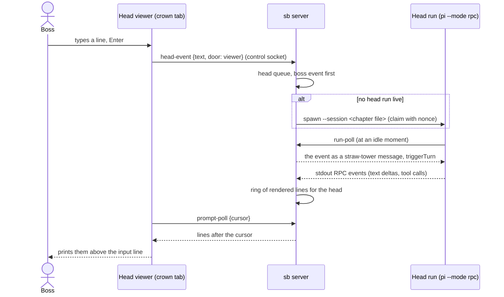
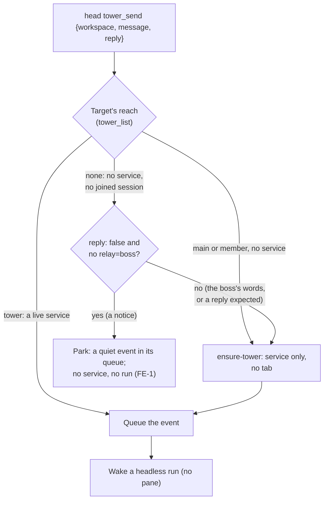

# F addendum: the head tower as the single entry

Date: 2026-11-23. Base: `main` at `080718c8` (0.83.0). Status: decided (see the boss decisions and framing at the end); built behind `towerRuns.headless` for 0.85.0 at the boss's minimum. As built: a plain line to the head, `@<workspace>` from a viewer (`head-event` with `to`), `/stop`, a run's dialogs answered in the viewer (`/yes N`, `/no N`, `/pick N`; the head's viewer lists every run's), the addressed tower's run start, finished messages and end as lines in the head's viewer, parked notices (FE-1), and viewers only where agents work (FE-2). Not built: `/to`, `/runs`, `focus`, the head brief's direct-conversation and parked-count lines, the ask's `expired` state, the local page's answer to a run's dialog, and the `door: viewer` rename (the viewer still posts `door: pane`). The original text follows.

This addendum extends section 4 of `docs/specs/2026-11-23-lite-b2-d-e-f.md` (F, headless tower runs). It designs the entry the boss asked for when he decided F:

> 「不再支援，但是主塔台要有能力作為統一入口」

A hand-started pi in a tower pane and the legacy resident tower are retired (F-3). The head tower must be able to act as the single entry point: from it the boss talks to any workspace's tower and sees that tower's runs.

The boss already decided: f_conv=headless, f_close=view, f_rollout=switch, f_restart=drain. This page does not reopen those choices.

## 0. Summary

- **What the entry already has.** The boss's words never reach a tower by typing. The tower prompt, the GUI composer, `/boss tower` and `/boss head` all post `tower-event` or `head-event` over the control socket. `prompt-typed` is the server typing the prompt's own launch command into a pane, not the boss's line. F changes what wakes behind the event: a `pi --mode rpc` child instead of a pi in the pane. It also takes away what the boss had in that pane: pi's TUI, its live text, Esc, and the dialogs.
- **A gap in section 4 as written.** Section 4.4 has `ensure-tower` make a viewer tab. Today's incident (section 4 below) would then recur: the head's forward still opens a tab in a workspace nobody works in, only as a viewer tab instead of a standing pane. This addendum splits the service from the viewer. `ensure-tower` registers the service with no tab. A viewer is made only when one is asked for (decision FE-2).
- **The entry.** The head viewer (the crown tab), the head page, and `/boss head` take three kinds of line:
  - a plain line goes to the head, as today;
  - `@<workspace> <text>` goes straight to that workspace's tower as the boss's words, with no head LLM turn in between;
  - `/to <workspace>` switches the viewer's transcript and its default target to that tower, and `/to head` switches back.
  
  Answers, wait cards, and approval cards from every tower come back to the head viewer.
- **The incident under F.** A forward from the head that is a notice (`reply: false`, not the boss's words) to a workspace with nobody in it (`reach: none`) opens nothing: no service, no tab, no run. It is parked in that workspace's queue as a quiet event, and the next run there takes it. A forward that carries the boss's words or expects a reply opens the service and a headless run with no pane (FE-1).
- **Effort.** F grows from 5–7 days to 7.5–10.5 days.
- **Open decisions.** FE-1 to FE-5 are in section 9, each with a recommendation.

## 1. Today on `080718c8` (measured)

| Path | What happens | Where |
|---|---|---|
| The boss's line at a tower prompt | `tower-event {workspace, text, present, door: "pane"}` over the control socket; a boss event that goes first in the queue | `src/towerprompt/serversource.ts` `post` |
| The same at the head pane | `head-event {text, door: "pane"}` | `serversource.ts` `pick.reply`; `src/server/headcmds.ts` |
| `/boss head <msg>`, the head page | `head-event` (no `door`) | `src/headcmd.ts`, `src/headroutes.ts` |
| `/boss tower -w <ws> <msg>`, a tower's page | `tower-event {present}` | `src/towercmd.ts`, `src/server/main.ts` `towerCommand` |
| The head forwards | `tower_send` → `ensureTower` (**tab and standing pane**) → ask `H<n>` → intercom to the tower identity | `src/server/headtools.ts` `forward` |
| A tower answers the head | `tower_send {head: true, inReplyTo}`; `headGate` lets in only an answer to an open ask | `src/server/headgate.ts` |
| What the head reaches | the towers of this computer, one workspace a call; no `device`, no broadcast, no main | `headtools.ts`, `src/runallow.ts` `HEAD_TOWER_TOOLS` |
| The boss in a run | the prompt posts, and pi's own keyboard input in the run's pane (`run-boss`) | `runmode.ts`, `runs.ts` |
| Which tower a card view lists first | its own; the head's own blocks, other towers' are a note | `src/towerprompt/waitblock.ts`; how-it-works, "What the server does" |
| The head and an operate controller | the head is never an operate session's (BR-F003) | `src/server/operatescope.ts:135` |

What F takes away from the entry: pi's TUI in a run's pane (live text, Esc to stop a turn, `!cmd`, the dialogs). The boss used these whenever a run woke in the pane he was looking at. The viewer must carry the live text, a stop, and the cards. Section 4.4 gives the viewer a transcript and cards; this addendum adds the head's view of every tower, direct addressing, and a stop.

## 2. Design

### 2.1 Terms

- **Service**: a tower's identity, its token, `service.json`, its queue, and its runs. Under F it needs no pane.
- **Run**: a `pi --mode rpc` child of the server (section 4.4).
- **Viewer**: the tower prompt with a transcript, in a pane the server made and typed into once (section 4.4).
- **Entry**: where the boss's words come in: a viewer, a page of the GUI, or a `/boss` command typed in a local pi session.

### 2.2 The service without a tab

`ensure-tower` splits in two:

| Command | Makes | Called by |
|---|---|---|
| `ensure-tower {workspace}` | the service only: identity, token, `service.json`. No tab, no pane, no typing | every automatic open: a promotion, `call_tower`, a head forward, an ally wake, a controller's open on a box |
| `ensure-tower {workspace, view: true}` | the service, plus a viewer tab when none runs (`--no-focus`, typed once, `exec`; section 4.4) | `/boss tower` (bare), the GUI's **Open viewer**, and, under FE-2 (b), a promotion on an attended device |

The head is the same: `head-open` with `view` makes the head workspace and its crown viewer (today's `makeHead`). A head event from the GUI or `/boss head <msg>` makes the head workspace as today, but no viewer.

The head service stays bound to its Herdr workspace (`head.ts` `makeHead`, `headcmds.ts` reads `t.head.status()?.workspace`). A head with no Herdr workspace at all is possible after F, but it is not in this addendum.

### 2.3 A typed line reaches the head's headless run

- Nothing is typed. The viewer's line goes over the control socket as it does today. Only `door` changes, from `pane` to `viewer`.
- **A line while the head is in a turn** waits for its next idle moment, as a boss event waits today (`runs.ts`). The viewer prints `queued · the head is working`. `/stop` (or Esc on an empty line) sends `run-abort {workspace}`: the server writes `{"type":"abort"}` to that run's stdin. pi ends the turn, and the run takes the boss's line at the idle moment that follows (FE-5).
- **The boss's presence** comes only from boss events the server queued: their source and `door`. An RPC child has no keyboard, so `run-boss` from the run's own input goes; nothing a run says can mark the boss present.
- **The head's conversation** resumes its chapter file at each run, as today. A drain on a server restart (F-5) ends a live head run after at most 60 seconds, and the next word resumes the same chapter.

### 2.4 From the head entry to any workspace's tower

Two paths, because they answer different needs:

| Path | Line | What it costs | When |
|---|---|---|---|
| **Through the head** | a plain line: `幫知識庫看一下 MP-5383 卡在哪` | a head turn, then the tower's run; an ask `H<n>`, then a one-line answer | the boss does not know or care which tower owns it, or it spans several |
| **Direct** | `@知識庫 MP-5383 卡在哪？` once, or `/to 知識庫` and then plain lines | the tower's run only (a boss conversation there) | the boss knows the tower and wants its own words and its full answer |

**The direct path is the boss's words at that tower**, exactly as `/boss tower -w 知識庫 <msg>` or that tower's page sends them:

- The viewer and the head page send `head-event {text, to: "<token>", door}`. The server resolves `to` as `/boss tower -w` resolves a workspace (`towercmd.ts`):
  - by id or exact label;
  - a label two workspaces share is refused with their ids;
  - a sub workspace goes to its parent;
  - the head's own workspace, or a token that names no workspace, is refused.
- The server then queues `tower-event {workspace, text, present: true, door}` on that tower. The head's queue, its asks, and its model see nothing of it.
- The service is ensured with no tab (2.2). A boss event wakes a run at once, with no hold, as today.
- **The head still knows.** Its brief's "workspaces now" gains `boss conversation live (from the entry, since 10:04)` for such a tower, so the head does not forward the same thing again.
- **Parsing is the client's.** Only a first word `@<token>` followed by a space addresses a tower, and `@@` sends a literal `@` to the head. Inside a paste, only the first line is read for it. The server takes `to` only as a field and never reads `@` out of `text`, so text cannot redirect itself.
- **`/to <workspace>`** (viewer and head page) sets the default target and the transcript the viewer shows (2.7). The viewer's input marker names the target: the crown glyph (U+F01A5) and `❯` for the head, the radio tower glyph (U+F043B), the label, and `❯` for a tower. Every posted line is echoed as `» → 知識庫: <first 60 characters>`, so a line sent to the wrong place shows before its answer does. `/to head` and `/to` alone go back. The target is not remembered across viewer starts: a viewer always starts at its own tower.

### 2.5 The head forwards, and opens a run there

The head's `tower_send` is unchanged in its arguments and its asks. What it opens changes:

- **A run there is a `pi --mode rpc` child** with `cwd` at the workspace's checkout. `assertSettingsSafe` runs on that folder first, as section 4.4 says. A refused check leaves the event queued and sends a notice to the head's ask: the ask's state reads `settings refused`, so the boss sees why nothing ran.
- **A quiet event:**
  - It is a queue file with `quiet: true`. The wake logic skips a queue that holds only quiet events. The next run there, woken by any other event, takes them in order, flagged `parked notice from the head (no one was here when it came)`.
  - A quiet event with the same text hash as one already parked there replaces it, so a daily sweep does not stack copies.
  - It expires with the queue's 24 hours. Its ask then closes as `expired`.
  - The head's ask reads `parked at <label>` on the head page. The tool's result tells the head the same, and its brief lists parked counts per workspace, so the head does not forward the same thing again.

### 2.6 Answers and cards come back

| What | From | To the boss through |
|---|---|---|
| A tower's answer to a forward | `tower_send {head: true, inReplyTo}` → `headGate` → the head queue → a head run | the head's turn, in the head ring: the head viewer, the head page, Zen |
| A direct conversation's answer | that tower's run | that tower's ring. In the head viewer: the full text when `/to` is on that tower, else one activity line `[知識庫] <first 160 characters>` per finished assistant message of a run the entry woke |
| A run starts or ends, for a run the head's forward or the entry woke | the server's run records | one activity line in the head viewer: `↳ 知識庫 run (H12)` and `✓ 知識庫 done: <note, first 100>` (or `✗ crashed`) |
| A wait card (`boss_wait_ask`, a memory wait) | any tower, or the head | the card view of any viewer. The head viewer lists the head's own cards first, then the `/to` tower's, then the rest. Only the head's own block it (the 2026-11-21 decision stands) |
| An approval card (`link_request` in a local run; a gated call of an ally run below `dispatch`) | a run's `extension_ui_request` (section 4.4) | the card view of the run's own viewer **and the head viewer**, and this computer's local page. Typed keys only. Never a paired device |
| A select or confirm of another extension in a run | the same | the same views, answered `cancel` after 60 seconds (section 4.4) |

`boss_wait_ask` in a run stays gated by where the boss's last words in that run came from (section 4.4): a viewer on this computer (`door: viewer`, the head viewer included for a run it addressed) or this computer's local page (`door: page`). Words from `/boss` in a pi session or from a paired device carry no door, so they open no card.

### 2.7 How a viewer shows transcripts

- **One ring per workspace and one for the head.** These are the server's last 300 rendered lines (section 4.4), kept in memory only. The session file stays the record.
- **What a line is.** The server writes the prefix; model text never does:
  - `│` for assistant text, with deltas folded per message;
  - `▸ <tool> <short args>`, then `✓` or `✗`;
  - `» ` for the boss's own words, with the source (`viewer`, `page`, `pi`, `phone`);
  - `⇠ <kind> from <name>` and the first line for an event (a main's call, a tower's answer, a teammate's message);
  - `· <state>` for the run's state.
- **Cleaning.** Every line is cut of control characters and escape sequences (CSI, OSC, a split SGR) before it is stored, and again in the viewer before it is written. This is the same cleaning the card text gets today (`waitblock.ts`). A ring line is never parsed as a card, a key, or a command: the card view draws only from the cards digest of `prompt-poll`. This keeps the AGENTS.md rule that the screen cannot tell model text from a dialog.
- **`prompt-poll {workspace, pid, cursor, focus?}`** answers `lines` after `cursor`, the new `cursor`, and `focusState`. `focus` is taken only from the head's own viewer (the server knows the viewer's pane and PID from the one typing), so a workspace viewer shows only its own tower. On a `/to` switch the viewer first gets the last 40 lines of the target's ring. An empty ring after a restart reads `(no live output · last run 10:12 done: <note>)`.
- **Ally runs** in the target's ring are labelled `[teammate · <device label>]` and are read-only. The boss's lines never go into an ally run (section 5).
- **`/runs [workspace]`** prints the last 10 runs from the run records (`tower/<ws>/runs/*.json`): kind, start, outcome, and the first line of the note. Without a workspace it covers every tower. It reads no transcript.

### 2.8 The GUI and `/boss` in any pi session

- **The head page** gets the same `@<token>` and `/to` in its composer, and the same `to` field to `head-event`. It also gets `live` text from the head ring (section 4.4, The GUI). Each ask card links to its tower's comms.
- **A tower's page** is unchanged: it is already a direct entry. It gains **Open viewer** (`ensure-tower {view: true}`).
- **In a pi session:** `/boss head <msg>` goes to the head, and `/boss head @<ws> <msg>` is direct, the same as `/boss tower -w <ws> <msg>`, which stays. Bare `/boss head` opens or focuses the crown viewer. Bare `/boss tower` opens or focuses this workspace's viewer (FE-4).
- **On an unattended device** no viewer draws cards on its own, as today. The head of a box is never an operate session's (BR-F003), so an operating controller has no head entry on the box.

### 2.9 Viewer commands

| Typed | Head viewer | Workspace viewer |
|---|---|---|
| a line | to the target (head, or the `/to` tower) | to its tower |
| `@<ws> <text>` | to that tower, direct | to that tower, direct (`tower-event`, as `/boss tower -w` sends it) |
| `/to <ws>`, `/to head` | switches target and transcript | refused: "only the head's viewer follows other towers" |
| `/stop` (Esc on an empty line) | aborts the target's live turn | aborts its tower's live turn |
| `/new`, `/quit` | the target's conversation: `head-new`/`head-leave`, or `tower-new`/`tower-leave` | its tower's |
| `/wait` | card view, ordered as in 2.6 | card view, its tower first (as today) |
| `/runs [ws]` | run list | run list of its tower |
| Ctrl+D | closes the viewer and its pane (`exec`); the services go on (f_close=view) | same |

## 3. How it changes section 4

- 4.4 **The viewer pane is `/boss tower`**: `ensure-tower` makes no tab. A tab is made by `view: true` (2.2), and the FE-2 choice decides whether a promotion asks for one.
- 4.4 **The run's dialogs**: approval and wait cards also draw in the head viewer (2.6).
- 4.4 **The viewer adds a live transcript**: per-workspace rings, `focus` for the head viewer, server-written prefixes, and cleaning (2.7).
- 4.4 **Head tower**: "Same path" stays, plus the entry (2.3–2.5) and parked notices.
- 4.4 **The box**: an ally wake and a controller's open make the service with no tab (already the intent there; now explicit in 2.2).
- 4.8 gains the tests in section 6. 4.9 gains the effort in section 7.
- New control fields: `head-event.to`, `ensure-tower.view`, `prompt-poll.cursor` and `.focus`, the queue's `quiet`, and `run-abort`. The `run-boss` command and `door: "pane"` go (a `pane` from an older prompt is read as `viewer` for the one switch release).

## 4. Case: the `ledger_sweep` of 2026-11-23

From `~/.pi/agent/straw-boss/server.log` and `tower/w2DE/runs/23e0c9998c27f96e.json`:

| Time (UTC) | What happened | Evidence |
|---|---|---|
| 14:02:37 | The daily sweep is queued for the head | `ledger-sweep date=2026-11-23 state=queued` |
| 14:03:46 | The head runs `ledger_sweep`: 44 actions, 11 matched to workspaces, 37 unmatched (to the head board) | `ledger-sweep … matched=11 unmatched=37` |
| 14:03:59 | The head forwards the matched items to w2ZG, w15X and wJ (which had towers) and to w2DE (pi-straw-boss), which had none. Every header says `reply=none` with no `relay`: H160–H163 | `tower-event workspace=w2DE … from=sb-head seq=0…3` |
| 14:03:59–14:04:09 | A tower is opened in w2DE to take them: a new tab, its standing pane typed into, a run in that pane | `tower-opened … tab=w2DE:t2`, `prompt-typed workspace=w2DE` |
| 14:04:09–14:04:58 | One run of 49 s. Its note: "dirty worktrees … no memory on them; left for the morning. Nothing routed." | `runs/23e0c9998c27f96e.json`, outcome `done` |
| 14:08:09 | The tab is closed by hand. The note is left only in a run record | `tower-closed … why="its tab is gone"` |

The brief said 3 notes; the log and the run record show 4 forwards (H160–H163) in that one run.

| | Today | Section 4 as written | This addendum (FE-1 a, FE-2 b) |
|---|---|---|---|
| Service in w2DE | opened | opened | **not opened** |
| Tab or pane | a tower tab with a standing pane, typed into | a viewer tab (4.4: `ensure-tower` makes one) | **none** |
| LLM run | one, 49 s, that did nothing but write a note | one headless run, same work | **none** |
| Where the four items are | one run's handoff note, unread | the same | 4 quiet events in `tower/w2DE/queue/` for 24 h, the asks `parked at pi-straw-boss` on the head page, and the counts in the head's brief. The next run there takes them, and tomorrow's sweep finds whatever is still left |

With FE-1 (b) (always run), the row would read: no tab, one headless run in the background, and the note in its record. With FE-1 (c) (never open), a forward carrying the boss's words would also be parked, so the boss would get no answer until something else woke the workspace.

## 5. Authority at the entry

| Source | May | May not |
|---|---|---|
| **The boss's keys in a viewer on this computer** | `head-event`, `tower-event`, `@`, `/to`, `/stop`, `/new`, `/quit`, card and approval presses (typed single keys only; a paste ends the card view with nothing pressed) | — |
| **`/boss head`, `/boss tower` typed in a local pi session** | the same events, with no `door`; `-w` writes ask first and name the tower (today's rule) | open a card through `boss_wait_ask` (no door); a pi with no screen refuses `-w` writes |
| **This computer's local page** | the same as a viewer, with `door: page`; it answers approvals as the local page does today | — |
| **A paired device (phone, LAN, remote)** | `head-event`, `@`, `tower-event`, `/stop` (as the page's **Stop**), all `guarded` | text that `localOnlyText` refuses; approval cards and `hereOnly` choices (`NO_RELAY`); no `door`, so no `boss_wait_ask` card |
| **An operate controller driving a box** | its scope on the box, as today | the box's head and its entry: no scope holds the head (BR-F003), so `@` through the box's head is refused with it |
| **A main or member, including a remote turn pinned to a teammate** | `call_tower` to its workspace tower: an intercom event under the code-written header, `origin=remote:<device>` where it applies | `head-event`, `tower-event`, `run-abort`, card or approval answers: none are tools, and `/boss` is typed input. A message to the head identity that is not an answer to an open ask is refused by `headGate` with a receipt |
| **A workspace tower's run (run token)** | `tower_send {head: true, inReplyTo}` for an open ask; its own run's requests | `head-event`, `tower-event`, `run-abort`, `ensure-tower {view}`, `prompt-poll` (all refused by `rungate.ts`'s default, and pinned by test) |
| **The head's run (run token)** | forwards with asks. `relay=boss:<id>` only when the server saw that the turn began with a boss event (`HeadPort.relay`) | the direct path (it cannot post the boss's words anywhere); a tab or viewer; a main; `device`; answering a card or an approval |
| **An ally run (teammate)** | its tools at its sender's level (section "Ally runs"); its transcript, read-only and labelled, in a viewer | the head, in either direction. The boss's lines: a boss event for a workspace whose only live run is an ally run is queued for a local run and never delivered into the ally run, so a teammate's session never runs a turn at the boss's level. `present` never applies to an ally run |
| **A teammate's message (Straw Link)** | an ally run or a link reply to the main that asked | the head; `present`; any entry command |
| **The server's own writes to a run's stdin** | `abort`, `extension_ui_response`, `get_state` | `prompt`, `steer`, `follow_up`, `bash`, `new_session`, `switch_session`, `set_model`, and any other command. The boss's words reach a model only as a `straw-tower` message through the run's extension, never as pi user input, so a line that starts with `/` or `!` is text, never a pi command or a shell (pinned by test). The boss's own `!cmd` in a run is gone with the TUI, on purpose |

**Section 4's guarantees kept as they are:**

1. The server types once, into a pane it made in the same call, until the viewer's first poll; never again (4.4, `typeonce`).
2. Only the server writes a run's stdin. A run cannot answer its own dialog or approve its own `link_request`. An approval is `allow` only on a typed yes in a viewer or the local page.
3. A run claims with run id, PID, and nonce. Any other claim is refused.
4. The head takes only the boss's words and answers to its open asks (`headGate`). It forwards one workspace at a time, with no `device`, no broadcast, and no main.
5. One boss conversation per workspace, whatever the entry: the viewer, the head's `@`, the page, or `/boss tower -w`.
6. Boss events go first. The `answering` hold, the crash and hold rules, the 60-second drain, and resuming the same session after a restart stay.
7. `NO_RELAY`: a paired device gets no approval card from a run.
8. Unattended devices draw no cards on their own.
9. No module but `standing.ts` calls Herdr `pane run` or `agent start` (4.8 test 5).

## 6. Tests (red-first)

Each one is red on `080718c8`, or on section 4 as written where noted.

1. **`tests/head-entry.test.ts`** (server world, fake pi that speaks RPC, fake clock):
   - a viewer's `head-event {door: viewer}` spawns one head child with `--session <chapter>`;
   - the event reaches it at its first poll;
   - its RPC text deltas reach the viewer's `prompt-poll` after the cursor;
   - no Herdr `pane run` happens after the viewer's first poll.
   - Red today: the head's run starts in its pane.
2. **`tests/head-address.test.ts`**:
   - `head-event {to}` by id, by label, and by a sub workspace (goes to its parent) queues a `tower-event` with `present` at that tower, and nothing in the head queue or asks;
   - a shared label is refused with the ids, and so are the head's workspace and an unknown token;
   - `text` that starts with `@x` and has no `to` goes to the head.
   - Red today: `to` is ignored.
3. **`tests/head-forward-park.test.ts`** (the incident):
   - a forward with `reply: false` and no relay to a workspace whose reach is `none` makes no `ensure-tower`, no `tab create`, and no spawn;
   - it writes one quiet event, and the ask reads `parked`;
   - a second forward with the same text replaces the first;
   - a later boss event there spawns one run, which takes both the boss event and the quiet one;
   - after 24 hours the quiet event is gone and the ask is `expired`.
   - Red today: `tower-opened` with a tab.
4. **`tests/head-forward-open.test.ts`**:
   - a forward with `relay=boss` (or `reply` left out) to a workspace with no service registers the service with no tab and spawns one headless run;
   - its `tower_send {head: true, inReplyTo}` wakes the head.
   - Red on section 4 as written: a viewer tab is made.
5. **`tests/viewer-make.test.ts`**:
   - `ensure-tower` with no `view` never makes a tab;
   - with `view: true` it makes one and types once;
   - under FE-2 (b), a promotion's open on an attended device asks `view`, and an unattended one does not.
6. **`tests/rungate.test.ts`** (extended): a local, head, and ally run token is refused `head-event`, `tower-event`, `run-abort`, `ensure-tower` with `view`, and `prompt-poll`.
7. **`tests/runchild-stdin.test.ts`**:
   - the server's writer accepts only `abort`, `extension_ui_response`, and `get_state`, and throws on anything else;
   - a boss line `/compact` or `!rm -rf x` arrives in the fake child only as a `straw-tower` message.
8. **`tests/viewer-transcript.test.ts`** (extends 4.8 test 4):
   - model text with `\x1b[3G`, an OSC, a split SGR, or a card-like `W2 choice · …` line is stored as a plain `│` line and never opens the card view;
   - `focus` from a workspace viewer is refused;
   - a `/to` switch returns the last 40 lines.
9. **`tests/entry-ally.test.ts`**: a boss event for a workspace whose only live run is an ally run is not delivered into it, and starts or waits for a local run.
10. **`tests/entry-cards.test.ts`**:
    - an approval request from a workspace run is drawn in the head viewer's card view and pressed by a typed key;
    - a paste ends the view with nothing pressed;
    - a paired device's answer is refused;
    - `boss_wait_ask` is allowed after a head viewer's `@` to that tower, and refused after `/boss tower -w` from a pi session.
11. **The live pass** of 4.8, run on the Mac, the box, and the Windows VM, adds:
    - a head conversation through the crown viewer;
    - `@<ws>` to a workspace with no tower;
    - one parked notice;
    - one approval pressed in the head viewer.

## 7. Effort

| Piece | Days |
|---|---:|
| `ensure-tower` split, `view`, FE-2 call sites | 0.5 |
| `head-event.to`, resolution, the head brief's direct-conversation field | 0.5 |
| Quiet events: queue flag, wake skip, replace, expiry, ask states, brief counts | 0.5–1 |
| Viewer: `/to`, `@`, rings per workspace, `focus`, activity lines, `/runs`, `/stop` and `run-abort` | 1–1.5 |
| Cards and approvals in the head viewer, `door: viewer`/`page` | included in section 4's card work, +0.25 |
| GUI head page: `@`, `/to`, live text, ask-card links, **Open viewer** | 0.5 |
| Tests 1–10 | included above |
| **Added to F** | **2.5–3.5** (F total 7.5–10.5, plus the VM and box pass) |

## 8. Risks

| Risk | Guard |
|---|---|
| A line goes to the wrong tower after `/to` | The input marker names the target; each post is echoed with its target; `/to` is not remembered across viewer starts; `@` is one-shot |
| The direct path skips the head's asks, so the head forwards the same thing | The head's brief shows direct conversations per workspace (2.4) |
| A parked notice is never read, because nobody works there | It shows on the head page as `parked at <label>` and in the head's brief. It expires after 24 h, and the daily sweep finds it again while the item is still left. The quiet event also replaces its own copy, so nothing piles up |
| A notice that should have woken someone is parked | Parking takes only `reply: false` with no `relay=boss`, and a target with nobody in it. The boss's words and any expected reply always open a run |
| Model text in a viewer passes for a card or the boss's line | Server-written prefixes, cleaning twice, and cards drawn only from the digest (2.7, test 8) |
| The boss loses Esc and steering mid-turn | `/stop` aborts the turn; a line waits for the idle moment (FE-5 b would deliver it as a steer instead) |
| The head becomes a bottleneck: one head run, busy | The direct path needs no head run; `@` and `/to` work while the head works |
| Ring memory | 300 lines per workspace with a live or recent run, dropped with the service |
| A paired device drives towers through the head | It may do exactly what it may do on a tower's page today, with the same `guarded` checks. Approvals stay with this computer |

## 9. Open decisions

| # | Decision | Options | Recommendation and reason |
|---|---|---|---|
| FE-1 | The head's `tower_send` to a workspace with no live tower | (a) park a notice (`reply: false`, not the boss's words) when nobody is there; open the service and a headless run for the boss's words and expected replies. (b) Always open the service and a headless run, with no pane. (c) Never open: park everything until something else wakes the workspace | **(a).** The incident's run cost an LLM run that did nothing but write a note nobody read. (b) removes the tab but keeps that run. (c) leaves the boss's own instructions unanswered |
| FE-2 | When a tower gets a viewer tab on its own | (a) Only when asked: `/boss tower`, **Open viewer**, `/boss head`. (b) Also when a promotion or a main's call opens the tower on an attended device; never for a head forward, an ally wake, or a controller's open | **(b).** Where agents already work, the tower keeps its row in Herdr's Agents list and the net view, as the boss kept it in 4.4. Workspaces nobody works in, the incident's case, never get a tab. (a) is lighter, but a tower would then show only in the GUI until the boss asks |
| FE-3 | How the head entry reaches a workspace's tower | (a) Both: a plain line through the head; `@<ws>` and `/to <ws>` direct to the tower. (b) Only through the head: every line costs a head turn and comes back as a summary. (c) Only direct: the head stays a router for others' asks | **(a).** The head routes what the boss leaves to it, and the boss can still talk to a tower in its own words and see its full answer without a second model in between |
| FE-4 | Bare `/boss tower` in a session of a workspace | (a) Opens or focuses this workspace's own viewer tab (section 4.4). (b) Opens the head viewer with `/to` this workspace: one viewer for every tower | **(a).** The boss is in that workspace, so its tab is where he looks. The head viewer can do the same with `/to`. Choose (b) if the boss wants at most one viewer on screen |
| FE-5 | The boss's line while the target is in a turn | (a) It waits for the next idle moment, as today; `/stop` (or Esc on an empty line) aborts the turn. (b) It is delivered at once as a steer | **(a).** It keeps the run protocol that `runmode.ts` and its tests pin (section 5 of the spec puts steer delivery out of scope), and `/stop` gives back the Esc the boss had in the TUI |

## Boss decisions (2026-11-23, review page form)
All five recommendations taken: fe_park=park_notice, fe_viewer=working, fe_address=both, fe_tower_cmd=own, fe_midturn=wait_stop.

## Boss framing (2026-11-23, after the form)
Verbatim: 「應該說主塔台可以是主要入口，但一般最佳用法不是，一般是直接和 main agent 對話，主塔台只有在 zen mode 或是偷懶模式的時候有用」.

What this means for the build:
- The boss normally talks to main agents in their own panes. The head entry is a secondary path, used in zen or lazy mode.
- The main panes stay first-class: F must not reduce, slow or reroute direct boss↔main talk.
- Build the head entry at its minimum: a plain line to the head, `@<ws>`, and cards and answers coming back. `/to`, `/runs` and the transcript switching are optional extras; cut them first if the effort grows.
- Re-estimate the effort with this scope before the build.
