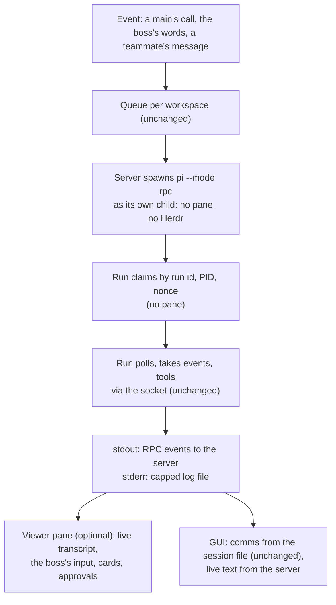
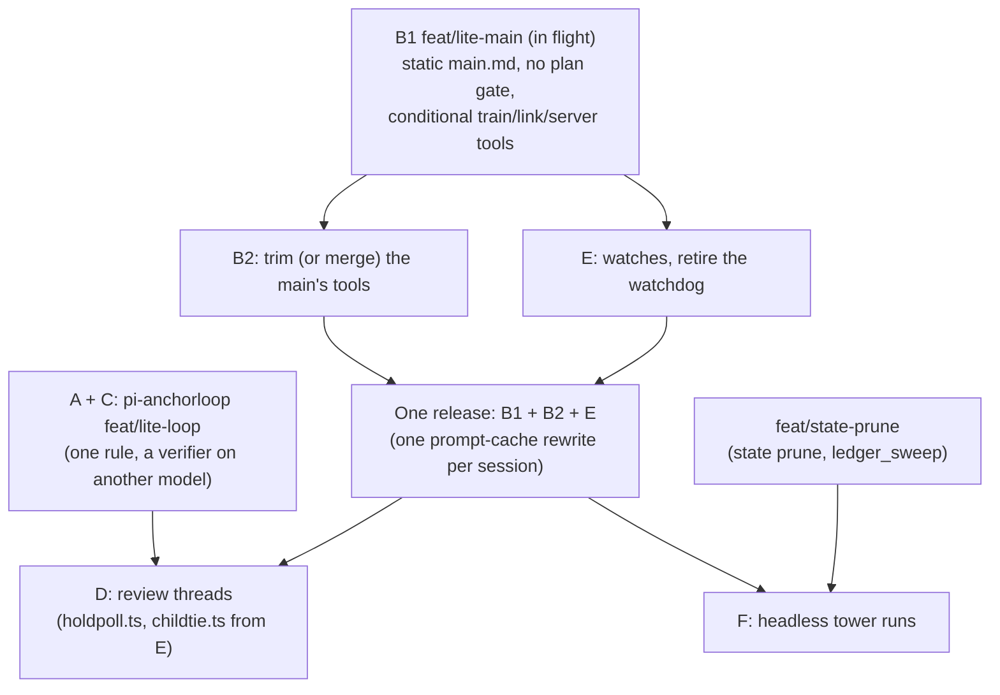

# Lighter sb: B2, D, E, F

Date: 2026-11-23. Status: the boss decided (see [Boss decisions](#boss-decisions-2026-11-23-review-page-form)). B2 (trim in place, `boss_status` folded into `board_read`) and E (`boss_watch`, the watchdog retired) are built for 0.83.0; D and F are not built yet.

As built, two points differ from the draft below: a session that has been off the net for 15 minutes loses its watches (the draft said "not restoring"; a revived main keeps its session id, so it keeps them within that time), and a member's `board_read` answers section `towers` alone instead of refusing, since `boss_status`, which members had, is gone.

The boss picked six items from the /swarm comparison (`/tmp/lite-review/lite.md`, research in `/tmp/lite-research.md`) and chose 「先為選中的項目寫規格，你看過再實作」. A and C are being built in `pi-anchorloop` `feat/lite-loop`. B1 and the conditional `train_car`, `link_request` and `boss_server` tools are on `feat/lite-main`. State prune and the head tower's daily `ledger_sweep` are on `feat/state-prune`. This spec covers the other four items: B2, D, E and F.

Measurements were taken on `main` at `94d5523c` (0.82.1) with throwaway scripts in `/tmp/lite-specs/measure/`. Tool size means `description.length + JSON.stringify(parameters).length`, which is what the provider receives, minus a fixed wrapper of about 40 to 60 characters per tool. Token figures assume 3.5 to 4 characters per token.

## Summary

| Item | What it does | Measured effect | Effort | Recommendation |
|---|---|---|---|---|
| B2 | Merges the main's tools (10 always-on tools become 4) | About −3.3K characters (−31%) on the 10 always-on tools. Trimming the descriptions in place saves the same amount (−3.4K) with no rename. | Merge: 2.5–3 days. Trim: 0.5–1 day. | **Trim in place** and fold `boss_status` into `board_read`. Ship it in the same release as B1 and E. |
| D | A review thread where a worker and a reviewer talk directly | The main takes 2 turns for a reviewed task instead of 2r+3 (r = repair rounds). | 3–4 days | Build it in sb, as a server-side thread with two child tools. |
| E | Replaces the LLM watchdog with code | Removes 6 to 30 LLM turns per hour per watched unit, 2 child tools (2.7K characters), and about 1,000 lines | 1–1.5 days | Server-owned watches and a `boss_watch` tool. |
| F | Runs the tower as headless pi children | The server stops typing into panes after a pane's first second. About 3,500 lines of code and 4,800 lines of tests go away; the F10 class of bugs cannot happen any more. | 5–7 days, plus a Windows VM and box pass | Headless `pi --mode rpc`. A viewer pane is created once and never typed into again. |

Recommended order: B1 (in flight), then E, then B2 (both in one release with B1), then D, then F after `feat/state-prune` lands. Sections 6 and 7 give the dependency graph and the decisions.

---

## 1. B2: merge the main's tools

### 1.1 Goal and the boss's words

He picked option B: 「看板、發送、session 三類各併成一個工具；train、link、server 相關的工具只在用得到時才註冊」 (merge the board, send, and session tools into one tool each; register the train, link and server tools only where they are used). Its pro was listed as 「每輪約少 9 KB 的 context」 (about 9 KB less context each turn). B1 owns the conditional registration. B2 owns the merge.

### 1.2 What a main carries today (measured)

A promoted main in the fake world with a server, plus `train_car`, carries 13 tools:

| Tool | Description | Schema | Total |
|---|---:|---:|---:|
| `call_tower` | 637 | 2,931 | 3,568 |
| `link_request` (B1: conditional) | 810 | 1,298 | 2,108 |
| `train_car` (B1: conditional) | 614 | 1,377 | 1,991 |
| `board_set` | 905 | 748 | 1,653 |
| `boss_wait_ask` | 1,093 | 321 | 1,414 |
| `board_read` | 648 | 328 | 976 |
| `boss_server` (B1: conditional) | 586 | 374 | 960 |
| `boss_broadcast` | 434 | 432 | 866 |
| `boss_handover` | 423 | 336 | 759 |
| `boss_duty` | 290 | 282 | 572 |
| `boss_rename` | 240 | 201 | 441 |
| `boss_promote` | 175 | 33 | 208 |
| `boss_status` | 144 | 33 | 177 |
| **13 tools** | 6,999 | 8,694 | **15,693** |
| 10 tools always on | | | 10,634 |

The research said "about 9 KB of schemas per turn" for B2. That figure counted B1's three conditional tools and assumed that merging shrinks text. It does not; see 1.4.

### 1.3 Design for option B2-a: the merge

Ten always-on tools become four. Every one of the new tools is a flat object with an `action` literal; there is no top-level `anyOf`, which some providers refuse. The code checks the arguments of each action and refuses an argument that does not belong to it, naming the action that takes it.

**`boss_board`**: actions `read` (the default), `status`, `set`, `auto`, `clear`.

```ts
Type.Object({
  action: Type.Optional(Type.Union(["read","status","set","auto","clear"].map(Type.Literal))),
  scope:  Type.Optional(Type.Union(["local","remote","all"].map(Type.Literal))),   // read
  device: Type.Optional(Type.String()),                                            // read
  now:    Type.Optional(Type.String()),                                            // set: 1..120, one line
  items:  Type.Optional(Type.Array(Type.Object({ t: Type.String(), done: Type.Boolean() }))), // set: at most 8
})
```

**`boss_send`**: `to` is `tower` (the default), `tab`, `workspace`, `towers` or `all`.

```ts
Type.Object({
  message:  Type.String(),
  to:       Type.Optional(Type.Union(["tower","tab","workspace","towers","all"].map(Type.Literal))),
  why:      Type.Optional(Type.Union(["milestone","shared","blocked"].map(Type.Literal))), // required with to=tower for a main
  workspace:Type.Optional(Type.String()),          // to=tower
  reply:    Type.Optional(Type.Boolean()),         // default true to the tower, false to a scope
  waitsOn:  Type.Optional(Type.Object({ device, owner?, what?, cancel? })),   // to=tower only
  linkWait: Type.Optional(Type.Object({ id, state })),                        // to=tower only
  standing: Type.Optional(Type.Object({ device, what? })),                    // to=tower only
})
```

**`boss_self`**: actions `rename`, `duty`, `promote`, `handover`.

```ts
Type.Object({
  action:  Type.Union(["rename","duty","promote","handover"].map(Type.Literal)),
  name:    Type.Optional(Type.String()),                                       // rename
  duty:    Type.Optional(Type.Union(["coordinator","integrator","standing"].map(Type.Literal))), // duty; integrator left out while integration is off
  handoff: Type.Optional(Type.String()),                                       // handover
  reason:  Type.Optional(Type.String()),                                       // duty, handover
})
```

**`boss_wait_ask`**: unchanged.

The conditional tools stay as B1 leaves them: `train_car`, `link_request` and `boss_server`.

**Mapping from the old tools**

| Old | New |
|---|---|
| `board_read {scope, device}` | `boss_board {action: read, scope, device}` |
| `boss_status {}` | `boss_board {action: status}` |
| `board_set {now, items}` / `{auto}` / `{clear}` | `boss_board {action: set, now, items}` / `{action: auto}` / `{action: clear}` |
| `call_tower {…}` | `boss_send {to: tower, …}`, with the same fields |
| `boss_broadcast {message, scope, reply}` | `boss_send {to: <scope>, message, reply}` |
| `boss_rename {name}` | `boss_self {action: rename, name}` |
| `boss_duty {duty, reason}` | `boss_self {action: duty, duty, reason}` |
| `boss_promote {}` | `boss_self {action: promote}` |
| `boss_handover {handoff, reason}` | `boss_self {action: handover, handoff, reason}` |

**Tower runs.** `runmode.ts` registers `boss_status`, `board_read` and `call_tower` through `tools.addNetTools()`. `runtools.ts` proxies them, and `runallow.ts` lists them in `RUN_TOWER_TOOLS` and `HEAD_TOWER_TOOLS`. The merge renames them there too, so the system has one vocabulary. `tower_*`, `boss_open_main`, `boss_close_main`, `boss_revive_main` and `boss_auto` are tower-only tools and keep their names.

**Places that act on a tool name.** Each of these must take the new name and action, and each gets a red-first test:

- `src/link/allow.ts` `FREE` treats `board_read` and `boss_status` as free in a remote turn. Under the merge this becomes `boss_board` with action `read` or `status` only. `set`, `auto` and `clear` go to the gate, as `board_set` does today.
- `src/link/hooks.ts:106` blocks `boss_handover` in a remote turn. It becomes `boss_self` with action `handover`. If this is missed, a teammate's turn can open a successor main (RVR-F002), so the change counts as P0.
- `src/auto.ts:91`: `call_tower` with `why=blocked` while auto mode is on. It becomes `boss_send` with `to=tower` and `why=blocked`.
- `src/trainguard.ts:536`: the departure check reads the input of `call_tower`. It becomes `boss_send` with `to=tower`.
- `src/items.ts:90` renders the `boss_duty` history line. It keeps the old case for old sessions and adds the new one.
- `src/standinghint.ts`: no change (E changes it).
- `src/server/runtools.ts:257,259,460,469,484` and `src/server/headtools.ts:56` switch on the run tool's name.
- `src/rolescheck.ts` and `PARENT_ONLY` (`tests/roles-check.test.ts` pins it).

**Text the server writes that names tools.** The server's messages name tools: `linkwaits.ts` uses 33 such names (for example "answer it with call_tower linkWait"). So do `towerbrief.ts`, `carnotices.ts`, `autotext.ts` and `opener.ts`. These texts switch to the new names.

### 1.4 What merging saves (measured)

`/tmp/lite-specs/measure/merged.ts` drafts the new tools. `trimmed.ts` keeps the old names and uses the same sentences, split back over the old tools.

| | Characters |
|---|---:|
| 9 old tools today (all always-on tools but `boss_wait_ask`) | 9,220 |
| B2-a: `boss_board` 1,472, `boss_send` 3,069, `boss_self` 1,426 | **5,967** |
| B2-b: the same 9 tools, names kept, descriptions trimmed | **5,785** |

Merging alone saves nothing. Every byte of the saving comes from shorter descriptions, because a merged tool still has to say what each action takes. Merging also removes 6 tool wrappers, about 300 characters. The two options end within about 100 characters of each other.

**Against the cached prefix.** The pi-claude-bridge cache study (`~/projects/weihung-agent-root/scratch/pi-cache/rewrites.md`) found that a main's `tools` block holds 25K to 31K tokens. sb's 10 always-on tools hold about 2.7K to 3.0K of those tokens, roughly 10%. B2 saves about 0.85K to 0.95K tokens, roughly 3% of the tools block.

Each turn reads the prefix from the cache at about 0.1 times the input price, so B2 saves about 90 token-equivalents per turn. Any change to the tool list, by contrast, rewrites the whole cached prefix (tools, system, and history) once in every live session at its `/reload`.

- For a session holding 150K tokens of history, that one rewrite costs about 190K token-equivalents. The saving pays it back after about 2,000 turns.
- B2, B1 and E therefore ship in **one release**, so each session takes one rewrite instead of three.
- The tool set must also be fixed at session start. If B1 registers a tool later (on `boss_duty integrator`, or when a member is promoted), that registration rewrites the prefix again. Section 6 gives the constraint for B1.

B1's conditional tools are worth more than B2: `link_request`, `train_car` and `boss_server` hold 5,059 characters (about 1.3K tokens) that a main without integration, Straw Link or debugging stops carrying.

### 1.5 Option B2-b: trim in place (recommended)

- Keep every name.
- Trim the descriptions of the 9 tools to the `trimmed.ts` text. Also trim `boss_wait_ask`, an estimated −500 characters that was not measured.
- Fold `boss_status` into `board_read`: its result gains a `towers` section, and `boss_status` is removed. Both tools are `FREE` in a remote turn and both read only, so the gate does not change.
- In-place trimming needs no compatibility work, and no security table changes beyond removing one name.
- Result: about 10,634 → 6,700 characters (−37%), and one tool fewer.

### 1.6 Compatibility (B2-a only, unless noted)

- **Old session files.** History keeps tool calls under the old names. A provider is expected to accept `tool_use` blocks for tools no longer in the current list (sessions survive an extension's removal today). This is not verified here. The GUI's `items.ts` keeps its old cases so the history still renders. The rollout includes one live check on each provider family (claude-bridge, openai-codex, antigravity): `/reload` a session with history and confirm the next turn succeeds.
- **The model calls an old name** from habit, a compaction summary, or an old skill. pi answers "tool not found" and the model retries, which costs one turn. Prevention: sb's `tool_call` hook cannot see an unknown tool, so the fix is to change every text that names an old tool:
  - `prompts/*.md` (25 mentions in 13 files) and `roles/`;
  - `docs/how-it-works.md` and its zh-TW twin;
  - `site/…/reference/commands.md` and its zh-TW twin;
  - `~/.pi/agent/rules/session-rotation.md` (`boss_handover`, sourced from `weihung-agent-root`);
  - `pi-anchorloop` skills (none today).
- **Old peers on this computer.** A main that has not reloaded keeps its old sb module, while the server it talks to is new. The server's texts that name tools must suit both. No session reports its sb version to the server today (checked: `server-look.ts`, `presence.ts`, the socket `hello`), so for one release every such text names both forms, for example `boss_board read (board_read before 0.83)`. One function, `toolWord(name)` in `src/server/toolwords.ts`, writes them, and the release after drops the old form. Adding a version report to sessions would be new plumbing for one release; it is not proposed.
- **Old peers on other devices (Straw Link caps).** No wire message carries a tool name that the receiver acts on. `confirm-request` carries `tool` and `args` only as the label shown to a delegate. An old controller shows `boss_board` or `boss_send` as written; the argument JSON names the action. No new caps feature is needed. The rollout notes say so.
- **Message kinds stay.** `kind=call_tower` in the intercom header, the server's `call_tower` events, and `why=` keep their names: they are wire terms and not tools, and older builds parse them.

### 1.7 What is removed

- B2-a: 6 tool registrations, about 120 lines in `tools.ts` and `waitcall.ts` (the duplicated checks and reply texts). It adds about 80 lines of action dispatch and argument checks, so the net change is about −40 lines.
- B2-b: `boss_status` (about 8 lines in `tools.ts`, 4 in `runtools.ts`, and the `PARENT_ONLY` entry).
- Both: −3.3K to −3.9K characters of tool text on every main.

### 1.8 Risks

| Risk | Past incident it could bring back | Guard |
|---|---|---|
| A remote turn reaches a write action through a tool that is free for reading | `link/allow.ts` `FREE`; the link-operate review found that a remote turn's reach is decided by tool name | Table test: every `(tool, action)` pair gets a verdict; a new action defaults to gate |
| A remote turn opens a successor main | RVR-F002 (a successor runs outside the device's revoke) | Red-first test in `tests/link-hooks.test.ts`: `boss_self {action: handover}` is blocked |
| Prompt cache rewrites | 0.81.0: 53 rewrites, 8.9M write tokens in 48 hours | One release; the tool set is fixed at session start; `main.md` stays static (B1) |
| Lost meaning when the descriptions are trimmed | `board_set`'s privacy line, and `call_tower`'s three-points rule | The trimmed text keeps both sentences verbatim; `tests/prompts.test.ts` gets a check that the phrase is present |
| Server text names a tool an old main does not have | none yet | `toolWord` writes both forms for one release; a table test |

### 1.9 Tests (red-first)

1. `tests/tools-budget.test.ts` (new): a promoted main in `World` sums description and schema of sb's always-on tools and asserts at most 7,000 characters. It is red today (10,634).
2. B2-a only: a `tests/link-allow.test.ts` table for `(boss_board, read)` allow, `(boss_board, set)` gate, and `(boss_self, handover)` refused. Red before `FREE` and `hooks.ts` are changed.
3. B2-a only: `auto.ts` and `trainguard.ts` react to `boss_send {to: tower, why: blocked}` and to a car slip sent with `boss_send`.
4. `tests/roles-check.test.ts`: `PARENT_ONLY` matches the registry.
5. `tests/prompts.test.ts`: no prompt or role names a tool missing from `PARENT_ONLY` or from the run lists; this guard catches stale names.
6. B2-a only: every server text that names a tool goes through `toolWord`, which writes both forms (a grep guard in `tests/imports.test.ts` over `src/server/` for bare old names).

### 1.10 Effort and dependencies

- B2-a: 2.5–3 days. B2-b: 0.5–1 day.
- Depends on B1 merged, because both edit `tools.ts`, `main.md` and the registration in `index.ts`.
- Ships in one release with B1 and E.

---

## 2. D: worker and reviewer on one thread

### 2.1 Goal and the boss's words

「每個任務開一塊有編號的公告板，worker 和 reviewer 在上面來回最多 3 輪，只有完成或卡住時才叫醒 main」 (each task gets a numbered board; the worker and the reviewer go back and forth on it at most 3 rounds; the main is woken only when the work is done or stuck). The pro he picked: 「多 worker 的任務，main 的回合大約少一半」 (on multi-worker tasks, about half as many main turns).

Today a reviewed task costs the main these turns:

1. dispatch the worker;
2. take its result and dispatch the reviewer;
3. take the findings and resume the worker;
4. take the result and resume the reviewer, and so on;
5. take the approval.

That is 2r+3 turns for r repair rounds: 9 for 3 rounds. The main also relays every finding, so its context carries each finding twice.

### 2.2 Where it lives: sb (recommended)

- **sb has the parts.**
  - The server holds state and has an intercom identity.
  - `watchreport.ts` already ties a child to its dispatcher through pi-herdr-agents' own files: the activity file, the launch or resume script, and the role in the session file.
  - sb registers tools in every child (today the watch tools, `defaultActive: false`).
  - The GUI can show the thread.
- **pi-herdr-agents would mean three repos.** The delivery engine is `@nubl/maestro`, a pinned fork, and the extension is a fork of giuseppecrj's upstream. A board there would touch the fork, the maestro fork and the upstream contract. Its persistent specialists cannot be resumed and allow 3 per parent, so they do not fit pairs.

### 2.3 Design

**The main pairs the two children before it dispatches them.** Main-side entry:

- B2-b: a new tool, `boss_pair {worker, reviewer, rounds?}` (about 490 characters, measured as a draft), and `board_read {thread}`.
- B2-a: `boss_board {action: pair, worker, reviewer, rounds?}` and `{action: read, thread}`.

The server creates thread `T<n>` with owner (the main's session id), members `worker` and `reviewer` (the `name`s the main will give `subagent`), `rounds` (1 to 3, default 3), and a TTL of 24 hours. The main then dispatches both children with `Thread: T<n>` in their tasks. They may run in parallel, and either may be first.

**Membership** is proven as `watch-report` proves a watchdog today, generalized in `src/server/childtie.ts`: the child's `PI_SUBAGENT_SESSION`, `PI_SUBAGENT_ID` and `PI_SUBAGENT_ACTIVITY_FILE` resolve to a launch or resume script of the thread's owner, and the script's `name` is a member of the thread. A child of another dispatcher is refused. The control socket carries no peer credentials, so the limit is the same as today's: a process of the same user can post a false message to that one thread.

**Child tools.** sb registers two tools in every child, with `defaultActive: false`:

- `thread_post {thread, to: ["worker"|"reviewer"|"main"], tag: review|fix|done|blocked|note, text (1..4000), refs?: [#n]}`. The server writes `#seq`, the time, and `from` (the member the tie proved).
- `thread_wait {thread, since?}` is a long poll on the server. It returns at once with the posts that mention the caller after `since`, or with `closed: {by, tag, at #n}`. It reuses watch_read's loop:
  - progress updates move the activity file, so pi-herdr-agents' hang advisory stays quiet;
  - an abort ends the call;
  - a message that arrives during the call ends it;
  - a server that does not answer is retried;
  - after at most 50 minutes with nothing for it, the call returns `unchanged` and the child calls again (one short turn).

  E retires `watch_read`, so that loop moves to `src/holdpoll.ts` for both. A child waiting in `thread_wait` spends no tokens.

At the child's first `before_agent_start`, sb asks the server `thread-member {tie}`. A member gets the two tools in its active set, before its first model call, so no cache is lost. `roles/reviewer.md` names the two tools in its `tools:` list. `roles/worker.md` has no list, so activation covers it.

**Rules the server enforces:**

- Only the reviewer posts `fix`. Each `fix` is one repair round. A `fix` past `rounds` is refused, and the server closes the thread as `blocked` with "N repair rounds used".
- `done` (the reviewer's approval) or `blocked` (either member) closes the thread. Every later post is refused.
- No post for 2 hours, a member that is gone (its activity file says done or its process exited without a close), or the TTL closes it as `blocked` with the reason.
- `@main` may be named only with `done` or `blocked`. Any other tag that names the main is refused, so a child cannot wake the main early.
- Mentions are routing only. A member's `thread_wait` returns only the posts that name it.

**The main is woken only by the end.** When a thread closes, both members' `thread_wait` return `closed`. Each child writes its final report with `#refs` and ends (`auto-exit`), and pi-herdr-agents delivers both results as it does today.

- The server sends the main nothing itself. The children's results are the wake, so nothing reaches the main through another path, and orphan pickup and revival keep working.
- Two results arrive within seconds. If the main is busy with the first, the second is queued as a follow-up. That is 1 or 2 turns, against 2r+3.

**Storage.** The thread lives in `<state>/threads/<owner8>/T<n>.jsonl` (append-only, mode 600) plus `T<n>.json` (members, rounds, state). A server restart reloads both. `board_read {thread}` (or `boss_board`) gives the main the posts, capped at 16 KB, newest last, framed like the orphan results (`| ` prefixes), so a child's text cannot pass for sb's.

### 2.4 How it fits subagents, worktrees, and the 0.82.0 revive and orphan logic

- **Worktrees.** The worker runs in its managed worktree. Its `review` post gives the branch, the head commit and the worktree path. The reviewer runs in the main's cwd and reads that path. It writes only its own report file, which `reviewer.md` already requires. Removing the worktree stays the main's job, after the results.
- **Revive (0.82.0).** A revived main runs the same session file and id, so it still owns the thread. Results that arrive while it is dead are picked up through `straw-boss-orphan-result`, unchanged.
- **Handover.** The thread's owner is the old main. Results go to it, as for any subagent. Its handoff file lists the open threads; `board_read` lists threads by owner. The successor reads them, and gets no new wake path.
- **The orphan nudge.** A member idle at its prompt after a close is the case the nudge already handles. A member that is still blocked in `thread_wait` is not idle; the server's `closed` answer ends that wait.
- **`caller_ping`** stays the way to ask the main for a decision (the child exits, the main resumes it). A member that pings has to post `blocked` first, so that its partner stops waiting.

### 2.5 What is removed and added

- Removed: nothing in sb. Removed from the main's work: the relay turns and the duplicated findings in its context.
- Added:
  - about 260 lines in the server (`threads.ts`, `childtie.ts` generalized from `watchreport.ts`);
  - about 120 lines for the child tools (on `holdpoll.ts`);
  - about 40 lines for the main entry;
  - one prompt bullet in `prompts/main.md` (within B1's static budget): "A reviewed change: `boss_pair` a worker and a reviewer, dispatch both with `Thread: T<n>`; their two results come when the thread closes".
  - one bullet each in `roles/worker.md` and `roles/reviewer.md`.

### 2.6 Risks

| Risk | Past incident | Guard |
|---|---|---|
| The worker writes the reviewer's brief and weakens it | Memory: a worker's self-review missed 4 correctness issues in authorization seed data | The main writes both briefs; the reviewer runs on a different model by C's default; the server routes posts but never writes briefs |
| A child posts as someone else | `watch-report`'s same-user limit (0.80.0) | Same tie, same documented limit; members only |
| The reviewer waits for hours | the hang advisory; F5's 2-hour polling loop | `thread_wait` progress updates; the 2-hour no-post close |
| Two children end one second apart and wake the main twice | none | Accepted (1–2 turns); measured in the e2e test |
| A child's text in a result reads as the boss's | the orphan-result framing (0.82.0) | Posts are framed by the same code |

### 2.7 Tests (red-first)

1. `tests/threads.test.ts` (server world, fake clock):
   - pair, then posts numbered `#1..#n`;
   - a post wakes only the members it names;
   - the 4th `fix` with `rounds: 3` is refused and the thread closes `blocked`;
   - `done` closes it;
   - `@main` with `note` is refused;
   - a child of another dispatcher is refused;
   - 2 hours without a post closes it;
   - a restart keeps the posts.
2. `tests/thread-e2e.test.ts` (World with two fake children): a worker and a reviewer go through 2 fix rounds, and the main receives exactly 2 `subagent_result` messages and no other message from sb. It is red until the wake rule holds.
3. `tests/holdpoll.test.ts`: the long poll moved out of `watchdog.ts` keeps watch_read's tests (abort, message arrival, server down).

### 2.8 Effort and dependencies

- 3–4 days.
- Depends on E, which extracts `holdpoll.ts` and retires the watch tools, and on B2's choice of main entry.
- Works best with C, the reviewer on a different model by default.

---

## 3. E: replace the LLM watchdog with code

### 3.1 Goal and the boss's words

「sb server 本來就會判斷行程有沒有變化、是否停住或已經結束，可以直接叫醒 main。watchdog subagent 和它的 2 個工具一起退休」 (the sb server already judges whether a process changed, stalled or ended, so it can wake the main itself; retire the watchdog subagent and its 2 tools). Keep the limit of at most one report in 30 seconds.

### 3.2 Today

- `roles/watchdog.md` is an LLM child with `read`, `watch_read` and `watch_report`, and `thinking: low`. It wakes 6 to 30 times an hour (0.80.0). The verdicts are computed by the server in `src/server/watchread.ts`: `changed`, `stalled`, `load`, `idle`, `waiting`, `offline`, `expired`, `gone`. The LLM only forwards them.
- There is already a code-only path: `cli.mjs watch <key>` (`src/server/watchcli.ts`) under `MonitorCreate`, which `duty-standing.md` names. It depends on pi-loop-monitor, its monitors do not survive a `/reload` (pi-loop-monitor's README says so), and it has no rate limit of its own.
- 0.78.0's head auto-watch is code already and stays as it is.

### 3.3 Design: server-owned watches

**How a main asks.** With `boss_watch {key, quiet?, idle?, until?, stop?}`, about 1,070 characters (measured as a draft):

- The session sends `watch-add {session, key, quietMs, idleMs, deadline}` or `watch-stop {session, key}` on the control socket. The server resolves the key as `watch-read` does (a unit key, a session id, or `link:` keys) and refuses an unknown key at once.
- One watch per `(session, key)`. A new add replaces the old one.
- `until` defaults to 6 hours, at most 48. `quiet` and `idle` are at least 1 minute.
- Members may not watch. Mains and trains may. A tower run may not: the head's auto-watch is its watch.
- `boss_watch` ensures the workspace's tower identity, as `call_tower` does, since that identity sends the wakes. With tower runs switched off (`towerRuns.enabled: false`) it is refused with that reason.

**Verdicts.** The same ones, from the same function. Each watch runs `createWatchRead`'s verdict over the server's own readings, chaining `since` inside the server, as `watchcli.ts` does over the socket. Nothing new is judged. The readings are the GUI's (every 2 s or 10 s). With the GUI stopped, the server reads the net every 10 seconds while any watch is open (today: while a hold is open). The sleep rule holds: a gap of more than 60 seconds between readings restarts the quiet clock.

**Delivery.**

- The server sends on the session's `straw-boss/control` intercom channel, which `closemain.ts` already uses for the tower's close ask. The receiving sb checks that the sender is its workspace's tower identity (`sb-tower-<ws>`), as `closemain.ts` checks today.
- sb turns the message into one `straw-boss-watch` custom message: `triggerTurn` when the session is idle, `deliverAs: "followUp"` when it is busy. It never steers.
- The text is one code-written line: `watch <key>: stalled since 12:03 (quiet 30m) · mark working · monitor gate: running, load 3.2`. It has no transcript, path, or monitor command (watch_read's `unit` view already excludes them).
- The channel registers at the first `boss_watch` and at every session start that has a watch on the server, so a `/reload` keeps receiving.

**Rate limits.** Enforced in the server and tested with the fake clock:

- At most one message per watch per 60 seconds. watch_report had 30 seconds; this one is per watch rather than per child.
- Latest state only: a pending verdict is replaced by a newer one, and a verdict equal to the last delivered one (the same state and facts) is not sent.
- At most 12 messages per session per hour across all its watches. After that, one "N more watch changes, `boss_watch` list" line, and quiet until the hour turns.
- At most 8 watches per session and 64 per server.
- `gone` and `expired` are always delivered (they end the watch) and count against the rate limit.

**Lifetime.**

- Watches persist in `<state>/watches.json`: session, key, options, the last delivered digest, and the `since` stamp.
- A server restart reloads them. The first verdict after a restart is compared with the last delivered digest, so a restart does not produce a repeated "changed".
- A watch ends at `gone`, `expired` or `stop`, or when its session leaves the net and is not restoring (the revive notes from 0.82.0). A revived main keeps its watches: same session id.

### 3.4 What is removed (measured)

| Removed | Size |
|---|---:|
| `roles/watchdog.md` | 17 lines |
| `src/watchdog.ts` (two tools, the child boundary, the cannot-start report) | 142 lines |
| `src/server/watchreport.ts` (the `watch-report` route and its three-file tie, which moves to `childtie.ts` for D) | 93 lines |
| `src/server/watchcli.ts` and its `cli.ts` wiring | 56 + about 10 lines |
| `src/server/watchdogops.ts` (becomes `watchesops.ts`, about the same size) | 55 → about 60 lines |
| The `watch_read` and `watch_report` tools in every child | 2 tools, 2,696 characters (registered inactive) |
| `watchdog` in `duty.ts`, `herdr.ts` `KIND_MARK`, `dashboard.ts`, `rolepack`, `rolescheck` `CHILD_ONLY` | about 10 lines |
| The `watchdog` exemption in `session.ts:350` (the plan gate, which B1 removes anyway) | 1 line |
| Tests: `watchdog.test.ts` 336, `watchdog-e2e.test.ts` 183, `watch-report.test.ts` 164 | 683 lines |
| `docs/how-it-works.md` "The watchdog" | about 10.6 KB, becomes "Watches" at about 3 KB |
| LLM turns | 6 to 30 per hour per watched unit |

Added: `src/server/watches.ts` (about 180 lines), the `boss_watch` tool (about 60), the delivery in the session (about 40), and about 300 lines of tests. Net: about −250 lines of source and −380 lines of tests.

`watch-read` itself stays, because the watches use it. It needs no outside caller once the CLI goes, so the route can become internal; the control command is kept one release for an old child that still calls it.

### 3.5 Prompt and doc changes

- `prompts/duty-standing.md`: "Watch with `boss_watch <key>` (quiet, idle, until), not in your own turns; each change comes as one message." The two clauses about `watchdog` and `cli watch` go.
- `standinghint.ts` fires on `boss_watch` from a coordinator, not on a watchdog dispatch or the CLI.
- In `docs/how-it-works.md` and its zh-TW twin, "The watchdog" becomes "Watches". `<a id="the-watchdog"></a>` keeps the anchor that release notes link to. The reference pages lose `watch_read` and `watch_report` and gain `boss_watch`.
- Release notes: the `watchdog` role is gone. A role named `watchdog` in a user's global or project folder still launches, but as an ordinary child with no watch tools. `/boss roles-check` lists 6 roles.

### 3.6 Risks

| Risk | Past incident | Guard |
|---|---|---|
| Noisy wakes into a busy main | 0.80.0 (output lines woke nothing; one report per 30 s) | Follow-up only, never a steer; 1 per 60 s per watch; 12 per hour per session; latest state only |
| A watch that cannot reach the session goes silent | 2026-11-12: a box produced nothing for 9 hours while the watchdog only checked "Working" (`autowatch.ts` header) | The head's auto-watch stays and watches output; `boss_watch` list shows each watch's last delivery; an undeliverable `gone` is logged |
| A forged watch message | the tower-close ask (CLR rounds) | Same channel, same sender check |
| A `/reload` drops the receiver | pi-loop-monitor's monitors (why the CLI path is not enough) | The channel registers again at session start whenever the server holds a watch for the session |
| A user's role named `watchdog` | AK4-F006 (a tool list is never a role) | The boundary goes with the role; such a child gets no watch tools, so it cannot report |

### 3.7 Tests (red-first)

1. `tests/watches.test.ts` (server world, fake clock):
   - add, then `stalled` after `quiet`, delivered once;
   - a second change within 60 seconds is coalesced to the newest;
   - an equal verdict is not resent;
   - the 13th message in an hour becomes one summary line;
   - `gone` ends the watch;
   - `stop` ends it;
   - a session leaving the net ends it;
   - a restart keeps it without a duplicate;
   - the 9th watch of a session is refused.
2. `tests/watch-delivery.test.ts` (World): a busy main gets a `followUp`, never a `steer`; an idle one gets a turn; a sender other than the tower identity is dropped.
3. `tests/roles-check.test.ts`: 6 roles. A child registers no sb tool, or only D's two thread tools once D lands. This is red until `watchdog.ts` is gone.

### 3.8 Effort and dependencies

- 1–1.5 days.
- After B1, which removes `session.ts`'s plan gate, where the watchdog exemption sits.
- Before D (`holdpoll.ts`, `childtie.ts`).
- Ships with B1 and B2: `boss_watch` is a tool change, so it needs the same single cache rewrite.

---

## 4. F: headless tower runs

### 4.1 Goal and the boss's words

「叫醒塔台改用內部呼叫，不再往 Herdr pane 裡打字。`/boss tower` 保留成可以看、也可以對話的分頁」 (wake the tower with an internal call instead of typing into a Herdr pane; keep `/boss tower` as a tab the boss can watch and talk in). The pro he picked: 「往終端打字造成的那類 bug（F10）從此消失」 (the bugs caused by typing into a terminal, F10, go away for good).

### 4.2 Today

`docs/how-it-works.md`, "The standing pane" and "Local runs":

- Between runs, the server types `node "<cli.mjs>" prompt …` into the tower's idle shell. It then judges, every 3 seconds, whether it may type again. That decision is `typegate.ts`, which holds 11 gates.
- For a run, the server tells the prompt to leave, waits for its process to exit, and starts pi in the pane with `herdr agent start --kind pi`. It then finds pi's PID, behind `cmd.exe /c pi.cmd` on Windows, and waits for pi to claim the run with pane, PID and start time.
- After a Herdr restart it must re-prove the seat (`seatGate`, `proofGate`, `claimGate`), because Herdr reuses ids.
- Ally runs split panes off the tower's tab, under their own pane proofs.
- A pi the boss starts by hand in the standing pane becomes a hand run (`pane-role`). A resident tower of an older build hands its pane over.

### 4.3 Incidents the current design fixed

| Class | Incidents (specs, releases, tests) | Cause |
|---|---|---|
| Typing into a pane that runs the boss's program | F10; RV7-F003, RV7-F004, RV7-F005, RV8-F003, RV8-F005, RV10-F002, RV11-F001, RV12-F001, RV13-F001, RV13-F002, RV14-F001, RV14-F002, RV16-F005; RVSEAT3-F002, RVSEAT4-F004 | The server has to judge "idle shell" from Herdr's process info, which lies on Windows (`ping -t` looked idle) and is racy everywhere |
| Wrong pane after a Herdr restart | RVSEAT-F001…F004, RVSEAT2…RVSEAT6 (RVSEAT6-F006), B7 VM pass | Herdr reuses workspace, tab and pane ids, so the server could type into, mark, or start a run in the boss's own shell |
| Starting pi in a pane | RV10-F003, RV10-F004, RV16-F004, `agent_pane_busy`, `run-yield` (zsh drops the Enter right after the prompt exits), Windows `TerminateProcess` leaving the console in a mode that mangles the next `agent start` (30-second waits, pane replacement), the 10–46 s Windows claim | pi runs inside a terminal that the server shares with a prompt and with the boss |
| Which pi is which in a pane | RV7-F001, RV7-F002, RV7-F005, RV8-F004; the resident tower hand-over; `pane-role` and hand runs | The pane is both the server's seat and a shell the boss may use |
| Ally run panes | RVSEAT5-F002, RVSEAT5-F003, `allyPaneGate` | Panes split per device and proven per terminal |
| The prompt's own input (posting the boss's words) | RV10-F001, RV11-F002, RV16-F001, RV16-F002, RV16-F003, RV17-F001, RV17-F002, RV18-F001, RV18-F003; RV7-F006 (fast polling) | Pastes against typed keys on a raw terminal |

### 4.4 Design



**Runs are the server's children.** Event runs, boss conversations, head runs and ally runs all start the same way:

```ts
spawn(nodePath, [piCli, "--mode", "rpc", "--name", name, "--sb-run", runId, "--tools", tools, ...(session ? ["--session", file] : [])],
  { cwd: workspaceCheckout, env: runEnv, stdio: ["pipe", "pipe", "pipe"], detached: process.platform !== "win32", windowsHide: true })
```

- **`piCli`** is resolved once at server start, and again on `ENOENT`:
  - `towerRuns.pi` in `config.json` when set;
  - else the real path behind `pi` on the boss's `PATH` (a symlink to `dist/cli.js` on macOS and Linux);
  - on Windows, the npm shim `pi.cmd` parsed for its JS target, so node runs directly: no `cmd.exe /c`, and no shell, which Node refuses for `.cmd` since CVE-2024-27980.

  `nodePath` is the `node` on that `PATH`, matching the shebang, because the server's own node may be a different nvm version.
- **`runEnv`** is the server's environment without any `STRAW_BOSS_*`, `HERDR_*`, `PI_SUBAGENT_*` or `PI_INTERCOM_SESSION_ID` (AGENTS.md: an inherited `PI_SUBAGENT_ID` makes every pi act as a subagent). It adds `STRAW_BOSS_RUN_NONCE`, 32 random hex.
- **`cwd`** is the workspace's checkout, the folder the settings check already falls back to. `assertSettingsSafe` runs on it before every spawn, as today.
- **The claim** becomes `{run, pid, start, nonce}`. The server knows the exact PID from `spawn`, so the whole wrapper search goes: `cmd.exe`, the process-table walk, and `startOf` on Windows. A claim from any other process, without the nonce, or a second claim is refused.
- **What stays the same:** the poll, events as `straw-tower` messages, `tower_done`, the run tools over the socket, the brief, `--tools`, the path denial, and the boss-in-run rules. The run extension (`runmode.ts`) loses only `pane-role` and hand runs.

**The run's dialogs over RPC.** pi in RPC mode sends `ctx.ui.select`, `confirm` and `input` as `extension_ui_request` records, which the server answers with `extension_ui_response` (pi's `docs/rpc-extension-ui.md`). Only the server writes to the child's stdin, so a run cannot answer its own dialog.

- **`link_request`'s approval** (today `link/approval.ts` `ui.confirm` with `NO_RELAY`) becomes an approval card. The viewer draws it with the existing card view (typed keys only; a paste ends the view), and the local GUI page shows it as it shows the run's dialog today. The answer is `allow` only on an explicit yes. A paired device gets no approval card from a run, as `NO_RELAY` says today.
- **`boss_wait_ask` in a run** raises the wait card it already raises. Its in-pi dialog ("while his last words came from that pane") becomes "while his last words came from this computer's viewer or local page". The server tags the source of each boss event, which the GUI composer and the prompt already distinguish.
- **Any other select or confirm** (an extension the run loads) is answered `cancel` after 60 seconds if nobody answers. It is logged and shown in the viewer.
- `ctx.ui.custom()` returns `undefined` in RPC mode. sb's run code does not call it. `secretscreen`, `pairing` and `lanface` are local `/boss` commands, which a run does not take.

**The viewer pane is `/boss tower`.** It is the existing tower prompt (`src/towerprompt/`), started once:

- `ensure-tower`, and `/boss tower` when no viewer runs, makes a tab with `--no-focus`. A tab created by this call holds a fresh shell nobody has used. The server types exactly one command into it: `exec node "<cli>" prompt --workspace <id> --state-dir "<dir>"`. On Windows it types `node "<cli>" prompt …; exit` for PowerShell, or `… & exit` for `cmd`.
- With `exec` the viewer replaces the shell, so when the viewer ends (Ctrl+D, a crash, or Herdr), the pane closes. **No shell is ever left behind for the server to type into again.**
- The single typing is retried only inside the minute after this call made the pane, and only until the viewer's first poll proves it runs (Herdr's lost-Enter case, `prompt-not-starting`). After that the server never types into that pane or any other.
- **The viewer adds a live transcript.** The server keeps a ring of the last 300 rendered lines per workspace from the live run's RPC events: assistant text (deltas folded per message), tool calls as `▸ <tool> <short args>`, results as `✓` or `✗`, and the run's state. `prompt-poll` returns the lines after the viewer's cursor, and the viewer prints them above its input line, which it already does with state lines.
- What stays: Enter posts the boss's words as a `boss` event, `/new`, `/quit`, the card view, paste grouping and the `answering` hold.
- What goes:
  - the prompt's exit and the yield dance;
  - "Ctrl+D parks the pane" (the pane now closes);
  - Retry's give-back;
  - every `freed`, `hand` and `fresh` mark;
  - the whole `typeGate` and its proofs. `typegate.ts` keeps one rule: "type only into the pane this `ensure-tower` call created, within 60 s, until its first poll".
- **The stand-in agent row** stays. The server reports the stand-in `tower` on the viewer pane while the viewer polls (working while a run works, blocked while cards wait), so Herdr's Agents list and the net view keep the tower's row. The viewer holds the foreground, which is why Herdr keeps the label.
- **A Herdr restart** kills the viewers, but not the runs, which are not Herdr's processes. A run in flight goes on, so "a pi that dies with Herdr" is no longer a case. The restored glyph tab holds a fresh shell that the server does not touch: it neither types into it, closes it, nor marks it. The server makes a new viewer tab once per Herdr restart, only for a workspace that had a live viewer and only on an attended device, and relabels the old tab `tower (old)`. A relabel sends no keys.
- `seatGate`, `proofGate`, `claimGate` and `allyPaneGate` are deleted. Nothing rests on a pane id any more.

**Crash handling.**

| Event | Outcome |
|---|---|
| The child exits 0 after `tower_done`, or after the boss's `/quit` or Leave | `done` or `quit`, as today |
| The child exits non-zero or by a signal, without `tower_done` | `crashed`: its events are re-queued with "possibly handled by a run that crashed". After 3 crashes in 10 minutes the service is held. Both rules are unchanged; the exit is seen at once, not after 30 seconds without a poll |
| No claim within the claim window | `crashed`; the child is killed |
| No poll for 30 seconds while the child lives (a hang) | Killed: POSIX `kill(-pid)` (its own process group), Windows `taskkill /pid <pid> /T /F`. Outcome `crashed`, kept apart from a sleep by the existing sleep-gap rule |
| The server stops on purpose (`/boss server stop`) | Every run is told `quit` (poll command), then its stdin closes. pi shuts down after its current command or once it settles. Up to 8 seconds, then a kill. Outcome `quit` |
| The server restarts (upgrade, `boss_server restart`) | **Drain** (decision F-5): no new runs start; live runs get up to 60 seconds to settle (a boss conversation is told "the server restarts; your next word resumes this session"), then stdin closes. Events not taken stay queued; taken ones follow the crash flag rule. A boss conversation resumes the same session file at the boss's next word (`--session`) |
| The server dies | The child's stdin closes, so pi shuts down. A child still in a turn polls the next server, its claim is refused (unknown run), and it quits: today's rule for an unreachable server |

**Logs.**

- The server log gains `run-spawn {run, kind, pid, workspace}` (no arguments beyond the kind), `run-exit {run, code, signal, outcome, ms}` and `rpc-bad-record {run}`.
- Each run's stderr goes to `<state>/tower/<ws>/runs/<run8>.stderr`, capped at 256 KB, with the last 20 runs or 24 hours kept. State-prune's daily sweep can own the cleanup.
- RPC stdout is protocol, read with an LF-only splitter: pi's docs warn that `readline` also splits on `U+2028`.
- The session file stays the record of the conversation.
- `/boss tower status` adds each recent run's exit code and its stderr path.

**The GUI.**

- The tower's comms read the session file, unchanged.
- The live run's partial text from the server's ring is added to the tower unit's stream as `live`, so the page shows text while it streams rather than only at the end of a message.
- The Terminal tab mirrors the viewer pane when one runs. Without one it says "runs are headless; the comms show them".
- Ally runs lose their panes. Their chips and read-only comms (key `ally-<run id>`) read session files already.
- The net view loses its ally-run pane rows; ally runs show as chips.

**Windows.** No run touches a console:

- the `TerminateProcess` console mode, the 30- and 20-second waits, pane replacement after a signal, `proveEmpty`, the process-table proofs and the 10–46 s claim are all deleted;
- kill uses `taskkill /T /F`;
- the claim needs no `startOf` in the background, because the PID is known;
- the viewer's one typing uses the existing PowerShell and `cmd` quoting.

**The box (an unattended Linux device).**

- Ally runs and local runs need no Herdr pane, so the box serves its controllers with no standing panes at all.
- `ensure-tower` on an unattended device makes no viewer tab unless a person runs `/boss tower`, and it draws no cards on its own (unchanged).
- The "unattended device opens a workspace for a controller" path keeps its workspace, because a tower identity is per workspace, but it no longer needs a tab.

**Head tower.** Same path. Its chapters and head conversation stay as they are, and its viewer is the crown tab.

### 4.5 How the new design avoids each incident class

| Class | Why it cannot recur |
|---|---|
| Typing into a busy pane (F10 …) | The server types once into a pane it created in the same call, then never again. `exec` removes the shell that a second typing would land in |
| A wrong pane after a restart (RVSEAT …) | No act rests on a pane id. A restored pane is relabelled at most, and receives no keys and no runs |
| Starting pi in a pane | pi starts with `spawn`. There is no `agent start`, no yield, no lost Enter and no console mode |
| Which pi is which | There is no pi in any pane the server owns. Hand runs and resident towers are retired (decision F-3) |
| Ally run panes | There are none |
| The prompt's own input | **Not removed.** The viewer keeps that code and its tests unchanged |

### 4.6 What is removed (estimates from reading the code; file totals measured)

| Area | Today | After |
|---|---:|---:|
| `src/server/typegate.ts` | 311 | about 40 |
| `src/server/standing.ts`, `standingsend.ts` | 557 | about 180 (stand-in report, viewer liveness, the one typing) |
| `src/server/runs.ts` | 1,901 | about 1,150 (the pane start, yield, PID search, Windows signals and pane replacement, `proveEmpty`, ally pane split and proofs, `herdr-restart` endings all go) |
| `src/server/towers.ts` (seat proofs, adoption, resident hand-over) | 1,379 | about 1,000 |
| `src/runmode.ts` (`pane-role`, hand runs, the resident) | 628 | about 480 |
| New `src/server/runchild.ts` (spawn, RPC framing, UI relay, kill) | – | about 350 |
| New viewer transcript in `src/towerprompt/` | 1,494 | about 1,650 |
| **Source, net** | | **about −2,000** (gross −3,500) |
| Tests that go or shrink: `server-win-pane` 707, `server-standing` 536, `seat-fix2` 513, `server-seat` 453, `standing-hand` 365, `typegate` 316, `wait-run-pane` 274, `standing-exit-wait` 162, `standing-seat` 146, `seat-fix6` 146, and parts of `server-tower-runs` 916, `run-session` 911, `server-ally-runs` 572 | about 4,800 | about 1,200 new |
| `docs/how-it-works.md` "The standing pane", "A Herdr restart", the Claim details | about 25 KB | about 8 KB |
| `prompts/tower-run.md` | 14,436 chars | unchanged (F changes how a run starts, not what it does) |

### 4.7 Risks

| Risk | Past incident it could bring back | Guard |
|---|---|---|
| Extensions behave differently in RPC mode (`ctx.mode` is `rpc`, `custom()` is a no-op) | none known; runs have always been TUI | Live check: one event run, one boss conversation and one ally run on the Mac, the box and the Windows VM with the boss's real extension set |
| The wrong pi or node on a machine | the 0.80 "node on the PATH is the one the boss runs pi from" rule | `piCli` and `nodePath` are resolved from the boss's PATH as the shell would; `towerRuns.pi` overrides; a spawn `ENOENT` gives one notice that names the path |
| A run answers its own approval | the `link_request` rule "a run cannot approve itself" | Only the server writes stdin; the approval is a card pressed by typed keys or on the local page; red-first test |
| The boss loses pi's full TUI in a conversation | the boss's ruling to keep `/boss tower` viewable and talkable | Decision F-1; the viewer shows a live transcript, and option (b) keeps the TUI |
| A server restart ends live runs | today a restart keeps runs (they reclaim) | Drain (F-5); events stay queued; the conversation resumes its session |
| A child that ignores stdin EOF outlives the server | the four node test processes that ran for 6 hours (bash `timeout` rule) | Own process group, a kill after 8 seconds, `testguard.ts` covers the new spawn path |
| Tests start real pi processes | AGENTS.md test isolation | `runchild.ts` takes an injected spawn; the test world gives a fake pi (a node script that speaks RPC and claims); `testguard.ts` refuses a real `pi` spawn in a test run |

### 4.8 Tests (red-first)

1. `tests/runchild.test.ts` (server world, fake pi script, fake clock):
   - a spawned run claims with its nonce and no pane;
   - a claim from another PID is refused;
   - events are delivered, and `tower_done` gives `done`;
   - exit 1 gives `crashed` with its events re-queued and flagged;
   - no poll for 30 seconds kills the child (POSIX group, and the Windows path through an injected platform calling `taskkill`);
   - a drain on restart.
2. `tests/typegate.test.ts` is rewritten as `tests/typeonce.test.ts`. The server types into the pane `ensure-tower` made, once, and after the viewer exits it types nothing at any later look, Retry or run end. This is red on today's code, where Retry and a run's end type the prompt again.
3. `tests/runchild-ui.test.ts`: an `extension_ui_request` confirm from `link_request` becomes an approval card; a model-side attempt to resolve it (a run tool) is refused; only the viewer's typed key or the local page answers `allow`.
4. `tests/viewer-transcript.test.ts`: RPC deltas fold into lines; `prompt-poll` gives lines after the cursor; the ring keeps 300 lines.
5. A guard test in `tests/imports.test.ts`: no module but `standing.ts` calls Herdr `pane run` or `agent start`.
6. A live pass on the Mac, the box and the Windows VM, with its runs recorded in the MR description.

### 4.9 Effort and dependencies

- 5–7 days, plus one Windows VM and box pass.
- After `feat/state-prune`, which touches the tower state folders and the run records, and after the head tower's `ledger_sweep`.
- Independent of B2, D and E except for the tool names in `runtools.ts` (rebase).
- Rollout: `towerRuns.mode: "headless" | "pane"` for one release, defaulting to `headless` once the VM pass is green. The release after it deletes the pane path (F-4).

---

## 5. Not in scope

- Stopping the revival of coordinator mains (L5). The boss wants revival; it was not picked.
- Delivering events over RPC `prompt` and `follow_up` instead of the run's poll. It is possible after F, but it would change the run protocol that `runmode.ts` and its tests pin. Follow-up.
- Ally runs for a project with no Herdr workspace. Possible after F. Follow-up.
- The single-key Alt+J and Ctrl+K approvals, and the walkthrough artifact. Not picked.

## 6. Dependencies and order



Constraints on the in-flight branches:

- **B1 must fix the tool set at session start.** A tool registered later (on promotion, on `boss_duty integrator`, or on a link that comes up) rewrites the whole cached prefix (section 1.4). If integration is switched on mid-session, `train_car` arrives at the next session start, not before. This needs to reach `feat/lite-main` now.
- **E removes the `watchdog` exemption** that B1's gate removal also touches (`session.ts:347–351`). E rebases on B1.
- **D's reviewer brief** follows A's single rule ("a fresh reviewer for shared contracts, auth, migrations, security") and C's default model. D adds no review policy of its own.
- **F and state-prune** both touch `<state>/tower/<ws>/`. F's `runs/*.stderr` is swept by state-prune's daily pass, so F rebases on it.

## 7. Open decisions for the boss

| # | Decision | Options | Recommendation and reason |
|---|---|---|---|
| B2-1 | How far B2 goes | (a) merge 10 → 4; (b) trim in place and fold `boss_status`; (c) skip | **(b).** It saves the same characters as (a) (5,785 against 5,967 on the same 9 tools) with no rename, no action-aware security tables, and no compatibility layer. Choose (a) only if fewer tool names matter for their own sake |
| B2-2 | If (a): names | `boss_board` / `boss_send` / `boss_self`; or `sb_*` | **`boss_*`**, which matches the existing `boss_*` and `board_*` names |
| B2-3 | If (a): rename in tower runs too | yes; mains only | **Yes**: one vocabulary across the prompts and the head's notices |
| D-1 | Where the thread lives | sb; pi-herdr-agents | **sb**: server, child tie, child tools and GUI already exist; pi-herdr-agents would touch two forks and upstream |
| D-2 | How the reviewer is attached | the main pairs both before dispatching; the worker spawns its own reviewer (no thread) | **The main pairs.** The author never writes its reviewer's brief. The nested option costs nothing to build, but it is the self-review the memory warns about |
| D-3 | The round cap | fixed at 3; per thread 1–3 | **Per thread 1–3, default 3**: one argument, and a small fix can cap at 1 |
| E-1 | How a main asks for a watch | the `boss_watch` tool (server-owned); keep only the CLI under `MonitorCreate` | **`boss_watch`**: the boss's words were that the server wakes the main; it survives `/reload` and server restarts; no dependency on pi-loop-monitor |
| E-2 | `straw-boss watch` CLI | retire; keep | **Retire**: one way to watch; no rule or role uses it |
| E-3 | Waking a busy main | follow-up (wait for the turn's end); steer (pi-intercom's default) | **Follow-up**: a watch change can wait a turn, and a steer cuts into work |
| F-1 | The boss conversation | (a) headless like every run, talked through the viewer; (b) the viewer starts an interactive pi as its own child in its pane | **(a)**: the GUI and phone already need the headless path; (b) keeps pi's TUI and slash commands but brings back a pi in a pane (claim by pane, yield) |
| F-2 | Closing the tower tab | the view closes and the tower keeps working; it ends the tower as today | **View only**: with `exec`, Ctrl+D closes the pane; ending the tower is `/boss tower close` or the GUI's button |
| F-3 | Hand runs and resident towers | retire; keep | **Retire**: they exist only because pi ran in the standing pane; a pi the boss starts there is a plain session |
| F-4 | Rollout | a `towerRuns.mode` switch for one release, then delete; cut over at once | **The switch for one release**: Mac, box and Windows each pass on `headless` before the pane path is deleted |
| F-5 | A server restart with live runs | drain up to 60 s, then end them; make runs reattachable (named pipe) | **Drain**: a boss conversation resumes its session at the next word; reattach would need a pipe server and a handshake for a rare event |
| O-1 | Order | B1 → (E + B2, one release) → D → F | **As stated**: E is the cheapest and saves the most LLM turns; one release keeps cache rewrites to one; F waits for state-prune |

## Boss decisions (2026-11-23, review page form)

- B2: trim descriptions in place and fold boss_status into board_read (b2_scope=trim). Any rename uses boss_* names, applied to tower runs too (b2_names=boss_all).
- D: build in sb (d_where=sb); the main pairs the two children (d_attach=main_pairs); a cap of 1–3 rounds per thread, default 3 (d_rounds=per_thread).
- E: a main asks with a tool, boss_watch (e_ask=tool); retire the `straw-boss watch` CLI (e_cli=retire); a change seen while the main is busy is sent as a follow-up after the turn (e_busy=followup).
- F: headless tower runs (f_conv=headless); `/boss tower` becomes a viewer (f_close=view).
  - Boss, verbatim: 「不再支援，但是主塔台要有能力作為統一入口」. A hand-started pi in a tower pane and the legacy resident tower are retired, and the head tower must be able to act as the single entry point. F's design has to give the head tower an interactive entry that reaches every workspace's tower.
  - Behind a switch for one release (f_rollout=switch). On a server restart, give a run up to 60 s to drain, then resume the same session (f_restart=drain).
- Order, as planned: B1 → E+B2 in one release → D → F.
