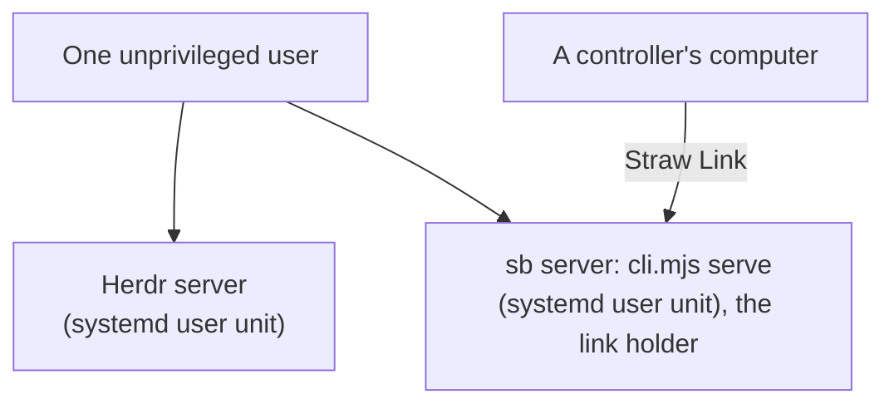

# Setting up an unattended device

English | [繁體中文](unattended-device.zh-TW.md)

An unattended device is a computer nobody sits at (a build box, a server) that other people's computers send work to over Straw Link. Its own infra sets it up: this page is
what that infra has to put where. The design is [the Straw Link spec](specs/2026-10-25-straw-link.md) (Storage and policy, Unattended devices) and
[the sb server spec](specs/2026-10-26-sb-backend.md) (Unattended devices, rebased); what the code does is in [how-it-works](how-it-works.md) (Straw Link).

Two computers take part. The device is set up by its infra (sections 1, 2, 4 and 5). A controller, an attended computer of the team's admin, creates the team and the invite and approves the join (section 3).

There is **no boot pi session**. The sb server (`cli.mjs serve`) is the link holder, so two long-lived processes run under one unprivileged user: the Herdr server and the sb server.

## 1. The two processes: systemd user units



Both run under `env -i`, with only `HOME`, `PATH`, `TERM` and `LANG`, and with Herdr on its **default** socket, so the sb server is the primary one (a named `herdr --session` is
invisible to the net, and an environment inherited from a pi session makes every pane's pi act as a subagent). Enable lingering so the units start at boot without a login:
`loginctl enable-linger <user>`.

<details>
<summary>Details</summary>

`~/.config/systemd/user/herdr.service`:

```ini
[Unit]
Description=Herdr server (default socket)

[Service]
ExecStart=/usr/bin/env -i HOME=%h PATH=%h/.local/bin:/usr/local/bin:/usr/bin:/bin TERM=xterm-256color LANG=C.UTF-8 herdr server
Restart=always

[Install]
WantedBy=default.target
```

`~/.config/systemd/user/straw-boss.service`:

```ini
[Unit]
Description=Straw Boss server (the Straw Link holder)
After=herdr.service
Requires=herdr.service

[Service]
ExecStart=/usr/bin/env -i HOME=%h PATH=%h/.local/bin:/usr/local/bin:/usr/bin:/bin TERM=xterm-256color LANG=C.UTF-8 node <pi-straw-boss>/cli.mjs serve
Restart=always

[Install]
WantedBy=default.target
```

`herdr server`, not `herdr`: the second wants a terminal. Install Herdr's pi integration once (`herdr integration install pi`) so Herdr resumes pi panes from their session files. On macOS the
same two commands run as a launchd daemon with `UserName`, with the same environment.

</details>

## 2. The policy file

`/etc/straw-link/policy.json` (the path is fixed in `src/link/policy.ts`). It decides that the device is unattended, which controllers it obeys and at what level, and which teams it takes
and where their work happens. **Owned by `root:root`, mode `0644`, in a directory owned by `root` at `0755`**: the check refuses unattended mode unless both the file and its directory
belong to another user than the one the server runs as, neither is a symlink, and neither is writable by that user.

<details>
<summary>Details</summary>

```json
{
  "unattended": true,
  "trust": { "<controller device id>": "dispatch" },
  "teams": { "<team id>": { "project": "/srv/work/moldplan-center", "share": "status" } },
  "operate": { "<controller device id>": "team" }
}
```

- A controller set to `true` instead of a level is at `dispatch`. `reply` is the default for anyone not listed.
- `project` is absolute and must pass the same check as `link.teams` (not the home folder, not a pi folder). `share` defaults to `status`.
- `config.json`'s `link` section is **ignored** on an unattended device, relay included: the relay comes from the invite.
- `operate` is optional and lets a controller see and type into the box's Herdr panes from its GUI ([What a controller sees](#7-what-a-controller-sees)). It maps a controller's 26-character device id to `"team"` or `"box"`:
  - `team`: the units of the teams the device is a roster admin of, and nothing else.
  - `box`: the same, plus the box's own units (its tower service, local runs, a session opened at the box, a worker in a tab of its own). That is the box owner's grant.
  - A device in `operate` must also be at `dispatch` in `trust`. One that is not has no operate, and the box logs that once (`policy-operate-idle`).
  - A malformed `operate` (not an object, a key that is no device id, a value other than `team` or `box`) turns operate off for the whole box and is logged once (`policy-operate-refused`); the rest of the policy stays in force.
  - With no `operate` field, or an empty one, nothing is advertised: the box lists no `operate/1` in its capabilities, builds no bridge, watches no policy file and writes no log line for it, and no controller opens a session to it.
  - hq's signed grants cannot carry `operate`; the grants sync copies it from the base policy unchanged.
- A file that says `unattended: true` but fails the check, or whose `teams` is malformed, **refuses** unattended mode: no holder runs, every sender is at `reply`, the team list is empty.
  The reason is written once to `link/link.log` (`policy-refused`) and shown as a log-line notice of the server.

</details>

## 3. The controller's side: the team, the invite, the approval

This is done in the GUI of an attended computer; the approval can also be done in pi. Nothing here touches the device.

<details>
<summary>Details</summary>

1. **Turn Straw Link on.** Settings → Teams shows "Set up Straw Link" while Straw Link is not running on that computer. Press it and wait a few seconds; it also writes `link/enabled`.
2. **Create the team** (once per team; skip it when the team exists). The relay's operator gives you a one-time team token. Open "Create a team", fill the Relay URL, the Team token, "This computer's label", "Share" (your towers' and tabs' states, or only that you are online) and the Project folder, then press "Create team". The token field is a password field, so a password manager's inline menu can take the focus when you click it: close the menu before you paste. The page clears the token once it is used.
3. **Read the two ids the device's policy needs** (section 2). The controller's device id is in the header of the Teams page ("device id …") and in its `<pi agent dir>/straw-boss/link/device.id`. The team's id is 32 hex digits: the page shows only the first six, and the team's file `<pi agent dir>/straw-boss/link/teams/<team id>.json` carries all of it in its name.
4. **Invite the device.** The infra reads the device's id from `link/device.id` on the device (26 characters) and gives it to you. On the team's card press "Invite an unattended device", type the id into the field "26-character device id", and press "Invite". The page shows the invite as a QR code and as text, with the time it lapses in; press "Copy". An invite pinned to a device lapses after just under 24 hours (an ordinary invite after 10 minutes) and works once.
5. **Give the text to the infra**, who drops it in `join.txt` on the device (section 4).
6. **Approve the join.** When the device's holder asks the relay, a card "{label} ({short}), an unattended device, asks to join team {team}" appears under Teams, and the Link bar raises a notice with a "Review" button. There are no four words to match: the device id in your invite stands in. Press "Approve" (or "Refuse"). In pi, `/boss link` lists the waiting requests with a short id and `/boss link decide <id> approve|refuse` decides; pi asks you to confirm an unattended device first, and a paired phone can read the requests but not decide them.
7. **Check.** The device is in the team's roster, with "unattended" in the column Kind. Its trust for your messages is the policy file's, not the roster's: your controller device id has to be in the policy's `trust` at `dispatch` (section 2).

</details>

## 4. Joining: `join.txt`

An unattended device has no screen to paste an invite into. An admin on an attended computer creates an invite pinned to this device's id; the infra drops the text in
`<pi agent dir>/straw-boss/link/join.txt`, **owned by the server's own user, mode `0600`, a regular file** (never a symlink). The device's id is in `link/device.id` (26 characters, a to z
and 2 to 7); it exists from the first look of the server, before any team, so the admin can pin the invite to it.

<details>
<summary>Details</summary>

The holder reads the file at start and on each tick while no join is in flight, asks the relay, waits for an admin's approval, writes the team file (never `config.json`) with project and share from
the policy, and ends with one logged outcome (`joined`, `refused`, `lapsed`, `failed`, `already-member`) after which the file is deleted. An invite for a team the policy does not name, or one that is
not pinned to this device's id, is refused before the relay hears of it. If the relay cannot be reached or answers with a passing failure, the file stays and the device tries again after a wait
(`join-file-retry`, 30 s up to 5 min). A file that cannot be removed (the folder is not writable) is reported once and left alone until it changes. Any failure of the file check deletes the file, so a leaked secret does not stay on disk. A server that restarts in the middle of a join loses the invite: drop a new
one. The invite text is never logged.

</details>

## 5. Pre-trusting the projects: `trust.json`

A project folder's `.pi/settings.json` and extensions ask for trust the first time a pi starts in it, and so does a `.agents/skills` folder in the working directory or any folder above it. Nobody is there to answer. Write the bound projects into pi's own
`<pi agent dir>/trust.json` (`{ "/srv/work/moldplan-center": true }`) when the device is set up. Without it the run fails after ten minutes of an unanswered question, and the controller gets a
`notice` (`trust-unanswered`). `assertSettingsSafe` still applies to every run and refuses a project whose settings link out of it; that refusal is also a `notice` (`run-refused`).

<details>
<summary>Details</summary>

The project is not the only folder a pi starts in:

- **Herdr's worker worktrees.** When a tower opens a worker, Herdr opens a worktree for it at `~/.herdr/worktrees/<repo>/<branch>` (seen on macOS; the Linux path is not confirmed yet, so check it at the first trial with a real worker), outside the project. A repository that carries `.agents/skills` stops every such worker at the trust prompt. pi uses the nearest entry of `trust.json` at or above the working directory, so one entry for the worktrees folder (`"/home/<user>/.herdr/worktrees": true`, written as its real path) covers every worktree, and one entry for the work folder (`"/srv/work": true`) covers every repository under it. Create the worktrees folder first, so that its real path can be written.
- **A changed `HOME`.** pi treats only `$HOME/.agents/skills` (the `HOME` of the pi process) as the user's own. A process that sets another `HOME` and then starts an interactive pi in a folder under the real home (for example `~/.pi/agent/sessions`) no longer has `~/.agents/skills` exempt and gets the trust prompt. Start such a pi with the real `HOME`, or trust that folder.

</details>

## 6. What a refusal looks like

The holder's events are in `<pi agent dir>/straw-boss/link/link.log` (JSON lines) and the forwarder's and the server's in `<pi agent dir>/straw-boss/server.log` (one `event key=value` line each: every `dialog-*` line below, and the `drop` lines of the forwarder's checks of an answer: `dialog-answer-unknown`, `-malformed`, `-invalid`, `-digest`, `-id`, `-late`, `-not-recipient`, `-here-only`, and `dialog-answered` for an answer carried to a session, with its `outcome`; the holder's own, `dialog-answer-level` and `-sender`, are in `link.log`); texts of dialogs and invites are never in them.

<details>
<summary>Details</summary>

| Log event | Meaning |
| --- | --- |
| `policy-refused` | The policy file failed the owner or write check or is malformed; the reason is in the line. No holder runs. |
| `join-file` with `outcome` | How a `join.txt` ended. `refused` carries the reason (symlink, owner, mode, not a regular file, team not in the policy, invite not pinned). |
| `join-file-retry` | The relay failed for a passing reason; the file stays and the next try is `waitMs` away. |
| `join-file-stuck` | The file could not be removed; reported once for that file. |
| `tower-open-failed` | A controller's message found no tower and the server could not open one; the controller got a `notice`. |
| `tower-in` | A `tower` or `tower-reply` message was kept in the inbox: `from` (the sender's device id), `team`, `ask` (the ask id it carries, when it has one), `id` (the message id). |
| `tower-run` | An ally run took that message into its session: `run` (the run id), and the same `from`, `team`, `ask`, `id`. |
| `dialog-forwarder` with `state` | `server.log`, at the start: `started` (the forwarder runs and looks every 15 s) or `skipped` with `primary`, `leaving` and `phase` (a server that is not the default Herdr's runs none). |
| `dialog-controllers` | `server.log`: the controllers the forwarder sees (`count`: attended members at `dispatch` of a running team; `known`: false while a roster cannot be read) and `open`, the questions it holds. One line at the first look and one whenever `count` or `known` changes. `count=0` is why nothing is sent. |
| `dialog-seen` | `server.log`: a question the hub made answerable and the forwarder took up: `dialog` (id), `unit` (its key), `owner` (the label a controller is told, e.g. `main - docs`), `package` (the package that opened it, e.g. `rpiv`). |
| `dialog-sent` | `server.log`: an envelope was handed to the link outbox: `kind` (`dialog-open` or `dialog-close`), `dialog`, `team`, `to` (the controller's device id; one per device, even when the device is in two teams of the box). It is queued, not delivered; the controller's `link.log` has `dialog-in` when it arrived. A question that never gets one of these was not sent. |
| `dialog-ended` | `server.log`: the question left the hub (`by`: who closed it, `remote` for an answer carried) after being sent to `sent` controllers. |
| `dialog-in` | The controller's `link.log`: a `dialog-open` was taken from `from` (a device id) for `dialog`; `fresh` is false for a question it already held (the box sends it again every ten minutes). |
| `dialog-pass-stuck` | `server.log`: a forwarder pass had not finished after `ms` (a minute) and waits at `step` (`read`, `dispatcher`, `notice`, `post`); it was let go and the next look began a pass of its own. |
| `dialog-pass-hung` | `server.log`: a second pass is stuck while the one let go before it has not returned (a call that never returns). It is not let go, to keep one pending pass at most; written once until the first returns. |
| `dialog-close-dropped` | `server.log`: a `dialog-close` that was not posted is given up: `reason` is `failed` (five tries), `stale` (the card had expired at the controller) or `full` (more than 256 held). |
| `dialog-full` | `server.log`: 32 questions are open and a new one is not taken up until one ends. |
| `dialog-unrouted` | `server.log`: a question nobody can be told of (no admin attended at `dispatch` and no dispatcher); it stays open. |
| `dialog-post-failed` / `dialog-forward-failed` | `server.log`: a post, or a whole pass, failed; the reason is in the line. |
| `dialog-oversize` | A question was too big to forward (64 KB); the controller got a `notice`. |
| `notice` | A notice was sent: `key`, `kind` and unit, never its text. |
| `drop` with `reason` | A message failed a check (`dialog-answer-level`, `dialog-answer-digest`, `dialog-answer-here-only`, `dialog-answer-not-recipient`, `unit-status-unexpected`, …). |

</details>

## 7. What a controller sees

**On a box several devs share, a controller sees only its own work and the admins see all of it.** A question a unit asks and a run's notice go to the controller that dispatched the unit (the device whose message started the ally run, or for which the run opened the main) and to the team's admins, not to the other controllers at `dispatch`; a unit nobody dispatched (the tower's own run) is the admins' alone. The box refuses an answer to a question from anyone else (`drop` with `dialog-answer-not-recipient`). The policy file has no field for this.

<details>
<summary>Details</summary>

Its page shows the device's bases like an ally's, with each unit's state, its running monitors, and its last report (the last `tower_done` summary or the last `tower_send` text to that
controller, cut to 4 KB), sent every minute and on a change. Only the units of workspaces inside the team's project are listed, and none when the team shares `presence` only; a device that has sent
nothing for 3 minutes shows its last units marked "no status lately". A `notice` (1 KB) arrives in the Link bar for: an ally or main run that crashed, timed out or was quit; a forwarded dialog
unanswered for 30 minutes (once); a dialog too big to forward; a tower that could not be opened; a run refused by the settings check or by a trust question nobody answered. Clearing a notice
is local to that page.

A controller with an `operate` grant also gets a live view and input.
Its GUI shows the box's workspaces as bases of its own, with the terminal and the whole conversation of each unit, the pad, the composer, queued messages, todos, monitors, Zen waits, and a fold "Earlier runs" with the transcripts of finished runs (kept 30 days, 2,000 at most, in `link/operate-ledger.jsonl`, which holds no content).
It is reachable from the controller's paired phone through the controller's GUI, over the same Link channel and nothing else: the box opens no port for it.
What a session reaches is its scope (the policy section above): a `team` operator sees the units of the team it administers, and a `box` operator also the box's own.
The box refuses, whatever the page asks: `!` shell lines, `/boss` commands, `hereOnly` choices and secret values, opening a main or a bare pane, closing a base, trust, Link and server settings, documents, and any key that pi's own keybindings do not confirm as an editor action.
The head tower is never in an operate session's reach, the `box` grant included.
Typing into a main still drives a pi session at full rights, so an operator can ask the model for anything the box's hooks and sandbox allow; that is no more than `dispatch` gives.
Every attach and every input is a line in `link/link.log` (`operate-open`, `operate-close`, `operate-input` with the action and the pane, `operate-read`, `operate-refused`), never with the text typed or read.
On an unattended box `link/link.log` rotates at 8 MiB and keeps four old copies (`link.log.1`, newest, to `link.log.4`), so an hour of typing does not push a week of audit out; an attended computer keeps 1 MiB and one old copy.
`/boss link operate` on the controller lists its sessions, and `/boss link operate off` ends them and keeps operate off there until `/boss link operate on`.

</details>

## 8. When a controller is removed

Take the controller out of the policy's `trust` (or make it `reply`), or remove it from the team, and the box ends what it started: an ally run claimed at `dispatch` is quit within a few seconds, and each main such a run opened is asked to quit every 15 seconds until it does. A main in the middle of a turn, or with a subagent working, refuses until it is idle; the team's admins get a notice once that it still runs and once that it has ended. A main that was opened with an Allow below `dispatch` is not ended. Nothing is ended while the box cannot read the policy or the team's roster, and a change must be seen twice (up to 30 seconds) before it ends anything. There is no remote stop of one unit yet: a main that never goes idle has to be closed at the box. The credentials of a controller who left badly are a matter for the infra, not for the link.

<details>
<summary>Details</summary>

Operate ends sooner and on one read.
Remove the controller from `operate`, take it below `dispatch`, make the policy unreadable or no longer `unattended`, remove it from the team, or take the admin role from it for a team, and the box closes that session at once (within the next 2-second look at the policy file for a policy edit, and when the roster change arrives for the others): it stops the session's watches and terminals, drops its keys, and writes `operate-close` to `link/link.log`.
A scope that only shrinks (an admin demoted for one team, `box` lowered to `team`) keeps the session with what is left.
The controller's page turns that base into one line ("the operate grant was withdrawn", or "this machine does not let this device operate" for a refusal) and tries again after a minute.
A session never outlives its grant: unlike the two looks the stop of a main waits for, a single bad read of the policy or the roster ends operate, since ending a view loses no work.

</details>
