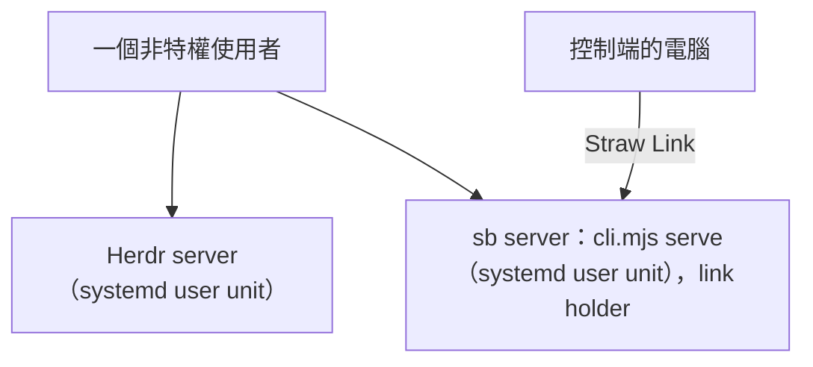

# 設定無人值守裝置

[English](unattended-device.md) | 繁體中文

無人值守裝置（unattended device）是沒有人坐在前面的電腦（建置機、伺服器），其他人的電腦透過 Straw Link 把工作送來給它。它由自己的 infra 負責設定：這一頁寫的是 infra 要把什麼放在哪裡。設計見 [Straw Link 規格](specs/2026-10-25-straw-link.md)（Storage and policy、Unattended devices）和 [sb server 規格](specs/2026-10-26-sb-backend.md)（Unattended devices、rebased）；程式實際怎麼做，見 [運作方式](how-it-works.md)（Straw Link）。以上三份都是英文。

這件事牽涉兩台電腦。裝置由它的 infra 設定（第 1、2、4、5 節）。控制端（controller）是團隊管理員有人值守的電腦，由它建立團隊和邀請，並核准加入（第 3 節）。

**沒有開機時啟動的 pi session。** sb server（`cli.mjs serve`）就是連線持有者（link holder），所以同一個沒有特權的使用者底下會跑兩個長駐程序：Herdr server 和 sb server。

## 1. 兩個程序：systemd user unit



兩個都用 `env -i` 啟動，只帶 `HOME`、`PATH`、`TERM` 和 `LANG`，Herdr 用它的**預設** socket，這樣 sb server 才是主要的那一個（具名的 `herdr --session` 在網裡看不到，而從 pi session 繼承來的環境變數，會讓每個 pane 裡的 pi 都以為自己是子智慧體）。要啟用 lingering，unit 才會在開機時、不用登入就啟動：`loginctl enable-linger <user>`。

<details>
<summary>細節</summary>

`~/.config/systemd/user/herdr.service`：

```ini
[Unit]
Description=Herdr server (default socket)

[Service]
ExecStart=/usr/bin/env -i HOME=%h PATH=%h/.local/bin:/usr/local/bin:/usr/bin:/bin TERM=xterm-256color LANG=C.UTF-8 herdr server
Restart=always

[Install]
WantedBy=default.target
```

`~/.config/systemd/user/straw-boss.service`：

```ini
[Unit]
Description=Straw Boss server (the Straw Link holder)
After=herdr.service
Requires=herdr.service

[Service]
ExecStart=/usr/bin/env -i HOME=%h PATH=%h/.local/bin:/usr/local/bin:/usr/bin:/bin TERM=xterm-256color LANG=C.UTF-8 node <pi-straw-boss>/cli.mjs serve
Restart=always

[Install]
WantedBy=default.target
```

要用 `herdr server`，不是 `herdr`：後者需要終端機。另外要裝一次 Herdr 的 pi 整合（`herdr integration install pi`），Herdr 才能從 session 檔恢復 pi 的 pane。在 macOS 上，同樣的兩個指令改以 launchd daemon 執行，帶 `UserName`，環境變數相同。

</details>

## 2. 政策檔

`/etc/straw-link/policy.json`（路徑固定寫在 `src/link/policy.ts`）。它決定這台裝置是無人值守的，聽哪些控制端的、信任到哪一級，以及接受哪些團隊、團隊的工作在哪裡進行。**擁有者 `root:root`、權限 `0644`，所在目錄也要是 `root` 擁有、`0755`**：檢查會要求檔案和它的目錄都屬於 server 執行身分以外的使用者、都不是 symlink、也都不能被那個使用者寫入，不符合就拒絕無人值守模式。

<details>
<summary>細節</summary>

```json
{
  "unattended": true,
  "trust": { "<controller device id>": "dispatch" },
  "teams": { "<team id>": { "project": "/srv/work/moldplan-center", "share": "status" } },
  "operate": { "<controller device id>": "team" }
}
```

- 控制端的值寫 `true` 而不是等級，就是 `dispatch`。沒列出來的人預設是 `reply`。
- `project` 要是絕對路徑，並通過和 `link.teams` 同一套檢查（不能是家目錄，也不能是 pi 的資料夾）。`share` 預設 `status`。
- 無人值守裝置會**忽略** `config.json` 的 `link` 區段，連中繼站（relay）也是：中繼站來自邀請。
- `operate` 是選填的，讓控制端能從自己的 GUI 看到這台裝置的 Herdr 窗格並在裡面打字（見[控制端看到什麼](#7-控制端看到什麼)）。它把控制端 26 個字元的裝置 id 對應到 `"team"` 或 `"box"`：
  - `team`：只有該裝置身為名冊管理員的那些團隊的單位，其他都看不到。
  - `box`：同上，再加上這台裝置自己的單位（塔台服務、本機的 run、在裝置上直接開的 session、自成一個分頁的 worker）。這是裝置擁有者的授權。
  - 列在 `operate` 的裝置，在 `trust` 裡也必須是 `dispatch`。沒達到的，operate 不會生效，裝置會記一次紀錄（`policy-operate-idle`）。
  - `operate` 格式有誤（不是物件、鍵不是裝置 id、值不是 `team` 或 `box`）時，整台裝置的 operate 都會關掉，並記一次紀錄（`policy-operate-refused`）；policy 的其餘部分照常生效。
  - 沒有 `operate` 欄位、或是空的，就什麼都不對外宣告：裝置的能力（capabilities）不列 `operate/1`，不建立橋接、不監看 policy 檔、也不為它寫任何紀錄，控制端不會對它開 session。
  - hq 簽發的授權不能帶 `operate`；授權同步會把基礎 policy 裡的 `operate` 原樣複製過去。
- 檔案寫了 `unattended: true` 卻沒通過檢查，或 `teams` 格式有誤，就會**拒絕**無人值守模式：不啟動持有者、每個寄件者都是 `reply`、團隊清單是空的。原因只會寫一次到 `link/link.log`（`policy-refused`），並以 server 的一行紀錄通知顯示。

</details>

## 3. 控制端這一邊：團隊、邀請、核准

這一節在有人值守的電腦的 GUI 裡做；核准也可以在 pi 裡做。這裡的任何一步都不會動到裝置。

<details>
<summary>細節</summary>

1. **開啟 Straw Link。** 那台電腦的 Straw Link 還沒在跑時，設定 → 團隊會顯示「設定 Straw Link」。按下去，等幾秒；它也會寫下 `link/enabled`。
2. **建立團隊**（每個團隊做一次；團隊已經有了就跳過）。中繼站的管理者會給你一次性的團隊 token。打開「建立團隊」，填中繼站網址、團隊 token、「這台電腦的名稱」、「分享」（分享你的塔台與分頁狀態，或只分享你在線），以及專案資料夾，再按「建立團隊」。token 欄位是密碼欄位，所以點它的時候，密碼管理員的內嵌選單可能會搶走焦點：貼上之前先把選單關掉。token 用過之後，頁面會把它清掉。
3. **讀出裝置的政策檔需要的兩個 id**（第 2 節）。控制端的裝置 id 在團隊頁的標題列（「裝置 id …」），也在 `<pi agent dir>/straw-boss/link/device.id`。團隊 id 是 32 個十六進位字元：頁面只顯示前六個，完整的 id 是團隊檔 `<pi agent dir>/straw-boss/link/teams/<team id>.json` 的檔名。
4. **邀請裝置。** infra 從裝置上的 `link/device.id` 讀出裝置的 id（26 個字元）交給你。在團隊的卡片上按「邀請無人值守裝置」，把 id 輸入「26 個字元的裝置 id」欄位，再按「邀請」。頁面會把邀請顯示成 QR code 和文字，並寫出它還有多久失效；按「複製」。綁定裝置的邀請在將近 24 小時後失效（一般邀請是 10 分鐘），只能用一次。
5. **把文字交給 infra**，由他放進裝置上的 `join.txt`（第 4 節）。
6. **核准加入。** 裝置的持有者向中繼站提出要求後，團隊頁會出現一張「{名稱}（{短 id}）是無人值守的裝置，要求加入團隊 {團隊}」的卡片，頁首的連線列也會跳出通知，附「查看」按鈕。這裡不用比對四個單字：你的邀請裡的裝置 id 取代了它。按「核准」（或「拒絕」）。在 pi 裡，`/boss link` 會列出等待中的要求和短 id，`/boss link decide <id> approve|refuse` 負責決定；核准無人值守的裝置之前，pi 會先請你確認，而已配對的手機可以看這些要求，不能決定。
7. **檢查。** 裝置出現在團隊的名冊裡，「類型」欄寫「無人值守」。它對你的訊息的信任等級是政策檔寫的，不是名冊寫的：你的控制端裝置 id 要在政策的 `trust` 裡，等級 `dispatch`（第 2 節）。

</details>

## 4. 加入：`join.txt`

無人值守裝置沒有螢幕可以貼邀請。有人值守的電腦上的管理員建立一張綁定這台裝置 id 的邀請，infra 把文字放進 `<pi agent dir>/straw-boss/link/join.txt`，這個檔要**屬於 server 自己的使用者、權限 `0600`、是一般檔案**（不能是 symlink）。裝置的 id 在 `link/device.id`（26 個字元，a 到 z 與 2 到 7）；server 第一次看（first look）時就會產生它，早於任何團隊，所以管理員可以先把邀請綁在這個 id 上。

<details>
<summary>細節</summary>

持有者啟動時會讀這個檔，之後只要沒有正在進行的加入，每個 tick 都讀一次；它向中繼站提出要求，等管理員核准，然後寫入團隊檔（絕不寫 `config.json`），project 和 share 取自政策檔，最後記錄一個結果（`joined`、`refused`、`lapsed`、`failed`、`already-member`），之後檔案就刪除。政策檔沒有列出的團隊的邀請，或沒有綁定這台裝置 id 的邀請，在中繼站聽到之前就會被拒絕。如果連不上中繼站，或中繼站回的是暫時性的失敗，檔案會留著，隔一段時間再試（`join-file-retry`，30 秒起、最長 5 分鐘）。檔案刪不掉（資料夾不可寫）時，只報告一次，然後不再理它，直到檔案改變。檔案檢查只要有一項失敗，就會把檔案刪掉，所以外洩的秘密不會留在磁碟上。server 在加入進行到一半時重啟，邀請就丟了：再放一張新的。邀請的文字不會被記錄。

</details>

## 5. 預先信任專案：`trust.json`

專案資料夾的 `.pi/settings.json` 和 extension，在 pi 第一次在其中啟動時會詢問是否信任，工作目錄或它上面任何一層資料夾裡的 `.agents/skills` 也一樣。這裡沒有人可以回答。裝置設定時，把綁定的專案寫進 pi 自己的 `<pi agent dir>/trust.json`（`{ "/srv/work/moldplan-center": true }`）。沒寫的話，執行會在問題沒人回答十分鐘後失敗，控制端會收到一則 `notice`（`trust-unanswered`）。`assertSettingsSafe` 對每次執行照樣有效，並拒絕設定連到專案資料夾之外的專案；這個拒絕也是一則 `notice`（`run-refused`）。

<details>
<summary>細節</summary>

pi 啟動的資料夾不只有專案：

- **Herdr 的 worker worktree。** 塔台開一個 worker 時，Herdr 會替它開一個 worktree，位置是 `~/.herdr/worktrees/<repo>/<branch>`（在 macOS 上看到的；Linux 上的路徑還沒確認，第一次用真正的 worker 試跑時要檢查），在專案之外。repo 只要帶有 `.agents/skills`，每個這樣的 worker 都會停在信任詢問上。pi 取的是工作目錄本身或它上面最近的一筆 `trust.json` 項目，所以 worktree 資料夾一筆（`"/home/<user>/.herdr/worktrees": true`，寫成它的真實路徑）就涵蓋所有 worktree，工作資料夾一筆（`"/srv/work": true`）就涵蓋底下所有 repo。先建立 worktree 資料夾，才寫得出它的真實路徑。
- **改過的 `HOME`。** pi 只把 `$HOME/.agents/skills`（pi 程序的 `HOME`）當成使用者自己的。一個程序把 `HOME` 改成別的，再在真實家目錄底下的資料夾（例如 `~/.pi/agent/sessions`）啟動互動式 pi，`~/.agents/skills` 就不再被豁免，會跳出信任詢問。這樣的 pi 要用真實的 `HOME` 啟動，或者信任那個資料夾。

</details>

## 6. 被拒絕時看起來像什麼

持有者的事件在 `<pi agent dir>/straw-boss/link/link.log`（JSON lines），轉送器和 server 的在 `<pi agent dir>/straw-boss/server.log`（每行 `event key=value`：下表所有 `dialog-*` 行，以及轉送器檢查回答時的 `drop` 行：`dialog-answer-unknown`、`-malformed`、`-invalid`、`-digest`、`-id`、`-late`、`-not-recipient`、`-here-only`，以及把回答送進 session 時的 `dialog-answered`（帶 `outcome`）；持有者自己檢查的 `dialog-answer-level`、`-sender` 在 `link.log`）；對話框和邀請的文字從不出現在其中。

<details>
<summary>細節</summary>

| 紀錄事件 | 意義 |
| --- | --- |
| `policy-refused` | 政策檔沒通過擁有者或寫入檢查，或格式有誤；原因寫在那一行。沒有持有者在跑。 |
| `join-file` 帶 `outcome` | `join.txt` 怎麼結束的。`refused` 會附原因（symlink、擁有者、權限、不是一般檔案、團隊不在政策裡、邀請沒有綁定）。 |
| `join-file-retry` | 中繼站暫時失敗；檔案留著，下一次嘗試在 `waitMs` 之後。 |
| `join-file-stuck` | 檔案刪不掉；同一個檔只報告一次。 |
| `tower-open-failed` | 控制端的訊息找不到塔台，server 也開不了；控制端收到一則 `notice`。 |
| `tower-in` | 一則 `tower` 或 `tower-reply` 訊息進了收件匣：`from`（寄件裝置 id）、`team`、`ask`（訊息帶的 ask id，沒有就不寫）、`id`（訊息 id）。 |
| `tower-run` | 某個 ally run 把那則訊息收進它的 session：`run`（run id），加上同樣的 `from`、`team`、`ask`、`id`。 |
| `dialog-forwarder` 帶 `state` | `server.log`，啟動時：`started`（轉送器在跑，每 15 秒看一次）或 `skipped`，附 `primary`、`leaving`、`phase`（不是預設 Herdr 的 server 不跑轉送器）。 |
| `dialog-controllers` | `server.log`：轉送器看得到的控制端（`count`：在跑的團隊裡、在 `dispatch`、有人值守的成員數；`known`：讀不到某個名冊時為 false）和 `open`，它手上的問題數。第一次看時寫一行，之後 `count` 或 `known` 變了才寫。`count=0` 就是什麼都沒送出去的原因。 |
| `dialog-seen` | `server.log`：hub 讓它可以回答、轉送器接手的問題：`dialog`（id）、`unit`（單位的 key）、`owner`（告訴控制端的標籤，例如 `main - docs`）、`package`（開這個對話框的套件，例如 `rpiv`）。 |
| `dialog-sent` | `server.log`：一個信封交給了連結的寄件匣：`kind`（`dialog-open` 或 `dialog-close`）、`dialog`、`team`、`to`（控制端的裝置 id；一個裝置一份，即使它在這台裝置的兩個團隊裡）。這是排進佇列，不是送達；送達了，控制端的 `link.log` 會有 `dialog-in`。沒有這一行的問題就是沒送出去。 |
| `dialog-ended` | `server.log`：問題離開了 hub（`by`：誰結束的，回答被帶走是 `remote`），之前送給了 `sent` 個控制端。 |
| `dialog-in` | 控制端的 `link.log`：從 `from`（裝置 id）收到 `dialog` 的 `dialog-open`；`fresh` 為 false 表示早就有這個問題（裝置每十分鐘會再送一次）。 |
| `dialog-pass-stuck` | `server.log`：轉送器的一輪跑了 `ms`（一分鐘）還沒結束，卡在 `step`（`read`、`dispatcher`、`notice`、`post`）；那一輪被放掉，下一次查看另開新的一輪。 |
| `dialog-pass-hung` | `server.log`：前一個被放掉的一輪還沒回來，下一輪又卡住了（有個呼叫永遠不回來）。這一輪不會再被放掉，好讓懸著的一輪最多一個；同一段期間只寫一次。 |
| `dialog-close-dropped` | `server.log`：一則沒送出的 `dialog-close` 被放棄：`reason` 是 `failed`（試了五次）、`stale`（控制端的卡片早已過期）或 `full`（留著的超過 256 則）。 |
| `dialog-full` | `server.log`：已經有 32 個問題開著，新的要等有一個結束才會接手。 |
| `dialog-unrouted` | `server.log`：沒有人能被告知的問題（沒有有人值守、在 `dispatch` 的管理員，也沒有派出者）；它維持開著。 |
| `dialog-post-failed` / `dialog-forward-failed` | `server.log`：一次送出，或整輪失敗；原因在那一行。 |
| `dialog-oversize` | 問題太大無法轉送（64 KB）；控制端收到一則 `notice`。 |
| `notice` | 送出了一則通知：`key`、`kind` 和單位，絕不含內容。 |
| `drop` 帶 `reason` | 訊息沒通過某項檢查（`dialog-answer-level`、`dialog-answer-digest`、`dialog-answer-here-only`、`unit-status-unexpected`……）。 |

</details>

## 7. 控制端看到什麼

**好幾個開發者共用一台裝置時，控制端只看得到自己的工作，管理員看得到全部。** 單位提出的問題、執行的通知，只會送給派出該單位的控制端（發訊息讓隊友 run 啟動的那台裝置，或執行為它開出主智慧體的那台裝置）和團隊的管理員，不會送給其他在 `dispatch` 的控制端；沒有人派出的單位（塔台自己的執行）只送給管理員。別人對該問題送來的回答，裝置會拒絕（`drop` 帶 `dialog-answer-not-recipient`）。policy 檔沒有為此增加欄位。

<details>
<summary>細節</summary>

控制端的頁面像顯示隊友（ally）一樣顯示這台裝置的基地，附上每個單位的狀態、正在跑的監看（monitor），以及它最後一次的報告（最後一次 `tower_done` 摘要，或最後一次 `tower_send` 給該控制端的文字，截成 4 KB），每分鐘送一次，有變化時也送。只列出位在團隊專案之內的工作區的單位，團隊只分享 `presence` 時一個都不列；裝置超過 3 分鐘沒送東西，就把它最後的單位標成「no status lately」。連結列會收到 `notice`（1 KB），情況有：隊友或主智慧體的執行當掉、逾時或被結束；轉送出去的對話框 30 分鐘沒人回答（只通知一次）；對話框太大無法轉送；塔台開不起來；執行被設定檢查拒絕，或信任詢問沒人回答。清掉通知只影響那一個頁面。

有 `operate` 授權的控制端還能即時查看並輸入。它的 GUI 會把這台裝置的工作區顯示成自己的基地，每個單位都有終端機和完整對話、按鍵面板、輸入框、排隊中的訊息、待辦、監看、Zen 裡的等待事項，以及一個摺疊區「Earlier runs」，裡面是已結束的 run 的逐字稿（保存 30 天、最多 2,000 筆，記在 `link/operate-ledger.jsonl`，檔案裡不含內容）。控制端用配對的手機也能透過控制端的 GUI 連上；走的是同一條 Link 通道，沒有別的路，裝置不會為它開任何 port。一個 session 能碰到的範圍就是它的 scope（見上面的政策檔一節）：`team` 的操作者看得到自己擔任管理員的那些團隊的單位，`box` 的操作者再加上裝置自己的單位。不論頁面怎麼要求，裝置都會拒絕：`!` 開頭的 shell 行、`/boss` 指令、`hereOnly` 的選項與機密值、開啟主智慧體或單獨的窗格、關閉基地、信任、Link 與 server 設定、文件，以及任何 pi 自己的快捷鍵設定不認得是編輯器動作的按鍵。主塔台（head tower）對任何 operate session 都不在範圍內，連 `box` 授權也一樣。在主智慧體裡打字，等於以完整權限驅動一個 pi session，所以操作者能請模型做裝置的 hooks 與沙箱允許的任何事；這不比 `dispatch` 多。每一次連線與每一次輸入都是 `link/link.log` 的一行（`operate-open`、`operate-close`、`operate-input`，含動作與窗格、`operate-read`、`operate-refused`），絕不含打了或讀了什麼內容。無人值守裝置的 `link/link.log` 在 8 MiB 時輪替並保留四份舊檔（`link.log.1` 最新，到 `link.log.4`），所以打一小時的字不會把一週的稽核紀錄擠掉；有人值守的電腦維持 1 MiB、一份舊檔。控制端上的 `/boss link operate` 會列出它的 session，`/boss link operate off` 會結束它們，並讓那裡的 operate 保持關閉，直到 `/boss link operate on`。

</details>

## 8. 移除控制端時

把控制端從 policy 的 `trust` 拿掉（或改成 `reply`），或把它從團隊移除，裝置就會結束它啟動過的東西：以 `dispatch` 領用的 ally run 幾秒內被要求結束，這類 run 開出來的每個主智慧體，每 15 秒被要求結束一次，直到它結束。主智慧體正在進行一輪、或有子智慧體在做事時會拒絕，等到閒下來為止；團隊的管理員會收到一則通知，說它還在跑（一次），以及它已經結束（一次）。以低於 `dispatch` 的等級、靠 Allow 開出來的主智慧體不會被結束。裝置讀不到 policy 或團隊名冊時，什麼都不會結束，而且變動要連續看到兩次（最長 30 秒）才會動手。目前還沒有遠端停掉單一單位的功能：一個永遠不閒下來的主智慧體，得在裝置上關掉。離開得不愉快的控制端留下的憑證，是 infra 的事，不是連結（link）的事。

<details>
<summary>細節</summary>

Operate 結束得更快，而且只要讀一次。把控制端從 `operate` 拿掉、降到 `dispatch` 以下、讓 policy 讀不到或不再是 `unattended`、把它從團隊移除，或拿掉它在某個團隊的管理員身分，裝置就會立刻關閉那個 session（policy 檔被改時，在下一次 2 秒一次的檢查內；其他情況在名冊變動送達時）：停掉該 session 的監看與終端機、丟掉它的按鍵，並把 `operate-close` 寫進 `link/link.log`。範圍只縮小的情況（某個團隊的管理員被降級、`box` 被降成 `team`）會留下剩下的範圍，session 繼續。控制端的頁面會把那個基地變成一行字（「操作權限已撤銷」，被拒絕時是「這台機器不讓這部裝置操作」），並在一分鐘後再試。Session 絕不會比它的授權活得久：不像停掉主智慧體要看兩次，只要有一次讀 policy 或名冊失敗，operate 就結束，因為結束一個檢視不會讓任何工作遺失。

</details>
