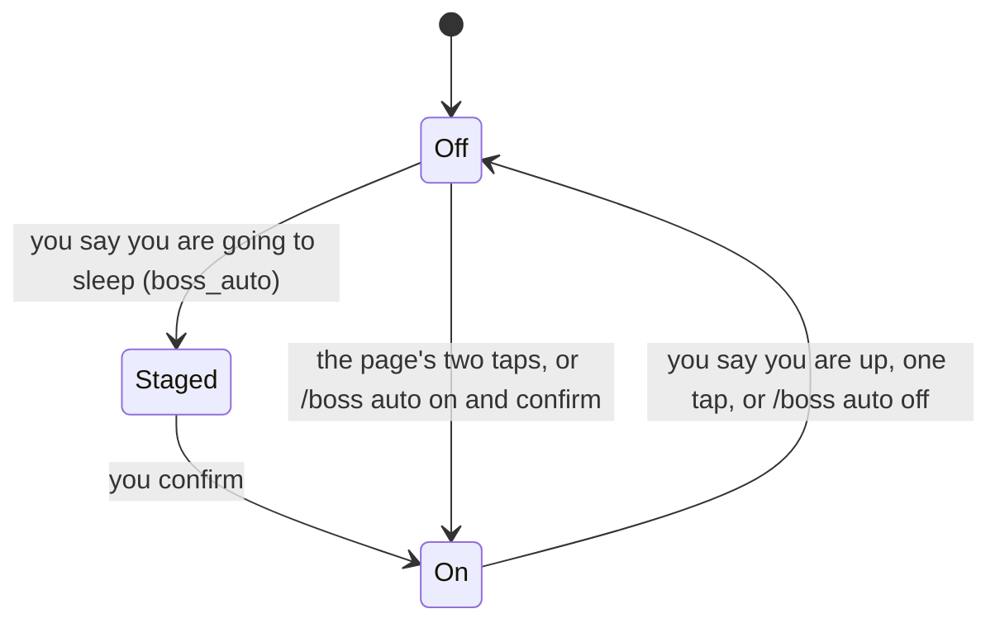

Auto mode is for when you are away, asleep or out.
While it is on, nothing may wait for you: agents keep working, and what needed you is parked until you are back.
It covers this computer; Straw Link teammates are not told.

## Turning it on and off

- **Tell the head tower.** Say you are going to sleep (「我要睡了」), and the head tower stages a request with `boss_auto`. Confirm it with the button on the head page or Zen's strip, or with `/boss auto confirm`. Say you are up again (「我起床了」) and it ends. The server reads your words itself and refuses a question, a negation, and words used before.
- **The page's switch.** The chip under the header says `Auto mode` while off and `Auto · since 23:10` while on. Starting takes two taps: the first shows what will happen, the second starts. Ending takes one tap.
- **In pi.** `/boss auto on` asks you to confirm in the terminal, `/boss auto off` ends it, and a bare `/boss auto` shows the state.

## What happens while it is on

- **Waits are refused.** In every session, a new `ask_user_question`, `question`, `robot_hand`, `secret_drop`, `link_request`, or browser login is refused with a note that says you are away, and a confirm opened inside a tool call is answered as Escape. Your own `/boss` commands still confirm.
- **Open waits are cancelled.** The ones open when it turns on are cancelled, and the agent is told why.
- **Towers park what needs you.** A wait card a tower records for you is parked: it raises no notification, sound, or Zen cue. The session that raised it is told once.
- **Agents keep working.** `call_tower`, monitors, loops, and subagents are not refused.

## When you are back

When auto mode ends, the parked waits become open waits again, and one list says what happened:

- **On the page**, a return panel opens on the next load: the parked waits first, as cards you can press, then what was cancelled or refused, what a tower decided on its own, and what still waits.
- **In pi**, `/boss auto off` prints the same list. Act on a parked wait with `/boss memory done|choose|decline W<n>`.

The rules are in [Auto mode](/pi-straw-boss/docs/reference/how-it-works/how-it-works/#auto-mode).
