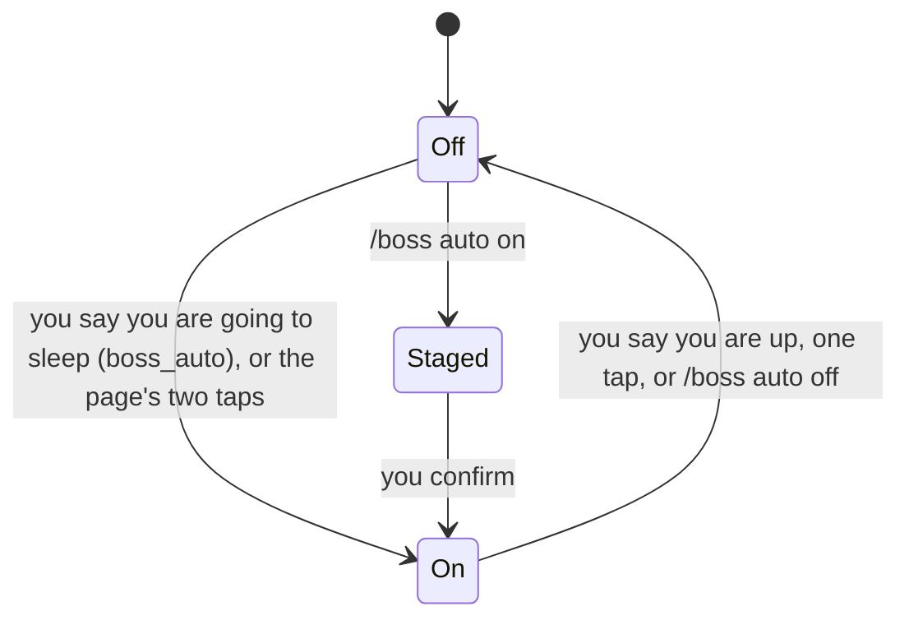

Auto mode is for when you are away, asleep or out.
While it is on, nothing may wait for you: agents keep working, and what needed you is parked until you are back.
It covers this computer; Straw Link teammates are not told.

## Turning it on and off

- **Tell the head tower.** Say you are going to sleep (「我要睡了」), and the head tower turns auto mode on with `boss_auto`, at once. Say you are up again (「我起床了」) and it ends. The server reads your words itself and refuses a question, a negation, and words used before.
- **The page's switch.** The chip under the header says `Auto mode` while off and `Auto · since 23:10` while on. Starting takes two taps: the first shows what will happen, the second starts. Ending takes one tap.
- **In pi.** `/boss auto on` asks you to confirm in the terminal, `/boss auto off` ends it, and a bare `/boss auto` shows the state.

## What happens while it is on

- **Waits are refused.** In every session, a new `ask_user_question`, `question`, `robot_hand`, `secret_drop`, `link_request`, or browser login is refused with a note that says you are away, and a confirm opened inside a tool call is answered as Escape. Your own `/boss` commands still confirm.
- **Open waits are cancelled.** The ones open when it turns on are cancelled, and the agent is told why.
- **Towers park what needs you.** A wait card a tower records for you is parked: it raises no notification, sound, or Zen cue. The session that raised it is told once that it comes back when you do.
- **Agents keep working.** `call_tower`, monitors, loops, and subagents are not refused.

## The head tower keeps watch

While auto mode is on, the sb server reads every workspace every 15 minutes and wakes the head tower when a reading holds something new. A calm reading wakes nobody and costs no head tower run; it is only counted. Nothing polls: the timer is the server's, it stops when auto mode ends, and it goes on after a server restart.

- **What the notice says.** The waits that were refused or parked, the mains that are idle with open work, a tower that takes no events, a train or a forward that has not moved for 30 minutes, a session the stall watch flagged, and the output since the last wake. Each finding is told once a night, and a main seen idle once is left alone until the next reading.
- **Output, not activity.** Output is what the server can see: board lines written and cars landed. A workspace that shows none for 2 hours is flagged once, even when its panes say working, unless its mains are all done. The server sees no commit and no push.
- **What the head tower does.** It has no new tool. It tells the owning tower to nudge a main that stays idle. For a parked question your standing instructions or decisions in its memory cover, it sends the owning tower the wait and your instruction's words, and the tower decides from its own memory or records it for the morning. It never decides past what you told it.
- **The head tower is opened for you.** Switching auto mode on opens the head tower when none is open. One that closes later in the night is not opened again: the morning list says from when no head tower was open.
- **Told means taken to the end.** A notice counts only once a head tower run took it and ended well. A run the server quit (you closed the head tower during it) or a notice purged from the queue does not count: its findings are told again in the next notice and named in the morning. While a notice waits, every later reading is skipped behind it, so a head tower that hangs on it never makes the night look calm.
- **A crashing head tower is left alone.** A notice parked after two head tower runs crashed with it no longer holds the watch back: the next notice tells its findings again. After two parked in a row the watch sends no more, so a head tower that crashes on every notice is not started all night; it resumes once you open the head tower again.
- **Nothing is left for the next night.** When auto mode ends, the watch's notices are dropped, even when the head tower is closed. One a head tower run is working on may be finished, but it is never handed to another run.
- **A box you operate is not watched** by your head tower: it keeps its own.

## When you are back

When auto mode ends, the towers do not relay the parked waits to you. Each parked card is closed and goes back to whoever raised it: a main gets it back as a message and asks you again itself, with its own question; a tower's own card goes back to that tower, which records it again if it still needs you. A card whose raiser has gone is closed with nothing left for you. One list says what happened:

- **On the page**, a return panel opens on the next load: where each parked card went first, then what was cancelled or refused, what a tower decided on its own, and what still waits.
- **In pi**, `/boss auto off` prints the same list. A card that was not parked still waits for you as usual: `/boss wait`, or `/boss memory done|choose|decline W<n>`.
- **The watch's part.** The list ends with how many readings the server took, how many were calm, how often the head tower was woken, the messages it sent on its own, and the workspaces that showed no output for 2 hours or more. Then every finding of the night is in one place: still open at the last reading (told, and still there: a held tower, a stuck train, an unanswered forward), carried only by notices parked after crashes, in a last notice a head tower run still holds, or told to nobody (no head tower run took it; one gone by the last reading is marked so). A finding that was told and is gone is left out. `/boss auto off` prints it; the page's return panel does not show it yet.

The rules are in [Auto mode](/pi-straw-boss/docs/reference/how-it-works/how-it-works/#auto-mode).
