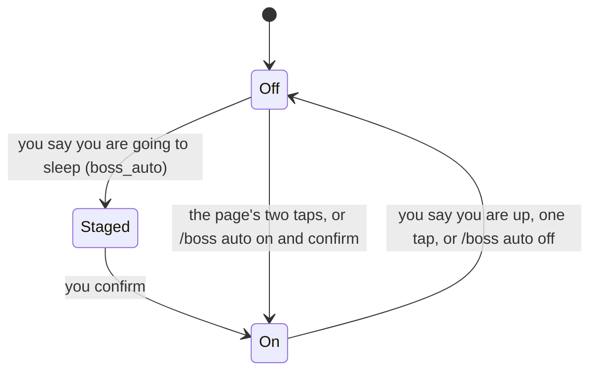

Auto mode is for when you are away, asleep or out.
While it is on, nothing may wait for you: agents keep working, and what needed you is parked until you are back.
It covers this computer; Straw Link teammates are not told.

## Turning it on and off

- **Tell the head tower.** Say you are going to sleep (「我要睡了」), and the head tower stages a request with `boss_auto`. Confirm it with the button on the head page or Zen's strip, or with `/boss auto confirm`. Say you are up again (「我起床了」) and it ends. The server reads your words itself and refuses a question, a negation, and words used before.
- **The page's switch.** The chip under the header says `Auto mode` while off and `Auto · since 23:10` while on. Starting takes two taps: the first shows what will happen, the second starts. Ending takes one tap.
- **In pi.** `/boss auto on` asks you to confirm in the terminal, `/boss auto off` ends it, and a bare `/boss auto` shows the state.

## What happens while it is on

- **Waits are refused.** In every session, a new `ask_user_question`, `question`, `robot_hand`, `secret_drop`, `link_request`, or browser login is refused with a note that says you are away, and a confirm opened inside a tool call is answered as Escape. Your own `/boss` commands still confirm.
- **Open waits are cancelled.** The ones open when it turns on are cancelled, and the agent is told why.
- **Towers park what needs you.** A wait card a tower records for you is parked: it raises no notification, sound, or Zen cue. The session that raised it is told once.
- **Agents keep working.** `call_tower`, monitors, loops, and subagents are not refused.

## The head tower keeps watch

While auto mode is on, the sb server reads every workspace every 15 minutes and wakes the head tower when a reading holds something new. A calm reading wakes nobody and costs no head tower run; it is only counted. Nothing polls: the timer is the server's, it stops when auto mode ends, and it goes on after a server restart.

- **What the notice says.** The waits that were refused or parked, the mains that are idle with open work, a tower that takes no events, a train or a forward that has not moved for 30 minutes, a session the stall watch flagged, and the output since the last wake. Each finding is told once a night, and a main seen idle once is left alone until the next reading.
- **Output, not activity.** Output is what the server can see: board lines written and cars landed. A workspace that shows none for 2 hours is flagged once, even when its panes say working, unless its mains are all done. The server sees no commit and no push.
- **What the head tower does.** It has no new tool. It tells the owning tower to nudge a main that stays idle. For a parked question your standing instructions or decisions in its memory cover, it sends the owning tower the wait and your instruction's words, and the tower decides from its own memory or records it for the morning. It never decides past what you told it.
- **The head tower is opened for you.** Switching auto mode on opens the head tower when none is open. One that closes later in the night is not opened again: the morning list says from when no head tower was open.
- **Told means taken.** A notice counts only once a head tower run took it and ended. While it waits, every later reading is skipped behind it, so a head tower that hangs or crashes on it never makes the night look calm.
- **A box you operate is not watched** by your head tower: it keeps its own.

## When you are back

When auto mode ends, the parked waits become open waits again, and one list says what happened:

- **On the page**, a return panel opens on the next load: the parked waits first, as cards you can press, then what was cancelled or refused, what a tower decided on its own, and what still waits.
- **In pi**, `/boss auto off` prints the same list. Act on a parked wait with `/boss memory done|choose|decline W<n>`.
- **The watch's part.** The list ends with how many readings the server took, how many were calm, how often the head tower was woken, the messages it sent on its own, and the workspaces that showed no output for 2 hours or more. Then come the findings still open at the last reading (a held tower, a stuck train, an unanswered forward), and, when the head tower never took the last notice, that notice's findings, which nobody was told. `/boss auto off` prints it; the page's return panel does not show it yet.

The rules are in [Auto mode](/pi-straw-boss/docs/reference/how-it-works/how-it-works/#auto-mode).
