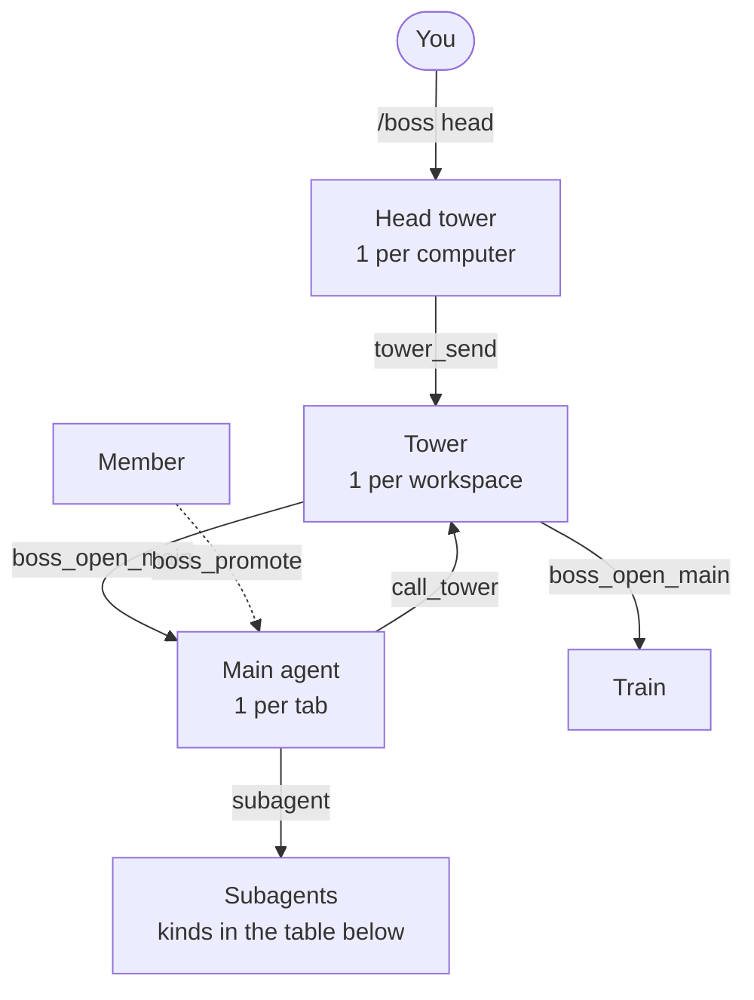
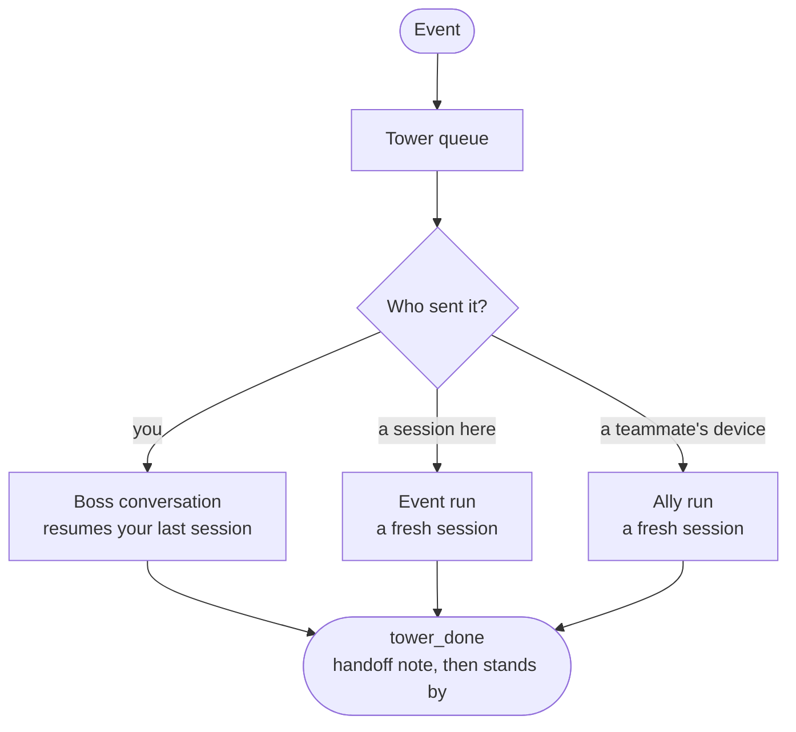

pi-straw-boss gives the agents you run across Herdr tabs a light chain of command.
Joining is automatic; the chain of command is earned.

## Who is who

| Role | Who | What it does |
| --- | --- | --- |
| **Member** | Every pi in a Herdr tab, from its start | Works on its own. With a main in the tab, it tells the main before it dispatches subagents. |
| **Main agent** | One per tab: the member that promotes first, or you with `/boss` | Plans, dispatches workers, checks their results, and asks you before it merges or deploys. |
| **Tower** | One per workspace, in its own tab pinned first | Coordinates the mains of its workspace and the other towers, and opens a tab with a new main for work no session owns. It never asks you. |
| **Head tower** | One per computer, belonging to no project | Takes your instructions and hands each to the tower of the workspace that owns it. See [The head tower](/pi-straw-boss/docs/guide/head-tower/). |
| **Train** | One per merge train, named `train <MMDDx>`, opened by the tower | Merges a batch of reviewed branches and ends. See [Merge train](/pi-straw-boss/docs/guide/merge-train/). |
| **Subagent** | Launched with [pi-herdr-agents](https://github.com/giuseppecrj/pi-herdr-agents), or a session in a Herdr worktree workspace | Never joins the net. The session that launched it speaks for it, and every view lists it under that session. |

The `/boss` commands and tools that move between these roles are in [Commands](/pi-straw-boss/docs/reference/commands/).

### Promotion

- An agent whose work grows (several steps, dispatching workers, more than one app) calls `boss_promote`.
- A member that dispatches a subagent is promoted first, automatically.
- A tab has one main. Nobody takes it over except you, with `/boss`.
- A main never demotes. When its session ends, the tab has no main until a member promotes.

### When the tower opens

A tower opens in its own tab when agents start to collide:

- a member dispatches a subagent, or an agent promotes itself;
- a workspace has two members while another workspace already has a tower;
- you type `/boss tower`.

Mains and the tower go together: a tower that opens promotes each tab's earliest member, and a tower that quits turns every main back into a member (their subagents stay).

## Kinds

A main and a subagent each have a **kind**, shown as a word beside the name and as the unit's icon in the [browser view](/pi-straw-boss/docs/guide/browser-view/) and the Herdr sidebar.

### Kinds of main

A main sets its kind with `boss_duty`.

| Kind | For | Icon |
| --- | --- | --- |
| `coordinator` (default) | Plans and dispatches work | Ship's wheel |
| `integrator` | One project's [merge trains](/pi-straw-boss/docs/guide/merge-train/) | Two arrows joining |
| `standing` | One system or machine, with no end | Lighthouse |
| *train* (a role, not a `boss_duty` kind) | One merge train | Locomotive |

The GUI shows `standing` as **on watch** (zh-TW 值守); this page keeps the code's word.

### Kinds of subagent

Straw Boss reads the kind from the name of the pi-herdr-agents role the subagent was launched with.
The roles come from pi-herdr-agents and its role packs; what a role does is in its own definition.

| Kind | Role names | Typical job | Icon |
| --- | --- | --- | --- |
| `worker` | `worker` | Implements a task | Wrench |
| `scout` | `scout` | Investigates and reports | Binoculars |
| `planner` | `planner` | Plans and designs | Pencil and ruler |
| `reviewer` | `reviewer`, `visual-tester`, `adversarial-reviewer` | Reviews a change or checks a screen | Magnifier |
| `watchdog` | `watchdog` | Watches something over time and reports | Hound |

Any other role name stays a plain subagent.

A coordinator may dispatch scouts, planners, and reviewers at once.
Any other dispatch (a worker, a watchdog, an unlisted role) is refused with `sb: plan first` until its todos name a plan graph: `single-loop`, `fan-out/fan-in`, or `orchestrator-worker`.

## How a tower runs

A tower is a service of the [sb server](#the-sb-server), not a long-lived pi.
Its pane stands by, and the server wakes it for each event with a **run**: a pi session that does the work and ends with a **handoff note** for the next run.

| Run | Wakes for | Notes |
| --- | --- | --- |
| **Event run** | A main's `call_tower`, or a notice | Starts fresh; the handoff note carries over what matters. |
| **Boss conversation** | Your message: `/boss tower <prompt>` or the GUI's composer | Resumes your last session with that tower. |
| **Ally run** | A teammate's [Straw Link](/pi-straw-boss/docs/guide/straw-link/) message | Works at the sender's trust level; the GUI shows it as an *ally run*. |

What has to outlive a run sits in the tower's memory: your standing instructions, your decisions, and its open waits on you.
A tower can only propose a standing instruction or a decision; it takes effect when you confirm it.
See [Tower memory](/pi-straw-boss/docs/reference/how-it-works/the-sb-server/#tower-memory).

## Talking

`call_tower` is a main's only message to its tower, at three points:

| `why` | When | Example |
| --- | --- | --- |
| `milestone` | Something landed | A branch merged |
| `shared` | Before it changes something outside its tab | A port, a database, a shared branch, a deploy target |
| `blocked` | It waits on someone outside its tab | A decision, a deploy window |

- **`tower_list` and `tower_send`**: a tower lists every workspace's tower and writes to one or all of them. A workspace without a tower is reached through its mains, else its members.
- **`boss_broadcast`**: a message to a tab, a workspace, every tower, or every session.
- Every such message opens with a header the code writes: who sent it, in what role, to whom, and whether a reply is expected. See [Talking between towers](/pi-straw-boss/docs/reference/how-it-works/how-it-works/#talking-between-towers).

## What a tower knows

- **The work board.** A main's entry fills itself from its todo list and its name; `board_set` overrides it. A tower reads every main's entry with `board_read`, here and on teammates' computers. Teammates see only an automatic entry's name and progress. See [The work board](/pi-straw-boss/docs/reference/how-it-works/how-it-works/#the-work-board).
- **The digest.** Joins, subagent launches, and renames in its workspace since its last run, read once and cleared.
- **Its memory.** See above.
- **The dashboard.** A live view in the tower's tab of who joined and what they and their subagents are doing.

A main a tower opened for a request reports to the sender and the tower when it is done, and the tower closes it with `boss_close_main` once nothing runs in it.

## The sb server

One background process per computer, the sb server, runs the towers, serves the browser view, and holds the Straw Link connection, so none of them depends on which pi session happens to run.
Any pi session starts it when it is down.
`/boss server` shows it, and `boss_server` lets an agent read its log or restart it with a reason.
See [The sb server](/pi-straw-boss/docs/reference/how-it-works/the-sb-server/).

## Housekeeping

Straw Boss also keeps tabs tidy, asks stranded subagents to report, resumes subagents a Herdr restart brought back as plain pi sessions ([Orphaned subagents](/pi-straw-boss/docs/reference/how-it-works/orphaned-subagents/)), and stops stray processes ([Process hygiene](/pi-straw-boss/docs/guide/process-hygiene/)).

The full rules are in [Roles and the tower](/pi-straw-boss/docs/reference/how-it-works/how-it-works/).
