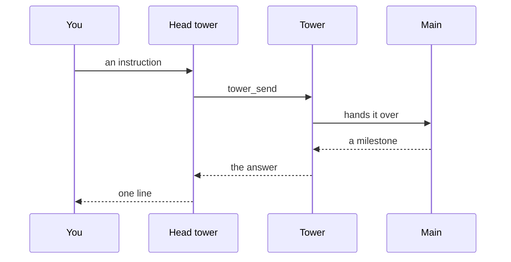

The **head tower** is the one tower that belongs to no project.
You talk to it in one long conversation, and it decides which workspace owns each instruction and hands it to that workspace's tower, opening the tower if there is none.
It does no work itself, and it tells you in a line when a tower answers.

 

## Where you talk to it

- **Its page** in the Standard view: the conversation, the forwards it made as one card per broadcast, and the composer.
- **The strip under Zen's breathing circle.** Zen starts at rest, with the input as a hairline. Click the input, press Enter, or press **H**, and the head's last lines come up, fading as they age; **H** again or a swipe up shows the whole conversation. A question it has for you waits as a card until you press Enter.
- **`/boss head <message>`** in any pi session. A bare `/boss head` makes its workspace and focuses its tab.
- **Its own pane** in Herdr, where Enter talks to the same conversation.

 

## What it may do

Its tools are the tower's lookup and forwarding tools and nothing else: it reads the work board and the tower list, writes to towers with `tower_send`, keeps its memory, and can see the sb server.
It has no shell, makes no edits, and opens no mains itself.
It listens only to you and to answers to its own forwards; a broadcast or a main's message wakes nothing.
It can start or end [auto mode](/pi-straw-boss/docs/guide/auto-mode/) on your own words.

The conversation continues across runs.
A long one starts a new chapter that carries the last handoff note; **New conversation** or `/boss head new` starts one by hand.
Its model is `headModel` in the [configuration](/pi-straw-boss/docs/reference/configuration/), else `towerModel`.

See [The head tower](/pi-straw-boss/docs/reference/how-it-works/how-it-works/#the-head-tower) for the rules.
