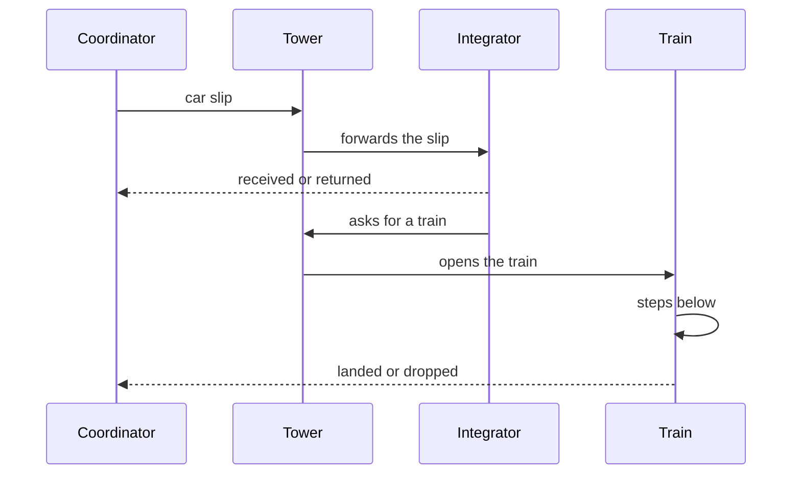
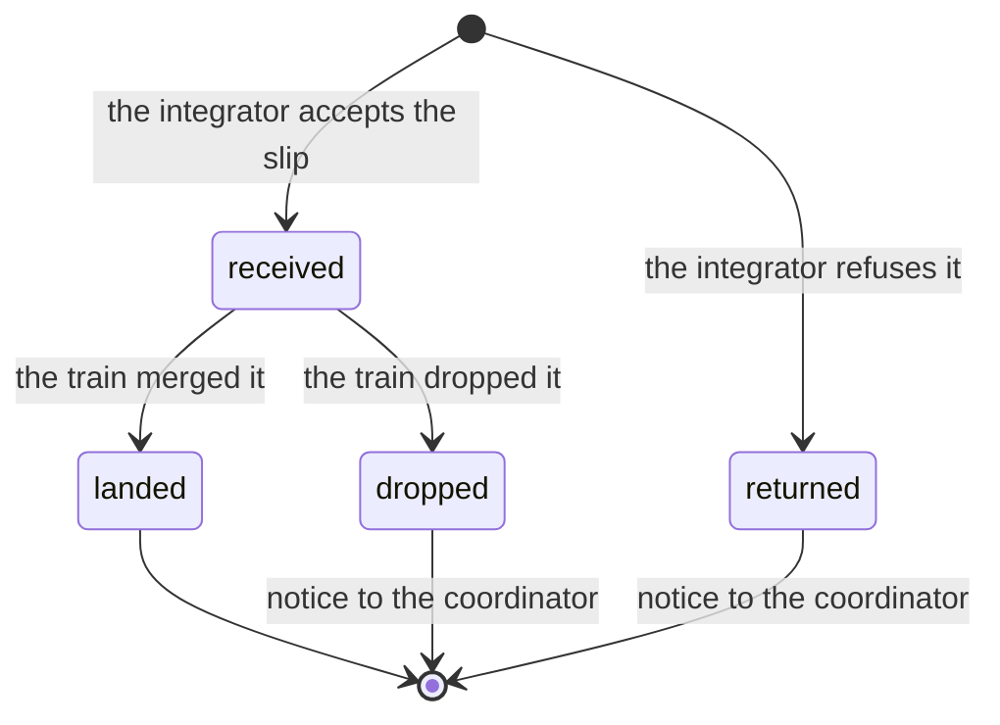

A project can give each app a merge train.
Instead of each coordinator merging its own branch, one **integrator** main takes the coordinators' branches as **cars** and forms **trains**.
Each train merges its cars together, has the combined result reviewed once, and runs the heavy gates (lint, build, full suites) once.
Where the app lists the stage, the train goes on to deploy.

It is opt-in, per app, in the project's `apps.json`.
An app without the `integration` field keeps the old flow.

## Who does what

| Who | What |
| --- | --- |
| **Coordinator** (a main) | Reviews its own branch (no P0 or P1 findings), runs the behaviour tests for its change and the project skill's light checks, runs the acceptance the app requires (with your nod), then sends a **car slip** with `call_tower` `why: shared`. |
| **Tower** | Forwards the slip to the project's one integrator, opening it when none runs, and opens each train when the integrator asks. |
| **Integrator** (`integ <project>`) | Receives or returns each car, forms trains, and asks the tower to open them. It does not supervise a train. |
| **Train** (`train 1106m`) | A session of its own for one train, doing the steps below. It never waits on a person. |



A train does these steps, then ends:

1. Assembles the cars on the latest base in a worktree.
2. Has a fresh reviewer read the assembly.
3. Runs the full gates.
4. Merges, and watches the pipelines.
5. Where its stages say so, deploys and verifies.
6. On a failure, rolls back or reports.

A car has four states, and the sb server sends the coordinator a notice for each:



Integrators:

- A project has one integrator on the whole computer. Its project is `integration.project` at the top of `apps.json`, else the repository's folder name; set it when your integrator already runs under another name.
- Integrators you already run under names of their own (such as `integ FE2` and `integ v3`) stay: the tower opens none beside them and forwards each slip to the one that runs that app's trains.
- On a shared box, a main opened for a teammate's device sends its car slip the same way.

## What you set

- **`apps.json`**: a top-level `integration` (`skill`, `maxCars` 4, `maxWaitMin` 60, `maxTrains` 3) and a per-app `integration` (`base`, `skill`, `stages`, `accept`, `targets`). [`prompts/apps-config.md`](https://github.com/wayne930242/pi-straw-boss/blob/main/prompts/apps-config.md) describes every field.
- **Stages.** `merge` always, then optionally `deploy`. An `auto` target takes every train on the config's standing word; a `strict` target (the default) takes a train only where every car's slip carries your authorization for it.
- **The project skill.** Every concrete check lives there, under the headings the `integrating` skill names in its Project skill contract: `## Light checks`, `## Train assembly`, `## Full gates`, `## Merge`, `## Post-merge`, and, as needed, `## Deploy`, `## Deploy verify`, and `## Acceptance`. Straw Boss sets the flow and names no environment.

## The merge-train contract

The train's procedure is not in Straw Boss.
It is two skills, `integrating` (merge) and `deploying` (deploy), and Straw Boss binds the places they leave open.
Straw Boss asks for no particular package: the two skills pi loaded must each declare the **merge-train contract**, version 1, in their frontmatter.

```yaml
metadata:
  merge-train-contract: "1"
```

Version 1 is what Straw Boss's prompts assume of the two skills:

- They are named `integrating` and `deploying`, and the stages are `merge`, then optionally `deploy`.
- They read one `## Seam bindings` block from the session's instructions, with the seams Handoff route, Batch owner, Approval, Record, Escalation route, Settings, and Step runner.
- They find the project's checks under the Project skill headings above (also `## Urgent lane` and `## Load`), exactly as written.
- A car's coordinator runs its acceptance before handoff, as `## Acceptance` says; no stage of the train waits on a person.
- A car arrives as a `car:` slip that carries `auth`, `accept`, `deploy`, `departs`, and `coordinator`.
- The settings are `base`, `skill`, `stages`, `accept`, `targets` (`auto` or `strict`), `maxCars`, and `maxWaitMin`.

The version is a whole number, and it rises only when a host written for the version before would go wrong.
A skill that still serves the older hosts lists both: `merge-train-contract: "1 2"`.

Straw Boss checks the declaration itself, because a model cannot tell a stale procedure from a current one by reading it.
Until both skills declare the contract, a train's and the integrator's `todo` and `MonitorCreate` calls that change something are refused with the reason, and nothing departs.

[pi-anchorloop](https://www.npmjs.com/package/pi-anchorloop) is one implementation, and the one Straw Boss is developed with.
Its skills implement version 1 since 2.11.0; the 2.15 releases and those before them carry no declaration yet.
For those, Straw Boss accepts pi-anchorloop 2.11.0 or newer without the declaration; that exception goes once a release that declares the contract is the oldest in use.

## Turning it off on a computer

Set `STRAW_BOSS_INTEGRATION=off` in the environment of `herdr server` and its sessions, or `"integration": "off"` in the [configuration](/pi-straw-boss/docs/reference/configuration/).
No main or tower then takes the integrator role, a merge or a deploy waits for your word, and `integration` in `apps.json` is ignored.

## Commands

`node dist/server/cli.mjs train status` lists every train, its steps, waits, locks, and cars.
`train check` validates a slip and its acceptance evidence before it is sent, and `train clear` releases what a train whose session is gone still holds.

The rules are in [Merge train](/pi-straw-boss/docs/reference/how-it-works/how-it-works/#merge-train).
