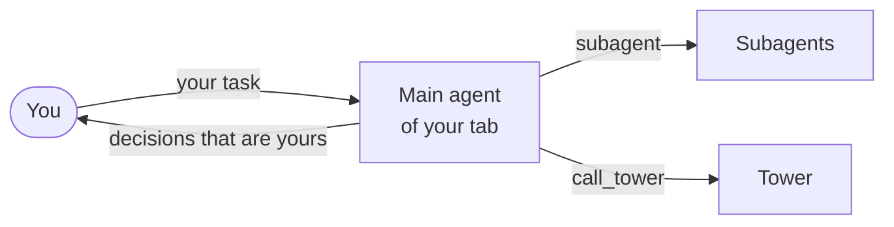

## How you work with it

**You talk to the main agent of the tab you work in, and to nobody else.**
The main agent is your entry point: it plans the work, dispatches subagents, checks their results, talks to the tower for you, and comes back to you only for the decisions that are yours, such as a merge or a deploy.

- **One task, one tab.** For a new piece of work, open a new Herdr tab, start pi there, and give it the task as you would give any pi. When the work grows (several steps, dispatching subagents, or more than one app), that pi becomes the tab's main agent by itself. Type `/boss` in it to make it the main at once.
- **You do not need to talk to the tower.** The tower coordinates the mains of a workspace and never asks you anything; `/boss tower <prompt>` is there for the rare time you want to tell it something. When a main is stuck on a decision only you can make, it reaches you as a question in that main's tab or as a wait card in the [browser view](/pi-straw-boss/docs/guide/browser-view/).
- **Leave subagents and members alone.** The main that launched a subagent speaks for it and reports its result to you. Writing to a subagent directly bypasses the main that checks its work.
- **Answer from where you are.** Questions that agents wait on show in their own tab, in `/boss gui`, and in `/boss answer`. Answer each in one place; the others clear.

The [head tower](/pi-straw-boss/docs/guide/head-tower/) is the one other entry point, and it is optional: one long conversation that hands each instruction to the workspace that owns it, for when you work across several projects at once or go to sleep ([Auto mode](/pi-straw-boss/docs/guide/auto-mode/)).
What each icon on the screen stands for is in [Icons](/pi-straw-boss/docs/guide/icons/).

## See the net in four steps

1. **Open pi in a Herdr tab and give it work.** It joins the net by itself. When its work grows, it promotes itself to the tab's main agent, which also opens the workspace's tower. Type `/boss` to make it the tab's main yourself.
2. **Type `/boss status`** to see each tab's main agent and the towers.
3. **Type `/boss tower`** to open the workspace's tower and watch its dashboard. It also opens by itself when agents start to collide. You do not need to talk to it.
4. **Type `/boss gui`** from any session to see the whole net in your browser.

## The tower runs on its own

The tower service of the sb server is on by default: it wakes for events and keeps a small memory, so you do not have to talk to it.
`/boss tower <prompt>` writes to it, `/boss memory` shows its memory, and `towerModel` in the [configuration](/pi-straw-boss/docs/reference/configuration/) gives it a lighter model.
How a run works, and what a handoff note is, is in [How a tower runs](/pi-straw-boss/docs/guide/concepts/#how-a-tower-runs).

## Next

- [Concepts](/pi-straw-boss/docs/guide/concepts/): who is a member, a main, a tower, and the head tower, and every kind of agent and run.
- [Icons](/pi-straw-boss/docs/guide/icons/): which icon and sidebar mark stands for which role and kind.
- [The browser view](/pi-straw-boss/docs/guide/browser-view/): the map, comms, alerts, and the Zen view.
- [Commands](/pi-straw-boss/docs/reference/commands/): every tool and `/boss` command.
