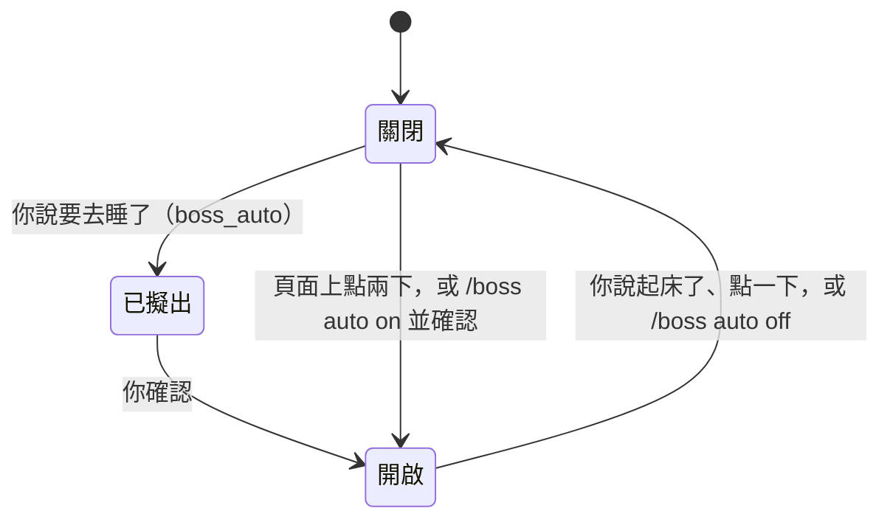

自動模式是給你不在的時候用的，不論是睡覺或外出。
開著的時候，沒有任何東西可以等你：智慧體繼續工作，需要你的事先擱置，等你回來。
它涵蓋這台電腦；Straw Link 的隊友不會被通知。

## 開啟與結束

- **告訴主塔台。** 說你要去睡了（「我要睡了」），主塔台就會用 `boss_auto` 擬出一個請求。用主塔台頁面或禪橫條上的按鈕確認，或用 `/boss auto confirm`。說你起床了（「我起床了」）就會結束。server 自己讀你的話，會拒絕問句、否定句與先前說過的話。
- **頁面上的開關。** 標題下方的 chip 在關閉時顯示「自動模式」，開啟時顯示「自動模式 · 23:10 起」。開始需要點兩下：第一下顯示將發生什麼，第二下才開始。結束只要點一下。
- **在 pi 裡。** `/boss auto on` 會請你在終端機確認，`/boss auto off` 結束，單獨的 `/boss auto` 顯示狀態。

## 開著的時候會發生什麼

- **等待會被拒絕。** 在每個 session 裡，新的 `ask_user_question`、`question`、`robot_hand`、`secret_drop`、`link_request` 或瀏覽器登入都會被拒絕，並附上說你不在的說明；工具呼叫內開出的 confirm 會被當成按下 Escape。你自己輸入的 `/boss` 指令仍然會確認。
- **已開著的等待會被取消。** 開啟時已開著的那些會被取消，並告訴智慧體原因。
- **塔台擱置需要你的事。** 塔台為你記下的等待卡片會被擱置：不會觸發通知、音效或禪的提示。提出它的 session 會被告知一次。
- **智慧體繼續工作。** `call_tower`、monitor、loop 與子智慧體都不會被拒絕。

## 你回來的時候

自動模式結束時，被擱置的等待會重新變成開著的等待，並由一份清單說明發生了什麼：

- **在頁面上**，下次載入時會開啟一個回來面板：先是被擱置的等待，以可以按的卡片呈現，接著是被取消或被拒絕的、塔台自己決定的，以及仍在等的。
- **在 pi 裡**，`/boss auto off` 會印出同一份清單。用 `/boss memory done|choose|decline W<n>` 處理被擱置的等待。

規則見[自動模式](/pi-straw-boss/docs/zh-tw/reference/how-it-works/how-it-works/#自動模式)。
