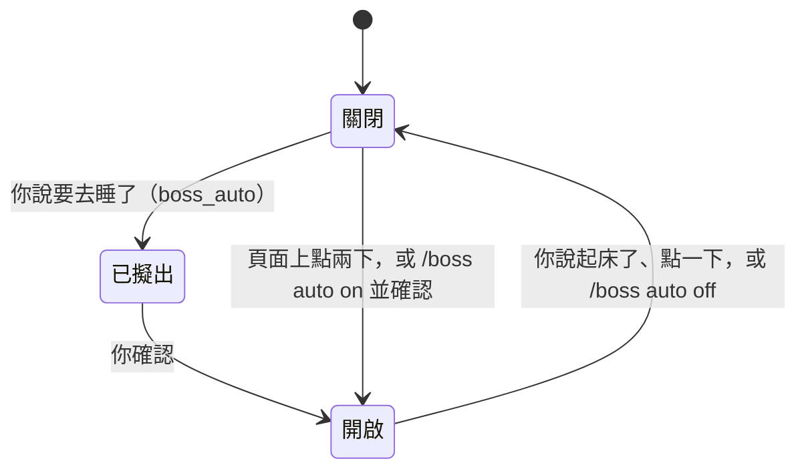

自動模式是給你不在的時候用的，不論是睡覺或外出。
開著的時候，沒有任何東西可以等你：智慧體繼續工作，需要你的事先擱置，等你回來。
它涵蓋這台電腦；Straw Link 的隊友不會被通知。

## 開啟與結束

- **告訴主塔台。** 說你要去睡了（「我要睡了」），主塔台就會用 `boss_auto` 擬出一個請求。用主塔台頁面或禪橫條上的按鈕確認，或用 `/boss auto confirm`。說你起床了（「我起床了」）就會結束。server 自己讀你的話，會拒絕問句、否定句與先前說過的話。
- **頁面上的開關。** 標題下方的 chip 在關閉時顯示「自動模式」，開啟時顯示「自動模式 · 23:10 起」。開始需要點兩下：第一下顯示將發生什麼，第二下才開始。結束只要點一下。
- **在 pi 裡。** `/boss auto on` 會請你在終端機確認，`/boss auto off` 結束，單獨的 `/boss auto` 顯示狀態。

## 開著的時候會發生什麼

- **等待會被拒絕。** 在每個 session 裡，新的 `ask_user_question`、`question`、`robot_hand`、`secret_drop`、`link_request` 或瀏覽器登入都會被拒絕，並附上說你不在的說明；工具呼叫內開出的 confirm 會被當成按下 Escape。你自己輸入的 `/boss` 指令仍然會確認。
- **已開著的等待會被取消。** 開啟時已開著的那些會被取消，並告訴智慧體原因。
- **塔台擱置需要你的事。** 塔台為你記下的等待卡片會被擱置：不會觸發通知、音效或禪的提示。提出它的 session 會被告知一次。
- **智慧體繼續工作。** `call_tower`、monitor、loop 與子智慧體都不會被拒絕。

## 主塔台負責守夜

自動模式開著的時候，sb server 每 15 分鐘讀一次每個工作區的狀況，讀到有新的事才叫醒主塔台。平靜的讀取不叫醒任何人，也不花主塔台一輪，只會被計數。沒有任何東西在輪詢：計時器是 server 自己的，自動模式結束就停，server 重新啟動後也會接著算。

- **通知說些什麼。** 被拒絕或被擱置的等待、閒置而還有待辦工作的主智慧體、不收事件的塔台、30 分鐘沒有動靜的火車或轉交訊息、被停滯監看標出的 session，以及上一次叫醒以來的產出。每個發現一晚只說一次；只被看到閒置一次的主智慧體，要等到下一次讀取才算。
- **看的是產出，不是有沒有在動。** 產出是 server 看得到的部分：寫進看板的行，以及落地的車廂。一個工作區 2 小時沒有產出就會被標出來一次，就算它的 pane 顯示工作中也一樣，除非它的主智慧體都做完了。server 看不到 commit 和 push。
- **主塔台會做什麼。** 它沒有新增工具。它請負責的塔台去催持續閒置的主智慧體。被擱置的問題若有它記憶裡你的長期指示或決定涵蓋，它把那個等待和你指示的原文送給負責的塔台，由塔台依自己的記憶決定，或記下來等早上。它絕不超出你交代的範圍做決定。
- **主塔台會替你開好。** 開啟自動模式時若沒有開著的主塔台，會開一個。夜裡之後才關掉的主塔台不會再開：早上的清單會說從什麼時候起沒有主塔台。
- **取走才算說過。** 一則通知要等主塔台的某一輪取走它並結束後才算數。它還在等的時候，之後的每次讀取都排在它後面略過，所以主塔台卡住時，這一夜不會看起來很平靜。在主塔台兩輪帶著它當掉後被擱置的通知，不再擋住監看：下一則通知會再說一次它的發現。
- **你操作的 box 不歸你的主塔台守夜**：它保留自己的監看。

## 你回來的時候

自動模式結束時，被擱置的等待會重新變成開著的等待，並由一份清單說明發生了什麼：

- **在頁面上**，下次載入時會開啟一個回來面板：先是被擱置的等待，以可以按的卡片呈現，接著是被取消或被拒絕的、塔台自己決定的，以及仍在等的。
- **在 pi 裡**，`/boss auto off` 會印出同一份清單。用 `/boss memory done|choose|decline W<n>` 處理被擱置的等待。
- **守夜的部分。** 清單最後會列出 server 讀了幾次、其中幾次平靜、主塔台被叫醒幾次、它自己送出的訊息，以及 2 小時以上沒有產出的工作區。接著是最後一次讀取時仍未解決的發現（暫停的塔台、卡住的火車、沒有回應的轉交訊息），接著是當掉後被擱置的通知；主塔台始終沒有取走最後一則通知時，還會列出那則通知裡沒有人被告知的發現。最後一則通知若還被主塔台進行中的一輪拿著，會寫明它正被那一輪拿著。`/boss auto off` 會印出來；頁面上的回來面板目前還不顯示這一段。

規則見[自動模式](/pi-straw-boss/docs/zh-tw/reference/how-it-works/how-it-works/#自動模式)。
