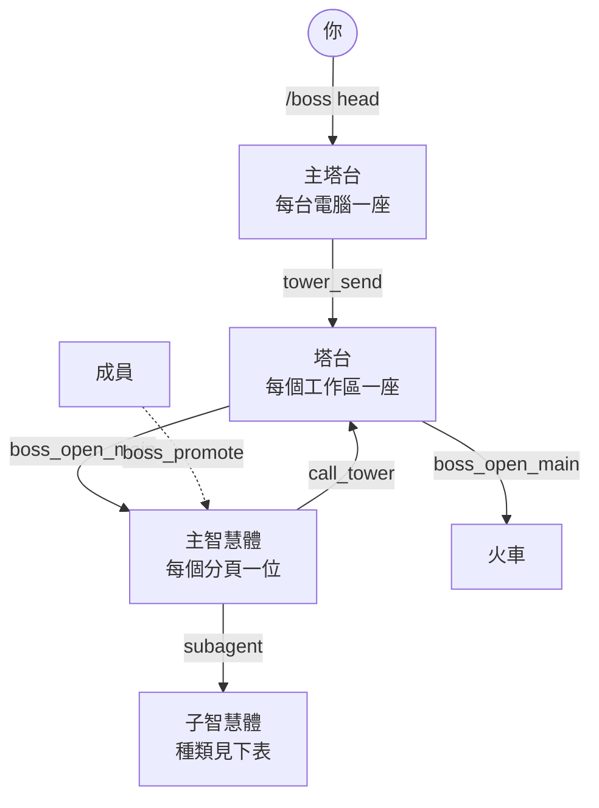
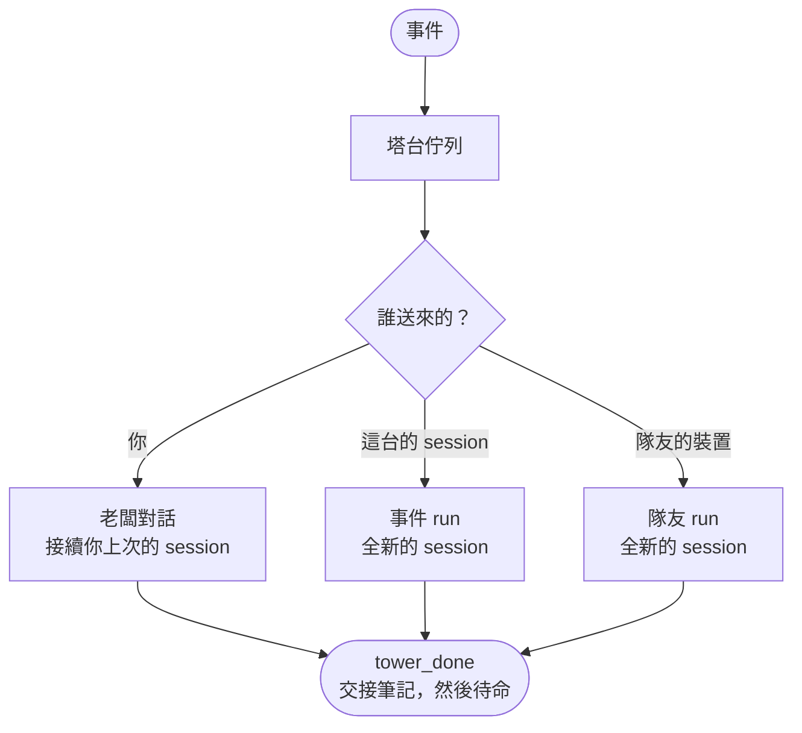

pi-straw-boss 為你跨 Herdr 分頁執行的智慧體，建立一套輕量的指揮鏈。
加入是自動的；指揮鏈要靠掙得。

## 誰是誰

| 角色 | 是誰 | 做什麼 |
| --- | --- | --- |
| **成員** | Herdr 分頁裡的每個 pi，從啟動起就是 | 自己工作。分頁裡有主智慧體時，派出子智慧體之前要先告訴主智慧體。 |
| **主智慧體** | 每個分頁一個：最先升任的成員，或用 `/boss` 接手的你 | 規劃、派出工作者、檢查他們的結果，並在合併或部署之前問你。 |
| **塔台** | 每個工作區一座，在自己的分頁裡並釘在最前面 | 協調自己工作區的各個主智慧體與其他塔台，並為沒有 session 負責的工作開一個帶新主智慧體的分頁。它從不問你。 |
| **主塔台** | 每台電腦一座，不屬於任何專案 | 接收你的指示，並把每項指示交給負責的工作區的塔台。見[主塔台](/pi-straw-boss/docs/zh-tw/guide/head-tower/)。 |
| **火車** | 每列合併火車一個，名為 `train <MMDDx>`，由塔台開出 | 合併一批審查過的分支，然後結束。見[合併火車](/pi-straw-boss/docs/zh-tw/guide/merge-train/)。 |
| **子智慧體** | 用 [pi-herdr-agents](https://github.com/giuseppecrj/pi-herdr-agents) 啟動的，或 Herdr worktree 工作區裡的 session | 不會加入網。由啟動它的 session 代為發言，每個檢視都把它列在那個 session 底下。 |

在這些角色之間切換的 `/boss` 指令與工具，見[指令](/pi-straw-boss/docs/zh-tw/reference/commands/)。

### 升任

- 工作變多的智慧體（好幾個步驟、派出工作者、涉及不只一個 app）會呼叫 `boss_promote`。
- 派出子智慧體的成員會先被自動升任。
- 一個分頁只有一位主智慧體，除了你用 `/boss` 之外，沒有人能接手它。
- 主智慧體永不降級；它的 session 結束後，該分頁就沒有主智慧體，直到有成員升任。

### 塔台何時開

智慧體開始互相衝突時，塔台會在自己的分頁裡開啟：

- 有成員派出子智慧體，或有智慧體自己升任；
- 某個工作區有兩位成員，而另一個工作區已有塔台；
- 你輸入 `/boss tower`。

主智慧體與塔台同進退：塔台開啟時，會升任每個分頁最早的成員；塔台結束時，會把每位主智慧體退回成員（它們的子智慧體留著）。

## 種類

主智慧體與子智慧體各有一個**種類**，在[瀏覽器檢視](/pi-straw-boss/docs/zh-tw/guide/browser-view/)與 Herdr 側邊欄裡，顯示為名稱旁的字詞與單位的圖示。

### 主智慧體的種類

主智慧體用 `boss_duty` 設定自己的種類。

| 種類 | 用途 | 圖示 |
| --- | --- | --- |
| `coordinator`（預設，GUI 稱協調者） | 規劃並派工 | 舵輪 |
| `integrator`（整合員） | 一個專案的[合併火車](/pi-straw-boss/docs/zh-tw/guide/merge-train/) | 兩支箭頭匯合 |
| `standing`（值守） | 負責某個系統或機器，沒有終點 | 燈塔 |
| *火車*（是角色，不是 `boss_duty` 的種類） | 一列合併火車 | 火車頭 |

GUI 把 `standing` 顯示為「值守」（英文是 on watch）；本頁其餘處沿用程式碼裡的字。

### 子智慧體的種類

Straw Boss 從子智慧體啟動時用的 pi-herdr-agents 角色名稱，讀出它的種類。
角色來自 pi-herdr-agents 與它的角色包；角色做什麼，看它自己的定義。

| 種類 | 角色名稱 | 典型工作 | 圖示 |
| --- | --- | --- | --- |
| `worker`（工作者） | `worker` | 實作一項任務 | 扳手 |
| `scout`（偵察） | `scout` | 調查並回報 | 望遠鏡 |
| `planner`（規劃） | `planner` | 規劃與設計 | 鉛筆加尺 |
| `reviewer`（審查） | `reviewer`、`visual-tester`、`adversarial-reviewer` | 審查變更，或檢查畫面 | 放大鏡 |
| `watchdog`（監控者） | `watchdog` | 長時間盯著某件事並回報 | 獵犬 |

其他角色名稱仍是一般的子智慧體。

協調者可以隨時派出偵察、規劃、審查與監控者。
其他任何派出（工作者、未列出的角色）在它的 todo 寫出計畫圖之前，都會被 `sb: plan first` 拒絕；計畫圖是 `single-loop`、`fan-out/fan-in` 或 `orchestrator-worker`。

### 用監控者盯著一件事

`watchdog`（監控者）替派出它的 session 監看網裡的一個單位：帶著 monitor 和 todo 的主智慧體、一列火車，或另一個子智慧體。
它只能讀取和回報。回報只送給派出它的 session，別人收不到，訊息上標著 `kind=watch_report`。

派出它的方式和其他子智慧體一樣，任務裡要寫：

- 監看哪個單位，用它的 session id 或它在網裡的鍵；
- 多久沒有動靜算停滯（`quietMs`，至少一分鐘），在意停滯時才需要；
- 時限，寫成絕對時間（`deadline`）；監看火車的 gate 時，再加上負載上限（`loadMax`）。

它會回報停滯、負載超過上限，以及單位或 monitor 變成等待、錯誤或過期。
單位的工作結束、時限已過，或派出它的 session 不在了，它就結束。
值守的主智慧體可以派出監控者，省去在自己的輪次裡反覆查看。

監控者需要 0.80.0 以上的 sb server；較舊的 server 在主智慧體 `/reload` 時升級。
它跑哪個模型由每台機器各自設定，寫在 pi-herdr-agents 的設定裡（`models.agents.watchdog`）。判定由 server 計算，小模型就夠用。
規則見[監控者](/pi-straw-boss/docs/zh-tw/reference/how-it-works/the-role-pack/#監控者)。

## 塔台怎麼運作

塔台是 [sb server](#sb-server) 的一項服務，不是一個長期活著的 pi。
它的 pane 平時待命，server 每有事件就喚醒它跑一次 **run**：一個 pi session 做完事，再留下一份給下一次 run 的**交接筆記**。

| run | 為誰喚醒 | 說明 |
| --- | --- | --- |
| **事件 run** | 主智慧體的 `call_tower`，或一則通知 | 從新的 session 開始；交接筆記帶過重要的事。 |
| **老闆對話** | 你的訊息：`/boss tower <prompt>` 或 GUI 的輸入框 | 接續你上次與該塔台的 session。 |
| **隊友 run** | 隊友的 [Straw Link](/pi-straw-boss/docs/zh-tw/guide/straw-link/) 訊息 | 以發送者的信任等級工作；GUI 顯示為「隊友 run」。 |

必須比一次 run 活得久的東西，放在塔台的記憶裡：你的長期指示、你的決定，以及它記下對你的等待事項。
塔台只能提議長期指示或決定，要等你確認才生效。
見[塔台記憶](/pi-straw-boss/docs/zh-tw/reference/how-it-works/the-sb-server/#塔台記憶)。

## 溝通

主智慧體只用 `call_tower` 向它的塔台發訊息，而且只在三種時機：

| `why` | 時機 | 例子 |
| --- | --- | --- |
| `milestone` | 有東西落地 | 一個分支合併了 |
| `shared` | 在它更動分頁之外的東西之前 | port、資料庫、共用分支、部署目標 |
| `blocked` | 它在等分頁之外的某人 | 一項決定、一個部署時段 |

- **`tower_list` 與 `tower_send`**：塔台列出每個工作區的塔台，並寫給其中一座或全部。沒有塔台的工作區，改由它的主智慧體接收，再不然由它的成員。
- **`boss_broadcast`**：發給一個分頁、一個工作區、所有塔台或所有 session 的訊息。
- 每則這類訊息，開頭都有一段由程式寫的標頭：誰發的、什麼角色、發給誰，以及是否期待回覆。見[塔台之間的對話](/pi-straw-boss/docs/zh-tw/reference/how-it-works/how-it-works/#塔台之間的對話)。

## 塔台知道什麼

- **工作看板。** 主智慧體的項目會依它的 todo 清單與名稱自動填入；`board_set` 可以覆寫。塔台用 `board_read` 讀每位主智慧體的項目，不論在這台電腦或隊友的電腦上。隊友只看得到自動項目的名稱與進度。見[工作看板](/pi-straw-boss/docs/zh-tw/reference/how-it-works/how-it-works/#工作看板)。
- **摘要。** 自上一次 run 以來，它的工作區裡的加入、子智慧體啟動與改名；讀進來一次後就清掉。
- **它的記憶。** 見上文。
- **儀表板。** 塔台分頁裡的即時畫面，顯示誰加入了，以及他們與他們的子智慧體正在做什麼。

塔台為某個請求開出的主智慧體，完成時會回報給發送者與塔台，等它裡面沒有東西在跑，塔台就用 `boss_close_main` 把它關掉。

## sb server

每台電腦一個背景程序，也就是 sb server，負責執行塔台、提供瀏覽器檢視，並持有 Straw Link 連線，所以它們都不依賴哪個 pi session 剛好在跑。
任何 pi session 在它沒在跑時都會把它啟動。
`/boss server` 會顯示它，`boss_server` 讓智慧體讀它的 log，或附上理由把它重新啟動。
見 [sb server](/pi-straw-boss/docs/zh-tw/reference/how-it-works/the-sb-server/)。

## 整理工作

Straw Boss 還會讓分頁保持整齊、請被留下的子智慧體回報、接續 Herdr 重啟後變成一般 pi session 的子智慧體（[孤立的子智慧體](/pi-straw-boss/docs/zh-tw/reference/how-it-works/orphaned-subagents/)），並停掉失控的程序（[程序衛生](/pi-straw-boss/docs/zh-tw/guide/process-hygiene/)）。

完整規則見[角色與塔台](/pi-straw-boss/docs/zh-tw/reference/how-it-works/how-it-works/)。
