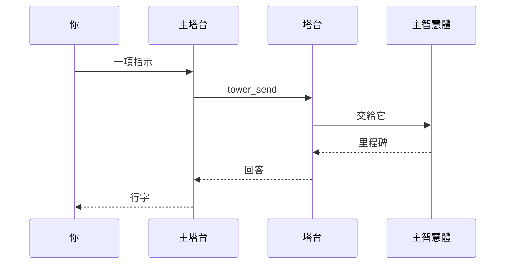

**主塔台**是唯一不屬於任何專案的塔台。
你在一段長長的對話裡跟它說話，它判斷每項指示由哪個工作區負責，交給那個工作區的塔台，沒有塔台就先開一座。
它自己不做事；塔台回答時，它會用一行告訴你。

 

## 在哪裡跟它說話

- **它的頁面**，在標準檢視裡：對話、它做的轉送（每次廣播一張卡片），以及輸入框。
- **禪檢視呼吸圓圈下方的橫條。** 禪檢視一開始是靜止的，輸入框只是一條細線。點一下輸入框、按 Enter 或按 **H**，主塔台最後幾行就會浮上來，隨時間淡去；再按一次 **H** 或往上滑，顯示整段對話。它對你的提問會以卡片等著，直到你按 Enter。
- **任何 pi session 裡的 `/boss head <message>`。** 單獨的 `/boss head` 會建立它的工作區並聚焦它的分頁。
- **它在 Herdr 裡自己的 pane**，在那裡按 Enter 就是在同一段對話裡說話。

 

## 它能做什麼

它的工具只有塔台的查詢與轉送工具，沒有別的：它讀工作看板與塔台清單，用 `tower_send` 寫給塔台，保存自己的記憶，並能看到 sb server。
它沒有 shell、不做任何編輯，也不自己開主智慧體。
它只聽你的話，以及對它自己轉送的回答；廣播或主智慧體的訊息不會喚醒它。
它可以依你自己的話開始或結束[自動模式](/pi-straw-boss/docs/zh-tw/guide/auto-mode/)。

對話會跨多次 run 延續。
太長的對話會開一個新章節，帶著上一份交接筆記；**開新對話**或 `/boss head new` 可以手動開新的一章。
它的模型是[設定](/pi-straw-boss/docs/zh-tw/reference/configuration/)裡的 `headModel`，沒有就用 `towerModel`。

規則見[主塔台](/pi-straw-boss/docs/zh-tw/reference/how-it-works/how-it-works/#主塔台)。
