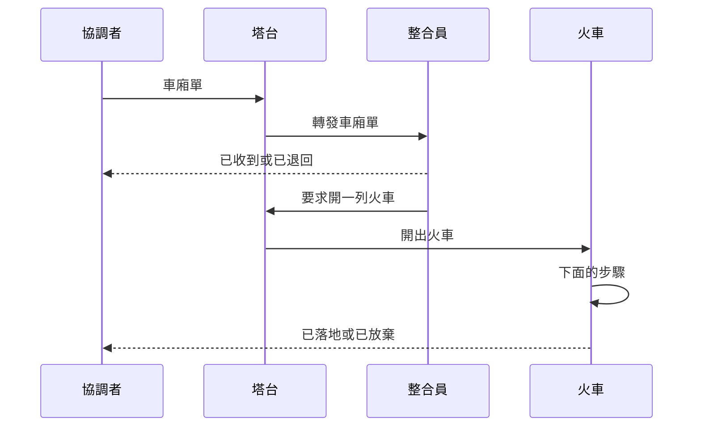
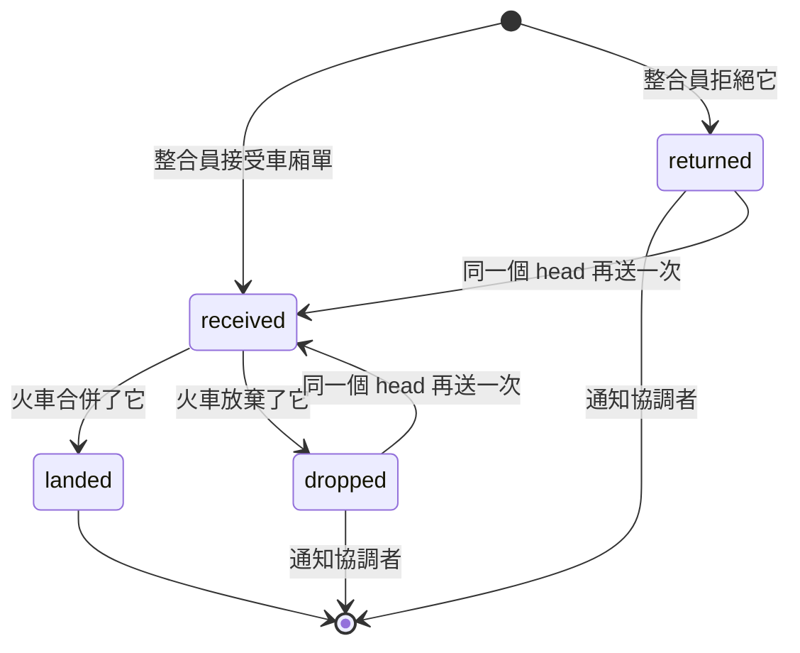

專案可以為每個 app 設一條合併火車。
不再由每位協調者合併自己的分支，而是由一位**整合員**主智慧體把協調者的分支當成**車廂**，組成**火車**。
每列火車把它的車廂合併在一起，讓合併後的結果只審查一次，並只跑一次重型關卡（lint、建置、完整測試）。
app 列出部署階段時，火車會接著部署。

這是選用的，依 app 設定，寫在專案的 `apps.json`。
沒有 `integration` 欄位的 app 維持舊的流程。

## 誰做什麼

| 誰 | 做什麼 |
| --- | --- |
| **協調者**（主智慧體） | 審查自己的分支（沒有 P0 或 P1 發現），跑它這次變更的行為測試與專案 skill 的輕量檢查，跑 app 要求的驗收（經你點頭），然後用 `call_tower` 的 `why: shared` 送出**車廂單**。 |
| **塔台** | 把車廂單轉給專案唯一的整合員（沒有在跑就開一個），並在整合員要求時開出每列火車。 |
| **整合員**（`integ <project>`） | 接收或退回每節車廂、組成火車，並請塔台開出它們。它不監督火車。 |
| **火車**（`train 1106m`） | 為一列火車而開的獨立 session，做下面的步驟。它從不等人。 |

火車做完這些步驟就結束：

1. 在 worktree 裡把車廂組裝到最新的 base 上。
2. 請一位全新的審查者讀組裝結果。
3. 跑完整的關卡。
4. 合併，並監看 pipeline。
5. 在它的階段有寫的地方部署並驗證。
6. 失敗時回滾或回報。

車廂有四個狀態，sb server 會為每一個發通知給協調者：

被退回或被放棄的車廂，如果協調者把車廂單改好、用同一個 head 再送一次，會像新車廂一樣被接收或退回。已經落地的車廂不會再被接收：一節車廂只落地一次，再送一次的協調者會被告知它已經在 base 上。

整合員：

- 一個專案在整台電腦上只有一位整合員。它的專案是 `apps.json` 最上層的 `integration.project`，沒有就用 repository 的資料夾名稱；你的整合員若已經用別的名稱在跑，就設定這個欄位。
- 你已經用自己的名稱在跑的整合員（例如 `integ FE2` 與 `integ v3`）會留著：塔台不會在它們旁邊再開一個，而是把每張車廂單轉發給跑那個 app 火車的那一個。
- 在共用的機器上，為隊友的裝置開的主智慧體用同樣的方式送出車廂單。

## 你要設定什麼

- **`apps.json`**：頂層的 `integration`（`skill`、`maxCars` 4、`maxWaitMin` 60、`maxTrains` 3），以及每個 app 的 `integration`（`base`、`skill`、`stages`、`accept`、`targets`）。[`prompts/apps-config.md`](https://github.com/wayne930242/pi-straw-boss/blob/main/prompts/apps-config.md) 說明每個欄位。
- **階段。** `merge` 一定有，之後可選 `deploy`。`auto` 目標憑設定裡的長期指示接受每列火車；`strict` 目標（預設）只在每張車廂單都帶著你對它的授權時才接受火車。
- **專案 skill。** 每項具體檢查都在那裡，放在 pi-anchorloop 的 Project skill contract 的標題底下：`## Light checks`、`## Train assembly`、`## Full gates`、`## Merge`、`## Post-merge`，以及視需要的 `## Deploy`、`## Deploy verify` 與 `## Acceptance`。Straw Boss 設定流程，不指名任何環境。

程序就是 pi-anchorloop 的 `integrating` 與 `deploying` skill（2.11.0 或更新版本）；Straw Boss 把那些 skill 留白的地方補上。

## 在一台電腦上關掉它

在 `herdr server` 與它的 session 的環境裡設 `STRAW_BOSS_INTEGRATION=off`，或在[設定](/pi-straw-boss/docs/zh-tw/reference/configuration/)裡設 `"integration": "off"`。
這樣就沒有主智慧體或塔台會擔任整合員，合併或部署要等你開口，`apps.json` 裡的 `integration` 也會被忽略。

## 指令

`node dist/server/cli.mjs train status` 列出每列火車、它的步驟、等待、鎖與車廂。
`train check` 在車廂單送出前驗證它與它的驗收證據，`train clear` 釋放 session 已不在的火車仍持有的東西。

規則見[合併火車](/pi-straw-boss/docs/zh-tw/reference/how-it-works/how-it-works/#合併火車)。
