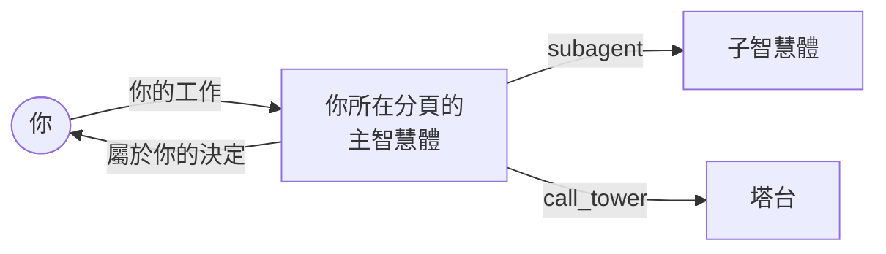

## 你怎麼使用它

**你只和自己所在分頁的主智慧體說話，不和其他任何人說話。**
主智慧體是你的入口：它規劃工作、派出子智慧體、檢查它們的結果、替你和塔台溝通，只有屬於你的決定（例如合併或部署）才回來找你。

- **一件工作，一個分頁。** 要開始一件新工作，就開一個新的 Herdr 分頁，在裡面啟動 pi，像交給任何 pi 一樣把工作交給它。工作變多時（好幾個步驟、要派子智慧體，或涉及不只一個 app），這個 pi 會自己成為該分頁的主智慧體；在它裡面輸入 `/boss`，可以讓它立刻成為主智慧體。
- **你不需要和塔台說話。** 塔台協調一個工作區裡的各個主智慧體，從不問你任何事；少數時候你想告訴它什麼，可以用 `/boss tower <prompt>`。主智慧體卡在只有你能做的決定時，問題會出現在該主智慧體的分頁裡，或成為[瀏覽器檢視](/pi-straw-boss/docs/zh-tw/guide/browser-view/)裡的一張等待卡。
- **不用理會子智慧體與成員。** 派出子智慧體的主智慧體替它發言，並把它的結果回報給你。直接寫給子智慧體，等於繞過了負責檢查它工作的主智慧體。
- **在你所在的地方回答。** 智慧體正在等的問題，會出現在它自己的分頁、`/boss gui` 與 `/boss answer` 裡。在其中一處回答即可，其他地方會跟著消失。

[主塔台](/pi-straw-boss/docs/zh-tw/guide/head-tower/)是另一個入口，而且是選用的：一段長對話，把每項指示交給負責的工作區，適合你同時處理好幾個專案，或要去睡覺的時候（[自動模式](/pi-straw-boss/docs/zh-tw/guide/auto-mode/)）。
畫面上每個圖示代表什麼，見[圖示](/pi-straw-boss/docs/zh-tw/guide/icons/)。

## 四個步驟看網運作

1. **在 Herdr 分頁裡開 pi，並交給它工作。** 它會自己加入網。工作變多時，它會自己升任為該分頁的主智慧體，同時開出該工作區的塔台。輸入 `/boss` 可以由你讓它成為該分頁的主智慧體。
2. **輸入 `/boss status`**，查看每個分頁的主智慧體與各座塔台。
3. **輸入 `/boss tower`**，開啟該工作區的塔台並查看它的儀表板。智慧體開始互相衝突時，它也會自己開。你不需要對它說話。
4. **在任何 session 輸入 `/boss gui`**，在瀏覽器裡看整張網。

## 塔台自己運作

sb server 的塔台服務預設是開的：它為事件醒來，並保管一份小小的記憶，所以你不必對它說話。
`/boss tower <prompt>` 會寫給它，`/boss memory` 會顯示它的記憶，在[設定](/pi-straw-boss/docs/zh-tw/reference/configuration/)裡設定 `towerModel` 可以給它較輕量的模型。
run 怎麼運作、交接筆記是什麼，見[塔台怎麼運作](/pi-straw-boss/docs/zh-tw/guide/concepts/#塔台怎麼運作)。

## 下一步

- [概念](/pi-straw-boss/docs/zh-tw/guide/concepts/)：誰是成員、主智慧體、塔台與主塔台，以及每一種智慧體與 run。
- [圖示](/pi-straw-boss/docs/zh-tw/guide/icons/)：哪個圖示與側邊欄標記代表哪個角色與種類。
- [瀏覽器檢視](/pi-straw-boss/docs/zh-tw/guide/browser-view/)：地圖、通訊畫面、警示與禪檢視。
- [指令](/pi-straw-boss/docs/zh-tw/reference/commands/)：每個工具與 `/boss` 指令。
